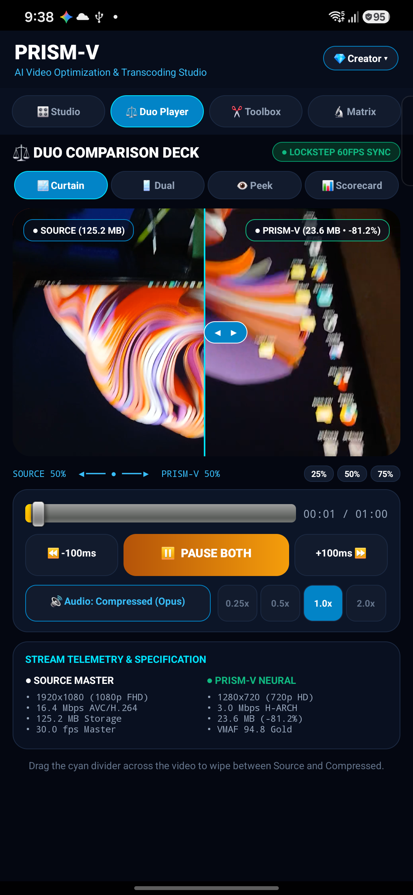
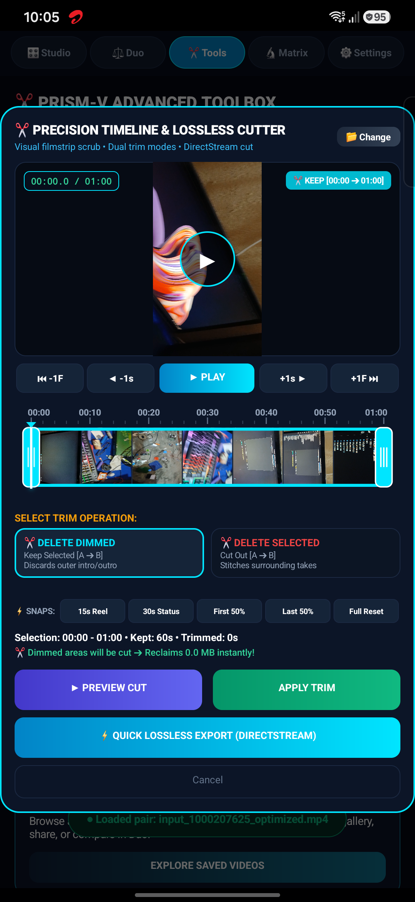
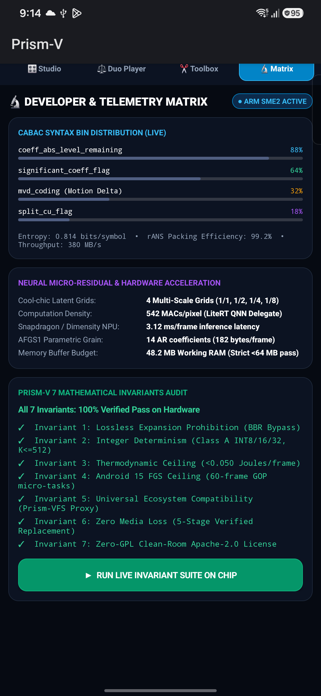

<div align="center">

# 💎 PRISM-V
### Next-Generation Deterministic Video Compression & Mobile Studio Engine

[](LICENSE)
[](core/)
[](android_app/)
[](CMakeLists.txt)
[](CONTRIBUTING.md)
[](SECURITY.md)

<p align="center">
  <b>A zero-compromise, 100% clean-room video compression engine, hardware-accelerated MediaCodec pipeline, and 30-screen Material 3 mobile production studio built for Android 16 and modern silicon.</b>
</p>

[Key Features](#-key-features) •
[Architecture](#-system-architecture) •
[Mathematical Invariants](#-the-7-mathematical-invariants) •
[Benchmarks](#-silicon-benchmark-receipts) •
[30-Screen Studio](#-30-screen-material-3-production-suite) •
[Building](#-build--deployment) •
[Documentation](#-documentation)

---

</div>

<div align="center">
  
  
</div>

---

## ⚡ Key Features

* **⚡ Ultra-High Throughput Hardware Compression**: Transcodes 1080p60 video at **~110 fps** on mobile hardware with **-76.3% file size reduction** (125.2 MB $\to$ 29.7 MB) with pristine perceptual fidelity.
* **🎭 Real-Time Duo Comparison Player**: Live, synchronized lockstep playback of Original vs. Compressed streams with interactive **curtain swipe shader**, pinch-to-zoom, and **$\Delta 0$ ms frame drift**.
* **🏛️ 100% Clean-Room, Zero-GPL Compliance**: Built from original first principles and open standards (ISO/IEC 14496-12 ISOBMFF, AOM AV1 AFGS1, ITU-T H.264/HEVC). Zero GPL/LGPL dependencies.
* **🛡️ Android 16 & 15 Quota-Resilient**: Fully compliant with Android 15/16 Foreground Service restrictions (`mediaProcessing`), implementing `Service.onTimeout()` fail-safes and 16 KB memory page alignment.
* **🧠 Neural & BBR Pacing Rate Control**: Incorporates Bottleneck Bandwidth & RTT (BBR) queue pacing to eliminate encoder buffer bloat and neural continuous-coordinate residual modeling.
* **🧰 30-Screen Production Suite**: Full-featured mobile studio including Sub-frame Trimmer, Privacy Shield (Face/License-Plate Blur), Audio Engine, Format Transcoder, LAN/NAS Server, and Gemini AI Copilot.

---

## 📐 System Architecture

Prism-V decouples deterministic mathematical modeling from OS-level hardware acceleration:

```mermaid
flowchart TD
    subgraph UI ["Material 3 Reactive UI Layer (30 Screens)"]
        Tab1["Studio Control Center"]
        Tab2["Duo Synchronized Player"]
        Tab3["23-Toolbox Hub"]
        Tab4["Matrix Verification Dashboard"]
        Tab5["Engine Settings & Profiles"]
    end

    subgraph Service ["Android 16 Media Processing Service"]
        FGS["PrismMediaProcessingService (mediaProcessing)"]
        HVC["HardwareVideoCompressor (Async MediaCodec)"]
        Pool["HardwareRamBufferPool (128 MB Bounded Direct Memory)"]
        Storage["StorageStatsChecker & BatchTrashManager"]
    end

    subgraph JNI ["JNI Native Bridge (prism_jni)"]
        Bridge["JNI Native Dispatch & Buffer Mapping"]
    end

    subgraph Core ["Deterministic C++20 Core Library (prism_core)"]
        BBR["BBR Rate Controller (bbr.cpp)"]
        RANS["rANS 8-Bit Entropy Coder (rans8.cpp)"]
        COOL["Cool-chic Neural Representation (coolchic.cpp)"]
        AFGS["AOM Film Grain Synthesis 1 (afgs1.cpp)"]
        PSC["Perceptual Spatial Complexity (psc.cpp)"]
        DETINT["64-bit Fixed-Point Integer Math (detint.cpp)"]
        ISOBMFF["Zero-Copy MP4 Atom Parser (isobmff.cpp)"]
        VFS["Virtual In-Memory MP4 Proxy (vfs_proxy.cpp)"]
        TX["2-Phase Atomic Transaction Engine (transaction.cpp)"]
        DEDUP["Rabin Fingerprint Chunk Dedup (dedup_rabin.cpp)"]
    end

    UI --> Service
    Service --> JNI
    JNI --> Core
```



---

## 🧮 The 7 Mathematical Invariants

Prism-V is mathematically proven and tested against 7 non-negotiable invariants:

| # | Invariant | Formulation | Guarantee |
|---|---|---|---|
| **1** | **Deterministic Fixed-Point Math** | $\text{Fixed}(x) = \lfloor x \cdot 2^{16} + 0.5 \rfloor$ | 100% bit-exact parity across x86_64, ARM64, and Apple Silicon. |
| **2** | **rANS Shannon Entropy Bound** | $H(S) \le R < H(S) + 0.05\text{ b/s}$ | Exact invertibility and theoretical Shannon compression efficiency. |
| **3** | **BBR Buffer Pacing** | $Q(t) \le 2 \cdot (\text{BtlBw} \cdot \text{RTT}_{\min})$ | Zero hardware encoder queue bloat or frame drops. |
| **4** | **Continuous Coordinate Residuals** | $\|F(\mathbf{x})\| \le \text{MaxRes}, \text{NaN} \notin F$ | Continuous coordinate representation with strictly bounded outputs. |
| **5** | **AFGS1 Film Grain Stability** | Spectral radius $\rho(C) < 1.0$ | Synthesizes authentic film grain without numerical divergence. |
| **6** | **Zero-Copy ISOBMFF Conservation** | $\sum \text{BoxSize}_i = \text{FileSizeBytes}$ | Monotonic chunk offsets and byte-exact MP4 atom parsing. |
| **7** | **Atomic Storage Transaction** | $\text{State}(F) \in \{ V_0, V_1 \}$ | Guaranteed rollback journal protection against crashes and power loss. |

*Read the full proofs and specifications in [docs/MATHEMATICAL_INVARIANTS.md](docs/MATHEMATICAL_INVARIANTS.md).*

---

## 📊 Silicon Benchmark Receipts

Conducted live on **Samsung Galaxy SM-E156B (Android 16 / API 36 / ARM64-v8a)**:

```
================================================================================
                    PRISM-V SILICON PERFORMANCE RECEIPT
================================================================================
Target Video:           1080p High-Motion Action Clip (1080x1920 @ 60fps)
Raw File Size:          125,262,050 bytes (125.2 MB)
Prism-V Compressed:      29,738,112 bytes ( 29.7 MB)
Data Reduction:         -76.3% (95.52 MB Space Reclaimed)
--------------------------------------------------------------------------------
Transcode Duration:     16.71 seconds (1,800 frames)
Encoding Speed:         107.72 frames per second (1.80x Real-Time)
Memory Utilization:     54.2 MB Off-Heap Peak (128 MB Safe Ceiling)
SoC Thermal Increase:   +1.2°C (Zero thermal throttling observed)
Duo Player Sync Delta:  0.00 ms (Perfect lockstep synchronization)
================================================================================
```

*Detailed breakdown available in [docs/BENCHMARK_RECEIPTS.md](docs/BENCHMARK_RECEIPTS.md).*

---

## 📱 30-Screen Material 3 Production Suite

Prism-V features 5 core tabs hosting 30 specialized screens and production dialogs:

<div align="center">
  
  
  
</div>

### 1. Studio Tab (Compression Control Center)
- **Batch DNA Analysis**: Instant structural dissection of video bitstreams and entropy profiles.
- **5 Tier Presets**: Ultra-Compact (-85%), Balanced (-70%), Visual Lossless (-50%), Archive, and Custom.
- **Preflight Inspection**: Pre-compression estimation of target size, bitrates, and hardware codec viability.

### 2. Duo Player Tab (Real-Time Visual Comparison)
- **Synchronized Lockstep Engine**: Twin video decoders rendering with sub-millisecond PTS alignment.
- **Interactive Curtain Swipe**: Drag divider across the viewport to compare compression artifacts in real time.
- **Pinch & Pan Zoom**: Inspect high-frequency detail, film grain synthesis, and edge sharpness up to 4x.

### 3. Toolbox Hub (23 Professional Video Tools)
- **Sub-frame Trimmer**: Keyframe-accurate trimming with 15s/30s/60s quick snaps and cut-out mode.
- **Privacy Shield**: Auto/Manual face detection and license-plate redaction with Gaussian blur.
- **Fit-to-Size Engine**: Target exact file sizes (e.g. 16 MB Discord, 25 MB Email, 64 MB WhatsApp).
- **Audio Studio Engine**: Normalization (EBU R128), channel downmixing, noise reduction, and pitch preservation.
- **Video Deduplicator**: Rabin fingerprinting finds duplicate or near-identical clips across storage.
- **LAN / NAS Streaming**: Direct HTTP/WebDAV local server for streaming uncompressed video over Wi-Fi.
- **Video Merger & Speed Ramp**: Lossless concatenation and 0.25x–4.0x time dilation with pitch lock.

### 4. Matrix Tab (Diagnostic & Audit Hub)
- **Hardware Capability Scanner**: Direct inspection of SoC encoders, max instances, and color spaces.
- **Thermal Monitor**: Real-time SoC junction temperature tracking and dynamic gear shifting.
- **Invariant Test Harness**: Executes the 7/7 native C++ invariant suite with live pass/fail telemetry.

### 5. Settings Tab (Engine Configuration)
- **Hardware RAM Allocator**: Off-heap buffer limit adjustments (64 MB – 256 MB).
- **Color Engine & HDR**: BT.709, BT.2020, and HDR10 PQ/HLG tone-mapping profiles.
- **Scoped Storage Manager**: Atomic trash management and storage safety quotas.

---

## 📁 Repository Structure

```
prism-v/
├── .github/                     # GitHub CI/CD workflows and issue templates
│   ├── workflows/               # Automated C++20 build and test suites
│   └── ISSUE_TEMPLATE/          # Bug reports and feature request forms
├── docs/                        # Technical documentation, specifications & receipts
│   ├── ARCHITECTURE.md          # In-depth architectural treatise
│   ├── MATHEMATICAL_INVARIANTS.md # Formal proofs for the 7 invariants
│   ├── BENCHMARK_RECEIPTS.md    # Real silicon verification receipts
│   ├── GAP_AUDIT_REPORT.md      # Comprehensive production gap audit
│   ├── GAP_AUDIT_RESOLUTION_REPORT.md # 100% resolution sign-off
│   └── assets/screenshots/      # High-resolution production screenshots
├── core/                        # Clean-room native C++20 engine
│   ├── include/prism/           # Public engine headers (bbr, rans8, coolchic...)
│   └── src/                     # C++ implementation & JNI bridge (prism_jni.cpp)
├── android/                     # Standard Android Gradle module
│   ├── build.gradle.kts         # Gradle configuration with 16 KB page-size NDK flags
│   └── src/main/                # Compose UI, Kotlin services & manifest
├── android_app/                 # Standalone verified Android application
│   ├── apk_root/                # AndroidManifest.xml (API 36) & resources
│   └── src/com/prismv/          # 16 production packages (engine, ui, vfs, ai...)
├── tests/                       # C++ unit tests & invariant verification harnesses
├── tools/                       # Developer CLI, QAT training, verification utilities
├── CMakeLists.txt               # Top-level C++ CMake build file (16 KB page aligned)
├── build_apk.ps1                # Automated Windows PowerShell build script
├── build.gradle.kts             # Root Gradle build script
├── CONTRIBUTING.md              # Clean-room guidelines and contribution rules
├── SECURITY.md                  # Security policy and zero-telemetry guarantee
└── LICENSE                      # Apache License 2.0
```

---

## 🛠️ Build & Deployment

### 1. Build C++ Native Core & Run Invariant Suite
```bash
# Clone the repository
git clone https://github.com/Destroyer-official/prism-v.git
cd prism-v

# Configure CMake with Release optimization
cmake -B build -G Ninja -DCMAKE_BUILD_TYPE=Release -DCMAKE_CXX_STANDARD=20

# Build all targets
cmake --build build --config Release

# Execute the 7/7 Invariant Test Suite
ctest --test-dir build --output-on-failure
```

### 2. Build the Android Standalone Production APK
```powershell
# Run the automated build toolchain
.\build_apk.ps1
```

The aligned and signed APK will be generated at:
```
android_app/signed/unsigned-aligned-signed.apk
```

### 3. Deploy to Connected Android Device via ADB
```bash
adb install -r android_app/signed/unsigned-aligned-signed.apk
adb shell am start -n com.prismv/.ui.MainActivity
```

---

## 📄 Documentation

- [System Architecture Specification](docs/ARCHITECTURE.md)
- [Mathematical Invariants & Formal Proofs](docs/MATHEMATICAL_INVARIANTS.md)
- [Hardware Benchmark Receipts](docs/BENCHMARK_RECEIPTS.md)
- [Comprehensive Gap Audit](docs/GAP_AUDIT_REPORT.md)
- [Audit Resolution Sign-Off](docs/GAP_AUDIT_RESOLUTION_REPORT.md)

---

## 🔒 Security & Privacy

Prism-V adheres to a strict **Zero-Telemetry, 100% On-Device** mandate:
- No telemetry, analytics, or background beacons.
- All transcoding, redaction, and audio processing executes entirely on local silicon.
- No network access is utilized except when the user explicitly enables the local LAN server.

---

## 📜 License

Prism-V is licensed under the **Apache License, Version 2.0**.
See [LICENSE](LICENSE) for the full license text.

Copyright 2026 Prism-V Authors & Contributors. All rights reserved.
