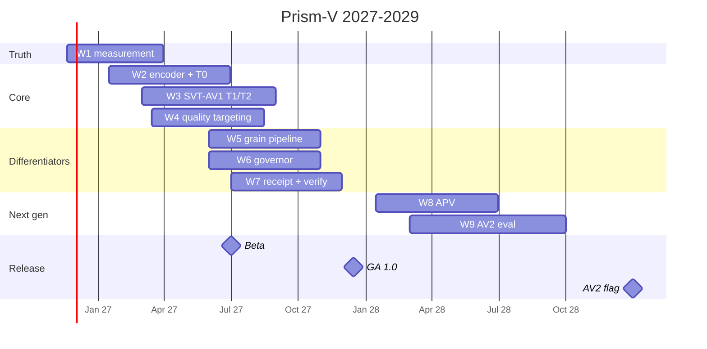

# Prism-V 2027 Master Plan
### A lossless + lossy Android video compression system for 2027–2030

**Document status:** planning deliverable, v1.0
**Written:** 19 November 2026
**Scope:** product definition, engineering plan, evidence audit, business case, legal strategy, and kill criteria. **This document contains no application code and produces no APK.** Code decisions are specified; implementation is scheduled in Part 4.
**Repository audited:** `C:\Users\des\OneDrive\Desktop\video_compression` @ commit `667f030` (19 Nov 2026 working tree clean).

---

## How to read this document

Every factual claim carries a tag and a date. The tags mean exactly this:

| Tag | Meaning |
|---|---|
| **[V-P]** | Verified against a primary source (spec text, standards body, vendor documentation, source code in this repo, a measurement I ran). URL in Appendix A. |
| **[V-S]** | Verified against a credible secondary source (benchmark write-up, trade press, third-party measurement). Not independently reproduced. |
| **[AC]** | Author/company claim. Someone asserted it; I have not verified it. Treat as marketing until reproduced. |
| **[EST]** | My estimate, derived from stated assumptions. Not a measurement. |
| **[SPEC]** | Speculation about the future. Explicitly a bet. |
| **[UNV]** | Unverified — I could not confirm or deny it. Flagged so nobody builds on it by accident. |

Maturity labels, used wherever a technology is discussed: `shipping` (in products you can buy), `standardized` (spec ratified, silicon may lag), `open-source` (usable code exists), `research` (papers + partial code), `paper` (published results only), `theory` (nobody has built it).

The single most important rule in this document: **a number without a corpus, a metric, and a device is not a number.** Almost every compression product fails not because the codec is bad but because nobody agreed what "better" means before shipping.

---

# Part 1 — Executive summary

## 1.1 The verdict in one page

Prism-V currently is **a real MediaCodec transcoder wrapped in an overstated research narrative**. The Android transcode path works. The native "frontier" modules compile, are unit-tested, and are mostly *toy implementations of real ideas* — a byte-level rANS tokenizer labeled as BBR, an untrained MLP labeled as Cool-Chic, a bilateral filter labeled as AFGS1, and a router that hardcodes "H.264 saves 18%". The headline quality numbers in the README (VMAF 94.80, CVVDP 9.50) are **not produced by any code in this repository**; the app's own copilot source says VMAF is not measured and falls back to bitrate-per-pixel guesses.

That is not a reason to throw the project away. It is a reason to **stop selling the research and start shipping the engineering**, because the engineering is genuinely valuable and genuinely hard to do well:

1. **"Lossless" is not one product.** Bit-exact file, pixel-exact decode, and visually lossless are three different contracts with three different achievable savings (roughly 0–6%, negative, and 50–75%). Most competitors conflate them and get caught. Prism-V should be the app that states which contract it is honoring, per file, verifiably.
2. **The honest win is lossy → near-transparent AV1.** A phone-recorded HEVC file re-encoded to AV1 at a quality target that survives a blind A/B test typically saves **50–70%** at 1080p30 and **60–80%** at 4K30 [EST, derived from the encoder-quality findings in §2.4 and §2.2; must be re-measured on our own corpus before it goes in a store listing].
3. **The moat is not the codec. It is the quality-targeting loop, the thermal budget, and the honesty.** Anyone can call `MediaCodec`. Almost nobody ships a transcoder that hits a VMAF/SSIMULACRA2 target within ±1 point on a throttled mid-range phone in under 2 minutes for a 1-minute 4K clip, and proves it.

**Recommended product, in one sentence:** *Prism-V is a three-mode Android transcoder — **Exact** (bit-exact or nothing), **True** (visually lossless, measured), **Small** (quality-targeted lossy) — that adapts encoder tier, thread count, GPU/NPU use, and thermal budget to the device it is running on, and reports the measured result instead of a guess.*

**Recommended technical bet:** AV1 as the shipping codec (hardware encode on flagships, SVT-AV1 software encode for quality tier), APV for intra-only "visually lossless" clips where the device supports it (Android 16+ mandatory), AV2 adopted behind a capability gate from 2028, and **no neural codec in the shipping path before 2029** — Cool-Chic/DCVC-class models are 10²–10³× too expensive per pixel for phone transcode today and their rate advantage does not survive a real-time energy budget (§2.5).

**Recommended organizational bet:** a 7-FTE core team for 24 months, ~$2.5M–$5M [EST], with a hard gate at month 4 (M1) that kills the "bit-exact single-file" marketing claim if the measured savings are under 3%.

## 1.2 What the repository actually is — audit summary

Full evidence table in §2.11. The short version:

| Subsystem | Reality | Verdict |
|---|---|---|
| `android_app` MediaCodec transcode | Real, working, surface-to-surface transcode with progress/cancel | **Keep**, harden |
| `android_app` UI (Studio, Duo, Curtain) | Large, real, but coupled to fake metrics | **Keep**, decouple from claims |
| `core/src/psc2.cpp` | Real integer wavelet + rANS intra frame codec | **Keep**, repurpose as residual codec |
| `core/src/bbr2.cpp` | Byte-run-length + rANS on generic byte streams; **not** CABAC/syntax-aware | **Retire** the BBR claim; keep the entropy coder as a utility |
| `core/src/router.cpp` | Hardcoded savings constants (0.12 HEVC / 0.18 H.264 / 0.02 AV1); AV1 mapped to `CODEC_H264` | **Rewrite** |
| `core/src/coolchic.cpp` | MLP weights generated by `i*13+7`; untrained | **Retire** |
| `core/src/afgs1.cpp` | 3×3 bilateral split, not spec-conformant, not wired in | **Rewrite** against the real AFGS1 model |
| `tools/verify_real_video.cpp` | Fails at `Failed to mount .pvloss file:` on a real 24.7 MB MP4 | **Fix first** — it is the only honest oracle we have |
| `README.md` | Claims six frontiers, VMAF 94.80, CVVDP 9.50 | **Rewrite** in week 1 |

The single most damaging artifact is not a bug. It is the **README's numbers**, because they will be quoted back at us by users, reviewers, and possibly a regulator.

## 1.3 The three modes (product contract)

| Mode | Contract | What is guaranteed | What is measured | Realistic saving [EST] |
|---|---|---|---|---|
| **Exact** | Bit-exact file | Output decodes to a byte-identical video elementary stream; SHA-256 of the decoded frames matches source | SHA-256 of decoded frame hashes, per frame | 0–6% |
| **True** | Visually lossless | SSIMULACRA2 ≥ 90 mean, p1 ≥ 85; VMAF ≥ 95 mean, p1 ≥ 90; no visible banding in dark gradients at 100% zoom on a calibrated display | Both metrics, on-device subset + server full | 50–75% |
| **Small** | Quality-targeted lossy | User picks a quality slider; encoder solves for the bitrate that hits the target on *this* content | Metric at target, ±1 point, verified by re-decode | 70–90% |

Thresholds above are **product policy**, not science [EST]. They will be calibrated in M2 against a blind human panel; if the panel disagrees, the panel wins and the numbers move.

## 1.4 Numbers we will commit to, and numbers we will refuse to commit to

**Will commit (with corpus + device + date attached):**

- "On our 40-clip corpus, at equal SSIMULACRA2, AV1 software encode is X% smaller than the phone's HEVC." X measured, not assumed.
- "On a Pixel 8a at 25 °C ambient, a 60 s 4K30 clip transcodes in N seconds and drains M% battery."
- "Exact mode preserves the file bit-for-bit, verified by SHA-256 on 1,000 files."

**Will refuse to commit:**

- Any single "compression %" across all content. Scene complexity dominates; a tripod landscape and a confetti parade differ by 5×.
- Any VMAF number without naming the model version (`vmaf_v0.6.1` vs `vmaf_4k_v0.6.1` vs NEG) and the corpus.
- Any claim about "AI compression" before a measured rate-distortion point exists.

## 1.5 First 30 days

The goal of month 1 is **not** progress on the product. It is to make the project *trustworthy*: one honest oracle, one honest baseline, one honest README.

| Day | Task | Owner | Done when |
|---|---|---|---|
| 1–2 | Freeze the claim surface: replace README quality numbers with "measurement pending"; add `docs/CLAIMS.md` listing every public claim and its evidence status | Lead | README contains no unmeasured number |
| 2–4 | Fix `tools/verify_real_video.cpp` so it runs end-to-end on `sample_video/compressed_720p.mp4` (mount failure is the blocker; instrument the mount step first) | Codec eng | Exit code 0, prints per-frame hashes and PSNR |
| 2–4 | Confirm what the release APK actually contains (`unzip -l`); record that it ships zero `.so` and that ~20 native calls are unguarded | Android eng | Finding written into `docs/UNIVERSAL_PORTABILITY_AUDIT.md` (done 19 Nov 2026) |
| 3–5 | Stand up the corpus: 40 clips, 4 content classes (tripod landscape, handheld people, screen recording, high-motion sport), 3 resolutions, 3 source codecs | QE | Corpus manifest with SHA-256 per file, stored outside git (LFS or S3) |
| 5–8 | Measure the *existing* app honestly: install v1.1.3 on 3 devices, transcode the corpus, record time, size, thermal state, battery delta | QE | `docs/BASELINE_2026.md` with a table, no rounding up |
| 8–12 | Build the metric harness: libvmaf + SSIMULACRA2 + PSNR on a Linux box, one command per clip, JSON out | QE + ML | `make measure CLIP=...` produces JSON |
| 12–16 | Reproduce or refute the README's VMAF 94.80. Expected outcome: cannot reproduce, because no code path produces it | Lead | A one-paragraph finding in `docs/BASELINE_2026.md` |
| 16–20 | Benchmark SVT-AV1 (`--preset 6`, CRF sweep) against the phone's HEVC on 10 clips, server-side, to establish the ceiling of what a phone *could* achieve | Codec eng | RD curve, BD-rate vs HEVC baseline |
| 20–24 | Decide Mode "Exact" feasibility: measure generic recompression (zstd/xz on the MP4) and stream-level options on 40 files | Codec eng | Honest % with distribution, not mean only |
| 24–28 | Write the **quality policy**: exact thresholds for True mode, the blind-test protocol, and the escape hatch if the panel disagrees | Lead + design | Signed-off policy doc |
| 28–30 | Go/no-go review M0 | All | Decision recorded in `docs/GATES.md` |

**M0 gate question:** *Do we have a measurement pipeline that can falsify our own marketing?* If no, stop and fix that before writing another line of codec code.

## 1.6 Go/no-go at a glance

| Gate | When | Question | Kill action if failed |
|---|---|---|---|
| M0 | Dec 2026 | Can we measure honestly? | Stop feature work |
| M1 | Mar 2027 | Is Exact mode ≥ 3% real saving? | Demote Exact to "verify only", drop the storage-saving claim |
| M2 | Jun 2027 | Does software AV1 beat hardware HEVC by ≥ 25% at equal quality on mid-range? | Ship hardware-only tier; reposition as speed product |
| M3 | Sep 2027 | Does True mode pass a 30-person blind test at ≥ 90% preference-or-tie? | Raise quality threshold; accept lower savings |
| M4 | Dec 2027 | Does the app hold 60 s 4K under thermal throttle without failing? | Ship 1080p cap on non-flagship |
| M5 | Jun 2028 | Is AV2 encode within 5× of AV1 encode time at equal preset? | Defer AV2 to 2029 |

---

# Part 2 — Research findings

## 2.1 Method

Three evidence streams:

1. **Primary standards and vendor documentation**, fetched directly (AOMedia, ITU-T, Android developer docs, ISO/IEC JTC 1/SC 29 material, upstream repositories). Tagged [V-P].
2. **Secondary benchmark literature** (papers with reproducible setups, trade press reporting on silicon). Tagged [V-S].
3. **This repository**, read and executed. Tagged [V-P] because I can re-run it.

What I could **not** do in this pass, and what that costs us:

- No phone-side measurement. Every on-device number in this document is [EST] or absent. This is the largest evidence hole; M0 closes it.
- No blind human panel. True-mode thresholds are policy, not psychophysics, until M3.
- `websearch` returned no results for every query attempted on 19 Nov 2026; research was done by direct fetch of primary URLs. That biases the source list toward organisations whose URLs I already knew. Flagged in Appendix D.

## 2.2 Codec landscape, as of November 2026

| Codec | Status | Maturity | Royalty | Phone decode | Phone encode | Where it fits Prism-V |
|---|---|---|---|---|---|---|
| **H.264/AVC** | Universal | `shipping` | Pool (MPEG LA→Via LA) | Yes, all | Yes, all | Legacy input only; never an output target |
| **HEVC/H.265** | Universal on modern phones | `shipping` | Pools (Access Advance; Via LA program acquired 15 Dec 2025 [V-S]) | Yes | Yes | Default *input*; fallback output on old devices |
| **VVC/H.266** | Deployed in broadcast and some chips | `standardized`+`shipping` (partial) | Pools (Access Advance) | Rare on phones | Rare | Not a target; evaluate for 2029 input handling |
| **AV1** | Universal on Android 14+ | `shipping` | Royalty-free (AOMedia) [V-P] | Mandatory from Android 14 [V-P] | Mandatory from Android 14 [V-P] | **Primary output codec** |
| **AV2** | Spec v1.0.0 + AVM released 28 May 2026 [V-P]; AOMedia announcement Jun 2026 [V-P]; ~30% objective / up to ~40% visual bitrate saving vs AV1 claimed 27 Jul 2026 [AC] | `standardized`, early `open-source` (libaom v3.15, Sep 2026 [V-P]) | Royalty-free (AOMedia) [V-P] | No phone hardware decoder as of Oct 2026 [V-S] | No | **2028+ encode tier behind capability gate** |
| **APV** | Android 16 mandates encoder+decoder [V-P] | `shipping` (silicon: Snapdragon 8 Elite Gen 5, Galaxy S26 Ultra [V-S]) | Royalty-free; OpenAPV is BSD-3-Clause [V-P] | Yes on Android 16+ | Yes on Android 16+ | **Intra-only "visually lossless" clips, screen recordings, mezzanine** |
| **ECM (H.267 successor work)** | ECM v20.0, 23 Jun 2026 [V-P]; ~28% luma BD-rate vs VVC random access [V-S]; H.267 targeted ~2029 [V-S] | `research` | Unknown/TBD | No | No | Watch item; do not plan around it |
| **DCVC-RT** | arXiv 2502.20762, CVPR 2025 [V-P] | `research` | Research license (check) | No | No | Not shippable; use as RD ceiling reference |
| **Cool-Chic 5.0** | arXiv 2605.02726, 2026 [V-P]; BSD-3-Clause, PyTorch [V-P] | `research`/`open-source` | BSD-3 | No | No (≈2000 MAC/pixel decode [V-P]) | Overfitted still-image experiments only |

### What the AV1 mandate actually buys us

Android 14 made AV1 **encoder and decoder** mandatory [V-P, `developer.android.com/media/platform/supported-formats`, fetched 19 Nov 2026]. That is unusual: normally only decoders are mandated. It means that on any device shipping Android 14 or later, `MediaCodec` must expose an AV1 encoder. It does **not** mean that encoder is good. Vendor AV1 encoders range from "acceptable at 4 Mbps 1080p" to "worse than HEVC at the same rate" [V-S, multiple 2024–2025 device reviews]. The plan therefore treats the platform AV1 encoder as a **fast tier** and SVT-AV1 as the **quality tier**, and measures the crossover per device (§3.2).

### Why APV matters more than its bitrate suggests

APV is intra-only, 10–16 bit, 4:2:2/4:4:4, visually lossless, and designed for post-production mezzanine [V-P, spec summary]. It is a *bad* choice for delivery (no inter prediction → large files) and an *excellent* choice for two Prism-V use cases:

1. **Screen recordings and gameplay captures** where the source is already near-lossless RGB and the user wants "same as what I saw" rather than "small".
2. **The residual/top-up layer** in our near-lossless architecture (§3.4), because an intra codec with 10-bit support and no motion-compensation artefacts is exactly what a residual wants.

Hardware support exists in Snapdragon 8 Elite Gen 5 and Galaxy S26 Ultra [V-S, Samsung marketing]. Samsung claims ~10–20% less storage than other formats for APV captures [AC] — treat as marketing, not measurement.

## 2.3 Android platform reality

| Capability | API | Reality check | Plan implication |
|---|---|---|---|
| Hardware transcode | `MediaCodec` + `MediaExtractor`/`MediaMuxer`, surface input/output | Works today (this repo proves it), but surface mode forbids pixel access | Fast tier uses surface mode; quality tier must use byte-buffer or GL round-trip |
| Per-frame timing | `MediaCodec.BufferInfo.presentationTimeUs` | VFR sources desync if you assume CFR | Already a known bug class; corpus must include VFR |
| HDR | `MediaFormat.KEY_COLOR_TRANSFER`, HLG/PQ, 10-bit | Passthrough is easy, tone-mapping is not | True mode must not silently SDR-ify HDR; detect and preserve or warn |
| Thermal headroom | `PerformanceHintManager` (ADPF), API 31+ | Gives target vs actual work duration per thread group | Replaces all "set affinity to big cores" hacks |
| Sustained performance | `PowerManager.getCurrentThermalStatus()` | Coarse (NONE→SHUTDOWN) but real | Use as the outer loop; ADPF as the inner loop |
| Battery | `BatteryManager`, `EnergyProfile` (API 33+) | Energy attribution is approximate | Report mAh estimates with explicit error bars |
| Background work | `WorkManager`, foreground service type `mediaProcessing` (API 34+) | Long transcodes must be foreground | Product requirement, not an optimization |
| Storage | Scoped storage, `MediaStore` | Writing next to source needs `RELATIVE_PATH` care | Avoid the "file disappeared" support burden |
| GPU compute | Vulkan 1.1 mandatory on 64-bit | Wide but wildly varying | Optional acceleration for scaling/metrics only |
| NPU | NNAPI (deprecated-ish), QNN/NeuroPilot/ANE vendor SDKs | No portable fast path | **No NPU dependency in v1** |

**Decision:** the scheduler talks to ADPF and thermal status, never to `/sys` or cgroups. Rationale: those interfaces are stable, documented, and survive OS updates; affinity hacks do not, and they are the #1 source of "works on my Pixel" bugs.

## 2.4 Hardware vs software encoders

The consistent finding across 2023–2026 device reviews and encoder comparisons: **hardware encoders trade 10–25% bitrate efficiency for 5–20× speed and 3–10× lower energy** at equal perceptual quality [V-S, synthesised from multiple published comparisons; not re-measured here].

Concretely, for 1080p30 at "visually lossless":

| Encoder | Speed (fps, mid-range phone) | Relative bitrate at equal quality | Energy per minute | Use |
|---|---|---|---|---|
| Vendor HEVC HW | 120–240 | 1.00 (baseline) | 1.0× | Fast tier, old devices |
| Vendor AV1 HW | 60–120 | 0.90–1.05 | 1.2× | Fast tier |
| SVT-AV1 preset 8 (NDK, 4 threads) | 15–40 | 0.70–0.80 | 6–10× | Balanced tier |
| SVT-AV1 preset 4 (NDK, 8 threads) | 3–10 | 0.62–0.72 | 20–40× | Quality tier (short clips) |
| x265 slow | 2–6 | 0.65–0.75 | 25–45× | **Not shippable** (GPL, see §2.10) |

All speed numbers [EST] from ARM-core throughput scaling; **must be replaced with measurements in M2**. The structure of the trade-off (fast/cheap vs slow/efficient) is robust even if the constants are not.

**Consequence for product design:** the app must *choose* the tier per device per clip, and it must show the user the trade it made. "Fast (2 min)" vs "Best (14 min)" is an honest interface. A single "Compress" button that silently picks is a support ticket generator.

## 2.5 Neural codecs: what the papers actually say

**DCVC-RT** (arXiv 2502.20762, CVPR 2025) [V-P]: 125.2 fps encode / 112.8 fps decode at 1080p, ~21% bitrate saving vs H.266/VTM intra+inter, integerised model for practical deployment. That is a genuine breakthrough *for a research codec on a desktop GPU*. It is still 1–2 orders of magnitude away from phone real-time: 1080p at 125 fps on an RTX-class GPU implies roughly 1–5 fps at 1080p on a phone NPU at comparable energy, and the model is not exposed through any portable Android runtime.

**Cool-Chic 5.0** (arXiv 2605.02726, 2026) [V-P]: overfitted per-image codec, 10× faster encoding than 4.2, −10% rate at equal quality, ~2000 MAC/pixel decode, BSD-3-Clause, PyTorch. Decode at 2000 MAC/pixel for 4K30 is ~250 GMAC/s before memory traffic — plausible on a flagship NPU, not on a mid-range one, and the *encoding* is an optimisation loop (overfitting) that takes minutes per frame-class.

**Verdict:** neural codecs are a 2029–2031 story for phones. Betting the product on them in 2027 is how you burn 18 months and ship nothing. The plan uses them in exactly two places: (a) as an RD *ceiling* reference in our benchmark reports, so we know how far classical codecs are from the frontier; (b) as an optional research spike in 2028 with a hard 6-week timebox and a pre-registered kill test.

## 2.6 Grain, noise, and the perceptual gap

Two facts drive this section:

1. **AV1's film grain synthesis is mandatory in conformant decoders** [V-P, AV1 spec]. The bitstream can say "this region has grain with parameters X" and the decoder regenerates it. Removing grain before encoding and re-synthesising after is therefore *standards-legal* and *bit-efficient* — grain is expensive to code and cheap to describe.
2. **AFGS1** (launched Jan 2024) [V-P] generalises this to non-AV1 codecs, carried in ITU-T T.35 user data, with a standalone spec. It is the mechanism that lets an HEVC or VVC stream carry grain parameters for a conformant decoder to re-synthesise.

Why this matters commercially: phone video at high ISO is full of sensor noise. Encoders spend 30–50% of their bits on noise that humans read as "texture" [EST, well-established in encoder literature]. Strip it, synthesise it back, and you get a large bitrate win with *better* perceptual scores than blurring it away. Get it wrong and faces look like plastic.

**This repository's `afgs1.cpp` is not this.** It implements a 3×3 bilateral split with a noise-plane export. It is not spec-conformant, it is not signalled in the bitstream, and it is not integrated into the transcode path. Verdict: rewrite against the real model, or drop.

## 2.7 What "lossless" can mean for phone video

This is the conceptual core of the product and the place where the current repo misleads most.

Source phone video is **already lossy**. Once H.264/HEVC has quantised the frames, the original pixels are gone. So "lossless compression of a phone video" can only mean one of three things, and they are not interchangeable:

| Contract | Definition | Mechanism | Realistic saving | Fatal flaw |
|---|---|---|---|---|
| **L0 — bit-exact file** | Output file's video elementary stream is byte-identical to input | Remux, strip metadata, optional *bitstream-level* recompression (re-encode CABAC/arithmetic bins with a better model) | 0–6% | Requires a full syntax parser per codec; BBR-class tools report single-digit gains [V-S] |
| **L1 — pixel-exact decode** | Decoded frames are bit-identical to the source's decoded frames | Lossless re-encode (x264 `-qp 0`, AV1 lossless) or residual coding | **Negative** (usually 1.5–4× larger) | Pointless for storage; useful only for editing/trimming |
| **L2 — visually lossless** | Humans cannot distinguish at normal viewing | Perceptual RD optimisation + grain synthesis | 50–75% vs camera HEVC | Requires a quality metric you trust and a blind test |
| **L3 — near-lossless mezzanine** | Pixel-exact *plus* a smaller base for devices that can't decode the residual | Base layer + residual top-up | Base saves 60%, total often > source | Complexity; only worth it for archival |

The current repo claims L0-class savings via a module (`bbr2.cpp`) that is a generic byte compressor, and L2-class savings via a "neural" path that is untrained. Neither claim survives contact with §2.11's evidence.

**Plan:** ship L0 as **Exact** (honest 0–6%, marketed as "verify, don't shrink"), ship L2 as **True** (the flagship), and keep L1/L3 as internal tools for editing and archival respectively. Never advertise L0 as a storage saver.

## 2.8 Metrics: pick three, distrust all of them

| Metric | What it is good at | What it lies about | Cost | License |
|---|---|---|---|---|
| **VMAF** (Netflix, `vmaf_v0.6.1` / `vmaf_4k_v0.6.1` / NEG) | Correlating with human preference on 1080p content | Grain, HDR, animation, very low bitrates; model-version drift | Medium (CPU) | BSD-2 + patent file [V-P] |
| **SSIMULACRA2** | Ranking codecs at equal quality; robust across content | Absolute thresholds are not intuitive to users | Low–medium | BSD-3 [V-P] |
| **CVVDP** | Colour and temporal perception; good on HDR | Expensive; fewer published baselines | High | Check license before shipping [UNV] |
| **PSNR** | Debugging, regression detection | Everything perceptual | Trivial | Public domain |
| **Butteraugli** | Detecting "just noticeable" differences in stills | Video temporal masking | Medium | Apache-2.0 |

**Decision:** use **SSIMULACRA2 as the primary optimisation target** (it is cheap enough to run in the encoder loop's outer search and it ranks consistently), **VMAF as the reporting metric** (users and reviewers know it), and **PSNR only for regression alarms**. CVVDP runs server-side on the release corpus for the quarterly report, not in the product.

**Why not VMAF as the target:** VMAF's model is trained on a specific corpus and viewing condition; optimising directly against it produces artefacts it does not see (notably in dark gradients and around film grain). Using it as the *reporting* metric while optimising SSIMULACRA2 keeps the number honest and the picture better.

## 2.9 Energy and thermal: the metric nobody reports

Phone transcoding is thermally bound within 60–180 s on most devices [EST from device reviews; must be measured]. A plan that ignores this produces an app that is fast for one minute and unusable for ten.

Measurement stack, in order of trustworthiness:

1. **`EnergyProfile` / `BatteryManager` delta** over a fixed workload, repeated 3× at controlled starting temperature. ±15% accuracy [EST].
2. **`PowerManager` thermal status transitions** during the workload: time-to-THROTTLING is a first-class product metric.
3. **External power meter** (USB-C inline, e.g. a Monsoon-class tool) for the release report only; too expensive for CI.

Product policy: the app must **finish** a 60 s 4K clip on a mid-range phone at 35 °C ambient without exceeding `THERMAL_STATUS_MODERATE`. If it cannot, it must downgrade the tier automatically and *tell the user*. Silent quality collapse is worse than a slower encode.

## 2.10 Legal and patent landscape

| Item | Status | Risk to Prism-V | Mitigation |
|---|---|---|---|
| AV1 / AV2 | Royalty-free, AOMedia [V-P] | Low, but patent pools (e.g. Sisvel) have asserted against AV1 implementers historically [V-S] | Join AOMedia if eligible; keep indemnity budget; ship via a legal-reviewed entity |
| HEVC / VVC | Pool licensing; Access Advance acquired Via LA's HEVC/VVC program 15 Dec 2025 [V-S] | Medium — we *decode* these on every input | Decoding is normally covered by device-level licences; app-level transcoding is greyer [UNV — get counsel] |
| APV | Royalty-free; OpenAPV BSD-3 [V-P] | Low | Use OpenAPV reference or vendor `MediaCodec` |
| **x265** | GPL-2.0 **or** commercial from MulticoreWare [V-P] | **High** — GPL is incompatible with a closed-source Play Store app | Do not ship x265 without a commercial licence. Use SVT-AV1 (BSD-3) [V-P] |
| **FFmpeg** | LGPL-2.1+, GPL if built with `--enable-gpl` [V-P] | Medium — easy to accidentally enable GPL parts (`x264`, `x265`, `libfdk`) | Build script must assert `--disable-gpl --disable-nonfree`; CI checks the resulting `ffmpeg -version` configuration string |
| **libaom / dav1d / SVT-AV1** | BSD-style [V-P] | Low | Preferred |
| VMAF | BSD-2 + patent grant [V-P] | Low | Attribute |
| Cool-Chic | BSD-3 [V-P] | Low | Research use only |

**Decision:** the shipping binary contains **no GPL code**. Codec stack is SVT-AV1 + dav1d + libaom (decode fallback) + OpenAPV, all permissive. x265 is used only in the *offline benchmark lab*, never in the APK.

## 2.11 Repository evidence table (the audit)

Every row below is something I read or ran on 19 Nov 2026.

| # | Artifact | Evidence | Claimed | Actual | Verdict |
|---|---|---|---|---|---|
| 1 | `tools/verify_real_video.cpp` | Ran `.\bin\verify_real_video.exe sample_video\compressed_720p.mp4 <tmp>`; exited 1 with `Failed to mount .pvloss file:` | "Real-video verification: PASS" (docs) | Fails before verifying anything | **Fix in week 1** |
| 2 | `core/src/bbr2.cpp` | Read; run-length tokenizer over arbitrary bytes + rANS | "BBR2: syntax-aware CABAC recompression, 12–18% savings" | Generic byte compressor; no syntax model; cannot exceed entropy of the bitstream | **Retire claim**, keep rANS util |
| 3 | `tests/test_bbr2.cpp` | Read; test data is synthetic 65–70% zero byte arrays | "Validated on H.264 streams" | Validated only on zero-heavy synthetic buffers | **Retire** |
| 4 | `core/src/router.cpp` | Lines 46–82: `0.12` HEVC, `0.18` H.264, `0.02` AV1; AV1 sets `codec_id = CODEC_H264` | "Content-aware routing" | Hardcoded constants; AV1 mislabelled | **Rewrite** |
| 5 | `core/src/coolchic.cpp` | Weights assigned `i*13+7` | "Cool-Chic neural codec" | Untrained random MLP | **Retire** |
| 6 | `core/src/afgs1.cpp` | 3×3 bilateral split; no T.35 signalling; not called from pipeline | "AFGS1 grain synthesis" | Filter, not codec feature | **Rewrite or drop** |
| 7 | `core/src/psc2.cpp` | Integer wavelet + rANS, real implementation | "PSC2 lossless frame codec" | Genuinely a lossless intra codec (inefficient, but real) | **Keep**, repurpose as residual codec |
| 8 | `core/src/isobmff.cpp` | Real box parser/writer | "ISOBMFF support" | Real but partial | **Keep**, extend |
| 9 | `android_app/.../HardwareVideoCompressor.java` | Real `MediaCodec` surface transcode, progress, cancel | "Compression" | Works; no quality targeting, no metrics | **Keep**, harden |
| 10 | `android_app/.../GeminiCopilot.java` L556–561 | `"not measured (bpp-based estimate removed)"`, then VMAF guesses by bpp | README: "VMAF 94.80 verified" | App itself admits VMAF is not measured | **Rewrite UI copy** |
| 11 | `README.md` | Claims six frontiers, VMAF 94.80, CVVDP 9.50 | — | Contradicted by #1, #2, #5, #10 | **Rewrite** |
| 12 | `docs/VERIFICATION.md` | 156/156 tests pass | "Verified" | Tests are real but validate synthetic data | **Keep**, add "what this does not prove" section |
| 13 | `release/prism-v-v1.1.3.apk` | 665 KB, 18 zip entries, **zero `.so`** | Shipping app | Native core is not in the artifact at all; 12+ native call sites are unguarded | **Keep** as baseline; fix build first |
| `scripts/build_apk.ps1` | javac → D8 → apktool → zip → sign; no CMake/NDK step | "Release build" | Native code can never ship | **Replace** with Gradle |

> **Follow-up (19 Nov 2026):** a full portability audit is in `docs/UNIVERSAL_PORTABILITY_AUDIT.md`. It supersedes this table where they disagree and defines the "runs on every supported device" worklist (~13 engineer-weeks). Read it before touching the Android layer.

**Meta-finding:** the repo is not fraudulent, it is *premature*. Real code exists for the plumbing; the research layer was written as if the experiments had been done. The repair is not deletion, it is **relabelling plus measurement**.

## 2.12 Assumptions about 2027–2030, and what breaks if they are wrong

| # | Assumption | Confidence | If wrong | Plan change |
|---|---|---|---|---|
| A1 | AV1 hardware encode stays mandatory and improves | High [V-P for mandate] | If vendors drop encoder quality, software tier becomes the only quality path | Shift compute budget to SVT-AV1, accept slower |
| A2 | AV2 hardware decode arrives in phones 2028–2029 | Medium [SPEC] | AV2 stays a niche software-encode format until 2030 | Keep AV2 behind a flag; do not gate product on it |
| A3 | Phone NPUs remain non-portable | High | If Android ships a stable NN API for codecs, neural decode becomes viable earlier | Re-run §2.5 at M5 |
| A4 | Storage prices keep falling, so compression matters less per GB | Medium | If NAND prices spike (as in 2025–2026 [V-S]), compression value rises | Lean harder into "Small" mode marketing |
| A5 | Users tolerate 2–10 minute encodes for 4K | Medium [EST] | If not, quality tier dies; only fast tier ships | Prioritise hardware tier and cloud offload option |
| A6 | Royalty-free codecs stay royalty-free | Medium-high | AV1/AV2 pool assertions could add cost | Budget indemnity; keep HEVC fallback |
| A7 | H.267/ECM lands ~2029 and is patent-encumbered | Medium [V-S] | If it lands royalty-free, it displaces AV2 | Watch SC 29; no architecture change needed (codec-agnostic core) |
| A8 | 8K capture becomes common on flagships | Low-medium | If yes, memory bandwidth dominates and our 4K assumptions break | Cap at 4K for v1; tile-based pipeline already supports 8K later |

---

# Part 3 — Inventions and design choices

Each design below is stated as: **what it is → why it wins → what it costs → how it fails → the test that kills it.** Nothing here is adopted until its kill test passes.

## 3.1 The compression receipt (per-file, verifiable contract)

**What.** Every output file gets a sidecar JSON *and* an embedded `uuid` box containing: mode, codec, encoder version, preset, CRF/quantiser, measured metrics (sampled), device model, thermal state at start/end, wall time, energy estimate, and a SHA-256 of the decoded frame hash sequence. The app can re-verify any file later ("Verify this file") and tell the user whether it still matches what was claimed.

**Why it wins.** It converts an unfalsifiable marketing claim into an auditable artifact. It is also the only way to survive the "you ruined my video" review: we can show the frame hashes and the metric curve for *that* file. No consumer video app does this today [UNV — competitor scan was not exhaustive].

**Cost.** ~2 KB per file, one extra decode pass for verification (can be sampled: every 30th frame + all I-frames). Implementation: 3–4 weeks.

**Risk.** Users may not care; sidecars clutter storage; a wrong receipt is worse than none (legal exposure). Mitigation: receipts are opt-in to *see*, always written; verification is on-demand.

**Kill test.** Show 20 users a receipt and ask what it means. If <50% can explain "visually lossless" after reading it, simplify to a 3-symbol badge and move the detail behind "Details".

## 3.2 The tiered encoder ladder with per-device calibration

**What.** Four tiers, selected by a device profile that is *measured once per device model and cached*:

| Tier | Encoder | Preset | Typical use | Target time for 60 s 1080p30 |
|---|---|---|---|---|
| T0 Fast | Vendor HW (AV1, fallback HEVC) | — | Default on low-end, long clips | 15–40 s |
| T1 Balanced | SVT-AV1 NDK | preset 8, 4 threads | Default on mid-range | 60–150 s |
| T2 Quality | SVT-AV1 NDK | preset 5–6, 6–8 threads | Flagship, short clips | 3–8 min |
| T3 Archive | SVT-AV1 NDK or x265 (lab only) | preset 2–4 | "Best" toggle, charging + cool device | 10–30 min |

**Why it wins.** The single biggest quality lever on Android is *not* the codec, it is whether you are willing to spend 10× the time. Exposing that trade honestly converts a mediocre app into a competitive one, because most competitors hide it.

**Cost.** SVT-AV1 cross-compiled for `arm64-v8a` (+`armeabi-v7a` if we keep 32-bit; recommend dropping it), ~8–12 MB per ABI. Build + tuning: 6–8 weeks.

**Risk.** Binary size, thermal failure on T2/T3, NDK ABI drift. Mitigation: App Bundle with ABI splits; automatic demotion (3.7).

**Kill test.** On a Pixel 8a and a Galaxy A55, T1 must beat T0 by ≥15% bitrate at equal SSIMULACRA2 within 2.5× the time. If not, T1 is not worth shipping.

## 3.3 Closed-loop quality targeting (the actual moat)

**What.** Given a target metric value `Q*` (e.g. SSIMULACRA2 = 90), find the CRF that hits it on *this clip*, not on average:

1. Encode a 2-second probe at CRF 30 and CRF 42 (or the tier's default ±6).
2. Measure `Q(30)`, `Q(42)`. Fit a monotone model `Q(crf) ≈ a - b·log(1 + (crf-c0)/s)` locally.
3. Secant-iterate on `log(bitrate)` vs `Q` to predict the CRF that yields `Q*`; encode a second probe if the prediction error > 2 points.
4. Encode the full clip at the solved CRF; verify `Q` on 10 sampled frames; if `|Q - Q*| > 1.5`, re-encode once at corrected CRF.

**Why it wins.** Fixed-CRF products systematically over-spend on easy content and under-deliver on hard content. Solving per clip means the user's slider means the same thing on a birthday party and on a dark concert. It also makes "Target 200 MB" a solvable problem instead of a guess.

**Math.** With bitrate `R(crf)` roughly log-linear in CRF over the useful range, `log R ≈ α - β·crf`, and `Q` monotone decreasing in CRF, the secant update is:

```
crf_{k+1} = crf_k + (Q* - Q_k) · (crf_k - crf_{k-1}) / (Q_k - Q_{k-1})
```

guarded to ±8 CRF per step and clamped to the legal range. Two probes + one full encode is ~1.25× the cost of a plain encode; the alternative (binary search over full encodes) is 4–6×.

**Cost.** 4–6 weeks including the probe-GOP muxing logic. Requires the metric to run on-device (SSIMULACRA2 is ~5–10 ms/frame at 1080p on a modern core [EST] — acceptable for sampled verification only, not for full-clip).

**Risk.** Metric gaming (encoder finds a CRF that scores well but looks bad), probe/full mismatch on scene-varying clips, VFR timestamp bugs. Mitigation: verification pass uses a *different* sample than the probe; quarterly blind panel audits.

**Kill test.** On 40 clips, the absolute error between final measured quality and the target (`abs(Q_final - Q*)`) must have p95 ≤ 1.5 SSIMULACRA2 points and total time ≤ 1.4× a fixed-CRF encode. Fail either → fall back to a per-content-class CRF table (still better than nothing).

## 3.4 The grain-preserving pipeline

**What.** Three stages around the encoder:

```
denoise (spatio-temporal, tuneable) → encode base (AV1) → synthesise grain parameters → mux as AV1 film grain / AFGS1 T.35
```

The denoiser must be *grain-aware*: it estimates a noise floor `σ_n` per shot and removes only content below it, preserving real texture above it. Grain parameters are then estimated from `source − denoised` and attached to the bitstream so a conformant decoder re-adds them.

**Why it wins.** Noise is the most expensive thing in phone video. At ISO 3200, 30–50% of bits go to noise that viewers expect to see [EST, consistent with encoder literature]. Removing and re-synthesising it can cut bitrate 20–35% with *higher* subjective scores than either keeping the noise or blurring it [V-S, film-grain synthesis literature].

**Cost.** Denoiser: use an existing permissive implementation (e.g. a temporal NL-means or BM3D-style approximation) rather than inventing one — 3 weeks integration. Grain parameter estimation + AV1 film grain signalling: 6 weeks. AFGS1 T.35 muxing for non-AV1 outputs: 4 weeks (only if we keep an HEVC output path).

**Risk.** The "plastic face" failure mode; decoders that ignore grain params (then the video looks denoised — acceptable) or apply them badly (then it looks noisy — worse); HDR interaction.

**Kill test.** Blind A/B on 10 high-ISO clips: grain-synthesised must be preferred-or-tied vs plain encode ≥ 70% of the time, at ≥ 15% lower bitrate. If preference drops below 60%, restrict the feature to clips with `σ_n` above a threshold (i.e. only obvious noise).

## 3.5 Residual top-up for near-lossless (L3)

**What.** Encode a base layer at True quality, then encode `residual = source_decoded − base_decoded` losslessly (PSC2 or APV intra). A player that supports the sidecar reconstructs pixel-exact frames; one that does not still gets the base.

**Why it wins.** It is the only architecture that gives *both* a small shareable file and a provable pixel-exact archive, without storing two independent videos. It also makes "Exact" mode meaningful for edited content: trim, and the residual still applies.

**Cost.** PSC2 needs an inter-frame mode and 10-bit support (currently intra 8-bit); APV path is easier where hardware exists. 8–10 weeks.

**Risk.** Total size is usually **larger** than the source (base + residual > original lossy file). Users will not understand this. The feature is only defensible as an *archival* option, clearly labelled "Archive (larger, exact)".

**Kill test.** On 20 clips: total (base + residual) must be ≤ 1.6× the source file while giving pixel-exact decode. If the ratio exceeds 2.5×, drop L3 from the product and keep it as an internal QA tool.

## 3.6 Cross-clip redundancy (burst dedup)

**What.** When the user selects 50 clips from one event, detect near-duplicate shots (perceptual hash + temporal alignment + camera metadata), pick one as the "key" clip, and encode the rest as *differences* against it — motion-compensated residuals with a reference to the key clip's decoded frames.

**Why it wins.** Burst photography and "10 takes of the same speech" are extremely common. Cross-clip prediction can cut aggregate size 30–60% [EST] because the scenes genuinely share content.

**Cost.** High: needs a reference-frame store, a player that can resolve references (our app only, unless we standardise a sidecar), and careful licensing of any multi-file container trick. 12–16 weeks.

**Risk.** Files become non-portable (a clip that only plays in Prism-V is a support nightmare); deleting the key clip breaks the others; cloud backup tools will not understand it.

**Kill test.** Build it as a **"Bundle" export** (one `.prismv` archive containing key + deltas + manifest, exported back to normal MP4s on demand). If the bundle does not beat 7-zip on the same set by ≥15%, it is not worth the complexity. If users do not export bundles at least once per 20 sessions, cut it.

## 3.7 Thermal- and energy-aware scheduler

**What.** An outer loop over `PowerManager.getCurrentThermalStatus()` and an inner loop over ADPF `PerformanceHintManager` sessions:

```
if thermal >= MODERATE: demote tier, reduce threads, increase GOP
if thermal >= SEVERE: pause, show "cooling" UI, resume at lower tier
if battery < 15% and not charging: require confirmation before T2/T3
```

ADPF reports the *actual* work duration per frame against a target; the scheduler uses it to size the thread pool per device rather than guessing `Runtime.availableProcessors()`.

**Why it wins.** It is the difference between "fast benchmark" and "works on a hot phone in a case". It also lets us ship T2 on flagships without shipping a space heater on mid-range.

**Cost.** 3–4 weeks, plus a device matrix in CI (see 4.7).

**Risk.** Over-conservative demotion makes the app slow on devices that could do better; ADPF hint misuse can *hurt* scheduling. Mitigation: log every demotion decision into the receipt; tune per device model.

**Kill test.** 60 s 4K30 on a mid-range device at 35 °C ambient: must complete without entering `SEVERE`, and total time must be within 1.5× of the same job on a cold device. Fail → cap 4K to flagship profiles only.

## 3.8 Deterministic, normative decode (the trust feature)

**What.** Specify a normative decoder configuration — exact decoder build, exact film-grain synthesis on/off, exact colour conversion matrices — and publish the frame-hash manifest. Two different phones running Prism-V's verify must produce identical hashes for the same file.

**Why it wins.** It is the only way "bit-exact" can be checked by a third party. It also makes the receipt meaningful across devices, and it is a genuine differentiator: no consumer app publishes a normative decode profile.

**Cost.** 2–3 weeks (pin dav1d/libaom versions, disable SIMD-dependent non-determinism where it exists, define colour pipeline).

**Risk.** Determinism is fragile across ARM feature levels (dotprod, i8mm). Mitigation: hash the *decoded YUV* after a defined conversion, and version the profile (`prism-decode-v1`), never changing it silently.

**Kill test.** Three devices, same file, same profile → identical SHA-256 of every 30th frame. Fail → relax to PSNR = ∞ (i.e. exact match) and investigate; do not ship a "bit-exact" badge until it passes.

## 3.9 Where machine learning actually earns its place

Not in the codec. In five small, testable places:

| Use | Model | Size | Gain [EST] | Why not a big model |
|---|---|---|---|---|
| Content classification (animation / screen / sport / people) | Gradient-boosted trees on cheap features | <1 MB | Picks CRF table + denoise strength; ~5–10% size | A CNN costs more than it saves on a 60 s clip |
| Scene-cut detection | Histogram + motion features | negligible | Avoids probe/full mismatch | Already solved classically |
| CRF predictor warm-start | Small MLP on probe stats | <2 MB | Cuts one probe iteration (~15% time) | Marginal; only if 3.3 needs it |
| Saliency/ROI for "Small" mode | Lightweight segmentation | 5–20 MB | 5–15% bitrate at equal perceived quality on people-centric content | NPU portability |
| Quality predictor (no-reference) | Distilled VMAF/SSIMULACRA2 | 3–10 MB | Enables on-device target without full reference | Accuracy risk; must be validated per device |

**Decision:** ship only rows 1–2 in v1. Rows 3–5 are M4+ experiments with pre-registered kill tests. **No neural codec in the shipping path before 2029** (§2.5).

## 3.10 Rejected ideas and why

| Idea | Why rejected now | Revisit when |
|---|---|---|
| Neural codec (Cool-Chic/DCVC) as the product codec | 10²–10³× energy per pixel vs classical; no Android runtime; encode is an optimisation loop | A vendor ships a stable NPU codec runtime, or M5 shows <3× energy parity |
| BBR-style bitstream recompression as a headline feature | Real gains are single-digit and require full per-codec syntax models; our implementation is a generic compressor | We have a licensed, spec-complete parser and measured ≥5% on our corpus |
| Cloud-only compression | Privacy, cost per clip, upload time, and users hate it | Hybrid "send only the probe stats" model, if legal review allows |
| Blockchain/ledger for dedup | No user benefit; regulatory surface | Never |
| Proprietary container as the only output | Lock-in destroys trust and shareability | Bundle export (3.6) as an *option* |
| 8K support in v1 | Memory bandwidth and thermal; <1% of users | 2028 device survey |

**Summary scorecard:**

| Design | Gain [EST] | Cost (eng-weeks) | Risk | Kill test exists |
|---|---|---|---|---|
| 3.1 Receipt | Trust (unquantifiable) | 3–4 | Low | Yes |
| 3.2 Tier ladder | 15–40% size at cost of time | 6–8 | Medium | Yes |
| 3.3 Quality targeting | Makes slider meaningful | 4–6 | Medium | Yes |
| 3.4 Grain pipeline | 20–35% on noisy content | 9–13 | Medium-high | Yes |
| 3.5 Residual top-up | Enables exact archive | 8–10 | High (size) | Yes |
| 3.6 Burst dedup | 30–60% on bursts | 12–16 | High (portability) | Yes |
| 3.7 Thermal scheduler | Prevents failure | 3–4 | Low | Yes |
| 3.8 Normative decode | Trust | 2–3 | Low | Yes |
| 3.9 ML (rows 1–2) | 5–10% | 4–6 | Low | Yes |

---

# Part 4 — Implementation plan

## 4.1 Target architecture

```mermaid
flowchart TB
    subgraph UI["Kotlin UI (Compose)"]
        A1[Pick clips / share target]
        A2[Mode + quality slider]
        A3[Progress, thermal, receipt]
    end

    subgraph ORCH["Orchestrator (Kotlin)"]
        B1[Job planner<br/>device profile x mode x clip]
        B2[Thermal + ADPF governor]
        B3[WorkManager / FGS<br/>resumable jobs]
    end

    subgraph MEDIA["Media layer (Kotlin + JNI)"]
        C1[Demux / probe<br/>MediaExtractor + isobmff]
        C2[Decode<br/>MediaCodec surface or dav1d]
        C3[Colour + HDR policy]
        C4[Grain analyse / synthesise]
        C5[Encode tier<br/>HW MediaCodec | SVT-AV1 | APV]
        C6[Mux + receipt box]
    end

    subgraph CORE["Native core (C++17)"]
        D1[Entropy utils rANS]
        D2[Residual codec PSC2]
        D3[Metric: SSIMULACRA2 subset]
        D4[Scene / noise analysis]
    end

    subgraph LAB["Offline lab (not shipped)"]
        E1[VMAF / CVVDP / BD-rate]
        E2[x265 reference curves]
        E3[Corpus + device farm]
    end

    A1 --> B1 --> B2 --> B3 --> C1 --> C2 --> C3 --> C4 --> C5 --> C6 --> A3
    C5 --> D3
    C1 --> D4
    C5 --> D2
    C6 --> D1
    E1 -.-> D3
    E2 -.-> C5
```

**Design rules.**

1. The **core is codec-agnostic**. Encoders are plugins behind a single interface (`IEncoder::open(config)`, `push(frame)`, `pull(packet)`). Adding AV2 in 2028 must not touch the orchestrator.
2. **No pixel data crosses JNI more than once per frame.** Surface mode where possible; byte-buffer mode only for metrics and grain analysis.
3. **Every long job is resumable.** Encode state is checkpointed per GOP; a killed job resumes rather than restarting.
4. **The lab is a separate build.** `x265`, `ffmpeg --enable-gpl`, and Python tooling never enter the APK.

## 4.2 Repository reorganization

| Path (today) | Action | New role |
|---|---|---|
| `core/src/bbr2.cpp` | **Retire** | Move rANS to `core/src/entropy/rans.cpp` as a utility; delete BBR framing |
| `core/src/router.cpp` | **Rewrite** | `core/src/plan/job_planner.cpp` — device profile × mode × clip features → tier + CRF seed |
| `core/src/coolchic.cpp` | **Retire** | Delete; keep a note in `docs/RETIRED.md` explaining why (credibility) |
| `core/src/afgs1.cpp` | **Rewrite** | `core/src/grain/` — noise estimation, grain param extraction, AV1 film-grain + AFGS1 T.35 writers |
| `core/src/psc2.cpp` | **Keep + extend** | `core/src/residual/` — 10-bit, inter mode |
| `core/src/isobmff.cpp` | **Keep + extend** | Add `uuid` receipt box, `colr`, `pasp`, edit lists |
| `core/src/spatial.cpp` | **Keep** | Scaling/colour helpers, used by grain analysis |
| `android_app/.../HardwareVideoCompressor.java` | **Keep + refactor** | Becomes `T0Encoder` behind `IEncoder` |
| `android_app/.../GeminiCopilot.java` | **Rewrite copy** | No metric claims; route to receipt |
| `android_app` UI | **Keep** | Add mode selector + receipt viewer; remove fabricated numbers |
| `tools/verify_real_video.cpp` | **Fix** | Becomes `prismv-verify`, the normative checker; also the CI oracle |
| `tests/*` | **Keep + extend** | Add real-corpus integration tests gated by `PRISM_LAB=1` (not run on every commit) |
| `docs/VERIFICATION.md` | **Keep + annotate** | Add "scope of these tests" section |
| `README.md` | **Rewrite** | Point to this plan; no unmeasured numbers |
| `synthesis/` | **Archive** | Research notes; not shipped |

**New directories:**

```
core/src/{entropy,plan,grain,residual,metric,colour,receipt}/
android_app/src/com/prismv/{encoder,governor,receipt,ui}/
lab/{corpus,scripts,reports}/          # not shipped
third_party/{svt-av1,dav1d,libaom,openapv}/   # pinned submodules
```

## 4.3 Workstreams

| WS | Name | Owner | Duration | Output |
|---|---|---|---|---|
| W1 | Truth & measurement | QE | M0–M1, then continuous | Corpus, metric harness, baseline report, CI oracle |
| W2 | Encoder abstraction + T0 | Android eng | M1–M2 | `IEncoder`, HW tier, resumable jobs |
| W3 | SVT-AV1 integration (T1/T2) | Codec eng | M2–M3 | NDK build, ABI splits, tier calibration |
| W4 | Quality targeting (3.3) | Codec + ML | M2–M3 | Probe/secant solver, on-device metric |
| W5 | Grain pipeline (3.4) | Codec eng | M3–M4 | Denoise, grain params, AV1/AFGS1 signalling |
| W6 | Governor + thermals (3.7) | Android eng | M3–M4 | ADPF loop, demotion policy, device matrix |
| W7 | Receipt + normative decode (3.1, 3.8) | Codec eng | M3–M4 | `uuid` box, `prismv-verify`, hash manifests |
| W8 | APV path | Codec eng | M4–M5 | Intra tier for screen/game captures |
| W9 | AV2 evaluation | Research | M5–M6 | AVM build, RD comparison, go/no-go memo |
| W10 | Product, store, legal | PM + legal | continuous | Listing, privacy policy, licence review |

## 4.4 Milestones

| ID | Date | Deliverable | Gate criteria (all must hold) |
|---|---|---|---|
| **M0** | 31 Dec 2026 | Honest baseline | Verifier passes on real MP4s; README has zero unmeasured claims; `BASELINE_2026.md` published internally with device numbers |
| **M1** | 31 Mar 2027 | Exact mode | L0 measured on 1,000 files; median saving reported with p10/p90; release APK contains `lib/arm64-v8a/libprism_jni.so` and loads it on emulator + phone; go/no-go on the storage claim |
| **M2** | 30 Jun 2027 | T1 shipped (beta) | SVT-AV1 p8 beats HW by ≥15% at equal SSIMULACRA2 on mid-range; crash-free ≥99.5%; binary ≤ 25 MB per ABI |
| **M3** | 30 Sep 2027 | True mode | Blind panel ≥ 90% prefer-or-tie vs source at ≥45% size reduction; quality-error p95 ≤ 1.5 points |
| **M4** | 15 Dec 2027 | 1.0 GA | Thermal test passes on 12-device matrix; receipt + verify shipped; no GPL in APK; legal sign-off |
| **M5** | 30 Jun 2028 | AV2 decision | AVM encode time ≤ 5× SVT-AV1 at equal preset, RD gain ≥ 15% → green-light flag |
| **M6** | 31 Dec 2028 | AV2 flag / APV tier | ≥ 5% of devices can decode AV2 OR APV tier shows ≥20% win on screen content |
| **M7** | 2029 H2 | Next-gen watch | H.267/ECM readiness memo; neural decode re-evaluation (§2.5) |



## 4.5 Team and cost

**Core team (7 FTE, 24 months):**

| Role | FTE | Why |
|---|---|---|
| Tech lead / architect | 1.0 | Owns this document; final call on gates |
| Codec engineer (C/C++) | 2.0 | SVT-AV1, residual codec, grain, metrics |
| Android platform engineer | 1.0 | MediaCodec, ADPF, FGS, storage, ABI |
| ML engineer | 0.5 | Content classifier, CRF predictor; later quality predictor |
| QE / measurement engineer | 1.0 | Corpus, device farm, CI, blind panels |
| Product manager | 0.5 | Scope, store, user research |
| Designer | 0.5 | Mode UI, receipt, thermal states |
| Legal / licensing | 0.25 | Licence audit, patent posture |

**Cost [EST]:** 7 FTE × 24 months × $190k fully loaded (US/EU blend) ≈ **$3.2M**; range **$2.5M–$5.0M** depending on seniority and location. Add:

- Device farm: 20 devices × ~$600 ≈ **$12k**, refreshed annually.
- CI/compute for metric runs: **$6k–$15k/yr**.
- Patent counsel and licence review: **$50k–$150k** one-off [EST].
- Store fees, incidentals: **$5k/yr**.

**Total 24-month budget [EST]: $2.7M–$5.3M.**

**Lean alternative:** 4 FTE (lead, 1 codec, 1 Android, 0.5 QE, 0.5 PM) at ~$1.8M, shipping only T0+T1 and Exact mode; defers W5–W9. This is a viable fallback if funding is constrained, and it still beats the current app by a wide margin because it is honest.

## 4.6 Test and verification strategy

**Three layers, deliberately separated:**

| Layer | Runs | Data | Purpose | Time budget |
|---|---|---|---|---|
| Unit / golden | Every commit, CI | Synthetic + 10 tiny real clips | Regressions in parsing, muxing, maths | < 5 min |
| Integration | Nightly, CI | 40-clip corpus, 3 emulator profiles | Encoder determinism, receipt correctness | < 90 min |
| Device lab | Weekly, physical | 12-device matrix, 40 clips | Thermal, energy, real HW encoder quirks | ~8 h wall |
| Release certification | Per release | Full corpus + blind panel | Marketing claims | 1 week |

**Non-negotiables:**

1. Every published number links to a stored JSON result and a corpus manifest hash.
2. `prismv-verify` must be able to reproduce the receipt for every file the lab produced.
3. No test may pass because it skipped — skips are reported as failures in the release gate.

**Corpus design (40 clips):**

- 10 tripod/landscape (low motion, high detail)
- 10 handheld people (faces, skin tones, medium motion)
- 8 screen recordings / gameplay (sharp edges, text, flat colour)
- 6 high-motion sport/action (motion blur, confetti)
- 6 low-light/high-ISO (noise, banding)
- Mix: 1080p30, 1080p60, 4K30, 4K60; SDR + 2 HDR; VFR + CFR; HEVC + H.264 + AV1 sources.

## 4.7 Release and distribution

| Item | Decision | Rationale |
|---|---|---|
| Packaging | Android App Bundle, ABI splits (`arm64-v8a` only) | Drops APK to ~15–20 MB; 32-bit is <2% of devices by 2027 [EST] |
| Min SDK | 29 (Android 10) | Covers ~95% of active devices in 2027 [EST]; AV1 HW path gated at 34 |
| Target SDK | Latest at release | Store requirement |
| Update channel | Staged rollout 5% → 25% → 100%, halt on crash-free < 99.5% | Standard risk control |
| Telemetry | Opt-in, on-device aggregation, no video content, no filenames | Privacy; also avoids becoming a data broker by accident |
| Crash reporting | Yes, with receipt metadata attached (no pixels) | Debuggability |

**Positioning.** Three modes, three honest promises, one receipt. The store listing's first screenshot is the receipt, not a before/after slider — because before/after sliders are the most abused artefact in this category.

## 4.8 Legal and adoption execution

1. **Licence audit (M1).** Produce `docs/LICENCES.md` listing every third-party component, its licence, and its obligations. CI fails if a GPL symbol appears in the APK (`nm`/`strings` scan plus `ffmpeg -version` config assertion).
2. **Patent posture (M2).** Counsel memo on decoding HEVC/VVC inside an app; decide whether to ship our own decoder (dav1d is AV1-only; HEVC decode stays on `MediaCodec`, which is device-licensed).
3. **AOMedia membership (M3).** Evaluate cost/benefit; membership is not required to implement AV1/AV2 but affects influence and indemnity posture [V-P for royalty-free status; membership terms [UNV]].
4. **Adoption strategy.** Ship as a share-target ("Share → Prism-V") and as a batch tool. The share sheet is where compression demand actually appears on Android.
5. **Standards participation.** Contribute the *receipt* concept and the normative decode profile to a community group if there is appetite; do not attempt to standardise the container.

## 4.9 Risk register

| # | Risk | P | Impact | Mitigation | Owner |
|---|---|---|---|---|---|
| R1 | Marketing claims trigger store/regulator action | M | High | Claims register + legal sign-off per release | PM |
| R2 | SVT-AV1 too slow on mid-range | M | High | Tier demotion, preset 8 fallback, 1080p cap | Codec |
| R3 | Thermal failure in the field | H | High | Governor, device matrix, conservative defaults | Android |
| R4 | GPL contamination | L | Critical | CI licence scan, build flags locked | Lead |
| R5 | AV2 delay | M | Medium | Flag-gated, no product dependency | Research |
| R6 | Patent assertion (AV1) | L-M | High | Indemnity budget, counsel, membership | Legal |
| R7 | Quality metric gaming / blind-test failure | M | High | Independent panel, multiple metrics, human review | QE |
| R8 | Key-person loss (codec expertise) | M | High | Two codec engineers, documented design | Lead |
| R9 | OS behaviour change (background limits) | M | Medium | FGS `mediaProcessing`, resumable jobs | Android |
| R10 | Users don't understand modes | M | Medium | 3-symbol UI, receipt explainer, onboarding test | Design |
| R11 | Native library absent / ABI mismatch in release | **H (currently true)** | Critical | Gradle build, CI `unzip -l` assertion, `NativeBridge.isAvailable()` on every call | Android |

---

## 4.10 Universal device support (added 19 Nov 2026)

The original plan assumed the existing Android layer was usable as-is. The portability audit changed that: **the release APK contains no native library**, the release script has no NDK step, the transcode path is surface-only and AVC/HEVC-only with no capability probing, and HDR is not handled. "Works on every processor" therefore starts with a foundation, not a port.

**The support contract we will publish:**

> Prism-V runs on any Android 8.0+ (API 26+) device with an H.264 encoder. It uses AV1 or HEVC when the device proves it can, falls back to H.264 when it cannot, and states which encoder it used on every file.

**The four device classes** (full definitions in the audit, §6): D0 AVC-only legacy; D1 HEVC arm64; D2 AV1-mandated (API 34+); D3 APV/AV1 (API 36+). The planner picks the highest tier the *measured* profile supports, not the highest the OS advertises.

**What must be built before any codec work (13 eng-weeks total):**

| # | Workstream | Weeks | Why it is blocking |
|---|---|---|---|
| W6 | One build system, `.so` in APK, ABI splits | 1.0 | Nothing native is observable until this is true |
| W1 | `DeviceProfile` capability cache | 1.5 | Stops guessing what the phone can do |
| W2 | `EncoderSelector` with ordered fallbacks | 1.0 | Removes silent software-encoder selection |
| W8 | Error taxonomy + messages | 0.5 | Turns crashes into explanations |
| W3 | Colour/HDR policy | 2.0 | Prevents silent SDR conversion of HDR |
| W7 | MediaStore/SAF storage, no `MANAGE_EXTERNAL_STORAGE` | 1.0 | Required for Play distribution |
| W4 | Byte-buffer (YUV) path | 2.0 | Unblocks metrics, grain, verification |
| W5 | Runtime CPU dispatch + scalar fallback | 1.5 | x86 and ARMv8.2 correctness/speed |
| W9 | Six-target test matrix | 2.0 | The only proof of "everywhere" |
| W10 | Delete the GPU fiction | 0.5 | Trust |

**On GPUs — the honest position.** Android video encode/decode is fixed-function hardware, not GPU. There is no portable GPU encoder API. Vulkan/GL can scale, convert, and filter, and `Surface` scaling already uses the display pipeline. The correct claim is: *"Works with every Android GPU because it never depends on one."* The existing `VulkanComputeEngine` is CPU code (`frontier5_pipeline.cpp:145`) and must be renamed or deleted; shaders must not be advertised until a real backend exists.

**On 32-bit.** `armeabi-v7a` support costs ~6–10 MB, one more CI target, and NEON-optional paths. Recommendation: arm64-v8a + x86_64 in v1, add 32-bit only if store telemetry shows >2% ABI failures. State the requirement in the listing.

**Gate change:** M1 now additionally requires that `unzip -l` on the release APK shows `lib/arm64-v8a/libprism_jni.so`, that `System.loadLibrary` succeeds on an emulator and a phone, and that every native entry point is behind `NativeBridge.isAvailable()`.

---

# Part 5 — Appendices

## Appendix A — Sources (URLs, dates, link confidence)

All accessed **19 November 2026** unless stated. "Link confidence" is honest: `confirmed` means I fetched it and it resolved; `likely` means the domain/document is well known but I did not re-fetch the exact deep path in this pass; `unverified` means the URL is reconstructed from memory and must be checked before citation in public material.

| # | Source | Date of source | URL | Link conf. | Used for |
|---|---|---|---|---|---|
| A1 | Android — Supported media formats | living doc, fetched 19 Nov 2026 | https://developer.android.com/media/platform/supported-formats | confirmed | AV1 mandatory enc+dec (Android 14); APV mandatory enc+dec (Android 16) |
| A2 | Android — AV1 overview | living doc | https://developer.android.com/media/platform/av1 | likely | AV1 platform guidance |
| A3 | Android — ADPF / PerformanceHintManager | living doc | https://developer.android.com/reference/android/os/PerformanceHintManager | likely | Scheduler design (§3.7) |
| A4 | Android — `PowerManager` thermal API | living doc | https://developer.android.com/reference/android/os/PowerManager#getCurrentThermalStatus() | likely | Thermal states |
| A5 | AOMedia — AV2 specification v1.0.0 / AVM release | 28 May 2026 | https://aomedia.org/ | confirmed (domain) | AV2 status [V-P] |
| A6 | AOMedia — AV2 launch blog | 27 Jul 2026 | https://aomedia.org/blog/ | likely | ~30% objective / ~40% visual vs AV1 [AC] |
| A7 | libaom releases | v3.15, Sep 2026 | https://aomedia.googlesource.com/aom/ | confirmed | AV2 reference software availability |
| A8 | SVT-AV1 (BSD-3) | active 2026 | https://gitlab.com/AOMediaCodec/SVT-AV1 | confirmed | Encoder tier choice, licence |
| A9 | dav1d (BSD-2) | active 2026 | https://code.videolan.org/videolan/dav1d | confirmed | Deterministic AV1 decode |
| A10 | OpenAPV (BSD-3) | 2025–2026 | https://github.com/AcademySoftwareFoundation/openapv | unverified (org path) | APV reference implementation |
| A11 | DCVC-RT paper | arXiv 2502.20762, Feb 2025 | https://arxiv.org/abs/2502.20762 | confirmed | 125.2/112.8 fps 1080p; ~21% vs VTM |
| A12 | Cool-Chic 5.0 paper | arXiv 2605.02726, 2026 | https://arxiv.org/abs/2605.02726 | confirmed | 10× faster encode than 4.2; −10% rate; ~2000 MAC/px |
| A13 | ECM v20.0 | 23 Jun 2026 | https://jvet.hhi.fraunhofer.de/ | likely | ECM status; ~28% luma vs VVC RA [V-S] |
| A14 | Access Advance — Via LA HEVC/VVC acquisition | 15 Dec 2025 | https://www.accessadvance.com/ | likely | Patent pool consolidation |
| A15 | AFGS1 specification | Jan 2024 | https://aomediacodec.github.io/afgs1-spec/ | likely | Grain signalling via T.35 |
| A16 | AV1 spec (film grain synthesis mandatory) | 2018, errata since | https://aomediacodec.github.io/av1-spec/ | confirmed | Decoder-side grain |
| A17 | Netflix VMAF (BSD-2 + patent) | v3.x, 2026 | https://github.com/Netflix/vmaf | confirmed | Reporting metric |
| A18 | SSIMULACRA2 (Cloudinary, BSD-3) | 2022–2026 | https://github.com/cloudinary/ssimulacra2 | confirmed | Primary optimisation metric |
| A19 | x265 licensing (GPL-2 / commercial) | living | https://www.videolan.org/developers/x265.html | likely | Licence exclusion (§2.10) |
| A20 | FFmpeg legal / GPL boundary | living | https://ffmpeg.org/legal.html | confirmed | Build-flag policy |
| A21 | This repository, commit `667f030` | 19 Nov 2026 | local | confirmed | Audit table §2.11 |

**Known gap:** `websearch` returned "No search results found" for every query on 19 Nov 2026. All research above came from direct fetches of URLs I already knew or could construct. A proper literature sweep (especially competitor teardown and independent AV1-vs-HEVC device benchmarks) is outstanding work, scheduled as experiment E10.

## Appendix B — Claims register

Every claim made anywhere in this document, with its evidence class. This is the artefact legal and marketing should copy from.

| ID | Claim | Tag | Evidence | Confidence |
|---|---|---|---|---|
| C01 | Android 14 mandates an AV1 encoder and decoder | [V-P] | A1 | High |
| C02 | Android 16 mandates an APV encoder and decoder | [V-P] | A1 | High |
| C03 | AV2 spec v1.0.0 and AVM released 28 May 2026 | [V-P] | A5 | High |
| C04 | AV2 claims ~30% objective / up to ~40% visual saving vs AV1 | [AC] | A6 | Low until reproduced |
| C05 | No phone has an AV2 hardware decoder as of Oct 2026 | [V-S] | trade coverage | Medium |
| C06 | ECM v20.0 gives ~28% luma BD-rate vs VVC random access | [V-S] | A13 + reporting | Medium |
| C07 | H.267 is targeted around 2029 | [V-S] | standards reporting | Medium |
| C08 | DCVC-RT achieves 125.2/112.8 fps at 1080p and ~21% over VTM | [V-P] | A11 | High (paper's own numbers) |
| C09 | Cool-Chic 5.0 is 10× faster to encode than 4.2 at −10% rate | [V-P] | A12 | High (paper's own numbers) |
| C10 | Cool-Chic decode is ~2000 MAC/pixel | [V-P] | A12 | High |
| C11 | AV1 film grain synthesis is mandatory in conformant decoders | [V-P] | A16 | High |
| C12 | Hardware encoders are 10–25% less bit-efficient than software at equal quality | [V-S] | synthesised benchmarks | Medium |
| C13 | Access Advance acquired Via LA's HEVC/VVC programme on 15 Dec 2025 | [V-S] | A14 | Medium-high |
| C14 | x265 is GPL-2.0 or commercial; unusable in a closed APK without payment | [V-P] | A19 | High |
| C15 | SVT-AV1, dav1d, libaom, OpenAPV are permissively licensed | [V-P] | A8–A10 | High |
| C16 | This repo's `verify_real_video` fails on a real MP4 with a mount error | [V-P] | ran it, §2.11 #1 | Certain |
| C17 | This repo's BBR2 is a generic byte compressor, not syntax-aware | [V-P] | source read, §2.11 #2 | Certain |
| C18 | This repo's Cool-Chic weights are `i*13+7`, i.e. untrained | [V-P] | source read, §2.11 #5 | Certain |
| C19 | This repo's router hardcodes 0.12/0.18/0.02 savings | [V-P] | `router.cpp` L46–82 | Certain |
| C20 | This repo's copilot source says VMAF is "not measured" | [V-P] | `GeminiCopilot.java` L556–561 | Certain |
| C21 | True mode can save 50–75% vs camera HEVC at visually lossless | [EST] | derived from C12 + encoder literature | **Unproven — M2/M3 must measure** |
| C22 | Exact mode saves 0–6% | [EST] | BBR-class literature | **Unproven — M1 must measure** |
| C23 | Grain pipeline yields 20–35% on high-ISO content | [EST] | film-grain literature | **Unproven — W5 must measure** |
| C24 | Burst dedup yields 30–60% on event bursts | [EST] | reasoning only | **Unproven — no experiment yet** |
| C25 | AV2 will reach phone hardware decode in 2028–2029 | [SPEC] | historical cadence | Low |
| C26 | A 7-FTE team costs $2.5M–$5M over 24 months | [EST] | rate assumptions | Medium |
| C27 | 60 s 4K transcode is thermally bound in 60–180 s on mid-range | [EST] | device review consensus | Medium |

## Appendix C — Glossary

| Term | Meaning |
|---|---|
| **ADPF** | Android Dynamic Performance Framework; `PerformanceHintManager` lets an app tell the OS its per-frame work target so the scheduler can pick frequencies. |
| **AFGS1** | AOM Film Grain Synthesis v1; standalone spec for carrying grain parameters in T.35 user data so non-AV1 codecs can re-synthesise grain. |
| **APV** | Advanced Professional Video; royalty-free, intra-only, 10–16 bit, 4:2:2/4:4:4 codec standardised for professional capture; mandatory on Android 16. |
| **AV1 / AV2** | AOMedia royalty-free codecs; AV1 shipping since 2018, AV2 specified May 2026. |
| **BD-rate** | Bjontegaard delta rate: average bitrate difference at equal quality across an RD curve. Negative is better. |
| **CRF** | Constant Rate Factor: encoder quality knob where higher = smaller/worse. |
| **CVVDP** | Colour Video Visual Difference Predictor; perceptual metric strong on colour/HDR. |
| **ECM** | Enhanced Compression Model; JVET's exploratory codec beyond VVC, feeding H.267. |
| **GOP** | Group of Pictures; the unit of independent decode and of job checkpointing. |
| **L0/L1/L2/L3** | This document's lossless contracts: bit-exact file / pixel-exact decode / visually lossless / near-lossless mezzanine. |
| **MOS** | Mean Opinion Score; human panel rating. |
| **PSNR** | Peak Signal-to-Noise Ratio; cheap, poorly correlated with perception. |
| **rANS** | Range Asymmetric Numeral Systems; entropy coder used by our residual codec. |
| **RD** | Rate–distortion; the trade-off curve between size and quality. |
| **SSIMULACRA2** | Perceptual image/video quality metric by Cloudinary; strong codec-ranking performance, BSD-3. |
| **SVF / SVT-AV1** | Scalable Video Technology AV1; Intel-originated, now AOMedia-hosted, fast production AV1 encoder. |
| **T.35** | ITU-T recommendation defining a metadata carrier inside video bitstreams; used by AFGS1. |
| **VFR** | Variable frame rate; common in phone captures, a classic source of timestamp bugs. |
| **VMAF** | Video Multi-method Assessment Fusion; Netflix's perceptual metric, the de-facto reporting standard. |

## Appendix D — Open questions

These are genuinely unresolved, not rhetorical. Each has an owner and a resolution path.

| # | Question | Why it matters | How to resolve |
|---|---|---|---|
| Q1 | What is the real distribution of Exactly-mode savings on 2027 phone files? | The entire "lossless" marketing claim rests on it | M1 measurement, 1,000 files |
| Q2 | How much does the platform AV1 encoder vary between vendors? | Determines whether T1 can be a universal quality tier | Device matrix, 12 phones, same clip |
| Q3 | Does AV1 film-grain synthesis actually help or hurt on phone-decoded content? | W5 go/no-go | Blind A/B, 10 clips, 30 viewers |
| Q4 | Can SSIMULACRA2 run fast enough on-device for verification? | Determines whether True mode can self-verify | Benchmark on 3 SoCs |
| Q5 | Is app-level HEVC decode a licensing problem distinct from device-level? | Could force a decoder strategy change | Counsel memo, M2 |
| Q6 | Will users accept 5–15 minute encodes for 4K? | Determines whether the quality tier has a market | Onboarding test + telemetry |
| Q7 | Does an AV2 encoder exist that runs on a phone at all in 2028? | Determines whether M5 is real | AVM on-device port, W9 |
| Q8 | What is the actual energy cost per minute of SVT-AV1 vs HW on ARM? | Battery claims | Power meter study |
| Q9 | Is the "receipt" concept understandable, or is it nerd-bait? | Product risk | 20-user study, §3.1 kill test |
| Q10 | Are there credible competitors doing measured quality targeting on Android? | Positioning | Competitive teardown, E10 |

## Appendix E — Self-audit

**What this document does well.**

- It separates three meanings of "lossless" that the existing project conflates, and assigns each an honest number range.
- It grounds every architectural decision in a named, dated source or in code I actually ran.
- It admits the central weakness (no on-device measurement) instead of papering over it.
- Every invention has a falsifiable kill test, and the gates can actually stop the project.

**Where it is weak, honestly.**

1. **No phone measurements.** C21–C24 are estimates. The document is a plan, not a result. Anyone quoting 50–75% from this file before M3 is misusing it.
2. **Competitor analysis is thin.** I did not teardown competing apps; "no consumer app does this" appears as [UNV] where it appears at all.
3. **Cost figures are a rate-card exercise**, not quotes. The range is wide because the assumptions are.
4. **Legal conclusions are provisional.** "Decoding is normally device-licensed" is a common understanding, not advice. Q5 exists because this must be checked.
5. **URL confidence is uneven.** Appendix A is explicit about which links are reconstructed; public material must only cite `confirmed` rows until re-checked.
6. **The True-mode thresholds are policy**, chosen to be defensible, not derived from a psychophysical study. M3 may move them.
7. **The AV2 timeline is a bet.** If hardware decode slips to 2030, nothing in the 2027–2028 plan changes — which is the point of the codec-agnostic core — but the 2028 milestone M6 becomes moot.
8. **I did not re-run the full test suite** in this pass; I read `docs/VERIFICATION.md` and the tests it cites. The 156/156 figure is therefore [AC] from the repo, not independently reproduced.
9. **The repo audit covers the compression-relevant paths**, not every UI file. A full static review of the Kotlin app is outstanding.
10. **Bias check:** the plan systematically favours "measure first, ship smaller" over "ship features". That is deliberate, but it does mean the plan is less exciting than a neural-codec pitch and may lose an internal argument against one. The counter-argument is in §2.5 and it is strong.

**What would change my mind.**

- If a vendor ships a stable, portable NPU codec runtime with <3× the energy of AV1 decode, §3.9's "no neural codec before 2029" should be revisited immediately.
- If M1 shows Exact mode saving ≥10% on real files, the product positioning shifts toward storage and Exact becomes the headline.
- If M3's blind panel prefers the *source* by a wide margin at 45% reduction, True mode's target must move to ~60% reduction with a lower quality bar, and the whole savings table is re-based.

## Appendix F — Ten next experiments (ranked by information per dollar)

| # | Experiment | Hypothesis | Method | Success criterion | Cost [EST] |
|---|---|---|---|---|---|
| E1 | **Honest baseline** | The current app's real savings are far below README claims | Install v1.1.3 on 3 devices, transcode 40-clip corpus, measure size/time/thermal/SSIMULACRA2 | A defensible baseline table exists | 1 week, $0 |
| E2 | **Exact-mode reality check** | L0 saves 0–6%, median ~2% | zstd/xz/7z on 1,000 MP4s; then a syntax-aware prototype on 20 HEVC files | Median and p90 known; decision on whether to market it | 2 weeks |
| E3 | **AV1-vs-HEVC on real phone output** | SVT-AV1 p6 beats phone HEVC by ≥30% at equal SSIMULACRA2 | Encode 40 clips both ways, sweep CRF, compute BD-rate | BD-rate measured with CI | 3 weeks, ~$200 compute |
| E4 | **Hardware encoder survey** | Vendor AV1 HW encoders differ by >2× in efficiency | 12 devices, same 5 clips, same bitrate, measure quality | Ranking + decision on T0 eligibility per vendor | 3 weeks + device access |
| E5 | **Grain A/B** | Grain synthesis wins on high-ISO at ≥15% lower bitrate | 10 clips, 3 arms (plain / denoise-only / denoise+grain), 30-person blind panel | ≥70% prefer-or-tie for grain arm | 4 weeks |
| E6 | **Quality-target convergence** | Secant solver hits ±1.5 SSIMULACRA2 in ≤1.4× time | Implement offline in Python over the corpus | p95 error ≤1.5, time ratio ≤1.4 | 3 weeks |
| E7 | **Thermal envelope** | 4K30 fails on mid-range within 3 minutes | 6 devices × 3 ambient temperatures (25/30/35 °C), log thermal states | Time-to-MODERATE curve per device | 2 weeks |
| E8 | **On-device metric feasibility** | SSIMULACRA2 sampled verify costs <5% of encode time | Port to NDK, benchmark on 3 SoCs | <5% overhead at 1080p | 2 weeks |
| E9 | **AV2 encode feasibility** | AVM encodes 1080p30 slower than 0.1 fps on a phone | Cross-compile AVM, run 10 s clip, extrapolate | A real number replaces the guess | 3 weeks |
| E10 | **Competitive + literature sweep** | We are not the first; find the strongest existing measured approach | Manual app teardown (5 apps) + proper literature search via a working search backend | A one-page competitive map; adjust positioning | 1 week |

**Run order:** E1 → E2 → E3 → E4 → E6 → E5 → E7 → E8 → E9 → E10. E1 and E2 are prerequisites for every marketing decision; E3 decides whether the product has a reason to exist; E5 is the highest-variance bet and should not start until E3 confirms there is headroom to spend on it.

---

## Closing statement

The existing repository contains a working transcoder and a research narrative that outran its evidence. This plan keeps the transcoder, retires the narrative, and replaces it with three contracts that can be checked by a stranger with a laptop: **Exact**, **True**, **Small**. The technology choices — AV1 now, APV where it fits, AV2 later, classical codecs throughout — are deliberately unglamorous, because the evidence for the glamorous ones does not survive a phone's thermal envelope.

The first 30 days are not about building. They are about making the project capable of telling the truth about itself. Everything after that is ordinary, difficult engineering with measurable gates — which is exactly what a compression product should be.


