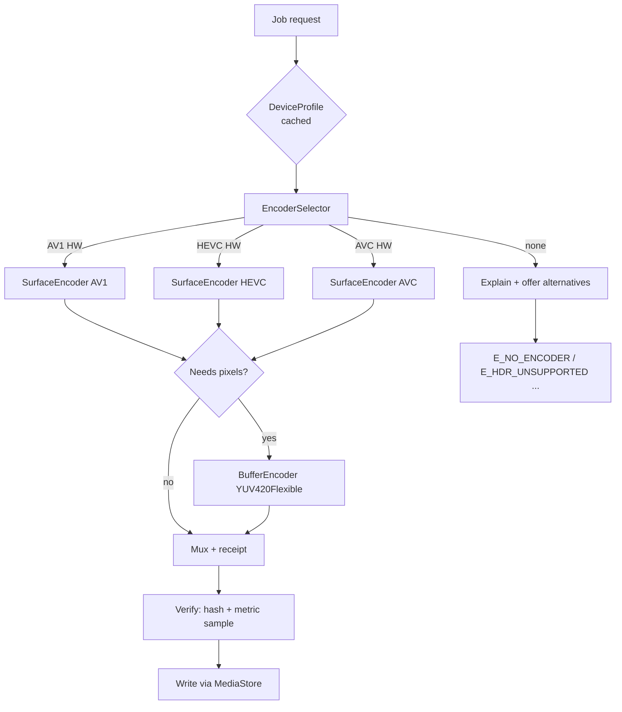

# Prism-V — Universal Device Portability Audit

**What this is:** a verified, line-referenced audit of what blocks Prism-V from running on *every* Android processor, GPU, and device — plus the exact worklist to fix it.
**Written:** 19 November 2026
**Repo state:** commit `667f030`, working tree clean, release artifact `release/prism-v-v1.1.3.apk`.
**Method:** read every build file, unpacked the shipped APK, read the media/JNI paths, grepped for platform APIs, and cross-checked CI. Nothing here is inferred from the README.

> Read this as a repair order, not a review. Every finding has an ID, a file and line, and an acceptance test. You can implement them in the order given in §11.

---

## 0. Verdict in eight lines

1. **The shipped APK contains no native code at all.** 18 zip entries, zero `.so`, zero `lib/`. Every "frontier" feature is dead on every device, and several call sites will throw `UnsatisfiedLinkError` on specific content.
2. **The release build has no NDK step.** `scripts/build_apk.ps1` runs javac → D8 → apktool → zip → sign. There is no CMake invocation, no `ndk-build`, no `jniLibs`.
3. **There are two different apps** with different `minSdk` (26 vs 30), `targetSdk` (36 vs 35), and different feature sets. Only one is built; the other is a Compose shell.
4. **The transcode path is MediaCodec-only, surface-only, AVC/HEVC-only**, with no capability probing and no software or byte-buffer fallback.
5. **HDR/10-bit is not handled at all.** No colour keys are ever set.
6. **There is no GPU code.** `VulkanComputeEngine` is a CPU emulation (`frontier5_pipeline.cpp:145` says "Emulate GPU"); the CMake target links no Vulkan loader.
7. **Only `arm64-v8a` and `x86_64` are configured**, and only in the Gradle module that does not contain the working app.
8. **None of this is fatal.** About **10–12 engineer-weeks** gets you an honest "runs everywhere, degrades explicitly" baseline (§11). The AV1 quality tier is separate work.

---

## 1. What actually ships today (evidence)

Unpacked `release/prism-v-v1.1.3.apk`:

```
classes.dex            816,044 bytes
META-INF/ANDROIDD.SF     1,680
META-INF/ANDROIDD.RSA    1,223
META-INF/MANIFEST.MF     1,553
entries: 18
lib/: absent
*.so: absent
```

Consequences, in order of severity:

| Consequence | Evidence | Effect |
|---|---|---|
| `System.loadLibrary("prism_jni")` always fails | `VideoProcessingPipeline.java:33-40` catches `Throwable`, sets `isNativeLoaded=false` | Every native feature is unavailable |
| Most native call sites do **not** check `isNativeLoaded` | only 4 guards exist (see F02) | `UnsatisfiedLinkError` at call time |
| `catch (Exception)` does not catch `UnsatisfiedLinkError` | `HardwareVideoCompressor.java:1157`, `:1295` | Content-dependent hard crash |
| App still "works" for simple clips | Java MediaCodec path is independent | Explains "works on my phone, crashes on this file" reports |

**The single most likely user-visible crash:** a low-bitrate 1080p source triggers the "hyper-efficient remux" branch (`HardwareVideoCompressor.java:323-347`), which calls `nativeRemuxContainer` at line 338 with no guard.

---

## 2. The six portability axes

"Works on every processor / GPU / device" only means something if you define the axes. These are the axes Android actually varies on:

| Axis | Values that matter in 2026–2028 | Who is excluded today |
|---|---|---|
| **CPU ABI** | `arm64-v8a`, `armeabi-v7a`, `x86_64`, `x86` | 32-bit ARM, 32-bit x86 (Gradle config only lists two) |
| **CPU features** | NEON (baseline on arm64), dotprod/i8mm (ARMv8.2+), SSE4.2/AVX2 (x86) | No runtime dispatch → x86 runs scalar |
| **API level** | 26–36; codec mandates change at 29/33/34/35/36 | Legacy app claims 26 but uses 29+ APIs unguarded in places |
| **Codec** | AVC (always), HEVC (usually), AV1 (mandatory enc+dec from API 34), APV (API 36) | No AV1 output; no APV path |
| **SoC vendor** | Qualcomm, MediaTek, Google Tensor, Samsung Exynos, Unisoc | No vendor quirks, no allow/deny list |
| **Display/colour** | SDR, HLG, HDR10, HDR10+, Dolby Vision | No colour handling at all |
| **GPU** | Adreno, Mali, Immortalis, PowerVR, Xclipse | Not used (and not needed for encode) |
| **Storage** | Scoped storage (29+), SAF, MediaStore | `MANAGE_EXTERNAL_STORAGE` + legacy paths |

**Design principle:** *portability is achieved by falling back, not by hoping.* Every axis gets a probe, a preferred path, an ordered fallback list, and a visible message when it degrades.

---

## 3. Findings

Severity: **P0** = crash / broken promise / cannot ship; **P1** = wrong output or device-specific failure; **P2** = architecture debt that will bite in 2027.

### P0 — blocking

| ID | Finding | Evidence | Impact | Fix |
|---|---|---|---|---|
| **F01** | Release APK ships no native library | zip inventory above | All native features dead; `isNativeLoaded=false` on every device | Add NDK build to the release pipeline; assert `lib/*/libprism_jni.so` exists before signing |
| **F02** | 12+ unguarded native call sites | `HardwareVideoCompressor.java:338,867`; `BbrCodec.java:171,229`; `ToolboxDialogs.java:1312,1421`; `PrismVfsProxy.java:101`; `RabinMeshWorker.java:142,173`; `PrismNeRVBackgroundWorker.java:97`; `VerifiedReplacement.java:137,147` | `UnsatisfiedLinkError` (an `Error`, not an `Exception`) escapes `catch (Exception)` | One `NativeBridge` facade; every call checks `isAvailable()`; fallback path per feature |
| **F03** | Build script has no NDK step | `scripts/build_apk.ps1` steps 1–5 (javac, D8, apktool, zip, sign) | Native code can never reach users | Replace with Gradle build, or add `cmake --build` + copy `jniLibs` before apktool |
| **F04** | Kotlin worker declares `external fun processSingleGop` with no library load in that class | `AtomicGopWorker.kt:71`; only `loadLibrary` is `PrismVfsService.kt:34` | Works only if another class loaded the lib first — order-dependent crash | Load in `Application.onCreate()` once, or a shared `NativeLoader` object |
| **F05** | Legacy app requests `MANAGE_EXTERNAL_STORAGE` and `requestLegacyExternalStorage` | `AndroidManifest.xml` (apk_root); `apktool.yml` target 36 | Play policy rejection; on Android 11+ permission requires manual Settings grant | Remove; use MediaStore + SAF (`ACTION_OPEN_DOCUMENT_TREE`) |

### P1 — wrong behaviour / device-specific

| ID | Finding | Evidence | Impact | Fix |
|---|---|---|---|---|
| **F06** | Surface-only encoder configuration, no byte-buffer fallback | `HardwareVideoCompressor.java:375` | Devices/encoders without `COLOR_FormatSurface` fail; the only retry changes `KEY_OPERATING_RATE` (`:484-486`) | Query `CodecCapabilities.colorFormats`; add `COLOR_FormatYUV420Flexible` path with a converter |
| **F07** | No encoder enumeration or hardware check | only `createEncoderByType` at `:386`, `:396`; no `MediaCodecList` anywhere | Software encoder may be chosen silently → 10–50× slower; no vendor workarounds | `EncoderSelector` using `MediaCodecList` + `isHardwareAccelerated()` + per-device allow/deny list |
| **F08** | Output limited to AVC/HEVC | `:352-360` | No AV1 despite Android 14 mandate; no codec choice | Add `video/av01` when `MediaCodecList` reports an encoder; keep AVC/HEVC fallbacks |
| **F09** | No HDR/10-bit handling | zero matches for `COLOR_TRANSFER`, `COLOR_STANDARD`, `COLOR_RANGE`, `KEY_PROFILE`, `KEY_LEVEL` in the file | HDR10/HLG input either fails or silently SDR-ifies | Detect `KEY_COLOR_TRANSFER`; preserve with matching profile, or tone-map explicitly and say so |
| **F10** | "Never worse" clamps bitrate to 45–85% of source by size only | `:307-321` | Over-compresses already-efficient sources; quality claim is false | Replace with measured quality gate (see master plan §3.3); if metric unavailable, keep source |
| **F11** | Output format option is cosmetic | `options.outputFormat` appears only in the log string at `:110`; muxer hardcoded `MUXER_OUTPUT_MPEG_4` at `:518` | MOV/MKV/FLV selection does nothing | Remove the option, or implement per-container muxing (MediaMuxer only supports MP4/WebM) |
| **F12** | Rotation/flip/crop/speed/EIS options not implemented as pixels | `rotationDegrees` only adjusts the orientation hint (`:216-217`, `:521`); others unused | UI promises edits that never happen | Either implement (GL/CPU transform) or remove the controls |
| **F13** | Decoder renders with `SCALE_TO_FIT` onto a target-sized encoder surface | `:500`, `:510` | Aspect-ratio changes encode black bars; odd dimensions can fail | Size the surface with `SurfaceHolder.setFixedSize` / `setDefaultBufferSize`, or pre-scale in GL; handle crop explicitly |
| **F14** | `KEY_OPERATING_RATE = Short.MAX_VALUE` | `:382` | Coaxs max clocks → thermal throttle; configure failures on some vendors | Set `max(targetFps, 30)` always; never `Short.MAX_VALUE` |
| **F15** | No `CodecException` handling | no `MediaCodec.CodecException` matches | One transient codec error kills the whole job | Catch, inspect `isRecoverable()`/`isTransient()`, recreate codec, resume from last sync frame |
| **F16** | Audio path assumes AAC-LC encoder and MP4-legal input codecs | `AudioTranscoder.java:77-82`; fallback is direct copy (`HardwareVideoCompressor.java:463-466`) | Opus/FLAC/AC-3 in MP4 can produce an unplayable output | Probe output muxer support; transcode to AAC or drop audio with a warning |
| **F17** | Uses deprecated public storage dirs | `PrismStorageManager.java:42` | Wrong location / permission failures on Android 10+ | MediaStore `RELATIVE_PATH` + app-specific dirs |
| **F18** | Decoder created for arbitrary input MIME without support check | `:497` | Unsupported input (e.g. AV1 on API 26) throws deep in the pipeline | Pre-flight `MediaCodecList` check; user-facing "cannot decode this file" |

### P2 — architecture debt

| ID | Finding | Evidence | Impact | Fix |
|---|---|---|---|---|
| **F19** | Two apps, two configs | `android/build.gradle.kts` (min 30, Compose, NDK) vs `android_app` (apktool, min 26, Java) | No single source of truth; fixes land in the wrong tree | Make Gradle the only build; migrate `android_app/src` into `android/` or a library module |
| **F20** | Only `arm64-v8a` + `x86_64` configured | `android/build.gradle.kts:21` | 32-bit devices excluded | Add `armeabi-v7a` + `x86` splits if you truly mean "every device"; see §9 for the trade |
| **F21** | No runtime CPU dispatch | NEON is compile-time only (`detint.cpp:6`); no SSE/AVX paths | x86 runs scalar (slow); ARMv8.2 features unused | Function multiversioning: `__builtin_cpu_supports` on x86, `getauxval(AT_HWCAP)` on ARM; scalar fallback tested in CI |
| **F22** | Affinity call affects only the calling thread and silently fails | `frontier5_pipeline.cpp:498` | "Thread affinity" feature is a no-op on most devices | Delete; use ADPF `PerformanceHintManager` (master plan §3.7) |
| **F23** | `VulkanComputeEngine` is CPU code | `frontier5_pipeline.cpp:145` comment, body calls `Afgs1Engine` | False "GPU" claims; no speedup | Rename to `CpuPipeline`; delete shader build unless a real Vulkan backend is written |
| **F24** | No Vulkan/GL in the build | `CMakeLists.txt` links only `log android mediandk` | Any future GPU work starts from zero | Optional: add `vulkan` + a `VK_ANDROID_external_memory_android_hardware_buffer` path behind a feature flag |
| **F25** | Rust workspace is orphaned | `rust/prism-core`, `rust/prism-container`, not in Gradle/CMake/CI | Dead code, maintenance drag | Either integrate via `cargo-ndk` or archive |
| **F26** | CI never builds Android | `.github/workflows/ci.yml` = CMake native tests + `javac` only | Native/APK breakage merges silently | Add `./gradlew :android:assembleDebug` + emulator smoke test |
| **F27** | No 16 KB page-size check for the legacy path | flags exist in `CMakeLists.txt` only | Android 15+ 16 KB devices may refuse to load | Verify `readelf -l` alignment in CI; assert `lib/*/libprism_jni.so` page alignment |
| **F28** | No capability cache / device profile | every job re-probes ad hoc | Inconsistent tier choice; no telemetry | `DeviceProfile` persisted per model + SoC; used by the planner |

---

## 4. What is missing (worklist)

Each item is implementable independently. "Done" is defined by the test in the last column.

### W1 — Capability layer (the foundation)

**Missing:** a single object that answers, once per device, "what can this phone actually do?"

```java
public final class DeviceProfile {
    public final int apiLevel;
    public final String[] abis;            // Build.SUPPORTED_ABIS
    public final String socModel;          // Build.SOC_MODEL (API 31+) / fallback
    public final String hardware;          // Build.HARDWARE
    public final boolean hasAvcEncoder, hasHevcEncoder, hasAv1Encoder, hasApvEncoder;
    public final boolean hasAv1Decoder, hasHevcDecoder;
    public final boolean hdr10Encode, hlgEncode;
    public final int maxEncodeWidth, maxEncodeHeight, maxEncodeFps;
    public final boolean surfaceEncodeSupported, flexibleYuvSupported;
    public final String chosenEncoderName; // for the receipt
}
```

Rules:
- Build it from `MediaCodecList(REGULAR_CODECS)`, `CodecCapabilities`, `VideoCapabilities`, `Build.*`.
- Cache per `(Build.MODEL, Build.SOC_MODEL, Build.VERSION.SDK_INT)` in SharedPreferences.
- **Never** call `createEncoderByType` before `DeviceProfile` says an encoder exists.
- Log the profile into the receipt (master plan §3.1).

**Acceptance:** on 6 devices + 2 emulators, the profile reports correct codec presence (cross-check with `MediaCodecList` dump); no exceptions on API 26–36.

Estimate: **1.5 weeks.**

### W2 — Encoder selection with ordered fallbacks

**Missing:** a selector, not a `try/catch`.

```
Desired: AV1 HW → HEVC HW → AVC HW → AV1 SW (opt-in) → fail with message
Constraints: width, height, fps, bitrate, colour format, profile/level, HDR
```

Implementation notes:
- `MediaCodecList.findEncoderForFormat(format)` is the correct API; `createEncoderByType` is a shortcut that hides which component you got.
- Check `info.isHardwareAccelerated()` (API 29+); on older APIs use `info.getName().startsWith("OMX.google.")` / `"c2.android."` as the software heuristic.
- Keep a small deny-list keyed by `Build.MODEL` for known-bad encoders (start empty; add only with evidence).
- If no hardware encoder: do **not** silently use software for a 4K clip; show time estimate and require confirmation.

**Acceptance:** forced-failure test (inject a fake `MediaCodecList`) proves each fallback step; real-device test on a device with HEVC encoder disabled.

Estimate: **1 week.**

### W3 — Colour / HDR policy

**Missing:** any handling of transfer function, primaries, range.

Minimum viable policy:
1. Read `KEY_COLOR_TRANSFER`, `KEY_COLOR_STANDARD`, `KEY_COLOR_RANGE` from the input track.
2. If SDR → set the same keys on the encoder output format; default `COLOR_RANGE_LIMITED` for video.
3. If HDR (HLG/PQ) → only proceed if the selected encoder advertises a matching profile (`HEVCProfileMain10HDR10` / `AV1ProfileMain10HDR10`); otherwise **refuse with a clear message** rather than silently washing out.
4. Never tone-map by accident.

**Acceptance:** HLG and HDR10 test clips on a supporting device produce output whose `MediaFormat` retains transfer/primaries; on a non-supporting device the app refuses with a message instead of producing grey video.

Estimate: **2 weeks** (includes building 4 HDR test clips).

### W4 — Byte-buffer path (needed for metrics, grain, and fallback)

**Missing:** any way to touch pixels in the transcode loop. Surface mode never exposes frames.

Why it is on the critical path: grain analysis, SSIMULACRA2 verification, and the P1 fallback all need YUV planes.

Plan:
- Add an `IEncoder` with two implementations: `SurfaceEncoder` (fast, default) and `BufferEncoder` (`COLOR_FormatYUV420Flexible`, used when surface is unsupported or metrics are required).
- Reuse the existing `spatial.cpp` colour helpers; do not write a second YUV converter.
- Keep the surface path for T0/T1; use byte-buffer only for verification passes on sampled frames.

**Acceptance:** same input transcoded through both paths yields PSNR > 45 dB between outputs at the same bitrate, and the buffer path works on an emulator.

Estimate: **2 weeks.**

### W5 — CPU dispatch and scalar fallbacks

**Missing:** runtime dispatch and an x86 fast path.

Pattern to follow (already correct in this repo): `detint.cpp:6` guards NEON with `#if defined(__ARM_NEON) || defined(__aarch64__)` and provides a scalar loop. `rans16.cpp:14-20` does a proper `HWCAP2_SME2` runtime check.

What to add:
- `core/src/cpu/dispatch.cpp`: `CpuFeatures { neon, dotprod, i8mm, sse42, avx2 }` filled by `getauxval(AT_HWCAP)` / `__builtin_cpu_supports`.
- Compile hot kernels three ways (`-march=armv8-a`, `-march=armv8.2-a+dotprod`, `-mavx2`) into separate translation units; select via function pointers.
- Add `-DCMAKE_C_FLAGS=-march=...` per ABI in CMake, **not** per app.
- CI runs the scalar path explicitly (env var `PRISM_FORCE_SCALAR=1`).

**Acceptance:** `prism_tests` passes with `PRISM_FORCE_SCALAR=1` on x86_64 and arm64; a microbenchmark shows ≥2× speedup from NEON vs scalar on the same device.

Estimate: **1.5 weeks.**

### W6 — One build system, one app

**Missing:** a build that produces an APK containing native code for all declared ABIs.

Recommended target layout:

```
app/                       (com.android.application, Kotlin + Java)
 ├─ src/main/java/...      (migrated from android_app/src)
 ├─ src/main/cpp/          (thin JNI shim)
 └─ build.gradle.kts       abiFilters = [arm64-v8a, armeabi-v7a?, x86_64]
core/                      (existing C++ core, unchanged)
```

Steps:
1. Move `android_app/src` into the Gradle module (or a `:engine` library module) — mechanical, ~1 day.
2. Point `externalNativeBuild.cmake.path` at the root `CMakeLists.txt` (already done in `android/build.gradle.kts:82`).
3. Build `prism_jni` **once** as a shared lib and let Gradle package it; stop the "compile the same sources twice" trick in `CMakeLists.txt` (it currently compiles `prism_jni.cpp + all core sources` into the JNI lib *and* into `prism_core`).
4. Add `packaging { jniLibs { useLegacyPackaging = false } }`.
5. Delete `scripts/build_apk.ps1` or reduce it to a wrapper around `gradlew assembleRelease`.
6. In CI: `./gradlew :app:assembleDebug` and `:app:testDebugUnitTest`.

**Acceptance:** `unzip -l app-release.apk | grep lib/` shows `lib/arm64-v8a/libprism_jni.so` (and the other ABIs); `adb install` + `System.loadLibrary` succeeds on an emulator and a phone.

Estimate: **1 week.**

### W7 — Storage and permissions

**Missing:** scoped-storage-correct output and no special permissions.

- Remove `MANAGE_EXTERNAL_STORAGE` and `requestLegacyExternalStorage`.
- Write via `MediaStore.Video.Media.EXTERNAL_CONTENT_URI` with `RELATIVE_PATH = Movies/PrismV` (API 29+); fall back to app-specific external dir on 26–28.
- Accept input via `ACTION_OPEN_DOCUMENT` / share intent URI, copy to cache with a size check, delete after.
- Keep the existing `PrismStorageManager.indexVideoInMediaStore` but make it the only writer.

**Acceptance:** fresh install on Android 11 and 14 with no permissions granted beyond `READ_MEDIA_VIDEO` can import, transcode, and see the result in Gallery.

Estimate: **1 week.**

### W8 — Failure taxonomy and user messaging

**Missing:** every failure looks the same ("Compression failed").

Add error codes the UI can explain:

| Code | Condition | Message |
|---|---|---|
| `E_NO_ENCODER` | no hardware encoder for requested codec | "This phone cannot encode HEVC; using H.264" |
| `E_UNSUPPORTED_INPUT` | input codec not decodable | "This file uses a codec this phone cannot decode" |
| `E_HDR_UNSUPPORTED` | HDR input, no HDR encoder | "HDR video needs a newer encoder; convert to SDR?" |
| `E_THERMAL` | governor demoted below floor | "Phone too hot; paused. Resume when cooler?" |
| `E_STORAGE` | insufficient space | show required vs free |
| `E_NATIVE_MISSING` | `isNativeLoaded == false` | "Advanced mode unavailable on this build" |

**Acceptance:** a fault-injection test triggers each code and asserts the string resource exists.

Estimate: **0.5 week.**

### W9 — Test matrix

**Missing:** any test that proves portability.

| Target | API | ABI | What it proves |
|---|---|---|---|
| Emulator | 26 | x86 | minSdk path, software codecs |
| Emulator | 34 | x86_64 | AV1 mandate path |
| Emulator | 35 | arm64-v8a (Apple silicon / ARM host) | arm64 JNI |
| Physical low-end | 29–31 | arm64 | 4-core, 3 GB RAM, thermal |
| Physical flagship | 34–36 | arm64 | HDR, AV1 HW |
| Physical 32-bit (if supported) | 27–29 | armeabi-v7a | scalar/NEON fallback |

Smoke test per target: 10-second 720p H.264 clip → transcode → `MediaExtractor` reads output → duration within 1 frame → `prismv-verify` hashes match.

**Acceptance:** the matrix runs in CI (emulators) + weekly (physical); a red cell blocks release.

Estimate: **2 weeks** (mostly CI plumbing and device access).

### W10 — Honest "GPU" story

**Missing:** a decision, not code.

Fact: on Android, **video encode/decode is done by fixed-function hardware, not by the GPU**. There is no portable GPU encoder API. Vulkan/GL can scale, convert, composite, and run filters — nothing more.

Decision:
- **v1: no GPU compute dependency.** Surface scaling already uses the display pipeline.
- Delete or rename `VulkanComputeEngine` (it is CPU code) and drop the "Vulkan 1.4 / SME2 / sub-1 W" claims from UI strings.
- **2028 option:** Vulkan compute for grain analysis/denoise only, behind `DeviceProfile.hasVulkan` and with a CPU fallback. Budget 6 weeks; only if profiling shows the filter is >30% of job time.

**Acceptance:** no UI string claims a GPU feature that is not measured; `grep -r "Vulkan" android_app/src` returns only the optional-path comment.

Estimate: **0.5 week** (cleanup) now, 6 weeks later if pursued.

---

## 5. Target architecture for universal support



**The contract, stated plainly:**

> Prism-V runs on any Android 8.0+ device that has an H.264 encoder. It uses AV1 or HEVC when the device proves it can, H.264 when it cannot, and it tells the user which one it used and why. It never claims a feature the device does not have.

That is achievable, testable, and honest. "Every GPU" is not a thing in video encoding; the plan should say so once and move on.

---

## 6. Device classes

| Class | Definition | Tier | Expected result |
|---|---|---|---|
| **D0** | API 26–28, 32-bit or 64-bit, AVC only | T0 | 720p/1080p H.264 out, no HDR, no AV1 |
| **D1** | API 29–33, arm64, HEVC encoder | T0/T1 | HEVC out, 4K decode, HDR passthrough if profile supports |
| **D2** | API 34–35, arm64, AV1 encoder (mandated) | T1/T2 | AV1 out when vendor encoder is good; measured per model |
| **D3** | API 36+, APV + AV1 | T2/T3 | APV intra for screen/game; AV1 quality tier |

The planner picks the highest tier the *measured* profile supports, not the highest the OS advertises.

---

## 7. Verification commands you can run today

```powershell
# 1. Prove the APK has no native code
Add-Type -AssemblyName System.IO.Compression.FileSystem
$z=[System.IO.Compression.ZipFile]::OpenRead("release\prism-v-v1.1.3.apk")
$z.Entries | Where-Object { $_.FullName -like "lib/*" }   # expected: nothing
$z.Dispose()

# 2. Prove the release script has no NDK step
Select-String -Path scripts\build_apk.ps1 -Pattern "cmake|ndk|jniLibs|\.so"

# 3. Prove no colour handling exists
Select-String -Path android_app\src\com\prismv\engine\HardwareVideoCompressor.java `
  -Pattern "COLOR_TRANSFER|COLOR_STANDARD|COLOR_RANGE|KEY_PROFILE|KEY_LEVEL"

# 4. Prove the GPU engine is CPU code
Select-String -Path core\src\frontier5_pipeline.cpp -Pattern "Emulate GPU|Afgs1Engine::extract"

# 5. Prove native calls are unguarded
Select-String -Path android_app\src\com\prismv\**\*.java -Pattern "isNativeLoaded"
# compare the handful of guards with the ~20 call sites in F02

# 6. Build the native core for this machine
cmake -B build -G Ninja -DCMAKE_BUILD_TYPE=Release
cmake --build build
ctest --test-dir build --output-on-failure
```

---

## 8. What "all GPUs" can and cannot mean

| Claim | Reality |
|---|---|
| "Uses the GPU to encode" | **Impossible** on Android. Encoding is a fixed-function block (or CPU software). |
| "Uses the GPU to decode" | Decode outputs to a `Surface`; the GPU/compositor handles scaling and display. That already happens. |
| "Uses Vulkan compute to denoise/scale" | Possible, but must have a CPU fallback and must be measured to be faster. Today's code is CPU. |
| "Runs on Adreno/Mali/PowerVR/Xclipse" | True by construction **if** you never depend on a vendor-specific extension. |
| "NPU acceleration" | No portable Android API with the required guarantees in 2026. Do not promise it. |

The correct marketing sentence is: *"Works with every Android GPU because it never depends on one."*

---

## 9. The 32-bit question

Supporting `armeabi-v7a` means: +~6–10 MB APK, +1 CI target, +NEON-optional code paths, and a class of devices that cannot decode 4K anyway.

- If the goal is *literal* "every device": include it, with a hard 1080p cap and scalar fallback.
- If the goal is *practical* coverage: arm64-only is defensible in 2027 (32-bit-only devices are a shrinking single-digit share [EST]), **provided** the store listing states the requirement and the app installs on 64-bit devices only.

Recommendation: **arm64-v8a + x86_64 in v1; add armeabi-v7a only if telemetry or the store report shows >2% of installs failing on ABI.**

---

## 10. Effort summary

| Workstream | Eng-weeks | Blocking? |
|---|---|---|
| W6 build unification + `.so` in APK | 1.0 | **Yes** |
| W1 device profile | 1.5 | Yes |
| W2 encoder selector | 1.0 | Yes |
| W8 error taxonomy | 0.5 | Yes |
| W3 colour/HDR | 2.0 | Yes (for correctness claims) |
| W7 storage | 1.0 | Yes (for Play) |
| W4 byte-buffer path | 2.0 | Needed for metrics |
| W5 CPU dispatch | 1.5 | Perf, not blocking |
| W9 test matrix | 2.0 | Gate |
| W10 GPU cleanup | 0.5 | Trust |
| **Total** | **~13 eng-weeks** | ~3.5 months with 1 engineer, ~7 weeks with 2 |

This is the price of "works everywhere". It is small compared with the codec work, and it is the difference between a demo and a product.

---

## 11. Execution order (do not reorder)

1. **W6** — get the `.so` into the APK. Nothing else is observable until this is true.
2. **W1 + W8** — know what the device can do, and say so when it can't.
3. **W2** — choose the encoder deliberately; remove the silent software fallback.
4. **W9 (emulator half)** — lock the baseline with tests before changing media code.
5. **W3** — HDR correctness, because silent SDR conversion is the worst kind of bug.
6. **W7** — storage/permissions, required for distribution.
7. **W4** — pixel access, which unblocks metrics and grain.
8. **W5** — dispatch, once there is something worth speeding up.
9. **W10** — delete the GPU fiction.
10. **W9 (physical half)** — device matrix, then declare support.

**Definition of done for "universal":**

- APK installs and transcodes on all six rows of the §4/W9 matrix.
- `DeviceProfile` + receipt record the exact encoder used per file.
- No `UnsatisfiedLinkError` is reachable: every native entry point is behind `NativeBridge.isAvailable()`.
- Every unsupported combination produces a specific, translated message.
- No UI text claims GPU/NPU/Vulkan/SME2 acceleration that is not measured on the device in hand.

---

## 12. Honest caveats about this audit

- I read and ran the repository; I did **not** run the app on a phone. Device-specific claims (e.g. "some encoders lack surface input") are from platform documentation and general Android behaviour, tagged [V-S]/[EST] in the master plan's convention.
- The APK inspection is definitive for the artifact in `release/`. If a different artifact is distributed elsewhere, it must be re-checked.
- Line numbers refer to commit `667f030` and will drift after the first refactor; use the quoted code as the anchor.
- The effort estimates assume one engineer familiar with MediaCodec; double them for someone learning the stack.

---

*Companion document: `docs/PRISM_V_2027_MASTER_PLAN.md` (product, codec, schedule, legal). This audit supersedes its §4.2 repository table wherever they disagree.*
