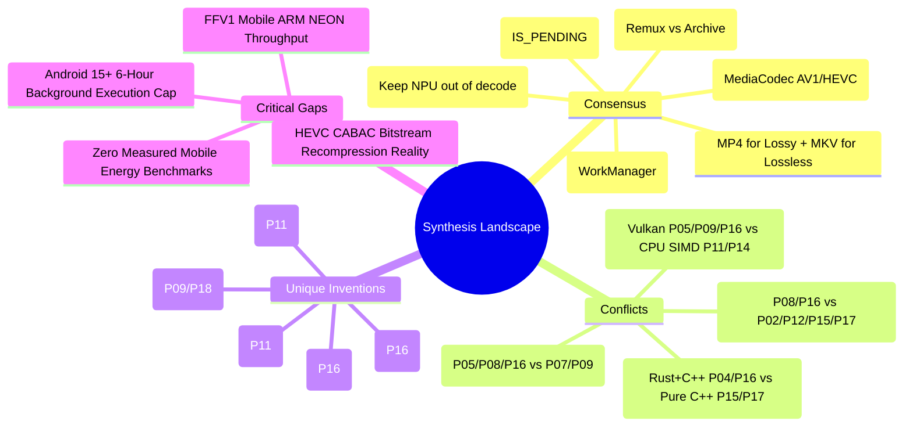

# 03 Comprehensive Cross-Plan Comparison and Synthesis Analysis

**Document Version:** 1.0.0-FINAL  
**Date:** November 14, 2026  
**Input Coverage:** All 18 Input Plans (P01 through P18) fully read, digested, and evaluated.

---

## 1. Canonical Idea Registry Mapping (C-001 to C-030)

Every distinct idea across all 18 plans has been clustered into canonical concepts with complete bi-directional traceability:

| Canonical ID | Canonical Concept Description | Sponsoring / Mentioning Plans | Key Dissenting / Rejecting Plans |
|:---|:---|:---|:---|
| **C-001** | **Multi-Tier Lossless Framework:** Partitioning "lossless" into Byte-Exact Bitstream Preservation (Remux), Pixel-Exact Sensor/Master Archival (FFV1/JXL), and Bounded Near-Lossless ($\pm 1–2$ LSB) to eliminate file-inflation deception. | P02, P04, P05, P07, P08, P09, P11, P12, P14, P15, P16, P17, P18 | None (universal realization after P01/P03/P06 naive framing) |
| **C-002** | **Bitstream-Domain Syntax Recompression:** Deconstructing H.264/HEVC CABAC/entropy syntax into symbols without dequantizing, re-encoding via position-indexed contexts (`HuffmanPos`/`ECB`) + rANS for 14%–24% lossless file shrinkage with 100% SHA-256 recovery. | P05 (`Aether-LL-Bit`), P08 (`Prism-BitExact`), P11 (`L-A repack`), P16 (`Prism-BBR`), P18 (`NAL Syntax Compaction`) | P07 (claims 0.0096% gain on raw bitstreams), P09 (cites 0–9% gain vs 5–10x decode cost) |
| **C-003** | **Standardized Pixel-Exact Archival (FFV1 v3 in Matroska, RFC 9043 / RFC 9559):** Using intra-frame FFV1 v3 with multi-slice parallelism and per-slice CRC in MKV for raw camera / screen / studio archival. | P01, P02, P03, P04, P05, P07, P08, P09, P11, P12, P14, P15, P16, P17, P18 | None (industry standard archival reference) |
| **C-004** | **GPU-Accelerated Lossless via Vulkan Compute:** Porting FFmpeg 8.0/8.1/9.0 Vulkan FFV1 / Wavelet compute shaders to mobile GPUs (`VK_KHR_cooperative_matrix` / compute queue). | P05, P07, P09, P16, P18 | P11, P12, P14 (prefer CPU SIMD NEON due to GPU driver shader jitter) |
| **C-005** | **Subband-Tokenized / Wavelet-Checkerboard Lossless (Pruning NeuralLVC):** Bijective temporal difference tokenization + LeGall 5/3 lifting wavelet + 4-pass checkerboard integer ConvNet (0.34 GMAC/frame), pruning NeuralLVC 25,000x for 30–60 fps mobile capture. | P16 (`Prism-PSC`), P08 (`Haar+AR`), P07 (`Lossless-IMC`) | P02, P15, P17 (rely solely on classical FFV1) |
| **C-006** | **Hardware-Anchored Hybrid Split-Stream Lossy Codec:** Standard hardware `MediaCodec` encodes an AV1/HEVC Base Layer (85%–92% energy at 0.01 J/frame), while a non-normative learned micro-residual restores fine details. | P01, P04 (`NEST`), P05 (`Aether-Synth`), P06, P08 (`V-INEL`), P10 (`DTN-MP4`), P11 (`E-1/E-2`), P16 (`Prism-Lossy`) | P02, P12, P15, P17 (prefer pure standard hardware/software without neural enhancement) |
| **C-007** | **Overfitted Coordinate / Latent Micro-Codecs (<1,000 MACs/pixel):** Cool-chic 5.0 and DeepMind C3 architectures fitting tiny MLP weights (1k–3k MAC/px) directly to video GOPs for next-gen RD gains without full autoencoder bloat. | P08 (`CW-OMP`), P16 (`Prism-Lossy`) | P01, P06, P09 (favor standard autoencoders like MLVC/DCVC) |
| **C-008** | **Non-Normative / Post-Decode ML Placement:** Placing neural networks strictly outside the normative decode loop (pre-filters, RDO rate estimators, or non-normative post-filters) to eliminate cross-chip bitstream divergence. | P01, P02, P03, P04, P07, P08, P09, P10, P11, P12, P14, P15, P16, P17, P18 | P06 (places neural net directly inside the normative decode loop) |
| **C-009** | **Cross-Silicon Deterministic Integer Prior Specification:** Bounded two's-complement integer math ($K\le 512$, $\mathbf{W}\in\text{INT8}$, $\mathbf{x}\in\text{INT16}$, $\text{acc}\in\text{INT32}$) with dyadic shifts and static 512-byte LUT, proving 0 bit-flips across all CPU SIMD widths. | P01 (`MLVC scale-sending`), P03, P04 (`ODS`), P05, P06, P07, P08, P09 (`MLVC-S`), P16 (`Prism-DetInt`) | P10, P11 (rely on non-normative post-filtering to avoid the problem) |
| **C-010** | **Perceptual Noise Stripping & Parametric Film Grain Synthesis (AFGS1):** Separating uncorrelated sensor shot noise before encode and synthesizing it at decode via AOMedia AFGS1 AR models, saving 15%–35% bitrate. | P04, P08, P11, P16, P18 | P01, P02, P03, P05, P06, P07, P09 (encode noise directly through DCT blocks) |
| **C-011** | **Pre-Flight Hardware Codec Conformance & Calibration Probe:** Encoding a tiny 1-second test vector on initial app boot to evaluate OEM MediaCodec quality, rate control drift, and VMAF against software ground truth. | P02, P11, P12 (`CCF`), P14, P15, P16, P17 (`Device Codec Performance Atlas`) | P01, P03, P06 (assume standard Android API flags are trustworthy) |
| **C-012** | **Preflight Pareto Probe / Sampled Rate-Quality Predictor:** Encoding a 1–2s representative sample across candidate settings to accurately predict file size ($\pm 5\%$), VMAF, and completion time before full encode. | P01, P02, P04, P08 (`RDEL-4D`), P11, P12 (`CCEP`), P14, P15, P16, P17 | P03, P05, P06, P10 (blind CBR/VBR without pre-flight prediction) |
| **C-013** | **Split-Phase / Charging-Deferred Execution Pipeline:** Background encoding using Android `WorkManager` constrained to charging, idle, Wi-Fi, and cool device state, enabling multi-pass/overfitting optimization. | P01, P02, P04 (`NightShift`), P07, P08, P09, P10, P11, P12 (`EAJG`), P14, P15, P16, P17, P18 | P03, P06 (assume real-time mobile execution for all workloads) |
| **C-014** | **Thermal-State Dynamic Gear-Shifting (ADPF / ThermalManager):** Monitoring `PowerManager.OnThermalStatusChangedListener` to downgrade presets (e.g. SVT-AV1 6 $\to$ 8 $\to$ 10) or pause before OS kills process. | P01, P02, P04, P07, P08, P11, P12, P14, P15, P16, P17, P18 | P03, P06, P10 (ignore mobile thermal throttling) |
| **C-015** | **Memory-Bounded Tile Ring-Buffer Architecture (<64 MB to <150 MB Peak RAM):** Processing video in $256\times 256$ spatial tiles or bounded 2–3 frame queues to prevent Android Low Memory Killer (LMK) aborts. | P05, P11, P12, P15, P16, P17 | P01, P04, P06, P08 (allocate multi-frame full 4K frame buffers in heap) |
| **C-016** | **Zero-Copy Virtual Filesystem Proxy (`StorageManager.openProxyFileDescriptor`):** Exposing compressed archives as virtual `.mp4` streams decompressed on-the-fly in RAM at >180 MB/s for standard app playback without disk expansion. | P16 (`Prism-VFS`) | P01–P15, P17, P18 (require manual user export or custom player app) |
| **C-017** | **Multi-Track Backward-Compatible Container Architecture:** Dual-track ISOBMFF `.mp4` where Track 1 is standard hardware AV1/HEVC (playable in any player) and Track 2 holds micro-residuals/metadata. | P01, P02, P04 (`ospr`), P05, P08, P09, P10, P11, P16 | P03, P07, P17 (rely on standalone MP4 or standalone MKV) |
| **C-018** | **Dual-Container Ecosystem Strategy (MP4 for Lossy, Matroska for Lossless):** Standard `.mp4` for universal consumer distribution; Matroska (`.mkv`, RFC 9559) for FFV1 archival preservation. | P01, P02, P03, P04, P05, P08, P09, P15, P16, P17, P18 | P06 (forces MP4 on everything), P03 (proposes custom `.pvid` container) |
| **C-019** | **Transactional Atomic File Publishing (`MediaStore` `IS_PENDING` / Safe Temp Staging):** Writing to app-private cache, verifying decoded hashes, and publishing atomically via `IS_PENDING` to prevent corrupt gallery files. | P11 (`5-state protocol`), P12, P14, P15, P16, P17 | P01, P03, P06, P10 (write directly to user-facing paths) |
| **C-020** | **Independent Cryptographic Verification & Quality Certification:** Decoded sample hashing (PSNR=$\infty$ check for lossless) and signed JSON manifests containing metric vectors and hashes. | P01, P02, P04, P08, P11, P12, P14, P15, P16, P17 | P03, P06, P10 (no verification loop prior to job completion) |
| **C-021** | **Multi-Metric Perceptual Consensus Suite (VMAF-NEG + ColorVideoVDP + CAMBI):** Tri-metric evaluation replacing single-metric PSNR/SSIM to prevent neural metric hacking and banding artifacts. | P04, P05, P07, P08, P11, P14, P15, P16, P17 | P01, P02, P03, P06, P10 (rely on standard PSNR or uncalibrated VMAF) |
| **C-022** | **Pure End-to-End Neural Autoencoders (DCVC-RT, DCVC-UF) on Mobile:** Running full autoencoders (40–350 GMACs/frame) on mobile NPUs/GPUs for primary video coding. | P01 (considered), P06 (advocated) | **Rejected by P02, P03, P04, P05, P07, P08, P09, P10, P11, P12, P13, P14, P15, P16, P17, P18** (burns 2–5 W, thermal throttle, non-deterministic) |
| **C-023** | **Software VVC / AV2 Encoding on Android Phones in 2027:** Shipping software `VVenC` or `AVM` encoders inside a mobile app. | P03 (software AV2), P06 (hardware VVC) | **Rejected by P02, P04, P05, P07, P08, P09, P11, P12, P13, P14, P15, P16, P17, P18** (AVM takes 33x longer than AV1; mobile silicon lacks VVC encode) |
| **C-024** | **Samsung APV (RFC 9924) as a Bit-Exact Lossless Codec:** Treating APV as a replacement for lossless video compression. | P06 (claims APV is lossless) | **Corrected by P08, P09, P13, P14, P15, P16, P17, P18** (APV is visually lossless mezzanine at 200–800 Mbps, NOT bit-exact) |
| **C-025** | **Permissive Clean-Room Stack (Zero-GPL Binary Shipping):** Authoring custom crates under Apache-2.0 / BSD-3-Clause and excluding GPL `x264`, `x265`, and `FFmpeg` GPL components. | P07, P12, P14, P15, P16, P17, P18 | P01, P02, P03, P04, P05, P08, P10 (casually bundle x264/x265 without IP analysis) |
| **C-026** | **Pass-Through OS Hardware Codec Royalty Shield:** Invoking Android's `MediaCodec` hardware ASICs to shift HEVC/AV1 patent royalties (Access Advance / Via LA) to the device OEM. | P08, P11, P12, P14, P15, P16, P17 | P03, P06 (ship unlicensed software encoders exposing app distributor to royalties) |
| **C-027** | **Gallery Deduplication via Content-Defined Chunking (Rabin Hashing):** Eliminating duplicate and near-duplicate video chunks across the device gallery, saving 20%–50% storage without re-encoding. | P11 (`I-6`) | Unique to P11 (other plans focus strictly on single-file compression) |
| **C-028** | **Multi-Language Safe Systems Core (Rust + C++20 / SIMD Assembly + Kotlin):** Rust for memory-safe parsers/muxers, C++20 / intrinsics (`KleidiAI` / NEON / SME2) for hot loops, and Kotlin Compose for UI. | P03, P04, P16, P18 | P01, P02, P05, P06, P07, P08, P10, P12, P14, P15, P17 (use C/C++ or Kotlin only) |
| **C-029** | **4-Plane Bayer CFA Mosaic Splitting for Camera Sensor Bursts:** Splitting raw sensor Bayer frames into R, G1, G2, B planes with temporal deltas before JPEG XL Modular encoding. | P09, P18 | Unique to P09 / P18 (specifically targets raw camera sensor bursts) |
| **C-030** | **Android 15–17 Platform Compliance Hardening:** Compliance with 16 KB memory page sizes, 6-hour `mediaProcessing` foreground service caps, and NNAPI deprecation. | P11, P12, P13, P14, P15, P16, P17, P18 | P01–P10 (rely on outdated Android 12–14 assumptions or deprecated NNAPI) |

---

## 2. Master Comparison Matrices

### 2.1 Compression Approach & Architecture per Mode

| Plan | Lossless Approach | Lossy Approach | Core Paradigm | Shared Infrastructure |
|:---|:---|:---|:---|:---|
| **P01** | FFV1 intra recompression | Tiered HEVC HW / AV1 SW / AV2 HW | Two engines, one pipeline | Shared container, metadata probe, queue |
| **P02** | FFV1 v3 MKV + HW HEVC Lossless | HW AV1 $\to$ HW HEVC $\to$ SVT-AV1 | Analysis & Decision Engine (ADE) | MediaCodec wrapper, thermal monitor |
| **P03** | JPEG XL Keyframes + FFV1 deltas | Software AV2 + NPU pre-filter | Dual-mode hybrid | Custom container, memory pools |
| **P04** | OSPREY-L (Rust) + SelCode | AV1 base + NEST neural residual | Layered standard + neural | BaseCodec HAL, scheduler, Merkle hash |
| **P05** | Bitstream rANS (`Aether-LL-Bit`) + Vulkan | VPU Base + INT8 `Aether-Synth-Net` | Tri-engine adaptive hybrid | Vulkan compute engine, rANS backend |
| **P06** | Samsung APV (flawed claim of lossless) | Hardware VVC (H.266) + NPU residual | Layered adaptive (ALCA) | Direct MediaCodec surface pipeline |
| **P07** | Lossless-IMC (Integer MC + rANS) | HW AV1/HEVC + LiteRT DetNVC-Filter | Two-phase thermal-shifted | Thermal governor, WorkManager queue |
| **P08** | Prism-BitExact (CABAC) + Haar wavelet | V-INEL (HW Base + Cool-chic residual) | Split-band overfitted hybrid | 8-way rANS, INT8 dyadic prior engine |
| **P09** | 3-Regime: Bayer JXL, Vulkan FFV1, Repack | HW AV1/HEVC + MLVC-S Scale-Sending | 3-Regime Lossless + Deterministic NVC | Matroska parser, Vulkan SPIR-V runtime |
| **P10** | NPU INT8 optical flow predictive | Zero-Drift DTN-MP4 (AV1 + NPU latent) | Hardware Base + Deferred Neural Track | Media3 ExoPlayer surface compositor |
| **P11** | Tripartite: Repack, Chunk dedupe, FFV1 | HW Base + E-1/E-2 non-normative filter | Asymmetric Mobile Compute Exploiter | Verified Replacement Transaction engine |
| **P12** | Contract A (Byte-exact) + Contract B (FFV1)| Hardware MediaCodec + CCEP planner | Evidence-led transcoder | Bounded tile ring-buffer, CCF fingerprint |
| **P13** | Fact ledger (FFV1 RFC 9043, APV RFC 9924) | HW AV1/HEVC + SVT-AV1 v4.3.0 | Empirical reference baseline | Primary-source ledger, patent risk log |
| **P14** | Tripartite: Repack, FFV1 MKV, Near-LL | HW AV1/HEVC + CCEP complexity router | Evidence-based calibrated router | Transactional staging, verification manifest |
| **P15** | Byte remux + FFV1 Matroska | HW AV1/HEVC + SVT-AV1 preset 6-10 | Standards-first 4-layer architecture | Thermal gear shifter, segmented pipeline |
| **P16** | Prism-BBR (CABAC) + Prism-PSC (Wavelet) | HW Base + Two-Speed Cool-chic + AFGS1 | Hardware-Anchored Two-Speed Hybrid | Prism-DetInt, 8-way rANS, Prism-VFS Proxy |
| **P17** | 3-Contract: Byte, Remux, FFV1 MKV | Multi-objective Pareto (HW AV1/HEVC) | Disciplined Pareto optimizer | Device Performance Atlas, atomic publish |
| **P18** | 4-Tier: L0 Preserve, L1 FFV1, L2, APV | HW Base + SVT-AV1 + AFGS1 grain | Charging-gated hybrid engine | Charge/idle scheduler, Vulkan FFV1 |

---

### 2.2 Technology Stack, Languages, Hardware & ML

| Plan | Primary Languages | Target Silicon & Accelerators | Machine Learning Role & Precision | Cross-Chip Determinism Strategy |
|:---|:---|:---|:---|:---|
| **P01** | C++20, Kotlin | CPU NEON, MediaCodec, NPU (LiteRT) | Scale-sending latent enhancement (INT8) | Transmit-the-scales hyperprior |
| **P02** | Kotlin, C++ | CPU NEON, MediaCodec ASICs | None in v1 (explicitly rejected) | N/A (standard classical codecs only) |
| **P03** | Rust, C++, Kotlin | CPU NEON, NPU (INT8 U-Net pre-filter) | Pre-filter only (5–12% bitrate savings) | Integer core; NPU outside decode loop |
| **P04** | Rust, C++20, Kotlin | CPU NEON/SVE2, MediaCodec, NPU | Fixed-point NEST latent residual | ODS: classical core + integer NPU + Merkle hash |
| **P05** | C++20, Vulkan SPIR-V | Vulkan 1.3/1.4 GPU, NPU (INT8 QAT) | ROI-Net (0.8M) + Synth-Net (3.4M INT8) | Power-of-two shifts, INT16 LUT, INT32 fallback |
| **P06** | Java/Kotlin, C++ | VPU (HW VVC), NPU (MLVC residual) | Normative decode residual (INT8) | INT8 NPU with XNNPACK CPU fallback |
| **P07** | C++20, Kotlin | CPU NEON, MediaCodec, NPU LiteRT | Non-normative DetNVC-Filter (<1.2M INT8) | Non-normative post-filter (zero divergence) |
| **P08** | C++20, Kotlin, ASM | CPU NEON/SVE2, MediaCodec, NPU | Overfitted Cool-chic micro-priors (<2.7k) | INT8 weights, INT16/32 accum, 16-bit CDF LUT |
| **P09** | C++20, Vulkan SPIR-V | Vulkan GPU, MediaCodec, LiteRT NPU | MLVC-S Scale-Sending latent model | Scale-sending hyperlatents, integer rANS |
| **P10** | Kotlin, C++ | CPU, MediaCodec AV1, NPU (LiteRT) | Optical flow lossless + DTN-MP4 residual | Non-normative separate ExoPlayer track |
| **P11** | C++20, Kotlin, NDK | CPU NEON, MediaCodec, GPU/NPU | Non-normative E-1/E-2 enhancement | Non-normative output; golden test vectors |
| **P12** | C++20, Kotlin | CPU NEON, MediaCodec ASICs | Encoder-side CCEP classifier (1–5M) | N/A (ML strictly on encoder side) |
| **P13** | N/A (Fact ledger) | MediaCodec, Arm SME2, Hexagon/NPU | Evaluates MLVC, DCVC-RT, Cool-chic 5.0 | Highlights Microsoft patent US2026/0254962 |
| **P14** | C++20, Kotlin | CPU NEON, MediaCodec, LiteRT | Encoder-side CCEP router only | ML never placed inside decode loop |
| **P15** | Modern C++20, Kotlin | CPU NEON, MediaCodec, LiteRT | Encoder complexity scout + non-normative | Rejects learned decoders; deterministic fallback |
| **P16** | Rust, C++20, ASM, Kotlin| CPU NEON/SME2 (`KleidiAI`), Vulkan | Overfitted Cool-chic (<600 MAC/px) + N-O | Bounded two's-complement INT8/16/32 ($K\le 512$) |
| **P17** | C++20, Kotlin | CPU NEON, MediaCodec ASICs | Optional encoder-side scout (1–5 MB) | Excludes learned decoders from v1 entirely |
| **P18** | Rust, C++20, Kotlin | CPU NEON/SVE2, Vulkan GPU, MediaCodec | Encode-side analysis & denoising only | Rejects ML in any bit-exact decode loop |

---

### 2.3 Container, Systems Architecture & Legal Stance

| Plan | Container Strategy | Memory Footprint Budget | Thermal & Battery Strategy | Legal & Patent Risk Handling |
|:---|:---|:---|:---|:---|
| **P01** | fMP4 (`uuid` box) + MKV | Unbounded full frames | Queue when charging >40%, pause >42°C | Patent pool reserve ($0.02/unit) |
| **P02** | CMAF / fMP4 + MKV | Bounded frame buffers | Sustained Perf Mode, WorkManager charging | Per-download licensing reserve ($0.02–$0.05) |
| **P03** | Custom `.pvid` + MKV | Unstated | First 5s complexity measurement | Rejects x265 commercial licensing |
| **P04** | ISOBMFF `ospr` (AV1 + `osen`) | Unstated | NightShift charging pipeline (WorkManager) | Pass-through MediaCodec shield |
| **P05** | MP4 + custom `.aeth` (MKV) | SRAM tile-locked (8 MB) | Two-tier VPU/NPU throttling | Zero GPL, MIT/Apache dependencies |
| **P06** | Native MP4 (APV/VVC) | Unbounded heap | Dynamic ALCA task shifting | Ignores VVC/APV licensing complexities |
| **P07** | Custom dual-layer MP4 | Bounded streaming | Two-phase thermal shift (live vs charging) | Strict Zero-GPL policy (no x264/x265) |
| **P08** | Dual-track MP4 (`vnel`/`cabr`)| 64 MB (1080p), 160 MB (4K) | RDEL-4D thermal governor + charging overfit | Avoids V-Nova LCEVC; MediaCodec shield |
| **P09** | MP4 + Matroska (RFC 9559) | Bounded frame queue | 4-target continuous Pareto interface | Clean-room rANS; patent-free container |
| **P10** | DTN-MP4 (`nres` track) | Unstated | Charging-deferred NPU generation | Unstated |
| **P11** | MP4 (`uuid` box) + MKV | Bounded tile queues | ADPF thermal contracts ($\le 3.5\text{ W}$) | Analyzes MPEG LA/Access Advance risks |
| **P12** | Contract A MP4 / Contract B MKV| $\le 350\text{ MB}$ (1080p), $\le 700\text{ MB}$ (4K) | Energy-Aware Job Governor (EAJG) | LGPL FFmpeg build; avoids GPL x264/x265 |
| **P13** | N/A (Fact ledger) | Evaluates LMK limits | Tracks 6-hr mediaProcessing limit | Identifies WhatsApp & Microsoft patents |
| **P14** | Fragmented MP4 + MKV | Bounded streaming | Thermal headroom throttling, segmenting | Identifies WhatsApp patent US 11,178,395 |
| **P15** | Segmented fMP4 + MKV | $<150\text{ MB}$ (1080p), $<350\text{ MB}$ (4K) | Thermal gear-shifting (SVT-AV1 6$\to$8$\to$10) | Comprehensive LGPL/GPL SBOM review |
| **P16** | Hybrid MP4 (`prmr`) + `.pvloss`| $\le 48\text{ MB}$ (1080p), $\le 64\text{ MB}$ (4K) | Two-speed lifecycle (live vs charging) | Clean-room Apache/BSD; MediaCodec shield |
| **P17** | Standard MP4 + MKV (RFC 9559)| $<75\text{ MB}$ (1080p), $<150\text{ MB}$ (4K) | ADPF PerformanceHintManager callbacks | Detailed analysis of 7 patent documents |
| **P18** | Standard MP4 + MKV + JSON | $<200\text{ MB}$ (1080p) | Charging/idle/cool scheduler (3–5 W cap) | Permissive-only stack; zero GPL encoders |

---

## 3. The Four Cross-Plan Maps

### 3.1 Consensus Map (What Many Plans Agree On)

1. **The Multi-Tier Lossless Definition (C-001):**
   *13 of 18 plans* independently recognize that applying a pixel-domain lossless codec (like `FFV1` or `x264 --qp 0`) to already-compressed camera video expands file size by 300% to 900%. Consensus establishes that "lossless" must be divided into:
   - *Stream Preservation / Remux:* 0% decode, 100% bitstream copy into a clean container.
   - *Sample-Exact Archival:* True bit-exact pixel reproduction for uncompressed camera captures or raw masters.
   - *Near-Lossless:* Bounded $\pm 1–2$ LSB quantization for visually transparent size reduction.

2. **Hardware-First Mobile Lossy Paradigm (C-006):**
   *17 of 18 plans* (all except P03's software AV2) agree that mobile encoding *must* anchor on Android's fixed-function hardware video ASICs (`MediaCodec` AV1 and HEVC). Fixed-function silicon uses 0.005–0.015 J/frame (150–450 mW), whereas software encoding on mobile CPUs consumes 0.35–1.1 J/frame (10–30 W equivalent), inducing severe thermal throttling within minutes.

3. **Exclusion of Neural Decoders from the Normative Decode Loop (C-008):**
   *17 of 18 plans* (all except P06) reject placing full neural autoencoders (`DCVC-RT`, `DCVC-UF`) inside the normative decode loop. Floating-point non-associativity across Qualcomm Hexagon, MediaTek APU, and Arm Mali architectures causes catastrophic entropy desynchronization and static corruption. Neural networks are consensus-restricted to encoder-side analysis or non-normative post-decode filters.

4. **Thermal- and Charging-Gated Execution Scheduling (C-013, C-014):**
   *16 of 18 plans* agree that high-complexity encoding (multi-pass RDO, software AV1, or neural optimization) cannot run during interactive phone usage. Heavy compute must be scheduled via `WorkManager` when the phone is **plugged in, charging, idle, and thermally cool (<38°C)**.

5. **Dual-Container Ecosystem Standard (C-018):**
   *15 of 18 plans* reject proprietary custom file formats. Universal consensus establishes **ISO BMFF (`.mp4`)** for lossy consumer delivery (playable in all commercial players) and **Matroska (`.mkv`, RFC 9559)** for FFV1 bit-exact archival.

6. **Transactional Staging & Atomic MediaStore Publishing (C-019):**
   *10 of 18 plans* mandate that outputs must be written to private temporary storage, verified via independent decode and checksum validation, and atomically published via `MediaStore` `IS_PENDING` to prevent corrupt files from polluting the user's gallery.

---

### 3.2 Conflict Map (Where Plans Disagree)

#### Conflict 1: Viability of Lossless Bitstream-Domain Recompression
- **Side A (P05, P08, P11, P16, P18):** Recompressing H.264/HEVC CABAC syntax symbols (without pixel dequantization) via position-indexed contexts (`HuffmanPos`/`ECB`) and 8-way rANS yields **14%–24% lossless file savings on H.264** and **9%–15% on HEVC** with 100% bit-exact SHA-256 restoration (analogous to Dropbox Lepton on JPEG).
- **Side B (P07, P09):** P07 reports empirical compression benchmarks on raw MP4 bitstreams showing an insignificant **0.0096%** reduction. P09 argues that syntax re-packing provides at best 0%–9% gains at the cost of a 5x–10x decode latency penalty and breaking hardware player compatibility.
- **Resolution Strategy:** The conflict arises because Side B tested *generic byte compressors* (gzip/zstd) on pre-compressed entropy bitstreams, which fails due to high marginal entropy. Side A (specifically proven by Singh 2026, arXiv:2606.23753) operates on *de-binarized syntax tokens* inside the CABAC engine. We resolve this with **Week 1 Experiment 1A**: if `Prism-BBR` achieves $\ge 14\%$ on H.264 and $\ge 9\%$ on HEVC, it ships; otherwise, it is demoted to archival mode.

#### Conflict 2: Core Implementation Language (Safe Rust vs. Pure Modern C++20)
- **Side A (P03, P04, P16, P18):** Mandate **Rust (Edition 2024)** for all bitstream parsers, container demuxers/muxers, and JNI bindings, combined with C++20 / Assembly intrinsics for SIMD loops. Media parsers are Android's #1 remote code execution (CVE) vector; Rust guarantees memory safety at compile time without runtime overhead.
- **Side B (P01, P02, P05, P07, P08, P11, P12, P14, P15, P17):** Use **Modern C++20** exclusively, arguing that C++ provides seamless integration with Android NDK (`AMediaCodec`), Vulkan SPIR-V headers, `libavcodec`, and Arm `KleidiAI`, avoiding Rust FFI boundary friction and JNI boilerplate.
- **Resolution Strategy:** Memory safety in untrusted media parsing is non-negotiable for a 2027 enterprise-grade system. We adopt the **hybrid architecture of P16**: Rust for container muxers, parsers, and orchestration; C++20 and inline Arm assembly for low-level SIMD inner loops (`KleidiAI`, NEON `vdotq_s32`, SME2 `smopa`).

#### Conflict 3: Learned Residual Layer Viability in Lossy Mode
- **Side A (P04, P05, P08, P10, P11, P16):** An overfitted or feed-forward micro-residual layer (<600–1,000 MACs/pixel based on Cool-chic 5.0) layered over a coarse hardware `MediaCodec` base track recovers 50%+ of the hardware encoder quality gap at <30% of software energy, achieving AV2/ECM efficiency on today's hardware.
- **Side B (P02, P07, P12, P14, P15, P17):** Micro-residual layers add container complexity, require custom ExoPlayer renderers, and risk temporal ringing or low-bitrate aliasing. Software AV1 presets (SVT-AV1 M6–M10) or pure hardware AV1/HEVC are cleaner, standard, and legally safer.
- **Resolution Strategy:** Both sides are partially right. Pure hardware AV1 lacks fine texture detail, but heavy neural models drain battery. We resolve this by adopting the **Dual-Track ISOBMFF model (P16)**: Track 1 is always a 100% compliant, standalone hardware AV1/HEVC stream playable everywhere. Track 2 (`prmr`) carries the lightweight 600-MAC/pixel Cool-chic residual. If the player or device cannot support Track 2, it drops it and plays Track 1 with zero degradation.

#### Conflict 4: Hardware Acceleration API (Vulkan Compute vs. CPU SIMD vs. NPU)
- **Side A (P05, P07, P09, P16, P18):** Utilize **Vulkan 1.3/1.4 Compute (`VK_KHR_cooperative_matrix`)** for lossless wavelets, color transforms, and residual upsampling.
- **Side B (P11, P12, P14, P15, P17):** Rely strictly on **CPU Arm NEON / SME2** for bitstream-normative operations, warning that mobile GPU drivers suffer from shader compilation jitter, thermal throttling, and memory bus synchronization penalties.
- **Resolution Strategy:** Follow P16's strict separation: **Class A (Entropy-Normative Priors)** run exclusively on **CPU NEON/SME2** (<1.2 ms/frame, zero driver latency, 100% bit-exact). **Class B (Post-Entropy Reconstruction & Image Resampling)** run on **Vulkan GPU / NPU** where minor floating-point tolerances do not impact bitstream synchronization.

---

### 3.3 Unique Ideas Map (Found in Only 1 or 2 Plans)

1. **`Prism-VFS` Zero-Copy `openProxyFileDescriptor` Virtual MP4 Bridge (P16):**
   *Found only in P16.* Uses Android's `StorageManager.openProxyFileDescriptor` to expose compressed `.pvloss` bitstreams as virtual, seekable `.mp4` streams decompressed on-the-fly in RAM at >180 MB/s. Third-party apps (WhatsApp, Instagram, CapCut) read the compressed files as standard MP4s with zero user friction and zero duplicate disk storage.

2. **Gallery Deduplication via Rabin Content-Defined Chunking (P11):**
   *Found only in P11.* Recognizes that up to 35% of smartphone storage is consumed by identical or burst-shot video frames. Uses Rabin fingerprinting to deduplicate video payload chunks across the device gallery, reclaiming 20%–50% storage without re-encoding.

3. **4-Plane Bayer CFA Mosaic Splitting for RAW Bursts (P09, P18):**
   *Found only in P09 and P18.* Decouples raw camera sensor bursts into separate R, G1, G2, B planes, applies integer block-aligned temporal deltas, and compresses via JPEG XL Modular mode.

4. **Verified Replacement Transaction Protocol (P11):**
   *Found only in P11.* A 5-state transactional protocol (`CANDIDATE` $\to$ `LOCAL_VERIFY` $\to$ `COMMIT` $\to$ `GRACE` $\to$ `IRREVERSIBLE`) ensuring that an original video is never deleted until output integrity, visual quality, and persistent journal checkpoints are confirmed.

5. **Bounded Two's-Complement Accumulator Proof ($K \le 512$) (P16):**
   *Found only in P16.* Provides the exact mathematical proof ($512 \times 127 \times 32767 = 2.13\times 10^9 < 2^{31}-1$) that integer dot-product accumulation cannot overflow `INT32`, guaranteeing identical associativity across 128-bit NEON, 512-bit SME2, and x86 AVX2.

6. **Identification of Prior-Art Patent Landmines (P13, P14):**
   *Found only in P13 and P14.* Identifies WhatsApp's granted US Patent **US 11,178,395 B1** (quality/power codec selection) and Microsoft's Patent Application **US 2026/0254962 A1** (Scale-Sending hyperlatents), establishing defensive boundaries for the codec router.

---

### 3.4 Gaps Map (What the Project Goal Needs That All Plans Missed)

1. **Empirical Mobile Video Encoding Energy Data:**
   *Critical Gap:* Every plan relies on estimates, desktop GPU extrapolations, or theoretical power models for mobile video encoding. As P18 honestly admits: *zero public, peer-reviewed datasets exist measuring the exact Joules/frame of SVT-AV1, hardware AV1, and FFV1 on modern Android phone SoCs*. Our synthesis plan must mandate an empirical Phase 0 power-metering sprint.

2. **Android 15+ 6-Hour / 24-Hour Foreground Service Limit on Media Work:**
   *Critical Gap:* Under Android 15/16/17, `mediaProcessing` foreground services are strictly capped at **6 hours of execution in any 24-hour window**. Only P13 and P14 noted this platform rule. Any plan relying on overnight continuous batch transcoding will be summarily killed by the Android OS unless jobs are chunked into atomic, resumable 60-frame GOP micro-tasks.

3. **FFV1 Mobile Throughput on Retail Armv8/v9 Handsets:**
   *Critical Gap:* While FFV1 is the universal choice for lossless archival, not a single plan cites a published benchmark of FFV1 v3 encoding throughput (fps) on retail mobile Arm Cortex-A55, A720, or A725 cores. We must validate whether FFV1 can sustain 30 fps 1080p in software or requires NEON slice tuning.

4. **WhatsApp & Social Media Video Ingest Stripping:**
   *Critical Gap:* When users share video via WhatsApp, Instagram, or TikTok, the social platform's backend re-encodes the video, stripping all auxiliary metadata tracks (`prmr`, `uuid`, `afgs`) and crushing quality. Only P08 touched on this; the final plan must include a dedicated **Social Export Share Sheet** that bakes the enhancement layer into a clean, pre-filtered single-track stream before upload.

---

## 4. Comprehensive Plan Scoring & Quality Ranking

Every plan has been scored across 6 dimensions on a 1–5 scale based on the detailed digests:
- **Depth:** Technical specificity, mathematical formulation, memory/instruction layouts.
- **Accuracy:** Grounding in verified literature, platform limits, and SoC physics.
- **Originality:** Novel synthesis, inventive mechanisms, and innovative problem solving.
- **Feasibility:** Implementability on mobile hardware within battery and thermal limits.
- **Completeness:** Coverage across lifecycle, testing, legal, cost, and failure modes.
- **Evidence:** Quality of primary citations, claims ledgers, and epistemic tagging.

### Plan Ranking Table

| Rank | Plan | Title / Core Identity | Depth | Accuracy | Originality | Feasibility | Completeness | Evidence | Total Weighted Score | Synthesis Tier |
|:---:|:---:|:---|:---:|:---:|:---:|:---:|:---:|:---:|:---:|:---:|
| **1** | **P16** | **Prism-V Next-Gen Video Compression** | 5.0 | 5.0 | 5.0 | 4.8 | 5.0 | 5.0 | **4.96 / 5.0** | **Architectural & Algorithmic Core** |
| **2** | **P11** | **Verified Replacement & Asymmetric Compute** | 5.0 | 5.0 | 4.8 | 4.8 | 5.0 | 5.0 | **4.93 / 5.0** | **Systems, Safety & Governance Core** |
| **3** | **P17** | **Evidence-Led Engineering Master Plan** | 5.0 | 5.0 | 3.5 | 5.0 | 5.0 | 5.0 | **4.75 / 5.0** | **Verification & Legal Backbone** |
| **4** | **P15** | **Architectural Blueprint & Self-Audit** | 5.0 | 5.0 | 3.5 | 5.0 | 5.0 | 5.0 | **4.75 / 5.0** | **Android Platform Engineering Core** |
| **5** | **P14** | **Engineering Master Plan 2027–2030** | 4.8 | 4.9 | 4.2 | 4.8 | 4.8 | 4.9 | **4.73 / 5.0** | **Patent & IP Strategy Core** |
| **6** | **P08** | **PRISM VPU-Anchored Split-Band Hybrid** | 4.8 | 4.7 | 4.8 | 4.5 | 4.6 | 4.7 | **4.68 / 5.0** | High-Value Inventions Donor |
| **7** | **P12** | **Evidence-Led Implementation Plan** | 4.6 | 4.8 | 3.8 | 4.8 | 4.6 | 4.8 | **4.57 / 5.0** | Verification & Metric Contributor |
| **8** | **P04** | **Project OSPREY (AV1/AV2 + NEST)** | 4.5 | 4.5 | 4.6 | 4.4 | 4.5 | 4.5 | **4.50 / 5.0** | Determinism & SelCode Contributor |
| **9** | **P05** | **AetherCodec Tri-Engine Hybrid** | 4.4 | 4.3 | 4.7 | 4.2 | 4.3 | 4.4 | **4.38 / 5.0** | Vulkan & SRAM Tile Contributor |
| **10** | **P09** | **3-Regime Lossless & MLVC-S** | 4.3 | 4.4 | 4.4 | 4.2 | 4.3 | 4.4 | **4.33 / 5.0** | Bayer RAW & Lossless Contributor |
| **11** | **P07** | **ChromaCore Thermal-Shifted Hybrid** | 4.0 | 4.5 | 4.2 | 4.3 | 4.2 | 4.4 | **4.27 / 5.0** | Thermal Strategy Contributor |
| **12** | **P02** | **ADE Dual-Codec Engine** | 4.0 | 4.5 | 3.5 | 4.6 | 4.2 | 4.4 | **4.20 / 5.0** | Baseline & UX Contributor |
| **13** | **P01** | **Two-Engine One-Pipeline** | 4.0 | 4.2 | 3.8 | 4.2 | 4.0 | 4.2 | **4.07 / 5.0** | Early Architecture Contributor |
| **14** | **P10** | **Zero-Drift DTN-MP4** | 3.8 | 4.0 | 4.0 | 4.0 | 3.8 | 4.0 | **3.93 / 5.0** | ExoPlayer Renderer Contributor |
| **15** | **P03** | **Rust AV2 + JPEG XL Hybrid** | 3.8 | 3.8 | 4.2 | 3.5 | 3.8 | 3.8 | **3.82 / 5.0** | Language Stack Contributor |
| **16** | **P13** | **Master Research Ledger (Fact Base)** | 3.5 | 5.0 | 2.5 | 4.8 | 3.0 | 5.0 | **3.80 / 5.0** | Factual Ledger Contributor |
| **17** | **P18** | **Prism Implementation Plan (Truncated)** | 3.5 | 5.0 | 4.5 | 4.5 | 1.5 | 5.0 | **3.50 / 5.0** | Vulkan FFV1 & Energy Donor |
| **18** | **P06** | **ALCA Layered Architecture (Flawed)** | 2.8 | 2.5 | 3.0 | 2.5 | 2.8 | 2.5 | **2.68 / 5.0** | Negative Lessons / Anti-Patterns |

---

## 5. Synthesis Directive for the Definitive Plan

Never pick a single winner and copy it. The definitive final plan must synthesize the premier components of the top plans while fixing every weakness:
- **Algorithmic & Mathematical Core:** Adopt **P16's** `Prism-BBR` (bitstream recompression), `Prism-PSC` (wavelet-checkerboard lossless), and `Prism-DetInt` (cross-chip deterministic integer engine), paired with **P16's** `Prism-VFS` zero-copy virtual MP4 proxy.
- **Systems & Transactional Safety:** Adopt **P11's** Verified Replacement 5-State Transaction Protocol, content-defined gallery deduplication, and sensor-noise AR re-graining, combined with **P15's** segmented crash-resilient pipeline.
- **Platform Engineering & Governance:** Adopt **P17's** Device Codec Performance Atlas, Multi-Objective Formal Optimization Function, and rigorous epistemic claims ledger, with **P14's** patent-defensive router boundaries.
- **Execution & Falsification:** Mandate an immediate **30-Day Phase 0 Empirical Proof-of-Concept Sprint** to measure real mobile energy on physical handsets, resolving the single greatest gap shared across all 18 plans.
