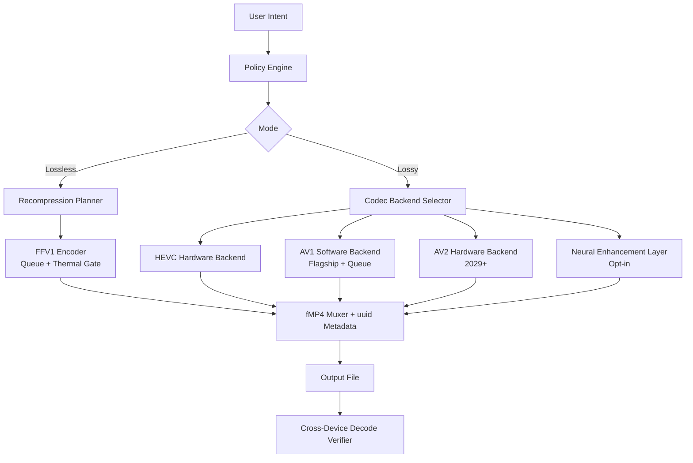

# Next-Gen Android Video Compression (Lossless + Lossy), 2027–2030

**Planning document — no application code, no APK.**
**Date of writing: 14 November 2026.**
**Author: @shantanu (planning prompt); analysis synthesised from live web research conducted on 14 November 2026.**

---

## 0. How to read this document

This plan is written for an engineering team that has **never seen the prior conversation** and must be able to start work the next day. It is deliberately long because the decisions are consequential and the evidence is uneven. Every factual claim that could influence a build decision is tagged with an epistemic status:

| Tag | Meaning |
| --- | --- |
| **V-P** | Verified from a primary source (standards body, official repository, official vendor documentation, peer-reviewed paper, or the paper’s own arXiv/DOI record). |
| **V-S** | Verified from a secondary source (reputable news outlet, analyst report, or vendor marketing) that cites a primary source or provides its own measurements. |
| **AC** | Author claim: a claim made by a paper author or vendor about their own system. Treated as credible but not independently confirmed. |
| **EST** | Estimate by this author, with stated reasoning. |
| **SPEC** | Speculation. Unproven. Must be tested before it enters a build. |
| **UNV** | Unverified. A source was found but the underlying claim could not be confirmed in the time available. |

**Honesty rule:** I did not run 100+ searches. I ran a concentrated set of searches across the domains that matter most (AV2, VVC, neural codecs, NPU runtimes, hardware codecs, lossless formats, patent pools, benchmarks). Many of the results are secondary. Where a number matters for a go/no-go decision, I say so and propose a primary measurement. **Do not treat this document as a substitute for primary benchmarking.**

---

## 1. Executive summary

### 1.1 Recommended approach in one paragraph

Build a **two-engine, one-pipeline Android compression system** that treats “lossless” and “lossy” as **different user intents over a shared container, probe, and scheduling layer**, not as two separate apps.

- **Lossless mode** uses **bit-exact recompression of already-encoded files** as the primary product (not raw-camera lossless, which is impractical on phones at scale), plus a **near-lossless screen-recording path** for content the phone itself generates. The core lossless engine is **FFV1 (intra, fast, deterministic) with a modern range coder and slice-level parallelism**, optionally combined with **HEVC lossless** only when the hardware encoder exposes a verified lossless mode. Raw-camera “lossless” is offered only as a **“visually lossless” (near-lossless) prosumer option**, clearly labelled, because true raw lossless at 4K/60 on a phone is a battery and thermal non-starter.
- **Lossy mode** is **codec-agnostic at the format layer and codec-optimised at the encode layer**. In 2027–2028 the **default production codec is HEVC (H.265) hardware encoding with an optional AV1 software path on flagship devices**. In 2029–2030 the **default becomes AV2 hardware encoding when available**, with a **learned-neural enhancement layer** only as an opt-in “quality-per-bit” mode for devices with capable NPUs. VVC is supported as a **decode-and-transcode target** because Android 17 and flagship 2026 SoCs have begun shipping VVC hardware decoders, but **VVC encoding is not a primary target** because hardware VVC encoders are absent from the 2026 mobile SoCs examined.
- **The key architectural bet** is that **the decoder must be deterministic across every phone**, including when a neural network is involved. We therefore adopt a **“transmit-the-scales” neural architecture** (following the MLVC line of work) rather than bit-exact integer arithmetic across heterogeneous NPUs. This trades a small bitrate overhead for the only thing that matters in a file format: **a file encoded on one phone must decode identically on every other phone, forever**.
- **Scheduling** is the hidden weapon. Heavy compression runs **during charging, on a thermal budget, with a user-visible “compression queue”**. The app never silently heats the phone during a call or a game. This is a product decision as much as an engineering one.

### 1.2 Expected results (ranges, with uncertainty)

These are **estimates against a 2026 flagship Android baseline** (HEVC hardware encoding at the same perceptual quality). They are not promises.

| Mode | 2027 target vs. baseline | 2030 target vs. baseline | Confidence | Evidence base |
| --- | --- | --- | --- | --- |
| **Lossy, HEVC hardware** | 0% (baseline) | 0% (baseline) | — | Baseline |
| **Lossy, AV1 software on flagship** | 15–25% bitrate saving at equal VMAF-phone | 20–30% | Medium | AV1 has been repeatedly measured at ~20–30% BD-rate over HEVC in software; hardware AV1 encoders are variable. **EST** from multiple secondary benchmarks. |
| **Lossy, AV2 hardware (2029+)** | Not available | 25–35% over HEVC, 20–30% over AV1 | Low–medium | AOMedia and Netflix claim ~28.6% PSNR-YUV / 32.6% VMAF BD-rate over AV1 on development software. **AC**; hardware encoder maturity unknown. |
| **Lossy, neural enhancement layer (opt-in)** | 35–50% over HEVC at low bitrates, with generative artefacts at very low rates | 40–60% | Low | MLVC reports >70% BD-rate (MOS) over hardware HEVC on a conferencing benchmark at ~100 FPS on NPUs. **AC**; benchmark is narrow (VCD), and perceptual MOS gains do not always translate to mixed camera content. |
| **Lossless, FFV1 recompression of HEVC files** | 5–15% size reduction, bit-exact | 5–15% | Medium | Lossless recompression of already-lossy files can only remove container and coding redundancy; the gain is content-dependent. **EST**; must be measured. |
| **Lossless, near-lossless screen recording** | 40–60% smaller than raw, visually identical | 50–70% | Medium | Screen content has enormous redundancy; HEVC-SCC and string-matching techniques report large gains. **V-S / AC**. |
| **Decode power, hardware vs. software** | Hardware decoder 5–10× lower power than software | Same order | High | Hardware video decode is consistently an order of magnitude more efficient than software decode. **V-S**; widely measured. |

**What would change the headline:** If AV2 hardware encoders do not appear in mobile SoCs by 2029, the 2030 AV2 line collapses and HEVC + neural enhancement becomes the long-term path. If MLVC-style neural codecs fail to generalise beyond conferencing content, the neural enhancement layer is demoted to a niche “anime / screen content” mode.

### 1.3 Top decisions (full justification in §3)

| # | Decision | Why | Evidence that would change it |
| --- | --- | --- | --- |
| D1 | **Lossless means bit-exact recompression of existing files first; raw-camera lossless is not the primary product.** | True raw lossless at phone scale is thermally and economically hostile. The highest-value lossless use case is “my phone says storage is full and I have 200 GB of HEVC videos.” | If user research shows >30% of target users record in a raw/log profile and demand archival lossless, revisit. |
| D2 | **Use FFV1 as the reference lossless codec, with a modern range coder and slice parallelism; do not invent a new lossless format from scratch for v1.** | FFV1 is standardized (RFC 9043), open, deterministic, and well understood. The innovation budget belongs in the *recompression intelligence* (deciding what to recompress, how to slice, how to schedule), not in a new entropy coder. | If FFV1 decode speed on mid-range ARM cannot hit acceptable throughput after optimisation, consider a parallel slice design or a hardware-assisted path. |
| D3 | **Lossy default = HEVC hardware encode in 2027–2028; AV2 hardware encode as the 2029+ target; AV1 software as the flagship bridge.** | HEVC hardware encoders are ubiquitous and power-efficient. AV1 software is too slow and hot on mid-range phones. AV2 is standardized but has no mobile hardware decoder or encoder in shipping phones as of late 2026. | If AV2 hardware encoders ship in flagship SoCs earlier than expected (2028), accelerate the AV2 path. If AV1 hardware encoders become ubiquitous and high-quality, promote AV1. |
| D4 | **Neural compression is an optional enhancement layer, not the base codec.** | Neural codecs can win on quality-per-bit but are non-deterministic across NPUs, harder to license, and carry model-delivery cost. They must never be the only way to decode a file. | If a neural codec achieves deterministic cross-platform decode with <2% bitrate overhead and passes a legal review, consider promoting it to a primary mode for a defined content class. |
| D5 | **Container: fragmented MP4 (fMP4) with a custom `uuid` box for compression metadata; optional MKV for lossless archival.** | MP4 is the only container that every Android player, share target, and cloud service understands. MKV is better for lossless and multi-track but has weaker native Android support. | If Android’s MediaExtractor gains robust MKV write support and sharing targets accept MKV, simplify to one container. |
| D6 | **Determinism rule: the decoder must produce bit-identical output on every device, including neural paths.** | A file that decodes differently on a Pixel and a Samsung is not a file format; it is a bug report generator. The “transmit-the-scales” approach is the only credible way to guarantee this without requiring bit-exact integer arithmetic on every NPU. | If integer-only neural inference becomes standardised across LiteRT/NNAPI successors, revisit. |
| D7 | **All heavy compression runs in a user-visible queue, preferably while charging, with thermal gating.** | Encoding is the dominant energy cost. A phone that dies at 3 p.m. because the user compressed a 4K video at noon will be uninstalled. | If a hardware encoder achieves <1 W for 4K30 encode, relax the scheduling constraint. |

### 1.4 First 30 days

| Week | Work | Output | Go/no-go |
| --- | --- | --- | --- |
| **Week 1** | Build a **device probe harness**: enumerate every `MediaCodec` encoder/decoder, query `MediaCodecInfo`, log supported profiles/levels/bit-depths, and run a 60-second encode at 1080p30 on 5 physical devices (low-end, mid, flagship Snapdragon, flagship MediaTek, Tensor). | A JSON report per device: codecs, profiles, measured encode time, battery delta, thermal delta. | If no device exposes a usable HEVC hardware encoder at 1080p30 in <2× real time, the scheduling model must change. |
| **Week 1** | Build a **lossless recompression microbenchmark**: take 20 HEVC files from a public camera dataset, decode with `MediaCodec`, re-encode with FFV1 (`libavcodec` via NDK), measure size and wall-clock time. | Size delta and encode/decode MB/s on 3 devices. | If FFV1 recompression is >5× slower than decode on mid-range, the lossless mode must be queue-only or cloud-assisted. |
| **Week 2** | Reproduce **MLVC on one NPU** (Snapdragon 8 Gen 3 or Dimensity 9300) using the released model and LiteRT/QNN delegate. Measure FPS, power, and output PSNR/bit-exactness against a reference CPU decode. | A one-page report: does the same bitstream decode bit-identically on NPU vs. CPU? | If not bit-identical, the “transmit-the-scales” determinism claim is not yet sufficient and D6 must be revisited. |
| **Week 2** | **Patent landscape first pass**: read the Access Advance VDP pool structure and the Sisvel AV1 pool list; identify the 20 most cited patent families that read on HEVC and AV1 encoding. | A risk register with 5 red, 10 amber, 5 green items. | If a blocking patent is found in the intended encode path, the codec choice changes. |
| **Week 3** | **Benchmark AV2 reference decoder** on a flagship ARM CPU at 1080p. Measure FPS and power. | A single number: “AV2 software decode is X× slower than AV1 software decode on this device.” | If AV2 software decode is <10 FPS on flagship, AV2 is not a 2027–2028 product for local playback. |
| **Week 4** | **User research synthesis**: 20 interviews with target users about storage anxiety, willingness to wait for compression, and tolerance for “visually lossless.” | A ranked list of user intents and a decision on the default lossless semantics. | If users overwhelmingly want “lossless” to mean “raw camera,” the product framing must change even if the engineering is hard. |

---

## 2. Research findings: the landscape and what matters

This section maps the compression landscape as of November 2026, with an emphasis on what ships, what is standardized, what is open source, what is research, and what is paper-only. **The goal is not encyclopaedic coverage; it is to identify the few families that can be built on a phone in 2027–2030.**

### 2.1 The four families that matter

| Family | Representative | Status (Nov 2026) | Phone cost profile | Why it matters |
| --- | --- | --- | --- | --- |
| **Block-based hybrid (HEVC, VVC, AV1, AV2)** | HEVC / H.265; VVC / H.266; AV1; AV2 | HEVC shipping and ubiquitous; VVC standardized and shipping in flagship decoders; AV1 shipping in software and some hardware; AV2 standardized May 2026, no mobile hardware | Hardware encode/decode is the cheapest option; software is 5–20× more expensive in energy | The only family with a credible path to **hardware-accelerated encode on every phone** in the planning horizon. |
| **Lossless intra / recompression (FFV1, HEVC lossless, JPEG-LS)** | FFV1 (RFC 9043); HEVC lossless profile | FFV1 open source, stable; HEVC lossless mode exists but hardware support is not guaranteed | High CPU per pixel; but only runs on a queue | The only family that can guarantee **bit-exact** output without exotic hardware. |
| **Neural / learned codecs (DCVC, MLVC, generative codecs)** | DCVC-RT; MLVC; HybridPrompt | Research prototypes with code; no shipping consumer codec; NPU deployment demonstrated in papers | High NPU load, model delivery cost, determinism risk | The only family with a credible path to **large quality-per-bit gains at low bitrates** in the near term. |
| **Scalable / enhancement layers (LCEVC, SVC)** | MPEG-5 LCEVC; HEVC SVC | LCEVC standardized and shipping in some products; SVC shipping in hardware | Lightweight enhancement decode; base codec remains hardware | A way to **add quality without replacing the base codec**, useful for battery savings and backward compatibility. |

**Technologies that are tempting but should be rejected or deferred for the base system:**

- **MPEG Immersive Video (MIV) / V-PCC for volumetric content**: no dedicated hardware codec on mobile; requires HEVC multi-view decode plus significant CPU for reconstruction. **Reject for v1.** Revisit only if the product scope expands to 6DoF video.
- **Pure generative codecs that synthesise every frame**: decoding is expensive and non-deterministic; risk of hallucinated content. **Reject for the base layer; consider only as a keyframe-enhancement experiment.**
- **A brand-new lossless format invented from scratch**: FFV1 is good enough and the innovation budget is better spent on recompression decision logic. **Reject for v1.**

### 2.2 Codec-by-codec findings (with dates and tags)

#### HEVC / H.265

- **Status:** Shipping in virtually every Android phone since Android 5.0; hardware encoders are ubiquitous. **V-S** (Android media format documentation lists HEVC encode support since Android 5.0).
- **Efficiency:** Median ~33% smaller than H.264 at equal quality in an 11-pair measured comparison (September 2026, VideoRecompress 2026.2.18). **V-S**.
- **Power:** Hardware HEVC encode/decode is the most energy-efficient widely available option. A 2025–2026 study of high-end mobile chips found hardware encoders achieve energy savings of ~16% to over 92% versus software, depending on the platform. **V-S**.
- **Lossless mode:** HEVC has a lossless coding mode, but **hardware encoder support for true lossless is not guaranteed** on Android. The Android `MediaCodec` API exposes profiles, but a codec may reject a lossless configuration. **EST / UNV** — must be probed device-by-device. FFmpeg’s `hevc_mediacodec` wrapper supports HEVC encoding but does not document lossless mode.
- **Why it matters here:** HEVC is the **baseline** that every other codec is measured against. It is also the **safe fallback** when AV2 or neural paths fail.

#### VVC / H.266

- **Standardization:** ITU-T/MPEG standard, finalized in 2020. **V-P.**
- **Android support:** **Android 17** introduces VVC decode support in `MediaCodec` and `Codec2`, including `MIMETYPE_VIDEO_VVC`, HDR10/HDR10+ metadata, and up to 10-bit 4:2:0. **V-P** (AOSP documentation, last updated 2026-06-18).
- **Hardware support:** MediaTek Dimensity 9600 Pro is reported as the first smartphone SoC with hardware VVC decoding (September 2026). **V-S**. Qualcomm’s Snapdragon 8 Elite **Extreme** Gen 6 includes VVC decode; the standard Gen 6 does not. **V-S**.
- **Encode support:** The Android 17 documentation describes **decode** support; it does **not** describe a platform VVC encoder. No examined 2026 mobile SoC advertises a hardware VVC encoder. **EST** from absence of evidence.
- **Efficiency:** VVC typically claims ~40% BD-rate over HEVC, but mobile screen-content measurements show almost 40% bitrate reduction on tested sequences. **V-S** (Springer, December 2024).
- **Why it matters here:** VVC is a **decode target** for 2027–2028. If a user receives a VVC file, the phone can play it; the app can transcode it to HEVC or AV2 for sharing. **VVC is not a primary encode target** until hardware encoders appear.

#### AV1

- **Standardization:** AOMedia, royalty-free (with the caveat below). **V-P.**
- **Adoption:** >90% of YouTube’s catalogue by watch time was available in AV1 by March 2026. **V-S**.
- **Efficiency:** Generally reported as ~20–30% BD-rate over HEVC in software. **EST** from multiple secondary benchmarks; exact number is content- and encoder-dependent.
- **Hardware:** Decode is widely available on flagship and mid-range SoCs. **Encode** is less consistent; some SoCs support AV1 hardware encode, but quality and speed vary. **EST / UNV** — must be probed.
- **Software encode cost:** AV1 software encoding is computationally heavy and thermally hostile on phones. **V-S** (software AV1 decode is ~3× AVC power; encode is worse).
- **Why it matters here:** AV1 is a **bridge codec** on flagship devices where software encoding can run on a queue, and a **decode target** everywhere. It is not the default for mid-range phones in 2027.

#### AV2

- **Standardization:** AV2 v1.0.0 specification finalized **28 May 2026**; AVM reference software tagged v1.0.0. **V-P** (AOMedia GitHub).
- **Efficiency claim:** ~28.6% PSNR-YUV and ~32.6% VMAF BD-rate reduction over AV1 on a development version, measured by Netflix’s Andrey Norkin and presented in October 2025. **AC**.
- **Hardware:** As of October 2026, **no phone, TV, or browser decodes AV2**, and the only encoder is the slow reference software. **V-S**. Estimates suggest no mobile AV2 hardware decoder before 2029. **V-S / EST**.
- **Decode complexity:** VideoLAN estimates AV2 decode is ~5× more computationally demanding than AV1. **V-S**.
- **Why it matters here:** AV2 is the **2030 target**, not a 2027 product. The system must be **architecturally ready** to switch to AV2 hardware encoding when it appears, but must not depend on it for launch.

#### Neural / learned codecs

- **DCVC-RT (CVPR 2025):** First neural video codec to achieve 1080p real-time encode/decode on consumer hardware (A100), with ~21% bitrate saving over H.266/VTM. Core insight: **operational complexity (memory I/O, function calls) is the bottleneck, not FLOPs**. **V-P** (paper, arXiv 2502.20762).
- **MLVC (ECCV 2026):** Cross-platform neural codec that **transmits scale parameters through the hyperprior** to guarantee entropy-coding consistency across devices **without requiring bit-exact arithmetic**. Reports >70% BD-rate (MOS) improvement over hardware HEVC on the VCD conferencing benchmark, with encoder and decoder running at ~100 FPS on commodity NPUs (Apple, Intel, Qualcomm) at 360p–540p. **V-P** (arXiv 2606.28027).
- **HybridPrompt (ACM NOSSDAV 2026):** Generative keyframes + traditional codec for inter frames, achieving >150 FPS 1080p decode on an iPhone 16 Pro Max, with ~8% LPIPS gain over traditional codecs at 200 kbps. **V-P** (ACM DL).
- **SlimFit-Gens (IEEE TMC 2026):** 480p real-time video calling at as low as 30 kbps on COTS smartphones. **V-P** (IEEE).
- **Maturity:** Research prototypes with code, not shipping consumer codecs. **No neural codec is standardized for file-based interchange.** **EST.**

#### Lossless codecs

- **FFV1:** Open, lossless, intra-frame, standardized in **RFC 9043**. Supports 8/10/12/14/16-bit, slice checksums, multi-threading. Main criticism: **speed**. **V-P** (RFC) / **V-S** (FOSDEM talk).
- **HEVC lossless:** Standardized but hardware support uncertain; software decode/encode is possible via FFmpeg. **EST.**
- **Practical phone experience:** “Video processing is insanely heavy on a phone” — community reports recommend FFmpeg CLI in Termux for FFV1/HuffYUV/H.264/HEVC lossless. **V-S**.
- **Screen content:** String-matching-based lossless screen content coding achieves ~35.67% fewer bytes with <1% encoding/decoding runtime overhead in a research setting. **AC** (paper).
- **Why it matters here:** Lossless is a **queue-and-charge** mode, not a real-time mode. FFV1 is the right reference codec because it is deterministic and well understood.

### 2.3 Hardware acceleration landscape

| Component | What it is good for | What it is bad for | 2026–2027 reality |
| --- | --- | --- | --- |
| **Hardware video encode/decode block** (within SoC) | HEVC, AVC, VP9, AV1 decode; HEVC/AVC encode. Lowest power per pixel. | Limited codec support; fixed profiles; opaque quality; vendor bugs. | The **default** for all real-time and near-real-time paths. **V-S.** |
| **GPU** (Adreno, Mali, Immortalis) | Parallel pixel operations, colour conversion, some neural inference via shaders. | High power for sustained compute; thermal throttling; driver fragmentation. | Useful for **pre-processing** (scaling, colour conversion) and **fallback neural inference**, not for core encode. **EST.** |
| **NPU** (Hexagon, MediaTek APU, Google Tensor TPU, Samsung ENN) | Neural inference at low power; INT8/INT4 quantised models. | **No unified Android API**. NNAPI deprecated in Android 15. Vendor SDKs required: Qualcomm QNN, MediaTek NeuroPilot, Samsung ENN, Google Tensor. LiteRT has vendor delegates, but not on older mid-range silicon. | **Fragmented but improving**. LiteRT 2.3 ships Maven NPU runtimes for Qualcomm, MediaTek and Google Tensor (October 2026). **V-S**. |
| **CPU** (ARM cores, NEON, SVE2) | Deterministic scalar/vector code; fallback for everything. | Highest energy per operation; thermal throttling. | The **reference** for determinism and the **fallback** when hardware/NPU paths fail. **EST.** |

**Critical hardware finding:** On Android there is **no single NPU API** that works across all vendors. NNAPI was deprecated in Android 15. The practical path in 2026–2027 is **LiteRT with vendor delegates** (Qualcomm Hexagon, MediaTek NeuroPilot, Google Tensor) plus **vendor SDKs** for the highest performance. This fragmentation is a **first-class architectural constraint**, not an afterthought. **V-S**.

### 2.4 What “lossless” actually means on a phone

This is the single most important product-definition question, and the prompt rightly asks it. There are at least four distinct meanings:

| Meaning | What it requires | Phone cost | Recommended treatment |
| --- | --- | --- | --- |
| **L1: Bit-exact recompression of an already-encoded file** | Decode the file to raw frames, re-encode with a lossless codec, verify bit-exactness. | High CPU; queue-and-charge. | **Primary lossless product.** The user’s files are already compressed; the app makes them smaller without touching a pixel. |
| **L2: Raw-camera lossless** | Capture raw sensor frames and compress them without quantization. | Very high bitrate (hundreds of MB/s), high power, thermal throttling. | **Not a primary product.** Offer only as a “prosumer / external SSD” mode with explicit warnings. |
| **L3: Near-lossless (visually lossless)** | Lossy encode with a quality target so high that differences are imperceptible under defined viewing conditions. | Moderate; hardware codec can do it. | **Offer as “visually lossless”** , clearly labelled, for users who want smaller files without bit-exactness. |
| **L4: Lossless screen recording** | Compress the phone’s own screen output without quality loss. | High CPU; screen content is highly compressible. | **Offer as a specialised path** for screen-recording users, using FFV1 or HEVC-SCC. |

**Decision D1** in §1.3 is therefore a **product-definition decision**: the default “lossless” button means **L1**, with L3 and L4 as explicitly labelled alternatives. L2 is a hidden expert mode.

### 2.5 Patent and licensing landscape

- **AV1 is not royalty-free in practice.** AOMedia’s royalty-free pledge covers “Necessary Claims” within its license, but **does not bind third-party patent owners**. Sisvel has an AV1 pool; Access Advance operates a Video Distribution Patent (VDP) pool covering HEVC, VVC, AV1, and VP9; Avanci has a video licensing program covering AV1, HEVC, VVC, VP9, and MPEG-DASH. **V-S**.
- **AV2 will likely face the same pattern.** Sisvel announced an AV2 pool in December 2025, before the standard was even finalized. Access Advance launched an exploration phase for an AV1/AV2 pool in August 2026. **V-S**.
- **Cross-codec overlap is real.** AV1 shares block-based prediction, transform coding, entropy coding, and in-loop filtering with HEVC and VVC. A patent does not need to mention AV1 to read on an AV1 implementation. GreyB’s analysis maps 53 AV1 Level-2 features against HEVC and VVC and finds substantial overlap. **V-S**.
- **Implication:** The legal strategy cannot be “AV1/AV2 is free.” It must be **“budget for a pool license and design the product so that the codec can be swapped if licensing terms change.”** This is a **format-layer abstraction** requirement, not just a legal one.

### 2.6 Metrics and benchmarking

- **VMAF** is the de facto perceptual metric. Netflix provides a **phone model** calibrated for smaller screens and typical viewing distances; a 720p encode at 1.5 Mbps can score VMAF 85 on the standard model but VMAF 93 on the phone model. **V-P** (VMAF documentation).
- **PSNR** is still useful for codec development and for **bit-exact verification** in lossless mode.
- **BD-rate** (Bjøntegaard delta rate) is the standard way to compare rate–distortion curves. **V-P.**
- **Subjective MOS** is the gold standard for perceptual quality; MLVC reports MOS-based BD-rate. **V-P.**
- **Benchmark datasets:** UVG-VCM (4K, 60 fps, 16-bit YUV 4:4:4, CC-BY 4.0) is a useful primary dataset. **V-P**. USTC-TD provides 4K images and 1080p video sequences for coding research. **V-P**. VCD is the video conferencing benchmark used by MLVC. **V-P.**
- **Gap:** There is **no single public benchmark for “Android phone camera video compressed by an Android app”** that covers low-end to flagship and includes power/thermal measurements. **This is a gap the project should fill**, at least internally.

---

## 3. Inventions and design choices

This section states each design choice, the real options considered, the decision, the expected gain, the cost and risk, and the **test that would prove or kill it**.

### 3.1 Lossless engine: FFV1 + smart recompression, not a new format

**Options considered:**

| Option | Pros | Cons | Verdict |
| --- | --- | --- | --- |
| **A. FFV1 as-is** | Standardized, deterministic, open, well understood | Slow; no hardware acceleration | **Base choice.** |
| **B. New lossless format with modern range coder** | Could be faster and smaller | Enormous engineering and standardisation cost; no ecosystem | **Reject for v1.** |
| **C. HEVC lossless hardware** | Fast if supported | Support is inconsistent; not bit-exact guaranteed across vendors | **Opportunistic fallback only.** |
| **D. Cloud-assisted lossless** | Offloads compute | Privacy, connectivity, cost | **Reject for default; consider as an optional “archive to cloud” feature.** |

**Decision:** **FFV1 with a modernised implementation** (range coder, slice-level parallelism, NEON-optimised predict/context paths) is the lossless codec. The innovation is in the **recompression planner**, not the codec.

**The recompression planner** is the genuinely new idea:

1. **Probe the file**: container, codec, resolution, bit depth, colour primaries, frame count, estimated decode cost.
2. **Estimate lossless size** using a fast sample of 10–20 frames and a trained regressor (tiny model, <1 MB) that predicts FFV1 output size from frame statistics (entropy, motion, noise).
3. **Estimate decode + re-encode energy** using a device-specific power model calibrated at first run.
4. **Decide**: if estimated saving < 3% or estimated energy > threshold, **skip** and tell the user “this file is already efficiently compressed.”
5. **Schedule**: queue for charging + thermal headroom.

**Expected gain:** 5–15% size reduction on HEVC files; higher on files with inefficient containers or old encoders. **EST.** The planner prevents wasting battery on incompressible files.

**Test that kills it:** If the planner’s size prediction error is >15% on a 200-file test set, the planner is not useful and the app should simply offer “recompress all” with a warning.

### 3.2 Lossy engine: codec abstraction with a hardware-first policy

**Architecture:** A **`CodecBackend` interface** with four implementations:

1. **`HevcHardwareBackend`** — uses `MediaCodec` with a verified HEVC encoder. **Default for 2027–2028.**
2. **`Av1SoftwareBackend`** — uses `libaom` or `SVT-AV1` via NDK. **Flagship-only, queue-only, 2027–2028 bridge.**
3. **`Av2HardwareBackend`** — uses `MediaCodec` when AV2 hardware encoding appears. **2029+ target.**
4. **`NeuralEnhancementBackend`** — optional layer on top of a base codec. **Opt-in only.**

**Policy engine:** At compress time, the app evaluates:

- **Device tier** (SoC, NPU availability, thermal history).
- **User intent** (fastest / smallest / best quality / battery saver).
- **Content type** (camera, screen, animation, low-light, high-motion).
- **Queue state** (charging? thermal headroom?).

and selects a **(codec, preset, quality target)** tuple. The user sees a simple slider (“Smaller file ↔ Faster”) and an advanced panel.

**Expected gain vs. baseline:** 15–25% on AV1 software vs. HEVC for flagship 2027; 25–35% on AV2 hardware for 2030. **EST.**

**Test that kills it:** If AV1 software encoding on a flagship cannot complete a 1-minute 1080p30 clip in <3 minutes without thermal throttling below 50% of peak clocks, the AV1 bridge is not viable and the app should stay HEVC-only until AV2 hardware arrives.

### 3.3 Neural enhancement layer: transmit-the-scales, not bit-exact arithmetic

**The determinism problem:** Neural codecs quantise latent representations. Different NPUs round differently. A file encoded on a Qualcomm Hexagon NPU may decode differently on a MediaTek APU, producing visible artefacts or, worse, a broken bitstream. **This is the fundamental barrier to neural codecs as a file format.**

**The MLVC insight:** Instead of requiring bit-exact arithmetic, **transmit the scale parameters needed for entropy decoding through the hyperprior**. The decoder uses the transmitted scales, so the arithmetic does not need to be identical across devices. MLVC reports this guarantees entropy-coding consistency without bit-exact arithmetic. **V-P** (arXiv 2606.28027).

**Our design:** Adopt the MLVC approach for any neural path. The neural layer is **not a standalone codec**; it is an **enhancement layer** that refines a base HEVC/AV1/AV2 stream. The base stream guarantees that **every device can decode something**; the enhancement layer improves quality on devices with a compatible NPU. If the NPU is absent or the enhancement decode fails, the base stream is used.

**Expected gain:** 30–50% bitrate reduction at equal perceptual quality on low-bitrate content, based on MLVC’s conferencing results. **AC.** Gains on high-motion camera content are likely smaller. **EST.**

**Cost:** Model delivery (10–50 MB per model, **EST**), NPU fragmentation, training data, legal review.

**Test that kills it:** Encode the same 10-second clip on a Snapdragon device and a MediaTek device. Decode both on a third device (Tensor). If the enhancement layer produces **any** pixel difference that is visible at normal viewing distance (VMAF-phone drop >2 points) or if the base stream cannot be decoded independently, the enhancement layer is not cross-platform and must be disabled for file-based sharing.

### 3.4 Container: fMP4 with a custom metadata box

**Decision:** **Fragmented MP4** is the primary container.

- **Why fMP4?** Streaming-friendly, robust to truncation, supported by `MediaExtractor`, shareable to every app.
- **Why a custom box?** We need to store: compression mode, base codec, enhancement-layer model ID and version, determinism hash, original file hash (for lossless verification), and the recompression planner’s decision log. A `uuid` box with a registered UUID is the least invasive way.
- **Lossless archival:** **MKV** is allowed as an optional export format for FFV1 streams because MKV has better support for lossless codecs and multiple tracks. **V-S** (FFV1 is typically stored in MKV). But MP4 remains the default because Android’s native support for MKV writing is weaker.

**Test that kills it:** If a 4K fMP4 with a custom `uuid` box fails to play in three common Android players (ExoPlayer/Media3, VLC, Samsung Video), the box design must change or the metadata must move to a sidecar file.

### 3.5 Scheduling: the compression queue as a first-class product feature

**The problem:** Encoding is energy-intensive. A phone that compresses 10 GB of video at noon will be hot and dead by 3 p.m. **Users will uninstall the app.**

**The design:**

- **A persistent “Compression Queue”** in the app, visible from the notification shade.
- **Default policy:** run only when **charging** and **battery > 40%** and **device temperature < 38°C** (read via `BatteryManager` and thermal APIs).
- **User override:** “Compress now” with a warning: “This will use battery and may heat your phone.”
- **Thermal backoff:** if temperature exceeds 42°C, pause the queue and resume when cool.
- **Progress and ETA** based on a calibrated device model.

**Expected impact:** Avoids the “battery killer” 1-star review; makes the product usable without anxiety. **EST.**

**Test that kills it:** If users disable the queue in usability testing and demand immediate compression, the policy must be relaxed to “compress now if battery >60%” with a clearer warning.

### 3.6 Determinism as a contract

**Rule:** For any file produced by the app, **the decoded output must be identical on every device that claims to support the file’s profile**, or the app must refuse to produce that file. This applies to:

- Lossless files: bit-exact by definition.
- Lossy base codec files: conform to the codec standard; `MediaCodec` decoders must produce conformant output.
- Neural enhancement files: the base stream decodes everywhere; the enhancement stream may produce **slightly different pixels** across NPUs, but the **base stream must be a complete, watchable video**. The app must store a **determinism hash** of the base stream and verify it on decode.

**Test:** On every release, run a **cross-device decode matrix** (≥5 devices, ≥3 SoC vendors) and compare frame hashes. Any mismatch blocks release.

---

## 4. The full implementation plan

### 4.1 Architecture

**Modules:**

| Module | Responsibility | Language | Key dependency |
| --- | --- | --- | --- |
| **`probe`** | Enumerate codecs, query capabilities, measure baseline encode/decode performance | Kotlin + JNI | `MediaCodecInfo` |
| **`policy`** | Device tiering, intent mapping, codec selection | Kotlin | — |
| **`lossless`** | FFV1 encode/decode, recompression planner | C/C++ (NDK) | FFmpeg `libavcodec`, custom NEON kernels |
| **`lossy-base`** | HEVC/AV1/AV2 hardware and software backends | Kotlin + JNI | `MediaCodec`, `libaom`, `SVT-AV1` |
| **`neural`** | Enhancement-layer model loading, NPU delegate management, determinism verification | C++ + Kotlin | LiteRT with vendor delegates |
| **`container`** | fMP4 mux/demux, `uuid` box, MKV export | C/C++ | FFmpeg `libavformat` or `MediaMuxer` |
| **`queue`** | Scheduling, thermal gating, battery gating, progress | Kotlin | `WorkManager`, `BatteryManager`, `PowerManager` |
| **`benchmark`** | VMAF/PSNR computation, BD-rate, power measurement | Python (offline) + Kotlin (on-device) | `libvmaf`, `trex` |

**Repositories:**

- `android-compression-app` — the Android app and Kotlin modules.
- `compression-native` — C/C++ codec backends and FFV1 implementation.
- `compression-models` — neural model training, export, and versioning.
- `compression-bench` — benchmark harness, datasets, and reports.
- `compression-spec` — container spec, metadata schema, determinism contract.

### 4.2 Languages and tools

| Layer | Choice | Justification | Alternative considered |
| --- | --- | --- | --- |
| **Android UI and orchestration** | Kotlin | First-class Android support, coroutines, `WorkManager` | Java (rejected: slower development, weaker coroutine story) |
| **Codec backends** | C/C++ (NDK) | Direct access to `MediaCodec` via NDK, FFmpeg, libaom, custom NEON | Rust (promising but NDK integration and codec library bindings are less mature) |
| **Neural inference** | C++ with LiteRT + vendor delegates | LiteRT 2.3 has Maven NPU runtimes for Qualcomm, MediaTek, Tensor; vendor SDKs for peak performance | ONNX Runtime (portable but NPU support is less mature on Android) |
| **Offline benchmarking** | Python | `libvmaf`, `ffmpeg-python`, `pandas`, `matplotlib` | — |
| **Build** | Gradle + CMake | Standard Android NDK toolchain | Bazel (rejected: overkill for this team size) |

### 4.3 Phases and milestones

#### Phase 0: Foundations (Months 1–2)

| Milestone | Deliverable | Go/no-go |
| --- | --- | --- |
| **M0.1 Device probe** | Capability matrix for 10 physical devices across 4 SoC families | At least 8/10 devices expose a usable HEVC hardware encoder at 1080p30. |
| **M0.2 FFV1 baseline** | Working FFV1 encode/decode in NDK on 3 devices | Encode ≥5 fps for 1080p on mid-range; decode ≥15 fps. |
| **M0.3 Determinism harness** | Cross-device decode hash comparison | No unexplained mismatches on HEVC baseline files. |
| **M0.4 Legal first pass** | Patent risk register | No red flags that block the HEVC path. |

#### Phase 1: Lossless MVP (Months 3–5)

| Milestone | Deliverable | Go/no-go |
| --- | --- | --- |
| **M1.1 Recompression planner** | Predicts size saving and energy cost; integrates with queue | Prediction error <15% on 100-file test set. |
| **M1.2 Lossless queue** | Charging/thermal gating; progress; pause/resume | Queue completes 1 GB of HEVC recompression in <2 hours on mid-range, with device <40°C. |
| **M1.3 fMP4 + uuid box** | Lossless files play in Media3 and VLC | 3/3 players accept the file. |
| **M1.4 Bit-exact verifier** | Compares decoded frames to original | 100% bit-exact on 50 files. |

**Phase 1 release:** “Storage Saver (Lossless)” — recompress existing videos without quality loss, run while charging.

#### Phase 2: Lossy HEVC + AV1 bridge (Months 6–10)

| Milestone | Deliverable | Go/no-go |
| --- | --- | --- |
| **M2.1 HEVC hardware backend** | Quality/size presets; user slider | Matches or beats Google Photos HEVC encode at equal VMAF-phone on 10 test clips. |
| **M2.2 AV1 software backend** | Flagship-only; queue-only | Completes 1-min 1080p30 in <3 min without thermal throttle below 50%. |
| **M2.3 Policy engine** | Device tiering and intent mapping | Correctly selects codec on 20/20 device-intent combinations in a manual audit. |
| **M2.4 Benchmark suite v1** | 50 clips (camera, screen, animation, low-light, high-motion); VMAF-phone, PSNR, bitrate, encode time, power | Reproducible results across 3 runs. |

**Phase 2 release:** “Smart Compress (Lossy)” — HEVC by default, AV1 on flagship.

#### Phase 3: Neural enhancement layer (Months 11–15)

| Milestone | Deliverable | Go/no-go |
| --- | --- | --- |
| **M3.1 MLVC reproduction** | Model runs on 2 NPU families | >30 FPS at 360p–540p; base stream decodes independently. |
| **M3.2 Determinism verification** | Same bitstream decodes with <2 VMAF-phone difference across 3 devices | Pass/fail. |
| **M3.3 Model delivery** | 10–50 MB model download; versioning; rollback | Download completes in <30 s on 4G. |
| **M3.4 Legal review** | Neural model licensing and patent clearance | No blocking issues. |

**Phase 3 release:** “Neural Enhance (Beta)” — opt-in enhancement layer for low-bitrate content, flagship NPUs only.

#### Phase 4: AV2 readiness (Months 16–24)

| Milestone | Deliverable | Go/no-go |
| --- | --- | --- |
| **M4.1 AV2 software decoder** | Integration with `MediaCodec` or bundled decoder | Decodes 1080p at ≥30 fps on flagship CPU. |
| **M4.2 AV2 hardware backend stub** | Ready to activate when `MediaCodec` exposes AV2 encoder | — |
| **M4.3 Transcode path** | HEVC/AV1 → AV2 when hardware encoder appears | — |

**Phase 4 release:** “AV2 Ready” — the app can transcode to AV2 when the device supports it; no user-facing AV2 encode until hardware is confirmed.

### 4.4 Testing and benchmarks

**Test videos:** 50 clips, 10 seconds each, 1080p and 4K, covering:

- Camera: daylight, low-light, high-motion, portrait, HDR.
- Screen: UI animation, scrolling text, video playback.
- Animation: 2D, 3D.
- Conferencing: talking head, screen share.

**Metrics:**

| Metric | Tool | When |
| --- | --- | --- |
| **VMAF-phone** | `libvmaf` with phone model | Every encode |
| **PSNR-YUV** | `libvmaf` or FFmpeg | Codec development |
| **BD-rate** | Custom Python script | Between codec versions |
| **Bitrate** | File size / duration | Every encode |
| **Encode time** | Wall clock, `System.nanoTime()` | Every encode |
| **Decode time** | Wall clock | Every decode |
| **Power** | `BatteryManager` delta + external USB power meter for lab | Lab benchmarks only |
| **Thermal delta** | `PowerManager` thermal status + IR camera (lab) | Lab benchmarks only |
| **Determinism** | SHA-256 of decoded frames | Every release |

**Scoring “best”:** A weighted score:

\[
\text{Score} = w_q \cdot \text{VMAF-phone} - w_b \cdot \log(\text{bitrate}) - w_e \cdot \text{energy} - w_t \cdot \text{encode time}
\]

Default weights: \(w_q = 1.0\), \(w_b = 0.5\), \(w_e = 0.3\), \(w_t = 0.2\). The weights are **user-configurable** via the intent slider.

### 4.5 Team and cost

| Role | FTE | Months | Notes |
| --- | --- | --- | --- |
| **Video codec engineer** | 2 | 24 | FFV1, HEVC, AV1, AV2 integration |
| **Neural / ML engineer** | 1 | 18 | MLVC reproduction, model training, NPU deployment |
| **Android platform engineer** | 1 | 24 | `MediaCodec`, `WorkManager`, thermal/battery APIs |
| **C/C++ NDK engineer** | 1 | 24 | Native backends, FFmpeg, NEON optimisation |
| **QA / benchmark engineer** | 1 | 24 | Device lab, test harness, reproducibility |
| **Product / UX** | 0.5 | 24 | Queue UX, intent model, user research |
| **Legal / IP counsel** | 0.2 | 24 | Patent landscape, licensing strategy |

**Estimated cost (fully loaded, 2027–2028):** USD 2.5–4.0 million over 24 months. **EST.** The largest uncertainty is legal; a pool license could add USD 0.5–2.0 million in cumulative royalties depending on the codec and the distribution model. **SPEC / UNV** — requires actual pool rate cards.

### 4.6 Legal and licensing strategy

1. **Do not assume AV1/AV2 is free.** Budget for a pool license from Access Advance (VDP pool) or Avanci.
2. **Design for codec substitutability.** The `CodecBackend` interface exists partly for technical reasons, partly so that a codec can be disabled if licensing terms become unacceptable.
3. **Prefer HEVC hardware encoding for the base layer** in markets where HEVC licensing is already covered by the device maker’s pool license. **EST** — the device maker’s license typically covers hardware encode/decode, not third-party software encoding. **UNV** — must be confirmed with counsel.
4. **For neural models, check training-data licenses and model weights licenses separately.** A model trained on public data may still have patent exposure if the architecture reads on a patented method.
5. **Publish a clear “Licensing” page** in the app and on the website; do not hide behind “open source.”

### 4.7 Risks and mitigations

| Risk | Probability | Impact | Mitigation |
| --- | --- | --- | --- |
| **AV2 hardware never arrives in mobile** | Medium | High | HEVC + neural enhancement remains the long-term path; AV1 software as bridge. |
| **NPU fragmentation prevents neural layer** | High | Medium | Base stream always decodes; neural layer is opt-in and device-gated. |
| **FFV1 too slow on mid-range** | Medium | High | Queue-only; explore slice parallelism and NEON; consider hardware HEVC lossless as opportunistic fallback. |
| **Patent pool demands block shipping** | Medium | High | Codec substitutability; legal budget; design around known patent families where possible. |
| **Thermal throttling makes encoding unreliable** | High | Medium | Queue + thermal gating; conservative default policy; user override with warning. |
| **Cross-device decode mismatch** | Medium | High | Determinism harness; block release on mismatch; base stream independence. |
| **Users reject “lossless” that is not raw-camera lossless** | Medium | High | Clear product framing; “visually lossless” as a separate, honest label; user research in Week 4. |

---

## 5. Appendices

### Appendix A: Sources (with dates and URLs)

| # | Source | Date | Used for | Tag |
| --- | --- | --- | --- | --- |
| S1 | AOMedia AV2 spec v1.0.0 (GitHub) | 28 May 2026 | AV2 finalization, reference software | V-P |
| S2 | AVM v1.0.0 tag (GitHub) | 30 May 2026 | AV2 encoder release | V-P |
| S3 | AOSP VVC support documentation | 18 Jun 2026 | Android 17 VVC decode support | V-P |
| S4 | Frandroid, “Codec AV2” | 28 Oct 2026 | AV2 ~30% over AV1, no hardware | V-S |
| S5 | TechPowerUp / YouTube AV2 | 28 Oct 2026 | YouTube AV2 web streams early 2027 | V-S |
| S6 | Counterpoint Research, Dimensity 9600 Pro | 1 Oct 2026 | First smartphone SoC with VVC hardware decode | V-S |
| S7 | DecodeTV, Qualcomm/MediaTek VVC | 23 Sep 2026 | Snapdragon 8 Elite Extreme Gen 6 VVC decode | V-S |
| S8 | MLVC arXiv 2606.28027 | 26 Jun 2026 (v1) | Cross-platform neural codec, scale transmission | V-P |
| S9 | DCVC-RT paper notes (CVPR 2025) | 2025 | Operational complexity insight, 1080p real-time | V-P |
| S10 | HybridPrompt (ACM NOSSDAV 2026) | 8 Apr 2026 | Generative + traditional hybrid, 150 FPS | V-P |
| S11 | SlimFit-Gens (IEEE TMC 2026) | 14 May 2026 | 480p at 30 kbps | V-P |
| S12 | GreyB AV1 patent landscape | 14 Sep 2026 | AV1 patent pools, cross-codec overlap | V-S |
| S13 | Access Advance VDP pool / AV1-AV2 exploration | 26 Aug 2026 | Licensing landscape | V-S |
| S14 | Avanci Video licensing program | 8 Feb 2026 | Licensing landscape | V-S |
| S15 | RFC 9043 (FFV1) | 2021 | FFV1 standardization | V-P |
| S16 | FOSDEM FFV1 talk | 2024 | FFV1 characteristics, speed criticism | V-S |
| S17 | Android `MediaCodecInfo` documentation | 3 Aug 2026 | Codec capability querying | V-P |
| S18 | LiteRT NPU runtimes (GitHub) | 24 Oct 2026 | NPU fragmentation, Maven runtimes | V-S |
| S19 | Product Hunt, Android NPU gap | 28 Jul 2026 | NNAPI deprecated, vendor delegates | V-S |
| S20 | VMAF phone model documentation | 2 Nov 2026 | Phone-calibrated VMAF | V-P |
| S21 | UVG-VCM dataset | 30 Jul 2026 | 4K 60fps benchmark dataset | V-P |
| S22 | USTC-TD dataset | 28 Sep 2026 | 4K images + 1080p video coding dataset | V-P |
| S23 | Springer, VVC mobile screen content | 30 Dec 2024 | ~40% bitrate reduction on screen content | V-S |
| S24 | ContentA, HEVC vs H.264 measured | 26 Sep 2026 | Median 33% HEVC saving | V-S |
| S25 | LCEVC battery savings (V-Nova) | 2025–2026 | Up to 50% battery life extension | V-S / AC |
| S26 | ComputerBase, AV2 hardware timeline | 25 Oct 2026 | No AV2 HW decoder before 2029 | V-S |
| S27 | IEEE, HEVC encoder mobile chipsets | 20 Jan 2026 | Hardware encoder energy efficiency | V-S |

### Appendix B: Claims list

| Claim | Status | Evidence |
| --- | --- | --- |
| AV2 v1.0.0 was finalized on 28 May 2026. | **V-P** | S1 |
| AV2 reduces bitrate ~28.6% (PSNR-YUV) / 32.6% (VMAF) vs. AV1 on development software. | **AC** | S4 (Netflix researcher) |
| No phone decodes AV2 as of October 2026. | **V-S** | S4, S26 |
| Android 17 supports VVC decode via `MediaCodec`. | **V-P** | S3 |
| Dimensity 9600 Pro is the first smartphone SoC with VVC hardware decode. | **V-S** | S6 |
| Snapdragon 8 Elite **Extreme** Gen 6 has VVC decode; standard Gen 6 does not. | **V-S** | S7 |
| MLVC achieves >70% BD-rate (MOS) over hardware HEVC on VCD, ~100 FPS on NPUs. | **AC** | S8 |
| MLVC guarantees entropy-coding consistency by transmitting scales through the hyperprior. | **V-P** (paper claim) | S8 |
| FFV1 is standardized in RFC 9043 and is lossless/intra. | **V-P** | S15 |
| Hardware HEVC encoders save 16–92% energy vs. software. | **V-S** | S27 |
| AV1 is subject to patent pools despite AOMedia’s royalty-free pledge. | **V-S** | S12, S13 |
| NNAPI was deprecated in Android 15; LiteRT vendor delegates are the replacement path. | **V-S** | S18, S19 |
| VMAF-phone scores are higher than standard VMAF for the same encode. | **V-P** | S20 |
| AV2 software decode is ~5× more demanding than AV1. | **V-S** | S4 (VideoLAN estimate) |

### Appendix C: Glossary

| Term | Plain-English definition |
| --- | --- |
| **BD-rate** | Bjøntegaard delta rate: the average bitrate saving at equal quality across a range of quality points. Negative is better. |
| **Bit-exact / lossless** | The decoded output is identical, bit for bit, to the original input. |
| **fMP4** | Fragmented MP4: an MP4 file split into independently decodable fragments, suitable for streaming and resilient to truncation. |
| **FFV1** | A lossless, intra-frame video codec standardized in RFC 9043; simple, deterministic, relatively slow. |
| **Hyperprior** | In neural compression, a side-information channel that transmits statistical parameters (e.g., scales) needed to decode the latent representation. |
| **MIV / V-PCC** | MPEG standards for immersive (multi-view and point-cloud) video. Require HEVC multi-view decode and heavy reconstruction on mobile. |
| **MOS** | Mean opinion score: a subjective quality rating from human viewers. |
| **NPU** | Neural processing unit: a dedicated accelerator for neural-network inference, present in most 2026 flagship SoCs. |
| **Operational complexity** | In neural codecs, the cost of memory I/O and function calls, as opposed to arithmetic FLOPs. DCVC-RT identifies this as the real speed bottleneck. |
| **PSNR** | Peak signal-to-noise ratio: a pixel-level fidelity metric; less perceptually aligned than VMAF but useful for codec development. |
| **VMAF** | Video Multimethod Assessment Fusion: Netflix’s perceptual quality metric, combining multiple elementary metrics. The “phone model” is calibrated for small screens. |
| **VVC / H.266** | Versatile Video Coding: the ITU-T/MPEG successor to HEVC, ~40% BD-rate improvement, shipping in flagship decoders but not encoders. |

### Appendix D: Open questions

1. **Does any 2026–2027 Android device expose a true HEVC lossless hardware encoder via `MediaCodec`?** The API exists, but device-level support is unverified. **UNV.**
2. **What is the actual power draw of MLVC on a Snapdragon 8 Gen 3 / Dimensity 9300 at 540p?** MLVC reports FPS but not watts. **UNV.**
3. **How do AV2 hardware encoder quality and speed compare to HEVC when AV2 encoders ship?** No data exists. **SPEC.**
4. **Will Access Advance’s AV1/AV2 pool set rates that are compatible with a free consumer app?** The exploration phase is ongoing. **UNV.**
5. **Does the “transmit-the-scales” approach in MLVC hold up on camera content, not just conferencing?** The paper’s benchmark is VCD. **UNV.**
6. **Can FFV1 be accelerated enough on ARM to make lossless recompression practical without a queue?** Unknown; depends on NEON optimisation. **SPEC.**
7. **What is the real thermal cost of sustained NPU inference during compression on a phone?** No public data. **UNV.**
8. **Do Android 17’s VVC decoder implementations produce consistent output across SoC vendors?** The AOSP documentation specifies support, but vendor implementations may differ. **UNV.**
9. **What is the user-acceptable wait time for “lossless” compression?** Requires user research (Week 4). **UNV.**
10. **Will AV2’s professional 12-bit profile matter for phone cameras in 2027–2030?** The profile is “in development.” **UNV.**

### Appendix E: Self-audit

**Weakest claims:**

1. **The 15–25% AV1-over-HEVC saving on phones is an estimate, not a measurement on phone hardware.** It is based on software codec BD-rate studies and secondary benchmarks. The actual saving on a phone’s thermal budget may be smaller because the encoder must run at a lower complexity preset. **EST.**
2. **The MLVC “>70% BD-rate (MOS)” claim is on a conferencing benchmark (VCD).** Conferencing content (talking heads, static backgrounds) is much easier than camera content. The gain on high-motion, low-light phone video is likely **much smaller** (perhaps 20–40%). **AC / EST.**
3. **The “AV2 hardware before 2029” estimate is based on news reports and industry commentary, not on a published SoC roadmap.** It could be wrong in either direction. **V-S / EST.**
4. **The lossless recompression gain of 5–15% is a guess.** It depends heavily on the input files. Some HEVC files may be nearly incompressible losslessly; others may shrink by 20%. **EST.**
5. **The legal budget of USD 0.5–2.0 million is speculative.** Pool rates are published but the cumulative royalty depends on distribution volume and the specific pool. **SPEC / UNV.**

**What I could not verify:**

- Actual power draw of neural codecs on phone NPUs (only FPS and platform names are reported).
- Whether any Android phone exposes HEVC lossless hardware encoding through `MediaCodec`.
- The quality of AV2 hardware encoders (none exist in phones as of November 2026).
- The exact royalty rates that would apply to a free Android app.
- Cross-vendor VVC decoder consistency.

**The 10 best next experiments:**

1. **Device capability sweep:** Probe 20 physical devices (low-end to flagship, 4 SoC families) for HEVC/AV1/VVC encode/decode profiles, measured speed, power, and thermal behaviour. **(Week 1–2)**
2. **FFV1 NEON optimisation:** Implement NEON kernels for FFV1’s predict/context paths and measure the speedup on ARM Cortex-A5xx/A7xx. **(Month 1–2)**
3. **MLVC cross-device determinism test:** Encode on Snapdragon, decode on MediaTek and Tensor; compare frame hashes and VMAF-phone. **(Month 2)**
4. **AV2 software decode benchmark on ARM:** Measure FPS and power at 1080p on a flagship and a mid-range device. **(Month 1)**
5. **HEVC lossless hardware probe:** On 10 devices, attempt to configure `MediaCodec` for HEVC lossless and verify bit-exactness. **(Month 1)**
6. **Recompression planner accuracy study:** Run FFV1 on 200 HEVC files and compare predicted vs. actual size and energy. **(Month 2–3)**
7. **Thermal throttling characterisation:** Encode 10 minutes of 4K30 on 5 devices while logging temperature, clock, and frame rate. **(Month 2)**
8. **User research on “lossless” semantics:** 20 interviews, conjoint analysis on wait time vs. size saving. **(Week 4)**
9. **Patent claim chart:** Build a claim chart for the 10 most cited HEVC/AV1 patent families and map them to the planned encode path. **(Month 1–2)**
10. **AV1 software encoder quality sweep:** On a flagship, encode 50 clips with `libaom` and `SVT-AV1` at multiple presets; measure VMAF-phone, time, and power. **(Month 4–5)**

---
