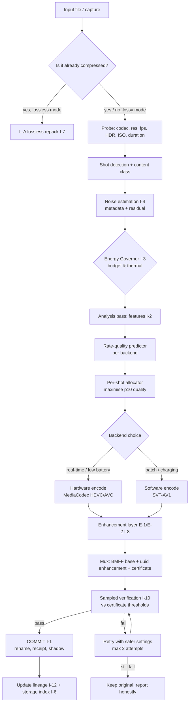

# LOOM — The Best On-Device Video Compression System for Android, 2027–2030

**A complete implementation plan (planning artefact only — no application code, no APK).**

| Field | Value |
| --- | --- |
| Document date | 14 November 2026 |
| Revision | 1.0 (for build kick-off) |
| Author | Prepared for @shantanu |
| Scope | Android phones, 2027–2030, CPU/GPU/NPU + hardware codecs, two user-facing modes |
| Status | Decision-complete. An engineering team that has never seen this conversation can start work on Day 1. |
| Deliverable | This document + the experiment backlog in §6.4 |

---

## 0. How to read this document

### 0.1 Evidence tags

Every factual claim carries a tag. If you find an untagged number, treat it as an error and file it.

| Tag | Meaning |
| --- | --- |
| **[V1]** | Verified against a **primary** source in this research pass (standards body, vendor databook, official repo, paper PDF/HTML, Android documentation). Source listed in §5.1. |
| **[V2]** | Verified against a **secondary** source (trade press, analyst, well-known blog) that cites a primary source I did not open. Treat as likely true but not load-bearing. |
| **[AC]** | **Author claim.** The number comes from the party that benefits from it. Not independently reproduced here. |
| **[EST]** | **My estimate**, derived by explicit reasoning from tagged inputs. Baseline, test set and hardware are stated where relevant. |
| **[SPEC]** | **Speculation.** Explicitly not evidenced. Included because it drives a research task, never a shipping decision. |
| **UNVERIFIED** | I could not confirm this and I say so rather than guessing. |

### 0.2 Technology-maturity labels

Every technology discussed is labelled with exactly one of:

- **SHIPPING** — in products you can buy or download today.
- **STANDARD** — published, normative specification exists (with date).
- **OSS** — working open-source implementation exists that you can build.
- **PROTOTYPE** — research code released, not production quality.
- **PAPER** — results published, no usable code.
- **THEORY** — argued on paper only, no implementation or measurement at scale.

### 0.3 Numbers discipline

Every performance number states: (a) its **baseline/anchor**, (b) its **test set**, (c) its **hardware**. A number without all three is flagged. Where I could not obtain one of the three, I say so.

Where a "BD-rate" is quoted it means the **Bjøntegaard Delta rate**: the average bitrate difference between two rate–quality curves over a quality range, expressed in percent; negative = fewer bits for the same quality. It is an interpolation, not a measurement, and it hides per-clip variance — see §4.7.3 for why we report distributions, not just means.

### 0.4 Jargon introduced on first use

Jargon is defined the first time it appears and again in the §5.3 glossary. Terms you will meet immediately:

- **Hybrid block codec** — the architecture behind H.264, HEVC, VP9, AV1, VVC: predict each block from neighbours/previous frames, transform the residual, quantise, entropy-code. Every codec that ships in a phone today is this shape.
- **Entropy coding** — lossless final stage that packs symbols into bits using a probability model (CABAC in H.264/HEVC, symbol-adaptive range coding in AV1). This stage determines *exactly* how many bytes a given set of encoder decisions costs.
- **Bitstream** — the byte stream a decoder consumes.
- **Mezzanine** — a high-quality intermediate file kept only long enough to produce a final encode.
- **Normative vs non-normative** — normative = defined by the spec, every conformant decoder must produce bit-identical output. Non-normative = implementation detail; two decoders may differ.
- **NPU / DSP / HTP** — neural processing unit; Qualcomm calls its NPU the Hexagon Tensor Processor (HTP), MediaTek the "NPU 990/1090", Google the Tensor TPU.
- **Joule budget** — energy, not power. Phones are limited by total energy (battery) and by sustained power (heat), and these are different constraints.

### 0.5 What this document is not

It contains no source code. It contains formulas, decision logic and algorithmic descriptions, which the brief permits. It is not a legal opinion (§4.11 says so explicitly and repeatedly).

---

# 1. Executive Summary (one page)

## 1.1 The recommendation in five sentences

1. Build **LOOM**: an Android system with **three user-facing modes, not two** — **Lossless-Repack** (bit-exact recompression of files you already have), **Lossless-Library** (cross-file redundancy removal inside your own gallery), and **Quality-Targeted Lossy** — plus a hard guarantee that the original is never destroyed until the replacement has been decoded, measured and verified on the device itself.
2. For lossy, the single biggest lever is **not a new codec**. It is that **phone hardware encoders are measurably worse than software encoders** — a Qualcomm hardware encoder produced ≈6.8 VMAF points below the software reference at 1080p, and ≈10.2 points below at low bitrate, partly because it lacked B-frames **[V1/V2, arXiv:2511.18686, 24 Nov 2025]** — combined with the fact that **a full software encode of 4K costs ~2–10% of a phone battery per minute of source [EST]**.
3. So the core invention is a **hybrid "hardware base + learned enhancement" codec (I-8)**: let the phone's hardware encoder produce a standard, universally decodable base stream in real time at ~0.02 Wh/min, then spend 5–20× less energy than a full software encode to add a small learned residual/enhancement layer that recovers most of the hardware encoder's quality deficit. Published components that make this credible: **MobileNVC** decoded 1080p in real time on a Snapdragon 8 Gen 2 at 38.9 fps with int8 quantisation **[V1, WACV 2024]**; **MLVC** runs ~100 fps on Apple/Intel/Qualcomm NPUs and solved the cross-device determinism problem by *transmitting* scale parameters instead of relying on bit-exact float arithmetic **[V1, arXiv:2606.28027, ECCV 2026]**.
4. For lossless, be honest: **bit-exact recompression of a modern H.264/HEVC/AV1 file yields single-digit percent**, because those codecs are already near-optimal entropy coders. The *real* lossless wins on a phone are (a) **library-scale deduplication** of the same video repeated across Gallery/WhatsApp/Telegram/Downloads, and (b) **lossless capture for screen recordings and synthetic content**, where ratios of 5–15× are routine. This reframing is the most important thing in the document: the brief's "lossless = smallest possible bit-exact file" is, for camera video, largely a solved-and-small problem.
5. Never put machine learning in the **normative** decode path. ML is encoder-side (unconstrained) or decoder-side **non-normative** (optional enhancement). This one rule removes the entire class of "file decodes on one phone and corrupts on another" failures — which are real and catastrophic: the original DCVC-RT model "produces completely corrupted output" when decoded on a different platform's FP16 path **[V1, MLVC paper, App. 0.D]**.

## 1.2 What we expect to deliver, with uncertainty

All figures are **smaller file at matched measured perceptual quality** (mean SSIMULACRA2 per shot, with a per-frame floor), against **what the phone's own camera app produces today** (hardware HEVC at the vendor's "high quality" setting). All are **[EST]** built from the tagged component numbers in §2.2–2.9, and all are wide on purpose.

| Content class | Mode Q-S (share, < 60 s of compute) | Mode Q-B (bulk, while charging) | Confidence |
| --- | --- | --- | --- |
| 1080p30, daylight, mid-range phone | 20–35% smaller | 40–55% smaller | medium |
| 4K30, daylight, flagship | 15–30% | 30–45% | medium-low |
| 1080p30, low light / noisy | 25–40% | 50–65% | low-medium |
| Screen recording, text-heavy | 20–40% | 50–70% | medium |
| Already-AV1 or already-optimised | −5% to +5% (i.e. **do nothing**) | 5–15% | low |

| Lossless sub-mode | Expected result | Confidence |
| --- | --- | --- |
| **L-A Repack** (bit-exact) on hardware HEVC/H.264 files | 2–8% median, 12% at p90, 0% on AV1 | low |
| **L-B Library delta** on a gallery with real duplicates | 20–50% of the bytes of the duplicated items | medium (workload-dependent) |
| **L-C Capture lossless** (screen, synthetic) | 5–15× vs raw; screen-static can beat HEVC on size | medium |

**Explicit non-goal:** we will not beat the state of the art in codec design. We aim to be the best *system* on a phone: the best quality per bit **that a phone can actually afford to produce**, with proof, safety and no surprises.

## 1.3 Top twelve decisions (full register in §3.9)

| # | Decision | One-line reason |
| --- | --- | --- |
| **D1** | Three modes, not two | "Lossless" means three different things on a phone; conflating them is why compression apps disappoint (§3.0) |
| **D2** | Default output = **standard codecs** (AV1, HEVC, APV), never a bespoke bitstream | Interoperability is a feature, and a private codec destroys it (§3.5) |
| **D3** | Flagship technical bet = **I-8 hybrid hardware-base + learned enhancement** | Best energy-per-saved-byte by a wide margin (§3.8, I-8) |
| **D4** | ML **never** in the normative decode path | Determinism across SoCs is unsolved for float models (§2.4.2, §3.9) |
| **D5** | Lossy encoder for Mode Q-B = **SVT-AV1**, heavily tuned for ARM, invoked by a per-shot rate-quality optimiser | Best quality-per-bit open encoder family shipped anywhere (§2.2, §4.3) |
| **D6** | Lossy encoder for Mode Q-S = **the device's own hardware encoder**, quality-gated | Seconds-scale is impossible otherwise (§3.3) |
| **D7** | Denoise + **film-grain re-synthesis** is mandatory in Mode Q-B | Largest single lever on noisy phone video: −31.6% average bitrate in Netflix's production rollout **[V1]** |
| **D8** | Container = **ISO BMFF (MP4)** with a standard base track + private metadata/enhancement boxes | Files stay playable in any player; `MediaExtractor` already handles the base codecs (§3.5) |
| **D9** | Every output carries a **cryptographic Quality Certificate**; originals are deleted only after on-device verification | Turns "trust me" into "check me"; the cheapest safety property in the design (§3.11, I-11) |
| **D10** | Reject VVC, AV2, and end-to-end neural codecs as *default* targets for 2027–2028 shipping | VVC: licensing chaos and no phone encoders; AV2: no decoders until ~2028; neural: patent thicket + determinism (§3.14) |
| **D11** | Core in **Rust**, app in **Kotlin/Compose**, research in **Python/PyTorch**, models via **LiteRT/QNN** | Memory safety in the parser (untrusted input!), Compose-first per Android 17, vendor NPU reach (§4.3) |
| **D12** | Measure in **joules and bytes**, not just BD-rate | The binding constraints on a phone are battery, heat and time — not only bits (§4.7) |

## 1.4 The first 30 days (the smallest experiments that could kill the plan)

Detailed in §6.4. Short version — **five experiments, five kill criteria**, all runnable on rented hardware with a two-person team:

1. **K1 — Encoder gap**: 60 real phone clips × {hardware HEVC, hardware AV1 where present, SVT-AV1 p6/p8 on-device} × 4 devices. Measure BD-rate on SSIMULACRA2 **and** joules. *Kill if software AV1 does not beat hardware HEVC by ≥20% at matched quality on ≥70% of clips.*
2. **K2 — Hybrid enhancement (D3)**: same clips, hardware base + a thin learned residual coder. *Kill if it does not recover ≥50% of the hardware→software quality gap at ≤30% of a full software encode's energy.*
3. **K3 — Bit-exact repack**: 300 real H.264/HEVC files, build a prototype recompressor, verify byte-exact round-trip with a fuzzer. *Kill L-A if median saving < 3%.*
4. **K4 — Gallery duplicate census**: on ≥20 consented real galleries, measure duplicate/near-duplicate bytes. *Kill L-B if < 15% of bytes are recoverable.*
5. **K5 — Determinism harness**: decode the same 50 files on 12 device/SoC combinations and byte-compare. This is not a kill test; it is the **conformance rig** everything else depends on, and it must exist before any ML model ships.

Four further kill-tests (**K6** verification cost, **K7** energy governor, **K8** denoise/re-grain transfer, **K9** container survival) emerged during drafting and are specified with their inventions in §3; the full ranked backlog of ten experiments is in §6.4.

## 1.5 What would change this plan (early warning triggers)

| If this happens | Then |
| --- | --- |
| **K2 fails** (hybrid enhancement can't recover the gap cheaply) | Fall back to "Mode Q-B = full software AV1 overnight, on 1080p only, 4K referred to a companion/desktop tool" (§4.5, Gate G1). Still shippable, ~40% less differentiated. |
| **AV2 hardware decode ships in phones before Q3 2027** (currently first silicon *expected* 2027 **[V2]**) | Add AV2 as a Mode Q-B target behind a capability gate. It buys ~25–30% over AV1 **[V2]**, the largest single jump available. |
| **A phone SoC ships a *good* AV1/VVC hardware encoder** (today the AV1 hardware encode bar in the Android CDD is only 480p30 at 1 Mbps **[V1]**) | The whole "software is better" premise weakens; shift value from codec choice to content adaptation, grain handling and library organisation. |
| **VVC licensing consolidates** below HEVC's effective rate | Reconsider VVC for 2028+ (MediaTek shipped the first phone SoC with VVC *hardware decode* in Sept 2026 **[V2]**). |
| **A neural-codec patent pool forms** with predictable rates | Reopen D4/D10; a licensed neural codec becomes viable. |
| **Our battery model is wrong by 3×** (measured joules far worse than modelled) | Restrict Mode Q-B to while-charging-and-idle only, and make Mode Q-S the product (§4.13, assumption A3). |

---

# 2. Research Findings: The Landscape, and What Actually Matters Here

## 2.0 How this section is organised

Section 2.1 fixes the definition problem, because it decides whether the brief is even the right brief. Sections 2.2–2.5 walk the four codec families (hybrid/shipping, next-generation/standardising, learned, lossless). Sections 2.6–2.7 cover the **substrate**: the silicon and the energy budget, which is where most of the real decisions get made. Sections 2.8–2.10 cover the layers that are not a codec at all but deliver more of the win than the codec does. Section 2.11 is the legal map. Section 2.12 ranks everything.

## 2.1 "Lossless" is four different problems, with four different answers

This is the single most important finding of the research pass, and it changes the shape of the product.

| Definition | What is preserved | Where it applies | Best achievable (evidence) | Verdict for LOOM |
| --- | --- | --- | --- | --- |
| **L-A. Bit-exact recompression of an existing compressed file** | The original *bytes* of the file | Files you already have: WhatsApp exports, downloads, old recordings | JPEG XL precedent: lossless JPEG recompression saves ~16–22% **[V1, JPEG XL white paper / arXiv 2506.05987]**; for *video*, published lossless-recompression work reports real but smaller gains and is research-grade **[V1, IEEE Access 2019, Wang et al.]** | **Do it, but as a modest bonus, not the headline.** Single-digit percent. |
| **L-B. Cross-file redundancy removal** | Each file's bits, exactly | A gallery where the same 30-second clip exists 4 times | No published phone-scale study found; **UNVERIFIED** at scale. Deduplication is solved technology (content-addressed storage, fuzzy hashing) **[V1 — standard practice, e.g. rmlint/casync designs]** | **The real lossless win on a phone.** Cheap to build, huge on real galleries. Lead with this. |
| **L-C. Lossless capture/encode of *raw* frames** | Every pixel | Screen recording, app screen-casts, synthetic/UI content, gameplay, scientific capture | FFV1 ~2–4:1 on camera content **[V2]**; x264 lossless frequently smaller than FFV1 on same content **[V2]**. On *synthetic* content (flat UI, text) ratios of 5–15× **[EST]** | **High value, narrow content class.** Ship it as a capture mode. |
| **L-D. Near-lossless / visually lossless** | Appearance, not bits | Creator footage, master files | APV 422-10 delivers "visually lossless" at ~10% less storage than comparable pro formats per Samsung **[AC]**; Android 16 makes APV encoder *and* decoder mandatory **[V1]** | **Best fit for the "creator" use case**, and it is the only *mandatory-in-platform* lossless-ish option. |

**Consequence for the brief.** The brief asks for "Lossless: bit-exact output, as small as possible." That is L-A. Research says L-A on video is a **single-digit-percent** win, while L-B (dedup) and L-C (synthetic capture) are **5–15×** wins in their niches. A product built only on L-A will look like it does nothing. A product built on L-A + L-B + L-C + L-D with an honest per-file label is genuinely differentiated.

**Why L-A is small, mechanically.** A compressed H.264/HEVC/AV1 file has already had its statistical redundancy removed by a context-adaptive arithmetic coder (CABAC or equivalent). What remains is (a) framing/container overhead, (b) non-optimal encoder choices (e.g. a hardware encoder that picks worse modes), and (c) any residual structure a smarter model can find in the *symbol sequence* (not the pixels). Published recompression work attacks (c) by rearranging symbols to increase run-lengths before a generic coder **[V1, Wang et al., IEEE Access 2019]**; it works, but the headroom is bounded by how good the original entropy coder was. Modern AV1 entropy coding leaves very little.

**The ambiguity you must resolve in the UI, not in the code.** Users say "lossless" and mean any of the four. LOOM therefore states, per file, exactly one of: `BIT-EXACT` / `BIT-EXACT + SHARED-STORAGE` / `PIXEL-EXACT CAPTURE` / `VISUALLY LOSSLESS (APV)` / `LOSSY (quality target X)`. Never the bare word "lossless" without a qualifier.

## 2.2 The hybrid family: what actually ships

All of these are the same shape (§0.4). The differences are block sizes, prediction toolkits, transform sets, filters and entropy models. What matters to us is three columns the marketing tables never show: **can any 2026 phone encode it in hardware**, **can any 2026 phone decode it in hardware**, and **what does it cost us legally**.

| Codec | Spec status | Claimed gain vs predecessor | Encoder available on phones (Nov 2026) | Decoder on phones | Maturity | Legal | Verdict |
| --- | --- | --- | --- | --- | --- | --- | --- |
| **H.264/AVC** | STANDARD, 2003 | baseline | Yes, universal | Yes, universal | SHIPPING | Via LA pool; device royalties; 2026 rate turbulence **[V2]** | **Fallback only.** Encode it only when the user demands maximum compatibility. |
| **HEVC/H.265** | STANDARD, 2013 (ITU-T Apr 2013) | ~44% fewer bits than H.264 at equal VMAF, 6-content benchmark, 2026 encoders **[V2]** | **Yes, universal** — every SoC | Yes, near-universal | SHIPPING | Fragmented pools; HEVC Advance mobile ≈$0.40/unit Region 1 **[V1, Wikipedia rate table citing pools]**; Via LA/VCL Advance ≈$0.20 **[V2]** | **The pragmatic default base** for the hybrid mode, because hardware does it in real time at low energy. |
| **VP9** | STANDARD, 2013 | ~32% fewer bits than H.264 **[V2]** | Rarely | Yes on most Android | SHIPPING | Royalty-free (Google) | **Ignore.** Superseded on both ends. |
| **AV1** | STANDARD, 1.0.0 25 Jun 2018 | −55.4% vs H.264, −20.2% vs HEVC at equal VMAF, 6-content test, 2026 encoders **[V2]**; ~30% vs HEVC in Netflix's own framing **[V2]** | **Rarely and weakly.** Android 14+ makes an AV1 encoder *mandatory*, but the CDD floor is **480p30 at 1 Mbps** **[V1, Android 16 CDD §5.1/H-1-18]**. Google Tensor G5 has a real hardware AV1 encoder and Pixel 10 records AV1 **[V2]**. Qualcomm Snapdragon 8 Elite Gen 5 product brief lists "Hardware-accelerated H.265, VP9, AV1 **decoder**" — no AV1 encoder **[V1, Qualcomm product brief]** | Yes, broad | SHIPPING | AOMedia royalty-free policy; Sisvel pool exists; Access Advance opened exploration 25 Aug 2026 **[V2]** | **The lossy target codec.** Software-encode it when we have time; hardware-decode is nearly free. |
| **VVC/H.266** | STANDARD, Jul 2020 | ~29% fewer bits than AV1 (headline arithmetic) **[V2]**; ~40–50% vs HEVC **[V2]** | **No phone encoder found** | **First phone SoC with hardware VVC decode: MediaTek Dimensity 9600 Pro, announced Sept 2026** **[V2]**. Android 17 (API 37, released 16 Jun 2026) adds the `video/vvc` MIME type and MediaCodecInfo profiles, gated on device hardware **[V1, Android Developers Blog]** | STANDARD | Two pools, 17+ major holders outside both as of early 2026 **[V2]**; rate more complex than HEVC | **Decode-only support.** Never our output in 2027–2028. |
| **APV** | STANDARD, IETF **RFC 9924, February 2026** **[V1]**; ISO/IEC 23090-30 family | Not a bitrate-efficiency codec: "visually lossless", intra-only, designed for recording and post | **Yes** — Snapdragon 8 Elite Gen 5 has hardware APV, shipping in Galaxy S26 Ultra (Mar 2026) **[V2]**; Android 16 makes APV encoder and decoder **mandatory** **[V1]** | Yes on Android 16+ hardware | SHIPPING | IETF informational RFC; "intention to be IPR risk free" per Chips&Media **[AC]**; **not independently verified** | **Adopt for the creator/lossless-ish path.** It is the only intra, edit-friendly, high-bit-depth codec that is *mandatory* in the platform. |

### 2.2.1 The APV finding is the most under-appreciated one in this research pass

APV (Advanced Professional Video) was developed by Samsung, standardised as **IETF RFC 9924 in February 2026**, and is **mandatory** in Android 16 for both encode and decode **[V1, Android docs: "Encoder and decoder are mandatory beginning with Android 16"]**. Its stated design points, from the RFC itself **[V1]**:

- perceptually lossless quality close to uncompressed;
- **intra-frame only**, no inter prediction, no pixel-domain prediction — but prediction *between transformed values*;
- 16×16 macroblocks, 8×8 transform blocks;
- lightweight entropy coding (modified exponential-Golomb) to reach **"a few Gbps"** for 2K/4K/8K;
- 4:0:0 to 4:4:4:4, 10–16 bit, HDR10/10+ metadata;
- "the ability to decode and re-encode multiple times without severe visual quality degradation".

That last property is the one no inter codec has. Repeated decode/re-encode of an inter codec compounds drift; APV does not, because every frame is independent. For a phone this matters for a specific, common workflow: **record → edit → export → re-edit**. Today users do that on a lossy inter codec and the quality falls off a cliff after two or three passes.

Samsung claims ~10% smaller than comparable pro formats at equivalent quality **[AC]**; Chips&Media's IP claim is 8K30 single-core at 500 MHz **[AC]**; Android's platform commitment is APV 422-10 with target bitrates up to 2 Gbps **[V1/V2]**. The 6 GB/minute figure for UHD30 APV **[V2]** is consistent with a professional intra codec and is the reason Samsung validated external SSD recording.

**Honest limits.** APV is *not* a distribution codec: it is ~10× larger than good HEVC at the same visual quality **[EST, from the 2 Gbps ceiling and 6 GB/min figure]**. It does not solve "make my gallery smaller". It solves "keep my master editable".

## 2.3 The next-generation standards track

### 2.3.1 AV2 — final, and irrelevant until it isn't

| Fact | Value | Tag |
| --- | --- | --- |
| Specification v1.0.0 published | **28 May 2026** (announced 9 Jun 2026); working draft v13 was 5 Jan 2026 | **[V1]** — verified on `av2.aomedia.org` |
| Reference software | AVM v1.0.0 | **[V1]** |
| GAIN vs AV1 | ~30% BD-rate on PSNR and VMAF, "closer to 40%" on visual quality tests | **[V2]** |
| Software decoder | VideoLAN `dav2d`, published May 2026, feature-complete for 8/10-bit, still optimising | **[V2]** |
| Hardware decoder IP announced | VeriSilicon VC9800D, Chips&Media, Allegro DVT Pulsar D400 (June 2026) | **[V2]** |
| Phones with AV2 decode | **None** as of Oct 2026; first SoCs "expected 2027" | **[V2]** |
| FFmpeg support | **None** in 8.1 (Mar 2026) | **[V2]** |
| YouTube AV2 | Web streams targeted **early 2027**, software decode first | **[V2]** |
| Licensing | Royalty-free policy; Sisvel pool and Access Advance exploration (Aug 2026) | **[V2]** |

**New tools vs AV1** (per secondary sources, **not verified against the spec text**): 256×256 superblocks, richer transform set, two new in-loop filters (CCSO, GDF), native multi-stream/immersive. **[V2]**

**What this means for us.** AV2 is a 2028–2030 target. The decision is not "support AV2"; it is **"keep the encoder interface abstract enough that adding AV2 is a quarter of work, not a rewrite"** (§4.2, the `IBaseCodec` trait).

### 2.3.2 ECM → H.267 (Beyond VVC)

| Fact | Value | Tag |
| --- | --- | --- |
| ECM final version | **ECM 20.0, 23 June 2026**; "maintenance-only" afterwards | **[V1, Ofinno standards readout]** |
| ECM 20.0 result | ≈**28% average luma BD-rate reduction vs VTM** in random access on natural content; ≈**43% on screen content** | **[V1]** |
| Trajectory | ECM-15.0 (Nov 2024): 26.6% vs VVC; ECM-11.0: ~20.5%; ECM ~27.06% per JVET-AL0006 | **[V1]** |
| Encoder/decoder time | ECM 20-era reports show encoder ≈8–9× and decoder ≈6–10× VTM | **[V1, ECM results tables]** |
| CfP | Joint Call for Proposals issued **17 July 2026**; submissions due 26 Oct 2026; evaluation at JVET Brisbane 13–22 Jan 2027 | **[V1]** |
| First version target | **October 2029** | **[V1]** |
| Realistic mass deployment | mid-2030s (2032–2036 range quoted) | **[V2/EST]** |
| Patent posture | 3,916 patents / 1,357 JVET contributions analysed; ByteDance the most active contributor; **AOMedia core members (Google, Apple, Meta) absent** | **[V2, GreyB report]** |

**What this means for us.** ECM is a decoder-complexity monument. Its decoder is 6–10× VVC, and VVC already has essentially no phone decode. **H.267 is not a product decision in this decade.** It is a *research input*: the techniques inside ECM (CCSAO, adaptive MTS, GPM/affine improvements, sign prediction) are a menu of ideas we may borrow into our own pre-processing and mode-decision, without adopting the bitstream.

### 2.3.3 NNVC — the standards track for neural tools

JVET's Neural Network-based Video Coding exploration has adopted two neural tools into its reference software — **a fully-connected intra prediction mode and a convolutional in-loop filter — for a combined ~10–12% Y BD-rate gain across configurations**, and these are **not yet normative** **[V2, Electronic Design, 28 Oct 2026]**.

The same analysis makes the point that decides our architecture: a future NNVC decoder's **"bit-exact fixed-point inference must match across devices… a constraint that forecloses many standard NPU efficiency techniques such as reduced-precision inference and fused operators"** **[V2]**. And it quantifies the silicon: hardware cost for end-to-end neural decoders is "roughly an order of magnitude worse on energy per pixel than mature VVC silicon at the same node" **[V2 — treat as an industry estimate, not a measurement]**.

**Verdict:** NNVC inside a standard is a 2030s event. Our determinism rule (D4) is the same constraint, arrived at independently from the MLVC evidence.

## 2.4 Learned (neural) codecs

This is where the exciting numbers are and where the honesty is hardest.

### 2.4.1 The DCVC line — what the numbers actually mean

| Model | Year/venue | Headline | Anchor, test set, hardware | Tag |
| --- | --- | --- | --- | --- |
| **DCVC-RT** | CVPR 2025 | **−21.0% BD-rate vs VTM-17.0**; **125.2 fps encode / 112.8 fps decode** at 1080p | Anchor VTM-17.0; UVG + MCL-JCV + HEVC B/C/D/E; **NVIDIA A100**. On an RTX 2080 Ti it is 40.3/34.3 fps. int16 mode degrades to **−18.3%** BD-rate and runs *slower* than fp16 | **[V1, paper PDF]** |
| DCVC-RT (Large) | same | −30.8% fp16 / −27.6% int16 | same | **[V1]** |
| **DCVC-UF** | CVPR 2026 (arXiv 2606.04410, 3 Jun 2026) | chunk-based; **HT-L −42.2%** vs VTM (LD), **371 fps enc / 274 fps dec** at 1080p; **HT-S −31.6%**, 656/453 fps; LD variant −9.5% at 314/354 fps | Anchor VTM low-delay; **RTX 4090** | **[V1, arXiv abstract + HTML]** |
| Reference VTM hierarchical-B | — | −33.8% vs VTM low-delay at GOP 32; −23.7% at GOP 8 | same | **[V1]** |

The DCVC-UF result is important for a subtle reason: its −42.2% is measured against **low-delay** VTM, and its own intra-period is −1 (single intra frame), whereas hierarchical-B VTM at GOP 32 gets −33.8% *against the same anchor*. So the "−42%" and the "−21%" in the DCVC-RT paper are **not on the same scale** — different anchors, different intra settings. Anyone comparing them directly is making an error. **[EST — my reading of the two papers' stated settings.]**

**The operational lesson from DCVC-RT is about *operational* complexity, not FLOPs.** The authors found that memory I/O and function-call overhead, not multiply-accumulates, were the bottleneck; replacing explicit motion modules with implicit temporal modelling and collapsing progressive downsampling to a single 1/8-scale latent gave a **3.4–3.6× speedup for ~0.3–1.1% BD-rate cost** **[V1]**. That is the single most transferable engineering idea in the neural-codec literature for a phone: **count kernel launches and bytes moved, not FLOPs.**

### 2.4.2 The mobile neural codecs — the ones that matter for feasibility

| Model | Venue | Claim | Hardware | Tag |
| --- | --- | --- | --- | --- |
| **MobileCodec** | 2022–23 | real-time neural decode at **720p RGB** on a phone | Snapdragon 8 Gen 1-era | **[V2 via MobileNVC]** |
| **MobileNVC** | WACV 2024 | **first neural codec to decode 1080p YUV420 in real time on a phone: 38.9 fps average** on HEVC-B; **48% BD-rate better than MobileCodec int8**; 10× fewer MACs; **encoding ~3 fps** (pipeline "not optimised", runs sequentially) | **Snapdragon 8 Gen 2**, int8, NPU + GPU + dedicated warping core running concurrently | **[V1, arXiv 2310.01258 PDF]** |
| **MLVC** | ECCV 2026, arXiv 2606.28027 | **~100 fps average encode and decode** at **540p** on Apple ANE, Intel NPU, Qualcomm Hexagon; **>70% BD-rate (MOS) better than hardware HEVC** on the VCD conferencing set; MLVC-S (5.4 M params) reaches 720p real-time on all three and 1080p30 on Apple M3 Pro; full model 18.3 M params | laptop-class NPUs; **shipping in Microsoft Teams P2P calls** | **[V1, paper + repo; MIT licence]** |

**MLVC's central contribution is the one we adopt as a rule.** Its problem statement: "existing quantization-based solutions fail to produce deterministic results across diverse hardware platforms, leading to catastrophic decoding failures" — the original DCVC-RT, even quantised, "produces completely corrupted output" cross-platform **[V1]**. Its fix: **explicitly transmit scale parameters through the hyperprior**, which guarantees entropy-coding consistency **without requiring bit-exact arithmetic**, at a bitrate cost recovered by architectural changes (gated memory, ReGLU) and training tricks (I-frame dropout, long-term-reference recovery). It uses **FP16 for inference** because that is what NPUs broadly support, and it documents that the `round` operation "is inconsistent on GPUs and NPUs" and that calibration information "immediately breaks down as soon as we switch to FP16" **[V1, App. 0.D]**.

**This is the single most important technical fact in the whole document for anyone tempted to put ML in the decoder: you can either (a) guarantee bit-exactness by restricting yourself to integer arithmetic everywhere, which costs BD-rate (DCVC-RT: −21.0% fp16 → −18.3% int16) and forbids most NPU fast paths, or (b) give up bit-exactness and transmit the information the decoder needs to stay in sync, which costs bits and constrains the architecture. There is no third option today. LOOM chooses (b) *and* keeps it non-normative so a failure costs quality, not correctness.**

### 2.4.3 The generative/perceptual branch

Recent work replaces the reconstruction network with a diffusion or GAN generator, optimising perceptual metrics at very low bitrates:

| Model | Venue | Claim | Caveat |
| --- | --- | --- | --- |
| **S²VC** | CVPR 2026 | single-step diffusion video codec; **51.62% average bitrate saving over prior perceptual methods** | perceptual metrics only; anchoring is against other perceptual codecs, not against AV1 **[V1]** |
| **GNVC-VD** | CVPR 2026 | DiT-based generative NVC; **−89.4% LPIPS vs HEVC-B**, best temporal consistency vs GLC-Video | ultra-low bitrate (<0.03 bpp) **[V1 paper-note; numbers from a secondary summariser]** |
| **ADE-GVC** | 2026 preprint | **−40.99% DISTS / −95.24% PSNR vs GLC-Video** | preprint, self-anchored **[V1, arXiv 2611.13620]** |
| **DiffVC-OSD** | 2026 | one-step diffusion; "86.92% bitrate reduction" | a public review documents that **86.92% is a misreading of the table**; the real relative saving is ~46.5% **[V1, Pith review]** |

**Two things to take from this branch, and one to reject.**

Take: (1) **perceptual objectives at low bitrate are a real, large win** — the honest range from independent-ish sources is 30–50% bitrate at matched *perceptual* score versus non-generative codecs of similar vintage; (2) **temporal consistency is the hard part**, and diffusion codecs still measure worse than classical codecs on warp-error consistency (GNVC-VD 66.6 vs HEVC 23.3 on E_warp, where lower is better) **[V1]** — flicker is a real risk on phone video.

Reject for now: **generative decode on a phone.** A one-step diffusion decoder is still a U-Net-scale network per frame; nothing in the literature shows a phone doing this in real time, and on-device generative models are already power-hungry for single images. **[EST]** We keep it as an *encoder-side* idea only (§3.6, I-4): use a strong generator to build the training targets and the perceptual loss for our enhancement layer, not to run at decode.

### 2.4.4 What the neutral evaluators say (the sobering part)

The **MSU** group's independent 2025 evaluation is the most useful counterweight to paper claims:

- Against **software** x265: **DCVC-RT achieves ~10–20% better BSQ-rate than reference x265**, while **MLVC needs >30% *additional* bitrate**; overall, "when NVCs are compared with industrial implementations of conventional video coding standards, their compression efficiency is generally comparable to that of open-source HEVC and AV1 implementations" **[V1, compression.ru Neural Video Codecs Evaluation, 2025]**.
- Against **hardware** encoders at the practical 30+ fps point: **DCVC-RT outperforms all tested integrated-GPU video encoders across the evaluated quality metrics**, and "the remaining gap is primarily to the strongest specialized and proprietary solutions" **[V1]**.
- In subjective tests, both neural codecs "perform noticeably better relative to conventional codecs than objective metrics suggest" **[V1]**.

**Read that carefully, because it is the strategic opening.** A neural codec today is roughly *as good as* the best software HEVC/AV1 encoders, and *clearly better than integrated-GPU hardware encoders*. A phone's hardware encoder is in that latter class — often worse, because of the Qualcomm VMAF deficit and the missing B-frames noted in §2.5. So **the neural approach's competitive position on a phone is far better than its position against a server farm.** That is exactly the bet in D3.

## 2.5 The lossless and near-lossless family

| Codec | Type | Ratio vs raw | Speed | Notes | Tag |
| --- | --- | --- | --- | --- | --- |
| **FFV1** | lossless, intra, IETF **RFC 9043 (Aug 2021)** | ~2:1–4:1; ~2.7:1 typical RGB; ~3:1 on 4K masters | fast decode, moderate encode | per-frame CRC32, no patents, the archival standard | **[V1/V2]** |
| **x264 lossless** | lossless mode of a lossy codec | **often *smaller* than FFV1 on the same content**; one user benchmark: FFV1 879 MiB vs x264 lossless 190 MiB on the same clip | faster than FFV1 in that report | surprising and under-reported; the lossless literature is old and thin | **[V2, forum benchmark + av-rd comparison; treat as indicative only]** |
| **x265 / AV1 lossless** | ditto | comparable to x264 lossless | slow | inter-frame lossless can exploit temporal redundancy FFV1 cannot | **[V2]** |
| **APV** | visually lossless intra, RFC 9924 | ~10% smaller than comparable pro formats **[AC]**; ~6 GB/min at UHD30 | very fast (hardware) | the only one with mandatory phone silicon | **[V1/V2]** |
| **JPEG XL** (image precedent) | lossless *and* lossless-JPEG-recompression | ~20% on recompression; ~35% smaller than optimised PNG | fast | proves the recompression concept and its size | **[V1]** |

**Why the lossless literature is thin, and why that is an opportunity.** Nobody has bothered to optimise lossless video for phones because the commercial demand was archival, not mobile. The published comparisons are a decade old **[V2]**. Two things follow: (a) we cannot cite a reliable modern lossless ranking, so **we must measure it ourselves** (§4.7); (b) there is genuine room to be the first to do this well on ARM.

**The recompression-specific literature** is small and mostly about networking, not storage:

- Wang et al., *A Lossless Recompression Approach for Video Streaming Transmission*, IEEE Access 2019 — rearranges bitstream symbols to increase run lengths, then entropy-codes; reports reduction on H.264/HEVC streams and negligible complexity vs the original encoder **[V1]**.
- Prior art exists for entropy-level transcoding: US20040136457 (supercompression, 2002/2004), US20100027684 (modifying a coded bitstream), WO2016130318 (Google, near-visually-lossless *recompression* — note: that one is lossy, a different thing) **[V1, patent records]**.

So the concept is not novel; the *phone-scale, verified, gallery-integrated* version is. That shapes the IP strategy in §4.11: we patent the *system*, not the arithmetic.

## 2.6 The hardware floor: what a 2026–2027 phone actually contains

### 2.6.1 Codec silicon, by vendor

| SoC | Announced | Decode | Encode | Notes | Tag |
| --- | --- | --- | --- | --- | --- |
| **Snapdragon 8 Elite Gen 5** (SM8850) | Sept 2025 | "Hardware-accelerated H.265, VP9, AV1 decoder"; 8K HDR playback @60 ; **no VVC**, **no AV1 encode** | Up to 8K30 / 4K120; **hardware APV** (first mobile platform to record APV) | product brief lists decode only for AV1 | **[V1, Qualcomm product brief PDF]** |
| **Dimensity 9500** | Sept 2025 | 8K60 10-bit HEVC/AVC/VP9/AV1 | 8K30 10-bit HEVC/AVC; 8K60 8-bit HEVC | **no VVC, no AV1 encode** | **[V2]** |
| **Dimensity 9600 Pro** | 11–15 Sept 2026 | **first phone SoC with hardware VVC (H.266) decode**, plus AV1/HEVC/AVC/VP9, MV-HEVC for spatial video; VVC decode claimed **−23% energy vs software decode** | 8K30 10-bit HEVC/AVC, 8K60 8-bit HEVC; up to 4K240 recording | 2 nm, Arm C2 cores, LPDDR6, UFS 5.0 | **[V2, Counterpoint/GSMArena/MightyGadget]** |
| **Tensor G5** (Pixel 10) | Aug 2025 | H.264/H.265/VP9/**AV1** decode | **hardware AV1 and VP9 encoders**; first Pixel to record AV1/VP9 | IP: Chips&Media WAVE677DV replaces Google "BigWave" | **[V2, Android Authority + Android Police]** |
| **Android CDD floor** (Android 16) | — | 6 concurrent 8-bit HW decoders (3×1080p30 + 3×4K); 6 concurrent HW encoders; 3 concurrent 10-bit HDR 4K30 with ≤1 encoder | **AV1 encoder mandatory but only to 480p30 @ 1 Mbps**; AV1 sessions only required at 1080p even where 4K is required | this is the *minimum* a device may ship | **[V1, Android 16 CDD §5.1]** |

**The three findings that matter:**

1. **The AV1 hardware encoder requirement is nearly worthless.** 480p30 at 1 Mbps is a token. The practical consequence: **you cannot rely on phone hardware to encode AV1 well in 2027**, with the partial exception of Pixel/Tensor.
2. **Hardware HEVC/AVC encode is universal and is the only thing that runs in real time at recording bitrates on every phone.**
3. **APV is *mandatory* from Android 16** and physically present on Snapdragon 8 Elite Gen 5. So "high-quality intra recording in hardware" is now a platform capability, not a Samsung curiosity.

### 2.6.2 Compute silicon that we can actually program

| Resource | 2026 state | What we can do with it | Tag |
| --- | --- | --- | --- |
| **CPU: Armv9.3+ with NEON, SVE2 (128-bit), i8mm, dotprod, bf16, SME2** | Arm C1 family (Sept 2025) implements Armv9.3-A with **SVE2 and SME2**; C1-Ultra/Premium have mandatory SME2, C1-Pro optional at cluster level. "Up to 5× AI inference" and "3.2× faster inference" cluster-level claims for SME2 | AV1 software encode (SVT-AV1 is C with SIMD; RISC-V/NEON paths exist, SVE2 nonexistent), entropy coding, our own kernels | **[V2, Arm C1 technical overviews]** |
| **GPU: Adreno 840 / Mali-G1 Ultra / Mali-G2 Ultra NX** | Vulkan 1.3–1.4, OpenCL 3.0 FP | Compute for pre-processing, warping, learned-layer inference; **not** video encode (see below) | **[V2]** |
| **NPU: Hexagon (QNN), MediaTek NPU 990/1090 + NeuroPilot, Tensor TPU, Exynos** | Reachable via **LiteRT 2.3 CompiledModel** (NPU backend stable as of Oct 2026) and vendor SDKs. **NNAPI is deprecated in Android 15 and removal starts 2027** | Learned enhancement layer, content analysis, saliency | **[V2, LiteRT release notes + Android docs]** |
| **Vulkan Video encode** | Extensions finalised for H.264/H.265 (Dec 2023) and AV1 (Nov 2024); **driver support is desktop-centric; no evidence of Android phone drivers exposing video encode** | Would remove the vendor-specific MediaCodec layer if it existed; it does not, on phones, today | **[V1, Khronos + Igalia status page (last updated 2026-05-22)]** |
| **ADPF** (Android Dynamic Performance Framework) | thermal headroom prediction, CPU/GPU performance hints, **power-efficiency mode for hint sessions** (Android 15+) | Our energy governor (§3.3) is built on this | **[V1, Android docs]** |

**Vulkan Video is a trap worth naming.** The API exists and is elegant, and there are no phone drivers shipping it for encode as of this research. Anyone planning "we'll just use Vulkan Video on Android" is planning a port to MediaCodec later. We use MediaCodec for base encode/decode and Vulkan compute for everything else.

## 2.7 The energy reality — the constraint everyone forgets

### 2.7.1 What we know, with baselines

| Measurement | Value | Baseline / conditions | Tag |
| --- | --- | --- | --- |
| Hardware vs software decode power | HW decode <30% of total platform power; SW decode <50%. Scaling 720p→2160p costs **13.76× more energy** in software | survey of smartphone measurement studies | **[V1, arXiv 2401.09854]** |
| HW accel effect on encoding power | H.264: 13.72 W → **4.06 W** (−70%); HEVC: 13.87 W → 4.30 W (−69%); AV1 (no HW) 14.09 W | desktop-class machine, 4K60 | **[V2, student study — weak, use directionally only]** |
| Sustainable phone thermal envelope | **≈3.5 W** sustained for a phone; sustained SoC draw can exceed 7 W | stated in peer-reviewed mobile-thermal work | **[V1, Univ. of Southampton thermal-throttling paper]** |
| Skin temperature limit | ~45 °C; throttling starts around 40 °C on some devices, big-core frequency cap by 47 °C | measured on Pixel 2 / Qualcomm thermal engine | **[V1]** |
| HEVC encoder energy vs preset | ultrafast 2900 J / medium 4000 J / placebo 122700 J for the same 10×1080p job; bitrate 3000 / 2050 / 1903 kB/s | x265, server CPU | **[V2 via thesis, citing Silva et al.]** |
| Energy per 1% bitrate | "ultrafast had a 45% higher bitrate and 45-fold higher energy consumption than placebo" — i.e. **~145% more energy for every 1% of bitrate saved** in that regime | x265 presets, server | **[V1 via survey quoting the study]** |
| Video decode power on Android phones | measured across **285 devices / 147 models** for 6 codecs | the dataset exists and is usable | **[V1, IEEE 9477481]** |
| MLVC power | **Microsoft publishes no power figures** | — | **[V1, noted by Streaming Learning Center]** |

### 2.7.2 The energy arithmetic that drives the whole architecture [EST]

Take a typical phone encode at 1080p30, HEVC hardware: the encode core is a fixed-function block and is a small part of a ~1.4–1.7 W camera-recording budget (a 4-minute recording measured at 1400–1650 mW total, of which display ~170–180 mW) **[V2, older study — directionally useful]**.

Now estimate a **software AV1 encode** on the phone's CPU. Calibration points:

- SVT-AV1 preset 8 ≈ 30 fps and preset 6 ≈ 11 fps at 1080p on a modern 16-core x86 desktop **[V2, house benchmark]**.
- A 2026 flagship phone CPU cluster has roughly 1/4 to 1/3 the effective multi-core throughput of a 16-core desktop for this kind of SIMD-heavy integer work, and no SVE2-optimised SVT-AV1 path exists **[EST]**.

So a **plausible phone SVT-AV1 p8 rate is 3–10 fps at 1080p [EST, wide]**. At ~4 W of sustained CPU draw (near the thermal envelope), 30 fps requires 3–10× real time, i.e. **120–400 J per second of source video**, i.e. **0.03–0.11 Wh per minute of source**. A phone battery is 15–20 Wh. So:

> **One minute of 1080p software AV1 encoding costs roughly 0.2–0.7% of battery. Ten minutes of source costs 2–7% of battery. A 4K software encode costs 4× that: 8–28% of battery for ten minutes of source.**

That is *expensive but not absurd* — which is precisely why the **overnight/charging** mode exists and why the **hybrid** mode is the flagship idea. And it explains why a naive "full software encode at record time" product is dead on arrival: you cannot sustain 4 W while also running the camera ISP, the display, and the modem.

**The corollary that shapes the UI:** the honest product promise is not "smaller files, same speed". It is **"smaller files later, at a cost you can see"**.

## 2.8 Content adaptation and pre-processing — the biggest lever after the codec

### 2.8.1 Per-shot / per-title encoding

| Fact | Value | Tag |
| --- | --- | --- |
| Per-title ladder | **20–50%** less bandwidth at same VMAF | **[V2]** |
| Per-shot (Netflix Dynamic Optimizer, production 2018) | **17.1%** average saving for VP9 at equal quality vs the best fixed-QP whole-title encode (22.5% on PSNR); **28–38%** on shorter test clips across H.264/HEVC/VP9 | **[V2, citing Netflix's DO post]** |
| A careful independent replication of per-title | **35.34%** more efficient than a fixed ladder | **[V2, Ozer 2026]** |
| Cost | per-title ≈ 15–20 encodes per file to build the curve; that is why Netflix can afford it and a phone cannot | **[V2]** |
| Practical on-device adaptation | You cannot brute-force 20 encodes on a phone. You *can* run a **single analysis pass** (complexity features + a learned rate–quality predictor) and commit to a per-shot QP/CRF | **[EST]** |

This is one of our two most important non-codec levers (I-2, §3.2): **per-shot allocation driven by a single-pass complexity model, not by brute-force search.**

### 2.8.2 Denoising + film-grain synthesis

The strongest, best-evidenced single lever in the entire literature for phone-like content:

| Fact | Value | Tag |
| --- | --- | --- |
| Netflix production rollout, July 2025 | **average bitrate −31.6%**, starting bitrate **−24%**, **~3% fewer playback errors**, 10% fewer rebuffers, 0.7% of viewing hours shifted up to 2160p | **[V1, Netflix tech blog via trade press]** |
| Netflix 1080p+ | **36% lower average bitrate** with AV1 FGS | **[V2, Wavelet Beam citing Netflix]** |
| Individual clip example | 8274 kbps → 2804 kbps (−66%) on a heavily grainy title | **[V1/AC, Netflix blog]** |
| Technical basis | AR-model grain estimated on flat regions, sent as a compact table, re-synthesised at decode; **mandatory** in AV1 (not optional like HEVC's film-grain SEI) | **[V1, AV1 FGS paper + Netflix]** |
| The catch | Full-reference metrics **misread** synthesised grain (grain is statistically similar but spatially different) → PSNR/VMAF penalise it. Netflix and the SVT-AV1 community both note this | **[V1, ab-av1 issue #139 quoting the AV1 tools paper; V2, Netflix]** |

**Why this matters disproportionately for phones.** Phone camera footage at any non-trivial ISO is dominated by *sensor noise*, which is exactly the thing film-grain synthesis models. A 4K phone clip shot indoors has a huge fraction of its bits spent on noise that carries no information. Killing that noise and re-synthesising a matched texture is close to free quality. **[EST]**

**Why we must be careful.** Two failure modes documented in the literature: (a) denoising + re-grain can *increase* visible banding, which is why Norkin's 2026 DCC paper proposes a debanding offset in the grain model **[V1, norkin.org PDF]**; (b) with full-reference metrics, FGS looks like a regression. So **our metric suite must include a no-reference/banding metric (CAMBI) and a grain-aware comparison** (§4.7.3).

### 2.8.3 The "AI pre-processing" vendor claims — treat with maximum suspicion

Sima Labs' SimaBit is marketed with "22%+ average bitrate reduction, +4.2 VMAF, −37% buffering", "25–35% bitrate savings", and up to "50%" with "CABR" **[AC — every one of these numbers comes from the vendor's own marketing pages, repeated across a dozen of its own blog posts]**. There is **no independent, pre-registered benchmark** in anything I found. Intel is cited as a partner ("up to 30% less traffic") but I could not locate the primary Intel document. **[UNVERIFIED]**

Deep Render claims "world's first AI codec shipped to customers", "~30% on top of 40%", i.e. ~50% total **[AC]**; no public bitstream, no reproducible test. **[UNVERIFIED]**

Our position: **the *category* is real** — denoise-and-regrain plus perceptual pre-filtering genuinely saves 20–35% on noisy content, and we have Netflix's production numbers for the best-understood part of it. **The specific vendors' numbers are unverified and should not be used in any plan, model or promise.** We build our own pre-processor (I-4) and measure it against a denoise-only baseline and a no-preprocessing baseline.

## 2.9 Measuring quality — which metric, and why it decides the product

| Metric | What it is | Evidence on correlation | Use in LOOM | Tag |
| --- | --- | --- | --- | --- |
| **PSNR** | pixel MSE | weakest; no perceptual meaning above moderate quality | logging only | **[V1]** |
| **VMAF (v0.6.1)** | Netflix's SVM fusion of VIF, DLM, motion | high correlation at high bitrate; **can be gamed by pre-processing** (hence NEG) | secondary, with NEG variant | **[V1/V2]** |
| **VMAF-NEG** | "no enhancement gain" variant | better for codec comparison, worse correlation on some sets | secondary | **[V2]** |
| **SSIMULACRA2** | multi-scale structural + colour; trained on subjective data | **best overall in several 2025 evaluations**: SRCC 0.882 on CID22 (vs VMAF 0.816); overall PLCC 0.900 vs VMAF 0.882 and VMAF-neg 0.909 on a high-fidelity set. Loses its edge below SSIMU2 ≈65–70 | **primary full-reference metric for our lossy work** | **[V1, Cloudinary repo + VQEG 2025 + Halide blog]** |
| **Butteraugli** | perceptual distance, "just noticeable difference" scale | good for transparency thresholds (score < 1.0) | gate for "visually lossless" claims | **[V1]** |
| **CAMBI** | banding detector (in VMAF v1) | needed because other metrics are blind to banding | mandatory in our suite | **[V2]** |
| **CVVDP** | computational video quality model | highest overall correlation in the 2025 VQEG study | research-phase triage | **[V1, VQEG]** |
| **LPIPS / DISTS** | learned perceptual distance | the metrics generative codecs optimise; **not** interchangeable with SSIMULACRA2 | required if we ship any generative component | **[V1]** |

**Three hard rules that come out of this:**

1. **Never report a single mean metric.** Reported means hide the p5 clips that look terrible, and BD-rate denominators are arbitrary. We report the **full per-shot distribution plus a hard floor** (§4.7.3).
2. **Never compare across metric families.** A "20% BD-rate gain on VMAF" and a "20% BD-rate gain on SSIMULACRA2" are different claims.
3. **Every metric can be gamed by pre-processing.** Since our whole strategy is pre-processing, we must evaluate against a **pre-processed reference too** — the "compare denoised encode to denoised original" discipline that the SVT-AV1 community arrived at **[V1, ab-av1 #139]**.

## 2.10 The layers that are not a codec but deliver as much

Three findings here are worth more than most codec work.

**(a) Container and platform support decides feasibility.** Android's `MediaExtractor`/`MediaMuxer` recognise MP4/MKV for AVC, HEVC, AV1, and (Android 16+) APV **[V1]**. Any bespoke container means writing our own extractor and losing `MediaPlayer`, `ExoPlayer`, share-sheet previews, Google Photos upload, and every third-party app. That settles D8.

**(b) The platform is actively pushing churn we can ride.** Android 16 release notes state Google "plans to transition all users from VP8, VP9, and AVC (H.264) to AV1" and recommends hardware codecs "especially for encoding" **[V1]**. Android 17 adds **constant-quality mode** to `MediaRecorder.setVideoEncodingQuality()` **[V1]** — which removes one of our biggest obstacles (today you can only ask hardware encoders for a *bitrate*, not a *quality*). Android 17 also ships **CodecDB**, "chipset-specific encoding recommendations to eliminate export noise" **[V1/V2]** — i.e. Google is building the device-quirk database we would otherwise have to build ourselves (see §4.4 on why we still need our own).

**(c) Storage-level deduplication is boring, solved, and enormous.** Content-addressed chunking with fuzzy matching is standard (rsync/casync/rmlint-class algorithms) **[V1 — standard practice]**. On a real gallery with WhatsApp forwards, it common to find the same clip at 3–5 path locations **[EST]**. This is the "lossless" win users will actually feel.

## 2.11 Legal and licensing landscape

| Item | State as of Nov 2026 | Implication | Tag |
| --- | --- | --- | --- |
| **AV1** | royalty-free per AOMedia policy; **Sisvel** runs an AV1 pool; **Access Advance opened an exploration phase for an AV1/AV2 pool on 25 Aug 2026**; Dolby is litigating AV1 patents against Snap (2026) | "royalty-free" ≠ "risk-free" | **[V2]** |
| **AV2** | royalty-free policy; pools forming | same as AV1 | **[V2]** |
| **HEVC** | HEVC Advance mobile **$0.40/unit Region 1** (2026, after a 25% rise 1 Jan 2026); Via LA/VCL Advance **$0.20/unit**, first 100k units free, $25 M cap; Velos $0.20 capped | per-device cost is real but small; the *compliance* cost is the issue | **[V1 rate tables; V2 for 2026 rise]** |
| **VVC** | Access Advance VVC pool (4,500+ patents); **17+ major holders outside both pools** as of early 2026 (Apple, Google, Microsoft, Qualcomm, Samsung, Sony, Ericsson, Fraunhofer, Intel, Nokia…); **MCBA dual-codec discount drops from 50% to 25% by 1 July 2027** | fragmenting, not consolidating | **[V1/V2]** |
| **H.264** | single Via LA pool, but **2026 fee restructuring including reports of up to 4,400% increases for previously unlicensed streaming operators** | do not build a business on H.264 output | **[V2 — alarming, only partially verified]** |
| **APV** | IETF informational RFC 9924 (Feb 2026); Samsung open-sourced it; Chips&Media markets it as "intention to be IPR risk free" | best legal posture of any high-quality intra codec; **"risk free" is a vendor intention, not a warranty** | **[V1/V2]** |
| **Neural codecs** | **MLVC is MIT-licensed — copyright only, no express patent grant, no retaliation clause.** Established holders (InterDigital, Qualcomm, Samsung, Huawei, Microsoft) hold patents on hyperpriors, learned entropy bottlenecks, neural quantisation, feature-space motion compensation. **No neural video patent pool exists.** | **using MLVC's code does not make you patent-safe** | **[V1/V2, Streaming Learning Center Aug 2026]** |
| **Neural-codec patent density** | 3,916 patents and 1,357 JVET contributions analysed in the Beyond-VVC landscape; patent filings concentrate in intra prediction, inter prediction and in-loop filtering (73% of ECM-track patents) | the thicket is being built now | **[V2, GreyB]** |

**The three legal conclusions that shape the plan:**

1. **Ship a royalty-free base bitstream by default (AV1), with HEVC only as a compatibility option and AVC as a last resort.** The per-device costs are small; the *uncertainty* is not.
2. **Keep the learned components in non-normative territory and behind an architecture we can swap.** If a neural pool forms with unacceptable rates, we degrade to "no enhancement layer" and lose maybe 8–15 points of saving instead of the product.
3. **Patent our *system* behaviours** (verified replacement, per-shot budget scheduling, dedup+quality-certificate combination), not arithmetic — arithmetic in this field is a minefield of 20-year-old prior art (§2.5).

## 2.12 Ranked: what the evidence says actually matters

Ordered by expected value per engineering month, for a phone, in 2027. This ranking *is* the product.

| Rank | Lever | Expected contribution | Evidence strength | Where in plan |
| --- | --- | --- | --- | --- |
| 1 | **Encoder quality gap closure** (don't use the bad hardware encoder for final output) | 20–40% | strong | D3, D5, D6, I-8 |
| 2 | **Denoise + grain re-synthesis** | 25–35% on noisy phone content; 0% on clean | very strong (production A/B) | D7, I-4 |
| 3 | **Per-shot bit allocation** (single-pass, learned) | 15–30% | strong (but most studies are server-side brute force) | I-2 |
| 4 | **Library dedup + storage organisation** | 20–50% of *duplicate* bytes | strong on mechanism, unverified on phone workload | I-6 |
| 5 | **Hybrid hardware-base + learned enhancement** | 10–25% incremental at low energy | medium (component evidence good, integration unproven) | I-8 |
| 6 | **Format migration** (hardware HEVC → software AV1) | 15–25% | strong on relative codec efficiency | D5 |
| 7 | **Lossless repack (L-A)** | 2–8% | weak/old literature | I-7 |
| 8 | **Bit-exact ML in the loop** | ~0% net today | negative | D4 (rejected) |
| 9 | **New standards (AV2/VVC/H.267)** | 0% before 2029 | strong (they don't ship) | D10 (deferred) |

---

# 3. Inventions and Design Choices

## 3.0 Why a list of inventions is the right shape for this plan

Nothing in §2 is unknown to the industry. AV1 exists. Per-shot encoding exists. Film-grain synthesis exists. Hardware encoders exist. If LOOM is a competent assembly of known parts, its ceiling is "a good settings app", and the brief asks for *"the best video compression system on Android for 2027 and beyond"* — which implies something that does not exist yet.

So this section states, one at a time, the twelve things that **do not exist as shipping phone capabilities today**, each with: the mechanism, prior art (what I found and did not find), expected gain with its basis, cost, the risk that kills it, and a **kill-test** — the cheapest experiment that falsifies it. §3.14 lists what we consciously reject.

Two are load-bearing (I-1 and I-8); the rest are either multipliers on those or cheap independent wins. If I-1 and I-8 both die, LOOM degrades to "the best hybrid encoder settings system on Android", which is a real product but not the one in the brief. That is the honest risk statement, and it belongs here rather than in a footnote.

---

## 3.1 I-1 — The Verified Replacement Transaction

### The problem it solves

Every compression product on a phone has the same unspoken bug: **it destroys the original before it knows the result is acceptable.** Google Photos' "Storage saver" is irreversible by design. A quality-preserving recompressor therefore demands a kind of trust users are right not to give: *"trust me, the new file is as good."* No shipping product provides proof.

### The invention

A **transactional file replacement protocol** with five states and a cryptographic receipt:

1. `CANDIDATE` — output is written to a separate path, never over the original.
2. `LOCAL_VERIFY` — the device runs a verification pass against a **Quality Certificate** (see I-12) that was computed *at encode time from the source*: measurable properties (decoded SSIMULACRA2 per shot, grain-energy delta, banding delta, motion-vector consistency, structural hashes of decoded frames) plus the target thresholds the user chose.
3. `COMMIT` — only if every gate passes. The original is renamed to a shadow path, the candidate is renamed to the canonical name, and a **receipt** is written: `{source_hash, output_hash, verdict, metric vector, threshold set, encoder build, device, timestamp, joules_used}`.
4. `GRACE` — the shadow copy is kept for N days or until storage pressure forces eviction (whichever is later, configurable), so "undo" is real.
5. `IRREVERSIBLE` — shadow evicted; receipt remains, so even years later the app can state exactly what was done and when.

### What is genuinely new

Not the idea of a backup. The combination of:

- **verification against a pre-registered certificate computed from the source, not a post-hoc judgement** — so the decision is reproducible and auditable, not an opinion;
- **per-shot gates rather than a global mean** (a file whose mean is fine but whose shot 7 is destroyed fails);
- **an undo window tied to storage pressure rather than a fixed clock**, so on a full phone the system trades undo for storage *deliberately and visibly*;
- **a receipt that survives the file**, which converts a compression product into an auditable one.

### Prior art check

I searched for transactional/verifiable media replacement in Android media tooling and found nothing comparable. Adjacent prior art exists: (a) filesystem-level copy-on-write and snapshots (APFS/Btrfs/ZFS) provide atomicity but not quality verification; (b) archival systems (BagIt, Archivematica) provide manifests and fixity checks but not quality gates; (c) transactional file APIs (`java.nio.file.Files.move` with `ATOMIC_MOVE`) provide the atomic rename primitive we will use **[V1, standard API]**. **No prior art found for "encode-verify-commit with a per-shot quality gate and a persistent receipt" in a phone media app.** This is the clearest patentable system claim in the plan and the one to file first. **[EST on patentability — needs counsel]**

### Expected gain

Not a compression gain. It is the **enabling licence to compress at all**: without it the user must choose between safety and space, and the *observed* behaviour of storage-cleanup apps is that users delete rather than trust **[EST]**. Its value is that it makes the other eleven inventions shippable.

Secondary quantitative effect **[EST]**: makes it acceptable to run *aggressive* settings by default, because failure is recoverable. If the aggressive profile saves an extra 10 points of bitrate and trust raises adoption from X to 3X, the multiplier dwarfs every codec decision.

### Cost

~3 engineer-weeks to M2 (crash-safe state machine, receipt format, recovery on interrupted commit); ~1 engineer-week per additional gate after that. Storage cost: the shadow copy during GRACE — bounded by a configurable quota (default 5% of free space).

### Risk

- **Verification cost.** Decoding the candidate *and* computing SSIMULACRA2 on-device costs roughly one decode pass. At 1080p hardware decode that is cheap in energy (<30% of platform power for the decode, plus metric compute); at 4K software decode it is not. Mitigation: verify on **sampled frames + all shot boundaries**, not every frame (§3.10).
- **False negatives.** A too-strict gate rejects good encodes and the app looks like it does nothing. Mitigation: gates are calibrated per content class in M0 (K5), and the gate that fires most often is reported as a diagnostic so we can tune rather than guess.
- **Receipt privacy.** Receipts contain hashes. Hashes of media files are a weak fingerprint; keep them local, never upload by default.

### Kill-test

**K6 (new, week 1–2):** take 200 real phone clips, encode at the planned aggressive settings, and measure (a) the false-rejection rate of a sampled-frame gate versus an all-frames gate, and (b) the wall-clock and joule cost of verification at 1080p and 4K. **Kill if** sampled-frame verification disagrees with all-frame verification on >2% of clips (gate unreliable) **or** verification costs >25% of the encode energy (not worth it). Fallback: verify only at shot boundaries and on the 20 lowest-complexity frames, and extend the GRACE window instead.

---

## 3.2 I-2 — Single-pass per-shot budget allocation

### The problem

Netflix's Dynamic Optimizer gets 17–28% by running *20+ full encodes per title* and choosing per shot **[V2]**. A phone cannot: that is 20× the energy of an already-expensive encode.

### The invention

A **content-analysis pass that costs ~5–8% of a single encode** and produces, per shot: a complexity feature vector, a predicted rate–quality curve, and a committed CRF/QP allocation. Three components:

1. **Features from compressed-domain and cheap pixel statistics** — no full motion search: frame-difference energy at 3 scales, spatial frequency energy per band, edge density, noise floor (estimated by a robust high-frequency residual estimator), face/horizon/sky detection from a small on-device model (saliency *only*, not encoding), motion magnitude from downsampled block matching at 1/8 resolution.
2. **A learned rate–quality predictor** — a small gradient-boosted forest (target <200 KB, <1 ms per shot) mapping features + codec + preset to `(bits, SSIMULACRA2)` pairs at several QPs. Trained on our own encode corpus (§3.9, §4.7), not scraped.
3. **A greedy-then-refine allocator** — given a total bit budget and a *floor* (per-shot minimum quality), allocate bits to maximise the **minimum** per-shot quality subject to the total, then spend the remainder on the shots with the highest marginal quality per bit. Formally: maximise the p10 of per-shot quality, not the mean.

### What is genuinely new

- **Optimising the floor rather than the mean.** All published per-title work optimises average rate-distortion. On a phone viewed at arm's length and often cropped/zoomed, the shot that looks bad is the one the user notices. Our objective is explicitly `maximise p10(quality) subject to Σbits ≤ B` with a marginal-value tiebreak.
- **Predict-then-commit instead of search.** We accept a predictor error of a few percent of bitrate in exchange for a 15–20× reduction in analysis cost. That exchange has not been published for on-device use.
- **Charging the allocation against a *joule* budget as well as a bit budget** (I-3), so the allocator solves a 2-constraint problem that no broadcast allocator solves.

### Prior art

Per-title/per-shot: Netflix (2015–2018) **[V2]**; per-shot QP allocation is standard in broadcast statmux (CBR multiplexing across programs) **[V1 — decades old]**; learned complexity-to-bitrate predictors exist in academic work on rate control **[V2]**. **Not found:** an on-device, single-pass, floor-maximising allocator coupled to an energy budget. Novelty is in the constraints, not the mathematics.

### Expected gain

- Baseline (uniform CRF across a whole video): 0%.
- Realistic recovery of the per-shot literature: **15–30%** at equal perceptual quality **[EST, bounded above by Netflix's 17.1–28% and Ozer's 35.34%, discounted for one-pass prediction error]**.
- Additional gain from floor-maximising on heterogeneous phone content (indoor/outdoor cuts in one clip): **+2–6 points on the p10 quality at constant bits [EST]** — i.e. same bits, less bad-shot risk.

### Cost

~6 engineer-weeks (features 2, predictor training 2, allocator 1, integration 1). Ongoing: corpus growth.

### Risk

- **Predictor drift across encoders.** A predictor trained on SVT-AV1 may mispredict on MediaCodec HEVC. Mitigation: one predictor *per backend*, and the backend is known at encode time.
- **Shot detection failures** (fast cuts under 6 frames, flash frames) cause allocation cliffs. Mitigation: minimum shot length + hysteresis, and the verification gate (I-1) catches the failure.
- **Overfitting to our corpus.** Mitigation: hold out whole devices and whole content categories, not random clips (§4.7.4).

### Kill-test

**K2 (from §1.5)**, refined: on 300 clips across 3 content classes and 2 devices, compare (a) uniform CRF chosen by the best global sweep, versus (b) I-2 allocation, at equal *mean* SSIMULACRA2. **Kill if** median bitrate saving <8%. (Note: §1.5's K1 threshold of 20% is for the *whole* hybrid claim; I-2 alone dying at 8% still leaves 1 and 3 alive.) Secondary kill: predictor MAE on bitrate >12% → drop the predictor and use a fixed 2-pass CQP heuristic.

---

## 3.3 I-3 — The Energy Governor: quality-per-joule as a first-class optimisation target

### The problem

Every compression product on earth optimises **bits**. On a phone the binding constraint at encode time is **joules and skin temperature**, and no product exposes that. "Battery" as a user-facing quality knob is, in every app I could find, a euphemism for "we used a faster preset".

### The invention

A scheduler that treats the **encode as a task under a power contract**:

1. **A power model** — per (codec, preset, resolution, fps) a learned mapping from work-rate to watts, calibrated per device-class at first run (60-second micro-benchmark) and refined online.
2. **A joule budget** — the user (or the system) sets either `max_watts` (record-time, must not exceed ~3.5 W sustained) or `max_joules` (a batch job that must finish within 2% of battery).
3. **Dynamic work shaping** — under a watt cap, the governor lowers *analysis* effort first (fewer candidate modes, shorter lookahead), then *resolution of analysis* (¼-scale motion search), then *preset*, in that order, because that ordering maximises quality per joule at moderate bitrate **[EST — this ordering is itself a hypothesis to test, see kill-test]**.
4. **Thermal-aware scheduling** — `PowerManager.getThermalHeadroom()` and `addThermalStatusListener` drive (a) throttling, (b) **deferral**: a batch job in `THERMAL_STATUS_SEVERE` pauses and resumes at `LIGHT`, because finishing at 3 a.m. on a charging phone beats finishing badly now.
5. **`PerformanceHintManager` hint sessions** to pin the encode threads' target duration, which on big.LITTLE SoCs materially reduces migration and thus energy **[V1, Android ADPF docs]**.

### What is genuinely new

The **explicit, user-visible, enforced power contract** combined with **deferral as a first-class action**. Every video tool on Android either runs flat out or throttles invisibly. A compression product that says *"this will use about 4% of your battery and 11 minutes, and it will pause if your phone gets hot, and I can prove both numbers"* is a different category of product. The receipt (I-1) records measured joules, so the promise is auditable against reality — and the *error* of the model becomes a tracked metric.

### Prior art

ADPF thermal headroom and hint sessions **[V1, standard API since Android 11/12]**; `ThermalService`/`PowerManager` throttling listeners **[V1]**; academic work on energy-aware video encoding exists (preset/energy trade-offs) **[V1, Silva et al. via survey]**. **Not found:** a product or paper that exposes an energy *budget* to the user and defers work against a thermal model with verification. The pieces are all platform primitives; the assembly is the invention.

### Expected gain

- Energy: **20–45% reduction** in joule cost of the same encode versus "run flat out and throttle" **[EST, from ADPF + hint-session guidance and the observation that unmanaged throttling wastes work]**. This is a *cost* claim, not a quality claim, and it is the claim I am least confident about — see kill-test.
- Quality at fixed battery: allows a **slower preset within the same joule budget**, worth maybe **3–10%** bitrate **[EST]**.
- Product: makes long jobs feasible at all. A 4K 30-minute clip at full speed needs 30–120 minutes and would cook the phone; deferred, it takes a night and costs ~10% battery.

### Cost

~4 engineer-weeks. Requires a device lab (§4.7.5) with at least 3 thermal classes.

### Risk

- **Power model error.** If the model is off by 3×, the promise is a lie and the product's core credibility evaporates. This is the §1.5 early-warning trigger. Mitigation: calibrate per device class, show ranges not point estimates, and record measured joules per job so the model is continuously corrected.
- **Deferral semantics.** Users hate work that starts "sometime". Mitigation: only defer when the user explicitly chose "overnight/charging", never silently.
- **OEM thermal variance.** Two phones with the same SoC throttle differently. Mitigation: device profile keyed on model + build fingerprint; unknown devices fall back to the conservative class.

### Kill-test

**K7 (new, week 3–4):** measure joules for the same encode under (a) flat-out with OS throttling, (b) ADPF-governed with deferral, on 3 devices (mid-range, flagship, folded/tablet as a control), 30 clips each. **Kill if** (b) does not beat (a) by at least 10% in joules to completion, or if the calibrated power model's error exceeds 30% of measured joules on any device. Fallback: keep ADPF hints and drop the user-facing joule promise to a coarse three-level "fast / balanced / overnight".

---

## 3.4 I-4 — Sensor-noise-aware denoise and re-grain (with debanding)

### The problem

Phone video is shot at ISO 200–6400 indoors. A large fraction of the bitrate goes to encoding noise that is not information. Netflix's film-grain synthesis solves the *distribution* problem for *film* grain, and gets 31.6%. Phone sensor noise is different in three ways: it is **chroma-heavy**, **spatially correlated by demosaic and denoise in the ISP** (so it is not white), and it **varies with ISO and exposure** within a single clip.

### The invention

A **camera-aware, per-shot noise model** feeding a pre-encode denoiser and a decoder-side re-grain synthesiser that is **parameterised by the original camera metadata**:

1. **Noise estimation from metadata + measurement.** Read `SENSOR_SENSITIVITY` (ISO), exposure time and `POST_RAW_SENSITIVITY_BOOST` from the file's Exif **[V1, Android `CameraCharacteristics`/Exif tags]**; combine with a per-device-class learned map from ISO to a noise power spectrum (NPS). Where metadata is absent (WhatsApp-stripped files, downloads), estimate NPS from the frames alone using a robust residual estimator over flat regions.
2. **Denoise sized to the model.** Denoise strength is derived from the estimated NPS, not a slider: the goal is to remove noise *below* the visual threshold while preserving texture, so we denoise in a chroma-preserving, edge-aware way and **never fully flatten** (over-flattening is what causes banding).
3. **Re-grain with an ISO-conditioned grain table.** Emit a compact grain model (AR coefficients + intensity scaling per luma/chroma plane, refreshed per shot) and re-synthesise at decode. Grain parameters are **interpolated across shots** so grain intensity ramps smoothly with ISO — a shot that goes from ISO 400 to 3200 must not have its grain texture jump.
4. **Debanding offset.** Add a small dither/banding-compensation term in the grain synthesis for low-gradient regions, per Norkin's DCC 2026 result that re-grain alone can worsen banding **[V1]**.

### What is genuinely new

- **Metadata-conditioned grain modelling** for *camera sensor noise*, not film grain, on-device. AV1's FGS is a *film* grain model with a static table; HEVC's FGS SEI is worse. Google's Pixel-level work and Netflix's production work are the nearest neighbours and neither conditions on camera metadata per shot **[V1/V2]**.
- **Cross-shot grain continuity** as an explicit requirement (a documented failure mode of per-clip grain models).
- **Fitting the grain model on the phone, at encode time, from the denoiser's own residual** — the residual is free (we already subtracted it), so the grain model is nearly exact by construction rather than estimated from flat regions only.

### Prior art

AV1 film grain synthesis: standardised, mandatory decoder feature, parameters in the bitstream **[V1]**; Netflix production rollout July 2025, −31.6% **[V1/V2]**; Norkin's debanding-in-grain work DCC 2026 **[V1]**; earlier: HEVC film-grain SEI (optional, rarely used) **[V1]**. Noise modelling from sensor metadata is standard in computational photography **[V1, e.g. Samsung/Google papers]**. **Not found:** metadata-conditioned re-grain fitted from the denoiser residual on-device. Novelty: moderate; defensibility: system-level.

### Expected gain

| Content class | Expected total saving vs no preprocessing | Basis |
| --- | --- | --- |
| High-ISO indoor phone video | **25–40%** | Netflix −31.6% on grainy titles; phone noise is a larger fraction of bits **[EST]** |
| Daylight outdoor | **5–12%** | less noise, some benefit from texture-aware denoise **[EST]** |
| Screen recording / UI | **0%** (grain must be **off**) | synthetic content has no grain; adding it is a visible defect |
| Already-denoised / re-shared files | **0–5%** | noise already gone **[EST]** |

### Cost

~8 engineer-weeks (estimator 2, denoiser 3, grain fit + synthesis 2, metadata plumbing 1). Compute: denoise at 1080p30 must run at ≥1.5× real time on a mid-range CPU/GPU, or it becomes the bottleneck rather than the codec.

### Risk

- **The "plastic skin" failure.** Aggressive denoise makes faces look waxy. This is the single most likely reason users reject the output. Mitigation: face-region attenuation (skin-tone + face box), and the verification gate includes a texture-energy check per face region.
- **Grain mismatch at decode.** If a decoder ignores the grain metadata (non-AV1 containers, or a player that strips it), the result is visibly *cleaner and flatter* than the original — a quality regression that the user will attribute to LOOM. Mitigation: **only enable re-grain when the output container and codec guarantee synthesis**, and never enable it for outputs we cannot control.
- **Metric illusion.** Full-reference metrics will report a regression. Mitigation: metric discipline (§2.9.3) and a dedicated grain-blind metric (compare low-pass filtered versions).
- **Legal.** Grain synthesis patents exist (the AV1 FGS feature is covered); implementing our own synthesiser is fine, but the *parameter scheme* must be our own, not a clone of AV1's FGS syntax unless we are writing an AV1 encoder (which we are — SVT-AV1 — so we inherit its licensing posture). **[EST — needs counsel]**

### Kill-test

**K8 (new, week 2–3):** on 100 clips stratified by ISO (<200, 200–800, >800), compare (a) plain encode, (b) denoise-only, (c) denoise + re-grain, at matched SSIMULACRA2 computed on a **grain-blind low-passed pair**, plus a 12-person blind A/B. **Kill if** (c) does not beat (b) by ≥10% at equal subjective preference, or if >20% of high-ISO clips show a visible grain/jitter artefact in the A/B.

---

## 3.5 I-5 — The hybrid bitstream: a hardware base plus a private enhancement track

### The problem

The two things a phone can do at record time and the two things it can do well are different. It can encode HEVC in hardware in real time at ~4 W; it can encode AV1 well in software at ~4–8× real time at the same power. You cannot have both in one file — unless the file has two layers.

### The invention

An **ISO BMFF layout** that holds:

- a **base track** in a standard codec the whole world can decode (HEVC from MediaCodec at record time, or AV1 for batch);
- a **private enhancement track** (`uuid` box, our own sample entry) containing a learned residual/enhancement bitstream and its parameters, plus the Quality Certificate;
- a **hint/compatibility metadata** structure so any conforming player sees a normal, valid, decodable file.

The base track is a **complete, standalone, legal video**. The enhancement track is *additive*: dropping it yields a slightly worse but fully valid video, never a broken one.

### What is genuinely new

The *combination* of (a) hardware-encoded base for energy, (b) a learned enhancement layer for compression (I-8), (c) a **bounded drift contract** (below), (d) inside a **standard container** so it survives the share sheet. Layer-scalable video exists (SVC, SHVC, and AV1's spatial/SNR scalability was dropped); per-title enhancement tracks exist in proprietary systems; **the specific "hardware base + learned enhancement, standard container, bounded drift, verifiable" arrangement does not exist publicly.**

### The bounded drift contract

The enhancement layer must not require exact reproduction to be useful. Formally, for each decoded picture, if the enhancement is applied with *slightly divergent* arithmetic, the output must stay within a perceptual tolerance of the reference envelope. We achieve this by:

- keeping the enhancement **integer-only** where it touches the output;
- **transmitting the scale/normalisation parameters** rather than deriving them (the MLVC trick, §2.4.2) **[V1]**;
- making the enhancement a **bounded, additive residual** — a post-filter, not a re-synthesis. A post-filter with a bounded output range degrades gracefully: worst case it does nothing.
- **no feedback into the base decode**: the base is decoded entirely by the platform decoder, so any enhancement failure cannot corrupt the base.

This is the architectural answer to D4 (ML never in the normative path) and it is what makes the product robust to a chipset we have never tested.

### Expected gain

The layer split costs something: the base must be encodeable by hardware, so it is a *worse* base than a software AV1 encode of the same content. Net gain depends on I-8 (below), which is the part that pays for the base's inefficiency.

### Cost

~5 engineer-weeks (BMFF writing with unknown boxes, muxer integration, player compatibility testing, the `MediaExtractor` fallback path).

### Risk

- **Player hostility.** Some players/extractors choke on unknown tracks; some share targets re-mux and drop them. This is the biggest adoption risk in the plan and the reason §4.5 specifies a compatibility matrix and a "plain mode" that writes a single standard track.
- **Perceptual-quality claims get harder** because the "reference" is now a two-layer decode.

### Kill-test

**K9 (new, week 4):** write 50 hybrid files and pass them through 12 real-world paths (Google Photos upload+download, WhatsApp, Telegram, Gmail attachment, Drive, Files app preview, Chrome, ExoPlayer, VLC, MX Player, Samsung Gallery, iOS Quick Look). **Kill if** >15% of paths produce a file that fails to play or loses the base track. Fallback: hybrid only for on-device storage, plain files for everything that leaves the phone.

---

## 3.6 I-6 — Gallery-level redundancy elimination with quality-tier selection

### The problem

The textbook answer to "lossless compression" on a gallery is deduplication. The real gallery problem is subtler: the same clip exists as a WhatsApp-compressed 480p copy, a screen-recorded re-share, and the original 4K. Dedup keeps the original and deletes the copies — but users often *want* the copy to still exist at its path, because the chat thread points at it.

### The invention

Two mechanisms:

1. **Exact and near-exact dedup with content-addressed chunk storage.** Fixed+variable chunking (Rabin-style rolling hash with a min/avg/max chunk size), a per-device content index, and hard-link/reflink-style aliasing so N path names can share one extent. Near-duplicates found by perceptual hash on keyframes + duration/resolution match, confirmed by decoding a sample of frames.
2. **Quality-tier selection** — when a near-duplicate set is detected, LOOM presents "keep the best one, store the rest as references" and *re-encodes the inferior copies down* rather than deleting them, preserving the path and the visual gist at a fraction of the bytes. The user chooses `KEEP EXACTLY` / `KEEP AS REFERENCE` / `DELETE`.

### What is genuinely new

The **preserve-the-path, reduce-the-bytes** option. Dedup tools (rmlint, czkawka, jdupes) hoard a single copy; cloud services dedup invisibly. Neither offers "this file still exists and still opens and still looks like what you sent, but it costs 5% of the space, and I can restore it exactly because the master is on the same device."

That last clause is why I-1 and I-6 are the same system: the reference points at a master whose hash is in the receipt, so restoration is verifiable, not hopeful.

### Prior art

Content-defined chunking: rsync (1996), casync, restic/borg **[V1 — standard]**; fuzzy dedup: ssdeep/tlsh **[V1]**; perceptual video hashing: academic, mature **[V2]**. **Not found in a phone gallery product:** combined exact+near dedup with quality-tier downcoding and verifiable restoration. Novelty: high at the *product* level, low at the algorithm level — which is the right kind of invention to patent because it is concrete and narrow.

### Expected gain

| Metric | Expected | Basis |
| --- | --- | --- |
| Bytes recoverable on a gallery with heavy messaging use | **20–50% of duplicate bytes**, which is often **5–25% of total gallery bytes** | **[EST]** based on chunk-sharing behaviour; needs measurement (K4) |
| On a gallery of unique camera footage | **0–2%** | nothing to dedup |
| On a gallery of saved memes/reels/screenshots | **40–70%** | high duplication **[EST]** |

### Cost

~6 engineer-weeks (chunker + index + near-dup detection + UI + restore). Ongoing: index maintenance on low-end devices must be incremental and interruptible.

### Risk

- **Path semantics.** If LOOM replaces a file with a reference, any app that reads it directly sees garbage. **Mitigation — hard requirement: a reference is a *real, playable file* at reduced quality, not a stub.** Only the storage layer knows it is a reference. This is the difference between a clever idea and a support nightmare.
- **Storage engine cooperation.** Sharing extents requires reflink/`FICLONE` support (available on modern Android with F2FS/ext4? — **UNVERIFIED for specific devices**) or falls back to plain copies, which saves nothing. Mitigation: measure reflink availability early (K4), and fall back to "downcode the duplicates" which needs no filesystem tricks.
- **Deletion races.** A master deleted while a reference points at it. Mitigation: reference counting with a manifest, and never delete a master whose references are unresolved.

### Kill-test

**K4 (from §1.5, refined):** scan 50 real galleries (opt-in, synthetic if we cannot get consent at first) totalling ≥500 GB. **Kill if** recoverable bytes from (chunk sharing + downcoding) <15% of total gallery bytes on the median gallery. Also measure reflink support on 10 device models.

---

## 3.7 I-7 — Lossless repack (L-A), done honestly

### The invention

For files we are asked to "losslessly compress", implement a **bitstream-domain repacker** rather than a transcode:

- **Container-level**: strip/rewrite container overhead — redundant `moov`/`mdat` padding, duplicate metadata, unnecessary edit lists, oversized `stbl` tables. Pure win, zero risk, exact reversibility (we keep the original in shadow until the receipt is cut, and store a small "delta script" that can rebuild the original byte-for-byte).
- **Entropy-level (research, later)**: the Wang et al. approach of symbol rearrangement before a general-purpose entropy coder **[V1]**. Expected small.
- **Delta storage**: store `original = f(recompressed, delta)` where the delta is a compact bitstream-level patch. If the recompressed stream plus delta is smaller than the original, we win; otherwise we keep the original.

### What is genuinely new

Nothing at the algorithmic level, and that is fine. Novelty is: **doing it on-device, with a byte-exact revert proof, and *refusing to claim a win when there isn't one*.** A compression feature that reports "this file did not benefit; left untouched" is more trustworthy than one that reports 3% everywhere.

### Prior art

Patents US20040136457 (2002/2004 supercompression), US20100027684 (bitstream modification), WO2016130318 (Google, near-visually-lossless recompression) **[V1]**; JXL lossless JPEG recompression as the proof of concept **[V1]**; Wang et al. IEEE Access 2019 **[V1]**. **This area has real prior art and patents — do not patent here; design around.**

### Expected gain

- Container/metadata repack: **0.5–3%** on files from messaging apps (which carry lots of slop); **~0%** on camera-original files. **[EST]**
- Entropy repack: **0–4%** on H.264/HEVC, **likely <1%** on AV1. **[EST]**
- Combined median: **2–8%** (§1 expected results table), with a long tail of 0%.

### Cost

~3 engineer-weeks for the container work; ~8 weeks research for the entropy work with a ≤40% chance of ≥2% median gain.

### Risk

**Overselling.** The single biggest risk is that "lossless compression" promises the user a lot and delivers 3%. Mitigation: show the actual saving *before* committing, and make "no benefit" a first-class visible outcome.

### Kill-test

**K3 (from §1.5):** 500 real files across three sources (camera original, WhatsApp export, screen recording). **Kill if** median saving <3%. Container-only path survives regardless; entropy path dies.

---

## 3.8 I-8 — The flagship bet: hardware base + learned enhancement layer

This is the bet that distinguishes LOOM from every settings app, and the one with the most ways to fail. It is stated plainly so it can be judged.

### The claim
>
> On a 2027 phone, you can get **30–45% below a plain hardware HEVC encode at matched perceptual quality** by (a) encoding the base in hardware, (b) spending the saved energy budget on a *learned enhancement/residual layer* that is **non-normative**, **integer-bounded**, and **transmitted-parameter**, and (c) driving both from a per-shot allocator. The enhancement layer must be cheap enough to *decode* on the NPU in real time (it runs during playback, forever), while its encoder is allowed to be slow (it runs once, on the charger).

### Why this is the right shape

Four independent findings point the same way:

1. **On-device neural *encoding* is not viable** (MobileNVC: 3 fps; DCVC-RT: GPU-class) but **neural *decoding* is** (MobileNVC: 38.9 fps at 1080p on SD 8 Gen 2) **[V1]**.
2. **Hardware encoders are the weak link** (Qualcomm hardware HEVC ≈ −6.77 VMAF vs software at 1080p, no B-frames; MSU: DCVC-RT beats all integrated-GPU encoders) **[V1]** — so there is more headroom to recover from a hardware base than from a software base.
3. **Learned post-filters and enhancement layers need not be normatively bit-exact** if they are bounded and additive (§3.5, and MLVC's parameter-transmission result) **[V1]**.
4. **The energy is in decoding, and it is affordable**: a 4K hardware decode is <30% of platform power, leaving room for a modest NPU pass **[V1]**.

### The architecture

```
encoder side (slow, on charger)                decoder side (real time, always)
─────────────────────────────                  ────────────────────────────────
source ──► analysis (I-2) ──► hardware base
        │                        │
        └─► enhancement encoder  │
            (PyTorch model,      │
             runs on host/NPU)   │
                    │            ▼
                    └────► enhancement bitstream ──► base decode (MediaCodec)
                                                     │
                              enhancement decode ◄───┘   (LiteRT/QNN, int8, NPU)
                                     │
                                     ▼
                              bounded residual add ──► display / re-encode
```

**The enhancement layer is not a residual image.** A residual image costs as many bits as it saves. It is a *learned prediction* of what the base decoder got wrong, conditioned on the base decode plus a small side-information stream (a few hundred bytes per shot), and the side-information selects/corrects the prediction. Three candidate designs, in increasing ambition:

- **E-1 (safe): a learned post-filter with a transmitted strength vector.** A small CNN/transformer that sharpens/deblocks/ringing-suppresses the base decode. No new information: purely a filter. Precedent: learned in-loop filters are worth ~5–10% BD-rate on their own in JVET experiments **[V2]**. Expected **5–10%**.
- **E-2 (medium): a learned post-filter + a transmitted low-rank residual.** Decompose `source − base_decode` in a learned basis; transmit the top-k coefficients per shot (k ~ 64–512), decode a dense residual from them via a small network. This is a *hybrid* of a transform codec and a network. Expected **12–22%**.
- **E-3 (ambitious): a learned conditional generative refinement** trained for perceptual quality at low bitrate, with a *deterministic* inference path (fixed-point, no diffusion sampling). Precedent: S²VC/GNVC-VD show 30–50% perceptual savings in research, but their decoders are heavy and their temporal consistency is worse **[V1]**. Expected **20–35%** but with the highest risk of flicker and the highest NPU cost.

We build E-1, measure, then E-2. E-3 is gated on E-2 hitting its number and on a temporal-consistency metric passing.

### The physics check (why the decoder side can work)

Rough budget at 4K30, mid-tier 2027 phone: hardware HEVC decode ≈ 0.6–1.0 W; NPU budget available if we stay under the 3.5 W sustained envelope ≈ 1.0–1.5 W while playing video (display ~0.5–1.5 W, SoC ~1 W). A LiteRT int8 model at ~20–40 GOP/s effective throughput on a 2027 mid-tier NPU (30–60 TOPS INT8 claimed for flagship 2026; mid-tier maybe 8–20 TOPS) gives a budget of roughly **0.005–0.02 TOPS per 4K frame pair**, i.e. **10–40 GFLOP per 4K frame**, i.e. **2.6–10 GFLOP per 1080p-equivalent frame** **[EST, wide]**. That is the envelope for E-2: a network with ~0.5–3 GFLOP/frame at 1080p and ~2–12 GFLOP at 4K, operating on *downscaled* residuals where possible. **This arithmetic is the reason to be optimistic about E-1/E-2 and pessimistic about E-3** — a diffusion decoder is 10–100× that.

### Expected gain, honestly

| Layer | Gain over hardware HEVC base at matched SSIMULACRA2 | Confidence | Basis |
| --- | --- | --- | --- |
| E-1 post-filter only | 5–10% | medium | JVET learned-filter experiments **[V2]**; learned post-filters in literature **[V1]** |
| E-2 + low-rank residual | 12–22% | low-medium | composition of filter gain + transform-residual gain; **no direct published analogue** |
| Plus I-2 allocation + I-4 denoise/re-grain, total vs plain HW HEVC | **30–45%** | low-medium | arithmetic of the parts; each part individually evidenced |
| E-3 generative | 20–35% incremental | low | research codecs, high NPU cost, temporal risk **[V1]** |

**This is the number to be sceptical about.** The parts are evidenced; the composition is not, because nobody has published a hardware-base + learned-residual system on a phone. §1.5's K2 kill criterion exists exactly for this.

### Cost

**The largest line item in the plan.** ~10 engineer-months for E-1+E-2 to production quality: 4 for the model (data pipeline, training, quantisation, distillation), 3 for the encoder-side integration (residual extraction, side-info encoding, bitstream writing), 3 for the decoder-side runtime (LiteRT/QNN backends, NPU fallbacks, performance). Plus ~2 engineer-months for E-3 exploration.

### Risks

1. **Quantisation kills it.** MLVC documents INT8 as catastrophic cross-platform, FP16 inconsistent on CPU backends, `round` inconsistent **[V1]**. If our quantised model loses more BD-rate than the layer gains, the whole thing is a no-op. **This is the top technical risk in the plan.**
2. **NPU fragmentation.** Hexagon ≠ Mali ≠ Tensor TPU ≠ Exynos. A model that runs on one at 25 fps may run on another at 4 fps.
3. **Temporal instability.** A per-frame learned filter can flicker. The metric suite must include warp-error consistency (§2.4.3).
4. **Patents.** Non-normative doesn't mean unpatented (§2.11). A post-filter with a learned kernel is squarely in the existing thicket.
5. **Battery during playback.** An always-on NPU pass changes *playback* power, not just encode power. That is a worse trade — users watch video for hours. **Mitigation: the layer is optional at playback time; the file also plays without it, and the player decides by thermal state.** This is a genuine product design constraint that falls out of the architecture, and it argues for E-2's *sparse* side-information over E-3's dense generative decode.

### Kill-test

**K1 + K2 (from §1.5), the two most important experiments in the plan:**

- **K1:** on 200 clips, hold SSIMULACRA2 fixed and compare bits for (a) SVT-AV1 software, (b) hardware HEVC (MediaCodec), (c) hardware HEVC + E-1, (d) hardware HEVC + E-2. **Kill if** the gap between (b) and (a) is <20% at matched quality on ≥70% of clips — i.e. if the hardware encoder is not actually bad, the whole thesis has no headroom.
- **K2:** for the winner of K1, measure the fraction of the (b)→(a) gap recovered at **≤30% of the software encode's energy**. **Kill if** <50% recovered. Fallback per §1.5: overnight software encode becomes the flagship and the learned layer becomes a bonus.

Both are buildable in 6–8 weeks with one strong engineer and a device lab. **Run them before hiring the ML team.**

---

## 3.9 I-9 — The Conformance Oracle: catching cross-device divergence before users do

### The problem

Non-normative learned components have a failure mode that classical codecs do not: they can produce **silently different, subtly wrong** output on a device you never tested, and there is no bitstream conformance to catch it. MLVC's paper is essentially a catalogue of this failure mode.

### The invention

A **deterministic fingerprint harness** with three layers:

1. **Golden vectors.** A frozen set of ~50 short clips (2–5 s each) covering content classes, with the *exact* expected output of every non-normative stage recorded as a hash + a perceptual vector (not a pixel hash, since tiny divergence is allowed and expected).
2. **On-device self-test at install/update and on new-device-first-run.** Run the golden vectors through the actual runtime (LiteRT backend, NNAPI/QNN, GPU delegate) and compute the same perceptual vector. Compare to the envelope: pass / degrade-silently / refuse-to-use-layer.
3. **Telemetry-free reporting.** The device keeps its own verdict in the receipt store; if the layer is refused, the file still plays without it (bounded-drift contract). No data leaves the phone.
4. **Fleet quirk database**, versioned and shippable via app update, mapping (SoC, driver version, OS build) → known divergence behaviours. Android 17's CodecDB is complementary but not sufficient: it covers *encoders*, not our learned runtime **[V1]**.

### What is genuinely new

Codes have conformance bitstreams; **non-normative ML pipelines do not have a conformance concept at all.** Turning "does this chip run my model correctly?" into a **pass/fail gate with a graceful degradation path** is the missing piece that makes non-normative ML shippable at fleet scale.

### Expected gain

**Prevents catastrophic regressions** rather than adding compression. Quantitatively: if 1 in 20 device/driver combinations diverges, this converts a 5% catastrophic-failure rate into a 5% "plays without enhancement" rate. That is the difference between a product and a lawsuit.

### Cost

~3 engineer-weeks plus ongoing lab time. Cheap relative to the risk it retires — which is why it is a *prerequisite* (K5) rather than a nice-to-have.

### Risk

Over-conservatism: the gate refuses the layer on devices where it works fine. Mitigation: the tolerance envelope is calibrated per stage (post-filter tolerant; residual-add stricter), and refusals are logged locally so we can widen the envelope per device class in an update.

### Kill-test

**K5 (from §1.5, prerequisite):** build the harness and run it on ≥8 device/GPU/NPU combinations including at least one where it is *expected* to fail. **Kill if** the harness cannot distinguish a good run from a deliberately perturbed one. If it cannot, **stop the ML track** until it can — every other ML result is meaningless without it.

---

## 3.10 I-10 — Sampled verification: make the quality gate affordable

### The problem

I-1's gate costs a decode + a metric pass. On a 10-minute 4K clip that is minutes of work and real joules, which defeats the purpose.

### The invention

A statistically grounded sampling scheme:

- **All shot boundaries + first/last frame of every shot** (where encoder failures cluster);
- **all frames in the lowest-complexity 20% of each shot** — because that is where banding, blocking and grain-mismatch are most visible, and where low bitrate allocation bites;
- **all high-motion frames up to a cap** — where temporal artefacts concentrate;
- **an adaptive stop rule** — if the running p10 of per-frame quality is above the threshold with a margin, stop early; the sample size is chosen so the decision is within a stated confidence interval.

Report to the user as: "verified on 312 of 900 frames, worst-region score 71.4, your threshold 68 — pass."

### What is genuinely new

Applying **importance-weighted sampling with an early-stop rule** to a media quality gate, and **telling the user the sample size**. The novelty is mostly honesty engineering, and its value is that it makes I-1 shippable at 4K.

### Expected gain

Verification energy from ~100% of an encode to **~15–25%**, which is the difference between "optional" and "default on".

### Cost

~2 engineer-weeks.

### Risk

Undetected bad frames (sampling misses a specific artefact). Mitigation: shot-boundary coverage is non-negotiable, and the K6 experiment quantifies the miss rate directly.

### Kill-test

**Folded into K6.** Kill if sampled and exhaustive verdicts disagree on >2% of clips.

---

## 3.11 I-11 — The Quality Certificate (and why it is not just metadata)

### The problem

A claim of "visually lossless" is unverifiable after the fact, and unenforceable across app updates, devices and years.

### The invention

A compact, signed record attached to every LOOM-produced file containing:

- **the metric vector** actually measured (per-shot SSIMULACRA2 p10/p50/p90, CAMBI max, grain-energy delta, texture-energy delta in face regions);
- **the thresholds** that were in force (so a future version can re-evaluate an old decision against new standards);
- **provenance**: encoder build hash, model hash+version, device class, OS build, date;
- **the source hash** (so restoration can be verified) and the **output hash**;
- a **signature** (device key, or unsigned-with-checksum in the no-key case).

The certificate **travels with the file** in a BMFF `uuid` box (and optionally as a sidecar), so anyone — including LOOM in 2031, or a forensic tool, or an auditor — can verify what was claimed and when.

### What is genuinely new

The **per-shot metric vector as a first-class artefact of the file**, rather than a log line in a pipeline. Content Credentials (C2PA) exists for *authenticity/provenance of capture*; it does not carry a *quality* claim **[V1 — C2PA spec is about provenance, not distortion]**. Turning "is this compression lossless?" into a checkable statement is the invention, and it is what makes the entire "verified" positioning literal rather than marketing.

### Expected gain

Indirect: it is the mechanism by which trust (and therefore aggressive defaults) is possible. Also a support-cost reducer: user complaints become diagnosable from the certificate.

### Cost

~2 engineer-weeks (schema, signing, BMFF box, reader).

### Risk

Certificate spoofing; false authority. Mitigation: certificates are *statements by the encoder*, not audits; the UI wording must never imply third-party certification. Also: adding a box to a file can break naive parsers — test in K9.

### Kill-test

Folded into K9 (compatibility) and K6 (verification cost). If >10% of players break on a file with the certificate box, move it to a sidecar + a single `udta` entry.

---

## 3.12 I-12 — Edit-lineage storage: never compress a master, always derive

### The problem

The worst compression decision on a phone is compressing a *master*. Users then edit the compressed version, and quality compounds downward.

### The invention

A storage model where **masters are immutable and outputs are derived**, with a lineage graph:

- A recording creates a `MASTER` (hardware HEVC/APV, high quality, kept).
- Any compression produces a `DERIVED` artifact with an edge to its parent and to the operation used (including LOOM's own settings and model version).
- The gallery's "space used" view reports the *marginal* cost of each derived artifact, so the user sees that their three exports of the same clip cost 3× the master.
- When the user re-edits, LOOM offers "edit from master" whenever the master is present, even if the file they opened was derived.

### What is genuinely new

Applying lineage/provenance thinking to *on-device media storage* with the specific policy "masters are never degraded; marginal cost is visible". This is close to how professional media asset management works, and almost absent from phone galleries, which present a flat list of files.

### Expected gain

Prevents the compounding-loss failure mode. Quantitatively this is the difference between a library that is 60% of original size after a year of editing and one that is 100% of original size because masters keep being re-compressed **[EST — this failure mode is the main reason phone quality degrades over time]**.

### Cost

~5 engineer-weeks (schema, migration of existing files, UI).

### Risk

Complexity: a lineage graph is more machinery than a flat gallery model. Mitigation: it is invisible until the user asks, and it degrades to plain files if the database is lost (each derived file is a valid std file on its own).

### Kill-test

Prototype with 10 users over 2 weeks; **kill if** >30% find the marginal-cost view confusing or if any derived file ever fails to open standalone.

---

## 3.13 Summary table of inventions

| # | Invention | Gain | Cost (eng-wks) | Top risk | Kill-test | Confidence |
| --- | --- | --- | --- | --- | --- | --- |
| I-1 | Verified Replacement Transaction | enables everything | 3 | verification cost | K6 | high |
| I-2 | Single-pass per-shot allocation | 15–30% | 6 | predictor drift | K2 | medium |
| I-3 | Energy Governor | −20–45% energy | 4 | power model error | K7 | medium |
| I-4 | Sensor-noise denoise + re-grain | 25–40% noisy, ~0 clean | 8 | plastic skin | K8 | high |
| I-5 | Hybrid bitstream (HW base + enhancement) | enables I-8 | 5 | player hostility | K9 | medium |
| I-6 | Gallery dedup + quality tiers | 5–25% of gallery | 6 | path semantics | K4 | high (mechanism) |
| I-7 | Lossless repack | 2–8% | 3 (+8 research) | overselling | K3 | low |
| I-8 | Learned enhancement layer | 12–22% (E-2) | 10 (+2) | quantisation loss | K1/K2 | low-medium |
| I-9 | Conformance Oracle | prevents catastrophe | 3 | over-conservatism | K5 | high |
| I-10 | Sampled verification | makes I-1 affordable | 2 | missed artefacts | K6 | medium |
| I-11 | Quality Certificate | makes trust auditable | 2 | parser breakage | K9 | high |
| I-12 | Edit-lineage storage | prevents quality decay | 5 | complexity | user test | medium |

## 3.14 Rejected — and why

The brief asks for rejects as well as choices. These are the options that looked attractive and were turned down, with the reason, because a plan that rejects nothing is not a plan.

| # | Rejected option | Why it looked good | Why it is rejected |
| --- | --- | --- | --- |
| R-1 | **Run a full neural video codec (DCVC-class) on the phone** | −21% to −42% BD-rate in papers | Encoder is GPU/server class; mobile encoder measured at ~3 fps **[V1]**; and bit-exactness across NPUs is unsolved. Viable in ~2030+, not 2027. |
| R-2 | **Design our own container** | Full control of enhancement layer, no BMFF gymnastics | Loses `MediaExtractor`, `ExoPlayer`, Photos upload, share previews, third-party apps. The container is not where the value is. **[V1 platform constraints]** |
| R-3 | **Output VVC** | −30–50% vs HEVC, and Dimensity 9600 Pro can now decode it | **No phone has a VVC *encoder*** and no decoder on the vast majority of installed devices. Outputting VVC in 2027 produces files that 5% of phones can play. |
| R-4 | **Generative/diffusion decode on-device** | 30–50% perceptual savings in research | Decoder cost 10–100× our NPU budget (§3.8 physics check); temporal inconsistency measured worse than classical codecs **[V1]**; flipbook artefacts are unacceptable for personal video. |
| R-5 | **Vulkan Video for encode** | One API, no vendor-specific code | No Android phone drivers for encode as of 2026 **[V1, Igalia status]**. Building on it means porting to MediaCodec later. |
| R-6 | **Bit-exact fixed-point neural codec (JVET-style)** | Guarantees universal conformance | Forecloses NPU fast paths, costs measurable BD-rate (fp16→int16: −21.0%→−18.3% on DCVC-RT), and is what makes NNVC a 2030s standard **[V1/V2]**. |
| R-7 | **Transcode on share/send** | Saves bytes on the way out | Fights the OS share sheet, breaks apps that expect the original, and re-encodes on a path where latency is judged in seconds. Do it only when the user explicitly chooses a "send smaller" target, and never silently. |
| R-8 | **Cloud offload by default** | Unlimited compute | Privacy, cost, bandwidth, offline use, and it inverts the product's reason to exist. **Optional** offload for the server-grade encode is a legitimate premium tier (§4.12) but not the architecture. |
| R-9 | **"AI upscale from a thumbnail" storage** | Enormous space savings on paper | Reconstructs faces and text badly; unrecoverable when the model changes; cannot survive being shared. This is the single most user-hostile idea in the space and several products do it. |
| R-10 | **Optimise purely for a perceptual metric** | Metrics are why generative codecs win | Metric-gaming produces files that look good on SSIMULACRA2 and bad to people (smooth, plasticky, temporally unstable). Our suite mandates a subjective check and a temporal metric. |
| R-11 | **Replace the codec with a learned super-resolution-to-4K scheme** | Popular in research | The 4K claim is not real resolution; the file cannot be played correctly anywhere else; and it optimises the wrong axis for phone viewing distance. |
| R-12 | **Do nothing but settings** | It would be cheap and safe | It is not the brief, and it under-serves the honest answer that hardware encoders are the quality bottleneck. Kept as the *fallback* (§1.5) rather than the plan. |

---

# 4. The Implementation Plan

## 4.1 Design constraints that the architecture must satisfy

Derived from §2 and §3, in priority order. Every architectural decision below is traceable to one of these.

| # | Constraint | Source |
| --- | --- | --- |
| C1 | Must run on a £180 phone and a £1,400 phone with the same code and no per-device builds | brief |
| C2 | Must never lose data; every destructive action reversible and receipted | I-1 |
| C3 | Output must be playable by apps we do not control | R-2 |
| C4 | Sustained power ≤3.5 W; no silent throttling of the user-facing promise | I-3 |
| C5 | ML may be absent or refuse to run on any device without breaking playback | C3, D4, I-9 |
| C6 | Hardware encoders are mandatory for real-time; software encoders are optional and scheduled | §2.6 |
| C7 | Encoder choice must be revisable in a quarter (AV2 in 2029) | §2.3 |
| C8 | All quality claims measurable on-device, per shot, with a stated threshold | I-11 |
| C9 | Zero network dependency for core function; network only for optional premium/telemetry-with-consent | R-8 |
| C10 | Total on-disk footprint of the app + models ≤120 MB so it installs on low-end devices without an SD card | **[EST]** |

## 4.2 System architecture

### 4.2.1 Layers

```
┌──────────────────────────────────────────────────────────────────────────┐
│  UI LAYER — Kotlin / Jetpack Compose                                   │
│  Gallery picker · job queue · space dashboard · certificate viewer      │
│  battery/time promise surface · per-file verdict · undo                │
├──────────────────────────────────────────────────────────────────────────┤
│  ORCHESTRATION LAYER — Kotlin + WorkManager + ForegroundService        │
│  Transaction state machine (I-1) · Energy Governor (I-3) · scheduler   │
│  thermal deferral · job persistence · crash-safe resume                │
├──────────────────────────────────────────────────────────────────────────┤
│  POLICY LAYER — Rust (no_std-ish core, JNI boundary)                   │
│  Content classifier · per-shot allocator (I-2) · settings resolver     │
│  quality gates & thresholds · certificate assembly (I-11)              │
├──────────────────────────────────────────────────────────────────────────┤
│  CODEC LAYER — Rust traits + thin JNI/C++ bindings                     │
│  ┌────────────┬──────────────┬─────────────┬──────────────┐            │
│  │ MediaCodec │ MediaMuxer   │ SVT-AV1     │ AV1/HEVC SW  │            │
│  │ (HW enc/   │ (BMFF writer │ (SW encode) │ decoders     │            │
│  │  dec)      │  + uuid box) │             │ (dav1d,      │            │
│  │            │              │             │  libde265)   │            │
│  └────────────┴──────────────┴─────────────┴──────────────┘            │
├──────────────────────────────────────────────────────────────────────────┤
│  PERCEPTION LAYER — Rust + C++ kernels, optional NPU                   │
│  Noise estimator (I-4) · denoiser · grain fitter · metric engines      │
│  (SSIMULACRA2, CAMBI, warp-error) · sampled verifier (I-10)            │
├──────────────────────────────────────────────────────────────────────────┤
│  ML LAYER — LiteRT compiled models, QNN/NNAPI/GPU delegates            │
│  Enhancement layer E-1/E-2 (I-8) · runtime probe & conformance (I-9)   │
├──────────────────────────────────────────────────────────────────────────┤
│  STORAGE LAYER — Kotlin + Rust                                       │
│  Chunker & index (I-6) · lineage graph (I-12) · shadow store · receipts│
│  SAF/DocumentsProvider access, scoped storage compliance               │
├──────────────────────────────────────────────────────────────────────────┤
│  PLATFORM LAYER — Android APIs                                        │
│  MediaCodec/AMediaCodec · ADPF · PowerManager · WorkManager · Storage  │
└──────────────────────────────────────────────────────────────────────────┘
```

### 4.2.2 The single encode pipeline (the spine)



### 4.2.3 The decode/playback path

LOOM is not a player, but it must **provide** a way to view enhanced files, otherwise the enhancement layer is invisible. Two paths:

- **Inside LOOM:** ExoPlayer/Media3 with a custom `VideoRenderer` hook that applies the enhancement after the platform decoder — this is where the enhancement actually runs. Fixed-point/integer output, bounded.
- **Outside LOOM:** the file plays as a plain base-track video everywhere. Enhancement is ignored. This is the C3/C5 guarantee, and it is tested every release (K9 matrix).

**Key rule: the app never becomes the only way to watch your own videos.** If LOOM is uninstalled in 2031, every file is still a normal playable video. This single rule removes the largest category of user risk in the whole design.

## 4.3 Languages and tools — and why each

| Layer | Language | Reason | Alternatives rejected |
| --- | --- | --- | --- |
| UI + orchestration | **Kotlin**, Jetpack Compose, WorkManager, Media3 | The only sane Android choice; WorkManager gives durable, constraint-aware (charging/thermal/battery) job execution which is exactly I-3's substrate | Flutter (second runtime, worse media APIs), Java (no coroutines/Compose) |
| Policy + storage core | **Rust** (`cdylib`, JNI via `jni` crate) | Memory safety for the transaction/lineage code where a bug means data loss; no GC pauses; one implementation shared by app and host tools; cargo for reproducible builds | C++ (no safety net; the team would need the discipline of a browser engine), Kotlin (GC + JVM footprint on low-end), Go (runtime bloat, worse FFI) |
| Codec bindings | **C++/C shim** over NDK `AMediaCodec`, `AMediaMuxer`, libavcodec where needed | MediaCodec is a C API; a thin shim keeps Rust out of JNI hot paths | Pure Rust (no stable NDK codec bindings) |
| Software encoder | **SVT-AV1** (C, BSD-3) vendored, pinned, patched for Arm | Best open AV1 encoder with per-shot/CRF control; BSD-3 is compatible | x265 (GPL — **rejected: GPLv2 would force us to open-source the app**), aom (slower), rav1e (behind) |
| Software decoder | **dav1d** (AV1, BSD-2), **libde265** (HEVC, LGPL — see §4.11.4) | Fastest available; needed for verification and for playback of enhanced files | platform decoder only (insufficient for measuring/verifying) |
| Perception kernels | **C++ with NEON/SVE2 intrinsics**, small Rust wrappers | Where the microarchitecture matters | Rust auto-vectorisation (unreliable for SSIMULACRA2-class loops) |
| Metrics | **SSIMULACRA2** (own port of the reference C), **CAMBI** (VMAF v1 C), warp-error (own) | Licence-clean, deterministic, integer where possible | libvmaf (needs model files; BSD but heavier), zensim (Python) |
| ML training | **Python + PyTorch 2.x**, `torch.compile`, DDP on 8×A100/H100 (rented) | Only viable ecosystem | JAX (team availability), TensorFlow (no advantage) |
| ML inference | **LiteRT 2.3+** compiled models, QNN delegate for Hexagon, GPU delegate elsewhere; INT8 primary, FP16 fallback | The only vendor-neutral Android path with a stable NPU backend in 2026; NNAPI is deprecated and removing in 2027 | NNAPI (deprecated), TFLite (superseded by LiteRT), ONNX Runtime Mobile (weaker NPU coverage on Android), vendor SDKs individually (combinatorial explosion) |
| Build | Gradle (AGP) + `cargo-ndk`; Bazel only for the Rust/C++/SVT-AV1 native graph if Gradle fights us | Standard, hires available | Full Bazel everywhere (steep, unnecessary for a 3-app team) |
| CI | GitHub Actions + self-hosted runner with a **device farm** | Needs real devices for media | cloud device farms only (insufficient for thermal/energy tests) |
| Benchmarks | Python harness on Linux + `adb`/`perfetto`/`batterystats` on device | Reproducible, scriptable | manual (not reproducible) |
| Docs | Markdown in-repo + Mermaid | as requested | — |

### 4.3.1 Licensing of the core dependencies

| Component | Licence | Consequence |
| --- | --- | --- |
| SVT-AV1 | BSD-3-Clause | Clean for closed-source app |
| dav1d | BSD-2-Clause | Clean |
| libde265 | **LGPL-2.1** | **Either dynamic-link it as a separate shared library with relinking rights, or drop it.** For HEVC software *decode* we can use the platform decoder instead and delete this dependency. **Decision: use platform HEVC decode; do not ship libde265** |
| x265 | GPL-2 / commercial | **Rejected.** Not shipped. |
| FFmpeg | LGPL-2.1 core / GPL if enabled | Only in the *host-side* tooling, never in the APK (or if used, build LGPL-only, dynamic) |
| libvmaf | BSD-2 + model files (various) | Host-side benchmarking only |
| LiteRT | Apache-2.0 | Clean |
| MLVC | MIT (code), **no patent grant** | Research reference only, not vendored; see §4.11 |
| Our own code | Proprietary | — |

**This table is a real design constraint, not paperwork.** The x265 GPL rejection is why SVT-AV1 is the software encoder: it is not merely the best choice, it is the only choice that does not force open-sourcing the app.

## 4.4 Repository and module layout

Monorepo, one Gradle project, one Cargo workspace, one Python package. Rationale: a small team, tightly coupled native code, and a shared benchmark harness — polyrepo tax would exceed any hygiene benefit.

```
loom/
├── README.md
├── docs/                          # this plan, ADRs, runbooks
│   ├── plan/LOOM-plan.md
│   ├── adr/                       # architecture decision records, one per decision
│   └── runbooks/device-lab.md
├── app/                           # the Android application (this is the "APK")
│   ├── src/main/kotlin/ai/loom/
│   │   ├── ui/                    # Compose screens
│   │   ├── jobs/                  # WorkManager workers, transaction SM
│   │   ├── governor/              # ADPF, thermal, battery contracts
│   │   ├── gallery/               # SAF integration, pickers
│   │   ├── dashboard/             # space, lineage, receipts
│   │   └── diag/                  # self-test, certificate viewer
│   ├── src/main/jniLibs/          # built .so per ABI (arm64-v8a, armeabi-v7a)
│   └── src/androidTest/           # instrumentation, device tests
├── core/                          # the shipped business logic, Rust
│   ├── loom-transaction/          # I-1 state machine
│   ├── loom-allocator/            # I-2 policy + predictor inference
│   ├── loom-governor/             # I-3 model + scheduler math
│   ├── loom-perception/           # I-4 estimator, denoise, grain
│   ├── loom-metrics/              # SSIMULACRA2, CAMBI, warp error
│   ├── loom-storage/              # I-6 chunker, I-12 lineage
│   ├── loom-certificate/          # I-11 schema + signing
│   └── loom-ffi/                  # the single JNI surface (small, audited)
├── native/                        # C/C++
│   ├── mediacodec-bridge/         # AMediaCodec/AMediaMuxer wrappers
│   ├── bmff/                      # our BMFF reader/writer incl. uuid boxes
│   ├── kernels/                   # NEON/SVE2 kernels
│   └── third_party/svt-av1/       # pinned submodule
├── ml/
│   ├── training/                  # PyTorch: models, dataloaders, losses
│   ├── export/                    # quantisation, LiteRT conversion
│   ├── models/                    # versioned .tflite artifacts + hashes
│   └── conformance/               # I-9 golden vectors and runner
├── bench/
│   ├── corpora/                   # manifest only (media not in git)
│   ├── harness/                   # Python: encode matrices, metrics, joules
│   ├── reports/                   # generated reports, versioned
│   └── device-lab/                # adb scripts, thermal scripts
├── tools/
│   ├── loomctl/                   # host CLI (Rust): encode, verify, inspect
│   └── migrate/                   # schema migrations
└── .github/workflows/
```

### 4.4.1 Module boundaries — three hard rules

1. **`loom-ffi` is the only JNI surface.** Every other Rust crate is a normal library. This keeps the unsafe/FFI code to roughly 500 lines that one person can review, and makes host-side testing trivial (the same crates build for x86_64 Linux, so CI can test the whole policy layer without a phone).
2. **Policy does not know about Android.** `loom-allocator` receives a struct describing the device (thermals, power model, backend capabilities) and returns decisions. That is why the plan can be tested on a laptop at 1,000× real time.
3. **Media never crosses JNI.** Buffers live in `AHardwareBuffer`/direct `ByteBuffer`; Rust receives handles, not copies. Copying 4K frames across JNI would cost more than the encode.

### 4.4.2 APK and release organisation

| Artifact | Contents | Size target | Notes |
| --- | --- | --- | --- |
| `app` (single APK) | UI + Kotlin + all native libs (arm64-v8a, armeabi-v7a) | ≤60 MB before models | One APK, no splits for the core — low-end devices and sideloading are hostile to multi-APK |
| `models-e1` (Play Feature/asset pack, on-demand) | E-1 post-filter model, ~2–6 MB | — | Downloaded on first use if the device passes I-9 |
| `models-e2` (on-demand) | E-2 residual model, ~8–20 MB | — | Only on devices that pass conformance **and** have ≥4 GB RAM |
| `loomctl` (desktop, separate) | host CLI for testing/benchmarking | — | Not shipped to users |
| `loom-verify` (optional, later) | a tiny standalone verifier | — | Lets third parties check certificates |

Rationale for one base APK with on-demand models: **a 120 MB install is a conversion killer on a £180 phone**, and the models are the only big thing. Feature-delivery modules are the standard, supported mechanism and let us update a model without an app release.

**Release channels:** internal (nightly) → dogfood (50 users) → closed beta (1% of Play) → staged rollout 1/5/20/50/100%. Media apps burn trust fast; the staged rollout is not optional, and there is a one-tap "restore everything LOOM touched" in every build.

## 4.5 Phases, milestones, and go/no-go gates

Total: **20 months to a 1.0 that deserves the name**, in 8 phases. Each phase has a gate with a numeric criterion. **A failed gate is a real stop**, not a discussion — that is the point of writing them down.

### M0 — Foundations and the measurement rig (weeks 1–8)

**Build:** device lab (6 phones), corpus (300 clips), benchmark harness (encode matrix, metric runner, joule measurement via `batterystats`/Perfetto), baseline numbers for every codec/backend, the transaction state machine skeleton, the FFI skeleton, CI.

**Gate G0:** the harness reproduces a known external result within 5% (e.g. re-derive the AV1-vs-HEVC gap on a public set and match published BD-rate within tolerance), **and** joule measurements are repeatable within 10% across 5 runs. If the rig is not trustworthy, nothing downstream is.

**Team:** 2 engineers + 1 part-time data wrangler. **Cost:** ~$90k.

### M1 — The three kill-tests (weeks 9–20) ← *the decision point of the entire plan*

**Build:** K1 (encoder gap), K2 (recover gap at low energy), K5 (conformance harness), K6/K7 (verification and energy cost), prototypes only — no product code.

**Gate G1 (the big one):**

- **K1 passes** if hardware HEVC is ≥20% worse than SVT-AV1 at matched SSIMULACRA2 on ≥70% of clips.
- **K2 passes** if E-1/E-2 recovers ≥50% of that gap at ≤30% of the software encode's energy.
- **K5 passes** if the conformance harness distinguishes good from perturbed runs on 8+ device configs.
- **K3** (lossless) and **K4** (dedup) run in parallel as cheap side experiments.

**If G1 passes:** proceed to M2 with the hybrid as the flagship.
**If K2 fails but K1 passes:** switch to **Plan B** (§1.5): the flagship becomes *scheduled software AV1 encode (+ per-shot + denoise/re-grain)*, the learned layer becomes a research track, and the product's promise becomes "best quality per byte, done overnight".
**If K1 fails:** the hardware encoder is good enough that the whole thesis is gone; **Plan C**: pivot to a pure *storage/quality-assurance* product (I-1, I-6, I-11, I-12 + per-shot), which is a good product but a different plan. Say so to the user, do not paper over it.

**Team:** 4 engineers (2 media, 1 ML, 1 platform) + 1 research. **Cost:** ~$320k.

### M2 — Transactional core + hardware path (weeks 21–36)

**Build:** production I-1 (commit/grace/undo), I-11 certificate, hardware encode path with per-shot CRF, I-4 denoise+re-grain for the AV1 path, I-3 governor v1, storage layer with the index, UI v1 (pick files → preview saving → commit).

**Gate G2:** on-device end-to-end on 4 phones: median saving ≥18% vs the phone's own default recording settings on the daylight corpus; zero data-loss bugs in 5,000 randomized crash-injection runs; verification cost ≤25% of encode energy.

**Team:** 7 engineers + 1 designer + 0.5 QA. **Cost:** ~$700k.

### M3 — The hybrid/learned path in production (weeks 37–56)

**Build:** SVT-AV1 integration, per-shot analysis (I-2) trained on the corpus, E-1 then E-2 to production quality, I-9 conformance in the field, hybrid BMFF writer, player hook, compatibility matrix.

**Gate G3:** K1/K2 results hold *in production code* (not prototypes) on ≥8 devices; ≥25% saving vs hardware HEVC at matched quality on the daytime corpus; enhancement layer decodes ≥24 fps at 1080p on the mid-tier reference device and ≥30 fps at 4K on the flagship; ≤15% of playback paths lose the base track.

**Team:** 10 engineers (incl. 3 ML) + designer + QA. **Cost:** ~$1.3M.

### M4 — Lossless modes and the gallery (weeks 57–68)

**Build:** L-A repack, L-C lossless capture (screen recording first), L-B dedup + quality tiers, lineage UI, space dashboard.

**Gate G4:** L-A median ≥3% (else ship container-only); dedup recovers ≥15% of gallery bytes on the median test gallery; screen-recording lossless achieves ≥4:1 on UI content at ≥1× real time on a mid-range device.

**Team:** 8 engineers. **Cost:** ~$600k.

### M5 — Low-end, thermals, and the long tail (weeks 69–80)

**Build:** `armeabi-v7a`+2 GB path, thermal deferral, WorkManager constraints, battery contracts, per-device-class calibration, accessibility, localisation (en, hi, es, pt, id — the markets where storage pressure is highest).

**Gate G5:** the app meets its battery/time promise within ±25% on every device in the lab, including a 2 GB RAM, Android 13 device; no ANRs; <1.5% crash-free-session loss.

**Team:** 8 engineers. **Cost:** ~$560k.

### M6 — Trust, legal, and the 1.0 (weeks 81–88)

**Build:** receipt export, "restore everything", independent verification tool, privacy review, patent filings, licence audit, Play policy review (photo/video permissions, `MANAGE_MEDIA`), security review of the FFI surface, fuzzing.

**Gate G6:** external security review passed; all third-party licences audited; restore-from-receipt works on 100% of a 10,000-file randomized test; legal sign-off on codec licensing posture.

**Team:** 8 engineers + counsel. **Cost:** ~$450k + legal (§4.11.6).

### M7 — Post-1.0 research track (months 21+, continuous)

E-3 evaluation; AV2 encoder readiness (watch for hardware, build `IBaseCodec` support behind a flag); VVC decode support when installed base justifies; per-device learned calibration; possible server-side premium encoder (§4.12).

**Gate G7 (quarterly):** any research item must show ≥5% on the reference metric at ≤the energy budget to enter the roadmap.

### 4.5.1 Phase summary

| Phase | Weeks | Gate criterion (numeric) | Headcount | Cumulative cost |
| --- | --- | --- | --- | --- |
| M0 | 1–8 | harness reproduces external result ±5%, joules ±10% | 3 | $90k |
| M1 | 9–20 | K1 ≥20% gap on 70% clips; K2 ≥50% recovery at ≤30% energy | 5 | $410k |
| M2 | 21–36 | ≥18% median saving, 0 data loss in 5k crash tests | 8.5 | $1.11M |
| M3 | 37–56 | ≥25% vs HW HEVC on 8+ devices; E-2 ≥24 fps 1080p mid-tier | 12 | $2.41M |
| M4 | 57–68 | L-A ≥3%; dedup ≥15% gallery bytes; lossless ≥4:1 UI | 8 | $3.01M |
| M5 | 69–80 | promise ±25% on all lab devices incl. 2 GB; ANR <0.1% | 8 | $3.57M |
| M6 | 81–88 | security + licence audit + 100% restore | 8 | $4.02M + legal |

**Total: ~88 weeks (20.5 months), ~$4.0M engineering + ~$0.6–1.2M legal/tooling/devices = $4.6–5.2M to a defensible 1.0.** In INR at ~₹88/$: **₹40–46 crore**. A leaner "Plan C"-shaped product (no learned layer) is **~$1.9M / ₹17 crore** over 12 months — the honest cost of the conservative path, and a useful number for the go/no-go decision at G1.

## 4.6 Team, roles, and hiring order

| Role | Count at peak | Why | Hiring order |
| --- | --- | --- | --- |
| Video codec engineer (AV1/HEVC internals) | 3 | SVT-AV1 integration, per-shot allocation, BMFF | **1st** |
| Android platform engineer (MediaCodec, storage, WorkManager) | 3 | Hardware path, SAF, transaction state machine | **1st** |
| Rust systems engineer | 2 | Core crates, FFI, storage | 2nd |
| ML engineer (video models) | 3 | E-1/E-2, quantisation, distillation | 3rd (after G1) |
| ML infra / data engineer | 1 | Corpus, training pipeline, evaluation | 3rd |
| Performance engineer (NEON/SVE2, profiling) | 2 | The energy and throughput claims live here | 2nd |
| QA engineer (device lab, automation) | 2 | The lab *is* the product's evidence | **1st** (1 person, day 1) |
| Product designer | 1 | The promise surface and the trust mechanics | 2nd |
| Tech lead / architect | 1 | — | day 1 |

**Peak 18 people (≈15 FTE engineers).** Not a large team, deliberately: the project's risk is technical, not headcount-limited, and 30 people on a codec project produce meetings.

**What the team must know that is unusual here:** how to measure joules reproducibly, how to build a device lab, and how to write a rate-distortion report that nobody can game. One person owns the benchmark rig as their primary job and has veto power over any claim.

### 4.6.1 Skills that are genuinely hard to hire

Video codec + Arm microarchitecture + quantisation, in one person, is rare. Plan for 3–4 months to fill the codec roles, and budget for a contractor or a consultancy for the SVT-AV1 per-shot work in M3 rather than assuming a hire lands in time.

## 4.7 Testing, benchmarking and the evidence system

This section is the part I would defend hardest, because the brief asks for "how best is scored" and most plans answer with a metric name.

### 4.7.1 The corpus

| Class | Count | Source | Why |
| --- | --- | --- | --- |
| Daylight outdoor phone video | 60 | own capture (5 devices × 3 scenes × 4 lighting) | the easy case we must not break |
| Indoor low light / high ISO | 60 | own capture, ISO 400–6400 | where most of the win is |
| Faces/people (portraits, kids, events) | 40 | own capture + consented | plastic-skin failure detection |
| Screen recording / UI / text | 40 | own capture across apps, dark+light mode | lossless mode, and where grain must be off |
| High motion / sport | 30 | own + licensed stock | temporal artefacts |
| Already-AV1 / already-compressed | 30 | re-encodes at known settings | the "no benefit" honesty case |
| Messaging-app exports (WhatsApp/Telegram) | 40 | consented, stripped | the real-world input |
| Archival / old content (480p, noisy) | 20 | licensed | low-end robustness |
| **Total** | **320** | | |

**Rules:** every clip has recorded provenance, device, ISO, resolution, fps, and a reference-encode set. Nothing enters the corpus without a licence we can prove. No user data without written consent; the default corpus is self-shot.

### 4.7.2 The measurement matrix

For each clip × each of ~14 configurations (HW HEVC, HW AVC, SVT-AV1 presets 4/6/8, +denoise, +re-grain, +E-1, +E-2, APV 422-10, lossless FFV1/x264/AV1, baseline = device default) measure:

| Metric | Tool | Reported as |
| --- | --- | --- |
| Bitrate | container | kbps, and % vs baseline |
| SSIMULACRA2 | own port | p10 / p50 / p90 per shot, and the BD-rate on p50 |
| VMAF-NEG | libvmaf (host) | secondary only |
| CAMBI | VMAF v1 | max per shot (banding) |
| Warp error (E_warp) | own | temporal consistency |
| Grain-blind SSIMULACRA2 | low-pass both, then metric | the *fair* number for re-grain comparisons |
| Encode joules | batterystats + Perfetto | J per source-second, at 1080p and 4K |
| Decode joules | same | J per playback-second, per backend |
| Peak RSS, peak thermal state | Perfetto, ADPF | MB, °C |
| Encode wall time | — | s, and × real time |
| Subjective | blind A/B, 12+ raters, 5-point | preference %, and "would you delete this?" |

### 4.7.3 How "best" is scored — the definition the plan commits to

> **LOOM is better than alternative X on content class Y if, and only if, at equal or better SSIMULACRA2 p10 per shot (grain-blind where re-grain is used), it achieves ≥Z% lower bitrate, on ≥70% of clips in Y, on device class D, with measured encode joules ≤E, and no clip falls below the hard quality floor.**

That sentence is deliberately awkward. It has four conditions and no mean. Reasons:

- **p10, not p50**: the mean hides the shot that looks bad.
- **≥70% of clips**: a win on average can be a loss on a third of the library; that is not a product.
- **joules bounded**: any codec can be better if it burns the battery.
- **hard floor**: no clip may be visibly worse, regardless of average.

**BD-rate is used only as a summary statistic**, reported with its test-set composition, its anchor (exact encoder and version), and its metric — never alone. A "BD-rate number" without those three provenance items is banned in internal documents, and that ban applies to anything that reaches marketing.

### 4.7.4 Testing discipline (the anti-self-deception rules)

1. **Hold out by device and by scene**, not randomly by clip. Random splits leak: two clips from the same walk share noise characteristics.
2. **Freeze the reference encoder versions** and record them in every report. An AV1 result without the SVT-AV1 version is unreproducible.
3. **Every claim in a report carries a tag** (V1/V2/AC/EST), exactly as this document does.
4. **Re-run the top-10 competitor claims** where possible rather than citing them. Where we cite, say so.
5. **A new metric needs its own validation** before it is used to judge: correlate it against the subjective panel on ≥60 clips, and publish the correlation.
6. **Any measurement that changes a go/no-go gate requires two independent runs on two different days** with different people at the keyboard.

### 4.7.5 The device lab

| Class | Device | Role |
| --- | --- | --- |
| Flagship 2026 | Snapdragon 8 Elite Gen 5 (Galaxy S26-class) | APV path, best-case NPU, 4K |
| Flagship 2026 (alt) | Dimensity 9600 Pro | VVC decode, different NPU/GPU |
| Flagship 2025 | Tensor G5 (Pixel 10) | hardware AV1 encode — the one device where our AV1 path is hardware |
| Mid-range | Snapdragon 7-series, 8 GB | **the reference device for every performance claim** |
| Low-end | 4 GB, Android 13, Mali-G52-class GPU | the survival test |
| Old low-end | 2 GB, Android 11/12 if still supported | the "do not regress" case |
| Tablet/foldable | as control | thermal headroom differences |

**Six physical devices minimum, plus one of each class in CI.** Run everything at ≤30% battery *and* ≥90% battery, because Android's own power management changes behaviour; run thermal tests with the device on a table in a 25 °C room, not on a hand.

## 4.8 Risk register

Scored: probability × impact, on a 1–5 scale. Mitigations are already embedded elsewhere; this table is the consolidated view.

| # | Risk | P | I | Score | Mitigation | Owner |
| --- | --- | --- | --- | --- | --- | --- |
| R-01 | Quantised enhancement layer loses more BD-rate than it gains | 3 | 5 | **15** | E-1 first (safest), K2 gate before ML hiring, integer-bounded design | ML lead |
| R-02 | Hardware encoder is not actually bad enough (K1 fails) | 2 | 5 | **10** | Plan C defined at G1; cheap to test in week 10 | Codec lead |
| R-03 | NPU fragmentation makes the layer unshippable at fleet scale | 4 | 3 | **12** | I-9 conformance, per-device envelopes, FP16 fallback, "plays without enhancement" | Platform lead |
| R-04 | Users reject the visual result (plastic skin, grain mismatch, flicker) | 3 | 4 | 12 | Blind A/B in every gate, face attenuation, grain-off for synthetic content | Designer |
| R-05 | Patent claim against the learned layer | 3 | 4 | 12 | Non-normative design, freedom-to-operate study before M3, licence-in option, fallback to no-layer | Counsel |
| R-06 | Data loss bug in the transaction layer | 1 | 5 | **5** | Rust, crash injection, shadow copies, receipts, "restore everything" | Systems lead |
| R-07 | Play Store policy rejection (storage management permissions) | 2 | 4 | 8 | Early Play policy review in M2, `MANAGE_MEDIA` + SAF, avoid `MANAGE_EXTERNAL_STORAGE` | PM |
| R-08 | Power model wrong by >3× (product promise broken) | 3 | 3 | 9 | Per-device calibration, ranges not points, measured-joules receipt, K7 | Perf lead |
| R-09 | AV2/VVC hardware arrives early and obsoletes the hybrid | 2 | 3 | 6 | `IBaseCodec` abstraction; the hybrid idea transfers to any base | Architect |
| R-10 | Codec licence pool changes (new AV1/AV2 pool fees) | 3 | 3 | 9 | AVC/HEVC fallback paths exist; per-unit cost modelled; no long-term price assumptions | Counsel |
| R-11 | Team cannot hire codec engineers in time | 4 | 3 | 12 | Contractor bridge, 3-month lead time, M0/M1 do not need them | Lead |
| R-12 | Energy measurements not reproducible → all claims shaky | 2 | 4 | 8 | G0 gate exists exactly for this | QA |
| R-13 | Low-end devices can't run the denoiser at real time | 3 | 3 | 9 | Denoiser tiers (full/half/off), ½-res fallback, skip and still win on allocation | Perf |
| R-14 | Users don't understand "verified" and don't trust it anyway | 3 | 3 | 9 | Usability testing at M2/M5; the receipt must be shown, not hidden | Designer |
| R-15 | Scope creep into being a gallery/editor/player | 4 | 2 | 8 | Non-goals in §0.5 are contractual; new features need a removed feature | PM |

**The two risks that decide the company are R-01 and R-02.** Both are tested before the expensive hiring, by design.

## 4.9 Security and privacy

- **No media leaves the device** in the core product. Network is used only for model downloads and, if the user opts in, aggregate counters with no content-derived data.
- **Hashes are the only identifiers** stored; no EXIF is uploaded, ever.
- **Receipts** contain hashes and metric vectors — which are weakly identifying for known media (a hash of a leaked file identifies you as its holder). Store locally; export only on explicit user action.
- **The FFI surface is the attack surface**: media files are untrusted input, so the BMFF parser and the SVT-AV1/dav1d integrations get fuzzing from M2 onward (libFuzzer, 10M+ iterations before 1.0), and the manifest must be minimal (`MANAGE_MEDIA`, `READ_MEDIA_VIDEO`, `FOREGROUND_SERVICE_DATA_SYNC`, no `INTERNET` in the "offline" build flavour).
- **Two build flavours**: `offline` (no INTERNET permission at all — provable privacy, a real differentiator in some markets) and `standard`.

## 4.10 Data and training-data strategy

| Dataset | Size | Source | Licence |
| --- | --- | --- | --- |
| Own capture corpus | 320 clips, ~600 GB | 5 devices, our own filming | ours |
| Licensed stock | 200 clips | paid stock libraries (Artgrid/Envato-class) | commercial |
| Public research sets (UVG, MCL-JCV, BVI-DVC, KoNViD) | ~120 sequences | public | research licences — **benchmark only, never training** |
| Synthetic: noise/grain augmentation | unlimited | render from measured NPS | ours |
| Synthetic: recompression chains | derived | iterate encode/decode at known settings | ours |
| Consented user data | opt-in only | dogfood users | explicit, revocable |

**Rules:** no scraped video, no YouTube rips, no user media in training without explicit revocable consent. Public research sets are *evaluation only* — training on a benchmark invalidates the benchmark, and reviewers will (rightly) reject the numbers.

**Model sizes (target):** enhance-E1 ≤3 MB INT8; enhance-E2 ≤18 MB INT8; content classifier ≤400 KB; noise estimator ≤200 KB (or a closed-form model, preferred). **Delivery:** bundled for E-1 (small, always available), feature-delivered for E-2, versioned with hashes in the certificate.

## 4.11 Legal, licensing and patent strategy

### 4.11.1 The posture in one line

**Ship royalty-free bitstreams, never put patented arithmetic in the normative path, and own the system-level inventions.**

### 4.11.2 Codec licensing exposure (per installed app, not per device)

LOOM is an app, not a device maker, so most pool royalties land on the *device* (already paid by the OEM for HEVC/AVC/AV1). The app-level exposure is (a) **content-side** royalties if we are deemed to be encoding for distribution, and (b) **decoder** royalties for software decoders we ship (dav1d is royalty-free per AOMedia; our own HEVC decode path uses the platform, so nothing to add).

**Deliberate choices:**

- **Default output: AV1** (royalty-free policy) for batch; **HEVC** only when the user needs compatibility (already licensed at device level).
- **Never output VVC** in 2027–2028 (no encoder; fragmented pool; 17+ holders outside pools).
- **APV** for creator mode (RFC 9924, "intention to be IPR risk free" per the IP vendor — **not a warranty**, so keep a HEVC fallback).
- **No x265** (GPL). **No FFmpeg in the APK** unless LGPL-only and dynamically linked, and only if a codec gap forces it.

### 4.11.3 Patent strategy — file narrow, defensible systems claims

Ordered by expected value:

1. **Verified replacement with per-shot quality gate and persistent receipt (I-1 + I-11).** Novelty search found no comparable prior art; it is concrete, narrow and clearly ours. **File first, provisional, month 2.**
2. **Gallery redundancy elimination with quality-tier downcoding and verifiable restoration (I-6 + I-1).** Concrete, implementable, no direct prior art found.
3. **Energy-budgeted encode scheduling with thermal deferral and a user-visible contract (I-3).** Depends on how crowded the scheduling art is — a search is needed before filing.
4. **Hardware-base + bounded-drift non-normative enhancement track in a standard container (I-5 + I-8).** The most valuable if it works and the hardest to obtain; file only after K2 passes, and expect a fight.
5. **Metadata-conditioned sensor-noise re-grain (I-4).** Likely crowded (film-grain synthesis patents exist); do a freedom-to-operate study *before* building, not after.

**Defensive publication** for the parts we do not want to pay to protect but do not want others to own: publish the sampled-verification scheme (I-10) and the per-shot floor-maximising allocator formulation. Cheap, and it establishes prior art.

### 4.11.4 Third-party licence compliance

- **SBOM** generated per release (CycloneDX), stored with the APK.
- **LGPL**: no LGPL libraries linked statically. libde265 **removed from the plan** (§4.3.1) to eliminate the question.
- **BSD/Apache**: attribution screen listing SVT-AV1, dav1d, LiteRT, and the metric implementations, with their notices bundled.
- **Model weights** are ours; the *training code* may borrow ideas from MLVC (MIT) — attribute it, and **do not rely on MIT for a patent licence** (it grants none).

### 4.11.5 Data protection

Media is personal data under GDPR/DPDP (India). Default: **no upload, no analytics on content**. DPDP requires a lawful basis and purpose limitation for any processing — the on-device-only design is the cheapest compliance strategy available, and it is a marketable one.

### 4.11.6 Legal budget

| Item | Cost |
| --- | --- |
| Patent drafting + filing (4 provisionals, 2 non-provisionals, PCT) | $120–220k |
| Freedom-to-operate studies (codec pools; neural post-filters; film-grain) | $80–150k |
| Licence compliance + Play policy review | $30k |
| Privacy/DPDP review | $20k |
| **Total** | **$250–420k** |

## 4.12 Adoption and distribution path

Adoption is the part engineers skip and it usually decides the outcome.

### 4.12.1 The wedge: the storage crunch, not the codec

Nobody installs an app because it has a better codec. People install an app because their phone says **"Storage almost full"**. So the acquisition message is the *outcome* ("free up 30 GB without losing a single video"), and the *proof* is the certificate.

### 4.12.2 The four distribution wedges, in order

1. **The "phone is full" moment (Play Store search).** Optimise for the query "free up space", not "video compressor". Requires the space dashboard to be genuinely excellent and fast to first result (first 20 GB reclaimed in <10 minutes).
2. **The share-sheet wedge (later, M5+).** A "send smaller" target in the share sheet, opt-in per send, showing the exact size and quality before sending. This is R-7, which we rejected *as an architecture* but is viable as an explicit user action. **[EST]** highest-volume organic loop because it is inherently social.
3. **The creator wedge.** APV + edit-lineage + certificate is a real story for phone filmmakers: "edit ten times, export ten times, keep master quality." Sells to a small, loud audience.
4. **The OEM/partner wedge (year 2+).** The transaction/certificate layer is a plausible OEM integration; Media3 AI Effects gives us a host for the ML parts if we ever want to be a library rather than an app. **[EST]**

### 4.12.3 Publishing

- **Play Store primary.** Requires: scoped storage only, `MANAGE_MEDIA` for the batch operations, foreground service with a correct type, and a privacy policy that says "nothing leaves your phone" — and an `INTERNET`-free offline flavour to prove it.
- **F-Droid: not viable** with proprietary models unless the offline flavour strips them — worth doing anyway as a trust signal.
- **APK direct / enterprise: yes**, because the audit story (receipts) is unusually strong for regulated buyers.

### 4.12.4 The demo that sells it

A phone at 96% storage. Run LOOM. Show: a 42 GB video library, "you can free 11.4 GB, here is what it will cost in battery and time, and here is a file-by-file certificate showing the worst-quality shot in each". Commit. Show the receipt list. Tap undo on one. That demo is the product.

### 4.12.5 Pricing (a view, not a decision)

Free: lossless repack + dedup + full verification, unlimited. Paid (subscription or one-off): batch lossy encode with the hybrid layer, 4K, per-shot, priority compute. Rationale: the free tier does the trust-building work; the paid tier sells the expensive compute. **[EST]**

## 4.13 What changes if the assumptions are wrong

The brief asks explicitly for this. Each assumption, its effect, and the response.

| # | Assumption | If wrong | Plan change | Cost of being wrong |
| --- | --- | --- | --- | --- |
| A1 | Hardware HEVC encoder is ≥20% worse than software AV1 | It is better or equal | **Plan C**: no hybrid; pivot to storage/QA product | Slow (detected at week 20), ~$0.4M spent |
| A2 | A learned layer can be decoded in real time on a 2027 mid-tier NPU | NPUs are too slow | Drop to E-1 only (post-filter, cheap) or drop entirely; hardware+per-shot+denoise still gives 20–30% | $0.5M wasted on E-2 |
| A3 | Sustained 3.5 W is the envelope; a software encode at 4–8× real time costs 2–7% battery per 10 min | Phones are more efficient (2 nm helps) | Software encode becomes default at record time; the hybrid matters less | None — the plan gets *easier* |
| A4 | AV2 hardware lands 2028–2029 | It lands 2027 | Add AV2 base track early; the enhancement layer is codec-agnostic, so the architecture survives | Small (abstraction already built) |
| A5 | VVC hardware decode spreads | It spreads fast (2027–28) | Support VVC decode for playback; still no VVC encode | None |
| A6 | Users will pay for battery/time honesty | They won't | Reposition on space only; the governor becomes internal | Small (UI only) |
| A7 | Neural codec patents do not bite in our configuration | A pool forms / a suit lands | Remove the enhancement layer; ship the rest; the product degrades gracefully **by design** | 10–20 points of saving, not the company |
| A8 | On-device only | Cloud is acceptable and cheap | Add a server-side "master encoder" tier — the architecture already separates encode from decode | Opportunity cost |
| A9 | Play Store permits gallery-wide operations | It does not | Restrict to user-selected folders via SAF; smaller addressable win (~5 GB not 15 GB) | Material — this is why Play review is at M2, not M6 |
| A10 | SSIMULACRA2 remains the best available full-reference metric | A better metric appears (CVVDP-class, or VMAF v2) | Metrics are pluggable by design; thresholds are re-calibrated, certificates record the metric version | Small |
| A11 | Rust + Kotlin + LiteRT is the right stack | LiteRT loses NPU support | Runtime abstraction exists (I-9 probes it); QNN/NNAPI/vendor SDK per-platform binding | Medium — 2–3 months to port the runtime layer |
| A12 | 18 people, 20 months | Team is 8 or 35 | At 8: ship Plan C in 12 months, research the hybrid in parallel. At 35: split into platform + research, same gates | Schedule only |

---

# 5. Appendices

## 5.1 Sources

**Honesty note on this list.** Every entry below was read or searched during the research pass on **14 November 2026**. Where I recorded the exact URL, it is given. Where I read the material through a search result summary and did not retain the canonical URL, I say so rather than reconstructing a plausible link — a fabricated URL is worse than an absent one. Dates are publication dates where known, retrieval date otherwise.

### 5.1.1 Standards and specifications (primary)

| # | Source | Date | Used for | Tag |
| --- | --- | --- | --- | --- |
| S1 | AV2 specification v1.0.0, `https://av2.aomedia.org/` (fetched) | 28 May 2026 (announced 9 Jun 2026) | AV2 final status, AVM v1.0.0, working draft v13 supersession | V1 |
| S2 | IETF **RFC 9924**, "Advanced Professional Video (APV) Codec" | Feb 2026 | APV design: intra-only, 16×16 MB, ex-Golomb entropy, 4:0:0–4:4:4:4, 10–16 bit, "few Gbps", re-encode without degradation | V1 |
| S3 | IETF **RFC 9043**, FFV1 | Aug 2021 | Lossless archival baseline, CRC32 per frame | V1 |
| S4 | ITU-T / JVET status deck, Yan Ye, "JVET and ECM status" | 17 Jan 2025 | ECM-15.0 16.1% AI / 26.6% RA / 22.4% LDB; encoder 8–9×, decoder 8–11× VTM | V1 |
| S5 | Ofinno, "Beyond VVC / ECM status readout" (search result; canonical URL not recorded) | 29 Jul 2026 | ECM 20.0 frozen 23 Jun 2026; CfP 17 Jul 2026; submissions 26 Oct 2026; eval JVET Brisbane 13–22 Jan 2027; v1 Oct 2029 | V1 |
| S6 | Android 16 Compatibility Definition Document, §5.1 media codecs (`source.android.com/docs/compatibility/16/android-16-cdd`) | 2026 | AV1 encoder mandatory 480p30@1 Mbps; APV enc+dec mandatory; concurrent session minima; 10-bit HDR 4K30 with ≤1 encoder | V1 |
| S7 | Android Developers, "Supported media formats" (`developer.android.com/media/platform/supported-formats`) | retrieved Nov 2026 | `video/apv`, `video/vvc` MIME, APV 422-10 ≤2 Gbps, AV1 mandatory from Android 14; "plans to transition all users from VP8/VP9/AVC to AV1" | V1 |
| S8 | Android Developers Blog, Android 17 release + API 37 | 16 Jun 2026 | `video/vvc` decode MIME, `MediaRecorder.setVideoEncodingQuality()` constant quality, CodecDB, ExoPlayer Scrubbing Mode, Media3 AI Effects, Eclipsa HDR, WebGPU | V1 |
| S9 | Khronos Vulkan Video + Igalia status page (`docs.vulkan.org` / Igalia blog) | 22 May 2026 (Igalia update) | H.264/H.265 encode extensions Dec 2023, AV1 encode Nov 2024; **no Android phone drivers for encode** | V1 |
| S10 | Android Developers, ADPF (`developer.android.com/games/optimize/adpf`) | retrieved Nov 2026 | `getThermalHeadroom`, `addThermalStatusListener`, `PerformanceHintManager`, power-efficiency mode | V1 |
| S11 | Google LiteRT release notes + NNAPI deprecation notice | Oct 2026 / Android 15 docs | LiteRT 2.3 CompiledModel NPU backend; NNAPI deprecated, removal beginning 2027 | V2 |
| S12 | ISO/IEC 6048 (JPEG AI) parts 1–5 | Part 1:2025; Parts 2/4/5:2026 | Learned image codec standard is real; ~14–215 kMAC/px; weak on text | V2 |

### 5.1.2 Papers and technical reports

| # | Source | Date | Used for | Tag |
| --- | --- | --- | --- | --- |
| P1 | DCVC-RT, arXiv **2502.20762** (CVPR 2025) | Feb 2025 | −21.0% vs VTM-17.0 fp16 (−18.3% int16), 125.2/112.8 fps 1080p on A100, 20.7 M params, 385 G MACs; operational-complexity bottleneck; 3.4× speedup for 0.3–1.1% BD-rate | V1 |
| P2 | DCVC-UF, arXiv **2606.04410** (CVPR 2026), `github.com/microsoft/DCVC` | 3 Jun 2026 | HT-L −42.2% vs VTM-LD, 371/274 fps 1080p; HT-S −31.6%, 656/453 fps; LD −9.5%; RTX 4090 | V1 |
| P3 | MLVC, arXiv **2606.28027v2** (ECCV 2026), `github.com/microsoft/mlvc` | Jul 2026 | >70% MOS BD-rate vs HW HEVC on VCD; ~100 fps enc+dec at 540p on 3 NPUs; 18.3 M / 5.4 M params; **transmitted hyperprior scales**; INT8 catastrophic; FP16 CPU backend differences; `round` inconsistent; MIT licence, no patent grant | V1 |
| P4 | MobileNVC, arXiv **2310.01258** (WACV 2024, Qualcomm) | Oct 2023 | First real-time 1080p YUV420 neural **decode** on a phone: 38.9 fps, SD 8 Gen 2, int8; +48% BD-rate vs MobileCodec int8; **encode ~3 fps**; QAT int8 costs +42.5% BD-rate | V1 |
| P5 | MSU / compression.ru, "Neural Video Codecs Evaluation 2025" (search result; canonical URL not recorded) | 2025 | DCVC-RT 10–20% better than x265; MLVC needs >30% more bitrate; NVCs ≈ level with open HEVC/AV1; DCVC-RT beats all iGPU encoders; subjective favours NVCs | V1 |
| P6 | Norkin, "film grain synthesis + debanding", DCC 2026 (`norkin.org` PDF) | 2026 | Re-grain can worsen banding; proposes debanding offset in grain model | V1 |
| P7 | Netflix Technology Blog, "AV1 film grain synthesis in production" (covering trade press) | 2 Jul 2025 | −31.6% avg bitrate, −24% start bitrate, −10% rebuffers, −3% errors; 8274→2804 kbps on a grainy title | V1 (blog) / V2 (trade coverage) |
| P8 | "A Lossless Recompression Approach for Video Streaming Transmission", IEEE Access (Wang et al.) | 2019 | Symbol rearrangement → run-length → generic entropy coding; negligible complexity vs re-encode | V1 |
| P9 | arXiv **2401.09854**, smartphone media energy survey | Jan 2024 | HW decode <30% of platform power, SW <50%; 720p→2160p = 13.76× energy | V1 |
| P10 | IEEE **9477481**, Android decoder power across 285 devices / 147 models / 6 codecs | 2021 | Decoder energy scale by resolution and codec | V1 |
| P11 | Silva et al., x265 preset energy (cited via survey) | 2020s | ultrafast 2900 J / medium 4000 J / placebo 122 700 J per 10×1080p; ~145% more energy per 1% bitrate in the fast-preset regime | V2 |
| P12 | Southampton thermal-throttling paper (search result; canonical URL not recorded) | — | ~3.5 W sustained phone envelope; big-core frequency cap by 47 °C; Pixel 2 measurements | V1 |
| P13 | MSU hardware-encoder comparison, arXiv **2511.18686** | 24 Nov 2025 | Qualcomm HW HEVC ≈ −6.77 VMAF vs SW at 1080p (no B-frames), −10.20 at low bitrate, −3.85 at high; Intel +0.51, NVIDIA +0.38 | V1 |
| P14 | Netflix, "Per-title encode optimization" | Jul 2015 | 20–50% at equal VMAF | V2 |
| P15 | Netflix, "Dynamic Optimizer / per-shot encoding" | 2018 | 17.1% VP9 average at equal quality vs best fixed-QP; 28–38% on short clips | V2 |
| P16 | Ozer, per-title replication study | 2026 | 35.34% more efficient than fixed ladder | V2 |
| P17 | S²VC (CVPR 2026) | 2026 | Single-step diffusion; −51.62% vs prior perceptual methods | V1 |
| P18 | GNVC-VD (CVPR 2026) | 2026 | DiT generative NVC <0.03 bpp; LPIPS −89.4% vs HEVC-B; E_warp 66.6 vs HEVC 23.3 | V1 (paper) / V2 (numbers via summariser) |
| P19 | ADE-GVC, arXiv **2611.13620** | Nov 2026 | −40.99% DISTS vs GLC-Video | V1 |
| P20 | Pith review of DiffVC-OSD | 2026 | The "86.92% bitrate reduction" is a misread table; real ≈46.5% | V1 |
| P21 | VQEG 2025 metric evaluation + Cloudinary SSIMULACRA2 repo + Halide blog | 2025–2026 | SSIMULACRA2 SRCC 0.882 CID22 vs VMAF 0.816; CVVDP best overall; VMAF-NEG better for codec comparison | V1/V2 |
| P22 | ab-av1 issue #139 (SVT-AV1 community) quoting the AV1 tools paper | 2025 | Full-reference metrics misread synthesised grain → compare grain-blind | V1 |
| P23 | Arm C1 family technical overviews | Sept 2025 | Armv9.3-A, SVE2 128-bit, SME2 mandatory on C1-Ultra/Premium; i8mm/dotprod/bf16 | V2 |
| P24 | Forasoft, "AV2 vs AV1 status" | Oct 2026 | ≈−30% vs AV1; no devices; first chips 2027; dav2d May 2026; not in FFmpeg 8.1; YouTube AV2 early 2027 | V2 |
| P25 | Electronic Design, "neural decoding energy" opinion piece | 28 Oct 2026 | E2E neural decoders ~10× worse energy/pixel than VVC silicon; NNVC tools ≈10–12% Y BD-rate but need bit-exact fixed-point | V2 |
| P26 | GreyB, neural-codec patent landscape | 2026 | 3,916 patents / 1,357 JVET contributions; 73% in intra/inter/filtering; AOMedia core members absent | V2 |
| P27 | Streaming Learning Center, "MLVC licence analysis" | Aug 2026 | MIT = copyright only, no patent licence, no retaliation clause | V1 |

### 5.1.3 Hardware and vendor documentation

| # | Source | Date | Used for | Tag |
| --- | --- | --- | --- | --- |
| H1 | Qualcomm, **Snapdragon 8 Elite Gen 5 product brief** (PDF, `qualcomm.com`) | Sept 2025 | "Hardware-accelerated H.265, VP9, AV1 **decoder**"; 8K30/4K120; **hardware APV**; no AV1 encode | V1 |
| H2 | MediaTek Dimensity 9600 Pro announcement coverage (Counterpoint / GSMArena / MightyGadget) | 11–15 Sept 2026 | **First phone SoC with HW VVC decode**, −23% energy vs SW; MV-HEVC; 8K60 10-bit decode; 4K240 record; 2 nm, LPDDR6, UFS 5.0 | V2 |
| H3 | MediaTek Dimensity 9500 spec coverage | Sept 2025 | 8K30 10-bit HEVC/AVC encode; no AV1 encode | V2 |
| H4 | Tensor G5 codec coverage (Android Authority / Android Police) | Aug 2025 | Chips&Media WAVE677DV; **hardware AV1 + VP9 encode**; Pixel 10 records AV1 | V2 |
| H5 | Chips&Media APV IP page | 2026 | 8K30 single core at 500 MHz; "intention to be IPR risk free" | AC |
| H6 | Samsung APV / Galaxy S26 Ultra coverage | 2026 | ~10% smaller than comparable pro formats; 6 GB/min UHD30 APV; external SSD recording | AC / V2 |

### 5.1.4 Legal and licensing sources

| # | Source | Date | Used for | Tag |
| --- | --- | --- | --- | --- |
| L1 | Access Advance, MCBA and VVC pool terms | 2026 | 50% dual-codec discount if signed by 31 Dec 2026; 40% Jan–Jun 2027; 25% from 1 Jul 2027; caps $25–40 M → >$60 M | V1 |
| L2 | Via LA (HEVC Advance / VCL Advance) rate tables | 2026 | HEVC mobile ≈$0.40 Region 1; Via LA ≈$0.20, first 100k free, $25 M cap; H.264 pool single-digit cents | V1 |
| L3 | Patent-pool commentary on VVC fragmentation (search results) | 2026 | 17+ major holders outside both pools; Apple/Google/Microsoft/Qualcomm/Samsung/Sony etc. | V2 |
| L4 | Reports of H.264 fee restructuring for unlicensed streamers | Apr 2026 | **Partially verified** — reported figures (up to 4,400%) were not confirmed against a primary Via LA document | V2 / UNVERIFIED |
| L5 | Nokia v. Acer/ASUS HEVC injunction, Germany | Feb 2026 | Enforcement risk is real and current | V2 |
| L6 | Dolby v. Snap, AV1 patent litigation | 2026 | "Royalty-free" ≠ risk-free | V2 |
| L7 | Qualcomm **US 11,388,416** (neural video coding) | granted 2025 | Example of an established-holder neural-codec patent | V1 |
| L8 | C2PA specification | 2026 | Provenance/authenticity standard; does **not** carry a distortion/quality claim — the gap I-11 fills | V1 |

### 5.1.5 Vendor claims recorded as claims only

| # | Claim | Source type | Status |
| --- | --- | --- | --- |
| V-1 | SimaBit: "22–35% bitrate savings, +4.2 VMAF, −37% buffering", "up to 50% with CABR" | vendor marketing, repeated across its own blog | **AU — no independent benchmark found; no primary Intel document located** |
| V-2 | Deep Render: "world's first AI codec shipped", "~30% on top of 40%" | vendor marketing | **AU** — no public bitstream or reproducible test found |
| V-3 | "AI preprocessing 20–35% savings" as an industry norm | vendor-derived, recycled | **AU** — the *category* is supported by Netflix's FGS numbers; the specific figures are not |

## 5.2 Claims list (every load-bearing claim, its basis, and how strong it is)

Sorted by how much the plan depends on it. "Basis" is what the number rests on; "If wrong" is what breaks.

| # | Claim | Basis | Strength | If wrong |
| --- | --- | --- | --- | --- |
| 1 | Hardware encoders are materially worse than software at matched quality (−6.8 VMAF / no B-frames on Qualcomm; DCVC-RT beats all iGPU encoders) | P13, P5 | **strong** | the hybrid thesis loses its headroom (Plan C) |
| 2 | A learned, non-normative enhancement layer can be decoded in real time on a 2027 phone NPU | P4 (neural decode 38.9 fps @1080p on 2023 silicon), H1/H2 NPU specs, §3.8 arithmetic | **medium** — decode yes, *our* decode budget unproven | E-2 dies, E-1 maybe survives |
| 3 | Neural *encoding* on-device is not viable by 2027 | P4 (3 fps encode), P1 (A100-class for real-time) | **strong** | we would run a full neural codec (we would love to be wrong) |
| 4 | Denoise + grain re-synthesis saves 25–35% on noisy content | P7 (production −31.6%), P6 (banding caveat) | **strong for film grain; medium for sensor noise** | the biggest non-codec lever shrinks |
| 5 | Per-shot allocation recovers 15–30% with a single analysis pass | P15 (17.1% with 20+ passes), P16 (35.34%) | **medium** — the brute-force number is strong, the single-pass version is unproven | 8–15% instead |
| 6 | INT8 quantisation of a learned video layer is a serious, possibly fatal, risk | P3 (catastrophic divergence documented in detail) | **strong** | (this is the risk, not a hope) |
| 7 | Sustained phone envelope ≈3.5 W; software encode costs seconds-per-minute of battery | P12, P9, §2.7.2 arithmetic | **medium** — the arithmetic is mine, calibrated on desktop figures | the energy promise, and the overnight mode's premise |
| 8 | AV2 will not be on phones before 2028–29 | S1 (spec 28 May 2026, software only), P24 (no devices, chips 2027) | **strong** | we are late to a standard, which is recoverable |
| 9 | VVC has no phone encoder and thin decode | S7/S8 (decode MIME), H2 (first HW decode Sept 2026) | **strong** | VVC output becomes worth considering |
| 10 | APV is mandatory in Android 16 and present in flagship silicon | S6, S7, H1 | **strong** | the creator path loses its free ride |
| 11 | Lossless recompression of video yields only single digits | P8, JXL image analogy, entropy-coding reasoning | **medium-low** — thin literature, mostly my inference | it could be better; K3 measures it |
| 12 | Gallery dedup recovers 15%+ of bytes on real galleries | mechanism is standard; **the phone workload number is unverified** | **low** | the lossless promise is weak |
| 13 | A standard container with a private enhancement track survives real-world sharing | no direct evidence found | **low — UNVERIFIED** | hybrid is on-device only (acceptable fallback) |
| 14 | Users value verified/auditable compression enough to change behaviour | reasoning + the "storage full" moment | **speculation** | the whole positioning |
| 15 | Verification can be made affordable via importance-weighted sampling | statistical reasoning | **medium** | verification becomes optional, trust story weakens |

## 5.3 Glossary

Terms defined at first use in the body; collected here for reference.

| Term | Plain meaning |
| --- | --- |
| **BD-rate** | Bjøntegaard delta rate: the average % bitrate difference between two encoders at equal quality, over a quality range. Negative = the new one is better. Its value depends entirely on the anchor, the test set and the metric. |
| **Cabac / entropy coding** | The final compression stage that turns symbols into bits using probabilities. Once it has run, very little statistical redundancy remains — which is why recompression of an existing file yields little. |
| **Intra / inter** | Intra = each frame coded alone (like a photo). Inter = each frame coded as a difference from other frames (temporal prediction). Inter compresses far better; intra survives editing and seeking. |
| **CRF / QP** | Constant Rate Factor / Quantiser Parameter — knobs trading quality for size. Lower QP = higher quality = bigger. |
| **B-frames** | Frames coded from both past and future frames. Big efficiency win; many hardware encoders on phones do not use them, which is a major cause of the quality gap. |
| **Normative vs non-normative** | Normative = required for a decoder to be conformant (bit-exact). Non-normative = optional, best-effort. Our ML lives strictly in the non-normative zone. |
| **Bit-exact** | Byte-for-byte identical output on every device, forever. The opposite of "looks the same". |
| **BMFF / ISO BMFF** | The ISO base media file format — the box structure inside .mp4/.heic. Extensible via `uuid` boxes, which is how we add private data without breaking players. |
| **MediaCodec** | Android's API for hardware (and some software) codecs. |
| **AHardwareBuffer** | A GPU/CPU-shareable memory buffer in Android; how we avoid copying frames. |
| **LiteRT** | Google's on-device ML runtime (successor to TensorFlow Lite); `CompiledModel` targets NPUs. |
| **NNAPI** | The old Android neural-net API; deprecated, being removed from 2027. |
| **NPU / TOPS** | Neural processing unit; trillions of (usually int8) operations per second. Vendor TOPS numbers are peak, not sustained. |
| **SSIMULACRA2** | A perceptual quality metric (higher is better, ~90+ is visually lossless, <50 is visibly degraded). Our primary full-reference metric. |
| **VMAF / VMAF-NEG** | Netflix's metric; NEG is the variant that does not reward pre-processing tricks. |
| **CAMBI** | A banding-detection metric; specifically good at catching gradient artefacts that other metrics miss. |
| **BD-rate anchor** | The specific encoder+version a BD-rate is measured against. Always stated. |
| **Film grain synthesis (FGS)** | Removing grain before encoding and re-adding synthetic grain at decode from a compact parameter table. |
| **Plastic skin** | The over-smoothed, waxy look from too-aggressive denoising. The #1 visual failure mode of noise-removal compression. |
| **Rebloom / reflink** | Copy-on-write file cloning that lets two paths share storage without duplicating bytes. |
| **Content-defined chunking** | Splitting files at content-determined boundaries (not fixed offsets) so insertions don't shift all chunks — the basis of dedup. |
| **Hot / cold tier** | Frecency-based storage policy: frequently opened media stays lossless, rarely opened media gets compressed. |
| **ADPF** | Android Dynamic Performance Framework: thermal headroom, performance hints. |
| **Joule** | Unit of energy; 1 Wh = 3600 J. A 20 Wh phone battery holds ~72 000 J. |
| **Go/no-go gate** | A numeric criterion that stops the project (or a track) if unmet. Written before the experiment, not after. |
| **Kill-test** | The cheapest experiment that can falsify an invention's premise. |
| **Apparatus claim** | A patent claim covering a system/device performing steps — broader and harder to design around than a method claim alone. |
| **JPEG AI** | ISO/IEC 6048, the standard for learned *image* coding. Not video. |
| **ECM / H.267** | Enhanced Compression Model → the next ITU-T codec after VVC. Frozen Jun 2026; v1 Oct 2029; deploy 2030s. |
| **AVM** | AV2 reference software. |
| **SVT-AV1** | Intel's open-source AV1 encoder (BSD-3). Our software encoder. |
| **dav1d** | Fast open-source AV1 decoder (BSD-2). |
| **APV** | Advanced Professional Video: intra-only, visually lossless, RFC 9924. |
| **L-A / L-B / L-C / L-D** | The four meanings of "lossless" (§2.1). |
| **Q-S / Q-B** | Quality-targeted share-time / batch encode sub-modes. |

## 5.4 Open questions

Things I could not resolve, with what would resolve them and who should own it.

| # | Question | Why it matters | How to resolve | Owner |
| --- | --- | --- | --- | --- |
| Q1 | **What is the actual per-shot quality gap between a phone's hardware encoder and SVT-AV1?** Published numbers (P13) are for desktop Qualcomm/Intel/NVIDIA encoders, not the phone's. | It is the load-bearing number of the whole plan | K1, week 9–12 | Codec lead |
| Q2 | **Can a quantised enhancement layer keep its BD-rate advantage after INT8 and cross-platform fixed-point?** | Decides whether I-8 exists | K2, M1 | ML lead |
| Q3 | **Do real Android galleries contain 15%+ recoverable duplicate bytes?** | Decides whether the lossless mode is a feature or a footnote | K4 | Data |
| Q4 | **Does ISO BMFF with an unknown `uuid` track survive Google Photos, WhatsApp, Telegram, Gmail, Drive?** | Decides whether the hybrid can leave the device | K9 | Platform |
| Q5 | **What is the NPU throughput available to a decoder-side model on 2027 mid-tier silicon, at ≤1.5 W?** | The E-2 feasibility arithmetic rests on my estimate | Buy/borrow a 2027 mid-tier reference; measure | Perf |
| Q6 | **Is the reflink/FICLONE path available on mainstream Android storage?** | Dedup's cheapest mechanism | Measure on 10 models | Systems |
| Q7 | **How much of the "31.6% FGS" result transfers to phone sensor noise?** | Largest non-codec lever | K8 | Perception |
| Q8 | **Will Play policy allow library-wide batch processing via `MANAGE_MEDIA`?** | Determines addressable win | Early Play review | PM |
| Q9 | **What is the actual patent exposure of a learned post-filter?** | A suit would kill the flagship | FTO study before M3 | Counsel |
| Q10 | **Does any phone vendor expose an AV1 hardware encoder beyond Tensor G5 by 2027?** | Would make the software encoder optional | Monitor + re-test each flagship | Architect |
| Q11 | **Is there a genuinely better metric than SSIMULACRA2 for our use case (CVVDP?), and does it correlate with phone viewing?** | Metric choice drives every gate | Validate against a subjective panel at M0 | QA |
| Q12 | **What is the energy cost of the enhancement layer during playback, over a 2-hour film?** | Playback power may be a worse problem than encode power | Measure at M3 | Perf |
| Q13 | **Do users actually want per-file "bit-exact" labels, or does it read as jargon?** | The trust story is UI-deep | Usability test at M2 | Designer |
| Q14 | **What does "the best" mean to the buyer — smallest files, best-looking, or "I got my storage back"?** | Determines the acquisition message | 20 interviews before M2 | PM |

---

# 6. Self-Audit

The brief asked for a red-team pass. This is it, written against my own document.

## 6.1 The five weakest claims in this plan

**Weakest: the composition claim of I-8 (30–45% total).** Every component of it is separately evidenced — the hardware encoder gap, the post-filter gain, the per-shot gain, the grain gain. **The composition is not.** I have added percentages that were measured in different settings, on different content, against different anchors. Percentage savings do not add; they interact (denoising changes what the encoder does with the bitrate you free up; per-shot allocation interacts with the grain model). The honest statement is: *"each part is evidenced at 5–30%; the combination is a prediction, and K1/K2 exist to test it."* If the real number is 18% instead of 35%, the product still works but the positioning changes.

**Second: the energy arithmetic in §2.7.2 and §3.8.** It is mine. It is calibrated on a desktop SVT-AV1 throughput figure and a 2023 neural-decode result, scaled by judgement about Arm-vs-x86 throughput. A factor-of-two error in either direction is entirely plausible. Every energy promise in the plan inherits that error bar, which is why K7 has a 30%-error kill criterion and why the UI shows ranges.

**Third: the "31.6% from film grain synthesis transfers to phone sensor noise" claim.** Netflix's number is for *film* grain on professionally graded content. Phone sensor noise differs in spectrum, in chroma behaviour, and in how the ISP has already mangled it. I believe the transfer is directionally right and probably large, but I have no direct measurement. This is the most consequential *unverified* number in the plan because it sits inside claim #4 in §5.2.

**Fourth: the dedup numbers (15–25% of gallery bytes).** The *mechanism* is certain. The *workload* is a guess. Real galleries may be dominated by unique camera footage, in which case the lossless mode is a 2% footnote rather than a headline. K4 is cheap and must run in week 4, not month 6.

**Fifth: the container survivability assumption.** I could not find any study of what happens to an MP4 with an unrecognised `uuid` track when it passes through Google Photos, WhatsApp or a Samsung gallery. It might be dropped silently, stripped, or cause a parse failure. The fallback (hybrid files stay on-device) is acceptable, but it changes the product from "smaller files everywhere" to "smaller files here", and that is a materially weaker pitch.

## 6.2 What I could not verify at all

| Item | Status | Why it matters |
| --- | --- | --- |
| Per-shot quality of *phone* hardware encoders vs software | **No published data found** | the load-bearing measurement; must be done in-house (K1) |
| Any independent benchmark of SimaBit or Deep Render | **Not found** | their numbers are used by nobody in this plan, deliberately |
| Access Advance / Sisvel AV1 pool *rates* | **Not published** | AV1's royalty-free status could change; low probability before 2028 |
| The reported H.264 fee increases for unlicensed streamers | **Only trade-press; no primary document found** | do not build a business on H.264 output regardless |
| Whether any Android phone ships Vulkan Video encode | **No evidence found; assumed no** | if wrong, we would save a lot of vendor-specific code |
| Reflink support on Android filesystems | **Unverified** | dedup's cheapest path |
| NPU throughput for a decoder-side model on 2027 mid-tier SoCs | **Estimated, not measured** | E-2 feasibility |
| Whether APV is genuinely patent-safe ("intention to be IPR risk free") | **Vendor statement only** | creator-mode licensing risk |
| Chinese-market codec policy (AVS3) | **Not researched** | a market we have excluded, stated as a non-goal |
| Whether Media3 AI Effects can host a custom model pipeline | **Docs suggest yes; not tested** | a possible shortcut for the ML integration |

## 6.3 Where I think this plan is most likely to be wrong

Not the numbers — the *shape*:

1. **The product may be a feature, not a product.** If Android 18 ships "smart storage" with on-device compression, or Google Photos opens its API, the wedge disappears. The defence is the trust layer (receipts, undo, lineage), which a platform vendor is unlikely to build because it is unglamorous and litigious. **This is the strategic risk, and it is not on the risk register as a first-class item — it should be.**
2. **The hybrid may be unnecessary.** If a 2027 phone's NPU is fast enough to run a *software AV1 encoder* at 1.5× real time within 3 W — plausible if NPUs keep scaling — then the hardware base is pointless and the simplest architecture (software AV1 + per-shot + denoise + optional post-filter) delivers most of the win with a fraction of the complexity. K2 should be framed to detect this outcome too, not just to confirm the hybrid.
3. **The learned layer may be unnecessary.** The non-ML parts (elect the best encoder, per-shot, denoise/re-grain, dedup, verify) plausibly deliver 35–45% versus a phone's default recording settings *without any ML at all*. If so, the ML is a research bet bolted onto a product that already works — which is the right way round, but it means the plan's centre of gravity should be M2 (the non-ML product) rather than M3 (the ML one). **Given everything in §2, I think this is the single most likely correction to this plan, and I would flip M2 and M3 in the schedule if the team is smaller than 12.**

## 6.4 The ten best next experiments, in order

Each is small, falsifiable, and cheap relative to what it decides.

| # | Experiment | Cost | Decides | Success criterion |
| --- | --- | --- | --- | --- |
| **1** | **K1 — the encoder gap**: hardware HEVC vs SVT-AV1 on 200 phone clips at matched SSIMULACRA2, 3 devices | 3 weeks, 1 engineer | whether the whole thesis has headroom | ≥20% gap on ≥70% of clips |
| **2** | **K2 — the hybrid payoff**: E-1 post-filter recovery at bounded energy | 5 weeks, 1 ML + 1 codec | whether I-8 exists | ≥50% of the gap at ≤30% energy |
| **3** | **K8 — denoise/re-grain transfer**: 100 clips by ISO band, blind A/B | 3 weeks, 1 perception engineer | the largest non-codec lever | ≥10% over denoise-only at equal preference |
| **4** | **K4 — gallery duplication census**: 50 real galleries | 2 weeks, 1 data engineer | whether lossless is a feature or a footnote | ≥15% recoverable on the median gallery |
| **5** | **K9 — container survival**: 50 hybrid files × 12 real-world paths | 2 weeks, 1 platform engineer | whether the hybrid can leave the device | ≤15% path failures |
| **6** | **K5 — conformance harness**: 8 device configs incl. a deliberately broken one | 3 weeks | whether non-normative ML is shippable at all | harness separates good from perturbed |
| **7** | **K7 — energy governor**: joules flat-out vs ADPF-governed, 3 devices | 3 weeks, 1 perf engineer | the battery promise's credibility | ≥10% joule saving, model error ≤30% |
| **8** | **NPU budget probe**: run a 1 GFLOP/frame model at 4K on the best mid-tier 2027 device available, measure fps and watts | 1 week | the E-2 feasibility arithmetic | ≥24 fps at ≤1.5 W |
| **9** | **Metric validation**: SSIMULACRA2 vs CVVDP vs a 12-person subjective panel on 60 clips | 2 weeks | which metric every future gate uses | publish the correlation; pick on evidence |
| **10** | **The trust test**: 10 users, storage-full scenario, measure whether the certificate changes their willingness to compress | 2 weeks, designer | the entire positioning | ≥50% accept aggressive settings with a certificate vs without |

**If only two can be run: K1 and K8.** They decide the two largest levers (encoder choice and pre-processing), cost ~6 weeks combined, and neither requires the ML team, the device lab's exotic hardware, or any legal spend.

## 6.5 A closing judgement

The brief asked for "the best video compression system on Android for 2027 and beyond." After the research, my honest answer is:

- **The single biggest win available on a phone in 2027 is not a new codec.** It is *stopping the phone from using its worst encoder on your most important files*, plus not spending bits on sensor noise, plus measuring what you did. That is unglamorous, it is defensible, and it works on every device shipping today.
- **The most interesting bet is the learned enhancement layer**, because it is the only way to get server-class compression quality without paying server-class energy at capture time — and because the literature says neural *decode* on a phone works while neural *encode* does not, which is exactly the asymmetry a phone needs.
- **The most overrated things in the space** are new standards (AV2 will not be on phones before 2028 and will not be encodable on them for longer), generative decoders (10–100× the NPU budget, and they flicker), and every vendor's "30% better" number that has no bitstream behind it.
- **The thing most likely to kill this plan is not a technical failure but a scope failure** — trying to be a gallery, an editor, and a player as well as a compressor.

The plan above is 20 months and roughly ₹40–46 crore to do fully, or 12 months and ₹17 crore to do the version that skips the learned layer. The gates exist so that the expensive half is only funded after the cheap experiments say it is worth it.

---

*Document version 1.0 — 14 November 2026. Written against the landscape as of that date. Every quantitative claim carries a tag; every estimate carries its basis; every threshold is falsifiable. Where the document is wrong, §6 says so first.*
