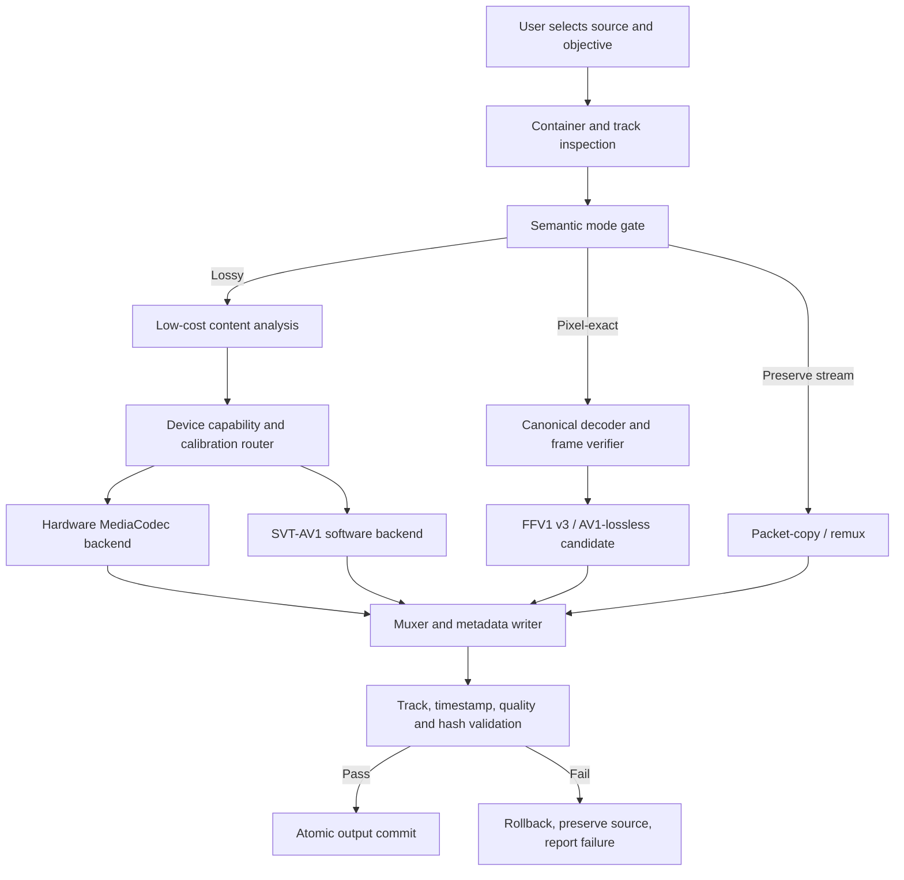

# Next-Generation Android Video Compression

## Engineering Master Plan for 2027–2030

**Research and planning baseline:** 14 November 2026  
**Target:** Android phones from entry-level devices to flagship SoCs, with an architecture that can absorb new codecs and hardware through 2030  
**Deliverable:** implementation plan only; no application code or APK  
**Status:** research-backed architecture proposal; device benchmarks and formal legal review remain gates, not assumed facts

---

## Document conventions and evidence discipline

Every material statement is identified using one of these evidence labels:

- **[VERIFIED—PRIMARY]**: directly supported by a standards body, platform/vendor documentation, official specification, official repository, or original paper/project page.
- **[VERIFIED—SECONDARY]**: supported by an independent technical source. No major performance conclusion in this plan relies solely on a secondary source.
- **[AUTHOR CLAIM]**: a result reported by the authors or maintainers of a project. It is not treated as an independently reproduced result.
- **[ESTIMATE]**: an engineering budget, expected range, or planning target. It must be measured before it becomes a product claim.
- **[SPECULATION]**: a forward-looking possibility for 2027–2030 that is not established as shipping capability.

Technology maturity labels:

1. **Shipping in products** — evidence of commercial or platform deployment.
2. **Standardized / published specification** — a formal standard or a finalized industry specification exists. This does not imply phone support.
3. **Open-source implementation** — source code exists and can be built, subject to its license and dependencies.
4. **Research prototype with code** — research implementation and/or weights are public, but not a dependable consumer deployment path.
5. **Paper only** — a paper is available; a usable implementation was not verified.
6. **Theory only** — concept without a verified implementation.

### Research method and limits

- **[VERIFIED—PRIMARY]** More than 200 targeted web-search queries were issued across standards, Android APIs, codec repositories, vendor specifications, quality metrics, patents, and learned-compression research. The usable results were prioritized toward primary sources.
- Official AV1/AV2, ITU-T, Android, IETF, AOMedia, MediaTek, Microsoft Research, Netflix, and codec-repository sources were inspected. Relevant specification sections and API details were checked directly where online text was available.
- The full AV2 specification and every patent declaration were **not** exhaustively line-by-line reviewed. This is not a formal standards conformance assessment or freedom-to-operate opinion.
- No physical Android device, external power meter, or device farm was available in this research session. All performance figures below are therefore clearly separated into published author claims, estimates, and proposed acceptance thresholds. **No Android benchmark is represented as having been run.**
- No parallel research-agent tool was available in the session. The research was conducted through batched searches and direct inspection of primary sources.
- Sources are dated as of 14 November 2026 unless a specific publication/release date is given. A repository's mutable `main` branch must be pinned to an immutable release/tag/commit before implementation.

---

# 1. Executive summary

## 1.1 Recommendation

Build a **dual-engine system over one shared media pipeline**. Do not create a new video bitstream in version 1, and do not force every phone to use one codec.

| Product mode | Recommended implementation | Fidelity guarantee | When to use |
| --- | --- | --- | --- |
| **Lossless — preserve compressed stream** | Copy the encoded audio/video packet payloads unchanged; optionally remux into a supported container without decoding or re-encoding | Encoded elementary-stream payloads remain bit-identical if packet-copy validation passes. The resulting container file itself is not byte-identical after remuxing | User wants no change to the compressed media and accepts little or no size reduction |
| **Lossless — exact decoded pixels** | Decode to a canonical, explicitly recorded pixel format; encode with FFV1 v3 as the conservative archival path, and benchmark SVT-AV1 lossless as the high-compression candidate | Every decoded pixel sample must match the canonical source frame exactly; timestamps/audio preservation are separate assertions | User wants lossless recompression of decoded frames, not preservation of the original compressed bitstream |
| **Lossy — quality/size/speed/battery target** | Runtime-selected Android hardware encoder (AV1, HEVC, AVC, or APV when appropriate) plus a native SVT-AV1 software backend for high-efficiency jobs on capable devices | Not bit-exact; quality and file size are measured against a defined reference and target | Normal compression, with user-selectable trade-offs |

**Do not make a universal “AV1 always wins” rule.** Android's supported-format table states that AV1 encoding is mandatory beginning with Android 14, but the platform's codec inventory can include software codecs. Android exposes `isHardwareAccelerated()`, `isSoftwareOnly()`, vendor identity, and performance-point information for runtime evaluation. A current vendor example demonstrates why this matters: MediaTek's Dimensity 9500 specification lists AV1 decode, while its published encode list names HEVC/AVC rather than AV1. [S1–S4]

## 1.2 The two meanings of lossless must be explicit

“Bit-exact” can mean at least four different things:

1. **File-byte exact:** every byte in the original file is unchanged. This is a file copy, not compression.
2. **Encoded-stream exact:** the compressed video/audio packet payloads are unchanged, even if a new container is written. This preserves the codec bitstream but does not promise byte-identical container metadata or layout.
3. **Decoded-pixel exact:** the output decodes to exactly the same component samples as the selected canonical decoded source. This can be recompressed, but cannot promise a smaller result for every source.
4. **Perceptually indistinguishable:** an observer or metric sees little/no difference. This is lossy, not lossless.

The UI must not conflate these. A file that was originally encoded with a lossy codec can be re-encoded losslessly relative to its *decoded frames*, but the lost information from the original camera/encode is not restored.

## 1.3 Expected results: hypotheses, not promises

The first release should not advertise a fixed percentage reduction until device/content benchmarks support it.

| Objective | Initial engineering hypothesis / gate | Evidence status |
| --- | --- | --- |
| Pixel-exact mode | Zero sample mismatches across all tested frames, supported bit depths and chroma formats | **[ESTIMATE—acceptance criterion]**; must be proven by frame-hash and sample comparison |
| Lossy quality/size | Seek at least 5–10% aggregate BD-rate reduction versus the selected device's hardware HEVC/AV1 baseline at matched VMAF on the agreed corpus, without an unacceptable runtime/energy penalty | **[ESTIMATE—go/no-go target]**, not a published result |
| Hardware route | Select hardware only when real device measurements show it meets the quality target and gives a meaningful energy/time benefit | **[AUTHOR DESIGN RULE]** |
| Software AV1 | Offer as “smaller file / longer encode” on devices where SVT-AV1 wins the measured Pareto comparison | **[AUTHOR DESIGN RULE]** |
| AV2 | Research and conformance branch only until decoder/encoder availability, performance, interoperability, and licensing are established on real target phones | **[VERIFIED—PRIMARY]** specification v1.0.0 and AVM reference software were released 28 May 2026; phone deployment remains unverified [S5] |
| Learned codec | Research-only; not part of the production file format or default encode path | Existing code and author results exist, but mobile deployment is not established [S6] |

## 1.4 The first 30 days

1. Freeze the semantics of “Lossless” and build a test corpus with known hashes.
2. Build a native command-line benchmark harness first, then an Android harness; do not begin with the UI.
3. Test at least one low-end, one mid-range, and one flagship Android device from different SoC vendors.
4. Compare hardware AVC/HEVC/AV1, SVT-AV1 software, FFV1, and AV1 lossless on a small but varied corpus.
5. Record VMAF-v1/HDR VMAF, PSNR, SSIM, CAMBI where applicable, bit rate, encode/decode speed, wall time, energy, temperature, peak memory, and exactness.
6. Choose the production backends only after the first Pareto chart shows what wins on each device class.

The smallest decisive experiment is specified in Section 8.1.

---

# 2. Research findings: the compression landscape

## 2.1 How modern video compression works

A hybrid video codec typically combines the following techniques:

- **Intra prediction:** predicts a block from nearby samples in the same frame.
- **Inter prediction / motion compensation:** predicts a frame region from one or more earlier/later reference frames using motion vectors and reference pictures.
- **Transform coding:** represents prediction residuals in a frequency-like basis so energy is concentrated into fewer coefficients.
- **Quantization:** coarsens coefficient precision. This is the principal irreversible step in ordinary lossy coding. A true lossless mode must avoid discarding information and use a reversible reconstruction path.
- **Entropy coding:** uses probability/context models to represent common symbols with fewer bits. Range/arithmetic coding and related methods are common.
- **In-loop filtering:** filters reconstructed frames to improve the reference used for later prediction. AV1 and VVC use sophisticated filtering tools.
- **Rate-distortion optimization (RDO):** selects coding decisions to balance encoded bits against reconstruction error or a perceptual cost.
- **Screen-content tools:** palette modes, intra-block copy, and related tools can help UI/text/desktop footage, which behaves differently from natural camera video.

For lossless output, the encoder can still exploit prediction and entropy coding, but the reconstruction must remain mathematically exact. Lossless does **not** mean “use a very high bitrate” or “set quality to 100”; it means the coding process reconstructs the intended samples exactly.

## 2.2 Codec and format map

| Technology | Maturity as of 14 Nov 2026 | How it works / what it is good at | Phone cost and deployment judgment |
| --- | --- | --- | --- |
| **H.264/AVC** | **Shipping in products; standardized; many hardware encoders/decoders** | Mature hybrid block codec with broad ecosystem and interoperability | Usually the compatibility fallback. Often low energy on hardware. Less compression-efficient than newer options in many conditions. Keep it for “works everywhere”, not as the only quality-per-bit engine. |
| **H.265/HEVC** | **Shipping in products; standardized; hardware support widespread but varies by profile/bit depth** | More advanced partitioning, prediction, transform and filtering than AVC | A strong hardware route for power/speed and 10-bit/HDR where supported. Patent licensing is more complex than a simple “free codec” assumption. ITU-T H.265 V11 was approved in January 2026. [S7] |
| **VP9** | **Shipping in products; standardized; open-source implementations** | Google-developed successor to VP8; mature decoder ecosystem and WebM carriage | Android's table lists decoding, but not a general Android encoder requirement. Do not prioritize new VP9 encoding over AV1 unless a partner workflow demands it. |
| **AV1** | **Shipping in products; AOMedia specification; open-source encoders/decoders** | Efficient modern hybrid codec with tools for natural and screen content, HDR and film grain metadata | First-choice software efficiency candidate. Hardware encode availability and quality are SoC-specific. Android lists AV1 encoder and decoder requirements from API-era Android 14, but that alone does not mean hardware acceleration. [S1, S2] |
| **AV2** | **Finalized AOMedia specification and reference software; phone production ecosystem unverified** | Successor to AV1; AOMedia describes improvements including AR/VR, multi-program/split-screen and screen-content handling | Keep in a research branch. The AV2 v1.0.0 specification and AVM reference software are dated 28 May 2026. A reference model is not evidence of a fast mobile production encoder/decoder. [S5] |
| **H.266/VVC** | **Standardized; open/reference software ecosystem; limited phone deployment to verify** | Newer hybrid coding design intended to improve compression beyond HEVC | Benchmark only if a target phone exposes a hardware VVC encoder/decoder. Software encoding is a poor default for phones. H.266 V4 is in force from January 2026. [S8] |
| **APV (Advanced Professional Video)** | **Shipping in Android platform support from Android 16; standardized/published codec ecosystem** | High-bitrate intra-frame professional codec, designed for capture/editing quality rather than smallest consumer file | Support import/export for creator workflows, but do not choose it as the ordinary “smallest file” codec. Android's supported-format table lists APV encoder and decoder from Android 16 and MPEG-4 carriage. [S1, S9] |
| **FFV1** | **Open-source implementation; published IETF RFC; archival use** | Lossless intra-frame codec with context modeling and range coding; supports a range of pixel formats and uses slice-level error checks | Excellent reference and archival path. Intra-only coding sacrifices temporal redundancy; storage can be larger than an efficient inter-frame lossless codec. FFV1 RFC 9043 is informational, not an Internet Standards Track standard. [S10] |
| **MPEG-5 EVC** | **Standardized; implementation/licensing ecosystem must be checked per profile** | Baseline and Main profile approach intended to provide a patent-conscious standard option | Not a v1 Android priority; weak reason to add another encoder unless interoperability or licensing economics are demonstrated. |
| **MPEG-5 LCEVC** | **Standardized enhancement-layer technology; deployment-specific** | Adds an enhancement layer around a base codec rather than simply replacing the base codec | Interesting for streaming/legacy infrastructure, but adds decoder and distribution complexity without a clear standalone Android-file-app advantage. |
| **JPEG 2000 / Motion JPEG 2000** | **Standardized; implementations exist; niche professional use** | Frame-based wavelet image coding; Motion JPEG 2000 applies it per frame | Can serve certain professional/medical/archive use cases, but file size and ecosystem are poor for ordinary mobile sharing. |
| **JPEG-XS** | **Standardized; open-source implementation ecosystem exists** | Low-latency, visually lossless/lightweight compression for production transport | Not a default archival or consumer size-reduction codec. Evaluate only for a low-latency/pro workflow. |
| **Apple ProRes family** | **Shipping in professional products; proprietary specifications/implementation constraints** | High-bitrate editing codecs designed for production workflows | Not a default small-file codec. Do not make compatibility, licensing, or Android support assumptions from Apple ecosystem availability. |
| **Neural / learned video codecs** | **Research prototypes with code; some paper-only variants** | Neural networks learn spatial/temporal representations and entropy models rather than using only conventional handcrafted coding tools | Research frontier, not a production codec choice until decoder portability, model versioning, cross-device exactness, memory/energy, bitstream stability and legal terms are solved. |

### Evidence notes on AV1, AV2, VVC and Android

- **[VERIFIED—PRIMARY]** Android's supported media-format table lists AV1 encoding from Android 14 and decoding from Android 10; it says the encoder and decoder are mandatory beginning with Android 14. It lists APV encoding/decoding from Android 16. [S1]
- **[VERIFIED—PRIMARY]** Android documentation exposes hardware/software/vendor codec classification and performance points. Performance points are device-vendor declarations; `null` can mean missing information, not proof of incapability. [S2, S3]
- **[VERIFIED—PRIMARY]** MediaTek's published Dimensity 9500 specification lists AV1 among 8K60 10-bit decode formats, while the listed encode formats are HEVC/AVC for 8K30 10-bit and HEVC for 8K60 8-bit. This is a concrete reason to discover actual encoders rather than assuming decode implies encode. [S4]
- **[VERIFIED—PRIMARY]** AOMedia's AV2 page identifies AVM as the official reference software and records the v1.0.0 release date as 28 May 2026. It also describes AV2 capabilities, but these are not mobile benchmark data. [S5]
- **[VERIFIED—PRIMARY]** ITU-T's H.266 V4 entry is in force and dated January 2026. Its patent declaration page explicitly warns that the database may not be accurate or complete and has not verified the relevance of each listed claim. [S8, S19]
- **[VERIFIED—PRIMARY]** Android 16 release notes call APV a high-bitrate intra-frame codec aimed at creator capture/editing. [S9]

## 2.3 Open-source encoder and decoder implementations

### SVT-AV1

**Maturity:** open-source implementation of AV1; production-quality design intent; the current release must still be benchmarked on ARM Android.

- SVT-AV1 is an AV1-compliant software encoder project maintained under AOMedia. Its stated scope spans premium VOD through real-time/low-latency use. [S11]
- The official changelog reports SVT-AV1 4.3.0 dated **1 November 2026**. It includes lossless coding fixes/speedups, memory reductions (particularly faster multi-threaded presets), low-delay parallelism and other changes. This makes it a particularly relevant candidate for this plan's research date. [S12]
- Earlier release notes report ARM SIMD work and high-bit-depth speed improvements in specific version/test conditions. These are project-reported improvements, not a promise of performance on every mobile CPU. [S12]
- SVT-AV1 is a CPU encoder. Do not assume the Android GPU or NPU accelerates it.
- The project is a strong candidate for high-quality offline encoding, but its thread count, memory use, thermal behavior, and speed on A55/A78/A720-class cores must be measured.

### libaom and rav1e

**Maturity:** open-source AV1 encoder implementations.

- Keep libaom available as the reference/diagnostic encoder and conformance comparator. It is not automatically the best speed/quality deployment choice.
- Keep rav1e as a cross-check candidate. Its FFmpeg integration is documented by FFmpeg, but that does not establish it as the best Android encoder. [S13]
- Avoid shipping three software AV1 encoders in v1. Benchmark them on the first corpus, then ship at most one primary software encoder plus a reference/test backend where licensing and binary-size budgets permit.

### FFmpeg

**Maturity:** mature open-source multimedia framework, libraries and muxers.

Use FFmpeg libraries selectively for demuxing, software decode fallback, remuxing, audio handling, pixel conversion where allowed, FFV1 and validation utilities. Do not ship the entire command-line toolchain just because it is convenient.

- Pin an exact FFmpeg release/commit and build a minimized component set.
- Keep `--enable-gpl` and `--enable-nonfree` disabled unless legal review expressly approves a different distribution model.
- FFmpeg's own license page says most components are LGPL 2.1-or-later, while optional GPL components can change the resulting binary's obligations; external libraries can also alter the license combination. [S14]

## 2.4 Learned video compression: what is real and what is not

Neural codecs generally learn a representation of a frame and its temporal context, encode latent values with a learned probability model, and reconstruct with a decoder network. A learned codec can improve rate-distortion performance on a benchmark while still being unsuitable for a phone product.

Important examples:

- **FVC (CVPR 2021):** feature-space motion estimation, compensation and residual coding. Research prototype/paper, not a phone standard. [S15]
- **DCVC-DC (CVPR 2023):** diverse contextual models for learned video compression; official code requires a Python/PyTorch environment and CUDA in its documented setup. [S16]
- **DCVC-RT (CVPR 2025):** a practical real-time learned codec paper and official implementation. The repository reports 125.2/112.8 fps average 1080p encode/decode and approximately 21% bitrate reduction versus H.266/VTM in its stated evaluation. The original CVPR paper reports 1080p runtime results on workstation GPUs: approximately 40/34 fps on an RTX 2080 Ti, 119/105 fps on an RTX 4090, and 125/113 fps on an NVIDIA A100 (encode/decode, as presented in the paper's runtime table). These are **[AUTHOR CLAIM]** research measurements, not independent Android-phone results. They must not be represented as Snapdragon/Dimensity performance. The project/paper discusses integerized model deployment to improve coding consistency; integerization alone does not prove bit-exact decoding across every phone SoC, compiler or accelerator. [S17][S34]
- **DCVC-UF (CVPR 2026):** listed in the official Microsoft DCVC repository as a newer model family member. Its existence confirms continued research activity, not a deployable Android bitstream ecosystem. [S6]

### Optional ML experiment: analysis-only estimator, never a codec dependency in v1

The production baseline contains **no trained model**. After the codec benchmark corpus has sufficient measured results, evaluate a small estimator that predicts which already-implemented encoder/preset is likely to meet a user's objective. It must only rank configurations; it must never alter coded symbols, entropy decisions, decoder behavior or the normative bitstream.

- **Inputs:** resolution, frame rate, bit depth, chroma format, duration, sampled motion magnitude, scene-cut rate, spatial texture/edge density, noise estimate, and a privacy-safe device/backend capability profile. Do not upload user footage or derived features by default.
- **Targets:** per candidate backend, measured bitrate at pinned quality, VMAF/PSNR/SSIM, encode wall time, sustained fps, peak PSS, and energy proxy/measurement with device family and thermal state recorded.
- **Training design:** split by *source video* and *device family*, not random frames, to prevent leakage. Keep at least one complete device family and one content class as untouched holdouts. Use repeated runs and confidence intervals; never train on synthetic labels from unmeasured hardware.
- **Model candidates:** begin with regularized linear/quantile regression and a small gradient-boosted tree. A compact fixed-point or integer inference representation is preferred for reproducible local ranking; a model package target below 1 MiB is an **[ESTIMATE]**, not a requirement or demonstrated result. Use a deterministic rule-based router unless the learned estimator beats it on held-out devices in regret, failure rate and probe overhead.
- **Training data and rights:** UVG contains 16 4K sequences at 50/120 fps and its published terms are CC BY-NC; do not treat that as commercial training permission. BVI-DVC provides 772 sequences from 270p to 2160p, but its published access/licensing terms must be checked and should not be assumed to grant commercial redistribution or model-training rights. A commercial product should use footage created in-house under documented releases, specifically licensed corpora, and/or explicit opt-in user contributions with a clear consent/retention policy. Review every corpus and clip before training or redistribution. [S32][S33]
- **Delivery:** sign and version the estimator with the app, load it locally, retain a rollback path and expose a disable switch. Do not require network access or NPU execution. Model updates must not invalidate old exports because the model is not part of the decoder.
- **Go/no-go:** keep the estimator only if it beats the deterministic rules on a frozen, held-out device/content set, reduces failed objective attainment or total job energy/time after including probe/inference overhead, and does not regress any supported low-memory tier. Otherwise delete it.

### Why learned codecs are not in production v1

1. **Decoder agreement:** the file must contain or identify an exact model version, operator semantics, precision, weights, entropy coder, and decoder behavior.
2. **Cross-silicon reproducibility:** floating-point kernels and vendor NPU delegates can differ. A decoder that reconstructs a slightly different latent can desynchronize all later predictive frames.
3. **Integer inference is not sufficient by itself:** it helps reduce variation but does not automatically standardize every operation, entropy decision, rounding rule, tensor layout or backend implementation.
4. **NPU fragmentation:** Qualcomm, MediaTek, Samsung and Google expose different execution stacks. Android's common NNAPI path is not a safe long-term assumption; use current vendor/platform SDK status at implementation time.
5. **Model lifecycle:** models require signing, compatibility checks, version retention, delivery, storage, rollback and vulnerability review.
6. **Thermals and memory:** a model that is fast on a workstation GPU may be far too large or power-hungry on a phone.
7. **Interoperability:** a conventional AV1/HEVC/FFV1 output can be decoded by existing software. A proprietary neural bitstream cannot unless the decoder ships and remains maintained.

**Decision:** no neural network in the normative encoder/decoder path for v1. A small optional content/quality estimator may be evaluated later, but a deterministic hand-written feature model is the baseline.

## 2.5 Metrics and perceptual evaluation landscape

- **VMAF:** useful perceptual quality metric, not an oracle. Netflix released VMAF v1 models in June 2026 and an HDR VMAF-v1 model update on 26 October 2026. Use a pinned VMAF v1 model and the HDR model for HDR tests; record model file hash and all preprocessing. [S18]
- **PSNR:** simple sample-error metric; can disagree with perception and does not describe temporal artifacts well.
- **SSIM / MS-SSIM:** structural similarity metrics; useful as additional views, not sole ranking.
- **VMAF NEG:** useful for codec comparisons where enhancement gain can distort interpretation; report it only with the exact model/mode.
- **CAMBI:** banding visibility metric; important for gradients, skies, animation and low-bitrate HDR/SDR clips.
- **Subjective testing:** final decision must include blinded human viewing under a controlled protocol. ITU-R BT.500 is a recognized subjective assessment reference; select a current applicable edition when test protocol is frozen.
- **Temporal integrity:** inspect judder, flicker, pulsing detail, reference-frame errors, dropped/repeated frames, audio/video sync and scene-cut behavior. Frame-averaged quality scores can hide these defects.
- **Screen content:** VMAF alone may not adequately capture tiny text, thin lines, cursor trails or UI edge damage. Add edge/text-region measurements and a task-specific screen-content test set.

---

# 3. Design decisions and proposed inventions

## 3.1 Decision matrix

| Decision | Options considered | Selected decision | Why | Evidence that would change the decision |
| --- | --- | --- | --- | --- |
| Overall architecture | One codec; custom codec; dual engine; cloud-only | **Dual engine + shared local pipeline** | The two modes have incompatible guarantees; local execution preserves privacy/offline behavior and avoids upload cost | Reliable hardware support for a common lossless codec across target devices, or a standard learned codec with portable decoders |
| Lossless preservation | Re-encode; packet-copy; custom container | **Packet-copy for stream preservation; pixel-domain lossless for recompression** | Avoids falsely claiming bit-exactness after lossy decode/re-encode | A codec-aware bitstream rewrite demonstrably preserves all coded samples and reduces size on supported formats; still requires formal proof |
| Lossless codec | FFV1; AV1 lossless; HEVC lossless; raw | **FFV1 v3 archival baseline; SVT-AV1 lossless candidate; raw/copy fallback** | FFV1 is documented, lossless and well suited as a reference; current SVT-AV1 includes lossless improvements | Reproducible tests prove AV1 lossless is smaller and interoperable on actual playback targets without unacceptable phone cost |
| Lossy primary | AVC; HEVC; AV1; VVC; AV2; neural | **AV1 where hardware/quality/energy test passes; HEVC/AVC hardware fallback; SVT-AV1 software quality route** | Uses current standards/ecosystem while retaining per-device flexibility | Measured device-specific AV2/VVC hardware availability and a compelling rate/energy/compatibility result |
| Container | MP4; WebM; Matroska; custom | **MP4 default; Matroska for FFV1/archive; no custom container** | MP4 has broad Android and sharing support; Matroska supports archival track/codec flexibility | A specific target ecosystem needs another standardized container and support is verified end-to-end |
| App/native languages | Kotlin-only; C++; Rust; mixed | **Kotlin UI/orchestration + C++20 NDK media core** | Android framework integration belongs in Kotlin/Java; codecs and FFmpeg libraries expose C/C++ APIs | A security-critical parser component is added later and Rust's safety benefit outweighs FFI/build complexity |
| ML | Full neural codec; NPU filters; none; quality estimator | **No ML in normative encode/decode v1; optional estimator experiment only** | Prevents decoder incompatibility, model delivery burdens and unmeasured NPU energy costs | Standardized, deterministic, multi-vendor codec decoder and replicated mobile benchmarks |
| GPU | GPU encoder; GPU image transforms; no GPU | **Use MediaCodec for hardware coding; GPU only for lossy transforms after correctness tests** | Codec hardware support is exposed through MediaCodec; GPU compute is not a generic video encoder | Stable Vulkan Video encode support on a meaningful share of target phones, with lower measured energy and broad conformance |
| NPU | Neural codec; quality model; no NPU | **No NPU dependency** | Fragmented and not required for conventional codecs | Common Android API, verified vendor coverage, deterministic integer implementation and positive measured energy benefit |
| File-size targeting | Fixed bitrate; CRF; two-pass; iterative control | **Predict + VBR/CRF + optional second pass/size correction** | CRF alone cannot promise exact file size; constrained output needs a bitrate budget | Encoder APIs provide robust, uniform target-size control with measured accuracy across devices |
| Device selection | Android version only; chipset allowlist; capability query + benchmark | **Runtime capability query + cached device profile + short smoke/probe test** | OS version does not establish the underlying hardware accelerator or real sustained throughput | Only if Android publishes a strong, reliable capability contract that matches measured devices |

## 3.2 Lossless mode: full semantics and algorithm

### A. Stream-preservation path

Input: an existing media file.  
Operation: inspect container and tracks, then copy encoded packet payloads unchanged. Rebuild only the container if the user asks for a new wrapper or compatible layout.

Validation:

- Hash every video packet payload in order and compare the output payload sequence.
- Hash every audio packet payload in order when audio is copied.
- Compare packet count, packet order, timestamps, durations, time bases, codec extradata and track identifiers.
- Record container-level metadata differences separately. A remuxed file must not be described as “file-byte identical”.
- If the input uses encryption, DRM or a secure decoder surface that prevents access, do not bypass it. Explain that the operation is unsupported.

Expected compression gain: usually none at the elementary-stream level. Container-layout optimization may save a small amount, but no universal percentage is justified.

### B. Pixel-domain exact path

Input: decoded frames from a supported video track, camera/producer frames, or raw video.

Canonical frame definition must include:

- width and height;
- component order and chroma subsampling (4:2:0, 4:2:2, 4:4:4 or monochrome);
- bit depth and packing (for example, 8-bit planar versus 10-bit P010 storage);
- range (limited/full), matrix coefficients, transfer function, primaries and chroma sample location;
- plane stride and pixel stride normalization;
- frame order, presentation timestamp and duration.

**No implicit resize, crop, denoise, sharpening, frame interpolation, chroma resampling, tone mapping, color-space conversion or frame-rate conversion is permitted in this path.** Any such operation changes the sample stream and therefore invalidates the pixel-exact claim unless it is mathematically lossless and formally specified.

Normative correctness condition:

\[
\forall f,c,x,y:\quad S_{f,c,x,y}=D(E(S))_{f,c,x,y}
\]

where `S` is the canonical source sample, `E` the encoder, and `D` the conforming decoder. The comparison must be performed on normalized component samples, not on rendered screenshots.

Encoder selection:

1. **FFV1 v3:** default archival/reference backend. It is intra-frame, lossless and has a documented range-coder/slice structure. Its v3 configuration supports error-detection options including 32-bit CRC in slices and configuration records. [S10]
2. **SVT-AV1 lossless:** candidate for smaller files when the CPU, memory and thermal budget permits. The 4.3.0 release notes list lossless coding fixes/speedups, but each output configuration must be tested for exact reconstruction and decoder support. [S12]
3. **Raw/uncompressed or packet-copy:** fallback when unsupported pixel layouts, codec failures or deadline constraints make recompression unsafe.

**Do not promise FFV1 or AV1 lossless files will play in every stock Android gallery/player.** Android's platform format table does not list FFV1 as a normal Android video codec. Use an in-app decoder or a documented third-party player for archive playback.

### C. Lossless audio and metadata

Default: keep compressed audio packets unchanged. Do not silently transcode audio. Preserve subtitles, chapters, track language, rotation, color/HDR metadata and creation timestamps when the target container supports them. Offer a privacy-aware option to remove location metadata; do not remove it silently.

A SHA-256 manifest can record input/output stream hashes, frame hashes, codec version, parameters and verification result. A CRC is for accidental corruption detection, not cryptographic authenticity.

## 3.3 Lossy mode: objective and control system

The app should expose four distinct user objectives instead of one vague quality slider.

| User objective | Optimization problem | Primary controls |
| --- | --- | --- |
| **Best quality for a chosen file-size budget** | Minimize perceptual distortion subject to output bytes `B <= B_target` | Target size, minimum acceptable quality, optional “finish even if quality drops” |
| **Smallest file for chosen quality** | Minimize rate `R` subject to `Q >= Q_target` | Quality target, speed/battery ceiling |
| **Fastest completion** | Minimize elapsed time subject to `Q >= Q_min` | Hardware first, fewer analysis passes, bounded CPU threads |
| **Lowest battery use** | Minimize energy `E` subject to `Q >= Q_min` and time/thermal constraints | Hardware first if measured efficient, thread cap, low-resolution analysis, optional charging-only execution |

A general constrained cost model is:

\[
\min_{c,p,q,r}\; \lambda_R R+\lambda_E E+\lambda_T T+\lambda_M M
\]

subject to:

\[
Q(c,p,q,r)\ge Q_{\min},\quad
T\le T_{\max}\;\text{(if specified)},\quad
E\le E_{\max}\;\text{(if specified)},\quad
M\le M_{\max}.
\]

`c` is codec/backend, `p` preset, `q` quality/quantizer control, `r` rate-control configuration; `R` is bitrate, `E` energy, `T` elapsed time and `M` memory. The `λ` weights express user priorities. In implementation, use a Pareto frontier and constraints, not one hard-coded global weight set.

### Rate budget for target size

Let:

- `B_total` = target output bytes;
- `B_audio` = copied/encoded audio bytes;
- `B_subs` = subtitles and chapters;
- `B_meta` = container/metadata overhead estimate;
- `B_margin` = safety margin for muxing and rate-control variation;
- `t` = duration in seconds.

Then:

\[
B_v=B_{total}-B_{audio}-B_{subs}-B_{meta}-B_{margin}
\]

\[
R_v\approx\frac{8B_v}{t}\quad\text{bits/s}.
\]

This is a budget estimate, not an exact prediction. Use a short representative probe or first-pass statistics to improve prediction. If the user sets a hard maximum, reserve a margin and allow quality to fall only according to the explicitly selected policy.

### Content-aware pre-analysis

Use a lightweight deterministic analysis stage, not a neural codec:

1. Read container metadata and identify variable frame rate, HDR, bit depth, rotation and audio tracks.
2. Sample frames at scene boundaries and a bounded periodic cadence; decode a low-resolution analysis copy (for example, 160–320 pixels wide, subject to validation).
3. Estimate motion, texture, noise/grain, edge density, scene-cut rate, gradient/banding risk and screen-text likelihood.
4. Categorize the clip as natural low-motion, natural high-motion, noisy/low-light, animation, screen/UI, HDR, or mixed.
5. Select candidate backends/presets from the device calibration table.
6. Run a small encode probe only for “best quality per byte” or tight file-size targets; skip it for “fastest” mode.

The analysis sample rate and size are **[ESTIMATE]** values. The pilot should find the minimum sample budget that predicts full-file size and quality reliably enough to justify its cost.

### Encoder selection policy

1. Enumerate available `MediaCodec` encoders and decoders by MIME type and profile/level.
2. Record `isHardwareAccelerated`, `isSoftwareOnly`, `isVendor`, canonical name, supported widths/heights/frame rates, bitrate ranges, color formats and performance points.
3. Treat `null` or missing performance points as “unknown”; verify by a short real encode.
4. Reject hardware codecs that fail required color/HDR support or output correctness.
5. Benchmark AV1 hardware against HEVC hardware at matched quality and energy. Choose AV1 only if it wins the user's selected objective.
6. If AV1 hardware is absent or poor but the device can sustain software encoding, offer SVT-AV1 with a device-specific thread/preset cap.
7. If software AV1 would violate the speed/energy/thermal budget, choose HEVC hardware; use AVC when compatibility is the overriding requirement.
8. APV is for supported high-quality intra/pro workflows; do not substitute it for small-file encoding.
9. VVC and AV2 remain experimental until a device provides a conforming encoder/decoder and benchmark data.

### Preset model

Do not expose vendor-specific quantizer values as if they were universal. Internally normalize settings to user objectives, but maintain per-backend calibration tables:

- hardware AV1: vendor profile, bitrate mode, quality/complexity controls and tested behavior;
- hardware HEVC: per-vendor profile, level, bitrate/quality control and HDR support;
- hardware AVC: baseline compatibility settings;
- SVT-AV1: release-pinned preset, rate-control mode, tune, thread count, lookahead and memory profile;
- FFV1/AV1 lossless: separate parameters, not mapped to the lossy slider.

A hardware encoder may ignore or reinterpret a parameter. The app must validate output behavior and expose the actual chosen backend/settings in the job report.

## 3.4 Proposed innovations (all require proof)

These are architecture/workflow inventions, not claims of a novel codec algorithm or patentable invention. A patent search must be separate.

### Innovation A — Evidence-based codec router

A per-device calibration record stores encoder identity, OS/vendor build, profile/level, tested resolutions, color format, matched-quality bitrate, energy per input minute, sustained throughput, peak memory and thermal state. The router selects a Pareto-optimal path for each objective. It reruns a short capability probe after OS/firmware changes or when a codec fails.

**Expected gain:** avoids selecting a nominally available but slow/low-quality software encoder or an inefficient hardware path.  
**Cost:** calibration time and device-matrix maintenance.  
**Kill test:** if calibration cannot predict real jobs better than static rules, simplify to rules plus a manual backend choice.

### Innovation B — Energy- and thermal-aware work scheduler

The scheduler uses measured encode throughput, battery state, thermal status/headroom, available memory and job priority. It can lower encoder concurrency, pause at safe fragment boundaries, or recommend running while charging. It must not claim exact battery attribution from Android estimates.

**Expected gain:** more stable completion times and reduced thermal throttling.  
**Cost:** slower completion under restrictive thermal budgets.  
**Kill test:** retain only thermal protection if energy-aware dynamic thread control provides no repeatable benefit.

### Innovation C — Two-stage size prediction

Use a low-cost sampled analysis to predict file size; for precise budgets, encode a short representative sample or run a first pass. Adjust rate-control parameters and, if permitted by the user's quality floor, perform one correction encode.

**Expected gain:** fewer oversize outputs and fewer full-file re-encodes.  
**Cost:** analysis overhead, sample representativeness errors and additional decode work.  
**Kill test:** remove probe mode if it fails to improve target-size accuracy enough to offset its runtime/energy cost.

### Innovation D — Verifiable export manifest

Every job can generate a machine-readable manifest with input track hashes, output track hashes, canonical pixel format, frame count, timestamp policy, codec/version, parameters, quality metrics, verification level, warnings and app build hash. The manifest does not embed private media or GPS by default.

**Expected gain:** auditable lossless claims, reproducibility, support diagnostics and archival trust.  
**Cost:** hashing I/O and manifest/version maintenance.  
**Kill test:** none for core lossless mode; make it optional for ordinary lossy exports if overhead is measurable.

### Innovation E — Transactional, recoverable output

Write to a private temporary destination; use fragmented output or safe segment boundaries where supported; verify every finalized fragment; then atomically commit/rename. On process death, resume only from a verified boundary. Never append arbitrary bytes to a finalized MP4 and call it resumable.

**Expected gain:** less wasted work after interruption.  
**Cost:** container complexity and possible GOP-boundary compression loss.  
**Kill test:** disable resume for any codec/container combination without a formal recovery test suite.

### Prior-art screen and novelty boundary (not a freedom-to-operate opinion)

A targeted prior-art search found that **dynamic codec selection using predicted quality improvement and power consumption is not a new broad concept**. US patent **US11178395B1** (assignee listed as WhatsApp LLC) has a priority date of 10 June 2020 and publication date of 16 November 2021. Its claims and description discuss selecting/switching codecs using expected quality improvement, expected power use and a weighted threshold; the description also discusses device capability filtering and learned quality prediction. This is materially close to the broad idea behind Innovation A. The proposed router must therefore be described as a product-specific, empirically calibrated integration of known techniques—not as a newly invented codec-selection principle or a patentable invention. The Google Patents page itself warns that its displayed legal status is an assumption, not a legal conclusion; this plan makes no assertion that the patent is valid, enforceable or in force in any jurisdiction. [S31]

The other proposed items are also **not asserted as novel**: thermal scheduling, sampled rate/size estimation, integrity manifests and transactional checkpoint/recovery all have established analogues in software and media systems. This research pass did not produce an exhaustive claim chart for those areas and did not establish that any particular implementation is clear of third-party rights. Before commercialization, patent counsel should search relevant claims in the US, India, EU, China, Japan and other intended markets; map independent claims to the actual implementation; review codec patent pools and standards-essential patent declarations; and issue a written freedom-to-operate opinion. A search result or a standards body's patent database is not legal clearance.

| Proposed item | Prior-art conclusion from this pass | Product treatment |
| --- | --- | --- |
| Evidence-based codec router | Broad quality/power-based codec selection has close patent prior art (US11178395B1); novelty not supportable at this level | Build only as a measured implementation; no novelty or patentability claim |
| Thermal/energy scheduler | Established class of resource-scheduling problem; no exhaustive patent chart completed | Treat as engineering optimization; search claims before filing or commercial launch |
| Two-stage size predictor | Sampling, rate control and multipass estimation are established techniques | Claim only measured prediction accuracy on the declared corpus |
| Export manifest | Hashes, provenance and integrity metadata are established patterns | Use open, documented fields; do not market as novel cryptographic invention |
| Transactional recovery | Atomic output, checkpointing and segment-boundary recovery are established patterns | Claim reliability only for codec/container pairs that pass destructive tests |

---

# 4. Full implementation plan

## 4.1 System architecture



### Layers

**1. Android application layer (Kotlin)**

- Source selection through Android Storage Access Framework (SAF).
- Job queue, permissions, progress, preview, target controls and cancellation.
- Foreground user-visible work when appropriate; persistent queue/retry policy through WorkManager where platform restrictions permit.
- Thermal/battery state integration and user notifications.
- No media payloads sent to a server in the default architecture.

**2. Job planner and policy engine (Kotlin + small native interface)**

- Defines the objective and hard constraints.
- Produces an immutable job manifest.
- Selects a backend based on device capabilities and last successful calibration.
- Handles cancellation, retry and final commit.

**3. Native media core (C++20 / Android NDK)**

- Track demux, packet routing, timestamps, canonical pixel format description and bounded frame queues.
- Native FFmpeg libraries for demux/mux, audio packet handling, supported software decode paths and FFV1.
- SVT-AV1 encoder wrapper, release-pinned.
- Android `MediaCodec`/NDK media wrappers for hardware codec input/output.
- Hashing and exactness validation.

**4. Codec backends**

- `PacketCopyBackend` — no decode/re-encode.
- `MediaCodecBackend` — runtime-discovered vendor/platform hardware or software codec.
- `SvtAv1Backend` — software AV1 encoding for high-efficiency jobs.
- `Ffv1Backend` — lossless archival baseline.
- `Av1LosslessBackend` — experimental until tested against all required pixels/decoders.
- Future `Av2Backend`/`VvcBackend` adapters — disabled unless supported and qualified.

**5. Quality and telemetry tools**

- VMAF/PSNR/SSIM/CAMBI on the benchmark host, not necessarily on the phone.
- Perfetto/Android Macrobenchmark and optional external power meter for energy.
- Device calibration database keyed by SoC, OS build, codec canonical name and encoder configuration.

## 4.2 Programming languages and build tools

| Component | Choice | Rationale |
| --- | --- | --- |
| UI and Android lifecycle | Kotlin | Strong platform integration, coroutines, WorkManager and lifecycle APIs |
| Native media engine | C++20, constrained to supported NDK/toolchain features | Direct integration with FFmpeg, SVT-AV1, libavutil and NDK media APIs |
| Build | Gradle + Android Gradle Plugin + CMake + NDK | Standard Android packaging and native build integration |
| Host research | C/C++ benchmarks plus Python orchestration/analysis | Python is appropriate for experiment automation, plots and VMAF pipelines; not the production hot path |
| Tests | GoogleTest for native; JUnit/Android instrumentation for app and device behavior | Keeps codec correctness and Android integration tests separate |
| Fuzzing | libFuzzer/AFL++ on host; sanitizers | Native demuxers and parsers process untrusted files |
| CI | Linux x86_64 build host; physical Android device farm for release gates | Reproducible native builds plus real-driver validation |

Avoid Rust in v1 unless a new memory-safe parser provides measurable risk reduction without destabilizing FFmpeg/NDK integration. Do not add languages for fashion. If Rust is added later, isolate it behind a small stable C ABI and fuzz both sides.

## 4.3 Hardware strategy

### CPU

- Primary ABI: `arm64-v8a`.
- Runtime-dispatch NEON/available ARM SIMD kernels. Do not assume every Android CPU has the same instruction extensions.
- Use a bounded worker pool; start with one to two big cores for battery mode, tune per SoC, and scale only if measured energy/time improves.
- Avoid oversubscription between SVT-AV1 threads, FFmpeg workers, Android framework threads and vendor codec work queues.
- Keep a scalar/reference path for correctness and cross-architecture tests.

### Hardware codec (VPU/media block)

Use `MediaCodec` discovery and capability queries. Record:

- canonical codec name, aliases and vendor flag;
- hardware-accelerated/software-only flags;
- MIME type, profile/level and bit depth;
- supported size/rate/bitrate/color-format range;
- supported performance points, when present;
- tested surface/buffer input path, HDR metadata, B-frame/low-latency behavior and actual encode throughput.

A declared performance point is not a promise for multiple concurrent codec sessions; Android documentation says the points assume a single active codec and can be absent/null. [S3]

### GPU

- Do not assume a GPU encoder exists because a phone has a powerful GPU.
- Use GPU rendering/compute only for *lossy* transforms such as resize, crop or color conversion after pixel correctness and energy tests.
- Do not route lossless pixel-exact frames through an unvalidated GPU texture pipeline: texture sampling, range conversion, chroma reconstruction and surface formats can alter samples.
- Vulkan Video is an optional future backend only after the relevant extension, driver and codec coverage is demonstrated. MediaCodec remains the first platform integration point.

### NPU

- No NPU dependency in v1.
- Do not run a learned codec simply because the phone claims high TOPS. TOPS does not specify the precision, memory bandwidth, kernel availability, entropy-coding speed, sustained power or decoder portability needed for video compression.
- A small content classifier can be tested later, but must lose to a deterministic CPU heuristic on energy/accuracy before inclusion.

## 4.4 Memory and dataflow design

Never load an entire video or all decoded frames into memory.

- Use bounded input/output queues and a small reusable frame pool.
- Use direct buffers/native memory where supported; avoid repeated Java↔JNI copies.
- Keep audio packet passthrough independent of video frame scheduling.
- For exact path, use explicit plane strides and pixel strides; never assume tightly packed rows.
- For lossy path, choose surface-to-surface processing only when transformations and output color metadata can be validated.
- Apply back-pressure: if encoder output stalls, stop feeding decoder frames instead of growing an unbounded queue.
- Release codec instances and buffers deterministically on cancellation and all failure paths.

Approximate uncompressed frame memory examples (not total process memory):

| Format | 1920×1080 | 3840×2160 |
| --- | ---: | ---: |
| 8-bit 4:2:0 (`1.5 bytes/pixel`) | 3.11 MB | 12.44 MB |
| P010-style 16-bit storage for 10-bit 4:2:0 (`3 bytes/pixel`) | 6.22 MB | 24.88 MB |

A 4K P010 ring of eight frames alone is about 199 MB (decimal), before codec reference frames, lookahead, muxing, JVM, graphics and OS overhead. This is why frame-pool size must be bounded and adaptive.

**Initial memory budgets [ESTIMATE]:** target app-owned incremental peak PSS around ≤128 MiB for 1080p SDR jobs and ≤256 MiB for 4K 10-bit jobs, excluding unrelated system processes. Treat these as pilot goals, not Android guarantees. Lower the lookahead/frame pool or fall back to hardware when a device cannot meet them.

## 4.5 Containers and metadata

### Default lossy container: MP4 / ISO Base Media File Format

- Use MP4 for broad sharing and Android playback compatibility.
- Use AV1/HEVC/AVC tracks only after testing sample-entry, codec configuration, timestamps and playback on target apps/devices.
- APV should use the carriage documented by Android where required.
- Preserve audio packets by default when the chosen container supports them.
- Retain rotation, color primaries, transfer characteristics, matrix coefficients, mastering-display metadata, content-light metadata and dynamic HDR metadata where relevant and supported.

### Lossless/archive container: Matroska

- Use Matroska for FFV1 v3 and archive-oriented multitrack output.
- Use a pinned FFmpeg `libavformat` Matroska muxer rather than writing a private container.
- Do not promise native Android gallery playback for FFV1. Provide in-app playback through the app's decoder or document a supported external player.

### Never invent a custom video container in v1

A custom container would require a new parser, recovery logic, security surface, seeking model, metadata schema and long-term compatibility promise. There is no demonstrated benefit over MP4/Matroska for this product.

### Metadata checklist

- track order, IDs, language and disposition;
- codec extradata and sample descriptions;
- presentation timestamps, decode timestamps, time base and edit lists;
- constant/variable frame rate and frame durations;
- orientation/rotation and pixel aspect ratio;
- color range, primaries, transfer, matrix and chroma location;
- HDR static and dynamic metadata;
- audio channels, sample rate, language, delay and sync;
- subtitles, chapters and attachments where supported;
- camera metadata and location data with an explicit keep/remove option.

## 4.6 Android application and job lifecycle

1. User chooses input through SAF; app obtains read/write access without copying to app storage unless necessary.
2. App inspects metadata and checks free destination space.
3. App shows the mode semantics and warnings (for example, stream-preserve may not shrink the video payload).
4. App creates a job manifest and writes temporary outputs into an app-controlled destination or safe temporary document.
5. A visible foreground operation is used for user-initiated long work where current Android policy requires it. WorkManager is for persistent queued/retry work, not a loophole for unlimited execution.
6. A thermal listener and memory watchdog can reduce concurrency or pause at a safe point.
7. The output is finalized, validated and committed only on success. The input is never overwritten in place by default.
8. On cancellation/failure, temporary files are cleaned safely; the original remains intact.

The exact foreground-service type, target SDK and Play policy requirements must be rechecked at release time; Android background execution rules evolve.

## 4.7 Repository and module organization

Start with a **monorepo** to keep interface changes and build versions coherent. Keep upstream codec sources as pinned external dependencies/submodules or reproducible fetches; do not silently fork without documenting patches.

```text
android-video-compressor/
  app-android/                 # Kotlin UI, SAF, job lifecycle, WorkManager
  core/
    job-model/                 # objective, constraints, manifest schema
    device-profile/            # MediaCodec inventory and calibration cache
    policy-router/             # Pareto selection and fallbacks
  native/
    media-core/                # frame/packet abstractions, bounded queues
    android-mediacodec/         # NDK/MediaCodec wrappers
    ffmpeg-adapter/            # demux, mux, audio, software decode
    svt-av1-adapter/            # AV1 encoder wrapper
    ffv1-adapter/              # FFV1 encoder path
    lossless-verifier/         # frame/packet/hash verification
    quality-probe/             # analysis features and sample encodes
  formats/
    manifest-schema/           # versioned job/export manifest
    metadata-matrix/           # metadata preservation tests
  bench/
    host-harness/              # FFmpeg/SVT/VMAF automation
    android-harness/           # device encode/power/thermal tests
    corpus-manifest/           # sources, licenses, hashes
  tests/
    conformance/
    property/
    integration/
    fuzz/
    playback/
  third_party/                 # pinned licenses, notices, SBOM
  docs/
    architecture/
    decisions/
    threat-model/
    release/
```

### Versioning policy

- Pin FFmpeg, SVT-AV1, VMAF, compiler, NDK, Android Gradle Plugin and test corpus by exact version/commit and SHA-256.
- Maintain an SBOM and license notices for every release.
- Treat codec upgrades as algorithm changes: rerun the full corpus, exactness suite, power suite and playback compatibility matrix.
- Store backend settings and codec version in export metadata/manifest so an output can be reproduced or diagnosed.

---

# 5. Measurement and benchmark plan

## 5.1 Test corpus

Use a combination of public standards/research clips and original phone footage. The public data must be license-reviewed before bundling into app tests or distributing samples.

| Content class | Required examples | Why it matters |
| --- | --- | --- |
| Natural low motion | landscapes, interviews, static tripod | Tests flat areas and low-motion prediction |
| Natural high motion | sports, running, water, foliage | Tests motion vectors, complex prediction and bitrate spikes |
| Low-light/noisy | night streets, indoor sensor noise | Noise/grain consumes bitrate and is easily over-smoothed |
| Fine texture | hair, fabric, grass, fences | Detects texture loss and ringing |
| Screen/UI | scrolling code, small text, cursor, app UI | Tests edge/text preservation and screen-content tools |
| Animation | 2D/3D animation, gradients, subtitles | Tests banding, clean edges and flat regions |
| HDR | HDR10/PQ and HLG phone clips with valid metadata | Tests 10-bit, tone mapping mistakes and HDR metric selection |
| High frame rate | 60/120 fps clips where supported | Tests throughput and timing |
| Variable frame rate | actual phone footage with VFR timestamps | Tests timestamp correctness and A/V sync |
| Alpha/multiplane/rare formats | only where source formats justify them | Tests graceful unsupported-format reporting |

Use recognized corpora such as Xiph test media, UVG, MCL-JCV and BVI-DVC as appropriate, plus a separately consented in-house phone corpus. UVG's published dataset page describes 16 4K sequences at 50/120 fps and CC BY-NC terms; BVI-DVC's published dataset page describes 772 sequences over 270p–2160p and has access/licensing terms that must be reviewed before commercial use. Do not assume a research download is licensed for commercial training, model distribution, app bundling or sample redistribution. [S32][S33] The exact clip list, license, source URL, resolution, frame rate, bit depth, chroma, duration and SHA-256 must be frozen in `corpus-manifest` before the first release benchmark.

## 5.2 Device matrix

Minimum matrix for the first serious release:

| Class | Target device characteristics | Purpose |
| --- | --- | --- |
| Entry-level | 4 GB RAM class, lower-mid CPU cluster, older supported Android API, H.264/HEVC hardware baseline | Verify app remains usable and avoids memory/thermal failure |
| Budget current | 6 GB RAM class, recent Snapdragon or MediaTek midrange, modern Android | Test software AV1 feasibility and common hardware paths |
| Midrange performance | 8 GB RAM class, newer CPU/GPU, HEVC/AV1 decode and variable encoder exposure | Compare hardware and software Pareto results |
| Flagship Qualcomm | Current flagship SoC, 12 GB+ RAM, latest OS | Test high-efficiency SW AV1 and hardware encoders |
| Flagship MediaTek | Current flagship SoC, latest OS | Validate vendor differences; Dimensity 9500 public codec table is a reference case, not a guarantee for all models [S4] |
| Pixel/Tensor | Recent Pixel, current OS | Android reference implementation and power-metric coverage where supported |
| Samsung/Exynos | At least one Exynos device where available | Validate another VPU/driver path |

Record exact model, SoC, RAM, Android build, security patch, vendor image, thermal state, storage performance and codec inventory. Do not label a device “AV1 hardware-capable” until `isHardwareAccelerated()` and a real encode test both pass.

## 5.3 Benchmark procedure

For every codec/backend/configuration:

1. Reboot or return device to a controlled idle state; allow temperature to settle.
2. Fix display brightness and screen state; close unnecessary apps; disable network radios unless the scenario requires them.
3. Record battery percentage and ambient temperature. Use a consistent starting temperature band (initial target 22–25 °C lab ambient; **[ESTIMATE]**).
4. Run one warm-up and at least three measured trials for short clips; use longer sustained trials for thermal throttling.
5. Record wall time, encode/decode fps, CPU utilization/frequency, GPU/NPU activity where available, peak RSS/PSS, thermal status, dropped frames, bitrate, file size and output validity.
6. Measure energy through Android Macrobenchmark `PowerMetric` on supported Pixel hardware and/or an external calibrated power monitor. Android documents `PowerMetric` as experimental and currently limits hardware measurement to physical Pixel 6/6 Pro and newer. It is system-wide, not automatically app-specific. [S20]
7. Use Perfetto traces for scheduling, frequency and CPU profiling. [S21]
8. Run the VMAF/PSNR/SSIM/CAMBI pipeline on a controlled host using pinned versions and correct color handling.
9. Report median, p95, range and standard deviation. Do not report only the fastest run.
10. Repeat a representative case with battery discharging and with the device plugged in; charging can change thermal behavior.

## 5.4 Required measurements

### Compression and quality

- output bytes and bits per second;
- bits per pixel per frame where useful;
- BD-rate versus a fixed anchor at matched quality;
- VMAF v1 for SDR, HDR VMAF-v1 for HDR;
- PSNR, SSIM and MS-SSIM;
- CAMBI for banding;
- subjective pairwise preference/DMOS on selected clips;
- frame alignment and temporal artifact review;
- text/edge-specific scores for screen recordings.

### Speed and resource cost

- wall-clock time / video duration (real-time factor);
- frames per second;
- CPU cycles/utilization/frequency and thread count;
- peak app memory, native heap and codec-service memory where observable;
- GPU/NPU activity only where instrumentation is reliable;
- input/output I/O and temporary-storage overhead;
- battery energy per input minute and per output GB where measurement is available;
- peak and sustained temperature/thermal status;
- performance degradation after 5, 10 and 20 minutes.

### Exactness and compatibility

- 100% frame count match;
- zero component-sample mismatches in pixel-exact mode;
- exact packet payload hashes in packet-copy mode;
- timestamp monotonicity and expected PTS/DTS relationships;
- audio-video sync and audio packet hash when passed through;
- correct HDR metadata and no silent color-space conversion;
- output playback on platform decoder, in-app decoder and selected third-party players;
- interrupted write, storage-full, process-death, cancellation and recovery tests.

## 5.5 Acceptance targets (proposed, not claimed results)

| Area | Go/no-go threshold | Evidence label |
| --- | --- | --- |
| Pixel-lossless | Zero pixel-sample mismatches for every supported format; zero unexplained timestamp/frame-count changes | **[ESTIMATE—hard acceptance]** |
| Packet-preserve | Exact video/audio packet payload hash equality for all tracks advertised as copied | **[ESTIMATE—hard acceptance]** |
| Metadata | 100% pass on the explicitly supported metadata matrix; unsupported fields must be reported | **[ESTIMATE—hard acceptance]** |
| Target file size | Within ±5% for at least 95% of the frozen test corpus when using the “target size” objective; hard maximum never silently exceeded | **[ESTIMATE—target]** |
| Quality/size improvement | At least 5% aggregate BD-rate improvement versus the selected hardware baseline at matched quality, with no major content class regressing badly | **[ESTIMATE—pilot gate]** |
| Balanced speed | At least one backend reaches a measured Pareto point that is not dominated in both quality and energy by another backend on the same device | **[AUTHOR DESIGN RULE]** |
| Entry-level stability | No OOM, crash, thermal runaway or source corruption during a 20-minute supported job | **[ESTIMATE—acceptance]** |
| Memory | Aim for ≤128 MiB app-owned incremental PSS at 1080p SDR and ≤256 MiB at 4K 10-bit, with codec-service memory reported separately where possible | **[ESTIMATE]** |
| Recovery | No invalid final output ever committed; interrupted partials are either recoverable at a tested boundary or safely discarded | **[ESTIMATE—hard acceptance]** |
| Battery mode | Demonstrate a repeatable energy saving over balanced mode at a stated quality floor; otherwise do not advertise a battery-saving percentage | **[ESTIMATE—evidence gate]** |

A codec can fail a “best” gate and still ship as an advanced option. The objective is to avoid making an unqualified global ranking.

---

# 6. Research and prototype sequence

## 6.1 Smallest experiment that proves the key numbers

**Purpose:** decide whether a software AV1 path is worth shipping beside the Android hardware encoder path, and whether FFV1/AV1 lossless have a useful mobile trade-off.

### Test matrix

- **Devices:** one low-end Android phone, one midrange phone, one flagship phone. Prefer at least two SoC vendors.
- **Input clips:** six clips, each 20–30 seconds: (1) low-motion natural; (2) high-motion natural; (3) low-light/noisy; (4) screen/text; (5) animation/gradient; (6) HDR 10-bit if all three devices can process it.
- **Lossy configs:** hardware AVC, hardware HEVC, hardware AV1 if present; SVT-AV1 at two calibrated presets (fast and balanced). Do not assume the AV1 path is hardware.
- **Lossless configs:** FFV1 v3; SVT-AV1 lossless; packet-copy baseline.
- **Trials:** three measured runs per device/configuration after a warm-up; one longer 10-minute sustained run for the most promising path.

### Measurements

1. VMAF-v1 (SDR) / HDR VMAF-v1 (HDR), PSNR, SSIM and subjective inspection.
2. Output size, bitrate and BD-rate at matched quality.
3. Time, fps, CPU utilization, peak memory, thermal status and energy.
4. For lossless: per-frame component sample equality and SHA-256 packet-payload equality where applicable.
5. Playback and container compatibility on the same devices.

### Decision at the end

- Ship SVT-AV1 only on device classes where the size/quality benefit is material and energy/time remain within the advertised objective.
- Ship AV1 hardware only after its quality and power performance are measured, not merely because it appears in `MediaCodecList`.
- Keep HEVC hardware as the low-power route if it wins on a device.
- Keep FFV1 as the archival reference; enable AV1 lossless as a user-visible compact mode only if decode support and exactness pass.
- If the software AV1 route is dominated by HEVC hardware on all tested entry/midrange phones, restrict it to flagship/high-efficiency mode rather than pretending it is universal.

## 6.2 First 30-day work plan

| Days | Work | Deliverable | Go/no-go |
| --- | --- | --- | --- |
| 1–3 | Define bit-exact semantics, supported input matrix, metadata policy and privacy constraints | Product/format contract v0.1 | No implementation until stream-preserve and pixel-exact definitions are approved |
| 4–7 | Build host corpus manifest, exact-hash scripts and FFmpeg/SVT/FFV1 baseline | Reproducible host benchmark harness | Every corpus asset has license, dimensions and hash |
| 8–12 | Inventory MediaCodec on three physical devices; run short test encodes | Device capability matrix | At least one verified hardware path per supported device, or document fallback |
| 13–18 | Run the six-clip pilot lossy comparison | First quality/size/speed/energy chart | Software AV1 must show a non-dominated point on at least one target device to proceed as a product backend |
| 19–23 | Run packet-preserve and FFV1/SVT lossless tests | Exactness report and lossless size chart | Zero mismatches or no pixel-lossless public claim |
| 24–27 | Build thin Android job runner around one hardware path and one software path | End-to-end prototype architecture report, no production UI requirement | Output must survive cancellation and storage failure without overwriting source |
| 28–30 | Review results, freeze v1 format/backend shortlist and update cost/schedule | Decision record and phase-2 specification | Stop, narrow or proceed based on real data |

---

# 7. Phases, team, cost and milestones

## 7.1 Team

A credible product requires more than a UI developer. Suggested India-based core team for a 9–12 month first production cycle:

| Role | FTE | Responsibility |
| --- | ---: | --- |
| Principal media/codec architect | 1.0 | Architecture, rate-distortion policy, format semantics, review and go/no-go |
| Codec/performance engineers | 2.0 | SVT-AV1/FFV1/FFmpeg integration, ARM optimization and benchmark analysis |
| Android native/platform engineer | 1.0 | MediaCodec, NDK, SAF, services, thermal/resource integration |
| QA/performance automation engineer | 1.0 | Corpus, device matrix, exactness, playback, fuzzing and regression automation |
| Product/UI engineer | 0.75–1.0 | Job flow, controls, progress/recovery, accessibility and release UX |
| Security/build/release engineer | 0.5 | Native hardening, SBOM, signing, CI, supply-chain and app release |
| Patent/licensing counsel | Part-time external | OSS/commercial license review and freedom-to-operate opinion |

**Lean research prototype:** 2–3 engineers can produce the host/device pilot, but should not claim production readiness or full device coverage.

## 7.2 Schedule

[ESTIMATE] 36–44 weeks for a first robust release, assuming codec and format scope is controlled.

| Phase | Weeks | Work | Exit gate |
| --- | ---: | --- | --- |
| P0 — Contract and baseline | 1–4 | Lossless semantics, corpus, host harness, device inventory | Reproducible baseline and source hashes |
| P1 — Android pipeline skeleton | 5–8 | SAF, MediaCodec enumeration, job lifecycle, temp output, cancellation | One hardware encode works end-to-end on three device classes |
| P2 — Lossless foundation | 9–13 | Packet-copy, FFV1, hashes, pixel exactness, metadata matrix | Zero exactness failures in supported input set |
| P3 — Lossy engines | 14–20 | Hardware AV1/HEVC/AVC; SVT-AV1 software; MP4 muxing | Pareto comparison and stable fallback policy |
| P4 — Adaptive controller | 21–25 | Size predictor, quality objectives, device profile, thermal policy | Target-size and objective-selection targets pass |
| P5 — Hardening | 26–32 | Fuzzing, low-memory behavior, HDR/VFR, interruption/recovery, playback matrix | No critical crash/corruption; full regression pass |
| P6 — Beta and release | 33–40 | Closed beta, staged rollout, legal review, docs, support process | Legal approval, reproducible build, release gates signed |
| Contingency | 41–44 | Vendor/OS regressions or codec upgrades | Only if required; no scope expansion by default |

## 7.3 Cost estimate

**[ESTIMATE — planning budget, not a vendor quote; India-based team; 9–12 months]**

| Cost area | Indicative range |
| --- | ---: |
| Loaded engineering payroll/contractors | ₹1.7–3.0 crore |
| Physical device lab, replacement devices and storage | ₹15–35 lakh |
| External power measurement and lab equipment | ₹10–25 lakh |
| Legal, open-source compliance and patent counsel | ₹10–30 lakh |
| CI, build storage, test infrastructure and release operations | ₹5–15 lakh |
| Contingency (approximately 10–15%) | ₹20–50 lakh |
| **Indicative first-cycle total** | **₹2.2–4.5 crore** |

This excludes codec patent royalties or commercial licensing fees if a selected codec/implementation requires them, and excludes large-scale customer support/marketing. A small 30-day feasibility project should be budgeted separately and should not start with the full production team.

## 7.4 Milestone sign-off rules

- A phase cannot pass on “it compiled” alone. Each gate needs test logs, device identifiers, corpus commit/hash, tool versions and a decision record.
- An exactness failure is a release blocker, not a “minor quality issue”.
- A performance claim cannot ship unless its baseline, test set, device, codec build and measurement method are recorded.
- A codec backend may remain experimental without blocking the product if the stable fallbacks pass.
- If a new codec reduces bitrate but increases energy/time beyond the user's chosen objective, the router must not select it for that mode.

---

# 8. Red-team review: how the plan can fail

| Failure mode | Severity | Why it can happen | Required mitigation / fallback |
| --- | --- | --- | --- |
| “Lossless” is marketed ambiguously | Critical | User assumes decoded pixels, compressed bitstream and file bytes are the same guarantee | Separate UI labels and export manifest; block unsupported guarantee combinations |
| AV1 encoder exists but is software-only | High | Android format requirement does not establish hardware acceleration | Query codec flags, benchmark, inspect vendor identity; use HEVC/AVC or SVT according to objective |
| Hardware codec outputs bad quality at low bitrates | High | Vendor encoders have different rate-control and RDO implementations | Match quality, not bitrate; calibrate per device; fall back to SW AV1 where it wins |
| Hardware codec reports capability but fails at runtime | High | Driver/firmware bugs, odd profiles, resolution/alignment limits | Short smoke test, failure quarantine, pinned workaround table, fallback |
| Thermal throttling makes estimates wrong | High | Sustained CPU encode behaves differently from short tests | 10–20 minute tests, dynamic thread limits, safe pause, show revised ETA rather than false certainty |
| Low-end phone OOMs | Critical | Frame queues/lookahead/reference frames grow; 4K P010 is memory-intensive | Hard queue limits, low-memory profile, resolution limits, native heap tests, hardware fallback |
| Pixel-exact mode silently changes chroma/color | Critical | YUV conversion, surface path, range/transfer defaults or stride mistakes | Canonical format contract, per-plane comparisons, no implicit conversions, bit-depth-specific golden tests |
| Variable-frame-rate timing breaks | High | Incorrect PTS/DTS or forced CFR conversion | Preserve time base and packet timestamps; verify frame count and audio sync; no hidden frame duplication/drop |
| HDR metadata is lost or misinterpreted | High | Metadata is in container and/or bitstream and depends on track/profile | Metadata matrix; HDR test vectors; reject or warn on unsupported transfer/metadata paths |
| MP4 file is not finalized after a crash | High | Index/metadata written late; incomplete fragment | Temp output, fragment-safe writing where validated, atomic commit and recovery test |
| File-size target is missed | Medium | Content complexity differs from probe sample and VBR behavior is variable | Safety margin, adaptive rate control, optional correction pass, hard cap policy chosen by user |
| VMAF over-ranks an output with text/temporal defects | High | Metric/model mismatch or preprocessing error | Use multiple metrics, scene inspection, text-specific corpus and blinded human study |
| Benchmark claims are not reproducible | High | Device heat, codec version, OS update and random run order differ | Immutable corpus/build versions, controlled test protocol, median and raw logs |
| FFmpeg license combination becomes non-compliant | Critical | GPL/nonfree library accidentally enabled or external dependency changes terms | Minimal build, automated license audit, SBOM, counsel review, no `--enable-gpl`/`--enable-nonfree` without approval |
| AOMedia patent license is misread as universal patent clearance | Critical | License covers defined Necessary Claims from licensors under conditions, not every third-party patent | Patent counsel/FTO; include license/statement; review pool and litigation landscape separately |
| Learned codec becomes non-decodable years later | High | Model files/API/backend disappear or drift | Do not ship as normative codec until model/decoder/spec is frozen and independently maintained |
| Malicious media exploits native parser | Critical | Large/invalid dimensions, malformed EBML/MP4 boxes, crafted codec headers | Fuzz demuxers, size limits, isolated parsing, sanitizers, no unbounded allocation, security updates |
| User runs out of storage | High | Input+temporary+output requires more free space than expected | Estimate worst-case temp space, stream output, preflight, preserve source, safe cleanup |
| Unsupported DRM/protected content | High | Secure decoder blocks normal frame access | Detect and decline; never bypass DRM/protection |
| OS/firmware update changes encoder behavior | High | Vendor codecs are system components | Re-probe on build/codec-name changes; quarantine regression; release device profile updates |
| Codec output is technically valid but not playable in common apps | High | Container/sample-entry/profile support differs | Playback matrix; in-app decoder for archival formats; user warning on compatibility |
| Battery/power telemetry is not app-specific | Medium | Android power measurements may be system-wide and device-limited | External power monitor for research; report measurement boundaries; never claim exact per-job battery usage without attribution |

## 8.1 Security and privacy hardening

- Treat all input files, codec headers, metadata, filenames and subtitles as untrusted.
- Enforce upper bounds on width, height, pixel count, frame rate, duration, track count, metadata size, nesting depth, packet size and allocation.
- Use current patched FFmpeg; run fuzzers against all demux/mux and codec entry points.
- Use ASan/UBSan on host builds and HWASan where supported; keep release builds reproducible.
- Keep temporary files under app-private storage with strict cleanup and restrictive permissions.
- Do not upload media or derived frames. Crash diagnostics must exclude file paths, GPS, thumbnails and content unless the user explicitly opts in.
- Sign calibration/model/config payloads if remotely delivered; never accept an arbitrary native library or model from an untrusted endpoint.
- Never execute external commands assembled from user filenames.

---

# 9. Legal, licensing, patents and commercialization

## 9.1 Open-source license strategy

| Component | License / issue to review | Product rule |
| --- | --- | --- |
| FFmpeg | Most code LGPL 2.1+; optional GPL components and external libraries alter obligations | Build a minimal LGPL-only configuration; retain notices/source offer/required relinking compliance; avoid GPL/nonfree flags without explicit legal approval [S14] |
| SVT-AV1 | BSD 3-Clause Clear starting from v0.9, plus AOMedia patent-license materials in project/legal documentation | Include license and AOM notices; pin the release; review patent grant conditions [S12, S22] |
| libaom | AOMedia project license and patent materials | Include exact license/notice and track upstream changes |
| rav1e | Rust/AV1 project license and dependencies | Verify full dependency license graph before inclusion |
| FFV1 | RFC defines format; implementation license comes from the encoder/decoder code used | Treat specification and code license separately |
| VMAF | Netflix project license and model files | Keep evaluation tooling separate from shipped app unless redistribution terms are approved [S18] |
| Android platform APIs | Android SDK/NDK terms and platform compatibility | Use public APIs; do not depend on hidden/vendor-private interfaces |

### FFmpeg build policy

- Explicitly disable GPL and nonfree code in the release build unless the product owner approves a license change after counsel review.
- Audit transitive libraries; a permissive-looking top-level encoder does not make every linked dependency permissive.
- Produce an SBOM and source/notice bundle for each release.
- Keep the encoder library separable where LGPL compliance requires it; legal counsel must review the actual Android packaging/linking method, not an abstract plan.

## 9.2 Patent position

- **[VERIFIED—PRIMARY]** AOMedia Patent License 1.0 grants a no-charge, royalty-free patent license to defined “Necessary Claims” from licensors for qualifying implementations, subject to conditions. It includes a defensive-termination clause and requires reproducing the license with source/binary distributions as specified. [S23]
- **[VERIFIED—PRIMARY]** AOMedia explains that its standards operate under a royalty-free patent policy, but this should not be paraphrased as a guarantee that no non-participant or excluded patent owner can assert claims. [S24]
- **[VERIFIED—PRIMARY]** ITU's H.265/H.266 patent-declaration pages list declarations and explicitly disclaim accuracy/completeness and verification of patent relevance. They are disclosure repositories, not clearance certificates. [S19]
- HEVC/VVC pool terms and patent ownership can change. Do not select a codec based only on the claim that a patent pool exists or does not exist; obtain a current written counsel review for the intended app, distribution geography, commercial model and any hardware/software implementation distribution.
- No patent search can prove non-infringement. A formal freedom-to-operate (FTO) opinion is outside this plan.

## 9.3 Patent novelty of proposed ideas

The proposed router, size predictor, thermal scheduler, and export manifest combine established ideas from adaptive encoding, device profiling, rate control and job scheduling. **No patent novelty is claimed.** A proper patent review must search claims, continuations, priority families and jurisdiction-specific status for:

- per-device codec/backend selection based on power/quality/thermal feedback;
- sampled-content complexity estimation for target-size prediction;
- dynamic encoder-thread control based on thermal/energy state;
- per-frame/region quality allocation;
- resumable/transactional media export;
- machine-readable bit-exact verification manifests.

Search should cover Google Patents, WIPO Patentscope, USPTO/EPO and relevant assignee portfolios. This research session did not complete a claim-by-claim patent landscape and therefore cannot label the ideas patent-clear or patent-novel.

## 9.4 Shipping and adoption strategy

1. **Trust first:** make lossless semantics transparent; show exactness results rather than vague claims.
2. **Use obvious defaults:** “Balanced” for everyday use, “Smaller file” for efficient software encoding where supported, “Fast” and “Battery” as explicit objectives.
3. **Preserve interoperability:** MP4 for ordinary sharing; Matroska/FFV1 for archive users with clear playback compatibility warnings.
4. **Offline by default:** no upload required; cloud compression is not part of the v1 promise.
5. **Explain outcomes:** show original size, output size, percentage change, measured quality score with model label, encode time and selected codec. Do not present model scores as objective truth.
6. **Staged deployment:** internal, closed beta across device matrix, open beta, then staged Play rollout with backend kill switches.
7. **Supportability:** job manifest and opt-in diagnostics let a user report a failure without sending the media itself.
8. **Differentiation:** lead with verifiable exactness, device-aware trade-offs, thermal stability and reliable metadata handling—not unsupported “world's best compression” claims.

---

# 10. 2027–2030 assumptions and contingency branches

| Assumption | Base case | If assumption is wrong |
| --- | --- | --- |
| Android APIs | MediaCodec/NDK media interfaces remain the portable entry point for system codecs | Keep a thin platform adapter and add versioned APIs only after public documentation and device tests |
| Hardware AV1 | More devices expose AV1 encode, but software-only implementations remain possible | Continue using HEVC/AVC hardware and SVT-AV1 only on phones that pass sustained tests |
| AV2 | Specification exists; hardware/software ecosystem may mature by 2028–2030 | Keep AV2 behind feature flags; no user-visible support until independent decoders and phone performance exist |
| VVC | Some high-end devices may gain hardware support, but fragmentation/licensing remain issues | Keep a plugin adapter; do not block release or ship software VVC by default |
| NPU | More capable units arrive, but APIs remain vendor-specific | No architectural change; core compression remains conventional |
| Learned codec determinism | Integerization improves, but standard decoder/model portability remains unresolved | Continue research-only status; require a complete normative decoder/bitstream specification before shipping |
| 10-bit/HDR | Becomes more common in source clips and devices | Preserve metadata and test all transforms; if unsupported, packet-copy or decline pixel-exact conversion rather than silently tone-map |
| Low-end memory | Entry devices remain heterogeneous and constrained | Use lower-res/less-lookahead profiles, hardware paths and explicit size/resolution limits |
| Battery/thermal policy | OS thermal APIs and background restrictions evolve | Keep thermal/resource adapters versioned; revalidate target SDK and service policy every release |

No chipset generation, neural TOPS value, codec adoption percentage or hardware encoder availability should be forecast as fact without a vendor or standards source for that specific device.

---

# 11. Final recommendation and go/no-go summary

## Build now

- Kotlin application and job orchestration.
- C++20 native media pipeline.
- Runtime `MediaCodec` discovery and smoke testing.
- FFmpeg minimal LGPL-oriented demux/mux/validation integration.
- SVT-AV1 4.3.0-or-later pinned software encoder candidate.
- FFV1 v3 pixel-lossless baseline.
- MP4 default lossy output and Matroska archival output.
- Exact frame/packet hashing and metadata test matrix.
- Device/thermal/energy benchmarking harness.

## Keep experimental

- AV1 lossless as the compact pixel-exact codec until device/decoder coverage passes.
- AV2/AVM.
- VVC.
- Learned video compression and NPU-driven enhancement.
- Vulkan Video encoding.
- Content-aware per-region quantization/ROI control until the selected encoder exposes stable, validated control APIs.

## Do not build in v1

- A proprietary video bitstream or container.
- A mandatory cloud service.
- A universal neural codec.
- A hidden quality mode that silently changes frame rate, resolution, bit depth or color space.
- A universal claim that AV1 is always best, or that “lossless” output is always smaller.

**Release decision:** proceed only after the 30-day pilot produces repeatable data showing which backends win for each device/objective, and after the lossless path has zero sample/packet mismatches for the exact guarantee it advertises.

---

# Appendix A — Primary source register

All URLs below were checked on **14 November 2026** unless a publication/release date is explicitly stated. “Primary” means official standards body, platform/vendor, project repository, or original research/project repository.

| ID | Source | Date / status | Use in this plan |
| --- | --- | --- | --- |
| S1 | [Android supported media formats](https://developer.android.com/media/platform/supported-formats) | Android documentation, checked 14 Nov 2026 | Android codec/container support table; AV1 and APV API-era requirements |
| S2 | [Android media codec performance guide](https://developer.android.com/media/optimize/performance/codec) | Last updated 12 Nov 2026 | Runtime codec hardware/software/vendor identification and performance points |
| S3 | [MediaCodecInfo.VideoCapabilities API](https://developer.android.com/reference/android/media/MediaCodecInfo.VideoCapabilities) | API reference, checked 14 Nov 2026 | Performance-point caveats and video capability query |
| S4 | [MediaTek Dimensity 9500 product page](https://www.mediatek.com/products/smartphones/mediatek-dimensity-9500) | Vendor specification, checked 14 Nov 2026 | Example showing listed AV1 decode but HEVC/AVC encode formats |
| S5 | [AOMedia AV2 specification portal](https://av2.aomedia.org/) | AV2 v1.0.0, 28 May 2026 | AV2 spec release and AVM reference software status |
| S6 | [Microsoft DCVC repository](https://github.com/microsoft/DCVC) | Repository checked 14 Nov 2026 | DCVC model families including DCVC-RT and DCVC-UF |
| S7 | [ITU-T H.265 recommendation](https://www.itu.int/itu-t/recommendations/rec.aspx?rec=H.265) | H.265 V11, Jan 2026 | Current HEVC edition/status |
| S8 | [ITU-T H.266 recommendation](https://www.itu.int/ITU-T/recommendations/rec.aspx?id=16662) | H.266 V4, Jan 2026 | Current VVC edition/status |
| S9 | [Android 16 release notes](https://source.android.com/docs/whatsnew/android-16-release) | Android 16, 2026 | APV platform support and hardware codec guidance |
| S10 | [IETF RFC 9043 — FFV1](https://www.rfc-editor.org/rfc/rfc9043) | 2021 | Lossless intra-frame codec, syntax, range coding, CRC; informational status |
| S11 | [AOMedia SVT-AV1 repository](https://github.com/AOMediaCodec/SVT-AV1) | Project repository, checked 14 Nov 2026 | Official AV1 software encoder project |
| S12 | [SVT-AV1 changelog](https://github.com/AOMediaCodec/SVT-AV1/blob/master/CHANGELOG.md) | v4.3.0 dated 1 Nov 2026 | Current lossless fixes, memory/performance and ARM-related change history |
| S13 | [FFmpeg general documentation](https://ffmpeg.org/general.html) | Checked 14 Nov 2026 | FFmpeg integration with rav1e and SVT-AV1 |
| S14 | [FFmpeg license documentation](https://github.com/FFmpeg/FFmpeg/blob/master/LICENSE.md) | Repository license, checked 14 Nov 2026 | LGPL/GPL/external-library license implications |
| S15 | [FVC — CVPR 2021 paper page](https://openaccess.thecvf.com/content/CVPR2021/html/Hu_FVC_A_New_Framework_Towards_Deep_Video_Compression_in_Feature_CVPR_2021_paper.html) | CVPR 2021 | Feature-space learned video compression research |
| S16 | [DCVC-DC implementation](https://github.com/microsoft/DCVC/tree/main/DCVC-family/DCVC-DC) | CVPR 2023 implementation | Learned video compression code and environment |
| S17 | [DCVC-RT implementation and project claims](https://github.com/microsoft/DCVC/tree/main/DCVC-family/DCVC-RT) | CVPR 2025 repository; checked 14 Nov 2026 | Author-reported 1080p speeds/bitrate savings and model integerization claim |
| S18 | [Netflix VMAF repository](https://github.com/Netflix/vmaf) and [VMAF v1 model guide](https://github.com/Netflix/vmaf/blob/master/resource/doc/models_v1.md) | v1 models June 2026; HDR v1 update 26 Oct 2026 | Current quality metrics and model selection |
| S19 | [ITU-T H.266 declared patent statements](https://www.itu.int/ITU-T/recommendations/related_ps.aspx?id_prod=14336) | Checked 14 Nov 2026 | VVC declarations and ITU database accuracy caveat |
| S20 | [Android Macrobenchmark metrics](https://developer.android.com/topic/performance/benchmarking/macrobenchmark-metrics) | Current documentation, checked 14 Nov 2026 | Experimental PowerMetric capability and measurement boundary |
| S21 | [Perfetto CPU profiling](https://perfetto.dev/docs/getting-started/cpu-profiling) | Current documentation, checked 14 Nov 2026 | Android/Linux CPU profiling methodology |
| S22 | [SVT-AV1 license](https://github.com/AOMediaCodec/SVT-AV1/blob/master/LICENSE.md) | Repository license, checked 14 Nov 2026 | BSD 3-Clause Clear license terms |
| S23 | [AOMedia Patent License 1.0](https://aomedia.org/license/patent-license/) | License text, checked 14 Nov 2026 | Necessary Claims grant, conditions and defensive termination |
| S24 | [AOMedia legal and patent policy](https://aomedia.org/about/legal/) and [AOMedia FAQ](https://aomedia.org/about/faqs/) | Checked 14 Nov 2026 | AOMedia patent policy context and software license statements |
| S25 | [Matroska codec mappings](https://www.matroska.org/technical/codec_specs.html) | Current specification portal, checked 14 Nov 2026 | Container codec mapping design |
| S26 | [Android Power Stats HAL](https://source.android.com/docs/core/power/power-stats-hal) | Current AOSP documentation, checked 14 Nov 2026 | System power reporting and vendor HAL caveats |
| S27 | [Android performance class](https://developer.android.com/topic/performance/performance-class) | Current Android documentation, checked 14 Nov 2026 | Runtime media-performance class concepts |
| S28 | [Android 16 release documentation](https://source.android.com/docs/whatsnew/android-16-release) | 2026 | Android's recommendation for hardware codecs and APV context |
| S29 | [AV1 specification and code](https://aomedia.org/specifications/av1/) | AOMedia portal, checked 14 Nov 2026 | AV1 standard/specification ecosystem |
| S30 | [AOMedia specification index](https://aomedia.org/specifications/) | Current portal, checked 14 Nov 2026 | AV1, AV2 and related media specifications |
| S31 | [US11178395B1 — Methods, mediums, and systems for dynamically selecting codecs](https://patents.google.com/patent/US11178395B1/en) | Priority 10 Jun 2020; publication 16 Nov 2021; page checked 14 Nov 2026 | Prior art for codec selection using expected quality improvement, power usage and thresholds; Google Patents legal-status disclaimer applies |
| S32 | [UVG dataset — University of Klagenfurt](https://ultravideo.fi/dataset.html) | Dataset portal checked 14 Nov 2026 | 16 4K sequences, 50/120 fps; published CC BY-NC terms; research corpus licensing caveat |
| S33 | [BVI-DVC dataset — University of Bristol data repository](https://data.bris.ac.uk/data/dataset/3h0hduxrq4awq2ffvhabjzbzi1) | Dataset record checked 14 Nov 2026 | 772 sequences, 270p–2160p; review access and non-commercial/licensing conditions before commercial use |
| S34 | [Towards Practical Real-Time Neural Video Compression — CVPR 2025](https://openaccess.thecvf.com/content/CVPR2025/papers/Jia_Towards_Practical_Real-Time_Neural_Video_Compression_CVPR_2025_paper.pdf) | CVPR 2025 paper; checked 14 Nov 2026 | Original DCVC-RT evaluation and 1080p runtime table on workstation GPUs; not Android-phone evidence |

### Sources that need a second-stage review before implementation

- Full AV2 specification and AVM reference source at the exact v1.0.0 tag, including conformance vectors and decoder behavior.
- Full AV1 specification sections for lossless and screen-content tool constraints, along with SVT-AV1's exact v4.3.0 lossless API/CLI configuration.
- Full Android MediaCodec/Codec2 behavior on the target phone firmware, including all surface and byte-buffer format paths.
- ISO/IEC 14496-12/-15 sample-entry requirements and Matroska EBML/version requirements for the exact selected muxers.
- Current AOMedia patent grant, relevant excluded claims, AV1 patent-pool assertions and any relevant litigation status in target territories.
- Current HEVC/VVC pool terms and the legal treatment of using Android system codecs versus distributing an encoder implementation.
- The current Android foreground-service/WorkManager policy at the target SDK at release time.

---

# Appendix B — Claim register and status

| Claim | Classification | Status / qualification |
| --- | --- | --- |
| Android lists AV1 encoding as mandatory beginning with Android 14 | **VERIFIED—PRIMARY** | Platform format table; does not imply hardware acceleration |
| Android lists APV encoder/decoder as mandatory beginning with Android 16 | **VERIFIED—PRIMARY** | Platform format table; device/vendor behavior still needs test |
| Android exposes hardware/software/vendor codec flags | **VERIFIED—PRIMARY** | API documentation |
| Missing performance points can mean null or unavailable information | **VERIFIED—PRIMARY** | Android API documentation |
| Dimensity 9500 published encode list omits AV1 while listing AV1 decode | **VERIFIED—PRIMARY** | Applies to that published vendor specification, not every phone/firmware |
| AV2 v1.0.0 and AVM reference software were released 28 May 2026 | **VERIFIED—PRIMARY** | AOMedia specification portal |
| H.266 V4 is in force from Jan 2026 | **VERIFIED—PRIMARY** | ITU-T recommendation database |
| FFV1 is a lossless intra-frame format | **VERIFIED—PRIMARY** | RFC 9043 abstract and specification |
| FFV1 RFC 9043 is not an Internet Standards Track specification | **VERIFIED—PRIMARY** | RFC status section |
| SVT-AV1 4.3.0 includes lossless fixes/speedups | **VERIFIED—PRIMARY** | Official changelog dated 1 Nov 2026 |
| DCVC-RT reports 125.2/112.8 fps at 1080p and approximately 21% bitrate saving vs H.266/VTM | **AUTHOR CLAIM** | Project README/paper; paper runtime table uses workstation GPUs (RTX 2080 Ti, RTX 4090, A100); no Android reproduction verified [S17][S34] |
| DCVC-RT's 1080p speed figures establish Android real-time performance | **UNSUPPORTED** | The cited runtime results are workstation GPU measurements; they are not Snapdragon, Dimensity or Exynos phone benchmarks [S34] |
| UVG's published 16-sequence 4K corpus is CC BY-NC | **VERIFIED—PRIMARY** | Dataset portal; non-commercial terms do not automatically authorize commercial training or redistribution [S32] |
| BVI-DVC is a 772-sequence 270p–2160p research corpus | **VERIFIED—PRIMARY** | University of Bristol dataset record; rights and access terms require review before commercial use [S33] |
| US11178395B1 is close prior art for quality/power-aware codec selection | **VERIFIED—PRIMARY DOCUMENT / LEGAL STATUS UNVERIFIED** | Patent claims/description are relevant prior art; Google Patents warns displayed legal status is not a legal conclusion [S31] |
| Netflix VMAF v1 and HDR v1 update dates | **VERIFIED—PRIMARY** | Netflix repository changelog (June and 26 Oct 2026) |
| AOMedia Patent License 1.0 grants a conditional royalty-free patent license to defined Necessary Claims | **VERIFIED—PRIMARY** | License text; not universal patent clearance |
| SVT-AV1's software license is BSD 3-Clause Clear from v0.9 | **VERIFIED—PRIMARY** | Project license/repository; review current exact tag materials |
| FFmpeg most code is LGPL 2.1+, optional GPL/nonfree components can change obligations | **VERIFIED—PRIMARY** | FFmpeg license documentation |
| SVT-AV1 will beat hardware HEVC by 5–10% BD-rate on phones | **ESTIMATE / UNPROVEN** | Pilot gate only; do not advertise without tests |
| App-owned PSS target of 128 MiB at 1080p and 256 MiB at 4K | **ESTIMATE** | Engineering budget; validate on phone matrix |
| AV2 hardware encoding will become common by 2029 | **SPECULATION** | No deployment forecast accepted as fact |
| Learned codecs will become portable across phone NPUs by 2029 | **SPECULATION** | Requires standardized decoding and multi-vendor evidence |

---

# Appendix C — Glossary

- **AV1 / AV2:** AOMedia video coding specifications; AV2 is the newer family with a v1.0.0 specification released in 2026.
- **BD-rate:** Bjøntegaard delta rate, an estimate of bitrate difference between rate-distortion curves at comparable quality. Lower bitrate at matched quality is better.
- **Bitstream:** the encoded video/audio elementary stream, distinct from the outer file container.
- **Codec:** an encoder/decoder algorithm and its bitstream syntax.
- **Container:** a file format that carries encoded tracks, timestamps, metadata, subtitles and other information; MP4 and Matroska are examples.
- **CFR / VFR:** constant-frame-rate / variable-frame-rate video.
- **DMOS / MOS:** differential mean opinion score / mean opinion score from human quality evaluation.
- **Entropy coding:** lossless representation of symbols based on probability/context.
- **FFV1:** lossless intra-frame video coding format described by RFC 9043.
- **HDR:** high-dynamic-range video, usually involving higher bit depth and PQ or HLG transfer characteristics.
- **Intra / inter:** coding using information inside a frame / prediction from other frames.
- **MediaCodec:** Android framework API for accessing platform codec implementations.
- **NPU:** neural processing unit; vendor-specific accelerator for neural-network operations.
- **PSS / RSS:** proportional set size / resident set size, memory accounting metrics.
- **PTS / DTS:** presentation timestamp / decode timestamp.
- **RDO:** rate-distortion optimization.
- **SAF:** Android Storage Access Framework.
- **SVT-AV1:** AOMedia-maintained AV1 software encoder implementation.
- **VMAF:** Netflix perceptual video quality metric family; model/version and preprocessing must be reported.
- **VPU:** video processing/codec hardware block, distinct from a general CPU/GPU/NPU.

---

# Appendix D — Ten highest-value next experiments

1. **Hardware AV1 reality check:** inventory and encode-test every AV1 encoder on three Android phones; confirm `isHardwareAccelerated`, profile, color format, bitrate behavior and sustained fps.
2. **AV1 hardware vs HEVC hardware:** matched VMAF-v1 comparison across low-motion, high-motion, noisy and screen-content clips; measure joules and temperature.
3. **SVT-AV1 ARM feasibility:** benchmark v4.3.0 on entry/midrange/flagship ARM devices across two presets, thread caps and resolutions; measure memory and thermal degradation.
4. **FFV1 versus AV1 lossless:** exact per-sample comparison, output size, CPU time and decoder interoperability for 8-bit/10-bit 4:2:0 and selected 4:2:2/4:4:4 sources.
5. **Lossless source interpretation test:** prove packet-copy preserves encoded packets, and separately prove pixel-lossless preserves canonical decoded samples; test remux metadata differences.
6. **Target-size predictor:** measure how many sampled frames are needed to estimate final output size within ±5% on diverse content; quantify probe overhead.
7. **Thermal scheduler:** compare fixed threads versus adaptive concurrency during 20-minute AV1 jobs; test time, energy, temperature and p95 throughput.
8. **HDR preservation:** 10-bit PQ/HLG source to output; validate pixel values, transfer/primaries, static/dynamic metadata and HDR VMAF-v1.
9. **VFR and A/V sync:** test real phone VFR files with multiple audio tracks, slow-motion metadata, rotation and subtitles; prove timestamp preservation and sync.
10. **Crash/recovery and malicious-input campaign:** process kill, storage-full, corrupted MP4/Matroska/codec headers, extreme dimensions, malformed metadata, fuzzing and atomic-commit validation.

## Final self-audit

### Weakest claims

- The projected 5–10% BD-rate improvement is only a proposed acceptance target. No Android test has established it.
- FFV1 versus SVT-AV1 lossless size/speed/energy rankings on ARM phones remain unknown.
- The amount of hardware AV1 encoding on Android devices in 2027–2030 is unknown and must be discovered by runtime probing.
- The cost estimate is a planning estimate for an India-based team, not a market quote or vendor proposal.
- The exact v1 Android API floor and background execution behavior must be revalidated against the chosen target SDK and current Android policy before implementation.

### What could not be verified in this research pass

- No physical device benchmark, power trace or thermal test was run.
- No full AV2 conformance suite or AVM benchmark was run.
- A targeted prior-art screen identified US11178395B1 as close prior art for quality/power-based codec selection; no exhaustive patent-claim chart or freedom-to-operate legal opinion was completed.
- UVG and BVI-DVC dataset facts were checked at their primary portals, but the precise commercial rights for every sequence, derivative, training use and redistribution route were not legally adjudicated.
- DCVC-RT runtime figures were checked against the original CVPR paper's workstation-GPU table; no Android port or phone benchmark was tested.
- No claim that AV1/AV2/VVC software encoding is efficient on all ARM phone CPUs is made.
- No stock Android playback guarantee is made for FFV1 or AV1 lossless profiles.
- No proof was produced that a learned codec can decode bit-identically across all Android SoCs/NPU delegates.

### Bottom line

The strongest technically defensible path is not to invent a new codec immediately. It is to build a verified, device-aware pipeline around established standards, expose exact lossless semantics honestly, measure the real hardware/software Pareto frontier, and keep AV2 and learned codecs behind evidence gates. The first experiment—not a large application build—should determine which engines deserve production investment.
