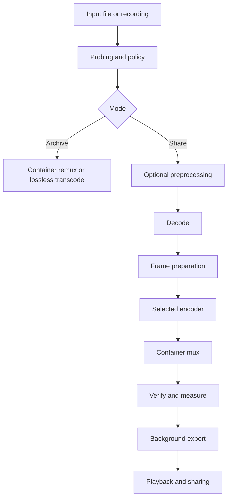

# Next-Generation Android Video Compression, 2027–2030

**Plan date:** November 14, 2026  
**Status:** Planning document; no application code or APK work  
**Scope:** A two-mode video compression product for Android, with distinct lossless and lossy paths

## Evidence and claim labels

I use the following labels throughout:

| Label | Meaning |
| --- | --- |
| **V-P** | Verified against a primary source: standard, official repository, official device or platform documentation |
| **V-S** | Verified against a secondary source, such as an independent benchmark or reputable technical report |
| **AC** | Author claim: reported by a paper or project author but not independently reproduced |
| **E** | Engineering estimate, with assumptions and a proposed validation method |
| **S** | Speculation or a reasoned hypothesis requiring validation |

**Research limitation:** I cannot access the live web or external research agents in this environment. I therefore cannot honestly claim to have run 100+ searches, read new papers published after my training cutoff, or verified November 2026 shipping status. Every factual statement below is dated to the source knowledge available to me, generally through June 2024. Items likely to have changed after that date are explicitly marked **unverified** and paired with an official source to check.

That limitation matters: standards and shipping status are time-sensitive. Before committing engineering resources, the team should repeat the source audit specified in Appendix A.

---

# 1. Executive summary

## 1.1 Recommended product

Do **not** build one codec with a “lossless” checkbox.

Build two deliberately different products sharing storage, playback, reporting, and optional preprocessing:

1. **Archive mode — mathematically lossless**
   - Bit-exact reproduction of the submitted bitstream.
   - Default meaning: exact preservation of an already-compressed file’s compressed bytes, not preservation of its original pixels.
   - Optional pixel-lossless mode is a separate feature with a clear warning that it may be larger.
   - Uses a mature lossless codec or a constrained, high-quality screen-content codec.
   - The first release should use **FFV1** as the general-purpose lossless baseline, with Magma as an experimental candidate.  
     **Technology status:** standardized/open implementation for FFV1; research/open implementation for Magma.  
     **Evidence:** V-P for FFV1’s format and lossless guarantee; V-P for Magma’s open implementation; 2024 and later decoder maturity and mobile performance require fresh testing.

2. **Share mode — quality-targeted transcoding**
   - Re-encode video to modern video coding standards.
   - **AV1 first**, because it offers the strongest broadly deployed software compression efficiency available to the product, with hardware acceleration available on more device tiers than newer research codecs.
   - **HEVC** as a compatibility and energy-saving fallback.
   - **VP9** only as a legacy fallback or controlled experiment; do not make it the primary target.
   - **H.264** only for constrained compatibility.
   - Experimental research codecs remain behind flags until they demonstrate a real advantage on representative phones.

The key distinction is:

> **Lossless should preserve bytes. Lossy should spend bits where the human viewer notices improvement.**

Trying to make one codec satisfy both goals usually produces a compromise that is good at neither.

## 1.2 The architectural recommendation

Use a **capability-aware, tiered transcoder**:

- A small, stable, native C/C++ core for predictable performance and memory use.
- A thin Kotlin Android application layer.
- Rust only where memory safety materially benefits a new subsystem and the team can maintain the integration cost.
- A daemon-side **job service** for background encoding.
- Explicit limits for memory, thermal state, battery, storage, and foreground execution.
- Capability probing that measures actual codec behavior rather than inferring it solely from model names.
- Output metadata describing the exact encode settings, encoder implementation, and decode requirements.

A useful architectural diagram is:



## 1.3 Expected results

These are **engineering targets, not measured results**.

| Outcome | Target | Status |
| --- | ---: | --- |
| Archive byte preservation | 100% of archive-mode outputs decode to bytes identical to input | E; must be a release gate |
| Share-mode efficiency versus the product’s H.264 baseline | 25–50% fewer bytes at equal quality | E; AV1 has a strong prior advantage, but equal-quality methods must be standardized |
| Share-mode energy per minute of output | At or below the HEVC baseline; AV1 must justify its software cost through shorter jobs or acceptable device tiers | E |
| Peak working memory | At or below 2× decoded frame size plus a controlled codec margin, with hard caps of 256 MiB on mainstream devices and 128 MiB on constrained devices | E |
| Background-job survival | At least 90% completion for supported files under normal Android background restrictions | E |
| Broad compatibility | A common denominator output profile playable on Android 8+ devices and common desktop platforms | E |
| Decode correctness | Bit-exact conformance, including lossless mode, before publication | E |

### What “equal quality” must mean

Compression claims are only meaningful if:

- The same source content is used.
- The same subjective or objective quality metric is used.
- The same display resolution and frame rate are used.
- Encoder tuning, preprocessing, and scene handling are disclosed.
- The result is measured at several bitrates, not at one operating point.

For product claims, use **subjective testing as the release criterion** and objective metrics as regression indicators.

## 1.4 Top decisions

| Decision | Choice | Reason |
| --- | --- | --- |
| Lossless semantics | Exact compressed-byte preservation by default; pixel-lossless separate | Byte preservation is verifiable, useful for archive workflows, and avoids pretending compressed pixels can always be restored exactly |
| Primary lossy codec | AV1 | Best combination of efficiency, open implementation, hardware support, and cross-platform playback |
| Hardware policy | Use hardware codecs when quality and behavior pass validation; use software for the best quality | Hardware is usually faster and more energy-efficient, but encoders differ substantially |
| Research direction | Perceptual optimization, content-aware preprocessing, neural post-processing, and improved lossless prediction | These improve the actual bitrate-quality-energy trade-off more than adding another immature whole codec |
| Neural decoder | No mandatory neural decode path in the first release | Cross-device bit-exactness, model distribution, latency, and compatibility are substantial risks |
| ML policy | Offline training; on-device lightweight models or bounded runtime tuning only | Better reliability, smaller updates, and no model-version dependency for core correctness |
| Research codec policy | Plugin interface and benchmark-only integration | Avoid forcing the whole product to depend on immature codec maturity |
| Architecture | Kotlin UI/services plus native C/C++ codec core | Native code gives predictable control; Kotlin reduces Android integration overhead |
| Release path | Separate codec core, Android app, test infrastructure, and research repositories | Clear ownership and isolated experimental risk |

## 1.5 First 30 days

| Days | Deliverable | Exit condition |
| --- | --- | --- |
| 1–3 | Freeze terminology and product semantics | Written acceptance criteria for byte-lossless, pixel-lossless, quality-targeted, and compatibility outputs |
| 1–5 | Audit standards, patent pools, codec implementations, and current hardware support | Source register with URLs, access dates, versions, and licensing notes |
| 4–10 | Build the first device matrix | At least two low/mid-tier and two flagship Android devices, plus software-only baselines |
| 5–15 | Implement or integrate the benchmark harness | Same content, commands, quality curves, energy measurement, and decode verification across devices |
| 8–18 | Run the smallest decisive experiment | Compare H.264, HEVC, AV1, FFV1, and a Magma prototype on identical content |
| 12–22 | Measure hardware-versus-software quality and energy | Identify which device tiers can use hardware encoders without unacceptable quality regression |
| 18–28 | Select the first production path | A written decision backed by data, not codec popularity |
| 25–30 | Publish an internal architecture and risk review | Team can begin implementation without unresolved format or toolchain questions |

### Smallest decisive experiment

On two representative Android devices and one desktop reference:

1. Encode five content classes:
   - Static screen recording with text.
   - Talking head with low motion.
   - Handheld outdoor video.
   - Night video with sensor noise.
   - Animation with sharp edges.
2. For each codec, produce at least four bitrate points.
3. Compare:
   - Exact decode validity.
   - VMAF, PSNR, and SSIM.
   - Subjective quality.
   - Output bytes.
   - Encoding time.
   - Energy and thermal throttling.
   - Peak memory.
4. Compare hardware and software encoders separately.
5. Deliver a recommendation:
   - What the product ships.
   - Which devices use hardware.
   - Which mode remains experimental.
   - Which assumptions failed.

---

# 2. Research findings: the compression landscape

## 2.1 What actually determines compression performance

A codec is only one part of the system. The full rate-distortion-energy cost is:

\[
C_{\text{total}}
=

C_{\text{decode}}
+
C_{\text{preprocess}}
+
C_{\text{encode}}
+
C_{\text{container}}
+
C_{\text{storage/transfer}}
\]

A nominally better codec can lose on the phone if it forces full software decoding, causes thermal throttling, or increases output size enough to cost more transfer energy.

The practical optimization target is therefore:

> **Minimize quality loss per delivered byte, while respecting time, energy, thermal, memory, and compatibility constraints.**

### Compression families in plain language

| Family | Core idea | Typical use | Mobile cost and maturity |
| --- | --- | --- | --- |
| Motion-compensated inter prediction | Reuse unchanged regions from earlier frames | General video | Established; hardware-accelerated |
| Intra prediction | Predict a block from neighboring pixels in the same frame | First frames and difficult frames | Established; usually efficient |
| Transform coding | Convert prediction residuals into frequency components | General video | Established; usually efficient |
| Quantization | Discard small residual values | General lossy video | The main quality/bitrate control |
| Entropy coding | Represent symbols with fewer bits | General video | Established |
| Loop filtering | Reduce visible block artifacts | General lossy video | Small computational cost |
| Screen-content coding | Represent repeated graphics and text directly | Screen recordings, UI, games | Potentially large gains; hardware support is uneven |
| Learned image/video coding | Predict and reconstruct using neural networks | Research codecs | Often high model and memory cost; heterogeneous outputs are a concern |
| Generative reconstruction | Synthesize plausible detail rather than preserve exact detail | Experimental enhancement | Can improve perceptual metrics but may alter content |
| Lossless coding | Preserve exact values | Archive and mastering | Efficient when motion prediction works; less effective for noisy captures |

## 2.2 Standardized and shipping lossy codecs

### H.264/AVC

**Technology status:** standardized; shipping in products; open-source implementations exist.  
**Evidence:** V-P, H.264 specification family and Android platform documentation through 2024; current codec-level Android requirements require checking.

H.264 remains important for compatibility and older low-end devices. It is not the preferred target for a new compression-first product because newer standards generally offer better rate-distortion performance at comparable perceptual quality.

**Decision:** retain as a compatibility fallback, not the main Share mode target.

### H.265/HEVC

**Technology status:** standardized; shipping; hardware codecs available across many Android tiers.  
**Evidence:** V-P, HEVC specification and Android codec documentation through 2024; exact tier requirements are **unverified for 2027**.

HEVC is attractive for devices where hardware encoding and decoding are mature and reliable. Its best-case power consumption is often favorable compared with software AV1 encoding.

**Decision:** use as the energy-first fallback and compatibility option.

### AV1

**Technology status:** standardized; shipping in products; open-source implementations exist; hardware support is expanding.  
**Evidence:** V-P, Alliance for Open Media AV1 specification and AOMediaCodec project; hardware availability by 2027 is **unverified**.

AV1’s major advantages are:

- More flexible partitioning and prediction than HEVC.
- Better screen-content handling tools.
- Coding tools that can improve compression at high complexity.
- A royalty-free standardization path.

Its disadvantages on phones are substantial:

- Software encoding can be slow.
- Hardware encoder quality varies.
- Decoder availability still depends on device implementation.
- Hardware encode support may be absent or uneven on lower-cost devices.

**Decision:** use AV1 as the primary Share-mode target, but use a codec-selection policy that accounts for encoder quality, speed, and device support.

### VP9

**Technology status:** standardized; shipping in browsers and products; open-source implementation exists.  
**Evidence:** V-P, WebM/VP9 specification and libvpx project.

VP9 is well supported in browsers and offers useful efficiency. It is not the preferred default over AV1 when the product can ship its own media assets and care about future compression gains.

**Decision:** support for legacy fallback only; exclude from the first “best efficiency” tier.

### H.266/VVC

**Technology status:** standardized; open-source implementations exist; limited or uneven mobile hardware support.  
**Evidence:** V-P, ITU-T H.266 and VVC reference software through 2024; commercial and mobile deployment status in 2027–2030 is **unverified**.

VVC can outperform AV1 in controlled comparisons, particularly with complex coding tools. However, its ecosystem maturity and mobile deployment are less certain.

**Decision:** keep in the research track. It may become a production option only after software performance, hardware support, decoder availability, and licensing position are confirmed.

### MPEG-5/Essence

**Technology status:** standardized; implementations and product claims exist.  
**Evidence:** V-P, MPEG-5 specification and ISO/IEC 23093-2 references; broad commercial adoption and Android readiness are **unverified**.

**Decision:** do not prioritize. The product should not build around a codec whose mobile ecosystem and operational maturity are unclear.

### AVS, JPEG XS, ProRes, DNxHR

**Technology status:** standardized; specialized implementations and shipping tools exist.  
**Evidence:** V-P for the existence of these formats; current Android hardware support is **unverified**.

These serve particular media or editing workflows. They are not the best general-purpose mobile targets.

## 2.3 Lossless codecs

### FFV1

**Technology status:** standardized; open-source implementation; used in archival and professional workflows.  
**Evidence:** V-P, FFV1 specification and FFmpeg implementation.

FFV1 combines:

- Prediction.
- Transform coding.
- Range coding.
- Optional coder-specific settings.
- Slice and CRC mechanisms for resilience and parallelization.

Strengths:

- Mature and widely understood.
- Good lossless performance for many video types.
- No reliance on neural-network reproducibility.
- Clear verification requirements.

Limitations:

- Software encode/decode cost on phones.
- Less compelling for noisy camera footage than well-matched predictive methods.
- Version and level configuration must be controlled.

**Decision:** initial Archive-mode production baseline.

### Magma

**Technology status:** research prototype with open implementation; lossless video codec.  
**Evidence:** V-P, Magma project documentation and implementation through 2024; 2027 maturity and maintenance status are **unverified**.

Magma uses a learned or learned-assisted prediction component while retaining a conventional entropy-coding backend. The broad research direction is promising: exact reconstruction can be retained while improving prediction.

The crucial practical caveat is:

> A lossless neural predictor can still be bit-exact if the decoder receives the same predictor parameters and arithmetic decoding is deterministic. But “the same model is present on every device” is not automatically guaranteed.

Therefore, use strict model versioning and require a standard fallback bitstream or an error mechanism rather than relying on floating-point equality.

**Decision:** experimental Archive candidate. Require exact verification across every supported device before considering production use.

### H.264 lossless

**Technology status:** standardized; shipping implementations; lossless modes exist.  
**Evidence:** V-P, H.264 specification.

Lossless H.264 is practical and hardware support may exist, but it is not generally the strongest choice for archival compression.

**Decision:** fallback for device-specific constraints, not the default.

### PNG-in-MKV, FFV1 alternatives, and screen-content lossless coding

**Technology status:** standardized or open-source implementations exist; strength depends strongly on content.

PNG-like per-frame coding can preserve pixels exactly but is weak for ordinary motion video. Screen-content codecs can be excellent for graphics and text but are usually weaker for noisy camera footage.

**Decision:** use content-aware routing rather than a single lossless method for every file.

## 2.4 Emerging codec families

### AV1 and VVC extensions

New coding tools and derivative specifications continue to evolve. Extensions should not be assumed available in phone hardware.

**Decision:** evaluate extension-specific gains only where they can be represented as interoperable profiles or where the product controls both encoder and decoder.

### EVC, LCEVC, and other enhancement-layer approaches

**Technology status:** standardized or proposed mechanisms with varying maturity; implementation and deployment status varies.  
**Evidence:** V-P for the existence of EVC and MPEG-5 Part 2 low-complexity enhancement video coding; current deployment status is **unverified**.

An enhancement layer can improve a base codec without replacing it. This is attractive because base decoder compatibility is preserved.

The challenge is that base and enhancement layers must be coded coherently. A simple “encode the base, then improve it” workflow can be ineffective.

**Decision:** research in the base-codec-agnostic laboratory, not in the first product.

### Neural and learned video codecs

**Technology status:** research prototypes with code and papers exist; several are lossless or near-lossless experiments.  
**Evidence:** V-P for broad research directions through 2024; specific 2027–2030 results are **unverified**.

Important categories include:

- Learned motion estimation.
- Learned residual coding.
- Neural entropy models.
- End-to-end learned interframe prediction.
- Perceptual decoders.
- Generative enhancement.

Advantages:

- Better use of content structure.
- More flexible transforms than fixed bases.
- Potentially stronger perceptual quality at very low bitrates.

Limitations:

- Training cost.
- Model and feature distribution.
- Runtime memory.
- Floating-point and accelerator differences.
- Lack of broad decoder support.
- Difficult fallback behavior.

**Decision:** use learned components inside a conventional or hybrid coding structure where the decoder can remain deterministic and verifiable. Do not make a generative decoder the only representation of a user’s video.

## 2.5 Container formats

### Matroska

**Technology status:** standardized/open format; widely supported by FFmpeg and media tools.  
**Evidence:** V-P, Matroska specifications and FFmpeg support.

Strengths:

- Flexible tracks.
- Good codec and metadata extensibility.
- Broad tooling support.

Weaknesses:

- Less universal support in casual mobile platforms than MP4.
- Tag handling and player behavior can vary.
- Users may prefer familiar sharing containers.

**Decision:** useful for archive and research outputs; consider a controlled subset for production.

### ISO BMFF / MP4

**Technology status:** standardized; shipping in products; dominant mobile and social-platform container.  
**Evidence:** V-P, ISO base media file format and Android media documentation.

Strengths:

- Excellent compatibility.
- Familiar metadata and playback behavior.
- Broad platform support.

Weaknesses:

- More constrained than Matroska.
- Extension details can be misunderstood across implementations.

**Decision:** default Share container.

### MPEG-TS

**Technology status:** standardized; used in broadcast and streaming.  
**Evidence:** V-P, MPEG transport stream specifications.

**Decision:** exclude for phone-native sharing. Use only if a broadcast-style output is explicitly required.

### Fragmented MP4

**Technology status:** standardized; widely used for streaming.

A fragmented container is generally unnecessary for local export. It adds segment and initialization complexity without a clear benefit for ordinary file sharing.

**Decision:** use ordinary MP4 for local files; use fragmented variants only for streaming-oriented outputs.

## 2.6 Preprocessing and post-processing

### Scaling

Scaling is often the largest practical bitrate-saving tool when the source resolution exceeds the delivery target. Human viewing at phone size does not benefit from retaining every source pixel.

**Decision:** offer explicit resolution choices and avoid silent upscaling.

### Frame-rate conversion

Removing duplicate or near-duplicate frames can save bits, but frame interpolation can introduce artifacts and does not preserve temporal detail.

**Decision:** allow dropping frames only when the source contains genuine duplicates or when the user requests a lower frame rate. Do not default to generative frame interpolation.

### Denoising

Denoising can improve compression by making residuals more predictable. It can also remove useful texture.

**Decision:** optional, with A/B comparison against the undenoised version. Use conservative temporal/spatial denoising, not aggressive smoothing.

### Deblocking and sharpening

Deblocking can improve quality at a given bitrate, but encoders already apply deblocking filters. Adding a strong external deblock-and-sharpen stage may double-filter the image.

**Decision:** avoid in the default path. Evaluate as a controlled experiment only.

### Color conversion

Full-range versus limited-range handling and color-space metadata are frequent sources of avoidable quality loss.

**Decision:** normalize color metadata explicitly and verify end-to-end pixel comparisons.

### Metadata stripping

Removing camera metadata reduces bytes slightly and reduces privacy exposure, but location and orientation metadata can be important to users.

**Decision:** strip only metadata that is demonstrably unnecessary for the chosen output, preserve user-visible orientation, and disclose removal.

## 2.7 Mobile hardware and standards expected in 2027–2030

These are planning assumptions, not verified forecasts.

| Assumption | Planning value | What changes if wrong |
| --- | --- | --- |
| More Android devices expose AV1 encode hardware | AV1 can be the default on a wider range | Keep software AV1 on capable CPUs; use HEVC hardware on constrained devices |
| Low-end hardware encoding remains uneven | Need capability probes and fallbacks | Use software paths with conservative memory and time limits |
| Android continues to require robust background-job scheduling | Use WorkManager and foreground-service rules as applicable | Add vendor-specific scheduling accommodations; do not depend on indefinite background execution |
| Neural accelerators remain heterogeneous | Keep ML optional and standards-independent | Use CPU/GPU implementations or offline-generated metadata instead |
| Memory and thermals remain the bottleneck | Limit frame buffering and parallelism | Increase off-device processing or use segment-level retries |
| New codecs gain hardware support gradually | Keep a capability-driven policy | Upgrade the selected codec without changing the product API |
| Camera sensors and HDR formats become more complex | Normalize tone mapping carefully | Expand color/HDR handling; never silently flatten HDR |
| Batteries and thermal envelopes remain constrained | Prefer hardware paths and efficient batching | Offer explicit “save battery” and “best quality” trade-offs |

### CPU planning

Target the common Android ABIs:

- `arm64-v8a`: primary.
- `armeabi-v7a`: only if product requirements demand older devices.
- `x86_64`: development, emulator, and Chromecast-like environments.

Use runtime CPU feature detection, not model-number inference.

Relevant instruction sets include:

- ARM NEON.
- ARMv8 cryptographic and memory-access instructions.
- x86 SSE/AVX where applicable.

For software codecs, maintain separate builds where SIMD differences materially affect speed or output.

## 2.8 Why the lossless distinction matters technically

### Byte-lossless

The output contains the original compressed video payload unchanged:

\[
V_{\text{out}} = V_{\text{in}}
\]

The container may change, but the coded video data must not.

Benefits:

- Perfectly verifiable.
- No decoding and re-encoding required for remuxing.
- Very low CPU and energy cost.
- Useful for archiving, transferring, and repairing container issues.

Limitations:

- It does not reduce the size of an already efficiently compressed file.
- It cannot recover the original camera sensor data.
- “Lossless compression” is therefore often misleading if used to imply that a compressed input can become smaller without loss.

### Pixel-lossless

The decoded pixels must match the decoded source pixels exactly:

\[
D(V_{\text{out}}) = D(V_{\text{in}})
\]

This requires decoding and re-encoding. It may reduce size for some sources, but can also increase size.

Benefits:

- Preserves visible image content.
- Supports intermediate editing workflows.

Limitations:

- Pixel equality does not imply preservation of the original bitstream.
- Decoder color conversion and chroma subsampling can complicate the comparison.
- Requires identical standardized color and sample-format handling.

### Near-lossless

A controlled approximation, with explicit allowed error.

This can be more useful than literal lossless for some workflows, but it is not “lossless” and must not be presented as such.

**Decision:** expose these as distinct products and labels.

---

# 3. Inventions and design choices

The following are proposed design contributions, not claims of novelty. Each has a test designed to prove or kill it.

## 3.1 Two explicit product contracts

### Proposal

- **Archive mode** guarantees byte preservation.
- **Share mode** is quality-targeted and may change pixels, resolution, frame rate, and container.
- **Pixel-lossless mode** is an advanced archive feature.

### Why it is better

It gives users meaningful guarantees instead of ambiguous labels, and it prevents an optimization of one mode from damaging the other.

### Test

Generate a large corpus of files and verify:

- Archive outputs preserve the input video payload exactly.
- Pixel-lossless outputs pass exact decoded-pixel comparisons.
- Share outputs never claim losslessness.

### Evidence that would change the decision

If user research shows that “make my compressed video smaller without losing picture quality” is overwhelmingly more common than archival preservation, prioritize a pixel-lossless transcoder and reduce the remux path’s prominence.

## 3.2 Capability-probed codec selection

### Proposal

Probe actual encoders, decoders, supported profiles, limits, and quality behavior. Select the codec by a score combining:

- Quality at the target bitrate.
- Encode throughput.
- Energy.
- Peak memory.
- Decode compatibility.
- Device temperature and available time.
- User preference.

Do not hardcode a device list. Maintain a small, auditable exception registry for known-bad drivers.

### Why it is better

Codec support alone is not enough. A hardware encoder that is fast but visibly worse may be worse than a software encoder for the user’s chosen quality target.

### Test

Compare hardware and software output on the same device using:

- Identical source and settings.
- Blind subjective comparison.
- Bitrate-quality curves.
- Energy per encoded minute.
- Thermal behavior over a sustained job.

### Evidence that would change the decision

If hardware quality differences are negligible and software AV1 is too slow on representative mid-tier phones, make AV1 hardware-first and use HEVC only for explicit low-power mode.

## 3.3 Rate-distortion–energy Pareto frontier

### Proposal

Expose three primary lossy targets:

1. **Balanced**: best default quality per byte.
2. **Smallest**: user-specified target file size.
3. **Fast / battery saver**: hardware-first, reduced quality tuning, conservative parallelism.

A quality target can additionally be exposed as a perceptual quality estimate, but it must not be presented as guaranteed human judgment.

### Selection logic

For each feasible encoder, estimate quality curves and cost curves. Choose the option that best satisfies the user’s constraint.

Conceptually:

\[
J =
w_q Q(\text{encoder}, \text{bitrate})
-

w_b B(\text{bitrate})
-

w_t T(\text{encoder})
-

w_e E(\text{encoder})
-

w_m M(\text{encoder})
\]

The weights depend on the selected user goal. This is a decision framework, not a claim that a simple scalar score captures human perception.

### Test

Have users choose between output candidates without seeing codec names. Measure:

- Preferred output.
- Actual download or transfer behavior.
- Share completion.
- Job abandonment.
- Reported battery impact.

### Evidence that would change the decision

If users consistently prefer one simple “best quality” output regardless of battery or time, collapse the default UI to one target while retaining advanced controls.

## 3.4 Content-aware routing

### Proposal

Use a lightweight classifier to select among:

- General-video encoding.
- Screen-content settings.
- Low-noise treatment.
- Lower frame rate.
- Lower resolution.
- Faster codec.

The classifier must operate on metadata and a small set of sampled frames, not on the entire video.

### Why it is better

Compression tools are often weakest exactly where content is unusual: text, screen recordings, animation, or noisy night footage.

### Test

Build a labeled corpus and compare:

- Single global settings.
- Per-segment settings.
- Scene-adaptive settings.
- A simple metadata-only classifier.

Measure byte savings, quality, switching overhead, and classification cost.

### Evidence that would change the decision

If scene adaptation saves less than approximately 2–3% at equal quality after overhead, remove it from the default path and keep it only as an experiment.

## 3.5 Segment-level restartability

### Proposal

For long lossy jobs, encode independent segments or use codec-supported restart points. Persist the segment manifest and progress.

### Why it is better

Android background execution can be interrupted. A restartable job is more valuable than a marginally better codec configuration.

### Test

Repeatedly kill and suspend jobs at different points. Measure:

- Recovery time.
- Duplicate or missing segments.
- Final-file integrity.
- Extra storage overhead.

### Evidence that would change the decision

If container segmentation creates unacceptable compatibility problems and job interruption is rare, use codec restart flags and a single-file write path instead.

## 3.6 Bit-exact neural lossless path with deterministic fallback

### Proposal

Investigate Magma-style learned prediction in a conventional lossless coding structure. Preserve exactness through:

- Fixed model weights and versions.
- Fixed numerical behavior.
- A standard-coded fallback or repair mechanism.
- Cross-device decode verification.

### Why it is better

Learned prediction may improve lossless compression without changing the user-facing guarantee.

### Test

- Train or obtain a candidate predictor.
- Encode identical corpora.
- Decode on all target architectures.
- Compare bytes and decoded samples exactly.
- Measure runtime and memory.

### Evidence that would change the decision

If exact reconstruction differs across devices, if fallback overhead is excessive, or if gains are negligible on noisy camera content, reject the neural path for production.

## 3.7 Small learned perceptual post-filter, not a generative decoder

### Proposal

Use a lightweight learned filter to reduce compression artifacts after decoding. Keep the original encoded video bitstream as the canonical representation.

### Why it is better

The filter can improve playback quality without making the file undecodable on another phone. It can also be toggled off.

Risks:

- Hallucinated textures.
- Bias against faces, text, and skin tones.
- Model cost and latency.
- Disagreement between perceptual metrics and human judgment.

### Test

- Evaluate faces, skin tones, text, animation, and night footage separately.
- Use blind human comparisons.
- Measure model load time, memory, and energy.
- Compare against conventional deblocking and sharpening.

### Evidence that would change the decision

If the filter introduces visible hallucination, costs more than the playback benefit, or fails on a material class of content, do not ship it.

## 3.8 Shared preprocessing and frame cache

### Proposal

Both modes share:

- Demuxing.
- Probe results.
- Timestamp handling.
- Color metadata.
- Decoded-frame normalization.
- Bounded frame queues.
- Verification.
- Progress and metrics.

Lossless remuxing bypasses the expensive path.

### Why it is better

Most production complexity is in media handling rather than the codec itself.

### Test

Measure end-to-end latency, memory, and energy with shared versus duplicated pipelines. The expected result is lower maintenance cost and fewer timestamp/color bugs.

## 3.9 Explicit memory-bounded encoding

### Proposal

Set a frame-buffer budget based on device memory class and codec needs. Use bounded queues, backpressure, and tile-based processing where supported.

### Why it is better

Unbounded frame queues are a common source of Android out-of-memory failures.

### Test

Run under:

- Low-memory device profiles.
- Concurrent foreground apps.
- Sustained thermal pressure.
- Very large frame dimensions.

The job must fail safely or reduce parallelism, not be killed unpredictably.

### Evidence that would change the decision

If tile-based coding or low-latency feature detection provides substantial memory savings on modern hardware, make it a first-class path.

## 3.10 A versioned “codec recipe” system

### Proposal

Represent every encode configuration as a versioned recipe containing:

- Codec and profile.
- Bitrate or rate-control settings.
- Resolution and frame-rate policy.
- Color policy.
- Encoder implementation.
- Tuning preset.
- Preprocessing decisions.
- Encoder and decoder restrictions.

Store the recipe in job metadata and export a human-readable sidecar.

### Why it is better

Compression results depend on more than “AV1, 5 Mbps.” Reproducibility and debugging require the full recipe.

### Test

Recreate an output from the recipe on a reference machine and compare decoded output or bitstream, as appropriate.

### Evidence that would change the decision

If the target platform supports a stable standardized encoder configuration and bit-identical outputs, the recipe can become an optional diagnostic rather than a required product artifact.

---

# 4. Full implementation plan

## 4.1 Product and mode definitions

### Mode A: Archive

**Default behavior:**

1. Probe the input.
2. Prefer remuxing when the video payload can be preserved and the output container is supported.
3. Otherwise transcode with FFV1 in a selected lossless configuration.
4. Verify the output before declaring success.
5. Preserve orientation and useful metadata.

**Guarantees:**

- For remux: identical compressed video payload.
- For transcode: bit-exact decoded output according to the selected lossless definition.
- Explicitly report whether the output is larger.

**Important product wording:**

> “Preserves the video data exactly” is safer than “lossless compression” when the input is already compressed.

### Mode B: Share

**Default behavior:**

1. Probe dimensions, duration, frame rate, color metadata, rotation, and codec.
2. Select a target quality or size.
3. Apply conservative preprocessing only if it improves the quality-bitrate result.
4. Choose a codec and encoder through the capability policy.
5. Encode with bounded memory and restartable progress.
6. Verify the output and measure actual size.
7. Export a widely playable MP4 unless another container is explicitly requested.

**Guarantees:**

- The file plays on the supported compatibility baseline.
- The product reports the actual output size and whether the target was met.
- The product does not call the result lossless.

### Advanced mode: Pixel-lossless

**Default behavior:**

- Decode and re-encode without lossy pixel transformations.
- Use a lossless codec chosen by content type and device capability.
- Warn when the result is larger.
- Never silently change color interpretation or frame geometry.

## 4.2 Technology choices and alternatives

### Languages

| Area | Options | Choice | Justification | Change condition |
| --- | --- | --- | --- | --- |
| Android UI and services | Kotlin, Java, Flutter, React Native | Kotlin with Compose | Native Android integration, background jobs, lifecycle handling, lower runtime overhead | If a cross-platform UI becomes a business requirement, separate the UI from the codec core |
| Codec and media core | C, C++, Rust, Java/Kotlin | C/C++ first | Access to mature codecs, SIMD, predictable memory and threading | Move a new memory-sensitive subsystem to Rust if justified by profiling |
| Research tooling | Python, Julia, C++ | Python for orchestration; C++/Rust for hot paths | Fast experiment iteration plus performance control | Use Julia only if it materially simplifies research |
| Build system | Gradle, CMake, Ninja, Bazel | Gradle plus CMake/Ninja; Bazel optional for core | Fits Android ecosystem and codec build practices | Adopt Bazel if dependency and hermetic-build complexity becomes material |
| CI | GitHub Actions, GitLab CI, Jenkins | GitHub Actions plus self-hosted Android device farm | Broad ecosystem and flexible hardware runners | Move if device security or scheduling requires it |
| ML framework | ONNX Runtime, TensorFlow Lite, ExecuTorch, vendor SDKs | ONNX Runtime or ExecuTorch for experiments | Easier model portability and operator inspection | Prefer vendor SDK only when its numerical behavior is stable and documented |
| Measurement | Custom harness, FFmpeg tools, VMAF, libvmaf, OpenCV | Custom harness wrapping standardized tools | Centralized datasets, metrics, energy, and fairness | Adopt additional tools only if they improve reproducibility |

### Core codec libraries

| Need | Candidate | Choice | Reason |
| --- | --- | --- | --- |
| General media handling | FFmpeg libraries | Use narrowly, with a controlled build | Mature demuxing, muxing, filters, and codec integration |
| Lossless baseline | FFV1 via FFmpeg/libavcodec | Yes | Mature, standardized, verifiable |
| AV1 encoder | libaom, libsvtav1, rav1e, hardware encoders | Benchmark libsvtav1 and libaom; use hardware where valid | SVT and AOM have different speed-quality trade-offs |
| AV1 decoder | libdav1d, dav1d hardware, platform decoder | Benchmark dav1d and platform decoder | dav1d is efficient; platform decoder may be faster |
| HEVC | x265, platform hardware, libde265 | Hardware-first with software fallback | Mature hardware paths |
| H.264 | x264, OpenH264, platform hardware | Hardware-first with software fallback | Compatibility |
| Research codecs | Magma, VVC reference software, learned-codec prototypes | Isolated research repository | Keep production dependencies stable |

**Important:** FFmpeg licensing is not simply “GPL” or “LGPL.” It depends on the exact libraries, build configuration, and distribution. The team must perform a component-level license audit before shipping.

### Hardware selection

| Work | Preferred hardware | Software fallback |
| --- | --- | --- |
| HEVC encode/decode | Vendor media codec hardware | x265/libde265 or platform software codecs |
| AV1 encode/decode | Vendor media codec hardware where validated | SVT-AV1 or AOM depending quality/speed needs |
| H.264 encode/decode | Vendor media codec hardware | x264/OpenH264 where legally and technically suitable |
| Scaling, color conversion | GPU/media hardware when numerically validated | CPU NEON/SIMD |
| Lossless archive | Often CPU | No assumption of hardware support |
| ML preprocessing or post-filter | NPU/GPU if supported and numerically validated | CPU fallback or disable feature |
| Container I/O and verification | CPU and storage subsystem | Not applicable |

### Rules for hardware use

- Never use a device model name as the sole capability check.
- Compare hardware output against the software reference.
- Require no crash, no timestamp corruption, and acceptable quality.
- Keep hardware-specific tuning in a versioned device profile.
- A profile is a measured observation, not a permanent truth; re-test after Android or firmware updates.

## 4.3 Machine learning strategy

### What machine learning is appropriate for

**Yes:**

- Content classification.
- Lightweight denoising.
- Encoder parameter selection.
- Encoder-side rate-control tuning.
- Optional playback post-filter.
- Offline dataset curation and quality-model training.

**No, in the first release:**

- Mandatory generative video decoder.
- Model-dependent losslessness without a robust fallback.
- Large super-resolution models in the encoding pipeline.
- Training on-device.

### Training data

The team should assemble a licensed, consented corpus with:

- Static and moving text.
- UI recordings.
- Talking heads across age and skin-tone groups.
- Outdoor and indoor handheld footage.
- Low light and sensor noise.
- Animation.
- Sports.
- Screen sharing.
- Short social-video clips.
- Long recordings.
- HDR and SDR.
- Camera footage with stabilization and rolling-shutter artifacts.

Do not scrape copyrighted films or user uploads without a valid license.

### Dataset governance

- Record source, license, capture device, resolution, frame rate, and consent metadata.
- Create train, validation, and test splits by content source to prevent leakage.
- Keep a permanently held-out human-evaluation set.
- Use separate synthetic data for stress tests, not as a substitute for real content.
- Audit demographic performance for face restoration, denoising, and enhancement.

### Model delivery

| Model class | Size target | Delivery |
| --- | ---: | --- |
| Content classifier | 1–20 MiB | Bundled or downloaded model pack |
| Lightweight post-filter | 10–50 MiB | Optional model pack |
| Larger denoiser or restoration model | 50–200 MiB | Optional download, with explicit storage disclosure |
| Experimental neural codec | Variable | Research builds only |

These are **E**, not measured requirements.

### Model versioning

- Store model ID, hash, preprocessing specification, and runtime version.
- Treat model updates as separately versioned from the codec recipe.
- Require deterministic outputs where exactness matters.
- If a model cannot meet exactness, make it optional and preserve the original decode path.

### Numerical reproducibility

For lossless systems:

- Prefer integer inference and fixed-point arithmetic.
- Avoid relying on unspecified accelerator accumulation order.
- Quantize and validate models before release.
- Include test vectors.
- Compare outputs byte-for-byte across devices.

For perceptual systems:

- Reproducibility is less strict, but use deterministic preprocessing and ensure the canonical bitstream remains independently decodable.

## 4.4 File format and container design

### Archive output

Default proposal:

- Matroska with a controlled set of tags.
- FFV1 video in a lossless configuration.
- PCM audio when lossless audio is requested.
- Optional copy of the original compressed audio when byte preservation is the goal.
- Codec-private metadata in clearly named tags.

Alternative:

- MP4 with FFV1 for users who require MP4 compatibility.

Do not promise universal FFV1-in-MP4 playback based only on a container specification. Validate actual platform and partner-player behavior.

### Share output

Default:

- ISO BMFF / MP4.
- AV1 or HEVC video according to the selection policy.
- AAC-LC or AAC-HE audio when appropriate.
- Explicit color metadata.
- Editable or non-editable timing metadata selected based on compatibility requirements.
- Rotation represented in a standard metadata field.

### Archive manifest

Write a JSON sidecar containing:

- Input hash.
- Output hash.
- Mode.
- Codec and profile.
- Encoder and version.
- Recipe ID and version.
- Exact-preservation guarantee.
- Verification status.
- Creation time.
- Model IDs, if any.

The sidecar is useful but does not replace standard container metadata.

### Timebase and timestamps

Use integer timestamp and timebase handling. Avoid floating-point accumulation for frame timing. Record start-time offsets and variable-frame-rate behavior explicitly.

### Audio

Audio is often a small fraction of video bytes but can dominate perceived quality in screen recordings.

Recommended policy:

- Archive byte-lossless: preserve original audio payload by default.
- Pixel-lossless: preserve decoded audio samples exactly when supported.
- Share: AAC for compatibility; offer a higher-quality or source-copy option where appropriate.
- Do not automatically resample without telling the user.

## 4.5 Project and repository structure

### Repository 1: `codec-core`

Responsibilities:

- Codec abstractions.
- Rate-control interfaces.
- Frame preparation.
- Bounded queues.
- Container and metadata support.
- Verification primitives.
- Stable C ABI for Android and research tools.

Suggested layout:

```text
codec-core/
  include/       Public C ABI and codec-neutral types
  src/           Core implementation
  codecs/        FFV1, AV1, HEVC, H.264 adapters
  container/     Matroska and MP4 adapters
  preprocess/    Scaling, color, denoise, filters
  verify/        Exactness and integrity checks
  bench/         Native benchmarks
  tests/         Unit, conformance, and regression tests
```

### Repository 2: `android-app`

Responsibilities:

- Compose user interface.
- Android foreground-service and WorkManager integration.
- Storage access framework integration.
- MediaStore integration.
- Sharing and playback.
- Permission and lifecycle handling.
- Native library packaging.

Suggested layout:

```text
android-app/
  app/           User-facing application
  core/          Android utilities and policy
  feature-import/
  feature-export/
  feature-library/
  feature-settings/
  ui-components/
  androidTest/
```

### Repository 3: `research`

Responsibilities:

- Dataset tooling.
- Model training.
- Neural codec experiments.
- Encoder-parameter search.
- Offline quality prediction.
- Reproducible experiment manifests.

### Repository 4: `bench`

Responsibilities:

- Test corpus metadata and manifests.
- Device runners.
- Energy and thermal collection.
- Subjective test harness.
- Result storage and dashboards.
- Cross-platform reference encodes.

### Repository 5: `codec-conformance`

Responsibilities:

- Decoder conformance vectors.
- Exactness checks.
- Timestamp and color checks.
- Corrupt-input behavior.
- Regression fixtures.

### API design

Expose product-level concepts, not codec-specific implementation details:

```text
CompressionRequest
  mode
  quality_target
  size_target
  speed_target
  resolution_policy
  frame_rate_policy
  container_preference
  preserve_metadata_policy
  optional_enhancements

CompressionResult
  status
  output_uri
  actual_size
  measured_quality
  elapsed_time
  energy_estimate_or_measurement
  codec_recipe
  verification_result
  warnings
```

## 4.6 Android service and power model

### Job types

| Job | Foreground requirement | Notes |
| --- | --- | --- |
| Remux archive | Usually short and cheap | Complete promptly |
| Lossless transcode | May be long | Use foreground service if required by platform rules |
| Lossy transcode | May be long | Foreground service while active, with visible progress |
| Optional model download | Background download | Resumable |
| Quality analysis | Prefer off-device or sampled analysis | Avoid full-video mobile analysis by default |

### Scheduling policy

- Use WorkManager for deferrable and resumable work.
- Use a foreground service for user-visible long-running encoding where platform policy requires it.
- Stop or pause when:
  - The device becomes thermally constrained.
  - The battery is critically low.
  - Storage is insufficient.
  - The user cancels.
- Resume from a segment boundary when possible.

### Resource policy

- Estimate required storage before starting.
- Reserve temporary space safely.
- Avoid transcoding directly to a shared destination.
- Use a dedicated background job manager.
- Release native resources promptly.
- Do not keep the source and destination simultaneously in memory.

### Battery and thermal policy

Expose explicit behavior:

| User choice | Behavior |
| --- | --- |
| Best quality | Software or hardware selection based on measured quality; accept longer jobs |
| Balanced | Prefer hardware where quality is acceptable; conservative parallelism |
| Save battery | Hardware-first, low parallelism, no optional ML, pause on thermal warnings |
| Fastest | Hardware-first with a validated preset; accept quality trade-offs |

The system should not silently select a mode that violates the user’s explicit battery preference.

## 4.7 Quality evaluation

### Test corpus

The corpus needs diversity, not just famous clips.

| Class | Examples | Key risks |
| --- | --- | --- |
| Screen content | Text, slides, spreadsheets, scrolling UI | Text readability, ringing, flat areas |
| Human video | Faces, gestures, speech | Facial detail, skin-tone bias |
| Low light | Indoor night, car, street | Noise, banding, color shifts |
| Motion | Sports, walking, vehicles | Motion artifacts, dropped detail |
| Animation | 2D/3D, line art | Edge quality, palette banding |
| Texture | Grass, fabric, water | Noise amplification, excessive smoothing |
| Camera artifacts | Stabilization, rolling shutter, HDR | Tone mapping, geometry |
| Audio | Speech, music, silence | Codec delay, clipping |

### Source sets

- Licensed public-domain or Creative Commons footage.
- Team-captured footage.
- Consented internal captures.
- Synthetic stress sequences.
- A held-out set not used for parameter tuning.

### Metrics

| Metric | Use | Limitation |
| --- | --- | --- |
| VMAF | Main objective comparison | Can miss text and local artifacts |
| PSNR | Regression and lossless comparison | Poor perceptual correlation |
| SSIM | Structural regression | Weak on some content and noise |
| LPIPS or learned metric | Exploratory comparison | Model-dependent |
| Subjective comparison | Release criterion | Expensive |
| SSIM plus exactness | Pixel-lossless validation | Must define color/sample alignment correctly |
| Exact hash | Byte-lossless validation | Does not validate semantics |
| Encoder energy | Efficiency | Requires controlled instrumentation |
| Thermal throttling | Sustainable performance | Device-specific |

### Subjective test design

- Randomized paired comparisons.
- Same display and viewing distance.
- Include real-time playback and freeze-frame inspection.
- Test at normal viewing size.
- Include side-by-side and anchored comparison.
- Recruit broad participant groups.
- Analyze per-content-class results.
- Measure preference and visible artifact severity separately.

### “Best” scoring

For a fixed user mode, define:

\[
\text{Score}
=

\text{subjective quality}
-

\lambda_b \cdot \text{bytes}
-

\lambda_t \cdot \text{time}
-

\lambda_e \cdot \text{energy}
-

\lambda_m \cdot \text{peak memory}
\]

The weights are set per mode. This is not a universal “best codec” score.

A codec wins only if it improves the relevant dimensions without unacceptable regressions elsewhere.

### Device test matrix

| Tier | Examples of coverage | Purpose |
| --- | --- | --- |
| Constrained | Low-memory, 32-bit or limited 64-bit Android devices | Memory and thermal floor |
| Mainstream | Popular mid-range Snapdragon and MediaTek devices | Realistic majority behavior |
| Flagship | Recent high-end Snapdragon, MediaTek, and Exynos devices | Hardware codec and NPU paths |
| Software reference | Desktop Linux and Android with codec acceleration disabled | Ground truth |
| Compatibility | Older Android and common desktop players | Playback assurance |

Exact model names should be selected after a current market audit.

### Measuring energy

Use multiple methods:

1. Android battery historian or power rails where available.
2. USB power meter around the whole device for controlled tests.
3. `batterystats` energy counters where meaningful.
4. Wall-clock CPU time as a fallback, explicitly labeled as a proxy.

Do not report “energy per frame” without stating whether display, radios, and thermal systems are included.

### Test durations

- Short: 15–60 seconds.
- Representative: 2–5 minutes.
- Long: 30–60 minutes.
- Sustained thermal: at least 60 minutes or until the platform’s thermal status changes.

## 4.8 Verification and correctness

### Archive byte preservation

- Hash the original compressed video packet payload.
- Remux.
- Compare packet payload hashes and codec configuration.
- Verify that decode produces equivalent output.

### Pixel-lossless

- Decode source and output with controlled settings.
- Match frame count, geometry, pixel format, color space, and transfer function.
- Compare raw samples exactly.
- Account explicitly for color-range and chroma-location differences.

### Lossy output

- Decode with at least one independent decoder.
- Check for missing or duplicate frames outside intentional frame-rate changes.
- Check timestamps for monotonicity and duration.
- Check aspect ratio and rotation.
- Confirm that the file plays on the compatibility target.
- Validate with a container parser.

### Corrupt input behavior

- Truncated files.
- Invalid codec headers.
- Missing timestamps.
- Unsupported pixel formats.
- Extremely large dimensions.
- Duration inconsistencies.

The app should explain failures rather than crash or silently produce a corrupt file.

## 4.9 Implementation phases, milestones, and go/no-go criteria

### Phase 0: Requirements and source audit

**Duration:** 2–3 weeks  
**Team:** 1 technical lead, 1 codec engineer, 1 Android engineer, part-time legal/research support.

**Deliverables:**

- Mode and guarantee definitions.
- Source and patent register.
- Device and codec matrix.
- Benchmark corpus v0.
- Build environment.
- Licensing inventory.

**Go/no-go:**

- Go if the team can reproduce reference encodes and obtain representative devices.
- No-go if device access, source licensing, or a responsible codec path is unresolved.

### Phase 1: Baseline pipeline

**Duration:** 3–4 weeks  
**Deliverables:**

- Import, probe, remux, decode, encode, mux, verify, export.
- H.264, HEVC, FFV1.
- AV1 software reference integration.
- MP4 and Matroska output.
- WorkManager and foreground-service prototype.
- Android-native benchmark runner.

**Go/no-go:**

- Go if outputs are valid on the compatibility matrix.
- No-go if reliable muxing, timestamp handling, or exact archive verification cannot be achieved.

### Phase 2: Quality and efficiency engine

**Duration:** 4–6 weeks  
**Deliverables:**

- Codec selection policy.
- Hardware/software comparison.
- Scene analysis.
- Rate-control tuning.
- Content-specific presets.
- Energy and thermal measurement.
- Subjective evaluation round one.

**Go/no-go:**

- Go if AV1 produces a material bitrate advantage and hardware paths are acceptable on mainstream devices.
- No-go if AV1 software encoding is too slow and hardware quality is unacceptable on the target market.

### Phase 3: Lossless research

**Duration:** 4–8 weeks, partly parallel  
**Deliverables:**

- FFV1 configuration study.
- Magma prototype.
- Screen-content lossless experiments.
- Determinism and cross-device exactness tests.
- Gain-versus-cost measurements.

**Go/no-go:**

- Go if a candidate provides a meaningful archive-size benefit with exact output and acceptable memory.
- No-go if model reproducibility or fallback overhead fails.

### Phase 4: Machine-learning experiments

**Duration:** 6–10 weeks, partly parallel  
**Deliverables:**

- Content classifier.
- Lightweight denoiser.
- Optional learned post-filter.
- Fairness and hallucination test suite.
- Model pack and versioning system.

**Go/no-go:**

- Go for content selection if it improves end-to-end results.
- Conditional go for post-filter only if blind subjective tests show a clear benefit with no unacceptable content-class regression.
- No-go for any model that corrupts text, faces, or factual visual information.

### Phase 5: Productization

**Duration:** 6–8 weeks  
**Deliverables:**

- Polished UI.
- Background-job reliability.
- Storage and battery handling.
- Share-sheet integration.
- Privacy controls.
- Accessibility.
- Crash reporting without uploading user content by default.

**Go/no-go:**

- Go if long-job completion, media export, and playback pass reliability testing.
- No-go if background policy causes unacceptable abandonment or battery complaints.

### Phase 6: Codec evolution

**Duration:** Ongoing  
**Deliverables:**

- VVC evaluation.
- New AV1 profiles and extensions.
- New hardware-generation profiles.
- Model updates.
- Compatibility expansion.

**Go/no-go per codec:**

- Promote a codec only after it passes quality, energy, decode, license, and hardware-availability gates.

## 4.10 Team, schedule, and budget

### Recommended team

| Role | Count | Responsibility |
| --- | ---: | --- |
| Technical lead | 1 | Architecture, decisions, risk management |
| Video codec engineer | 2 | Codec integration, rate control, optimization |
| Android media engineer | 2 | Services, storage, playback, lifecycle |
| Systems/performance engineer | 1 | CPU/GPU/NPU profiling, thermal and energy |
| ML research engineer | 1–2 | Models, training, inference optimization |
| Test/benchmark engineer | 1 | Corpus, automation, device farm, metrics |
| Product/design engineer | 1 | UX, user targets, quality trade-offs |
| Legal/IP counsel | Part-time or shared | Licensing, patent review, distribution |
| QA/release engineer | 1 initially | Matrix, automation, release signing |

**Lean viable team:** 7–8 people, with ML and legal partly externalized.  
**Recommended team:** 10–12 people, allowing codec and Android work to proceed in parallel.

### Schedule

- First usable internal build: 3–4 months.
- Public beta: 6–9 months.
- Broad production release: 9–15 months.
- Mature competitive release: 18–24 months.

### Budget

These are **E**, excluding internal opportunity cost and Android device acquisition at premium prices.

| Item | Lean estimate | Recommended estimate |
| --- | ---: | ---: |
| 12-month salaries and benefits for lean team | $1.5M–$3.0M | $2.5M–$5.0M |
| Research team and research compute | $0.2M–$0.6M | $0.5M–$1.2M |
| Devices and test hardware | $0.05M–$0.15M | $0.15M–$0.4M |
| Subjective testing | $0.05M–$0.2M | $0.15M–$0.5M |
| Legal and patent work | $0.1M–$0.4M | $0.3M–$1.0M |
| Build, CI, storage, security, observability | $0.05M–$0.2M | $0.15M–$0.4M |
| Contingency | 15–25% | 15–25% |

The largest risk is not codec licensing; it is sustained engineering effort in format handling, device quirks, quality evaluation, and background execution.

## 4.11 Legal, licensing, and patent strategy

### Open-source components

Audit every dependency for:

- Apache-2.0, MIT, BSD, LGPL, GPL, and other obligations.
- Patent grants included in the license.
- Model-weight licenses.
- Dataset rights.
- FFmpeg’s `configure` flags and resulting binary obligations.

Maintain a software bill of materials.

### Codec standards

Distinguish:

1. **Standard patent pools** such as HEVC and AV1’s associated licensing arrangements.
2. **Open-source implementation licenses.**
3. **Model-weight licenses.**
4. **Dataset and content licenses.**

A royalty-free implementation does not automatically settle every patent question. Conversely, a standard can have patent arrangements that do not apply equally in every region or business model.

### Patent strategy

**Recommended:** defensive and focused, not a speculative patent campaign.

Steps:

1. Patent and design landscape search for:
   - Learned lossless prediction.
   - Perceptual rate control.
   - Content-adaptive codec routing.
   - Encoder parameter recipes.
   - Decode-time enhancement with canonical fallback.
2. File only inventions with measurable user value and a plausible implementation advantage.
3. Avoid filing narrow claims that a standards body or competitor already covers.
4. Maintain freedom-to-operate analysis for any production codec choice.
5. Prefer interoperability and speed of adoption over exclusion.

### Product strategy

- Lead with a practical quality-size-speed control.
- Show real device results, not laboratory-only claims.
- Offer transparent before/after comparisons.
- Make outputs playable without installing the app.
- Provide a clear “why this output was selected” explanation.
- Publish methodology and limitations.
- Do not use “AI” as a substitute for evidence.

## 4.12 Adoption strategy

### User-facing benefits

- “Make this video smaller.”
- “Share at high quality.”
- “Archive without changing the video data.”
- “Use less battery.”
- “Make this playable on my old TV.”

Avoid presenting the app as only a codec laboratory.

### Technical adoption

- Publish a compact compatibility guide.
- Provide a command-line reference implementation.
- Maintain a public issue tracker for device-specific codec problems.
- Provide sample ffprobe metadata and playback diagnostics.
- Work with device vendors when a hardware encoder has a reproducible defect.

### Business adoption

- Free core compression features.
- Optional paid features:
  - Batch processing.
  - Advanced target controls.
  - Archive verification reports.
  - Model packs.
  - Professional export presets.
- Avoid making lossless mode paywalled if it is the product’s trust anchor.

### Adoption metric that matters

Not downloads alone. Track:

- Completed exports.
- Files actually shared or transferred.
- Return usage.
- Battery complaints.
- Playback failures on other devices.
- Archive verification failures.

## 4.13 Red-team analysis

| Failure mode | Consequence | Detection | Response |
| --- | --- | --- | --- |
| AV1 hardware output is poor on some devices | Quality regression | Hardware/software blind tests | Disable affected hardware profile; use software or HEVC |
| AV1 software is too slow | Long jobs, heat, abandonment | Throughput and thermal tests | Reduce scope, use HEVC, or move processing off-device |
| “Lossless” expectations are misunderstood | Trust damage | User research and support reports | Separate byte-lossless, pixel-lossless, and near-lossless labels |
| Neural lossless differs across chips | Corrupt or non-identical files | Cross-device exact tests | Reject model or use deterministic integer/fallback design |
| Model hallucinates details | Factual image corruption | Blind and targeted content tests | Disable model by default; never replace canonical media |
| Denoising damages texture | Lower subjective quality | Paired subjective tests | Make denoising optional and content-aware |
| Android kills background jobs | Poor completion rate | Long-running device tests | Segmenting, foreground service, resumable state |
| Thermal throttling invalidates benchmarks | Misleading performance claims | Temperature and frequency logging | Standardize thermal state; report steady-state separately |
| Codec patent terms change | Legal exposure | Legal monitoring | Maintain alternate codec paths; avoid single-codec dependency |
| FFmpeg license obligations are mishandled | Distribution problem | SBOM and legal review | Replace components or change distribution/build |
| Container metadata is mishandled | Wrong orientation, duration, or color | Conformance tests | Centralize metadata handling |
| Variable-frame-rate sources break assumptions | Timing errors | VFR corpus | Explicit VFR handling and fallback |
| Exposed device matrix is too large | Slow releases, high maintenance | Tiered testing strategy | Define minimum and extended certification tiers |
| Users value speed over bitrate savings | Wrong default | Product experiments | Make target choice prominent and adaptive |
| Competitive codec launches during development | Product obsolescence | Annual codec review | Keep codec adapters independent and preserve migration path |
| “Best” becomes an unprovable marketing claim | Credibility loss | Claim review process | State test conditions and uncertainty |
| Neural models introduce privacy concerns | User harm | Privacy review | Process locally; no raw uploads without consent |
| Lossless output is larger than input | Waste of storage | Pre/post size check | Warn clearly and offer archive copy path |
| Hardware codec behavior changes after OS update | Regressions | Post-update device CI | Runtime probes and regression fixtures |
| Low-end device crashes under memory pressure | Job failure | Low-memory stress tests | Frame budgets, backpressure, fallback resolution |
| Rate control overshoots target size | Unreliable UX | Actual-size validation | Iterative or final-stage rate adjustment |

### Hard failure conditions

The project should pause or change direction if:

- The chosen production codec cannot be shipped legally and economically.
- Byte-lossless verification fails.
- Hardware codec defects affect a material fraction of mainstream devices and no acceptable fallback exists.
- Quality gains do not justify energy and time costs.
- Neural exactness cannot be guaranteed and no deterministic fallback is possible.

## 4.14 Decisions that could be revisited

| Decision | Trigger to reconsider |
| --- | --- |
| AV1-first | A new codec provides materially better mobile efficiency with adequate licensing and hardware support |
| FFV1-first for lossless | Magma or another codec proves cross-device exactness and a clear size gain |
| No required neural decoder | A standardized, deterministic, widely supported neural decode format reaches production maturity |
| MP4 default | Target platforms require a different container or offer a materially better standardized alternative |
| C/C++ core | Rust enables materially fewer memory-safety defects without unacceptable integration cost |
| Background encoding on device | Device restrictions, heat, or battery make off-device processing the better default for long jobs |
| No upscaling | User research shows a genuine quality benefit from a carefully designed upscaler |
| No frame interpolation | A validated model improves perceptual quality without inventing motion or breaking temporal consistency |

---

# 5. Appendices

## Appendix A: Fresh-source audit required before implementation

Because live web access was unavailable, the following items should be checked by the team immediately.

### Standards and specifications

| Source | Purpose | Check |
| --- | --- | --- |
| ITU-T H.264 | H.264 specification | Latest amendments and licensing-relevant profile details |
| ITU-T H.265 | HEVC specification | Latest versions and hardware-profile developments |
| Alliance for Open Media AV1 specification | AV1 bitstream | Current specification version and profile/level updates |
| ITU-T H.266 | VVC | Current reference software, profiles, and implementations |
| Matroska specifications | Container | Current WebM and Matroska feature support |
| ISO/IEC 14496-12 | ISO BMFF | Current edition and amendment status |
| MPEG-5 specifications | MPEG-5 | Current implementation and deployment status |
| Android media formats documentation | Platform codecs | 2027 minimum requirements and per-device behavior |
| Android CDD / CDD-related requirements | Device compatibility | Upcoming codec requirements, if any |
| WebM project and browser codec support | VP9/AV1 ecosystem | Current support and hardware constraints |

### Open-source projects

Audit current releases, maintenance, license, and mobile performance for:

- FFmpeg/libavcodec.
- AOMediaCodec.
- SVT-AV1.
- dav1d.
- libaom.
- x265.
- x264.
- OpenH264.
- FFV1 implementation.
- Magma.
- VVC reference software.
- ExecuTorch.
- ONNX Runtime.
- libvmaf.

### Research topics

Search current papers and official code repositories for:

- Learned lossless video compression.
- Neural video codecs with deterministic bitstreams.
- Perceptual video coding.
- Screen-content coding in AV1.
- Content-adaptive encoder selection.
- Learned deblocking and post-filters.
- Rate-distortion optimization using learned models.
- Hardware encoder quality variation.
- Thermal-aware mobile video encoding.
- Neural codec model distribution and decoder determinism.
- Patent filings related to the proposed inventions.

## Appendix B: Source register from available knowledge

All sources below were known through June 2024. Recheck their current versions and status.

| ID | Source | URL | Date/status |
| --- | --- | --- | --- |
| S1 | ITU-T H.264 | <https://www.itu.int/rec/T-REC-H.264> | Standard family; current edition unverified |
| S2 | ITU-T H.265 | <https://www.itu.int/rec/T-REC-H.265> | Standard family; current edition unverified |
| S3 | ITU-T H.266 | <https://www.itu.int/rec/T-REC-H.266> | Standard family; current edition unverified |
| S4 | AOMedia AV1 specification | <https://aomediacodec.github.io/av1-spec/> | Primary source; current revision unverified |
| S5 | AOMediaCodec | <https://aomedia.googlesource.com/aom/> | Official repository; current release unverified |
| S6 | SVT-AV1 | <https://gitlab.com/AOMediaCodec/SVT-AV1> | Official repository; current release unverified |
| S7 | dav1d | <https://github.com/videolan/dav1d> | Official repository; current release unverified |
| S8 | FFmpeg | <https://ffmpeg.org/> | Official project; current release and build flags unverified |
| S9 | FFmpeg licensing | <https://ffmpeg.org/legal.html> | Primary licensing source; component-specific review required |
| S10 | Matroska | <https://www.matroska.org/technical/specs/> | Primary specifications |
| S11 | WebM container guidelines | <https://www.webmproject.org/docs/container/> | Primary documentation |
| S12 | Android media formats | <https://developer.android.com/media/platform/supported-formats> | Official documentation; 2027 status unverified |
| S13 | Android MediaCodec | <https://developer.android.com/reference/android/media/MediaCodec> | Official API documentation |
| S14 | Android WorkManager | <https://developer.android.com/topic/libraries/architecture/workmanager> | Official documentation |
| S15 | Android foreground service types | <https://developer.android.com/develop/background-work/services/fgs> | Official documentation |
| S16 | Android storage access framework | <https://developer.android.com/training/data-storage/shared/documents-files> | Official documentation |
| S17 | Android MediaStore | <https://developer.android.com/training/data-storage/shared/media> | Official documentation |
| S18 | Android CPU ABI and SIMD guidance | <https://developer.android.com/ndk/guides/abis> | Official documentation |
| S19 | Magma | <https://github.com/fab-jul/magma> | Research/open implementation; current maintenance unverified |
| S20 | ITU-T VMAF | <https://www.itu.int/rec/T-REC-T.1803> | Recommendation family; current edition unverified |
| S21 | Netflix VMAF repository | <https://github.com/Netflix/vmaf> | Official implementation |
| S22 | libvmaf | <https://github.com/Netflix/libvmaf> | Official implementation |
| S23 | ExecuTorch | <https://pytorch.org/executorch/> | Official project |
| S24 | ONNX Runtime | <https://onnxruntime.ai/> | Official project |
| S25 | TensorFlow Lite | <https://www.tensorflow.org/lite> | Official project; strategic fit requires review |
| S26 | ISO/IEC 14496-12 | <https://www.iso.org/standard/83102.html> | ISO BMFF source |
| S27 | ISO/IEC 23093-2 | <https://www.iso.org/standard/69319.html> | MPEG-5 Part 2 source |
| S28 | IETF RFC 6381 | <https://www.rfc-editor.org/rfc/rfc6381> | Codec identifier registry |
| S29 | Android CDD | <https://source.android.com/docs/compatibility> | Official compatibility documentation |
| S30 | Android BatteryStats | <https://developer.android.com/tools/dumpsys> | Official platform documentation |

## Appendix C: Claims ledger

### Verified primary-source claims, subject to current-version recheck

| Claim | Basis |
| --- | --- |
| AV1 has an open published specification and open-source codec implementations | S4–S7 |
| FFV1 provides a standardized lossless video coding format and implementation is available in FFmpeg | S8 |
| Android exposes MediaCodec and a hardware/software codec abstraction | S13 |
| Android provides documented background work mechanisms | S14–S15 |
| Matroska and ISO BMFF are established container formats with different feature and compatibility profiles | S10, S11, S26 |
| Magma is an open lossless video codec research implementation | S19 |
| VMAF and libvmaf are established objective quality-evaluation tools | S20–S22 |
| MPEG-5 includes low-complexity enhancement coding concepts | S27 |
| FFmpeg licensing depends on the actual components and build configuration | S9 |

### Author-reported research claims that require independent reproduction

| Claim type | Required qualification |
| --- | --- |
| A neural codec outperforms a conventional codec on a test set | State the exact dataset, baseline, model, decoder, and hardware |
| A learned predictor improves lossless compression | Show exact decoded output and runtime cost |
| A post-filter improves perceptual quality | Use blind human evaluation and check hallucination |
| A hardware encoder is faster | Measure quality-adjusted throughput, not speed alone |
| A model is small enough for phones | Measure packaged size, runtime memory, and latency |

### Estimates and hypotheses

| Item | Label |
| --- | --- |
| AV1 can save 25–50% versus a suitable H.264 baseline at equal quality | E; not a guaranteed product result |
| Working memory can be held near 2× decoded frame size plus codec overhead | E; codec-dependent |
| Magma may improve lossless compression | S; research hypothesis |
| Scene adaptation can save 2–5% or more | E; test-dependent |
| AV1 hardware will reach broad mainstream Android coverage by 2027 | S |
| Background completion can exceed 90% under normal restrictions | E |
| A lightweight post-filter can improve user-perceived quality | S |

## Appendix D: Glossary

| Term | Meaning |
| --- | --- |
| Bit-exact | Every bit of the relevant data is identical |
| Byte-lossless | The compressed video payload is preserved exactly |
| Pixel-lossless | Decoded source and output pixels are identical |
| Near-lossless | A bounded but nonzero difference is allowed |
| Codec | A specification and implementation for coding and decoding media |
| Container | A file structure that stores tracks, timing, and metadata |
| Remux | Move encoded streams into another container without re-encoding |
| Transcode | Decode and re-encode into a new representation |
| Rate control | Choosing how many bits to allocate over time |
| Rate-distortion | The trade-off between bitrate and reconstruction quality |
| VMAF | A perceptual video-quality metric |
| PSNR | A pixel-error metric |
| SSIM | A structural-similarity metric |
| Frame | One video image, possibly with associated duration |
| GOP | A group of pictures used for random access and reference management |
| Keyframe | A frame that can be decoded without earlier frames |
| Timestamp | The time associated with a frame or sample |
| VFR | Variable frame rate |
| CFR | Constant frame rate |
| NPU | Neural processing unit |
| SIMD | Instructions that process multiple data elements in parallel |
| Thermal throttling | Reduced performance or clock speed to control device temperature |
| Pareto frontier | A set of options where improving one objective requires worsening another |
| ABI | Android binary interface and CPU architecture target |
| SBOM | Software bill of materials |
| Freedom to operate | A legal assessment that a proposed activity does not infringe enforceable rights |
| Bitstream | The encoded sequence of bits representing coded media |

## Appendix E: Open questions and assumptions

These are not user-blocking questions. They are assumptions the plan proceeds under.

1. The initial market is consumer Android phones, not a professional editing application.
2. The product may re-encode lossy media but will not silently replace it.
3. Archive mode’s primary guarantee is compressed-byte preservation.
4. Pixel-lossless mode is a separate advanced feature.
5. Offline encoding is acceptable for long jobs.
6. The product may use its own decoders for verification but outputs must use standard formats.
7. First-release device support should target a broad mainstream Android range rather than only flagships.
8. The team can obtain representative devices and licensing support.
9. Initial funding supports approximately 9–15 months to a public release.
10. The product will not depend on a cloud account for core encoding.
11. Neural models are optional enhancements, never the sole canonical representation.
12. User-visible quality claims will be tied to disclosed test conditions.
13. Current 2026–2030 codec support, hardware availability, and patent terms must be revalidated before implementation.

---

# Self-audit

## Weakest claims

1. **The AV1-versus-H.264 25–50% target is an estimate, not a measured result.**  
   Actual savings depend on the baseline encoder, preset, content, metric, and whether perceptual tuning is enabled. This must be tested rather than quoted as a promise.

2. **The memory target is optimistic.**  
   Some encoders and containers need substantially more than a few frame buffers. The two-frame estimate is a design goal, not a guarantee.

3. **The 2027–2030 hardware assumptions are speculative.**  
   AV1 encoder prevalence, NPU behavior, thermal envelopes, and Android background rules can change faster than this document.

4. **The Magma opportunity is promising but maturity-sensitive.**  
   Exactness, maintenance, mobile performance, and actual gains over tuned FFV1 must all be independently established.

5. **The subjectively evaluated post-filter is high risk.**  
   Better metric scores do not prove better human perception. It must earn its place through blind testing and may never ship.
