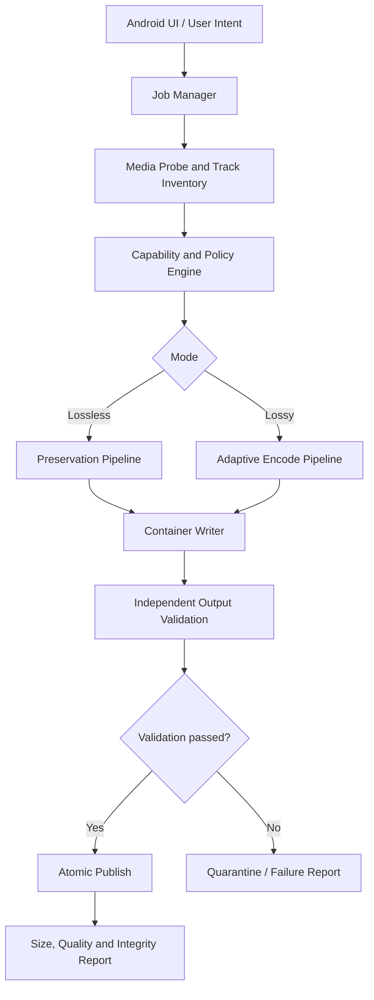
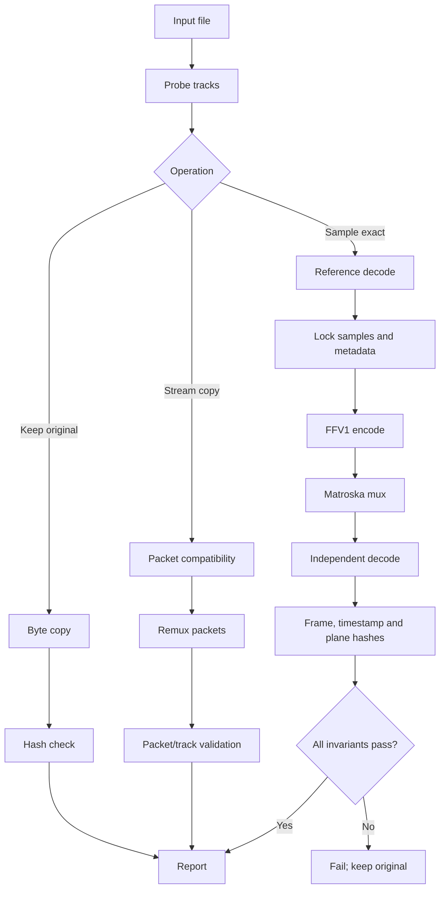

# Next-Generation Android Video Compression

## Complete technical research and implementation master plan for 2027–2030

**Prepared:** 14 November 2026  
**Scope:** Planning only. No application source code and no APK build.  
**Target:** Android phones from entry-level devices to flagships, with an architecture designed to evolve through 2030.

---

## How to read this document

### Evidence labels

- **[Verified—primary]**: supported directly by a standards body, Android/AOSP documentation, official repository, paper publisher, vendor technical documentation, or patent publication.
- **[Verified—secondary]**: supported by an independent benchmark, review or other secondary source.
- **[Author estimate]**: engineering estimate or proposed target, not a measured result. Assumptions and baseline are stated.
- **[Author recommendation]**: design choice proposed by this plan.
- **[Speculation]**: plausible future direction, not confirmed as a shipping capability.
- **[Unverified]**: not confirmed in the material reviewed by 14 November 2026; do not treat it as a product capability.

### Technology maturity labels

1. **Shipping in products** — used in released products or commercial devices.
2. **Standardized** — a published standard/specification exists; that does not prove phone implementation.
3. **Open-source implementation** — usable source code exists under a published license.
4. **Research prototype with code** — research code exists, but it is not proven as a mobile production component.
5. **Paper only** — a paper describes the method, but no production-ready public implementation was confirmed here.
6. **Theory/speculative** — concept without a demonstrated interoperable implementation.

A technology can have multiple labels. AV2, for example, is standardized and has open-source reference software, but is not verified here as a broadly shipping Android hardware encoder.

### Rules for numbers

- Existing platform/standard numbers are cited.
- Project targets are gates to test, not claims about current performance.
- Pixel-memory figures are arithmetic estimates.
- Budget and schedule values are planning estimates, not quotations.
- No compression ratio, battery advantage, speed-up, quality score or energy result is presented as a physical-phone measurement. No phone tests were run for this plan.

### Research method and limitations

The research pass used approximately **130 targeted live-web searches** across Android media APIs, codec specifications, reference implementations, learned compression, quality metrics, datasets, mobile SoCs, thermal management, licensing and patent publications. It prioritized official Android/AOSP, ITU-T, IETF, AOMedia, official GitHub repositories, vendor documentation and independent benchmark sources. The full online text of the FFV1 RFC, Matroska RFC and AV2 specification was examined, along with relevant Android documents and codec/research repositories.

**Limitations:** no physical Android devices were available; no encode, conformance, battery or thermal tests were run; no parallel research-agent facility was available; searches do not equal reviewing every paper, patent family, confidential codec implementation or OEM firmware release; patent research is preliminary, not a legal freedom-to-operate opinion. Re-check release-specific facts before implementation and shipping.

**Interpretation:** this is a research-backed engineering proposal and experiment plan, not a claim that the proposed encoder has already achieved any target.

---

# 1. Executive summary

## 1.1 Recommended product

Build a **unified, hardware-first, software-capable, adaptive Android video pipeline** with two separate modes: a rigorously verified lossless path and a content-/device-aware lossy path. They share probing, metadata inventory, resource control, container handling, job recovery and output validation, but not a vague common “quality” setting.

Do not force one codec or one encoder configuration onto every use case. A budget phone compressing a social clip, a flagship encoding 4K HDR, and a user preserving camera originals have different goals and limits.

## 1.2 Define Lossless accurately

The UI should distinguish three operations, because “lossless” is commonly used to describe different things:

1. **Keep original file (byte-for-byte copy):** copy all bytes unchanged. This is preservation, not compression. It is the only way to preserve the complete original file exactly, including container bytes and metadata layout.
2. **Stream copy / remux (encoded-packet preservation):** copy compressed audio/video packets into a compatible new container without decoding and re-encoding the streams. Outer file bytes, indexes, ordering and metadata representation may change. Some tracks may not fit the destination container.
3. **Decoded-sample-exact re-encode:** decode into a defined sample representation and encode using a lossless codec. Independent decoding of the output must reproduce those samples exactly. The resulting file is not byte-identical to the source and may be larger.

**Do not promise that lossless re-encoding of an already compressed video will make it smaller.** No codec can guarantee a smaller file for every input. No new encoder can restore detail already discarded by an earlier lossy encode. The system should compare candidates and retain the original when re-encoding is larger.

## 1.3 Define Lossy as user-selected optimization

Offer:

- **Best quality:** maximize visual quality within size, speed, heat and battery limits.
- **Smallest file:** minimize bytes subject to a visible quality floor and compatibility requirement.
- **Fastest:** minimize elapsed time subject to quality and resource limits.
- **Battery saver:** minimize joules per processed minute subject to quality, output-size and completion constraints.
- **Balanced/custom:** show the feasible trade-off and allow advanced limits.

These are objective functions over codec paths, not separate codecs.

## 1.4 Current developments that matter

| Development | Finding as of 14 Nov 2026 | Consequence |
| --- | --- | --- |
| AV1 | Android's official format table lists AV1 encoding from Android 14 and decoding from Android 10. [Verified—primary, S01.] | Make AV1 a main candidate; still discover real hardware/software status per device. |
| AV2 | AOMedia published AV2 1.0.0 specification and AVM reference software on 28 May 2026. [Verified—primary, S02, S07.] | Experimental adapter only; a published spec is not phone readiness. |
| VVC/H.266 | ITU-T H.266 Version 4 entered into force 13 Jan 2026. [Verified—primary, S03.] | Research candidate; hardware and patent licensing remain practical gates. |
| APV | Android's supported-format documentation lists APV from Android 16; Samsung documents professional APV support on specified devices. [S01, S12.] | Investigate professional workflows; do not treat visually-lossless as sample-exact or as the smallest-file option. |
| NNAPI | Android 15 deprecates NNAPI. [Verified—primary, S04.] | Do not make NNAPI required for NPU inference. |
| LiteRT | Google documents newer LiteRT Android APIs and vendor delegate options. [S05, S27.] | Optional ML acceleration only, with CPU fallback. |
| Media3 | Transformer uses Android media components including MediaCodec and OpenGL for supported transformations. [S06.] | Useful integration/reference layer, not the whole custom compression engine. |

A mandatory Android codec capability does not mean identical hardware, profiles, quality, latency or energy across manufacturers.

## 1.5 Main architecture



## 1.6 Key decisions

| Area | Recommendation | Evidence that could change it |
| --- | --- | --- |
| Architecture | Shared platform services; independent lossless/lossy engines | A universal mobile codec eventually satisfies both contracts |
| Lossless fallback | Original copy or remux first; FFV1 v3 in Matroska for sample-exact archive | Another codec is proven smaller, interoperable and energy-feasible while exact |
| Lossy | Runtime-selected hardware AV1/HEVC/AVC | Device fleet test data shows different ranking |
| Compatibility | AVC fallback | Guaranteed playback ecosystem changes |
| New codecs | AV2, VVC, APV and EVC/LCEVC experiments behind feature gates | Broad hardware, independent tests and legal clearance |
| App | Kotlin + Android platform APIs | Future Android API changes |
| Media core | C++20 + NDK, pinned native libraries | Rust can prove a substantial safety/integration advantage |
| ML | Optional encoder-side analysis only; no ML decoder in v1 | Standardized, deterministic and widely accelerated neural codec emerges |
| Containers | MP4 lossy; Matroska FFV1 archive | Interoperability/licensing evidence supports a better choice |

## 1.7 Results the product can honestly promise

- Lossless: exact decoded-sample equality for explicitly supported formats and workflows; output may grow.
- Lossy: reproducible quality/size/speed/energy choices for supported combinations; predictions shown as ranges.
- No claim of being “world's best” until independent, reproducible tests support it.

## 1.8 First 30 days

| Period | Deliverable | Go/no-go gate |
| --- | --- | --- |
| Days 1–3 | Sign off meanings of byte-copy, packet-preserving remux and sample-exact re-encode | Every supported metadata type has preserve/drop/warn rule |
| Days 4–7 | Device inventory and codec probe | At least one entry, mid and flagship phone; repeatable reports |
| Days 8–14 | 20-clip pilot corpus | Every clip has hash, format, rate, color, tracks and license record |
| Days 15–21 | FFV1 + MediaCodec pilot | Round-trip exactness passes on controlled formats |
| Days 22–26 | AVC/HEVC/AV1 baseline | Measure available encoders on same clips/device |
| Days 27–30 | Feasibility report | Proceed only with clear scope, exactness and at least one useful lossy route |

The smallest decisive experiment is detailed in Section 14. Do not build the full app before it proves the pipeline, exactness and at least one useful lossy route.

---

# 2. Research findings: landscape

## 2.1 How compression works

A video is a sequence of pictures plus timing and possibly audio, subtitles, captions, orientation and color/HDR metadata. Codecs reduce the data by exploiting:

- **Spatial redundancy:** nearby pixels often resemble each other; prediction and transforms compact them.
- **Temporal redundancy:** adjacent frames share content; motion estimation and inter-frame prediction encode changes.
- **Perceptual redundancy:** visual errors are not equally noticeable; lossy codecs prioritize perceptually important detail.
- **Statistical redundancy:** entropy coding gives frequent symbols shorter representations.

Lossless coding must preserve every sample in the defined input representation. Lossy coding intentionally discards some information. Film grain, sensor noise, motion, text, line art, animation, screen captures, dark gradients, HDR and high frame rates stress codecs differently.

## 2.2 Codec landscape and maturity

| Codec/family | Maturity | Role | Strengths | Mobile cost/risk | Decision |
| --- | --- | --- | --- | --- | --- |
| AVC/H.264 | Shipping; standardized; open implementations | Compatibility | Very broad support; common hardware acceleration | Less efficient than newer codecs at similar quality | Compatibility fallback/baseline |
| HEVC/H.265 | Shipping; standardized; open implementations | Modern consumer/HDR | Good compression; modern hardware support | Patent pool and country-specific legal issues; profile variation | Strong candidate after legal review |
| VP9 | Shipping; standardized; open implementations | Web playback | Mature decode ecosystem | Hardware encode less consistent | Input/decode coverage; low priority encoder |
| AV1 | Shipping; standardized; open implementations | Modern web/local delivery | Strong efficiency; AOM patent framework | Software encoding may be costly; hardware encode varies | Main candidate, runtime selected |
| AV2 | Standardized 1.0; open reference code | Future web/media | New AOMedia design and reference implementation | No broadly deployed Android hardware encode confirmed here | Lab only |
| VVC/H.266 | Standardized; commercial implementations | High-efficiency delivery | Strong coding tools | Complexity, pools, uncertain phone support | Workstation research only initially |
| EVC/MPEG-5 Part 1 | Standardized; implementations exist | Alternative MPEG codec | Profiles designed with different patent/efficiency objectives | Market and mobile support need validation | Monitor |
| LCEVC/MPEG-5 Part 2 | Standardized; implementations exist | Enhancement layer over base codec | Potential quality improvement on base codec | Requires compatible chain and extra processing | Experimental |
| FFV1 | RFC specification; open implementations | Preservation | Lossless, flexible pixel formats, Matroska mapping | Large intra-frame files; limited general-player support | Reference archive path |
| APV | Standard/platform-supported; specific products | Professional editing | 4:2:2/4:4:4 workflows; visually lossless positioning | High bitrate; visually lossless is not sample-exact | Compatibility experiment, not main compressor |
| ProRes/DNxHR | Shipping professional formats | Editing intermediates | High-quality, editing-friendly | Large files and proprietary ecosystem | Not consumer-size priority |
| Neural codecs (DCVC etc.) | Research prototypes with code | Experimental compression | Learned temporal/entropy/synthesis models | Compute, model interoperability, determinism and thermal risks | Monitor only |
| Neural post-filters | Standardization/research work; implementation varies | Quality improvement | Potential perceptual benefit | Decoder model, signaling, patents and compute | Separate experimental track |

Sources: Android formats [S01], AV2/AVM [S02, S07], ITU [S03, S08, S09], FFV1 [S10], Matroska [S11], APV [S12], MPEG [S13], DCVC [S14].

## 2.3 Important codec families

### AVC / H.264

Block-based intra/inter prediction, motion compensation, transform/quantization and entropy coding. Standardized and shipped broadly. [S09.] Hardware is mature and widely available; exact encoder quality varies. Keep for compatibility and benchmarking, not as the efficiency leader.

### HEVC / H.265

Extends partitioning, prediction, transforms and coding tools beyond AVC. ITU-T's H.265 page lists a 2026 edition. [S08.] Good hardware candidate on many phones. Patent licensing remains separate from technical standardization; a pool may not cover every essential patent. Include as a candidate after counsel review.

### AV1

Block-based prediction, transforms, quantization, advanced partitioning and entropy coding. AV1 includes lossless tools, but Android encoder exposure and quality must be verified. [S15.] Software encode can be costly; hardware encode may be unavailable even where decode is supported. Make it first-class, never the only option.

### VP9

Mature web playback codec predating AV1. Keep input/decode support where useful; do not prioritize software encode over AV1/HEVC unless device tests justify it.

### AV2

AOMedia released AV2 1.0.0 and AVM reference software on 28 May 2026. [S02, S07.] The research did not confirm broad Android hardware encode, stable cross-OEM behavior or phone energy performance. Test on workstations first; phone prototype only after decoder conformance, rate-distortion, memory/thermal and legal gates pass.

### VVC / H.266

H.266 Version 4 is in force from 13 Jan 2026. [S03.] No broad Android hardware encode ecosystem or straightforward pool position was established in this research. Keep workstation comparison only until devices and license terms justify a mobile path.

### APV

Samsung describes APV as a professional, visually-lossless format and documents support on specific Galaxy devices. Android format documentation lists APV from Android 16. [S01, S12.] Samsung's comparison claim of around 10% better efficiency in its context is a **vendor claim**, not an independent cross-device result. Its examples show hundreds of Mbps for some 4K30 APV settings, so professional quality does not mean small-file compression. Do not call it bit-exact lossless.

## 2.4 Lossless families

### FFV1

RFC 9043 specifies FFV1 as a lossless intra-frame format supporting varied pixel formats. It is an informational RFC, not an Internet Standards Track specification. [S10.] It has defined configuration structures, a Matroska mapping and multiple slices that can support parallelism. Advantages: exactness-oriented design and archival framing. Disadvantages: potentially large output and limited common consumer playback. Use FFV1 v3 in Matroska as the reference exact-sample path, with independent decode-and-compare.

### AV1 lossless

AV1 has lossless coding tools. [S15.] Benchmark against FFV1, but do not assume an Android hardware encoder exposes lossless mode or that software encoding is acceptable on a phone. Adopt only after exact sample validation and energy/time tests.

### Lossless H.264/H.265

Some implementations expose lossless modes, but settings, profiles, licensing and playback compatibility differ. x264 publishes GPLv2 and commercial options. [S17.] Verify x265 licensing separately before use in a proprietary app.

## 2.5 Neural video compression

Learned codecs use neural analysis transforms, temporal/motion models, entropy models and synthesis transforms, trained to optimize rate and distortion. Microsoft's DCVC repository includes research variants through 2026; published GPU examples are not evidence of Android performance. [S14.] MPEG has ongoing exploration work on neural video compression. [S13.]

Do not use a learned decoder in v1: decoder behavior depends on model weights, version, numeric precision and accelerator implementation. Different phone GPUs/NPUs may produce divergent results; updates cannot silently change old-file decoding. ML can optionally help the encoder select standard codec settings; ordinary standard decoders must remain sufficient to decode output.

## 2.6 Hardware truth matters more than Android-version assumptions

MediaCodec/MediaCodecInfo expose MIME types, component flags, profiles, color formats, bitrate modes and performance points. Performance-point data can be absent or incomplete. [S18, S19.] MediaTek's official Dimensity 9500 page lists AV1 decoding, while its stated hardware encoding includes HEVC/AVC rather than AV1. [S20.] This is a concrete example of why decode support does not imply encode support.

**Requirement:** query the actual device, configure the exact profile, run a short encode/decode, and retain a device/firmware-specific profile. Marketing names and API presence are not enough.

---

# 3. Define “best” as a measurable multi-objective problem

## 3.1 Four user priorities, four optimization problems

Let `R` be output bitrate/bytes, `D` perceptual distortion, `T` elapsed time, `E` energy, `M` peak additional memory, `H` thermal state and `C` compatibility constraints.

- **Best quality:** minimize `D` subject to maximum size, time, memory and thermal constraints.
- **Smallest file:** minimize `R` subject to a quality floor, compatibility and maximum time/energy.
- **Fastest:** minimize `T` subject to quality and size floors and safe resource limits.
- **Battery saver:** minimize `E` subject to quality, size and completion-time constraints. Energy must be measured in joules/Wh, not inferred from CPU percentage.
- **Balanced:** choose a non-dominated point on the Pareto frontier. A solution is Pareto-dominated if another is no worse in every relevant dimension and better in at least one.

Do not hide these priorities behind a single quality slider. A screen recording with text needs different quality protection from a noisy night video.

## 3.2 Internal optimization model

A weighted objective can help rank candidate configurations:

`J = wD × D + wR × log(R) + wT × log(T) + wE × log(E) + wM × log(M)`

Weights derive from the selected user goal. This is a policy-ranking device, not a universal scientific measure. Apply hard constraints before scoring. For example, battery saver rejects candidates that violate the quality floor or thermal ceiling even if their weighted score looks good.

## 3.3 File-size targeting

For duration `t` seconds and target total size `S` bytes, a first-order estimate is:

`video_bitrate_bits_per_second = (8 × S − audio_bits − estimated_container_overhead_bits) / t`

This is only a starting point. Actual output depends on codec rate control, GOP structure, scene complexity, audio tracks, metadata and mux overhead. Constant-quality mode may overshoot; constrained bitrate may reduce quality to hit the size.

Product behavior:

1. Estimate feasible size from a short representative sample or source metadata.
2. Show a prediction range, not false precision.
3. Let the user set a minimum quality floor.
4. Use constrained VBR/CBR when its quality is acceptable.
5. If the encoder misses, allow at most one correction pass by default.
6. If the target is infeasible without violating the quality floor, explain the conflict and offer the nearest alternatives.

**Proposed gate [Author estimate]:** median absolute target-size error ≤5% on the declared supported test corpus. Baseline is the user's byte target; test set is the fixed release corpus; hardware is each supported device tier. This is an acceptance target, not an existing result.

## 3.4 Quality metrics

Use several metrics and human review:

- **VMAF:** Netflix perceptual-quality model; use correct model/version for SDR or HDR. VMAF v1 and HDR model releases are in its official repository. [Verified—primary: S21.]
- **PSNR:** numerical error measure; useful for debugging, not complete visual quality.
- **SSIM / MS-SSIM:** structural similarity metrics; use alongside VMAF.
- **CAMBI:** banding visibility metric included in VMAF's project ecosystem. [S21.]
- **Content-specific checks:** edge/text/chroma checks for screen content, subtitles and line art.
- **Human pairwise tests:** validate that metric improvements correspond to visible improvements.

Mean VMAF can hide a few poor scenes. Report mean, median, fifth percentile and worst-scene values. Preserve source/reference alignment. For streaming-oriented use cases, review ITU-T P.1204 and relevant 2026 updates. [S22, S23.]

## 3.5 Rate-distortion comparison

Use BD-rate/rate-distortion curves. Fix source, resolution, frame rate, bit depth, chroma, color metadata and quality range. Report per-clip results before aggregates. Do not compare different content or different quality points and call the difference a codec win. Independent MSU comparisons provide useful context, but scores depend on their test set, encoder settings and metric; they do not substitute for phone tests. [Verified—secondary: S24.]

---

# 4. Recommended system design

## 4.1 Shared system architecture


Shared modules:

1. **Media probe:** streams, codecs, profiles, dimensions, frame rate/VFR, bit depth, chroma, color primaries/transfer/matrix/range, rotation, HDR, audio, subtitles, chapters and attachments.
2. **Capability engine:** query Android components and perform short real encode/decode validation.
3. **Policy engine:** convert user priorities to hard constraints and candidate configurations.
4. **Frame/packet I/O:** bounded queues, timestamps, backpressure and cancellation.
5. **Container service:** MP4 and Matroska with explicit track/metadata policies.
6. **Resource governor:** memory, thermal, throughput and energy-aware throttling.
7. **Job manager:** persistent state, progress and recovery.
8. **Validation service:** independent decode, hashes, timestamps, tracks and container integrity.
9. **Report service:** settings, quality estimates, warnings and verification results.

## 4.2 Separate correctness invariants

**Lossless:** no unrequested scale/crop/rotation bake-in/frame-rate change/bit-depth reduction/chroma conversion/color transform; every frame accounted for; timestamps preserved under a defined time-base tolerance; pixel format recorded; HDR/dynamic metadata preserved or rejected/warned; independently decoded sample comparison required.

**Lossy:** never claim exact preservation; maintain visible user quality floor and constraints; use measured per-device profiles; report audio/subtitle/metadata behavior; independently decode output before marking success.

## 4.3 Programming languages and tools

| Layer | Choice | Reason / caution |
| --- | --- | --- |
| Android UI/app | Kotlin + Jetpack Compose, Coroutines/Flow | Native lifecycle and modern Android integration |
| Platform media | Kotlin/Java MediaCodec, MediaExtractor, MediaMuxer, MediaStore | Codec discovery and OS media access |
| Native media core | C++20, Android NDK, CMake/Ninja, JNI | Mature codec/container ecosystem, SIMD and media libraries |
| Container/codec library | Minimal FFmpeg build with approved LGPL components | Broad demux/mux/pixel/codec support; audit every component and build flag |
| Lossless | FFV1 from approved build | Reference exact-sample path; validate independent decode |
| AV1 | libaom and approved libraries | Standards reference/research; do not assume mobile real-time speed |
| Research | Python 3.12, shell, Jupyter, pandas, NumPy | Reproducible experiments and result analysis |
| Quality | VMAF, PSNR, SSIM/MS-SSIM, CAMBI, subjective tests | Multi-dimensional scoring; pin model versions |
| Build/release | Gradle, CMake, CI, reproducible build manifests | Android pipeline and dependency control |
| Diagnostics | Perfetto, Android Studio Profiler, thermal/performance APIs | Trace resources; use external calibrated meter for credible energy |

Use one **mono-repository** initially. Split repositories only when independent teams/release cycles make a single repository a demonstrated bottleneck.

## 4.4 Suggested repository layout

```text
android-video-compressor/
  android/
    app/                     # UI, permissions, user workflow
    media-platform/          # MediaCodec, MediaExtractor, MediaStore
    job-runtime/             # lifecycle, persistence, recovery
  native/
    media-core/              # frame/packet abstractions, timestamps, queues
    probe/                   # format and metadata inspection
    codecs/mediacodec/       # hardware codec adapter
    codecs/ffv1/             # approved FFV1 integration
    codecs/av1/              # AV1 integration and experiments
    codecs/future/           # gated AV2/VVC/APV experiments
    containers/mp4/
    containers/matroska/
    color/                   # explicit pixel/color operations
    resource/                # bounded buffers and resource control
  policy/
    capability-profiles/     # tested device/component profiles
    optimizer/               # user priority and candidate selection
  ml/encoder-analysis/       # optional encoder-side models
  bench/harness/             # reproducible tests
  bench/datasets/            # manifests and licenses, not unlicensed media dumps
  bench/results/             # versioned results
  tests/conformance/
  tests/exactness/
  tests/fuzz/
  tests/interoperability/
  tests/regression/
  licenses/                  # notices, SBOM and per-file license records
  docs/architecture/
  docs/ADRs/
  docs/release-checklists/
```

Do not commit media assets unless their licenses permit it. Keep dataset manifests, hashes, download instructions and license evidence separately.

## 4.5 Runtime capability selection

Do not decide capability using `Android version >= X`. Inspect:

- MIME type and encoder/decoder role;
- component name and hardware/software/vendor/alias classification;
- profiles and levels;
- color formats and bit depths;
- supported dimensions, alignments and frame rates;
- bitrate modes and ranges;
- performance points where supplied;
- surface input support;
- exact requested format configuration success;
- short encode/decode validation;
- sustained throughput and thermal behavior.

A component name or `isHardwareAccelerated` flag is a filter, not a quality guarantee.

**Selection sequence:** discover candidates → filter for required format/profile → exclude known regressions → preflight unfamiliar/updated components → measure quality/size/time/resource use → rank candidates satisfying hard constraints → cache profile keyed by device/OS/codec version → re-test after system/component update.

Do not benchmark every parameter for every job. Use a bounded local cache and targeted revalidation.

## 4.6 Bounded frame architecture and memory

Stream decode → bounded frame queue → encode → mux/write. Never load the whole video into RAM.

For 4:2:0 8-bit video, packed payload is approximately `width × height × 1.5` bytes:

- 1920×1080 ≈ 3.11 MB/frame;
- 3840×2160 ≈ 12.44 MB/frame.

If 10-bit samples are held in 16-bit words, double those numbers: ≈6.22 MB and ≈24.88 MB. These are arithmetic payload estimates, not measured Android allocations. Strides, alignment, surfaces, duplicates and codec-private buffers increase real memory.

**Initial design targets [Author estimate]:** only 2–3 app-managed full frames in flight; one active encode job by default; <75 MB additional app-controlled media memory at 1080p and <150 MB at 4K on the minimum tier. Refine after pilot measurements. Use backpressure rather than queue growth. Prefer surface-to-surface lossy processing when validated. For sample-exact processing, avoid GPU/color operations that change samples.

## 4.7 CPU, GPU, NPU and hardware codecs

**Hardware video codec:** default for lossy encode/decode only when the exact profile/format passes quality and output validation. Do not infer 10-bit, 4:2:2/4:4:4, HDR, lossless or advanced controls from MIME presence alone.

**CPU:** probing, container work, metadata, policy, hashing and fallback coding. Android ARM64 has NEON as its baseline SIMD path; detect optional instruction extensions at runtime. Do not require Armv9 SME2/SVE2 across the fleet. [S25, S26.]

**GPU:** hardware surface paths, compositing or specific tested transforms. No custom GPU video codec in v1. GPU readback may erase gains.

**NPU:** optional tiny encoder-analysis model only. NNAPI is deprecated from Android 15; LiteRT and Qualcomm delegates are not universal. Always have a CPU/heuristic fallback. [S04, S05, S27.]

Avoid CPU core pinning/frequency control, forcing accelerators unnecessarily, high-performance hints that overrule thermal limits, and per-frame neural inference without proven net energy benefit.

---

# 5. Lossless mode: full technical plan

## 5.1 Exactness contract

Before claiming sample-exact output, record dimensions, frame count/timestamps, pixel format, bit depth, chroma subsampling/siting, alpha, color primaries/transfer/matrix/range, HDR static/dynamic metadata, orientation, audio/subtitle inventory, time base and edit-list behavior.

Recommended guarantee wording:

> “For the supported video track and declared decoded sample representation, independently decoding the output reproduces every video sample exactly. Container bytes, packet boundaries, metadata representation, timestamps and non-video tracks are preserved only to the extent separately stated in this job's report.”

This prevents an image-sample guarantee from being mistaken for whole-file/track preservation.

## 5.2 Three workflows

### A. Original byte copy

- Copy file to destination.
- Verify source and destination SHA-256 hashes match.
- Do not repackage or mutate track bytes.
- Fail before starting if storage is insufficient.

### B. Packet-preserving stream copy / remux

- Probe and inventory streams.
- Select a compatible container.
- Copy compressed packets without decode/re-encode.
- Preserve timestamps and side data where supported.
- Validate packet payload hashes for tracks advertised as exact-packet-preserving.
- Compare track inventory after muxing.
- If a track/metadata item cannot be carried, retain original container or warn/reject; never silently omit it.

### C. Decoded-sample-exact re-encode

1. Pin a reference decoder implementation/version.
2. Decode without lossy transforms or display-only processing.
3. Preserve native sample planes and timestamps.
4. Encode with a validated lossless codec/profile.
5. Mux the output.
6. Independently decode output with a second implementation where feasible.
7. Compare every plane/sample and frame/timestamp mapping (only documented byte-packing normalization; no color conversion).
8. Validate side metadata separately.
9. Mark sample-exact only when all declared invariants pass.

## 5.3 Codec choice

**Default reference encoder: FFV1 v3 in Matroska.** FFV1 is specified for lossless video by RFC 9043; Matroska has a published spec and FFV1 mapping. [S10, S11, S28.] It is intra-frame and has slice support useful for parallelism. The format is not guaranteed to give the smallest output, and ordinary consumer playback support is weaker than MP4 AVC/HEVC/AV1.

**Alternative research candidate: AV1 lossless.** Compare it using identical sample representation and independent validation. Use only if exactness, size and energy/time gates pass. Do not presume Android hardware exposes lossless mode.

“FFV1 is lossless” describes the codec configuration, not the entire decode/encode pipeline. An input decoder may already convert range, chroma or bit depth before FFV1 receives the samples.

## 5.4 Lossless flow



## 5.5 Color, HDR and metadata rules

Do not silently convert 4:2:2/4:4:4 to 4:2:0, 10-bit to 8-bit, alter frame rate, scale, change color range or bake rotation. Preserve primaries, transfer, matrix, full/limited range, orientation, HDR10 mastering-display and content-light metadata where supported. Treat Dolby Vision and dynamic HDR as explicit, separately validated features. If exact metadata cannot be carried, keep original stream/container or warn that complete preservation is unsupported. Preserve audio/subtitle/chapter/attachment tracks only where compatible and validated.

## 5.6 Verification matrix

| Dimension | Test | Pass condition |
| --- | --- | --- |
| Pixel samples | Independent source/output decode | Exact equality in every supported plane |
| Frame count | Count decoded frames | Identical |
| Timestamps | Normalized presentation timeline | No unapproved dropped, duplicated, reordered or shifted frame |
| Pixel format | Inspect decoded output | Same declared bit depth/chroma layout |
| Color metadata | Compare tags and display meaning | No silent loss; unsupported items reported |
| Audio | Stream identity or explicit re-encode check | No silent drop or unintended conversion |
| Subtitles/chapters | Track inventory and extraction | Preserved or explicitly excluded |
| Corrupt files | Truncated/malformed cases | Safe failure; no false success |
| Repeated jobs | Repeat identical operation | Every run passes exactness |
| Recovery | Terminate at each pipeline stage | No partial output published as complete |

## 5.7 When the lossless output is larger

Show absolute/percentage size change; explain that the source was already compressed or is difficult to encode losslessly; offer stream copy or original preservation; keep the source by default; allow the user to keep the larger exact archive. Optimize lossless mode for preservation and transparency, not a guaranteed size reduction.

---

# 6. Lossy mode: full technical plan

## 6.1 Candidate codec order

There should be no fixed global preference order. Evaluate:

1. Hardware AV1 if a tested encoder supports the required profile, pixel format, bit depth and resolution and passes quality/energy requirements.
2. Hardware HEVC if available and legally approved for the product's distribution model.
3. Hardware AVC for broad compatibility or when its measured quality/energy result is better for the selected goal.
4. Software AV1 on selected high-performance phones only when the user chooses a quality/size priority and measured time/energy is acceptable.
5. Other codecs only in feature-gated experiments with license approval.

This is a candidate list, not a universal ranking. A strong HEVC hardware encoder can beat a constrained AV1 implementation on a particular phone or clip when all the user's objectives are considered.

## 6.2 End-to-end lossy pipeline

1. **Probe:** enumerate streams, metadata, resolution, frame rate, HDR and likely content class.
2. **Normalize only when necessary:** test whether source format can pass directly to hardware; record any conversion.
3. **Select candidates:** include hardware and software encoders that actually support requested output.
4. **Preflight:** short representative encode, or use a sufficiently similar cached device profile.
5. **Measure:** quality proxy, output bits, throughput, memory pressure and thermal trend.
6. **Optimize:** choose a candidate meeting hard limits and the selected objective.
7. **Encode:** bounded queues and adaptive rate-control settings.
8. **Mux:** preserve supported audio/metadata and warn about unsupported elements.
9. **Validate:** decode output and check tracks, timestamps, frame count and profile.
10. **Report:** size, quality estimate, selected codec, settings, elapsed time and warnings.

## 6.3 Content-aware decisions without a large AI model

Start with fast deterministic features:

- mean/peak luma and dynamic range;
- spatial activity and edge density;
- temporal difference and motion estimate;
- noise/grain estimate;
- scene-cut likelihood;
- text/line-art likelihood;
- dark-scene and gradient/banding risk;
- frame rate and variable-frame-rate behavior;
- chroma activity;
- HDR and bit depth.

These features predict which encoder setting deserves a preflight test. They are not an oracle. A screen recording with tiny text needs a stronger edge-preservation floor than a low-motion camera clip; a dark gradient needs banding checks; noisy night footage may need more bits than daylight footage at the same dimensions. The actual encoder result should decide.

## 6.4 GOP policy

A **GOP** (Group of Pictures) is a sequence organized around keyframes and inter-predicted frames.

- Keep GOP length configurable within the selected codec's supported behavior.
- Shorter GOPs can improve seeking/recovery but may cost bits.
- Longer GOPs may improve compression but increase dependency length and recovery cost.
- Insert keyframes at scene cuts only where supported and tested.
- Respect source presentation timestamps; never silently convert VFR to CFR.
- Offer separate compact-delivery and editing/intermediate profiles.

## 6.5 Adaptive bitrate and quality controller

### Calibration

For a new device/codec/resolution combination, test a small number of quality/bitrate points. Record output bytes, VMAF and secondary metrics, encode/decode speed, energy (where measured), peak memory, thermal trend and independent decoder compatibility. Cache the results against Android build and codec component version.

### During the job

- Keep the user's selected objective fixed.
- Re-estimate remaining output size and completion time from observed progress.
- Adjust bitrate only if the encoder supports it and the quality floor remains satisfied.
- On thermal pressure, reduce concurrency, slow analysis or pause safely.
- Never silently change resolution or frame rate to meet a byte target.
- Log every automatic policy decision for reproducibility.

### File-size mode

Use constrained VBR/CBR when its quality is acceptable. If only constant-quality mode is available, estimate size and offer one correction pass when the user requests strict size targeting. Distinguish “estimated target” from “verified exact size.”

### Quality mode

First filter candidates against the quality floor, then rank by size, energy and time. Do not accept a codec solely because average VMAF exceeds the target; inspect low-percentile and scene-specific quality.

## 6.6 Software versus hardware encoding

Hardware is the default when it meets the user's goal. Use software only when hardware is absent, quality is inadequate, a needed lossless/advanced mode exists only in software, or the user explicitly accepts slower high-compression processing and the phone passes time/energy/thermal tests. A workstation AV1 result does not prove that the same software encoder is suitable for a phone.

## 6.7 Audio strategy

Video compression is not audio compression. Default to **audio stream copy** when the destination container supports the original audio codec and the user did not request audio conversion. If audio must be converted, expose this separately with clear codec/bitrate/quality information. Do not silently transcode audio because the user only selected video compression. Preserve language, channels, sample rate, selected tracks and metadata where possible.

## 6.8 Unsupported metadata

For every stream and side-data type, choose one explicit behavior: preserve it exactly or with a documented mapping; warn and ask before changing/dropping it; or reject the operation if the change violates the chosen preservation contract. Never silently discard HDR, dynamic metadata, subtitles, chapters, timed metadata or orientation information.

---

# 7. ML strategy for 2027–2030

## 7.1 Recommended role

Use ML as an **optional encoder-side analysis tool**, not as a decoder. Potential tasks: estimate clip complexity; recommend codec/preset; classify screen versus natural content; detect text/line-art/grain; predict quality risks; select representative preflight regions. The output file must remain a conventional interoperable codec bitstream.

## 7.2 Data strategy

Training and test material must cover natural camera video, indoor/outdoor/night scenes, noise/grain, motion, screen recordings, documents/UI/text, animation, games, gradients, HDR/SDR and different resolutions/frame rates/chroma formats/bit depths.

Public datasets are not automatically licensed for commercial training. UVG's dataset page states non-commercial terms. [S29.] Netflix Open Content and Xiph provide useful material, but inspect each asset's license and permitted use. [S30, S31.]

Every clip manifest should include source URL/owner, license, restrictions, download date, SHA-256, format, duration, train/validation/test split and permitted uses. Keep the test split content-disjoint from training to prevent leakage.

## 7.3 Model size and inference budget

**Initial proposal [Author estimate]:** a quantized 1–5 MB model, or a fast heuristic equivalent, running on downsampled frames/features at roughly one sample per second. These are starting experiment values, not proven optima.

Compare CPU-only inference, GPU delegate, NPU delegate where supported, and no model. Keep CPU and heuristic fallback. The model should not inspect every frame unless an ablation shows that the quality improvement justifies energy and latency.

## 7.4 Runtime selection

NNAPI deprecation means there must be no NNAPI-only path. LiteRT has current Android APIs, and Qualcomm documents an NPU delegate for supported Snapdragon hardware, but neither is universal. [S04, S05, S27.]

1. Always implement a CPU fallback.
2. Query available delegates at runtime.
3. Benchmark latency and energy on the actual device.
4. Do not select NPU if wake-up, copying or launch overhead exceeds the CPU route.
5. Fall back to heuristics without changing output correctness.
6. Record model/runtime version in job diagnostics.

## 7.5 Why learned decoding is excluded

A learned decoder becomes part of the file format contract. Long-term decoding would need exact model version, weights, numeric behavior, entropy decoder and conformance rules. Different accelerator kernels can diverge. A model update must not silently change old-file decoding. Neural filtering and compression are research/standardization directions worth monitoring, not a reason to ship a non-interoperable decoder now. [S08, S09, S13, S32.]

---

# 8. Container, output format and file design

## 8.1 Recommendation

- **MP4 / ISO Base Media File Format:** main lossy consumer output when codec and metadata mapping are supported.
- **Matroska (MKV):** FFV1 archival output and other workflows needing flexible track/metadata mapping.
- **Original container:** retain it for byte copy or packet-preserving workflows when remuxing adds risk without benefit.

Matroska has a published RFC 9559 specification, and FFV1 has a Matroska mapping. [S10, S11, S28.]

## 8.2 Why not one container?

MP4 is a practical interoperability choice, but not every archival/lossless codec and metadata combination has broad MP4 player support. Matroska is flexible for FFV1 and archive workflows. One container would compromise compatibility or require a custom player.

## 8.3 Reject a custom container in v1

A custom container would require parser/muxer, timestamps, random access, codec configuration storage, seeking/indexing, crash recovery, metadata mapping, fragmentation, fuzzing and third-party playback. The product's value should be device-aware encoding and proof of correctness, not another container ecosystem.

## 8.4 Atomic publishing

Write to app-private temporary storage or a non-public destination. Flush and close the container, reopen and validate it, and only then publish to MediaStore or the user URI. On supported Android versions use MediaStore `IS_PENDING` to avoid exposing partial files. [S33.] Never overwrite the source by default; retain it until the new file passes validation and the user chooses otherwise.

## 8.5 Job report

Store a compact report containing source/output hashes; track inventory; codec/profile/container/resolution/frame rate; bit depth/chroma/color/HDR tags; device/OS/codec component version; user objective and hard limits; actual encoder settings; size/time/memory/thermal measurements; quality metrics; validation result/warnings; app/native/model versions. This makes bugs reproducible.

---

# 9. Android implementation details

## 9.1 Minimum Android version

**Recommendation: minSdk 29 (Android 10) for the first baseline.** [Author recommendation.] It retains broad reach and modern scoped-storage foundations; Android's format table lists AV1 decoding from Android 10, but that does not guarantee hardware decoding. [S01.] Thermal headroom and performance hints are later optional APIs.

Do not require APV, a specific NPU, or Android 14+ AV1 encoding to use the app. Maintain a fallback path. Re-evaluate minSdk at release using market install data and QA cost. Re-check the required target SDK and Play policies immediately before shipping; do not freeze today's target into a 2027 plan.

## 9.2 Platform interfaces

Use MediaCodec, MediaExtractor, MediaMuxer and related APIs for platform codec access, with native integration as needed. Media3 Transformer can be a reference or a helper for simple transformations, but do not assume it expresses exact sample-preservation, FFV1/Matroska and custom rate-control requirements. [S06, S18.]

For every component query supported MIME/profile/level/bit depth/color/bitrate modes and size/rate bounds, check input-surface support, record component identity, handle output-format changes/EOS/errors/releases correctly, and validate actual encoded output. Successful `configure()` is not enough.

## 9.3 Background work and recovery

Android documents a `mediaProcessing` foreground-service type for user-initiated media work. The Android 15 behavior includes a limit up to 6 hours in a 24-hour period; re-check current documentation and target-SDK rules at shipping time. [S34, S35.]

- Explain that a long user-visible job is running.
- Persist job state/checkpoints.
- Support pause, resume, cancel and safe restart.
- Release codec resources on stop.
- Do not treat WorkManager as a way around OS limits.
- If a job reaches a platform limit, checkpoint and let user resume.
- “Continue while charging” can be a preference, not an undisclosed requirement.

## 9.4 Thermal and performance APIs

Android provides thermal status/headroom and Performance Hint APIs on supported versions. [S36, S37.] Observe thermal state sensibly; treat NaN/stale/unavailable data as unknown, not “cool”; use callbacks where available; throttle/pause under sustained serious stress; use hints to describe workload rather than force maximum performance. Measure wall time and energy; API presence is not a performance promise.

## 9.5 Device matrix

| Tier | Example requirement | Purpose |
| --- | --- | --- |
| Entry | Older/low-cost phone with limited RAM and budget SoC | Ensure safe compatibility fallback and no OOM/overheat |
| Mid-range | Current mainstream Snapdragon/Dimensity/Exynos class | Validate likely main market and sustained encode |
| Flagship | Recent Snapdragon/Dimensity/Exynos/Tensor class | Evaluate AV1/HEVC, 4K, HDR and complexity |
| OEM diversity | At least two Android OEM software stacks | Find vendor codec and thermal differences |
| OS diversity | Android 10/11 legacy, current supported release and latest public Android | Validate API fallbacks/lifecycle |

**Initial sample proposal [Author estimate]:** 12 distinct models, 4–6 SoC/device families, with duplicate physical units for critical configurations. Not an existing tested fleet. Record exact model, SoC, RAM, storage, OS build, codec component and firmware. Test devices based on intended user distribution, not brand alone.

---

# 10. Benchmark and QA system

## 10.1 Test corpus

Build a fixed, license-reviewed, versioned corpus of roughly 120–200 clips for release testing. [Author estimate.] A 20-clip pilot is enough for feasibility, not public superiority claims.

Include: foliage/high detail; faces/skin/hair; low light/noise/grain; sports/fast motion; slow motion/high frame rate; animation/anime/line art; screen/UI/text/cursor; games; gradients/sky/fog/dark; HDR/10-bit/wide gamut; VFR/nonstandard timestamps; audio/multitrack/subtitle/chapter/rotation; malformed/truncated/corrupt files.

Potential sources are Xiph, Netflix Open Content and UVG. UVG documents non-commercial licensing, so do not use it for commercial model training without separate permission. Inspect per-asset rights. [S29–S31.]

## 10.2 Baselines

On every target phone/clip compare:

- device hardware AVC;
- device hardware HEVC;
- hardware AV1 if present;
- approved software AV1 on suitable hardware;
- FFV1 for lossless exactness, size and speed;
- workstation AV2/VVC/neural research where useful.

Keep source, resolution, frame rate, color, bit depth, quality range, audio, container and decoder conditions comparable. Record exact encoder settings and quality decoder.

## 10.3 Device and lab conditions

Record exact model/SoC/RAM/storage, Android build/security patch, codec component/version, battery condition, ambient/start temperature, charge/charging state, screen/background activity, source hash/settings and app/library build hashes.

Suggested starting lab conditions: 23–25°C ambient, idle device before cold run, 60–80% charge, unplugged for energy comparison unless charging is the explicit scenario. These are proposed test conditions, not platform requirements. Include cold, sustained and hot-restart runs.

## 10.4 Metrics and method

| Metric | Unit | Method |
| --- | --- | --- |
| Compression | output bytes, bitrate, source/output ratio | Exact file-size measurement |
| Visual quality | VMAF, PSNR, SSIM/MS-SSIM, CAMBI, human review | Timestamp-aligned decoded frames |
| Speed | seconds, fps, real-time factor | Wall-clock measurement |
| Energy | joules/Wh per video minute | Calibrated external power meter or validated measurement |
| CPU | time/utilization/frequency trace | Perfetto/platform trace |
| GPU/NPU | utilization/execution time when exposed | System/vendor tools; report missing values |
| Memory | peak PSS/RSS and app-managed buffer use | Profiler and native allocator instrumentation |
| Thermal | state/headroom and sensor values where available | Android API and external sensor if possible |
| Reliability | success/crash/validation failure rate | Repeated automation/device farm |
| Compatibility | playback and track preservation | Independent decoders/apps and track inspection |

Run repeated trials. Initial test protocol: at least 5 normal runs and 10 for noisy/variable cases; report median and 95% confidence intervals. [Author proposal.]

## 10.5 Quality methodology

Pin VMAF model/version and use the correct SDR/HDR model; align frames by PTS; report mean/median/5th percentile/worst scene; report per clip and aggregate; use PSNR/SSIM diagnostically; CAMBI or equivalent for banding; blinded A/B tests on representative clips. Do not downscale or convert the reference unless that is an explicit feature.

## 10.6 Proposed gates

All figures below are **engineering targets**, not existing results. Baseline and method appear in the third column.

| Area | Proposed gate | Baseline / test |
| --- | --- | --- |
| Lossless correctness | 100% sample equality for every advertised supported profile | Independent FFV1 output decode vs pinned source reference; all frames/planes |
| Stream-copy | 100% packet payload identity where claimed | Packet hashes plus track/timestamp checks |
| Silent loss | 0 unreported dropped tracks/metadata | Input/output inventory and side data |
| Lossy validity | 100% output decode success for jobs marked complete | Device and reference decoder |
| Quality | Predeclared quality/subjective floor; no average-only pass | Fixed corpus and appropriate reference/model |
| Size target | Median absolute target error ≤5% where strict target support is advertised | Target bytes vs actual output on fixed corpus and hardware |
| Memory | Start with <75 MB additional app-controlled memory at 1080p, <150 MB at 4K | Profiler per device; revise after pilot |
| Thermal | No sustained severe thermal state for declared supported workload | 30-minute stress run, controlled ambient |
| Reliability | 99.5% job completion or safe diagnosable failure in large beta corpus; zero false-success corruption | Automated jobs and validation |
| Compatibility | All declared output profiles play on the published support matrix | Independent decoders and real devices |
| Battery mode | Measurably lower joules than quality mode at comparable quality on tested phones | External meter, same clip/device/quality band |

Stretch target only: seek **8–10% lower average bitrate** than a declared AVC hardware baseline at matched quality on a representative corpus. This is not measured. Baseline must state phone, encoder component/version, settings, corpus, metric/model and confidence interval. If not met, do not manipulate test set or hide results.

## 10.7 Public benchmarks

Publish clip IDs/licenses, phone/build, codec/profile/settings, hashes, metric/model versions, energy setup, repeats/statistics, caveats, missing measurements and failed configurations. Never claim “X% smaller than all competitors” from one phone or narrow content. Separate workstation encoder comparisons from mobile speed/energy claims.

---

# 11. Security, reliability and privacy

## 11.1 Treat media parsers as an attack surface

Video files can contain malformed lengths, invalid indexes, corrupt bitstreams, unusual timestamps, broken metadata and resource-exhaustion patterns. Requirements:

- pin parsers/codecs to reviewed releases;
- fuzz demuxers, container/metadata parsers and resume logic;
- cap declared dimensions, frame counts, track counts, metadata size and allocations;
- reject integer overflow and invalid time-base calculations;
- validate offsets and lengths before buffer access;
- isolate risky parsing/decoding where practical;
- never publish a partial file as success;
- do not trust unverified temporary files during recovery;
- maintain an update process for codec dependencies.

## 11.2 Storage and crash safety

A transcode may require both source and output space. Estimate required space with a safety margin before starting. If insufficient, ask the user to choose another location or a different operation. Never delete the source automatically.

For long jobs, persist state/source identity, use recoverable output boundaries where possible, publish atomically after validation, clean stale temporary files only after checking no job owns them, and ensure cancellation/force-stop cannot leave a corrupt output appearing complete.

## 11.3 Privacy

Default to on-device processing. Never upload user videos, frames or audio for analytics/training by default. Make optional diagnostics opt-in and explain exactly what is collected. A media hash can itself be sensitive metadata; do not upload it without a clear purpose and consent.

---

# 12. Patent, licensing and legal strategy

## 12.1 Open-source licenses

- FFmpeg's license depends on build options and linked components. Its official guidance explains LGPL/GPL distinctions and compliance expectations. Do not enable GPL or nonfree components in a commercial build unless counsel and the release model explicitly approve them. [Verified—primary: S38.]
- x264 publishes GPLv2 and commercial licensing options. [Verified—primary: S17.]
- AOMedia publishes AV1 patent-license materials. The grant is described as royalty-free subject to terms, exclusions and reciprocity; this does not prove that every possible third-party patent claim is covered. [S15, S16.]
- AVM has a repository license. Review exact release/branch license and patent terms. [S07.]
- FFV1's RFC is a format spec, not a patent opinion. Review implementation licenses separately. [S10.]
- APV's exact implementation license was not verified here. Confirm the official source and every bundled file before integrating it; “open” is not a substitute for an explicit license. [Unverified: S12.]

## 12.2 Codec patent pools

VCL Advance/Via Licensing and Access Advance publish HEVC/VVC licensing information. Pool coverage does not necessarily include every essential patent or every patent holder. [S39, S40.]

Do not assume hardware use is automatically obligation-free; that the device maker's license covers an app's software encoder; that one pool covers all territories; or that encoding, decoding, distributing an encoder and distributing a file are legally identical. Counsel must evaluate exact product role, territory, implementation, distribution and business model.

## 12.3 Preliminary patent landscape

The search found examples around adaptive codec selection based on power/performance/quality, mobile content-adaptive transcoding, bitrate/quality control, and neural post-filter signaling. Examples include US11178395B1, EP3923574A2, US9407921B2, US11381816B2, US20250343958A1, US12647587B2 and US12701238B2. [S41–S47.]

These examples show that broad ideas such as selecting a codec based on battery, analyzing video before encoding, or using a neural filter are not automatically novel. Their presence does not prove infringement. Claim scope, prosecution history, patent family, jurisdiction, status and prior art require professional review.

## 12.4 Legal process

1. Formal freedom-to-operate search for the actual product features and target markets.
2. Claim mapping against the proposed architecture and user-visible workflows.
3. File-level and build-level audit of every codec/dependency license.
4. SBOM for every release.
5. Patent/design log for genuinely new mechanisms; no broad novelty claims without analysis.
6. Re-check patent pool terms before launch and market expansion.
7. Verify training, benchmark and promotional media licenses.
8. Match Play privacy, media permissions and foreground-service declarations to actual behavior.

**Legal status:** this is preliminary research only. No legal opinion, FTO clearance or commercial codec license has been obtained.

---

# 13. What to invent, combine, use or reject

A useful engineering idea is not automatically a novel or patentable invention.

## 13.1 Proposed mechanisms

| Mechanism | Description / expected value | Cost / risk | Proof experiment | Novelty position |
| --- | --- | --- | --- | --- |
| Device Codec Performance Atlas | Measured codec/profile/quality/speed/energy results by phone, firmware, component and resolution; avoids assumptions from API/SoC marketing | Profile drift and test-lab burden | Repeat same clips after firmware update; measure prediction error | Adaptive codec selection is prior art; novelty not asserted [S41–S44] |
| Preflight Pareto Probe | Encode small representative samples at several quality points, measure size/quality/resources, select feasible setting | Adds startup delay; sample may miss later scene types | Compare short-sample prediction with full-clip results | Content-adaptive transcoding concepts exist; not assumed novel [S42–S47] |
| Dual-contract Lossless UX | Separate byte copy, packet-preserving remux and sample-exact re-encode | More UI and validation work | Usability test of user understanding | Product semantics, not a codec invention |
| Budget Envelope Controller | Turn user preference into explicit quality/time/energy/memory/thermal constraints and throttle/pause within them | Depends on accurate metrics and conservative fallbacks | Compare decisions against offline Pareto frontier | Resource-aware selection is prior art; no patentability claim [S41–S44] |
| Metadata Preservation Ledger | Track each stream/tag/side-data item as preserved, transformed, unavailable or dropped | Container mapping complexity | Metadata round-trip and fuzz tests | Engineering correctness feature |
| Independent Sample Certificate | Save hashes and machine-readable exactness results | Additional decode time/storage | Revalidate on a second decoder/device | Hashing/integrity are established techniques |
| ML Complexity Scout | Tiny model estimates content class and suggests settings; never required by decoder | Data rights, delegate variation, power | Ablation: model vs heuristics vs none | ML-assisted quality prediction is active research; novelty unverified [S13–S15, S45] |

## 13.2 Use, combine and reject

**Use:** MediaCodec, standard containers, FFV1, approved AOM reference implementations, VMAF/PSNR/SSIM/CAMBI, thermal and performance APIs.

**Combine:** runtime capability discovery + short preflight encode + cached device atlas + explicit resource constraints + independent output validation.

**Invent at product-system level:** explainable “budget envelope” showing a feasible device/clip-specific frontier; a sample-exact workflow that certifies exactly which preservation contract passed.

**Reject in v1:** custom proprietary codec; custom container; mandatory NPU; learned decoder; heavy per-frame ML; universal one-codec claims; always-on cloud uploads; automatic source deletion; AV2/VVC as mandatory shipping features.

## 13.3 Evidence that would change decisions

- Broad, independently verified AV2 hardware encoder support on Android plus competitive energy/decoder stability.
- Standardized neural codec with deterministic integer inference, stable reference code, model signaling and broad mobile acceleration.
- APV profiles across multiple OEMs plus consumer bitrate/compatibility advantage.
- Commercially viable H.266 license plus real phone hardware.
- Alternative lossless codec that is exactly conformant, smaller than FFV1 on the actual corpus and acceptable in energy/time.

---

# 14. Smallest experiment that proves or kills the central idea

## 14.1 Experiment

**30-day Dual-Path Mobile Feasibility Spike.**

## 14.2 Scope

- **Devices:** one entry-level, one mid-range and one flagship Android phone.
- **Clips:** 20 licensed/cleared clips with hashes; include 1080p SDR, 4K where available, motion, grain/noise, screen/text, animation, low light and HDR where possible.
- **Duration:** mostly 30–60 seconds, with short and sustained runs.
- **Lossless:** byte-copy hash; stream-copy/remux for compatible inputs; FFV1/Matroska sample-exact; small software AV1-lossless experiment if practical.
- **Lossy:** hardware AVC/HEVC on capable devices; AV1 if an encoder is present; software AV1 on flagship/workstation initially.

## 14.3 Measurements

Record source/output bytes; encode/decode time and real-time factor; independent decode; lossless sample equality; VMAF/PSNR/SSIM/CAMBI; peak memory; CPU/GPU use where available; thermal trend; energy for representative runs with a calibrated meter; audio/metadata/track preservation; crash/retry behavior.

## 14.4 Go/no-go

**Go to core-engine development if:**

1. FFV1 round-trip exactly matches samples on the supported pilot matrix.
2. Media pipeline shows bounded memory.
3. At least one hardware lossy codec produces validated output on each target tier.
4. Candidate selection can be based on measured quality/size/time/resource data.
5. Track/metadata omissions are explicitly detected and reported.

**Pause or narrow scope if:** exactness fails due uncontrolled color conversion; entry devices cannot safely run advertised profiles; muxer silently loses tracks; codec components corrupt output with no fallback; software encoding is too costly.

**Kill a codec path if:** independent decode fails; any sample differs in an advertised sample-exact profile; hardware repeatedly violates profile; an alternative is materially better in energy/time without compensating benefit; license cannot be cleared.

Do not kill the whole product because AV1 hardware encode is absent on one phone. The architecture should fall back to HEVC/AVC or an explicitly supported software route.

---

# 15. Implementation schedule and milestones

**Planning horizon:** about 9–12 months for a specialist team to reach a production-quality first release. This is an estimate assuming deliberately limited codec scope. New codecs, formal patent negotiations or complex Dolby Vision/HDR preservation can extend it.

| Phase | Approx. timing | Work and deliverable | Go/no-go gate |
| --- | --- | --- | --- |
| 0. Definition/research freeze | Weeks 1–2 | Requirements, supported formats, legal screen, benchmark method, ADRs and corpus plan | Lossless meanings and metadata scope are defined |
| 1. Feasibility spike | Weeks 3–6 | FFV1 round-trip, MediaCodec discovery, AVC/HEVC/AV1 tests, harness | Exactness and a useful lossy path on each target tier |
| 2. Media core | Weeks 7–11 | Probe, timestamp model, queues, mux, storage, crash recovery | Bounded memory; track/timestamp validation |
| 3. Lossless alpha | Weeks 12–18 | Byte copy, stream copy, FFV1/Matroska, hashes and independent decode | 100% exactness for supported inputs |
| 4. Lossy alpha | Weeks 16–24 | Hardware adapters, policy, preflight, quality/size modes | Valid output and documented curves |
| 5. Resource/thermal | Weeks 25–30 | Memory, energy, thermal governor, pause/resume, foreground job | Long jobs pass safety/recovery gates |
| 6. Product integration | Weeks 27–34 | UI, file selection, permissions, storage, reports and queue | Correct lifecycle; no source overwrite |
| 7. Hardening | Weeks 31–38 | Fuzzing, malformed files, metadata, regression, OEM differences, accessibility | No critical corruption/security defects |
| 8. Closed/public beta | Weeks 39–44 | Device expansion, feedback, opt-in diagnostics, quality review | Defect and performance gates met |
| 9. Release | Weeks 45–52 | Play compliance, legal approvals, staged rollout and rollback plan | Engineering, QA, security and legal sign-off |

Phases may overlap once the architecture is stable. Do not allow UI work or the lossy pipeline to bypass lossless correctness gates.

## 15.1 Architecture decision records

Write an ADR for: lossless contract/reference pixel domain; lossless codec/container; lossy candidate selection; minSdk/target policy; FFmpeg build/license; color/HDR metadata; hardware/software fallback; ML and decoder exclusion; resource/thermal budgets; benchmark method; patent approval; crash recovery/release. Each ADR includes options, decision, rationale, evidence, assumptions, risks, owner/date and conditions that reopen it.

---

# 16. Team and cost

## 16.1 Suggested team

| Role | Approx. allocation | Responsibility |
| --- | ---: | --- |
| Technical lead/media architect | 1.0 FTE | System, codec, quality and release decisions |
| Android platform engineer | 1.0 FTE | Kotlin app, MediaCodec, storage, job lifecycle |
| Native media/codec engineers | 2.0 FTE | C++ core, FFmpeg/FFV1/AV1, timestamps and mux |
| Video quality/research engineer | 1.0 FTE | Rate-distortion, VMAF, corpus, subjective tests |
| QA/device automation engineer | 1.0 FTE | Device matrix, regression, fuzz coordination and release QA |
| ML engineer | 0.25–0.5 FTE | Optional model experiments/inference |
| DevOps/release engineer | 0.25–0.5 FTE | Reproducible builds, CI, SBOM |
| Product design/accessibility | 0.25–0.5 FTE | Clear goals and preservation UX |
| Legal/patent counsel | External retainer | Codec licensing, FTO, app/data compliance |

**Planning size:** approximately 7–9 FTE equivalents plus external legal review. Author estimate, not a staffing survey.

## 16.2 Indicative India-based budget

**Author estimate for 9–12 months: ₹2.2 crore–₹4.0 crore.**

| Cost area | Range | Assumption |
| --- | ---: | --- |
| Engineering/product | ₹1.5–2.4 crore | 7–9 FTE equivalents, fully loaded, 9–12 months |
| Device lab/instrumentation | ₹15–30 lakh | About 12 device models, duplicate units for key cases, power meter, temperature tools, storage |
| CI/cloud/storage | ₹5–15 lakh | Build runners, artifacts, corpus and fuzz/regression infrastructure |
| External legal/patent/licensing review | ₹10–35 lakh reserve | Initial review only; does not guarantee codec royalty/license costs fit |
| Contingency | ₹20–50 lakh | Device replacement, firmware issues, codec surprises and schedule slip |

These are not vendor quotations. They exclude substantial patent royalties, commercial codec agreements, special media licenses, litigation, marketing, support staffing and large post-launch research. Legal obligations can materially change the budget. Obtain current salary/device/counsel quotes before approval.

## 16.3 Lean prototype alternative

Two or three engineers could validate feasibility in a 4–8 week spike, but should not be expected to deliver full device coverage, patent clearance, quality validation and production security. Never market prototype results as production-grade benchmarks.

---

# 17. Release, distribution and adoption

## 17.1 Release stages

1. **Engineering builds:** internal, diagnostic logging enabled, only synthetic/licensed test media.
2. **Closed alpha:** limited devices/users, no destructive source operations, opt-in crash/quality reports.
3. **Public beta:** wider device matrix, supported-codec table, opt-in diagnostics and public benchmark page.
4. **Production:** staged rollout (e.g. 1%, 5%, 20%, then wider) with rollback triggers. These are proposed rollout steps, not Play requirements.
5. **Maintenance:** codec security updates, OS compatibility, firmware regressions, benchmark refresh and license review.

## 17.2 Trust features

Never overwrite originals by default; show size/quality as ranges; explain codec choice; label lossless operations accurately; report audio/subtitle/HDR metadata changes; offer before/after preview for lossy mode; save reproducible settings; default to on-device processing; do not use “AI” as marketing instead of measured gains.

## 17.3 Business model

Start with a free on-device tier for basic AVC/HEVC compression and transparent reporting. Consider paid pro features for batches, software AV1 experiments, lossless archives, advanced profiles and export automation. Do not promise that a one-time purchase covers future external codec royalties unless contractually resolved. Do not interrupt an active encode with ads or condition an already-started job on an ad.

## 17.4 Adoption

Publish methodology and representative results; demonstrate actual bytes and quality; make accurate lossless semantics a differentiator; simple presets plus advanced panel; device compatibility notes; reproducible bug reports without requiring private footage uploads; engage creator/preservation communities only after license and compatibility are established.

---

# 18. Red-team analysis

| Failure | Likely cause / signal | Mitigation | Stop condition |
| --- | --- | --- | --- |
| AV1 hardware encode absent | Decode exists, encoder absent or software-only | Use tested HEVC/AVC; optional software AV1 on capable phones | Do not ship unsupported profile |
| AV1 hardware quality weak | Restricted controls / poor implementation | Per-device policy and alternative codec | Remove component/profile from preferred list |
| Lossless sample mismatch | Decoder changes range/bit depth/chroma | Lock format; reference decode; disable conversion | Never label sample-exact until fixed |
| Metadata disappears | Muxer can't carry dynamic HDR/side data | Remux original or warn/reject | Never claim full preservation |
| Lossless file grows | Source already compressed/noisy | Explain; offer original/remux; keep source | No guaranteed reduction claim |
| File-size target missed | Content and rate control vary | One bounded correction; show feasible range | Relax size or quality if infeasible |
| Thermal throttling | Sustained load | Throttle, pause, charge-time scheduling, lower concurrency | Pause under serious/critical thermal status |
| Low-RAM device OOM | Too many/duplicated buffers | Bounded queue, streaming, reject unsupported mode early | Block profile before OOM |
| App stops in background | OS lifecycle/FGS limits | Persist/checkpoint; resumable jobs | No uninterrupted-run promise |
| OEM codec crashes | Vendor component bug | Regression profile/denylist; alternate codec | Disable profile on affected firmware |
| APV called mathematically lossless | “Visually lossless” language | Label as professional/visually-lossless | Never put in exact-sample path without proof |
| AV2 not practical | No phone HW, high compute, poor compatibility | Lab feature flag | No production default before gates pass |
| Learned decoder differs by device | Floating-point/accelerator/model differences | Exclude from v1 | Reject nonconformant decoder |
| Patent/license issue | Pool gaps or app obligations | Remove option or obtain license | No ship until counsel signs off |
| FFmpeg includes GPL/nonfree | Build/transitive dependency mistake | Pinned LGPL build and CI license gate | Release blocked until fixed |
| Dataset rights unclear | Non-commercial data used commercially | Obtain rights or replace media | No training/marketing with restricted assets |
| Malformed file exploits parser | Untrusted input | Fuzz, limits, safe failure, patches | Block known exploitable path |
| Partial output appears complete | Published before finalize/validation | Temp file, close, independent validation, atomic publish | Never show success before validation |
| Battery saver costs more energy | NPU/wake/copy overhead | Remove ML or use heuristic | No battery claim without measured benefit |
| Benchmark misleads | Wrong VMAF model/alignment/leakage | Multiple metrics, blinded tests | Withdraw/re-run claim |
| Unsupported “best” claim | Narrow/non-reproducible tests | Public methodology and caveats | No unsubstantiated superlative |
| Storage fills mid-job | Size under-estimated | Preflight storage, safe temp handling | Keep source; mark failure safely |

## 18.1 Release blockers

Block release if any advertised lossless path has an unexplained sample mismatch; completed output fails independent decode; tracks/metadata are silently dropped; source can be overwritten/deleted without explicit user action; critical parser vulnerability remains; shipped binary violates license; necessary patent review is unresolved; background behavior violates current Android policy; or benchmark claims cannot be reproduced from hashes/settings/versions.

---

# 19. Open research questions for 2027–2030

1. Which Android OEMs will ship AV1 hardware encoding in flagship and midrange tiers, and with what profiles/quality controls?
2. Will AV2 obtain mobile hardware support and interoperable containers before 2030?
3. Will VVC encode/decode and its licensing become practical for consumer Android apps?
4. Will APV spread beyond specific devices/pro workflows?
5. Will Android provide a stable vendor-neutral NPU path that is useful for tiny analysis models?
6. Can quality models improve settings without consuming the energy they save?
7. How much do encoder quality/energy differ across OEM firmware for the same nominal SoC?
8. Can AV1 lossless outperform FFV1 sufficiently to justify phone encode cost?
9. Which HDR/dynamic metadata can be preserved through hardware pipelines?
10. Can deterministic neural coding interoperate across phone accelerators and long-term playback systems?
11. What commercial codec licenses apply in each target market?
12. Can a device capability atlas be shared without exposing personal media traits or device fingerprints?

Review quarterly during active development and before major codec/library upgrades.

---

# 20. Self-audit

## 20.1 Weakest claims

1. **Mobile AV1 efficiency:** hardware encoder quality is device-specific; Android codec tables are not quality benchmarks.
2. **AV2 mobile readiness:** standard and reference implementation do not prove Android hardware availability or acceptable energy.
3. **Lossless size:** FFV1/AV1 lossless rankings vary by content, pixel format and settings.
4. **ML budget:** proposed 1–5 MB and ~1 sample/s are experiment settings, not measured optima.
5. **Memory:** proposed 75 MB at 1080p and 150 MB at 4K are app-controlled targets; codec-private allocations may exceed them.
6. **Budget:** ₹2.2–4 crore is a staffing/lab assumption, not a quotation.
7. **Schedule:** 9–12 months assumes limited scope and timely devices/legal work.
8. **Patent position:** examples do not establish infringement, non-infringement, novelty or FTO.
9. **APV comparison:** vendor claims are not independent cross-device results.
10. **Future tech:** 2027–2030 hardware forecasts are speculation until manufacturers ship and document capabilities.

## 20.2 Unverified by 14 Nov 2026

- Broad Android AV2 hardware-encoder support.
- Cross-OEM APV profiles and complete APV implementation license terms.
- A universal, vendor-neutral Android NPU path meeting this app's requirements.
- Device-specific AV1/HEVC/AVC quality, speed, energy and thermal behavior for the intended market.
- Complete list of essential patents and all pool obligations for each codec.
- A claim-by-claim patent analysis of the adaptive policy features.
- Any measured compression ratio or battery advantage for the proposed system.
- A single lossless codec consistently smaller than alternatives on the target corpus.

These are experiments/legal tasks, not facts to fill in with assumptions.

## 20.3 Ten best next experiments

1. **Sample-exact pilot:** FFV1 round-trip vs independent reference across RGB/YUV, 8/10-bit and chroma formats actually supported.
2. **MediaCodec truth test:** compare capability reports with real AVC/HEVC/AV1 encode/decode on entry/mid/flagship devices.
3. **AV1 lossless vs FFV1:** identical sample representation; size, time, memory and energy.
4. **Hardware rate-distortion curves:** at least four quality points for AVC/HEVC/AV1 on same clips/device.
5. **Preflight prediction:** does short sample predict full-clip size/quality? Measure scene-change error.
6. **Energy validation:** compare device energy estimates with external meter and determine noise/run duration.
7. **HDR/color round trip:** HDR10 metadata, dynamic metadata where available, range, rotation, VFR.
8. **Thermal sustained test:** 30- and 60-minute jobs at controlled ambient; throughput drop and recovery.
9. **ML ablation:** heuristics vs tiny model vs no analysis; compare quality gain, time and net energy.
10. **Patent/license/FTO:** map actual build and features to license terms/patent families in each target market.

## 20.4 Final recommendation

1. Freeze the meaning of lossless.
2. Prove FFV1 exactness and the track-preservation ledger.
3. Build MediaCodec truth-testing harness.
4. Measure AVC, HEVC and AV1 on real phones.
5. Implement device-aware Pareto selection.
6. Add resource/thermal control and resumable jobs.
7. Add encoder-side ML only if an ablation shows net benefit.
8. Harden, license-review, fuzz, benchmark and release.

The differentiator should not be an unproven “AI codec.” It should be a system that **knows what the phone can actually encode, chooses the right path for the user's goal, preserves data exactly when promised, uses resources responsibly and proves output before reporting success.**

---

# Appendix A. Source register

**Access date:** 14 November 2026 unless publication/approval date is stated. Re-check versions and current product terms before implementation.

## A1. Android and platform documentation

**[S01] Android Developers — Supported media formats.** Official codec/format table by platform release, including AV1 and APV.  
<https://developer.android.com/media/platform/supported-formats>

**[S04] Android Developers — NNAPI migration guide.** NNAPI deprecation and migration.  
<https://developer.android.com/ndk/guides/neuralnetworks/migration-guide>

**[S05] Google for Developers — LiteRT for Android.** Current Android runtime documentation.  
<https://developers.google.com/edge/litert/android>

**[S06] Android Developers — Media3 Transformer.** Official media transformation pipeline.  
<https://developer.android.com/media/media3/transformer>

**[S18] Android Developers — MediaCodec API.**  
<https://developer.android.com/reference/android/media/MediaCodec>

**[S19] Android Developers — MediaCodecInfo API.**  
<https://developer.android.com/reference/android/media/MediaCodecInfo>

**[S25] Android NDK — ARM NEON.**  
<https://developer.android.com/ndk/guides/cpu-arm-neon>

**[S26] Android NDK — CPU feature detection.**  
<https://developer.android.com/ndk/guides/cpu-features>

**[S27] Google for Developers — LiteRT Qualcomm NPU delegate.**  
<https://developers.google.com/edge/litert/android/npu/qualcomm>

**[S33] Android Developers — MediaStore IS_PENDING.**  
<https://developer.android.com/reference/android/provider/MediaStore.MediaColumns#IS_PENDING>

**[S34] Android Developers — Background-work data-transfer options.**  
<https://developer.android.com/develop/background-work/background-tasks/data-transfer-options>

**[S35] Android Developers — Long-running work.**  
<https://developer.android.com/develop/background-work/background-tasks/persistent/how-to/long-running>

**[S36] Android Developers — PowerManager / thermal APIs.**  
<https://developer.android.com/reference/android/os/PowerManager>

**[S37] Android Developers — PerformanceHintManager.Session.**  
<https://developer.android.com/reference/android/os/PerformanceHintManager.Session>

## A2. Standards and codec specifications

**[S02] AOMedia — AV2.** Official AV2 1.0.0 specification/reference-software release, 28 May 2026.  
<https://av2.aomedia.org/>

**[S03] ITU-T — H.266 Version 4 (01/2026).**  
<https://www.itu.int/dms_pubrec/itu-t/rec/h/T-REC-H.266-202601-I!!SUM-HTM-E.htm>

**[S08] ITU-T — H.265 (01/2026).**  
<https://www.itu.int/rec/T-REC-H.265-202601-I/en>

**[S09] ITU-T — H.264 (06/2026).**  
<https://www.itu.int/rec/T-REC-H.264-202606-I/en>

**[S10] IETF RFC 9043 — FFV1 Video Coding Format Versions 0, 1, and 3.** Informational RFC.  
<https://www.rfc-editor.org/rfc/rfc9043.html>

**[S11] IETF RFC 9559 — Matroska Media Container Format.** October 2024.  
<https://www.rfc-editor.org/rfc/rfc9559.html>

**[S15] AOMedia — AV1 specification portal.**  
<https://aomedia.org/specifications/av1/>

**[S16] AOMedia AV1 specification repository — patent terms.** Review conditions/exclusions.  
<https://github.com/AOMediaCodec/av1-spec/blob/master/PATENTS.md>

**[S28] Matroska specification and codec mapping material.**  
<https://www.rfc-editor.org/rfc/rfc9559.html>

## A3. Official repositories and vendor documentation

**[S07] AOMedia — AVM reference implementation.** Review exact release license.  
<https://github.com/AOMediaCodec/avm>

**[S12] Samsung Developer — Advanced Professional Video (APV).** Vendor claims/device support.  
<https://developer.samsung.com/mobile/apv.html>

**[S17] x264 — Licensing.**  
<https://x264.org/licensing/>

**[S20] MediaTek — Dimensity 9500.** Vendor product/media codec specifications.  
<https://www.mediatek.com/products/smartphones/mediatek-dimensity-9500>

**[S38] FFmpeg — Legal considerations.**  
<https://www.ffmpeg.org/legal.html>

## A4. Research, quality metrics and datasets

**[S13] MPEG — Neural network-based video compression exploration.** Exploration work, not a final codec standard.  
<https://www.mpeg.org/standards/Explorations/36/>

**[S14] Microsoft — DCVC repository.** Research code and papers; GPU performance is not Android evidence.  
<https://github.com/microsoft/DCVC>

**[S21] Netflix — VMAF repository.** Metric implementation and model versions.  
<https://github.com/Netflix/vmaf>

**[S22] ITU-T — P.1204 (10/2025).**  
<https://www.itu.int/rec/T-REC-P.1204-202510-I/en>

**[S23] ITU-T — P.1204.1 (07/2026).**  
<https://www.itu.int/rec/T-REC-P.1204.1-202607-I/en>

**[S24] MSU Video Codecs Comparison 2025.** Independent benchmark; results depend on corpus/settings/scoring.  
<https://www.compression.ru/video/codec_comparison/2025/>

**[S29] UVG — Ultra Video Group dataset.** Dataset/license; non-commercial terms apply.  
<https://ultravideo.fi/dataset.html>

**[S30] Netflix Open Content.** Check terms per asset.  
<https://opencontent.netflix.com/>

**[S31] Xiph media test files.** Check terms per asset.  
<https://media.xiph.org/>

**[S32] US Patent 12,647,587 B2 — Neural network based post filter for video coding.**  
<https://patents.google.com/patent/US12647587B2/en>

## A5. Patent/licensing landscape examples

These are examples, not an exhaustive patent search or infringement conclusion.

**[S39] VCL Advance / Via Licensing — HEVC and VVC licensing programs.**  
<https://www.via-la.com/licensing-programs/hevc-vvc/>

**[S40] Access Advance — VVC Advance program information.**  
<https://accessadvance.com/vvc-advance-patent-pool-what-and-whom-do-we-license/>

**[S41] US Patent 11,178,395 B1 — adaptive codec selection example.**  
<https://patents.google.com/patent/US11178395B1/en>

**[S42] EP 3,923,574 A2 — codec selection example.**  
<https://patents.google.com/patent/EP3923574A2/en>

**[S43] US Patent 9,407,921 B2 — adaptive codec selection example.**  
<https://patents.google.com/patent/US9407921B2/en>

**[S44] US Patent 11,381,816 B2 — mobile content-adaptive transcoding example.**  
<https://patents.google.com/patent/US11381816B2/en>

**[S45] US Patent Application 2025/0343958 A1 — dynamic codec selection example.**  
<https://patents.google.com/patent/US20250343958A1/en>

**[S46] US Patent 12,701,238 B2 — video quality assessment/target quality example.**  
<https://patents.google.com/patent/US12701238B2/en>

**[S47] US Patent 12,647,587 B2 — neural post-filter example.**  
<https://patents.google.com/patent/US12647587B2/en>

---

# Appendix B. Glossary

| Term | Meaning |
| --- | --- |
| AVC / H.264 | Widely deployed ITU-T video coding standard |
| HEVC / H.265 | High Efficiency Video Coding |
| VVC / H.266 | Versatile Video Coding |
| AV1 / AV2 | AOMedia video coding specifications |
| APV | Advanced Professional Video, professional workflow codec |
| Bitstream | Encoded compressed media data |
| Byte-identical | Every byte in two files is identical |
| Stream copy / remux | Copy encoded packets to a new container without re-encoding |
| Decoded-sample-exact | Output decode reproduces the defined source sample values |
| Lossless | No information discarded within a defined representation/workflow |
| Lossy | Some source information intentionally discarded to reduce size |
| Chroma subsampling | Store chroma at lower spatial resolution than luma, e.g. 4:2:0 |
| Bit depth | Bits used to represent each sample, e.g. 8 or 10 |
| GOP | Group of Pictures; structure of keyframes and predicted frames |
| I/P/B frames | Intra-coded, predicted and bi-predicted picture types |
| Rate control | Encoder control of bitrate/quality over time |
| CQ / CRF | Constant-quality style settings; meaning is encoder-specific |
| CBR / VBR | Constant/variable bitrate modes |
| VMAF | Netflix perceptual video quality metric |
| PSNR | Peak Signal-to-Noise Ratio |
| SSIM / MS-SSIM | Structural Similarity / Multi-Scale Structural Similarity |
| CAMBI | Contrast-Aware Multiscale Banding Index |
| BD-rate | Bjøntegaard Delta rate; bitrate difference at matched quality curves |
| Pareto frontier | Choices where improving one objective requires worsening another |
| MediaCodec | Android media encoder/decoder API |
| MediaStore | Android media collection/publishing interface |
| NDK | Android Native Development Kit |
| JNI | Java Native Interface between managed and native code |
| SIMD | Single Instruction, Multiple Data CPU operations |
| NEON | ARM SIMD instruction set for Android ARM64 CPUs |
| NPU | Neural Processing Unit |
| Thermal throttling | Reduce performance to manage heat |
| FGS | Foreground service for ongoing visible work |
| SBOM | Software Bill of Materials |
| FTO | Freedom to Operate patent assessment |
| ADR | Architecture Decision Record |

---

# Appendix C. Engineering checklists

## Before implementation

- [ ] Agree on three lossless operations and exact guarantees.
- [ ] Define supported pixel formats, bit depths, chroma formats and metadata.
- [ ] Identify target Android versions and device tiers.
- [ ] Create a license-reviewed pilot corpus and hash manifest.
- [ ] Establish reproducible device benchmark harness.
- [ ] Complete FFV1 and hardware-codec feasibility spike.
- [ ] Review FFmpeg build and all transitive licenses.
- [ ] Start formal patent/FTO review before codec scope is locked.

## Before internal alpha

- [ ] Bounded buffers and queues.
- [ ] Source files never overwritten by default.
- [ ] Temporary output validated before publishing.
- [ ] Independent exact-sample verification.
- [ ] Audio/subtitle/chapter/metadata inventory.
- [ ] Device-aware hardware/software selection.
- [ ] Cancel/pause/resume/restart tests.
- [ ] Thermal response and codec release handling.
- [ ] Failed codec components can be disabled by profile.

## Before beta

- [ ] Corpus includes screen, noise, animation, HDR, VFR and corrupt media.
- [ ] Quality models/versions pinned.
- [ ] Entry/mid/flagship and multiple OEMs tested.
- [ ] Power/thermal method documented.
- [ ] Public results reproducible.
- [ ] Parser fuzzing/security review has no critical unresolved issue.
- [ ] Lossless terminology user-tested and accessible.

## Before production

- [ ] Current target SDK and Play rules checked.
- [ ] Codec licenses/notices approved.
- [ ] Patent counsel signs off or scope is changed.
- [ ] SBOM and reproducible build artifacts generated.
- [ ] Staged rollout/rollback triggers set.
- [ ] No critical exactness mismatch or silent metadata loss.
- [ ] Privacy behavior matches actual collection.
- [ ] Support documentation lists tested device/profile matrix.

**End of plan.**
