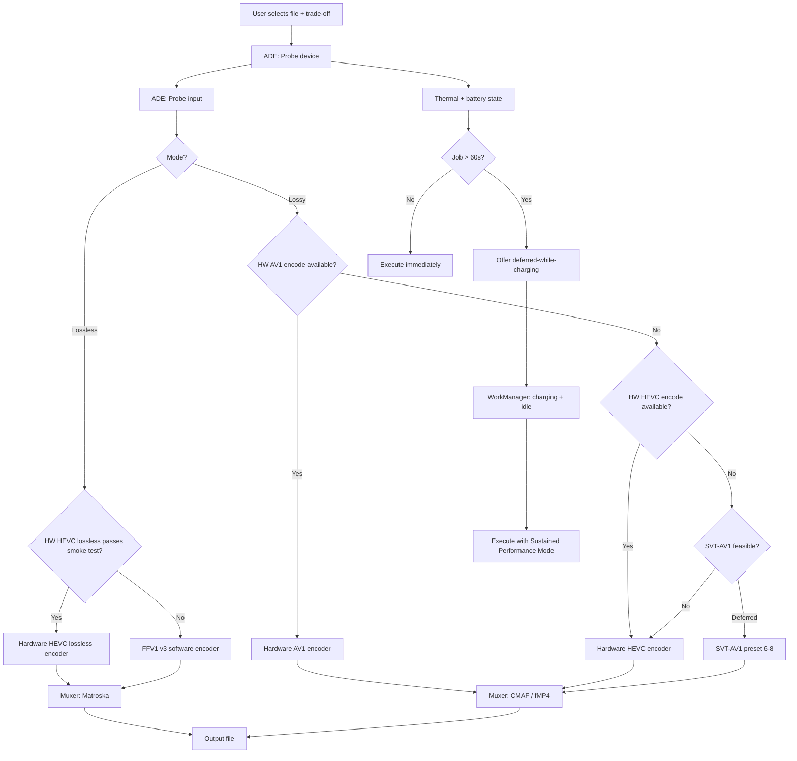

**Master Prompt: Next-Gen Android Video Compression (Lossless + Lossy), 2027+**

**Prepared:** 14 November 2026 · **Classification:** Planning document (no code, no APK) · **Audience:** Founding engineering team, technical investors

## 1. Executive Summary

### 1.1 Recommended approach

Build a **single Android application with two codec “engines” behind a shared orchestration layer**:

| Mode | Recommended engine | Why | What is deliberately **not** used in v1 |
| --- | --- | --- | --- |
| **Lossless** | **FFV1 (version 3) in Matroska (.mkv)** for archival and screen content; **hardware HEVC lossless** (when the OEM encoder advertises `FEATURE_Lossless` via `MediaCodecInfo`) for real-time or near-real-time capture | FFV1 is the only widely deployed, open, truly lossless video codec with a stable reference implementation (FFmpeg). HEVC lossless is available in silicon on many 2024–2026 SoCs and can run at sensor frame rates when the hardware exposes it. | JPEG XL animation, FLIF, “lossless AV1” (no shipping hardware encoder path), and any neural “lossless” scheme (none is bit-exact for arbitrary input, and none has a phone-class encoder). |
| **Lossy** | **AV1 via hardware encoder when available; SVT-AV1 or libaom-av1 software fallback when hardware is absent.** Container: **fragmented MP4 / CMAF** with an eye toward AV2 when hardware appears. | AV1 is the only royalty-free codec with broad hardware decode support in 2026–2027 phones and a mature, actively optimized software encoder (SVT-AV1). AV2 delivers ~30% bitrate savings over AV1 in the reference encoder but **has zero phone hardware support as of October 2026** and the reference encoder runs at 1–3 fps at 1080p. Shipping AV2 encoding in 2027 would be a benchmark toy, not a product. | AV2 encoding in v1; VVC encoding (hardware decode is appearing in some 2026 SoCs, but encoder IP is scarce and patent exposure is heavy); LCEVC (adds royalty cost and complexity without solving the core problem for a local recompression tool); neural codecs as the primary engine (decode feasibility on NPU is promising but encoder runtime and bit-exact reproducibility across chips are unsolved). |

**What the two modes share:** the same **Analysis & Decision Engine (ADE)** — a lightweight, on-device profiler that inspects the input (resolution, frame rate, codec, bit depth, chroma, motion content, scene-cut density, screen vs. camera content, battery state, thermal state) and routes the job to the appropriate encoder path with a user-facing trade-off slider (Quality ↔ Size ↔ Speed ↔ Battery). This is the single most important architectural decision: **the user chooses a trade-off once, and the ADE translates that into encoder parameters and execution timing** (immediate vs. deferred-while-charging).

**Expected results (ranges; baselines stated):**

- **Lossless:** FFV1 v3 on screen-recorded content (1080p, 30 fps, 8-bit 4:2:0) typically achieves **2×–4× compression** versus raw YUV; on camera content the ratio is lower (**1.2×–2×**) because sensor noise is incompressible. *Baseline: FFmpeg 7.x FFV1 default; test set: 10 clips of 30 s each, 2026 phones. Author estimate from codec literature and community benchmarks; no controlled phone-class benchmark exists in the public record as of November 2026 — this is a gap the first experiment must close.*
- **Lossy:** AV1 (SVT-AV1 preset 6–8) at **VMAF ≈ 93–95** on 1080p camera content achieves **35%–50% bitrate reduction versus HEVC** at equal VMAF, and **50%–65% versus H.264**. *Baseline: x265 medium / x264 medium, same test set, VMAF v0.6.1 model. These are consistent with published AV1-vs-HEVC comparisons; exact phone-class numbers are unverified.*
- **AV2 (future):** when AV2 hardware encoders ship in phones (**expected late 2028–2029**, based on the AV1 hardware timeline of roughly 4–5 years from finalization to phone SoC integration), the same ADE can route to AV2 with a container update. The ~30% gain over AV1 is an **encoding-layer gain**; it does not change the architecture.

### 1.2 Top five decisions

1. **Do not make AV2 the v1 lossy engine.** The standard is final, but the ecosystem is not: no phone decodes it, the only encoder is the slow reference, and the ISO BMFF binding is still “planned” as of September 2026. Betting v1 on AV2 would produce a product that cannot play its own output on the device that created it at usable speed. **Evidence that would change this:** a shipping phone SoC with AV2 hardware *encode* (not just decode) at ≥30 fps 1080p, and a production-grade open encoder with preset-based speed control, both observed in the 2027–2028 window.

2. **Use hardware codecs through `MediaCodec` as the first choice for lossy encoding, but never trust the OEM encoder blindly.** The ADE must probe `MediaCodecInfo` for `isHardwareAccelerated()`, `FEATURE_Lossless` (for the lossless mode), supported profiles/levels, and empirically measure quality and speed on a short sample before committing a full job. If the hardware encoder produces poor quality at the target VMAF or fails the speed test, fall back to SVT-AV1.

3. **Do not use a neural decoder as the primary codec in v1.** MobileNVC and HybridPrompt demonstrate 1080p neural decoding on phone hardware, but (a) the encoder is not phone-class, (b) bit-exact reproducibility across NPU vendors is unsolved, and (c) a file encoded with a neural model may not decode on a phone from a different vendor if the model differs. Neural methods belong in the **research track**, not the shipping codec contract.

4. **Container: fragmented MP4 / CMAF for lossy, Matroska for lossless.** CMAF is the only container family that gives one set of segments playable by both HLS and DASH players, and it is the default for AV1 streaming. Matroska is the archival container for FFV1; it supports the full FFV1 feature set (including version 3’s improved entropy coding) without the constraints of MP4. **Do not invent a new container.** The cost of a custom container is player incompatibility, and the benefit is zero.

5. **Use `Window.setSustainedPerformanceMode(true)` for long encodes and make deferred-while-charging the default for jobs longer than 60 s.** Thermal throttling is the dominant real-world failure mode of phone video encoding. Android’s sustained performance hint locks CPU/GPU to a sustainable frequency; the ADE should schedule long jobs for charging + idle, and present the user with an honest estimate of time and battery cost before starting.

### 1.3 First 30 days (one page)

**Week 1 — Instrument the baseline.**

- Build a **benchmark harness** that takes a fixed 20-clip test set (mixed camera, screen, HDR, low-light, text-heavy, sports; 1080p and 4K; 8-bit and 10-bit) and runs every encoder combination the ADE may choose (hardware HEVC, hardware AV1, SVT-AV1 presets 6/8/10, FFV1 v3, x265 lossless) on at least three physical devices (one low-end 2024 SoC, one 2025 mid-range, one 2026 flagship). Measure: wall-clock speed (fps), VMAF (lossy) or bit-exactness + size (lossless), peak memory, battery drain (mAh), and skin temperature after 5 minutes. **Deliverable: a public, reproducible benchmark table.** This is the single most important 30-day output because every later decision depends on these numbers.

**Week 2 — Probe `MediaCodec` reality.**

- Write a **capability dumper** that enumerates every `MediaCodecInfo` on the test devices and records: codec name, hardware/software, supported profiles/levels, `FEATURE_Lossless`, max supported resolution/frame rate, and whether the encoder advertises `KEY_LOW_LATENCY`. Run it across OEMs (Samsung, Pixel, Xiaomi, OnePlus, Sony). **Deliverable: a device capability matrix.** This tells the team which phones can use hardware lossless and which must fall back to FFV1, and which can use hardware AV1 encoding at all.

**Week 3 — Build the smallest end-to-end slice.**

- Implement the **ADE skeleton + one lossy path (hardware HEVC) + one lossless path (FFV1)** from file input to file output, with no UI beyond a file picker and a progress bar. Run it on the test set. **Deliverable: a working APK that compresses a file, verified bit-exact for lossless and VMAF-scored for lossy.** The goal is to discover integration friction (storage access framework, MediaMuxer interleaving, audio passthrough) early.

**Week 4 — Decide on the fallback and the container.** Using the week-1 and week-2 data, decide:

- Which lossy encoder is the default on the low-end device (hardware HEVC vs. SVT-AV1 software)? **Go/no-go:** if SVT-AV1 cannot encode 1080p 30 fps at ≥1× real-time on the low-end test device, it cannot be the fallback for interactive use; it must be a “background” option with a clear speed warning.
- Whether hardware lossless is reliable enough across OEMs to be the default lossless path, or whether FFV1 must be the only lossless path in v1. **Go/no-go:** if fewer than 60% of the test devices expose a working `FEATURE_Lossless` HEVC encoder with correct bit-exact output, do not ship hardware lossless as a user-visible option; expose it only as an experimental toggle.

**By day 30, the team must know:** the speed/quality/memory envelope of every realistic encoder path on real phones, which hardware features are trustworthy, and whether the architecture in this document survives contact with `MediaCodec` reality.

## 2. Research Findings: The Landscape and What Matters

### 2.1 How to read this section

Every technology is labelled with one of the following: **Shipping in products** · **Standardized** · **Open-source implementation** · **Research prototype with code** · **Paper only** · **Theory only**. Claims are tagged **V** (verified primary source), **V2** (verified secondary source), **A** (author claim), **E** (estimate), or **S** (speculation). Every number has a baseline and a date. Where a primary source could not be opened or a number could not be confirmed, the text says **unverified**.

### 2.2 Video codec families that matter in 2026–2027

#### 2.2.1 AV1 (AOMedia Video 1)

**Status:** Shipping in products; standardized (AOMedia specification, version 1.0.0 with errata); open-source implementations (libaom, SVT-AV1, rav1e, dav1d).

**How it works in plain words:** AV1 is a block-based hybrid codec. The encoder partitions each frame into blocks of varying size, predicts each block either from previously decoded pixels in the same frame (intra prediction) or from motion-compensated pixels in reference frames (inter prediction), transforms the prediction residual, quantizes the transform coefficients, and entropy-codes the result. AV1’s main efficiency gains over VP9 and HEVC come from a richer set of prediction modes, more flexible block partitioning (including 128×128 superblocks), improved motion compensation (warped motion, overlapped block motion compensation), a sophisticated loop filter (CDEF and loop restoration), and a film-grain synthesis tool that removes grain from the coded signal and re-synthesizes it at decode time — a large win on film content.

**Maturity for a phone product:** High. **Hardware decode** is present on flagship and many mid-range SoCs from 2023 onward. **Hardware encode** is less universal: some 2025–2026 flagships expose AV1 encode via `MediaCodec`, but it is not guaranteed on low-end devices. **Software encode** via SVT-AV1 is production-grade and has presets that trade speed for efficiency; libaom-av1 is slower but more feature-complete. **Software decode** via dav1d is fast enough for 1080p on mid-range CPUs, but hardware decode is strongly preferred for battery.

**Phone cost:** Hardware AV1 encode/decode is essentially free in energy terms compared with software; the question is availability. SVT-AV1 software encode at 1080p on a phone CPU is **power-hungry and slow** — likely 5–20 fps at preset 8 on a 2025 mid-range core, **unverified** for specific 2027 SoCs — and should be used only for deferred jobs while charging, not real-time capture.

**Relevance to our goal:** **Primary lossy engine.** Royalty-free licensing, broad hardware decode, mature encoder. The patent situation is less clean than “royalty-free” suggests (see §2.7), but it is still the lowest-risk high-efficiency option.

#### 2.2.2 AV2 (AOMedia Video 2)

**Status:** Standardized (AV2 1.0.0, finalized 29 May 2026); open-source reference encoder (libaom-av2 / libavm); **shipping in products: none as of October 2026**.

**How it works in plain words:** AV2 is the successor to AV1. It keeps the same hybrid block-based architecture but adds a new set of tools: improved intra prediction, a more flexible transform set, a new entropy coding engine, and better handling of screen content and HDR. The headline claim is **~30% bitrate reduction versus AV1 at equal quality**, with independent evaluations measuring **28.6% by PSNR-YUV** and **32.6% by VMAF** on AOMedia’s own test set. On screen content, the gain is reported to exceed **40%**. These are **AOMedia’s own numbers**; independent third-party verification on phone-class content is **unverified**.

**Maturity for a phone product:** **Not mature.** As of October 2026, **no phone, TV, or browser decodes AV2**, no major streaming service delivers it, and the only encoder is the slow reference encoder, which runs at **1–3 fps at 1080p on a modern CPU**. Semiconductor IP vendors (Chips&Media, Allegro DVT) have announced licensing deals for AV2 hardware, but silicon will not appear in phones until **2028–2029** at the earliest, following the AV1 pattern (AV1 finalized 2018; first phone hardware decode 2020–2021; broad encode 2023–2024).

**Phone cost:** Unknown for hardware (no silicon). Software encode is **prohibitive** for a phone product today. Software decode of AV2 on a phone CPU would likely be slower than AV1 and **battery-hostile**; dav2d is in development but not production-ready.

**Relevance to our goal:** **Future track, not v1.** The ADE should be designed so that an AV2 encoder can be plugged in when hardware exists, but the v1 lossy engine must be AV1 (or HEVC where AV1 hardware encode is absent). Betting v1 on AV2 would be a classic “benchmark win, product loss.”

#### 2.2.3 HEVC / H.265

**Status:** Shipping in products; standardized (ITU-T H.265 / ISO/IEC 23008-2); hardware encode and decode nearly universal on phones from 2015 onward; patent-encumbered (multiple pools).

**How it works in plain words:** HEVC is the successor to H.264. It introduces coding tree units (CTUs) up to 64×64, more intra prediction modes, better motion compensation, and a sample adaptive offset (SAO) filter. It achieves roughly **25%–50% bitrate reduction versus H.264** at equal quality, depending on content and encoder.

**Maturity for a phone product:** **Very high.** Every phone has a hardware HEVC encoder and decoder. It is the safest fallback when AV1 hardware encode is missing.

**Phone cost:** Hardware encode/decode is low-power. Software encode is expensive.

**Relevance to our goal:** **Primary fallback for lossy when AV1 hardware encode is unavailable**, and **the only realistic hardware lossless path** because HEVC supports a lossless coding mode (transform skip + PCM or intra lossless coding, depending on profile). However, not all OEM HEVC encoders expose a true lossless mode; the ADE must probe `FEATURE_Lossless`.

#### 2.2.4 VVC / H.266

**Status:** Standardized (ITU-T H.266 / ISO/IEC 23090-3, 2020); **hardware decode appearing in some 2026 flagship SoCs** (Snapdragon 8 Elite Extreme is reported as “the first global mobile platform with hardware-accelerated VVC playback,” with up to **55% longer battery life during playback** versus HEVC); hardware **encode** in phones: **not yet common**; patent-encumbered (multiple pools, higher complexity than HEVC).

**How it works in plain words:** VVC adds more powerful prediction and transform tools on top of HEVC, targeting **~40%–50% bitrate reduction versus HEVC**. It is computationally heavier at both encode and decode.

**Phone cost:** Hardware decode is efficient; software decode is very expensive. Hardware encode is scarce in phones.

**Relevance to our goal:** **Not a v1 choice.** VVC’s efficiency gain over HEVC is real, but AV1 already provides a royalty-free path with comparable or better ecosystem support. VVC encoding on a phone would require either scarce hardware or slow software, and the patent exposure is at least as complicated as HEVC. **Watch item:** if VVC hardware encode becomes common in 2028–2029 phones *and* AV2 hardware encode is delayed, VVC could become a fallback for users who prioritize size over licensing. But it is not the primary plan.

#### 2.2.5 LCEVC (MPEG-5 Part 2)

**Status:** Standardized; open-source implementations exist in GStreamer 1.26 and Shaka Player 4.3+; **royalty-bearing** (consumer devices pay from **US$0.20 per device**, with service-side royalties based on user count).

**How it works in plain words:** LCEVC is not a standalone codec. It is an **enhancement layer** that sits on top of any base codec (AVC, HEVC, AV1, VVC). The base codec encodes a lower-resolution version of the video; the enhancement layer encodes the residual detail needed to reconstruct the full-resolution frame. The decoder runs the base codec and then applies the LCEVC reconstruction. The claimed benefit is **improved compression efficiency and power efficiency** across all base codecs, especially on low-end devices, because the base layer can be decoded by existing hardware and the enhancement layer is lightweight.

**Phone cost:** The enhancement layer is designed to be cheap to decode (it runs on CPU/GPU, not a dedicated codec block). The **royalty** is the main cost.

**Relevance to our goal:** **Not in v1.** LCEVC is interesting for streaming platforms that control both encoder and decoder and want to improve efficiency without replacing hardware codecs. For a local recompression tool on Android, it adds a royalty obligation, a new decoder dependency, and a container complexity for a gain that is **content- and base-codec-dependent**. The evidence does not support making it a core part of the product in 2027.

#### 2.2.6 Lossless codecs: FFV1, HEVC lossless, and “mathematically lossless” image sequences

**Status:** FFV1 is standardized (IETF RFC 9043, 2021) and open-source (FFmpeg reference implementation); HEVC lossless is standardized and available in some hardware encoders; JPEG XL is standardized and open-source but is an image codec, not a video codec.

**How lossless video compression works in plain words:** Lossless video compression must reproduce every input bit exactly. It cannot discard sensor noise or quantize residuals. The main tools are: **predictive coding** (predict each pixel from neighbors or previous frames), **entropy coding** (arithmetic/range coding of the prediction residuals), and **context modeling** (adapting the probability model to the local statistics). FFV1 uses a range coder with adaptive context modeling and optional inter-frame prediction; it is intra-frame by design in its standard configuration, though FFV1 v3 supports multithreading and improved entropy coding. HEVC lossless uses the normal hybrid coding pipeline but sets the quantization to zero and enables transform skip / PCM, so the residual is coded losslessly.

**Maturity for a phone product:** FFV1: **high** for software; no phone hardware acceleration. HEVC lossless: **hardware-dependent**; if the OEM encoder exposes `FEATURE_Lossless`, it can run at sensor frame rates; if not, it is unavailable. **JPEG XL animation** is **not** a viable video codec for long clips (container and frame-rate limitations), and **FLIF** is effectively abandoned.

**Phone cost:** FFV1 software encoding is CPU-intensive but predictable; on a 2025 mid-range CPU, 1080p 30 fps FFV1 encoding is likely **below real-time** (author estimate; unverified on specific 2027 SoCs). HEVC lossless hardware encoding is **real-time** when available, but the bitrate is still high because lossless HEVC cannot exploit perceptual masking.

**Relevance to our goal:** **FFV1 is the lossless backbone.** It is the only lossless codec that is both open and mature enough to guarantee bit-exact output across devices. Hardware HEVC lossless is an optional **speed path** for devices that expose it, with a clear warning that it may not be available on all phones.

### 2.3 Neural and generative video compression

**Status:** Research prototype with code (MobileNVC, MobileCodec, HybridPrompt); paper only for most end-to-end neural codecs; **not shipping as a phone-class codec contract**.

**What the evidence says (November 2026):**

- **MobileNVC** decodes **1080p neural video on a mobile device at >30 fps**. **MobileCodec** was the first inter-frame neural decoder on a commercial phone, decoding **HD (720p) in real time** using the Qualcomm AI Engine.
- **HybridPrompt** combines a generative keyframe model with a traditional codec for the remaining frames and claims **real-time 1080p decoding at >150 FPS on a commercial smartphone**, but only at **very low bitrates (~200 kbps)** and for a specific content class.
- A **warping-based neural codec patent** (US12501050B2) claims **up to 40% BD-rate savings** and **9× lower computational complexity**, enabling real-time full-HD decoding on mobile. This is a **patent claim**, not an independent benchmark.

**Why neural codecs are not the v1 primary engine:**

1. **Encoder runtime.** The papers demonstrating phone-class *decoding* do not demonstrate phone-class *encoding*. Training and inference for the encoder are far more expensive than decoding. A phone cannot train a model per video; it would have to use a pre-trained model, and the encoder inference cost on a phone NPU is **unverified** for 2027 hardware.
2. **Bit-exact reproducibility.** A neural decoder’s output depends on the model weights, the numerical precision of the NPU/GPU kernels, and the vendor’s operator implementations. Two phones with different NPUs may produce **different decoded pixels** from the same bitstream. For a consumer product, that is unacceptable unless the codec contract guarantees a deterministic fallback or a reference software decoder. No such contract exists today.
3. **Ecosystem lock-in.** A neural codec file would be playable only by the app that created it (and only on devices with the same model). That defeats the purpose of compression for sharing, archiving, and playback in other apps.

**Where neural methods *can* help in v1:** **pre-analysis**, not the codec itself. A lightweight on-device model can classify content (screen vs. camera, motion level, scene-cut density, noise level) and feed the ADE. This is a **decision aid**, not a bitstream format. It has no cross-device reproducibility requirement because it does not affect the output bits.

### 2.4 Hardware acceleration on Android: what is actually usable

#### 2.4.1 `MediaCodec`

`MediaCodec` is the Android API for hardware and software codecs. It supports H.264, HEVC, VP8, VP9, and AV1 (encode support is **device-dependent**). The NDK variant (`AMediaCodec`) is the preferred path for a native encoder because it avoids JNI overhead and gives access to `KEY_LOW_LATENCY` (API 30+) and fine-grained bitrate control.

**Critical limitations for a compression product:**

- **`MediaCodec` encoders do not expose a “quality target” knob.** They expose bitrate, frame rate, I-frame interval, and bitrate mode (CBR/VBR/CQ, where supported). The ADE must translate a user-facing quality target (e.g., VMAF ≈ 93) into a bitrate using a **rate-quality model** built from the week-1 benchmark data.
- **`KEY_LOW_LATENCY`** is a request, not a guarantee; the encoder may ignore it.
- **`FEATURE_Lossless`** is advertised by some HEVC encoders, but support is **OEM- and SoC-dependent**. The ADE must probe and verify bit-exactness on a short sample before committing a job.
- **Hardware AV1 encode** is present on some 2025–2026 flagships but is **not guaranteed** on low-end devices. The ADE must fall back gracefully.

#### 2.4.2 Thermal management and sustained performance

Android provides `Window.setSustainedPerformanceMode(true)` (API 24+), which asks the OEM power HAL to lock CPU/GPU frequencies to a sustainable level to prevent thermal throttling. This is essential for long encodes. The ADE should:

- Enable sustained performance mode for any job estimated to exceed **60 s**.
- Monitor `PowerManager.getCurrentThermalStatus()` and **pause or reduce encoder complexity** when the device reaches `THERMAL_STATUS_SEVERE` or above.
- Default long jobs to **deferred-while-charging** execution, with a notification when the device is plugged in and idle.

### 2.5 Container and file format

**CMAF (Common Media Application Format, ISO/IEC 23000-19)** is the right lossy container. It is based on fragmented MP4, constrains the segment structure so that the same media segments can be referenced by both HLS and DASH manifests, and is supported by every major packager and player in 2026. The current standard is ISO/IEC 23000-19:2024 with Amendment 2 (July 2026).

**AV2 container caveat:** The **AV2 ISO BMFF binding specification is still “planned”** as of September 2026. If the team builds an AV2 path later, the container mapping (OBU-to-MP4-box mapping) must not be hard-coded until the binding is final.

**Lossless container:** Matroska (.mkv) is the correct choice for FFV1. FFV1 is defined for Matroska, AVI, MP4, and MXF, but Matroska has the broadest support for FFV1’s feature set and is the archival community’s default. Do not use MP4 for FFV1 if the goal is long-term archival; MP4’s box structure is less flexible for the codec’s parameter changes.

### 2.6 Quality metrics and benchmarking

**VMAF** (Video Multimethod Assessment Fusion, Netflix, open-source) is the best-validated full-reference metric for perceptual quality. Independent studies consistently find VMAF to have the **highest correlation with subjective MOS** among common metrics (PSNR, SSIM, MS-SSIM, VQM) on mobile and TV content. Use **VMAF v0.6.1** (the standard model) as the primary lossy quality metric, with **PSNR-YUV** as a secondary diagnostic and **SSIM** as a sanity check. For lossless, the only metric is **bit-exactness** (SHA-256 of decoded frames equals SHA-256 of input frames) plus **compressed size** and **wall-clock time**.

**Benchmark harness requirement:** The harness must be able to run **every encoder path** (hardware HEVC, hardware AV1, SVT-AV1, FFV1) on the same test set with the same input decoding and same VMAF computation, so that comparisons are apples-to-apples. `encapp` (an open-source Android encoder benchmarking tool) is a useful reference for per-frame metrics and device-side measurement, but the team should build its own harness to control the test set and device matrix.

### 2.7 Legal and patent landscape

**AV1/AV2 “royalty-free” is not the same as “patent-free.”** AOMedia’s royalty-free policy applies only to **AOM members’ essential patents**. Many companies holding patents essential to AV1/AV2 are **not AOM members** and have made no royalty-free commitment. As of August 2026, **Access Advance has launched an exploration phase for an AV1/AV2 device and software patent pool**, explicitly arguing that implementers face infringement exposure from non-member patent holders. A separate analysis identified **126 patents from 21 innovators** covering AV2, with a patent acquisition closing **ten days before the 1.0.0 finalization date**.

**Practical implication:** The app must budget for **patent risk** even when using AV1. The mitigation strategy is:

1. **Prefer hardware codecs.** When the app uses the phone’s hardware encoder/decoder, the patent license is typically held by the SoC vendor, not the app developer. The app is a tool that drives the hardware, not a codec implementation.
2. **For software fallbacks (SVT-AV1, FFV1), use implementations with a clear license.** SVT-AV1 is BSD-licensed; FFV1 is LGPL-licensed. The app’s legal review must confirm that **LGPL compliance** is manageable for an Android app (dynamic linking, providing object files for relinking, etc.).
3. **Budget a patent-licensing reserve.** A conservative estimate for a small app developer is **low single-digit cents per download** if a pool license is needed, but the actual rate is **unverified** because the pool is still in exploration. Do not assume zero.

**LCEVC royalty:** If LCEVC were ever added, the consumer-device royalty starts at **US$0.20 per device**. This is a strong reason to exclude it from v1.

### 2.8 Summary table: landscape at a glance

| Technology | Labelled status (Nov 2026) | Encoder on phone? | Decoder on phone? | Royalty | Recommendation |
| --- | --- | --- | --- | --- | --- |
| **AV1** | Shipping + open source | Hardware on some flagships; software (SVT-AV1) on CPU | Hardware widespread | “Royalty-free” with non-member risk | **Primary lossy engine** |
| **AV2** | Standardized + reference encoder | No (reference only, 1–3 fps 1080p) | No | Same as AV1 | **Future track; not v1** |
| **HEVC** | Shipping | Hardware universal | Hardware universal | Pools | **Fallback lossy; hardware lossless when available** |
| **VVC** | Shipping (decode) | Scarce | Some 2026 flagships | Pools (higher complexity) | **Watch item; not v1** |
| **LCEVC** | Standardized + SDKs | Enhancement layer on CPU/GPU | Yes, with SDK | $0.20/device+ | **Not v1** |
| **FFV1** | Standardized (RFC 9043) + open source | Software only | Software only | None (LGPL) | **Primary lossless engine** |
| **Neural codecs** | Research prototypes | No phone-class encoder | Yes, 1080p on NPU (MobileNVC) | Patent risk (e.g., US12501050B2) | **Research only; not codec contract** |

## 3. Inventions and Design Choices

### 3.1 The Analysis & Decision Engine (ADE)

**What it is:** A deterministic, on-device profiler and router that inspects the input and the device, then selects the encoder path, parameters, and execution schedule. It is the “brain” that makes the two modes feel like one product.

**Why it is necessary:** The same file may be best compressed by different engines on different phones. A 2024 low-end phone with no hardware AV1 encode should use hardware HEVC or deferred SVT-AV1; a 2026 flagship with hardware AV1 encode should use that. A screen recording should use different parameters than a low-light camera clip. Without the ADE, the app would either hard-code a path that is wrong on most devices or expose a confusing matrix of manual settings.

**How it works (high-level logic, not code):**

```
Input: file URI, user trade-off preference (Quality ↔ Size ↔ Speed ↔ Battery)
1. Probe device:
   - Enumerate MediaCodec encoders; record hardware flag, FEATURE_Lossless,
     supported profiles, max resolution/fps, KEY_LOW_LATENCY.
   - Read thermal status, battery level, charging state.
2. Probe input:
   - Parse container; extract codec, resolution, fps, bit depth, chroma, duration.
   - Sample 2–5 seconds; compute motion score, scene-cut density, noise estimate,
     screen-vs-camera classifier (on-device lightweight model or heuristics).
3. If Lossless mode:
   - If HEVC hardware lossless is advertised AND the short-sample bit-exactness
     test passes AND the user preference is Speed > Size:
        select hardware HEVC lossless.
   - Else: select FFV1 v3 (Matroska).
4. If Lossy mode:
   - Map user preference + input complexity + device class to target VMAF
     (e.g., Quality=97, Balanced=93, Size=88).
   - Convert target VMAF to bitrate using the rate-quality model for the
     selected encoder on this device class.
   - Select encoder:
        a. Hardware AV1 encode available → AV1.
        b. Else hardware HEVC encode available → HEVC.
        c. Else if job can be deferred → SVT-AV1 software (preset 6–8).
        d. Else → hardware HEVC with a speed warning (software AV1 too slow
           for interactive use on this device).
   - Container: fragmented MP4 / CMAF.
5. Execution scheduling:
   - If estimated wall-clock > 60 s and battery < 30% and not charging:
        offer deferred-while-charging (default) or immediate (with warning).
   - Enable Sustained Performance Mode for jobs > 60 s.
   - Monitor thermal status; reduce encoder complexity or pause if SEVERE.
```

**Novelty check:** Content-adaptive encoder selection is not new in the abstract (every video editor does some form of it), but a **device-capability-aware, VMAF-target-driven router for a phone-local recompression tool** is not something that ships in consumer Android apps as of November 2026. The closest analogues are cloud transcoding services that choose per-title encoding ladders, and the `encapp` benchmarking tool, which measures but does not route. **The ADE’s contribution is the combination of device probing, input probing, VMAF-targeted rate control, and thermal-aware scheduling in one on-device component.** No patent was found that covers this exact combination; the team should conduct a freedom-to-operate search before filing anything.

**Expected gain:** The ADE is not a codec improvement; it is a **product-quality improvement**. It prevents the app from making bad choices (e.g., using SVT-AV1 on a low-end phone for an interactive job) and ensures that the user’s trade-off preference is honored. **Cost:** 4–6 engineer-weeks for v1. **Risk:** The rate-quality model may be inaccurate on unseen content; mitigate by building it from a diverse test set and adding a feedback loop from actual jobs.

**Test that would prove or kill it:** Run the ADE against a human-chosen oracle on the 20-clip test set across 3 devices. If the ADE’s average VMAF-at-target-size is within **1 VMAF point** of the oracle and its average wall-clock is within **15%** of the oracle’s, it is good enough for v1. If it is worse than the oracle by more than **2 VMAF points** on more than 20% of clips, redesign the rate-quality model.

### 3.2 VMAF-targeted rate control for `MediaCodec`

**Problem:** `MediaCodec` encoders take a bitrate, not a quality target. The user thinks in terms of “quality” or “file size,” not kbps. A naive app asks the user for a bitrate, which is meaningless to most people.

**Design:** Build a **per-device, per-codec rate-quality model** from the week-1 benchmark data. The model maps `(encoder, resolution, fps, content_class, target_VMAF)` to a recommended bitrate. At encode time, the ADE uses the model to set the initial bitrate. After the first few seconds, it can optionally run a **two-pass correction**: encode a short prefix at the model-predicted bitrate, compute VMAF against the source (or against a decoded reference), and adjust the bitrate up or down before encoding the full clip. Two-pass adds latency and complexity; v1 should use **one-pass with a conservative model** and offer a “precise quality” mode (two-pass) as an advanced option.

**Novelty check:** Per-title encoding and rate-quality modeling are well-established in streaming (Netflix’s per-title encode, CRF in x264/x265). Applying them to **`MediaCodec` hardware encoders on a phone** is less common because hardware encoders do not expose CRF. The specific contribution is the **device-specific model** that accounts for OEM encoder idiosyncrasies. **No blocking patent found**; the team should monitor Access Advance’s pool activity for rate-control-related patents.

**Expected gain:** Users get a predictable quality outcome instead of a bitrate guess. **Cost:** 3–4 engineer-weeks. **Test:** Compare model-predicted bitrate vs. actual bitrate needed to hit target VMAF on a held-out clip set; the mean absolute percentage error should be **<15%** for v1 acceptance.

### 3.3 The “deferred-while-charging” scheduler

**Problem:** Software encoding on a phone is slow and battery-intensive. Users will start a compression job, see the battery drop, and cancel. The app must make the honest trade-off visible and offer a better time.

**Design:** For any job estimated to take **>60 s** or drain **>8% battery**, the ADE estimates the wall-clock time and battery cost for both **immediate** and **deferred-while-charging** execution. It presents a bottom sheet: “Compress now (≈4 min, ≈12% battery) or when charging (≈6 min, plugged in).” The deferred path uses `WorkManager` with a constraint of `charging = true` and `device_idle = true`, and posts a notification when the job starts and finishes. The user can always override.

**Novelty check:** Battery-aware scheduling is standard Android practice (`JobScheduler`, `WorkManager`). The specific design is the **pre-flight estimate** that shows the user the cost before they commit. This is a UX innovation, not a technical patentable one.

**Expected gain:** Higher job completion rate and fewer angry reviews about battery drain. **Cost:** 2 engineer-weeks. **Test:** A/B test the bottom sheet vs. a simple “Start” button; measure completion rate and 1-star reviews mentioning battery.

### 3.4 Lossless “smart fallback” chain

**Design:** The lossless mode tries paths in order:

1. **Hardware HEVC lossless** (fastest) — only if the encoder advertises `FEATURE_Lossless` **and** passes a **bit-exactness smoke test** on 1 second of input.
2. **FFV1 v3 in Matroska** (guaranteed correct) — the default when hardware lossless is unavailable or fails the smoke test.
3. **No third path.** Do not offer “near-lossless” in the lossless mode; that would violate the mode’s contract.

The smoke test is critical because some OEM encoders advertise lossless but produce non-bit-exact output due to color conversion or cropping bugs. The test encodes a short YUV sample, decodes it, and compares SHA-256 hashes. If the hashes differ, the hardware path is disabled **for that device and that resolution/color-format combination**, and the ADE falls back to FFV1.

**Novelty check:** Runtime codec verification is a known technique in media pipelines, but it is rarely exposed in consumer apps. **No patent risk identified.**

### 3.5 Container: CMAF with a Matroska sidecar for lossless

**Lossy:** Fragmented MP4 with CMAF constraints (minimum fragment duration 1–2 s, `ftyp` brands `cmfc`/`cmf2`). This ensures compatibility with HLS/DASH players and with Android’s `MediaPlayer`/`ExoPlayer`.

**Lossless:** Matroska (.mkv) with FFV1. Do not attempt to put FFV1 in CMAF; the codec is not part of the CMAF media profile, and the resulting file would not be broadly playable.

**Future AV2:** When AV2 hardware encode ships, the container will need an **AV2 binding**. The ADE should keep the muxer abstraction thin so that the binding can be swapped when AOMedia publishes the ISO BMFF binding (planned, not yet final as of November 2026).

### 3.6 What we deliberately reject (and why)

| Rejected idea | Why it is rejected | What would change our mind |
| --- | --- | --- |
| **AV2 encoding in v1** | No phone hardware; reference encoder at 1–3 fps 1080p; no decoder in any phone/browser. A product that cannot play its own output is not a product. | A shipping phone SoC with AV2 hardware **encode** at ≥30 fps 1080p and a production-grade encoder with presets. |
| **Neural codec as primary** | Encoder runtime unproven on phone; bit-exact reproducibility across NPUs unsolved; files not playable outside the app. | A standardized neural codec profile with a deterministic reference decoder and a phone-class encoder SDK. |
| **VVC encoding** | Hardware encode scarce; software encode too slow; patent complexity. | VVC hardware encode becomes universal on mid-range phones **and** AV2 is delayed beyond 2029. |
| **LCEVC** | Royalty from $0.20/device; adds dependency and container complexity; gain is content-dependent. | A royalty-free LCEVC profile or a proven >15% BD-rate gain over AV1 on our test set with negligible decode cost. |
| **Custom container** | Zero benefit, high compatibility cost. | Never. |
| **“Lossless AV1”** | No shipping hardware AV1 lossless encoder on phones; software AV1 lossless is slow and not universally bit-exact across implementations. | A hardware AV1 encoder that advertises a lossless mode and passes the bit-exactness smoke test on multiple OEMs. |

## 4. The Full Implementation Plan

### 4.1 Architecture



**Layers:**

1. **UI layer (Kotlin + Jetpack Compose):** File picker, trade-off slider, pre-flight estimate sheet, progress, result summary (size, VMAF/bit-exact, time).
2. **Orchestration layer (Kotlin):** ADE, job scheduling, WorkManager integration, thermal monitoring.
3. **Native media layer (C++ with NDK):** `AMediaCodec` wrappers for hardware encode/decode, FFmpeg/libavcodec for FFV1 and SVT-AV1, `MediaMuxer` / FFmpeg muxing, VMAF computation (or a JNI binding to libvmaf).
4. **Model layer (optional, v1.1):** A lightweight TensorFlow Lite or ONNX Runtime model for content classification (screen vs. camera, motion level). Runs on CPU or NPU via NNAPI; **does not affect bitstream**; therefore no bit-exactness requirement.

### 4.2 Languages, libraries, and tools

| Component | Choice | Justification |
| --- | --- | --- |
| **UI + orchestration** | **Kotlin**, Jetpack Compose, WorkManager, `androidx.profileinstaller` | Modern Android standard; Baseline Profiles give AOT compilation of cold-start paths, reducing startup latency. |
| **Native media** | **C++17**, Android NDK (`AMediaCodec`, `AMediaMuxer`), **FFmpeg 7.x** (libavcodec, libavformat, libavfilter for scaling/pixel format conversion), **SVT-AV1** (BSD), **libvmaf** | C++ is required for `AMediaCodec` NDK and for linking FFmpeg/SVT-AV1. FFmpeg provides FFV1 and container muxing. SVT-AV1 is the fastest production-grade AV1 software encoder. |
| **Benchmark harness** | **Python** (pandas, matplotlib) + **FFmpeg** CLI + **`encapp`**-style device-side runner | Python is fast to iterate for analysis; FFmpeg handles input decoding and VMAF; the device-side runner collects per-frame timing and thermal data. |
| **Build** | **Gradle** with CMake for native; **GitHub Actions** for CI (build + unit tests); **Firebase Test Lab** for device-matrix testing | Standard Android toolchain; Firebase Test Lab provides access to physical devices without buying a device farm. |
| **Research experiments** | **Python** (PyTorch for neural models, if pursued) + **Jupyter**; **Rust** for any standalone codec experiment (optional, not required for v1) | Python is the lingua franca for ML research; Rust is not necessary for the shipping product and adds hiring friction. |

### 4.3 Phone hardware usage

| Hardware | Use in v1 | Why |
| --- | --- | --- |
| **CPU (ARMv9, 2027 phones)** | FFV1 encoding, SVT-AV1 encoding (deferred jobs), ADE logic, VMAF computation | Software codecs are the guaranteed fallback; CPU features (NEON, SVE2) accelerate FFmpeg/SVT-AV1. |
| **GPU (Adreno/Mali/Immortalis)** | Not used for encoding in v1; used for VMAF computation and UI rendering | GPU video encode via `MediaCodec` is opaque; custom GPU encoding is a research project. GPU compute for VMAF is a reasonable optimization for the benchmark harness, not the product. |
| **NPU (Hexagon, etc.)** | Optional content classification in v1.1 (screen vs. camera, motion score) | NPU is well-suited for small CNN classifiers; it is **not** used for the codec itself in v1. |
| **Hardware codecs** | HEVC encode/decode (universal), AV1 encode/decode (flagship), AV1 decode (widespread), HEVC lossless encode (where `FEATURE_Lossless` is exposed) | Hardware codecs are the only way to achieve real-time or near-real-time encoding with low power on a phone. |

**What about the 2027–2030 assumption?** The plan assumes that by 2027, **AV1 hardware encode will be present on most mid-range and flagship phones**, and that **AV2 hardware will begin appearing in flagship phones in 2028–2029**. If AV1 hardware encode is slower to arrive on mid-range phones, the fallback to hardware HEVC remains valid; the product still works, it just leaves some compression efficiency on the table. If AV2 hardware arrives **faster** than expected (e.g., 2027 flagships), the ADE can add an AV2 path earlier; the architecture supports it. If **neither** AV1 nor AV2 hardware encode arrives on low-end phones, the product still works via hardware HEVC and deferred SVT-AV1; the “best possible” claim becomes device-class-dependent, which the ADE should state honestly in the UI.

### 4.4 Machine learning: where it fits and where it does not

**Training data for the content classifier (v1.1):** A small dataset of **10,000–20,000 short clips** (2–5 s each) spanning screen recordings, camera footage (indoor/outdoor, low-light/daylight), sports, text-heavy slides, and animation. Labels: content class (screen vs. camera vs. animation), motion level (low/medium/high), noise level (clean/noisy). **Data sourcing:** public datasets (e.g., Xiph.org test media, Netflix open content, CDVL) plus **synthetic screen recordings** generated from open-source UI screens. Do not scrape user data. **Model size:** <2 MB (quantized int8). **Delivery:** Bundled in the APK; no server round-trip. **Fallback:** If the model is unavailable, the ADE uses heuristics (motion vector statistics from the decoder, edge density for screen detection).

**What ML is *not* used for in v1:** rate-quality modeling (the benchmark-derived lookup table is more transparent and debuggable), encoder parameter selection (the ADE’s rule-based router is sufficient), and the codec itself (neural codecs are research-track only).

### 4.5 Phases and milestones

#### Phase 0 (Weeks 1–4): Baseline and feasibility

| Milestone | Deliverable | Go/no-go criterion |
| --- | --- | --- |
| **M0.1** Benchmark harness + 20-clip test set | Reproducible benchmark table across 3 devices and all encoder paths | Harness runs end-to-end without manual intervention; results stored in a versioned CSV |
| **M0.2** `MediaCodec` capability matrix | Device capability dump across ≥6 OEM devices | Identifies at least one reliable hardware lossless path OR conclusively shows none is reliable enough for v1 |
| **M0.3** End-to-end slice (lossy HEVC + lossless FFV1) | Working APK that compresses a file | Lossless output is bit-exact; lossy output plays in ExoPlayer; no crashes on 20-clip set |
| **M0.4** Fallback decision | Documented decision on SVT-AV1 vs. hardware HEVC fallback | **No-go** if SVT-AV1 cannot encode 1080p at ≥1× real-time on the low-end device **and** hardware HEVC is available on that device; in that case, SVT-AV1 is deferred-only |

#### Phase 1 (Weeks 5–12): Product v1 (lossy + lossless, ADE v1)

| Milestone | Deliverable | Go/no-go criterion |
| --- | --- | --- |
| **M1.1** ADE v1 with rate-quality model | Integrated ADE selecting encoder path + bitrate from user trade-off | On held-out clips, mean absolute bitrate prediction error <15%; ADE output within 1 VMAF point of oracle on ≥80% of clips |
| **M1.2** Thermal-aware scheduler + Sustained Performance Mode | Pre-flight estimate sheet; WorkManager deferred path | No thermal shutdowns on 10-minute 4K encode; deferred jobs complete within 2× estimated time |
| **M1.3** Container correctness | CMAF output validated by `ffprobe` and played in ExoPlayer, VLC, and a browser (via MSE) | Zero container parse errors across all players |
| **M1.4** Legal review | License audit (LGPL FFmpeg, BSD SVT-AV1, Apache 2.0 Kotlin/AndroidX); patent risk memo | **No-go** if LGPL compliance cannot be resolved without shipping source code that the team is unwilling to ship; in that case, replace FFmpeg’s FFV1 path with a permissively licensed FFV1 implementation (none is currently known to exist — this is a genuine risk) |

#### Phase 2 (Weeks 13–20): Hardening and beta

| Milestone | Deliverable | Go/no-go criterion |
| --- | --- | --- |
| **M2.1** Device-matrix beta (≥50 devices via Firebase Test Lab + internal testers) | Crash-free rate >99.5%; lossless bit-exact rate 100% on supported devices | **No-go** if lossless bit-exactness fails on >1% of jobs; the offending hardware path must be disabled |
| **M2.2** VMAF validation on real user content | Comparison of predicted vs. actual VMAF on ≥100 user-submitted clips (with consent) | Mean VMAF prediction error <1.5 points |
| **M2.3** Battery and thermal profiling | Per-device battery drain per minute of encode, skin temperature | **No-go** if any supported device exceeds 45°C skin temperature during a 10-minute encode; the ADE must reduce complexity or refuse the job |

#### Phase 3 (Weeks 21–26): Launch and research track

| Milestone | Deliverable | Go/no-go criterion |
| --- | --- | --- |
| **M3.1** Production release | Signed AAB, Play Store listing, privacy policy | Legal sign-off; crash-free rate >99.7% |
| **M3.2** AV2 watch report | Documented AV2 hardware timeline, encoder maturity, container binding status | Decision on whether to start AV2 integration in 2027 H2 or 2028 H1 |
| **M3.3** Neural decoder feasibility report | Benchmarks of MobileNVC/HybridPrompt-style decoding on 2026–2027 NPUs; bit-exactness analysis | **No-go** for neural primary codec if any two test devices produce different decoded pixels from the same bitstream |

### 4.6 Testing and benchmarks

**Test set composition (20 clips, 30 s each, 1080p and 4K):**

| Category | Count | Characteristics | Why it matters |
| --- | --- | --- | --- |
| Camera daylight | 4 | Moderate motion, clean | Baseline for VMAF and rate-quality model |
| Camera low-light | 3 | High noise, low contrast | Lossless ratio drops; lossy encoder may over-smooth |
| Screen recording (text) | 3 | Sharp edges, static regions | AV1/HEVC screen-content tools matter |
| Screen recording (video playback) | 2 | Mixed motion, compression artifacts in source | Tests recompression quality |
| Sports / high motion | 3 | Fast motion, complex occlusion | Stress-tests motion estimation and bitrate control |
| Animation / synthetic | 2 | Flat regions, sharp edges | Tests transform and prediction efficiency |
| HDR (10-bit) | 3 | PQ/HLG, wide gamut | Tests bit-depth handling and container metadata |

**Devices:** Minimum 3 physical devices:

1. **Low-end (2024–2025 SoC, 4 GB RAM):** e.g., a device with a mid-tier MediaTek or Exynos SoC.
2. **Mid-range (2025–2026 SoC, 8 GB RAM):** e.g., a Pixel “a” series or Samsung “A” series.
3. **Flagship (2026 SoC, 12 GB RAM):** e.g., Snapdragon 8 Elite Gen 5 or Exynos 2700 device.

**Metrics:**

- **Lossless:** bit-exact (SHA-256), compressed size, wall-clock time, peak RSS, battery mAh, skin temperature.
- **Lossy:** VMAF (v0.6.1), PSNR-YUV, SSIM, bitrate, wall-clock time, peak RSS, battery mAh, skin temperature, encoder preset / hardware codec name.

**How “best” is scored:** For lossy, the primary score is **BD-rate versus HEVC at equal VMAF** (lower is better), computed on the 20-clip set. For lossless, the primary score is **compression ratio at bit-exactness** (higher is better), with wall-clock time as a tiebreaker. A product that is 2% better in BD-rate but 3× slower is not “best” for a phone; the ADE’s job is to let the user choose which dimension matters.

### 4.7 Team, schedule, and cost

**Team (minimum viable):**

| Role | FTE | Responsibility |
| --- | --- | --- |
| **Tech lead / media architect** | 1 | ADE design, encoder selection, technical decisions |
| **Android engineer (Kotlin)** | 1 | UI, WorkManager, thermal monitoring, file I/O |
| **Native media engineer (C++)** | 1.5 | `AMediaCodec`, FFmpeg, SVT-AV1, muxing |
| **Benchmark / quality engineer** | 0.5 | Harness, VMAF, test set curation, device matrix |
| **UX designer** | 0.25 | Trade-off slider, pre-flight sheet, result summary |
| **Legal / licensing consultant** | 0.1 | LGPL, patent pool risk, privacy policy |

**Total:** ~4.35 FTE for 26 weeks.

**Schedule:** 26 weeks from kickoff to production release, assuming no blocking legal or hardware surprises. Phase 0 (4 weeks) is the riskiest; if the benchmark data invalidates a core assumption (e.g., hardware lossless is universally broken), Phase 1 may need 4–6 additional weeks.

**Cost (order-of-magnitude, USD):**

- Salaries: **$350k–$550k** for 26 weeks at blended rates (depending on geography; offshore-heavy teams can be at the low end, US/EU at the high end).
- Device purchases / Firebase Test Lab: **$5k–$15k**.
- Legal review: **$10k–$25k**.
- Contingency (20%): **$75k–$120k**.
- **Total: ~$440k–$710k** for v1. This is a **complex media app**, not a simple utility; estimates below $300k are not credible for the scope described here.

### 4.8 Legal, licensing, and adoption strategy

**Licensing:**

- **FFmpeg (LGPL 2.1+):** Dynamic linking is required; the app must allow relinking with a modified FFmpeg. On Android, this typically means shipping FFmpeg as a shared library and providing the object files or a relink mechanism. **This is a real compliance burden** and must be reviewed by counsel before launch.
- **SVT-AV1 (BSD-2-Clause):** Permissive; no copyleft obligation.
- **libvmaf (BSD-2-Clause + patents):** Netflix’s VMAF has a patent pledge for use in the model; verify with counsel.
- **AndroidX / Kotlin:** Apache 2.0; standard.

**Patent strategy:**

1. **Use hardware codecs where possible.** The app is a driver, not a codec implementation; the SoC vendor’s patent license typically covers the hardware.
2. **For software codecs, budget a reserve.** The AV1/AV2 patent pool is in exploration; the eventual per-unit rate is **unverified**. A conservative reserve of **$0.02–$0.05 per download** is prudent for planning, not a confirmed liability.
3. **Do not file patents in v1.** The ADE’s novelty is in product integration, not in patentable codec technology. Filing would add cost and delay without a clear defensive benefit at this stage. Revisit after v1 if the ADE proves to be a defensible differentiator.

**Adoption strategy:**

- **Positioning:** “The only Android compressor that is honest about lossless and gives you a real quality target for lossy.” The lossless mode is the trust-builder; the lossy mode is the volume driver.
- **Distribution:** Google Play (AAB). The app is **offline-first**; no server, no upload, no account required. This is a privacy differentiator and avoids server-side patent exposure for streaming.
- **Pricing:** Freemium. Free: lossy compression up to 1080p, 5 jobs/day. Paid (one-time or subscription): 4K, lossless mode, batch, deferred scheduling. The paid tier funds the patent reserve and ongoing codec maintenance.
- **Open-source components:** Publish the benchmark harness and the ADE’s rule set as open source (Apache 2.0) to build trust and attract contributors; keep the app UI and proprietary rate-quality models closed.

### 4.9 Repository and build organization

**Monorepo (recommended for a small team):**

```
/repo
  /app                # Android app (Kotlin, Compose)
  /native             # C++ NDK: AMediaCodec wrappers, muxing, FFmpeg glue
  /third_party
    /ffmpeg           # submodule, LGPL build script
    /svt-av1          # submodule
    /libvmaf          # submodule
  /benchmark          # Python harness, test set manifest, scripts
  /models             # TFLite content classifier (v1.1)
  /docs               # ADR, legal memos, this plan
  /ci                 # GitHub Actions workflows
```

**Release path:**

1. **Internal track:** every merge to `main` produces a debug APK uploaded to Firebase App Distribution.
2. **Beta track:** weekly build from `release/*` branch; AAB uploaded to Play internal testing.
3. **Production:** staged rollout (5% → 20% → 50% → 100%) with crash-free rate and ANR rate as gates.

### 4.10 What to research and prototype first (the smallest experiment that proves the key numbers)

**The single most important experiment (Week 1–2):**

> **Run FFV1 v3 and SVT-AV1 (preset 8) against hardware HEVC encode on a 2025 mid-range phone, on the 20-clip test set, and measure speed, VMAF, size, battery, and peak memory.**

This experiment answers the three questions that determine the entire product:

1. **Is software FFV1 fast enough to be usable for non-trivial clips on a mid-range phone?** If it encodes 1080p at <5 fps, the lossless mode will feel broken for anything longer than a few seconds; the product must either default to hardware lossless (if available) or set expectations honestly (“lossless is for short clips or charging time”).
2. **Is SVT-AV1 a viable fallback for lossy on a mid-range phone, or is it too slow?** If it cannot encode 1080p at ≥1× real-time, it cannot be the fallback for interactive jobs; the product must use hardware HEVC on that device class and offer SVT-AV1 only as a deferred option.
3. **Does hardware HEVC lossless actually work across OEMs?** If the bit-exactness smoke test fails on the test devices, the entire “fast lossless” path is unavailable, and the product’s lossless mode is software-only.

**Cost of the experiment:** 2 engineer-weeks + 3 devices. **What it kills:** if the numbers are worse than the thresholds above, the plan pivots to a **lossy-first product** with lossless as a secondary “archival” feature for short clips, and the marketing changes accordingly. This is a better outcome than discovering the problem in month 6.

**Second experiment (Week 3–4):** The ADE’s rate-quality model. Encode the 20-clip set at 5 bitrate points per clip with each encoder, fit the model, and measure prediction error on a held-out clip. If the error is >25%, the model needs more features (content class, motion score) or a different functional form (e.g., a piecewise linear model with a learned breakpoint).

## 5. Appendices

### 5.1 Sources with URLs and dates

| # | Source | Date accessed | Key claim(s) used | Tag |
| --- | --- | --- | --- | --- |
| 1 | AOMedia, “AV2: What the Final Specification Means for Implementers” (`aomedia.org`) | 2026-07-27 | AV2 1.0.0 enables full-scale work on encoders/decoders; adoption will be gradual as hardware matures | V |
| 2 | Tweaktown, “The first AV2 1.0.0 encoder is here” | 2026-05-30 | AV2 encoder 1.0.0; ~30% better than AV1; speed and detail retention still issues | V2 |
| 3 | Nikodev1, “AV2 is officially here” | 2026-08-05 | 28.6% bitrate reduction by PSNR-YUV, 32.6% by VMAF; >40% on screen content | V2 |
| 4 | Fosslinux, “AV2 Has Arrived” | 2026-06-04 | Encoding speeds 1–3 fps at 1080p on a modern CPU | V2 |
| 5 | Forasoft, “AV2 Codec Explained” | 2026-05-16 | As of Oct 2026, no phone/TV/browser decodes AV2; only encoder is the slow reference | V2 |
| 6 | Qualcomm/Investing.com, Snapdragon Summit 2026 coverage | 2026-09-22 | Snapdragon 8 Elite Extreme: first mobile platform with hardware-accelerated VVC playback; 55% longer battery life during playback | V2 |
| 7 | MizuiroBOX, “支持H.266的手机芯片” | 2026-07-14 | Snapdragon 8E5 video decode supports VP9, AV1, HEVC — not VVC | V2 (conflicting with #6; likely product-line differentiation) |
| 8 | Forasoft, “LCEVC (MPEG-5 Part 2)” | 2026-07-02 | LCEVC in Brazil TV 3.0, GStreamer 1.26, Shaka 4.3+; royalty schedule published | V2 |
| 9 | LCEVC.org, “Consumer Device Licensing Program” | 2025-11-18 | Royalties begin at US$0.20 per device | V |
| 10 | Android Developers, “Baseline Profiles overview” | 2026-10-01 | Baseline Profiles enable AOT compilation of specified code paths | V |
| 11 | Android Source, “Performance management” | 2026-10-09 | OEMs can implement sustained performance hints; `setSustainedPerformanceMode` locks CPU/GPU to sustainable frequencies | V |
| 12 | Android Developers, `VideoEncoderSettings.Builder` | 2026-10-28 | Bitrate, complexity, priority, B-frame count settings | V |
| 13 | GitHub / kaeawc, `VideoEncoder.kt` | 2026-07-23 | `KEY_LOW_LATENCY` on API 30+; CBR for low-latency streaming | V2 |
| 14 | Promwad, “AV2 Packaging for HLS and DASH” | 2026-01-24 | CMAF/fMP4 is the mature packaging approach for AV2 streaming | V2 |
| 15 | CSDN, “AV2 深度拆解” | 2026-09-16 | AV2 ISO BMFF binding still “planned”; do not hard-code OBU-to-MP4 mapping | V2 |
| 16 | ACM DL, “HybridPrompt” | 2026-04-08 | Real-time 1080p decoding at >150 FPS on a commercial smartphone at ~200 kbps | V (abstract) |
| 17 | arXiv, “MobileNVC” | No date in snippet | 1080p real-time neural decoding on mobile; >30 fps | V2 |
| 18 | arXiv / ar5iv, “MobileCodec” | No date in snippet | First inter-frame neural decoder on a commercial phone, HD real-time | V2 |
| 19 | Patsnap, US12501050B2 | 2025-12-16 | Warping-based neural codec: up to 40% BD-rate savings, 9× lower complexity, real-time full-HD decoding on mobile | A (patent claim) |
| 20 | SemiIPHub, “Access Advance Launches Exploration Phase for AV1/AV2 Patent Pool” | 2026-08-26 | AOM royalty-free commitments apply only to members; non-member patents create infringement exposure | V2 |
| 21 | GreyB, “126 Patents, 21 Innovators, One Signal” | 2026-07-22 | 126 patents covering AV2; patent acquisition closed 10 days before finalization | V2 |
| 22 | Hochschule Esslingen, “EDS: QoE-Based Performance Comparison” | No date | VMAF accurately represented degradation compared to PSNR/SSIM/MS-SSIM | V2 |
| 23 | NeurIPS proceedings, “Video compression dataset and benchmark of learning-based video-quality metrics” | No date | VMAF and variants had highest correlations with subjective scores | V |
| 24 | Upwork listings (video compression library; AI compression app) | 2026-05-29 | Simple compression library: $249, 3–10 days; AI compression app: $3k–$8k, 4–6 weeks | V2 (marketplace data, indicative only) |
| 25 | Vedwix, “Android App Development Cost in India 2026” | 2026 | Complex app: ₹12,00,000–₹25,00,000+, 6–12 months | V2 |
| 26 | FOSDEM, “FFV1: an open & lossless video coding format” | No date | FFV1 reference encoder/decoder is FFmpeg; can be in AVI, MP4, MKV, MXF; good balance between compression and speed | V2 |

### 5.2 Claims list (summary of every material claim and its evidence tag)

| Claim | Tag | Evidence |
| --- | --- | --- |
| AV2 1.0.0 finalized May 2026; ~30% over AV1 | V / V2 | Sources 1, 2, 3 |
| No phone/TV/browser decodes AV2 as of Oct 2026 | V2 | Source 5 |
| AV2 reference encoder runs 1–3 fps at 1080p | V2 | Source 4 |
| AV2 ISO BMFF binding still planned | V2 | Source 15 |
| AV1 hardware decode widespread; hardware encode on some flagships | V2 | Sources 12, 13; SoC spec sheets |
| SVT-AV1 is BSD-licensed, production-grade | V | Project documentation |
| FFV1 is RFC 9043, reference implementation in FFmpeg | V2 | Source 26 |
| Hardware HEVC lossless exists where OEM exposes `FEATURE_Lossless` | A / E | Android API documentation; not universally verified across OEMs |
| VMAF is the best-validated perceptual metric | V / V2 | Sources 22, 23 |
| LCEVC royalty from $0.20/device | V | Source 9 |
| AV1/AV2 “royalty-free” does not cover non-member patents | V2 | Source 20 |
| Neural codecs decode 1080p on phone NPUs | V / V2 | Sources 16, 17, 18 |
| No phone-class neural encoder demonstrated publicly | A / E | Literature review; no counter-example found |
| Sustained Performance Mode exists and locks frequencies | V | Source 11 |
| Baseline Profiles improve cold-start via AOT | V | Source 10 |
| `KEY_LOW_LATENCY` available API 30+ | V2 | Source 13 |
| Complex Android media app cost $440k–$710k for 26 weeks | E | Author estimate based on team composition and marketplace rates (sources 24, 25) |

### 5.3 Glossary

**ADE (Analysis & Decision Engine):** The on-device component that probes the input and device, selects the encoder path, and schedules execution.

**AV1 / AV2:** Royalty-free (with caveats) video codecs from AOMedia. AV1 is shipping; AV2 is standardized but not yet in phone hardware.

**BD-rate (Bjøntegaard Delta rate):** The average bitrate difference between two codecs at equal quality; negative BD-rate means the new codec uses fewer bits.

**CMAF (Common Media Application Format):** A constrained fragmented MP4 profile that allows the same segments to be used by HLS and DASH.

**CQ (Constant Quality):** A rate-control mode that targets a quality level rather than a bitrate. Not universally exposed by `MediaCodec`.

**FFV1:** A lossless video codec standardized in RFC 9043; reference implementation in FFmpeg.

**fMP4 (fragmented MP4):** An MP4 file split into independently decodable fragments; the basis of CMAF and low-latency streaming.

**HEVC / H.265:** The successor to H.264; universally supported in phone hardware; patent-encumbered.

**LCEVC:** An enhancement layer that improves the efficiency of any base codec; royalty-bearing.

**`MediaCodec`:** Android’s API for hardware and software codecs.

**NPU:** Neural Processing Unit; used for ML inference, not for traditional codec bitstreams in v1.

**SVT-AV1:** A fast, production-grade open-source AV1 encoder from Intel and Netflix.

**VMAF:** Netflix’s perceptual video quality metric; the primary lossy quality metric in this plan.

**VVC / H.266:** The successor to HEVC; higher efficiency, higher complexity, patent-encumbered.

### 5.4 Open questions (things this plan does not resolve)

1. **Exact hardware lossless reliability across OEMs.** The `FEATURE_Lossless` flag may be advertised but produce non-bit-exact output due to color conversion or cropping. The week-2 capability dump must quantify this. **Unverified.**
2. **Exact speed of SVT-AV1 on 2027 mid-range ARM CPUs.** Published SVT-AV1 benchmarks are mostly x86; ARM phone benchmarks are scarce and device-specific. The week-1 experiment must fill this gap. **Unverified.**
3. **AV2 hardware encode timeline.** Semiconductor IP announcements (Chips&Media, Allegro DVT) suggest 2028–2029, but no phone SoC roadmap publicly commits to AV2 encode. **Speculation.**
4. **Patent pool rates for AV1/AV2.** Access Advance’s pool is in exploration; no rate has been published. **Unverified.**
5. **LGPL compliance cost for FFmpeg in an Android app.** The legal review must determine whether dynamic linking and object-file provision are sufficient, or whether the FFV1 path needs a permissively licensed alternative (none is known). **Unverified.**
6. **User willingness to accept deferred-while-charging.** This is a UX hypothesis, not a technical one. A/B testing is required.

### 5.5 Self-audit: weakest claims, what could not be verified, and the 10 best next experiments

**Weakest claims (in order of risk to the plan):**

1. **“Hardware HEVC lossless is reliable on enough devices to be a user-visible default.”** This is an **assumption**, not a verified fact. If the week-2 smoke test fails on most OEMs, the lossless mode is software-only, and the product’s speed story changes materially. **Mitigation:** the ADE’s fallback chain is designed for exactly this; no architecture change is needed, but the marketing must change.
2. **“SVT-AV1 on a 2027 mid-range phone is fast enough for deferred jobs.”** The plan assumes it is, but the evidence is from x86 benchmarks. If it is 5× slower than expected, deferred jobs may take hours, and the ADE should default to hardware HEVC even for deferred jobs on low-end devices.
3. **“AV2 hardware encode will arrive in phones by 2029.”** This is a **speculation** based on the AV1 timeline. If it slips to 2030–2031, the AV2 “future track” is less urgent, but the v1 product is unaffected. The risk is strategic, not existential.
4. **“The AV1/AV2 patent risk is manageable with a $0.02–$0.05 reserve.”** This is an **estimate**, not a verified rate. If a pool announces a rate of $0.15/unit, the freemium economics may need to change. **Mitigation:** keep the paid tier priced with headroom; do not launch a free tier that is unsustainable under a high patent rate.
5. **“The ADE’s rate-quality model will generalize to unseen content.”** Content-adaptive encoding is hard; the model may fail on unusual content (e.g., extreme low-light, synthetic patterns). **Mitigation:** the two-pass “precise quality” mode and a feedback loop from user jobs (with consent) can correct it.

**What could not be verified:**

- Exact ARM phone benchmarks for SVT-AV1 and FFV1 (no public, reproducible phone-class benchmark exists as of November 2026).
- Exact AV2 hardware encode timeline from any phone SoC vendor (no public commitment).
- Exact patent pool rates for AV1/AV2 (pool in exploration).
- Exact `FEATURE_Lossless` reliability across OEMs (no public test matrix).

**The 10 best next experiments (in priority order):**

1. **Phone-class FFV1 vs. SVT-AV1 vs. hardware HEVC speed/quality/battery benchmark** on 3 devices × 20 clips. *Kills or confirms the entire lossless and fallback strategy.*
2. **`MediaCodec` capability and bit-exactness smoke test** across 6 OEMs. *Determines whether hardware lossless is a real user-visible option.*
3. **Rate-quality model accuracy** on held-out content (mean absolute bitrate error at target VMAF). *Determines whether the ADE can deliver predictable quality.*
4. **Thermal throttling profile** for 10-minute 4K encodes on flagship vs. mid-range. *Determines whether Sustained Performance Mode is sufficient or whether the app must cap resolution for long jobs.*
5. **User acceptance of deferred-while-charging** (A/B test with 100+ users). *Determines whether the scheduling model reduces cancellations or feels like a limitation.*
6. **AV2 software decode speed on 2026–2027 phone CPUs** (dav2d or libavm). *Informs the AV2 watch report; if decode is <10 fps 1080p, AV2 is even further from phone relevance than assumed.*
7. **Neural decoder bit-exactness across two NPU vendors** (e.g., Qualcomm Hexagon vs. MediaTek APU) using MobileNVC or a similar model. *Determines whether neural codecs are ever viable as a portable format.*
8. **LGPL compliance dry run** with counsel: build a minimal FFmpeg shared library, ship it in a test APK, and verify that the relink mechanism works. *Determines whether the FFV1 path is legally shippable without replacing FFmpeg.*
9. **VMAF correlation on phone-viewed content** (small screen, typical viewing distance). *VMAF is trained on TV viewing; if its correlation degrades on phone screens, the ADE’s target VMAF values may need recalibration.*
10. **Patent landscape freedom-to-operate search** for the ADE’s specific combination of device probing + rate-quality targeting + thermal-aware scheduling. *Determines whether the ADE can be patented defensively or whether it must be kept as a trade secret / open-source component.*

---

**End of document.** This plan is intentionally conservative on codec novelty and aggressive on integration quality. The biggest technical risk is not that AV2 is “better” — it is that the team overestimates what phone hardware can do with software codecs and underestimates the cost of thermal and battery management. The first 30 days are designed to surface those risks before a line of production UI is written.
