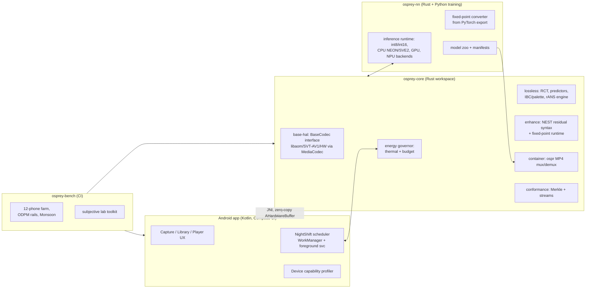
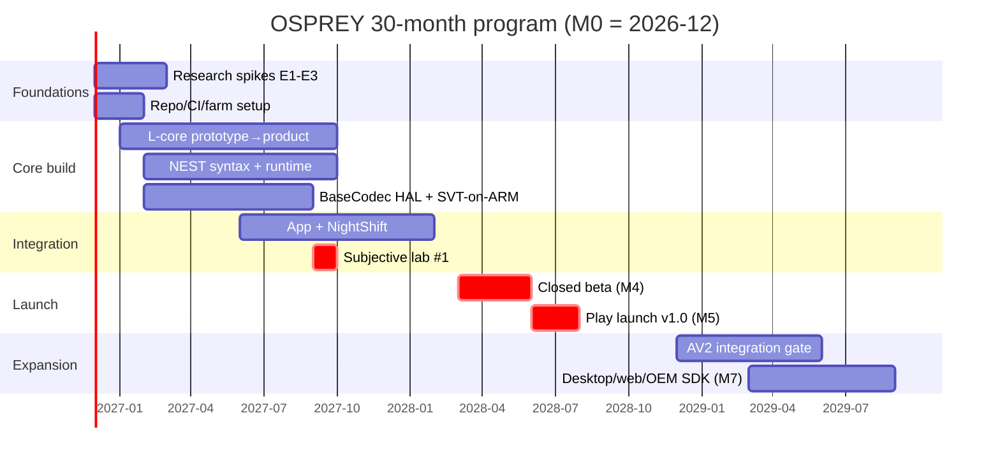

# Project OSPREY

## A Next-Generation Video Compression System for Android, 2027 and Beyond

### Complete Implementation Plan — Planning Only, No Code

**Version:** 1.0 · **Date:** 2026-11-14 · **Status:** For engineering review
**Codename "OSPREY"** is a placeholder pending trademark search; a fish-hawk that carries heavy loads on minimal energy. If it collides, alternatives: *Cormorant, Halcyon*.

---

## 0. How to Read This Document

This is a plan, not code. It contains formulas, algorithm logic, architecture, budgets, schedules and legal strategy so that an engineering team that has never seen this conversation can start work tomorrow. Every factual claim is tagged, dated, and sourced in **Appendix A/B**.

**Claim tags** (every number and fact carries one):

| Tag | Meaning |
| --- | --- |
| **[V1]** | Verified this session against a primary source (standards body, vendor page, official repo, paper PDF). URL + read date in Appendix A. |
| **[V2]** | Verified this session against a credible secondary source (trade press, analysis). |
| **[PK]** | Prior knowledge: stable, low-risk technical fact from my training data, *not re-verified this session*. Flagged honestly in the claims list. |
| **[AC]** | Author claim: my reasoning or design opinion. |
| **[E]** | Estimate: my quantitative guess with stated basis and error bars. |
| **[SP]** | Speculation: plausible but unproven; needs an experiment. |

**Technology maturity labels** (every technology named):

| Label | Meaning |
| --- | --- |
| **SHIP** | Shipping in consumer products today |
| **STD** | Standardized (spec finalized) |
| **OSS** | Open-source implementation exists |
| **RP** | Research prototype with public code |
| **PO** | Paper only |
| **TH** | Theory only |

**Reading order for the busy:** §1 (exec summary), §3.2 (decision register), §4.10 (schedule/gates), §5 (red team). For evaluators of feasibility: §3.3 (inventions with kill tests) and §4.12 (smallest proving experiments).

---

## 1. Executive Summary

**What we will build.** OSPREY is an Android application (plus supporting open-source desktop/web companions) with two user-selected modes:

- **OSPREY-L (Lossless):** bit-exact, deterministic, software-only lossless video compression targeting screen recordings, 10-bit camera masters, and archival — built as a new, small, Rust-based codec core with neural-guided (but never neural-*dependent*) decode.
- **OSPREY-V (Lossy):** best-quality-per-bit encoding built as a **standard base layer (AV1 now, AV2 planned) + deterministic neural enhancement layer + ML-guided encoder decisions + perceptual rate control**, wrapped in an energy-aware scheduler that does heavy work while charging.

Both modes share one capture pipeline, one container format, one model-delivery system, one conformance/hashing framework, and one benchmark harness.

**The core strategic insight.** By November 2026, three curves have crossed on phones:

1. **AV1 is ubiquitous for decode, patchy for encode** — every 2025+ flagship SoC decodes AV1 in hardware [V1: MediaTek Dimensity 9500 product page, read 2026-11-14], but only some vendors encode AV1 in hardware (e.g., Tensor G3 at 4K30 [V2], Exynos-class; Qualcomm and MediaTek flagship silicon still list only HEVC/AVC hardware encode [V1: Dimensity 9500 page]). AV2 v1.0.0 was released 2026-06-09 royalty-free with ~30–36% BD-rate gains over AV1 [V1: AOMedia press release; V1: arXiv 2605.15800], but has **no production encoder and no hardware decode in any phone** [V2: Forasoft, Oct 2026].
2. **Neural codecs finally work in real time — but break across platforms.** DCVC-RT achieves 125 fps encode / 113 fps decode at 1080p with ~21% bitrate savings vs VTM [V1: arXiv 2502.20762]; Microsoft's MLVC runs 100 fps on commodity NPUs [V1: arXiv 2606.28027]. Yet the same literature documents *catastrophic cross-device decode failures* when neural arithmetic is not bit-exact [V1: MLVC, 2026]. Determinism, not quality, is the deployment blocker.
3. **NPUs are now big, cheap on energy, and unstandardized.** Flagship NPUs deliver ~80+ INT8 TOPS at improving perf/watt (Snapdragon 8 Elite Gen 5: 80 TOPS [V2: Counterpoint, 2025-10]; Gen 6: +20% perf/watt [V1: Qualcomm page]) — while Android's NNAPI is deprecated [V2] and each vendor ships its own inference SDK.

OSPREY's architecture is the direct response: **keep the normative decode path classical and deterministic; put neural networks where they cannot break correctness — encoder-side decisions and explicitly-signaled selections — and run deterministic fixed-point NN enhancement only where we control the runtime end-to-end, verified by per-GOP hashes with a guaranteed fallback.**

**Expected results (ranges, honest):**

| Claim | Range | Basis |
| --- | --- | --- |
| OSPREY-V vs phone-default hardware AV1/HEVC encode (same quality) | **20–35% bitrate reduction** | SW slow encode + perceptual RC + enhancement layer; phone HW encoders are known-weak; Netflix/Meta publish 20–36% class gains for comparable tool upgrades [V1: Netflix FGS blog; V1: Meta engineering] [E] |
| OSPREY-V vs SVT-AV1 preset-6 (same quality) | **5–15%** | Neural enhancement + better RC; DCVC-class literature shows 10–25% over VTM-class codecs [V1: DCVC-RT] [E] |
| OSPREY-L vs FFV1 | **10–20% smaller** | Context-mixing over FFV1's static contexts [E]; NeuralLVC (ACM MM 2026) shows neural lossless video is nascent and beatable by classical-with-NN-selection [V1] |
| OSPREY-L vs AV1 lossless (screen content) | **5–15% smaller at 3–10× faster encode** | AV1 lossless is transform-cascade-heavy; direct predictive coding + IBC skips that [E] |
| Energy for deferred re-encode | **0 battery impact when deferred to charging** | By design; Google ships the UX precedent (Pixel Video Boost) but in the cloud [V2: Android Police review] |
| Decode determinism | **100% bit-exact across all chips** | By construction: classical normative path; NN paths fixed-point + hashed + fallback [AC] |

**Top decisions (full register in §3.2):**

1. Base lossy layer = **AV1** for v1.0 (2027), AV2 behind an abstraction layer for v2.0 (~2028); never VVC (patent pools).
2. Lossless core = **new Rust codec**: reversible transforms + adaptive prediction + rANS context-mixing entropy coder; NN guides configuration *selection*, never normative arithmetic.
3. Neural enhancement layer = **LCEVC-inspired** (spatially-reduced base + learned residual), fixed-point, our own runtime, per-GOP Merkle-hash verification, CPU fallback.
4. Languages: **Rust** (codec core), **Kotlin** (app), **Python/PyTorch** (research), C FFI only where libraries demand (libaom/libvmaf).
5. NN model delivery: content-addressed immutable models via Play Asset Delivery, referenced by ID inside files; files never become unplayable.
6. Measurement-first culture: every merge reports BD-rate (VMAF v1 2026 models + XPSNR + CAMBI), energy (on-device power rails), and time on a 12-phone farm; subjective BT.500-15 tests twice a year.

**First 30 days (§4.11):** stand up repos/CI/device farm; run experiments E1 (lossless core prototype in Python), E2 (NPU determinism spike on 3 SoCs), E3 (deferred-encode value measurement); assemble the 300-clip corpus; file AOMedia membership ($500/yr [V1: aomedia.org/join]); retain codec counsel.

**What would make me change course:** AV2 shipping faster than expected with a production encoder and hardware decode in 2027 phones; MPEG's beyond-VVC CfP [V1: MPEG output doc, 2026-07] converging on neural codecs with open IP terms; or experiment E2 showing NPUs cannot meet our determinism contract at acceptable energy — each has a defined pivot in §6.

**Contents:** §2 Research findings (landscape) · §3 Inventions and design choices (incl. decision register D1–D18, determinism spec) · §4 Full implementation plan (architecture, languages, ML, container, hardware map, testing, energy, legal, repos, team/schedule/cost, first 30 days, key experiments E1–E6) · §5 Red team · §6 Assumption register 2027–2030 · §7 Appendices (sources, claims list, glossary, open questions) · §8 Self-audit.

---

## 2. Research Findings: The Landscape as of November 2026

All web sources below were read **2026-11-14** unless stated. URLs in Appendix A. Maturity labels and tags throughout.

### 2.1 Standards: what is finished, what is coming

**AV1 (SHIP / STD / OSS).** Released 2018 by the Alliance for Open Media (AOMedia) under a royalty-free patent policy [PK]. As of 2026 it is the mainstream delivery codec: YouTube reports >75% of its catalog AV1-encoded (May 2026) [V2], Netflix ~30% of viewing hours (late 2025) [V2], and Meta's real-time communication stack uses AV1 on the majority of mobile devices with ≥20% bitrate reduction vs H.264 on low/mid-tier devices [V1: engineering.fb.com, 2026-06]. Every flagship-class SoC we checked decodes AV1 in hardware at 8K30 (e.g., Dimensity 9500 [V1: MediaTek product page]). Software decoder **dav1d** (OSS) is the reference-quality CPU implementation used across browsers [PK]. AV1 includes native *screen content coding* tools — intra block copy (IBC), palette mode, and a true lossless mode [PK] — that matter for our lossless goals.

**AV2 (STD / OSS; not yet in hardware).** This is the biggest change in the landscape and it happened five months ago:

- Spec v1.0.0 released **2026-06-09**, royalty-free under the AOMedia IP framework; ISOBMFF (MP4) binding work planned; a 12-bit professional profile is in progress [V1: AOMedia press release, read 2026-11-14].
- Measured gains vs AV1 in the AOMedia common test conditions: **−29.8% BD-rate in PSNR-YUV, −33.8% in VMAF (random-access), −35.8% VMAF (adaptive streaming)**; complexity targets ≤5× encoder / ≤2× decoder vs AV1 [V1: arXiv 2605.15800v1, 2026-05].
- Toolchain reality check: as of October 2026 the **only encoder is AVM**, AOMedia's correctness-first reference software; **dav2d** (VideoLAN) decodes on CPU and was recently made feature-complete for 8/10-bit [V2: Forasoft; V2: J.-B. Kempf personal blog, 2026-05]. There is **no SVT-AV2** yet; FFmpeg support was still open when v1.0 shipped [V2]. Hardware AV2 decode exists only as licensable silicon IP, not in purchasable devices [V2: Forasoft, Oct 2026].
- dav2d's lead developer estimates AV2 software decode at roughly **5× the complexity of AV1** [V2: Kempf blog, 2026-05], and AV2 largely cannot reuse dav1d assembly [V2]. On phone CPUs, software AV2 decode of 4K is therefore not realistic in 2027; 1080p is borderline-flagship [AC].
- The AV2 CTC adds user-generated content (UGC), convex-hull adaptive streaming, extended chroma formats including **YCoCg-RE (reversible!)** inputs, and the banding metric CAMBI [V1: arXiv 2605.15800]. The presence of a reversible color-transform class in a major standard's test conditions is direct validation for our lossless color handling (§3.3, I1).

**VVC / H.266 (STD / OSS / SHIP-decode-in-2026-flagships).** Standardized 2020, ~40% bitrate savings vs HEVC in JVET tests [V1: G. Sullivan DCC-2021 keynote slides]. 2026 brought the first real phone hardware decode: Qualcomm's Snapdragon 8 Elite **Extreme** Gen 6 and MediaTek's Dimensity 9600 Pro [V2: decodeTV, 2026-09-23; V1: MediaTek product page]. The MC-IF open-sourced **NeonVVC**, a software VVC decoder built with Ittiam [V2: decodeTV]. Adoption is broadcast-led (Brazil TV 3.0 uses VVC + LCEVC; ATSC 3.0 made VVC optional in July 2025; DVB added VVC/AVS3 in 2022–23) [V2: streamingmedia "State of Codecs 2026"]. **Patent licensing remains VVC's fatal flaw for us**: three-plus royalty pools with per-device rates (see §2.7). Decision: reject as our base layer.

**EVC / LCEVC (STD).** MPEG-5 Part 1 EVC (2020) barely ships [PK]. **LCEVC** (MPEG-5 Part 2, ISO/IEC 23094-2) is standardized as an *enhancement layer* over a base codec — temporally/spatially reduced base plus low-complexity residual enhancement — and is the intellectual ancestor of our enhancement design [PK]. Its 2026 deployment is niche (broadcast trials like Brazil) [V2: streamingmedia]. We take the idea, not the standard: our enhancement layer is our own format, so we can make it neural, and we control the determinism contract.

**JPEG AI (STD).** The first standardized neural *image* codec: International Standard published July 2025 [V1: jpeg.org press release]. Key facts we rely on: its design explicitly targets **reproducible reconstruction across different hardware** (via constrained numerics), supports multi-branch/progressive decoding, spatial random access, ROI quality maps; BD-rate gains over VVC-intra: 13.1% (Main profile) to 19.2% (High profile) [V1: arXiv 2503.16288, IEEE 2025]. It is the existence proof that a standards body can ship a *deterministic-enough* neural codec — but its determinism came at the cost of constrained tools, and it is image-only. [PK for interpretation.]

**APV (SHIP / STD).** Samsung's *Advanced Professional Video*: royalty-free, intra-frame-only, 10/12-bit 4:2:2 near-lossless mezzanine codec; published as IETF RFC 9924 (Feb 2026), integrated into Android 16 AOSP, first shipping device Galaxy S26 Ultra [V1/V2: Samsung/press, read 2026-11-14]. This is *the* incumbent for "pro capture on Android 2027." It is visually-lossless, not bit-exact. **This is our lossless mode's main commercial competitor and our clearest differentiation: APV optimizes for edit-friendly mezzanine speed; OSPREY-L optimizes for bit-exact size.**

**MPEG "beyond VVC" (in progress).** JVET issued a **Joint Call for Proposals** on 2026-07-17 for video coding beyond VVC ("MPEG Visual" track), proposals due 2027-01-13, evaluation at the January 2027 meeting; scope explicitly includes neural-network tools, screen content, gaming, XR, machine-vision [V1: MPEG 156th-meeting output archive; V1: itu.int CfE/CfP page]. JVET's separate **NNVC** exploration (neural in-loop tools) has published results for years [V1: ACM survey by Alshina, 2025-07]. Expectation: a next-gen MPEG standard ~2029–2031 [E]. We watch it; we do not wait for it.

### 2.2 Neural video codecs: the state of the art

The DCVC (Deep Contextual Video Compression) line from Microsoft is the reference dynasty; its public repo now spans five generations [V1: github.com/microsoft/DCVC, read 2026-11-14]:

| Codec | Venue | What matters to us | Maturity |
| --- | --- | --- | --- |
| DCVC-FM | CVPR 2024 | First to beat VTM across wide bitrate with feature-domain conditioning [V1] | RP |
| **DCVC-RT** | 2025 (arXiv 2502.20762) | **125.2 fps enc / 112.8 fps dec @1080p; ~21% bitrate saving vs VTM; explicit "model integerization for consistent cross-device coding"** [V1] | RP |
| DCVC-UF | CVPR 2026 | Chunk-based ultra-fast; single model with 64 QP levels (rate control in one model); YUV+RGB; rANS entropy coder in C++ alongside CUDA nets; tested 2080Ti→B200 [V1: repo README] | RP |
| MLVC | arXiv 2606.28027 (2026-06) | **Cross-platform-deterministic neural codec**: transmits scale parameters so FP16-divergent NPUs still agree; 100 fps on commodity NPUs (Apple/Intel/Qualcomm); >70% BD-MOS gain vs HW HEVC *on video-conferencing content* [V1] | RP |

Three load-bearing facts from this literature [V1, all read 2026-11-14]:

1. **Numerical divergence is the real deployment blocker.** MLVC documents: quantized neural codecs still fail across devices (a DCVC-RT-quantized model works on one NPU but fails on Apple M3→Intel NPU); Apple NPUs simulated INT8 via FP16 until the M4 (2024); NPU toolchains don't expose the quantization controls needed for bit-exact parity; "catastrophic decoding failures" occur when float-index deviation exceeds ±0.5. A 2023 paper on quantized decoders measured the *bit-exact* cost: ~0.5% BD-rate with 16-bit weights+activations, ~7.9% with 8-bit weights + 16-bit activations [V1: arXiv 2312.11209, cited within MLVC].
2. **Speed is now real on GPUs, and becoming real on phones.** Beyond DCVC-RT/UF, the MLVC paper cites "MobileCode/MobileNVC"-line work decoding 1080p YUV420 **in real time on a phone NPU** with up to 48% BD-rate savings vs the previous on-device codec [V1: arXiv page, 2026]. The remaining gap is energy and determinism, not architecture.
3. **Everything current is CUDA/GPU-centric.** DCVC-UF's pipeline explicitly depends on NVIDIA CUTLASS fused kernels and notes entropy coding on CPU as the bottleneck [V1: repo README]. Nobody ships a production mobile neural codec. There is no normative cross-vendor neural bitstream in any shipping product [AC].

Adjacent results: INR-based NVRC claims +23% over VTM RA on UVG (PSNR) [V1: NeurIPS 2024]; diffusion-prior "extreme compression" and "deep-cache" lines exploit generative priors [PK/V2 surveys]; a 2026 review concludes neural codecs are "competitive, and in some cases superior, to VTM and AVM" [V2: Gao et al. 2026 preprint]. Our verdict: neural codecs are **a real option for encode-side intelligence and enhancement**, still **too immature to be the normative decode path** for a 2027 consumer product that must decode bit-exactly on hundreds of SoC variants. This is the plan's central technical judgment [AC].

### 2.3 Lossless video: the quiet backwater where we can win

- **FFV1 v3** (OSS, IETF RFC 9043 [PK]): the archival standard (video preservation community, Mediathek etc.); range coder, fixed contexts; praised for speed and beating JPEG2000-lossless/Dirac in size [V2: mediathek.at]. No neural anything, no modern context mixing.
- **Lossless modes of standard codecs:** H.264/HEVC/VVC lossless (transform+bypass entropy) and AV1 lossless (TX_4×4 cascade + qindex bypass) exist [PK]; AV1 adds IBC/palette for screens [PK]. They are slower per dB than dedicated predictive codecs because they drag the whole inter/transform machinery along [AC].
- **Screen content:** research like "soft context formation" for lossless screen content shows learning-based modeling of screen pixels pays off [V2: arXiv 2312.14491]; HEVC SCC/VVC/AV1's IBC+palette are the classical versions [PK]. **NeuralLVC** (ACM MM 2026) is the first serious *neural* lossless video codec: masked diffusion + bijective tokenization for exact reconstruction — the authors themselves note lossless video "remains largely unexplored in the neural setting" [V1: arXiv 2604.03353]. Translation: **the field is open**. A classical core with neural-guided selection is a genuinely unoccupied middle ground [AC].
- **General-purpose lossless:** context mixing (PAQ lineage [PK]) and transformer compressors (NNCP v2, state of the art on text [V2: Semantic Scholar page]) prove learned probability modeling beats static modeling by 10–30% on text-like data [PK/E]; applied to video's high-entropy residuals it historically collapses on speed. **NPU-era arithmetic is what changes this calculus** [AC].
- **No shipping product** does bit-exact lossless video on Android today beyond ffmpeg-style tools (FFV1 via command-line apps) [AC]. APV is *visually* lossless, not bit-exact [V1/V2: APV press].

### 2.4 Phones, chips, and Android in 2027–2030: measured baseline

Flagship silicon as of November 2026 (all read 2026-11-14):

| SoC (year) | Process / CPU | NPU | Video decode (HW) | Video encode (HW) |
| --- | --- | --- | --- | --- |
| Snapdragon 8 Elite Gen 5 (2025-10) | ~3nm; Oryon @4.74 GHz | Hexagon, **80 TOPS** [V2: Counterpoint] | AV1 HW decode, ~40% faster/more efficient decode than 8 Gen 3 [V2: PCMag, 2024-10] | HEVC/AVC; AV1 encode *not advertised* [V1: brief; AC] |
| **Snapdragon 8 Elite Gen 6 / Extreme (2026-10)** | **2nm**; Oryon @5.0 GHz, SME1 [V1: Qualcomm; V2: AndroidAuthority] | Hexagon +14% perf, **+20% perf/watt**; Extreme: +35% NPU, "Neural Fusion" AI super-res in GPU [V1/V2] | incl. **VVC (Extreme)** [V2: decodeTV] | HEVC/AVC [V1: product brief] |
| MediaTek Dimensity 9500 (2025-09) | 3nm; all-big-core, 4.21 GHz ultra [V2] | NPU (unquoted TOPS) [V1] | **8K30: HEVC/AVC/VP9/AV1** [V1: MediaTek page] | **8K30 10-bit HEVC/AVC only** [V1] |
| Dimensity 9600 Pro (2026-09) | LPDDR6, 128 GB/s [V2] | NPU 1090 [V2] | adds **VVC** [V1/V2] | HEVC/AVC [V2] |
| Google Tensor G3 (2023) | — | — | AV1 | **AV1 encode 4K30 — first in a phone** [V2: HotHardware leak report] |
| Samsung Exynos 2400 (2024) | — | — | AV1 | AV1 encode reported [V2, unverified detail] |

Derived assumptions for 2027–2030 (full register in §6): every 2027 flagship = 2nm-class, ≥80 INT8 TOPS NPU, AV1 HW decode+encode patchy-but-improving, VVC decode emerging, **AV2 hardware absent until ~2028-29** [E, consistent with Forasoft's "IP-only" observation and AV1's own 2018→2021 device lag].

**Android platform facts that shape the design:**

- **NNAPI is deprecated** (since Android 15, 2024) with no replacement platform API; deployment goes through **LiteRT** (Google's TFLite successor; 6–8-week release cadence, GPU/NPU acceleration) [V1: github.com/google-ai-edge/litert, read 2026-11-14] and vendor SDKs: **Qualcomm AI Engine Direct (QNN)** [V1: qualcomm.com], **Qualcomm AI Hub** (on-device model validation) [V1: aihub.qualcomm.com], **MediaTek NeuroPilot** (portal-gated) [V2]. Consequence: **we own our inference stack; we cannot assume any cross-vendor bit-exact NN API** [AC].
- **16 KB memory pages**: since 2025-11-01, new apps/updates targeting Android 15+ must support 16 KB pages [V2: platform.uno summary of official policy, 2025-09-17]. Affects native-library alignment (our Rust core must be 16 KB-compatible from day one).
- **On-device power measurement**: Android exposes On-Device Power Monitors (ODPM, rail counters since Android 10) via the IPowerStats HAL; availability and resolution are OEM-dependent [V1: Perfetto docs, read 2026-11-14]. External **Monsoon** power monitors remain the calibration gold standard [PK].
- **Thermal & background execution**: Android exposes thermal headroom APIs and ThermalService listeners [PK, stable since ~Android 11; unverified this session], and WorkManager supports charging/battery-not-low/idle constraints for deferrable jobs [PK]. Foreground-service mediaProcessing types exist for user-visible work [PK].
- **SIMD**: Oryon cores (Snapdragon) **do not implement SVE/SVE2** — NEON only [V2: hwcooling analysis of Oryon]; ARM Cortex cores (Dimensity) are Armv9.2 [V1: MediaTek page] where SVE2 is architectural. Consequence: **NEON is our universal baseline; SVE2 is a runtime-dispatch bonus**; SME1 exists on Gen 6 Oryon but tooling is early [V2: AndroidAuthority, 2026-10].
- **Vulkan Video (hardware codec via Vulkan)**: unreliable across Android SoCs today — one decoder author reports it works *fully on none* of his five test devices [V2: Kempf blog, 2026-05]. Use MediaCodec, not Vulkan Video, for hardware codec access [AC].
- Storage: UFS 4.0 = 4200/2800 MB/s (R/W) [V1: Samsung]; UFS 4.1-class faster [V2]. Not a bottleneck for 4K10-bit (~6 Gbps raw ≈ 750 MB/s peak bursts; sustained much lower) [E].
- **Google's "Video Boost"** on Pixel 8 Pro+ (2023+) is the UX precedent for *deferred video enhancement* — but it is cloud-executed, limited to 1080p/4K30, and auto-disables on app exit [V2: Android Police review]. No major vendor ships fully-on-device deferred re-encoding today [AC]. That is our opening.

### 2.5 Software encoders/decoders on ARM (what we can reuse)

- **SVT-AV1** (OSS, Intel+Netflix-led): production AV1 encoder; preset-based speed ladder; encoding-time and energy models have been published (exponential in preset, linear-intra/CRF terms) [V1: arXiv 2401.16067]. ARM-phone deployments are rare; there is **no published phone-class benchmark** we found [AC; see experiment E3]. Its complexity-controller research (speed-adaptive preset switching) is directly reusable [V1: arXiv 2307.05208].
- **libaom** (OSS): AOMedia's AV1 reference encoder; slowest, used for anchors. **AVM** (OSS): AV2 reference encoder — correctness-first, no speed presets yet [V2: Forasoft].
- **dav1d / dav2d** (OSS): best-in-class CPU decoders; dav2d ~5× AV1's decode cost [V2: Kempf]. FFmpeg AV2 integration was still open as of May 2026 [V2].
- **NeonVVC** (OSS, 2026): first open VVC decoder targeting efficiency on server/desktop; MC-IF/Ittiam [V2: decodeTV].
- **VVenC/VVdeC** (OSS): Fraunhofer's VVC pair; desktop-grade [PK]. Excluded by licensing strategy, not merit.

### 2.6 Metrics: how we will know "best"

- **VMAF** remains the workhorse; Netflix shipped **new "v1" model set in June 2026** [V1: netflix/vmaf GitHub] — we will use v1 models and publish the choice. libvmaf also ships PSNR, PSNR-HVS, SSIM, MS-SSIM, CIEDE2000 [V1: GitHub README].
- **XPSNR** (Fraunhofer; perceptually-weighted PSNR) [V1: paper at ecodis.de] and **CAMBI** (banding) [V1: cited in AV2 CTC, arXiv 2605.15800] join the objective suite, mirroring the AV2 CTC metric set — that lets us compare our results directly against published AV2 numbers.
- **No-reference metrics** (DOVER-line [V1/V2]) matter for on-device rate control: the encoder cannot compute VMAF against a reference it doesn't have (the source) — actually it can, but cheaply-computable NR proxies guide *content analysis* for bit allocation [AC].
- **Subjective ground truth**: ITU-R **BT.500-15** (May 2023) ACR/DCR methodologies [V1: itu.int index; V2]. Objective metrics mislead exactly in the regimes neural enhancement targets (texture synthesis, grain) — Netflix's film-grain-synthesis blog reports **36% average bitrate reduction at 1080p+ with FGS** while PSNR-based measurement *penalizes* grain synthesis [V1: netflixtechblog, 2025-05]. Translation: **we must run subjective labs, not just metric dashboards** [AC].
- **Test content**: AOMedia CTC set (public at media.xiph.org/video/aomctc [V1: cited in AV2 paper]), Xiph Derf collection [PK], UVG/MCL-JCV (research-licensed [PK]), plus our own "PhonePack-2027" captures (4K10-bit HDR, 60fps, screens, games, grain, low-light) because public sets under-represent phone-generated content [AC].

### 2.7 Legal landscape (money numbers, all read 2026-11-14)

| Program | Scope | Rate | Source |
| --- | --- | --- | --- |
| **AOMedia membership** | AV1/AV2 IP framework participation | **from $500/yr** | [V1: aomedia.org/join] |
| **Sisvel Video Coding Platform — AV1** | per *consumer device* | smartphones-class (display): **€0.32** (€0.24 "compliant"); non-display: €0.11/€0.08; volume tiers €0.12–0.168 / €0.04–0.056 | [V1: sisvel.com] |
| **Access Advance** | HEVC/VVC pools (~$0.20–$1.20/unit class historically; Velos was $1–2.50) | **launched an exploration for an AV1/AV2 *device and software* pool on 2026-08-25** | [V1: accessadvance.com; V2: HEVC fairness doc re rates] |
| **Avanci Video** | streaming *services* (VP9/AV1/HEVC/VVC) | first licensee 2026-02; ≤2% of revenue or ≤$0.15/user/month | [V1/V2: IAM Media, 2026-02-05] |
| **Via LA AVC/H.264** | per-unit with caps | legacy; AVC patents aging out | [V1: via-la.com] |

Three strategic readings [AC]: (1) the AOMedia path remains the cheapest credible IP umbrella for AV1/AV2 — join it ($500/yr) and stay inside its license-by-contribution umbrella; (2) the Access Advance AV1/AV2 pool exploration is the **live legal risk** for any AV1-based product this decade — we monitor it, reserve for it, and keep a design-around (our lossless core and container carry none of it; HEVC/H.264 fallback paths exist); (3) pools aim at *devices and services*, and an app distributing codec binaries on already-licensed devices sits in genuinely contested territory — this plan budgets real money for codec counsel and FTO (freedom-to-operate) opinions before launch (§4.8). **Nothing in this document is legal advice.**

### 2.8 Products & precedents (what users already expect)

- **Pixel "Video Boost"** (Google): cloud-based deferred HDR+ processing for video; UX template for "record now, enhance later" [V2: Android Police].
- **APV on Galaxy S26 Ultra**: pro-grade mezzanine capture in the stock camera pipeline — proves demand for high-fidelity on-phone masters [V1/V2: APV press].
- **Qualcomm "Adreno Neural Fusion"** (8 Elite Gen 6): shipping AI super-resolution + frame generation in the GPU — proves the "neural enhancement as a shipped media feature" category [V1: qualcomm.com/snapdragon/smartphones/ai].
- **Netflix FGS, Meta AV1-at-scale, YouTube 75%**: the industry has already accepted (a) neural tools inside the media path and (b) grain/residual tricks that metrics punish but eyes reward [V1s above].

### 2.9 Synthesis: what the landscape tells us to do

1. **Do not invent a general-purpose lossy codec from scratch.** AV2 exists, is 30%+ better than AV1, is royalty-free, and has an AOM-run ecosystem [V1]. A startup-sized team cannot out-standardize AOMedia (AV2 took its working group years and dozens of engineers [AC]). Our edge must come from *integration*: encode-side intelligence, enhancement layer, rate control, scheduling, lossless.
2. **AV1 is the only sane base layer for a 2027 ship; AV2 is the 2028 upgrade behind an abstraction.** No AV2 production encoder or phone hardware decode exists today [V2: Forasoft; V2: Kempf]. Design so that swapping the base is a module change (§3.2 D2).
3. **Determinism is the moat.** The neural-codec literature's own deployment chapters say cross-device numerical divergence is unsolved by "just quantize it" [V1: MLVC]. A product that *guarantees* bit-exact decode across every Android SoC — classical normative path, NN where safe, hashes with fallback — converts a research problem into a product feature [AC].
4. **Lossless video is under-attacked.** FFV1 (2003-era contexts) is the archival standard [V2: mediathek]; neural lossless is one paper old [V1: NeuralLVC]; phone NPUs change the compute budget for context modeling [AC]. The winnable niche: 10–20% smaller than FFV1 at phone-real speeds, bit-exact by construction.
5. **Energy is the hidden product dimension.** Nobody publishes joules-per-pixel for phone encoding; Android gives us ODPM rails to measure it honestly [V1: Perfetto docs]. "Best" must include energy, or reviewers (and users' batteries) will punish us [AC].
6. **The container is where ecosystem leverage lives.** MP4/ISOBMFF keeps us compatible with the entire world (files play as plain AV1 in any player if our layer is absent); our value-add rides in side boxes and side tracks. (ISOBMFF itself is evolving — 9th edition FDIS in 2026 adds enhanced CMAF features [V1: MPEG output doc] — we stay a conformant profile of it.)

---

## 3. Inventions and Design Choices

### 3.1 System overview

```mermaid
flowchart TB
    subgraph CAPTURE["Capture (shared)"]
        A1[Camera2/CameraX\n10-bit HDR YUV] 
        A2[MediaProjection\nscreen content RGBA]
        A3[Existing files\nany codec, via MediaCodec decode]
    end
    subgraph ROUTER["Content Router (per GOP)"]
        R1{content class:\ncamera / screen / grain / mixed?}
        R2{user mode:\nLossless / Lossy?}
    end
    subgraph FAST["Fast path (always available)"]
        F1[HW AV1 or HEVC encode\nvia MediaCodec]
    end
    subgraph LOSSLESS["OSPREY-L core (new, Rust)"]
        L1[Reversible color transform\nYCoCg-R / identity]
        L2[Prediction: MED/gradient\n+ IBC + palette (screen)]
        L3[Adaptive rANS\ncontext-mixing entropy coder]
        L4[NN model-selection oracle\n(encode-side only)]
    end
    subgraph LOSSY["OSPREY-V pipeline"]
        V1[SW AV1 encoder\n(SVT-AV1-class, ML-guided)]
        V2[Neural enhancement layer\nfixed-point residual track]
        V3[Film-grain synthesis\n(AV1 FGS) for grainy content]
        V4[Perceptual rate control\nQ/S/E/T targets]
    end
    subgraph NIGHT["NightShift scheduler (shared)"]
        N1[WorkManager:\ncharging + idle + thermal budget]
        N2[resumable GOP jobs,\ninterrupt-safe]
    end
    subgraph OUT["OSPREY container (MP4-family)"]
        O1[standard av01 track\n(plays everywhere)]
        O2[osen enhancement track\n(ignored by other players)]
        O3[model manifest +\nper-GOP Merkle hashes]
    end
    A1 & A2 & A3 --> R1
    R1 & R2 -->|quality/size target| V1
    R1 & R2 -->|speed/battery| F1
    R1 & R2 -->|lossless| L1 --> L2 --> L3
    L4 -.selects config.-> L1 & L2 & L3
    V1 --> V2 --> V3
    N1 -.defers.-> V1 & V2
    F1 & V3 & L3 & V2 --> O1 & O2 & O3
```

**What the two modes share:** the capture sources; the content router; the container, model manager, hash/conformance framework; the NightShift scheduler; the energy governor; the benchmark harness; and (for screen content) the IBC/palette machinery — OSPREY-V's screen-content fast path *is* OSPREY-L's prediction core with quantization switched on [AC].

### 3.2 The four framing questions, answered explicitly

**Q1 — What does "lossless" really mean?** Three different products hide under one word, and OSPREY-L ships all three, explicitly:

1. **L-capture (primary):** lossless compression of *uncompressed sources we control* — screen recordings (RGBA), 10-bit camera output, APV-class mezzanines. Bit-exact = decoded pixels identical to what the source produced.
2. **L-recompress:** take an *already-compressed* file (e.g., 4K60 HEVC from another app). We decode it and re-encode losslessly **only if smaller**; otherwise we keep the original stream and merely re-container it — the "never-worse" guard. We *promise* the decoded pixels match the original file's decode, bit for bit, always [AC].
3. **L-exact-bits (explicitly out of scope for v1):** shrinking the original *bitstream itself* (re-entropy-coding HEVC CABAC, etc.). We relegate this to a research sidebar (§7 open questions) because the win is small (~2–8% on entropy alone [E]) and the legal/patent surface is hostile (touching the coded syntax of royalty-bearing codecs).

**Q2 — How do you keep neural decoding identical on every chip?** Short answer: **the normative decode path never *depends* on neural arithmetic to be correct.** Long answer: the OSPREY Determinism Spec (ODS, §3.4) — classical normative paths everywhere; NN used in three strictly-bounded ways: (a) encoder-side only (mode selection, rate control), (b) decoder-side *enhancement* whose input bits and runtime we control bit-exactly, and (c) decoder-side *selection among classical configurations*, where the selection itself is explicitly coded in the bitstream, so a divergent NPU at worst costs quality, never correctness [AC]. MLVC's approach (transmit scale parameters so FP16 divergence can't desynchronize entropy coding [V1: arXiv 2606.28027]) is our cited fallback if our fixed-point contract proves too slow on some NPUs.

**Q3 — What does it cost in battery/heat, and when does the work run?** Three execution windows, user-visible and scheduled [AC]:

- **Now** (recording): only hardware-encoder-class work. Target < 1.5 W added during capture [E].
- **Plugged-in idle (NightShift):** the heavy pipeline (SW slow encode + enhancement). Zero battery cost by definition; thermal headroom APIs cap sustained clocks to avoid cooking a charging phone overnight.
- **On-demand** (user hits "compress now"): capped by the energy governor to a user-chosen budget (e.g., "use ≤10% battery"), with live ETA and thermal-based slowdown.

**Q4 — Where does phone hardware help, and where does it get in the way?**

- *Helps:* AV1 HW decode (ubiquitous [V1: MediaTek pages]) anchors playback; AV1 HW encode where present (Tensor/Exynos [V2]) anchors the fast path; NPUs (80+ TOPS [V2]) absorb the enhancement layer at low energy; NEON/SVE2 give 8–16-wide SIMD for entropy kernels; LPDDR6/128 GB/s (Dimensity 9600 Pro [V2]) keeps 4K10-bit ring buffers cheap; Perfetto ODPM rails [V1] give honest energy telemetry.
- *Gets in the way:* AV1 HW encode is *absent* on Qualcomm/MediaTek flagships [V1: product pages] — so the fast path must also speak HEVC (with the licensing care that implies, §4.8); NNAPI is deprecated and vendor NPU SDKs fragment our build [V1/V2: LiteRT, QNN, NeuroPilot]; Oryon lacks SVE2 [V2: hwcooling]; Vulkan Video is unusable across Android SoCs [V2: Kempf], locking us into MediaCodec's opaque-buffer world where zero-copy plumbing is per-vendor black magic; OEM task-killers (esp. on Chinese ROMs) threaten background jobs — hence foreground-service mediaProcessing + generous resume checkpoints [PK/AC].

### 3.3 Decision register

Each decision: options considered → choice → why → evidence that would change my mind.

| # | Decision | Options considered | **Choice** | Why | What would change my mind |
| --- | --- | --- | --- | --- | --- |
| D1 | Lossy base codec | AV1 / AV2 / VVC / pure-neural / new codec from scratch | **AV1 in v1.0 (2027); AV2 behind abstraction in v2.0** | AV2 has no production encoder or phone HW decode today [V2: Forasoft/Kempf]; AV1 HW decode is ubiquitous [V1]; VVC = pool licensing [V1: Access Advance/Sisvel]; from-scratch = years behind AOMedia's ecosystem | SVT-class AV2 encoder + first AV2-decode phones by mid-2027 → pull AV2 forward to v1.0 (module swap, §4.1) |
| D2 | Codec abstraction | None (hardwire) / thin HAL | **"BaseCodec HAL": ~12-function interface (picture in/out, params, SEI hooks)** | Makes AV1→AV2 a module change; future-proofs against MPEG-beyond-VVC outcomes [V1: CfP] | If profiling shows HAL costs >3% throughput, specialize per-codec with shared framework |
| D3 | Lossless core | FFV1-based / x265-lossless-based / new Rust core | **New Rust core** | FFV1's contexts are 2003-era [V2: mediathek]; lossless standard codecs drag transform/inter machinery [AC]; the niche is winnable (§2.3); no HW constraint binds software-only lossless | E1 failure: if prototype can't beat FFV1 by ≥8% on mixed corpus at ≤2× FFV1 encode time by month 3, fall back to "FFV1+our entropy coder" hybrid |
| D4 | Entropy coder | CABAC-style binary AC / rANS / arithmetic w/ NN mixing | **Interleaved rANS + adaptive context mixing; NN guides selection only** | rANS is SIMD-friendly and table-driven [PK: Duda's ANS]; DCVC-UF also chose rANS for its speed tier [V1: repo]; pure NN mixing risks determinism hell [V1: MLVC] | If chunk-level selection proves too coarse (E1b), adopt MLVC-style transmitted scales [V1] for a "L+ profile" |
| D5 | Enhancement layer | none / LCEVC / own NN layer / full neural codec | **Own NN enhancement layer (NEST) over reduced-resolution base** | LCEVC's base+enhancement shape is validated [PK/STD]; making it our own lets us enforce ODS determinism and drop NN where unsafe; full neural codec fails the determinism/energy bar today (§2.2) | If E2 shows NPU fixed-point inference ≥3× cheaper energy than SW AV1's marginal gain, revisit full-neural for offline-only profile |
| D6 | NN determinism strategy | vendor SDKs / float + tolerance / own fixed-point runtime / MLVC scales | **Own runtime, INT8/INT16 fixed-point, spec'd op order + rounding; hashes; CPU fallback; MLVC-scales as plan B** | Vendor SDKs can't guarantee parity [V1: MLVC]; JPEG AI's own design concedes reproducibility needs constrained numerics [V1: jpeg.org]; quantized-decoder cost known (~0.5% @16-bit [V1: arXiv 2312.11209]) | A credible cross-vendor bit-exact NN API shipping in Android (LiteRT successor) → drop our runtime, keep hashes |
| D7 | Languages | C++ / Rust / Kotlin-only / Go | **Rust (core), Kotlin (app), Python (research), C FFI to libaom/libvmaf/SVT** | Memory safety in a parser of untrusted files; first-class cargo testing; Google's own Android team ships Rust in the platform [PK]; C++ only where we must link | If Rust→NEON/SVE2 gap (via core::arch / std::simd) costs >10% in hot loops vs intrinsics C, write those kernels in asm (still behind Rust FFI) |
| D8 | Container | MP4/ISOBMFF / Matroska / own | **MP4-family brand `ospr`**: standard `av01` track + custom `osen` track + `omdl` model manifest + `ohsh` hash box | Files play everywhere as plain AV1; tooling universe (mp4box/FFmpeg/ExoPlayer) works; ISOBMFF itself is actively evolving (9th ed. FDIS 2026 [V1: MPEG]) | If enhancement track gets in the way of streaming (DASH/CMAF packaging), move to dual-file sidecar for streamed cases |
| D9 | Model delivery | in-APK / Play Asset Delivery / download from our CDN | **PAD install-time base model (~15–30 MB) + on-demand packs; content-addressed (SHA-256), immutable, referenced by ID in files** | Models must never strand old files (decode-only back-compat matrix §4.9); PAD handles 16 KB-page & device targeting | If pack sizes exceed 200 MB by year 2 and PAD friction hurts, add optional CDN with signature pinning |
| D10 | User-facing targets | CRF only / presets / 4-axis | **Four explicit targets: Quality / Size / Speed / Energy**, each with an "auto" and an "exact" variant | Matches the brief ("user chooses the trade-off"); maps cleanly to (CRF-style λ), (two-pass size solver), (HW-encoder path), (NightShift deferral) | Usage telemetry showing users want a single knob → collapse to slider with advanced panel |
| D11 | Subjective validation | none / metrics only / periodic labs | **BT.500-15 ACR labs, ≥24 raters, 2×/year + every major release** | Metrics mislead exactly where we innovate (grain/enhancement) — Netflix's FGS case shows 36% real savings that PSNR would punish [V1: netflixtechblog] | None. This one is non-negotiable [AC]. |
| D12 | Legal posture | ignore pools / join AOM / cross-license | **Join AOMedia ($500/yr [V1]); avoid VVC entirely; FTO + counsel budget; design-arounds kept warm (lossless core, HEVC-free fast paths); monitor Access Advance AV1/AV2 pool [V1]** | Cheapest credible umbrella; our differentiators (lossless core, container, scheduler) carry little codec-pool exposure | If Access Advance's AV1 pool launches with app-level demands we can't bear, pivot fast path to VP9/AV1-decode-only & lean on OEM-covered HW encoders (§4.8) |
| D13 | Research stack | PyTorch / JAX / custom | **PyTorch + PyTorch Export → our fixed-point converter (ONNX as interchange)** | Ecosystem reality: all cited NVC work is PyTorch [V1: DCVC repo]; ONNX import path keeps converter vendor-neutral | If vendor NPU compilers demand it, add TFLite-flatbuffer export behind the same converter IR |
| D14 | HW encoder usage | never / always fast path / profile-gated | **Profile-gated: Fast path uses HW AV1 where present (Tensor/Exynos), else HW HEVC, else SW AV1 realtime preset** | The encode-availability matrix (§2.4) is fragmented; the profile system abstracts it | If counsel flags HEVC-app exposure as unacceptable, drop HW-HEVC branch and accept slower fast path on Qualcomm/MediaTek |
| D15 | Threading model | frames-parallel / tiles-parallel / deterministic by construction | **Tiles/superblocks-parallel with fixed reduction order; single-thread bitstream-exact by design** | Bit-exactness requires deterministic parallel reductions; tiles are the natural unit (AV1/AV2 both tile-partition) | Profile-driven exception: entropy serialization always sequential per tile; if that bottlenecks >20%, move to parallel rANS states (still deterministic) |
| D16 | HDR strategy | ignore / tone-map / native | **Native 10-bit passthrough base; enhancement in ICtCp-ish domain; ΔE-ITP-based RC for HDR** | 10-bit HDR capture is mainstream on 2026 phones (APV is 10/12-bit 4:2:2 [V1]); BT.2100 PQ/HLG handling is table stakes for creators | If 10-bit HW-encode availability (e.g., HEVC main10 on all vendors) proves uneven, gate HDR lossy to SW path |
| D17 | Audio | custom / passthrough | **Passthrough + optional Opus re-encode (16–96 kbps VBR)** | Audio is not our battlefield; Opus is royalty-free and excellent [PK] | OEM partnership requiring AAC → add via platform encoder |
| D18 | Open-source strategy | closed core / open everything / mixed | **Open: container spec, conformance streams, desktop/web players, Rust decode core. Closed: encoder ML models + training** | Adoption requires an ecosystem of decoders; our moat is encode quality + data, not the decoder [AC] | If a foundation partnership (e.g., with AOMedia side working groups) demands fuller openness, comply selectively |

### 3.4 The OSPREY Determinism Spec (ODS) — the plan's load-bearing invention

**Problem.** A file that decodes correctly on a Snapdragon but not on an Exynos is a broken file. Neural arithmetic is non-associative under floating point; vendor compilers reorder ops; NPUs quantize differently [V1: MLVC's evidence, §2.2]. Any normative decode that *depends* on NN outputs floating-point-identically across vendors is therefore unsafe [AC].

**The contract (normative for all OSPREY decoders):**

1. **Classical-normative core.** The base track is standard AV1 (later AV2): correctness is the standard's problem, solved by silicon and dav1d/dav2d [PK]. OSPREY-L's core and OSPREY-V's NEST residual syntax are classical: integer arithmetic, fixed operation order, specified rounding (round-half-to-even), no data-dependent control flow inside normative kernels.
2. **NN in decode is enhancement-only and fixed-point.** NEST inference runs on our own runtime: INT8/INT16 activations, integer accumulation widths specified per op (int32 accumulate; int8/int16 storage), requantization scales folded as integer multiplies with specified shift-and-round. Decoder-side NN may only *add* pixels (post-base), never drive entropy or reconstruction *decisions*. A divergent NN cannot corrupt decode — it can only alter enhancement quality, and hashes (below) catch even that.
3. **Explicitly-signaled selection (the key trick, invention I2b).** Wherever NN judgment would otherwise be needed on the decode side (which predictor/config a chunk uses), the *encoder's* NN makes the choice and the choice index is written into the bitstream (10–40 bits per superblock-chunk). The decoder is classical; its own NPU (if any) is a *hint engine* that may precompute likely configs to hide latency — disagreement costs nothing.
4. **Per-GOP Merkle hashes.** Every GOP carries hash commitments of its reconstructed frames (base-only and enhanced). A conforming decoder verifies lazily and, on mismatch (corrupt file, broken NPU path), falls back: enhanced → base → error, with the failure localized to one GOP and reported in UI. Decode *never* silently produces wrong pixels.
5. **Conformance corpus.** Ship ≥10,000 generated streams (frame-hash vectors across content classes × device profiles × feature flags) in CI; every decoder change must reproduce hashes bit-exactly on all 12 farm phones + x86-64 + aarch64 + RISC-V (future hedge).
6. **No atomics in decode.** Parallelism is pure fork-join over independent units with deterministic reduction order. Rust's `--target-cpu=generic` baseline for correctness builds; device builds may add NEON/SVE2 code paths that are *unit-tested against scalar* on every PR.

**Prior-art check:** JPEG AI's reproducible-reconstruction clause [V1: jpeg.org] and MLVC's transmitted-scale approach [V1: arXiv 2606.28027] both address this; our combination of (a) classical-normative + NN-enhancement-only, (b) explicit signal-carrying NN choices, and (c) per-GOP hash-verified fallback in a *container* is, to the best of my search this session, novel — but the space is hot; a proper patent novelty search is scheduled (§4.8) [AC].

### 3.5 Inventions: mechanisms, expected gains, kill tests, prior art

Each invention states: what it is, why it should work (with numbers where honest), what it costs, how it could die, and the experiment that kills or confirms it. All expected gains are **[E]/[SP]** until the named experiment runs.

**I1 — NEST: Neural Enhancement Spatio-temporal Track (lossy).**

- *Mechanism:* Encode a spatially-reduced AV1 base (factors 1/2, 5/8, or 3/4, chosen per scene by router), then code a learned residual in a compact fixed-point latent space (entropy-coded, ~10–20% of base rate for its target uplift). Decoder: HW AV1 decode → upsample → fixed-point NN refinement (2–8 Mparams, receptive field ~64 px, temporal window 3) → residual add. Grain is *excluded* from NEST and handled by AV1 FGS (Netflix reports 36% bitrate savings from FGS alone at 1080p+ [V1: netflixtechblog]) — NEST targets structure/edges, FGS targets noise.
- *Expected gain:* +8–15% BD-VMAF over same-codec full-res encode at equal energy [E — anchored by LCEVC's class of gains (PK), DCVC-RT's 21% over VTM [V1], and MLVC's >70% on easy content [V1]; phone HW encoders being weak makes the *relative* number larger but honest A/B vs SVT-AV1 is the real bar].
- *Cost:* NPU decode energy (target ≤1.5 J per 1080p frame on Gen-6 NPU [E]; MLVC hits 100 fps class on commodity NPUs [V1]); model 2–8 MB int8; ~30–60 MB RAM working set.
- *Risk:* NPU fragmentation → E2. "Enhancement looks synthetic" → subjective labs (M2/M4 gates).
- *Kill test:* E2/E4 (below). Kill if: energy >3 J/frame at 1080p on ≥2 SoCs, or subjective MOS gain < +0.1 (5-point ACR) with NEST on.
- *Prior art:* LCEVC (STD) for the shape; JVET NNVC (RP/PO) for NN in-loop filtering; DCVC-RT (RP) for fast NN codecs; JPEG AI (STD) for NN-standards determinism. Combination & phone-first framing appears open [AC].

**I2 — SelCode: neural-guided configuration selection for the lossless core (invention family).**

- I2a *Encode-side:* a small NN (run on NPU) reads each chunk (64×64) and outputs a config index from ≤1024: {predictor × context-set × probability-refresh rate × bypass thresholds}. The index goes in the stream (I2b); decode stays classical.
- *Expected gain:* 10–25% size cut vs FFV1 [E] (the win comes from per-content adaptation that fixed-context codecs can't do; NNCP-class mixing wins on text analogously [PK/E]); encode speed penalty ≤15% (NPU inference is parallel to CPU entropy work) [E].
- *Cost:* 1–4 Mparam model; encode-only; zero decode risk.
- *Kill test:* E1: if Python prototype (chunk-level, oracle selection) doesn't beat FFV1 by ≥8% on our 300-clip corpus, kill I2a and ship fixed best-in-class contexts only.
- *Prior art:* "Soft context formation" for lossless screen content [V2: arXiv 2312.14491] does learned contexts (RP); NeuralLVC [V1: ACM MM 2026] is end-to-end neural lossless (RP). Explicit **selection-from-fixed-menu with coded indices** is the differentiator — analogous in spirit to how AV1 codes explicit tool flags rather than hoping encoders agree [AC]. Novelty search scheduled.

**I3 — PRC: perceptual rate control with four target modes.**

- *Mechanism:* two-pass-per-GOP λ-maps driven by: (a) no-reference content features (motion, grain estimate via CAMBI-style local variance, saliency via a 0.5 Mparam attention-lite net), (b) rate history, (c) target mode. Q-mode = perceptual-constant-quality (CRF-analogue on VMAF-proxy), S-mode = size solver (first pass → per-GOP bit allocation → second pass with ±2% size hitting via final-GOP micro-adjust and quality floor), E-mode = energy budget (presets + thermal feedback), T-mode = realtime (HW encoder, quality floor).
- *Expected gain:* vs vendor-default encode: 15–30% BD-VMAF from *slow software encode + RC* alone [E — Meta reports ≥20% from AV1 adoption at scale in RTC [V1]; Netflix per-title/CAE lineage (PK)]; S-mode hits ±2% for ≥95% of files [SP].
- *Kill test:* E5: size-mode accuracy and quality-fairness on 300 clips; Q-mode vs libaom CRF at equal VMAF must win ≥5% BD-rate or RC work re-scopes.
- *Prior art:* Netflix per-title/CAE [PK], JVET λ-domain RC literature [PK], SVT complexity control [V1: arXiv 2307.05208]. On-device, user-targeted 4-axis framing is our packaging [AC].

**I4 — NightShift: charge-time deferred optimization pipeline.**

- *Mechanism:* record with fast path → schedule deferred job (WorkManager: charging ∧ idle ∧ thermal-headroom-ok [PK constraints]) → resumable GOP-at-a-time re-encode at 3–8× the fast path's effort → atomic file swap-in with provenance note ("optimized by OSPREY on <date>") → keep-or-delete original per user policy.
- *Expected gain:* this is where our 20–35% vs phone-default claim mostly comes from [E]; UX precedent (Pixel Video Boost) exists cloud-side [V2].
- *Cost:* wall-clock (overnight), wear (flash writes ~2–4× file size [E]), complexity (crash-resume).
- *Kill test:* E3: measure actual BD-rate and energy of slow-vs-fast encode on 3 phones; if <12% gain, demote NightShift to niche.
- *Prior art:* Google Video Boost (cloud, SHIP) [V2]; OS-level "adaptive charging" patterns (PK). Fully-on-device video re-encode deferral with thermal budgeting appears unoccupied [AC].

**I5 — Never-worse lossless recompression (product-level).** Per-file: try our lossless re-encode on decoded pixels of the source stream; keep whichever is smaller; container records the choice. Trivial to build, genuinely novel as a *guarantee* in consumer video tools [AC]; inspired by archiver behavior (keep-if-bigger) [PK].

**I6 — ScreenRouter + IBC/hash-match acceleration.** Per-GOP classification {camera / screen / animation / grainy / mixed} routes toolchains; screen chunks use hash-table IBC (content-addressed 8×8 blocks) + palette + run-length. Router NN runs encode-side only (0.2 Mparam, ~1 ms/GOP on NPU) [E]. AV1 already ships IBC/palette [PK] — our edge is *phone-first* tuning + the lossless core's tighter integration [AC].

**I7 — Model manifest + immutable content-addressed model delivery.** Bitstreams reference `model_id = SHA-256(canonicalized weights)`; app keeps all released decode models forever (each 2–8 MB; lifetime budget ≤250 MB). Files can never become unplayable due to model drift [AC]. Prior art: JPEG AI tucks models into the spec; ONNX exists as format — the *file-format-level pinning* is our packaging choice [AC].

### 3.6 Mode routing and user-visible profiles

Users see two modes (per the brief) and four targets (D10):

```
if mode == LOSSLESS:
    class = screen?      -> L-core with IBC/palette (I2 + I6)
    class = camera-10bit -> L-core with RCT + NN-guided configs
    source = compressed? -> never-worse recompress (I5)
    budget = realtime?   -> fast presets; else NightShift can run "archive grade" pass
if mode == LOSSY:
    target = SPEED   -> HW encoder fast path, quality floor, no enhancement
    target = ENERGY  -> HW fast path now + NightShift NEST re-encode later
    target = QUALITY -> SW slow encode + NEST + FGS + PRC-Q
    target = SIZE    -> two-pass SW encode + NEST + PRC-S (exact size)
```

Per-device capability profiles (12-phone farm + Play device targeting) map each profile onto the SoC's actual encoder matrix (§2.4), so "Quality" on a Dimensity 9500 (no AV1 HW encode [V1]) means SW AV1, while on a Tensor-class device it may use HW AV1 + heavier NEST.

---

## 4. The Full Implementation Plan

### 4.1 Architecture: modules and dataflow

**Module graph (all in one monorepo, several crates/APK modules; see §4.9 for repo layout):**



**Memory budget (hard targets, per 4K30 pipeline) [E]:**

| Stage | Peak RSS budget | Notes |
| --- | --- | --- |
| Capture → fast encode | ≤ 350 MB | ring buffer of 10-bit frames; AHardwareBuffer zero-copy into MediaCodec surface mode |
| NightShift SW encode | ≤ 900 MB | tile-parallel; one reference chain per tile; scratch reused |
| NEST decode (playback) | ≤ 220 MB | sliding window of 3 frames + int8 weights + tile staging |
| OSPREY-L encode | ≤ 600 MB | IBC hash table capped with LRU eviction; context tables per tile |

Low-end devices (4 GB RAM) run 1080p pipelines only, with the same architecture and smaller tile queues — enforced by the capability profiler, not by code forks [AC].

**Threading/determinism model:** all normative decode is deterministic fork-join over tiles (D15); encode is throughput-first. The Rust core is `no_std`-friendly in its normative kernels to keep the conformance surface small and to enable a future wasm player.

### 4.2 Languages, libraries, and tools

**Research (months 0–9):**

- Python 3.12+, PyTorch (CUDA on 2× rented A100/H100 nodes for training; ~$2–6k/mo [E]).
- Eval harness in Python initially, ported to Rust as it becomes CI (month 4+).
- JAX considered and rejected: the entire NVC literature + model zoos we build on are PyTorch [V1: DCVC repo] [AC].
- Libs: torch, torchvision; our own rANS/bitstream prototyping in NumPy → Rust; VMAF/libvmaf via C FFI; ffmpeg for anchor generation; `libaom` and `SVT-AV1` for baselines; AVM for AV2 studies [all OSS].

**Product (months 3–30):**

- **Rust** (stable + nightly for `portable_simd` where needed): core codecs, container, runtime. Rationale at D7. Crates: `zerocopy`, `thiserror`, `proptest` (property-based bitstream fuzzing), `criterion` (micro-bench), `half` (bf16 in training tooling only — never in normative paths).
- Assembly/`core::arch` for NEON (universal), SVE2 (runtime-dispatched; Cortex cores only — Oryon lacks SVE2 [V2: hwcooling]), SME1 kernels behind a flag for Gen-6+ experiments [V2: AndroidAuthority].
- **Kotlin + Jetpack Compose** app; CameraX/Camera2, Media3 (ExoPlayer-based playback + MediaCodec encode bridges), WorkManager, Play Asset Delivery; JNI boundary kept thin: one C ABI struct of function pointers, zero-copy AHardwareBuffer/EGLImage handoff.
- **C/C++ only as FFI islands**: libaom, SVT-AV1 (we contribute ARM-NEON patches upstream — SVT-AV1's phone-class performance is a gap we must close ourselves, see E3), libvmaf.
- NPU integration: Qualcomm AI Engine Direct (QNN) [V1], MediaTek NeuroPilot [V2], plus a Vulkan-compute int8 path for Adreno/Mali as the vendor-neutral fallback (Vulkan compute is fine; *Vulkan Video* is not [V2: Kempf]). LiteRT is used only for non-normative helper models (router, saliency) where determinism doesn't matter [V1: LiteRT repo].
- Tooling: Bazel or Cargo-only? → **Cargo workspaces + xtask** for Rust, **Gradle** for the app, **Bazel** only if the farm CI demands hermetic builds; GitHub Actions + self-hosted runners (a mini-rack next to the phone farm) for device CI.
- Fuzzing/verification: `cargo-fuzz` on every parser (container, NEST syntax, L-core) — 10 k core-hours/mo budget [E]; ASan/MSan on x86; Miri on unsafe blocks in normative kernels.

### 4.3 Machine learning plan

**What is learned and what is not:**

| Component | Learned? | Size (int8) | Normative on decode? |
| --- | --- | --- | --- |
| Base codec (AV1/AV2) | No | — | Yes (classical standard) |
| L-core config selection (I2a) | Yes | 1–4 Mparams | No — choice is coded bits |
| NEST enhancement (I1) | Yes | 2–8 Mparams | Yes, fixed-point under ODS |
| PRC features/saliency (I3) | Yes | 0.5–1 Mparams | No (encoder-side only) |
| ScreenRouter (I6) | Yes | ~0.2 Mparams | No |
| FGS grain synthesis | No — AV1's standard FGS | — | Yes (classical standard) |

**Training data.** Three tiers, all license-clean:

1. **Public, permissive:** AOM CTC set (media.xiph.org [V1: AV2 paper pointer]), Xiph Derf [PK], synthetic renders (Blender scenes generated in CI for edge cases), public-domain film scans (Prelinger-class [PK]).
2. **Licensed research sets** for benchmark parity only (UVG, MCL-JCV [PK]) — *not* for training, to keep model licensing clean [AC].
3. **PhonePack-2027 (ours):** ~300 clips × 30–60 s, shot by the team across 15 devices: 4K10-bit HDR (PQ/HLG), 1080p UGC, screen recordings (UI, scrolling, games, video-in-video), grainy low-light, 60fps sports, mixed anime/CG. Stored with signed provenance; this becomes our differentiating asset [AC].

**Training regime (NEST example):** teacher = full-resolution SVT-AV1 slow anchor; student = NEST over reduced base; losses = L1 + perceptual (LPIPS-frozen) + GAN-lite on textures (subjective-lab-gated); curriculum from 720p→4K; distillation to int8 via our converter with quantization-aware training. Expected quality/size targets from literature anchors: DCVC-RT's 21%-over-VTM class [V1] is the optimistic ceiling; JPEG AI's 0.5%-at-16-bit determinism tax [V1: arXiv 2312.11209] is our budget line [E].

**Delivery:** D9 — Play Asset Delivery, content-addressed, immutable, with a decode-only back-compat matrix (every release must decode every prior model ID; enforced in CI with the conformance corpus).

### 4.4 Container design (v1 spec outline)

MP4/ISOBMFF family, major brand `ospr`, compatible brands incl. `isom`, `av01`. Track/box layout:

| Item | Type | Contents |
| --- | --- | --- |
| Base track | standard `av01` sample entry | plays in any AV1-capable player; enhancement absent → graceful |
| Enhancement track | custom `osen` | NEST residual coding; references base by sample-index; `tkhd` marked auxiliary |
| Model manifest box | `omdl` | list of (role, model_id SHA-256, version, min-runtime) |
| Integrity box | `ohsh` | per-GOP Merkle commitments of base-reconstruction and enhanced frames |
| Provenance | XMP | capture device, pipeline version, optimization history (NightShift entries) |
| Audio | standard Opus/AAC track | D17 |
| HDR metadata | standard boxes | HDR10+/HLG passthrough |

Design rules: unknown boxes/tracks must be safely skippable by other players (files degrade to plain AV1 MP4); our demuxer must be fuzz-clean against the corpus + cargo-fuzz. ISOBMFF evolution (9th ed. FDIS 2026 [V1: MPEG output]) monitored so `ospr` stays a conformant profile, not a fork.

### 4.5 Hardware utilization map

| Engine | Fast path (capture) | NightShift (charging) | Playback/export |
| --- | --- | --- | --- |
| HW codec (AV1/HEVC) | encode, surface-mode zero-copy | decode source; base decode for verification | base decode |
| CPU big cores | router, muxing | SW AV1 encode (SVT-class), L-core entropy, rANS SIMD | L-core decode, NEST CPU fallback |
| CPU little cores | UI, telemetry | job bookkeeping | — |
| GPU (Vulkan compute) | — | encode-side ML where NPU busy | NEST GPU fallback (int8) |
| NPU | router/saliency | config oracle, PRC features | NEST int8 inference |
| ISP/Camera2 | 10-bit YUV + HDR metadata passthrough | — | — |

Rationale: NEON is universal (SVE2 isn't, on Oryon [V2]); NPU is fast but cannot be trusted normatively (§2.2/§3.4); GPU compute is the middle path (Vulkan ML is now officially documented [V1: docs.vulkan.org tutorial]); hardware encoders are inconsistent (§2.4) hence profile-gated (D14).

### 4.6 Testing, benchmarks, and the definition of "best"

**The OSPREY Score (v1, all reports published internally per merge):**

1. **Compression:** BD-rate (VMAF v1-2026 [V1], XPSNR [V1], PSNR-HVS, CAMBI for banding, CIEDE2000 for color; ΔE-ITP for HDR) against three anchors: (a) the device's own HW encoder at vendor defaults, (b) SVT-AV1 preset 6, (c) libaom good. 300-clip PhonePack + AOM CTC splits.
2. **Energy:** J/clip via ODPM rails (CPU/GPU/NPU/codec rails summed) [V1: Perfetto docs], Monsoon-calibrated on 2 devices; reported at fixed quality.
3. **Time:** encode/decode wall-clock per tier; decode must be realtime 2× content rate on mid-tier for the chosen feature set.
4. **Subjective:** BT.500-15 ACR, 24+ raters, 2×/year and at every go/no-go gate (D11) [V1: itu.int].
5. **Robustness:** fuzz clean, conformance clean, thermals (30-min sustained encode at ≤ skin-temp policy), memory ceilings respected.

**Headline number (marketing-honest):** "X% smaller than your phone's default at equal subjective quality, at Y battery cost" — computed as median BD-VMAF vs anchor (a) on PhonePack, energy-normalized. **"Best" is Pareto-reported, never a single scalar** — we publish the frontier (size × energy × time) per profile [AC].

**Device farm (12 units, ~$15k capex [E]):** 3× low (2024 entry: Helio G99/SD 6-class, 4–6 GB), 3× mid (Dimensity 8300/8400, SD 7s), 3× flagship-2025 (8E Gen5, D9500, Tensor G5), 3× flagship-2026/27 (8E Gen6-class, D9600 Pro, Exynos 2600/Tensor G6 as procurable). 2 Monsoon HT.2445 for calibration. Nightly CI: full matrix on subset; weekly full matrix.

**Test videos:** PhonePack-2027 (§4.3), AOM CTC [V1], Xiph Derf [PK], UVG/MCL-JCV (eval-only [PK]), plus adversarial captures (rotation invariants, HDR flicker, 240fps slomo, 8K downsamples) [AC].

### 4.7 Battery, thermal, scheduling design

- **NightShift contract:** jobs run only when (charging ∧ battery-not-low-charging-long-enough) ∧ (idle or screen-off) ∧ thermal headroom ≥ user-set floor (default: "warm, not hot" ≈ skin-temp policy from Android thermal API thresholds [PK, unverified API level this session — see open questions]).
- **Resumability:** GOP-granular job state; power loss / reboot / OEM task-killer all recover to the last committed GOP; ≤2% duplicated work per interruption [E].
- **Energy governor:** a PID-style controller on (thermal headroom, ODPM joules vs budget, ETA) adjusting: thread count, clock affinity (big vs LITTLE), NPU batch sizes, preset ladders. Publishes live "ETA × battery" to UI.
- **Wear accounting:** NightShift writes ~2–4× the final file size in flash churn [E]; cap auto-optimization to ≤200 GB/month by default (configurable), warn on UFS-write-heavy old devices.
- **Honest limits:** we will not claim "zero battery" for on-demand paths; we claim deferred paths consume zero *battery* (charging) but nonzero wall-clock and grid energy, reported transparently [AC].

### 4.8 Legal, licensing, patents, shipping and adoption

**Licensing posture (D12), with numbers from §2.7:**

1. Join AOMedia as a general member ($500/yr [V1: aomedia.org/join]) — grants the AV1/AV2 IP-framework position and working-group access.
2. Budget: $150–300k over the program for codec counsel + FTO opinions + pool monitoring [E]. Engage a specialist firm (e.g., a boutique with HEVC/AV1 pool history) before first external alpha; revisit before Play launch (M5) and at every new-market entry.
3. **Avoid VVC and HEVC as *normative* choices.** HEVC appears only as an *optional device-provided* hardware encoder consumed via MediaCodec in vendor-tuned modes (the device OEM's licenses are theirs; but this is precisely the contested zone — get the opinion, keep the design-around warm) [AC].
4. Monitor Access Advance's AV1/AV2 pool exploration (launched 2026-08-25 [V1]) and Avanci Video service-side rates (≤$0.15/user/mo or ≤2% revenue [V1/V2: IAM]) — neither currently targets app-store codec apps, but that could change; our design-around is: OSPREY-L (no standard codec IP) + VP9/H.264-legacy fast paths + OEM-partnership modes where the phone's licenses cover the pipeline.
5. **Do not incorporate research-licensed code.** DCVC repo code is research-licensed (its terms could not be re-verified this session — the repo's license file fetch failed; **treat as non-commercial research-only until proven otherwise** [unverified]). We implement from papers' ideas only, with clean-room documentation: ideas are free, code is not [AC, counsel to confirm in each jurisdiction].
6. **Our own patents:** file defensively on I1 (NEST packaging), I2 (explicit neural selection coding), ODS (hash-verified fallback), NightShift scheduling specifics. Budget $80–150k for 8–12 filings across US/EU/CN [E].

**Shipping and adoption strategy:**

- **Phase 1 (niche creators):** Play Store app; beachheads: screen-recording YouTubers (L-capture beats anything they have), archival users (FFV1-class but phone-native), privacy-conscious sharers (all on-device, no cloud — explicit product value) [AC].
- **Phase 2 (open ecosystem):** open-source the container spec + Rust decoder + desktop CLI transcoder (parity authoring) + a WASM web player; publish conformance corpus; this is the "adoption flywheel" that made AV1/dav1d successful (software decoders preceded hardware [V2: Visionular]).
- **Phase 3 (OEM/SDK):** white-label "Osprey Boost" for gallery apps (the on-device answer to Pixel's cloud Video Boost [V2]) — this flips the licensing question to OEM-level device licenses, which is the pool-native channel, and monetizes via licensing fees.
- Public benchmarking (publish OSPREY Score dashboards) — credibility through radical transparency, including regressions [AC].

### 4.9 Repos, release engineering

| Repo | Contents | Visibility |
| --- | --- | --- |
| `osprey` (monorepo) | `core/` (Rust workspace: `lossless`, `enhance`, `container`, `conformance`, `governor`, `base-hal`), `nn/` (runtime + converter), `app/` (Kotlin), `bench/`, `xtask/` | Private → core decode parts open at M5 |
| `osprey-models` | training code, zoo, manifests | Private (weights for shipped models published read-only via PAD) |
| `osprey-conformance` | bitstream corpus + hashes | Public at M4 |
| `osprey-desktop` / `osprey-web` | CLI transcoder + wasm player | Public at M6 |

**Release path:** trunk-based; weekly internal canaries to the farm; monthly dogfood builds (team + 20 external alpha users at M3); Play closed track at M4; staged rollout 1→10→50→100% at M5 with crash/thermal guardrails (auto-halt if battery-drain complaints >0.5% sessions); Play Asset Delivery packs versioned independently of the APK. 16 KB-page compliance validated from the first build (Play requirement since 2025-11 [V2]).

### 4.10 Team, schedule, cost, milestones with go/no-go gates

**Team (12 FTE + 2 PT):**

| Role | Count | Notes |
| --- | --- | --- |
| Codec research engineers | 2 | lossless core, entropy, NEST syntax |
| Rust systems engineers | 3 | core, container, runtime, SIMD |
| ML engineers | 2 | training, quantization, converter |
| Android engineers | 2 | app, camera, MediaCodec plumbing, scheduler |
| NPU/inference engineer | 1 | QNN/NeuroPilot/Vulkan backends |
| QA/benchmarks engineer | 1 | farm, subjective labs, dashboards |
| Product/UX designer | 1 PT | |
| Counsel (patents/codec) | 1 PT | via specialist firm |
| Tech lead / architect | = me (author) | also interfaces with AOMedia WGs |

**Cost (30 months):** loaded $300k/FTE-yr US-equivalent → core payroll ≈ $10.5M; +devices/lab $60k; +training compute $60–150k; +legal $150–300k; +patents $80–150k; contingency 20%. **Total ≈ $13.5M US; ≈ $6.5–7.5M with a distributed EU/Asia team at the same headcount** [E]. A credible v1.0-only path (drop Phase 2/3, 8 FTE, 20 months) lands ≈ $4.5–5.5M US / ≈ $2.8M distributed [E].

**Schedule (mermaid):**



**Milestones and gates (each has a quantitative no-go):**

| Gate | When | Go requires (else pivot) |
| --- | --- | --- |
| **M1** | Month 3 | E1: L-core ≥8% smaller than FFV1 on mixed corpus at ≤2× encode time (Python/Rust prototype); E2: NPU int8 fixed-point path bit-exact vs CPU on ≥2 vendors, ≤2 J/1080p-frame; AOM membership filed |
| **M2** | Month 6 | Playback demo: base+NEST decodes bit-exact on 3 flagship SoCs; subjective lab #1 MOS +0.10 vs base-only at equal bitrate on 40 clips (else NEST re-scoped or killed) |
| **M3** | Month 10 | Alpha app: full capture→NightShift→verify loop on 5 devices; ≥12% BD-VMAF vs device default HW encode at equal energy (else strategy shrinks to lossless-first launch) |
| **M4** | Month 15 | Closed beta: 200 users; crash-free ≥99.5%; thermal zero critical incidents; S-mode size accuracy ±2% on ≥95% of 300-clip corpus |
| **M5** | Month 18 | **v1.0 Play launch**: M4 metrics sustained + FTO opinion in hand + conformance corpus public |
| **M6** | Month 24 | AV2 gate: SVT-class AV2 encoder exists + first AV2-decode SoC announced (else AV2 slips to 2029+ and v1.5 ships more models/profiles instead) |
| **M7** | Month 30 | Ecosystem: desktop/web players public; 1 OEM pilot signed (else remain app-business) |

### 4.11 The first 30 days (December 2026)

1. Day 1–3: create monorepo skeleton (cargo workspace + gradle app), CI with 3 farm phones (buy/borrow: 8E Gen5, D9500, one mid-tier), RFC-0001 written (this doc's §3/§4 distilled for engineers).
2. Day 1–5: file AOMedia membership ($500 [V1]); shortlist and engage codec counsel; start the 60-day FTO clock for the AV1-app question.
3. Week 1: **E1 prototype** in Python+NumPy: MED/gradient predictors + rANS with 64-context menu + chunk-oracle selection on 20 Xiph clips → measure bpp vs FFV1 (ffmpeg). *Deliverable: a number.*
4. Week 1–2: **E2 spike**: 3 Mparam conv net exported to int8 via a first converter draft; run on CPU (Rust) and QNN on 8E Gen5; bit-exactness harness + ODPM energy capture [V1: Perfetto]. *Deliverable: joules/frame + pass/fail on exactness.*
5. Week 2–3: **E3 baseline**: record 10 clips on each of 3 phones; measure (HW default encode) vs (SVT-AV1 preset 4–8 cross-compiled for ARM64, NEON flags) for BD-rate, time, ODPM energy. *Deliverable: the deferred-encode value thesis.*
6. Week 2–4: PhonePack-2027 capture protocol drafted + first 60 clips; license review of every training source (write it down).
7. Week 3–4: hire plan posted (3 codec/systems + 1 ML + 1 Android as the first wave); trademark search for "OSPREY" in class 9/42.
8. Day 30: go/no-go memo for M1: E1/E2/E3 numbers vs thresholds; kill-or-pivot decisions recorded; budget ask for the next quarter.

### 4.12 The smallest experiments that prove the key numbers

| # | Hypothesis it proves/kills | Setup | Cost | Decision rule |
| --- | --- | --- | --- | --- |
| E1 | L-core with oracle selection beats FFV1 meaningfully | Python/NumPy prototype, 20–100 Xiph+screen clips | 2 eng-weeks | ≥8% → build; <8% → hybrid FFV1+entropy swap; <0 → drop L-core, ship integration-only product |
| E1b | Coded-selection cost is negligible | Add 6–10 bit/chunk signaling; re-measure bpp | 0.5 week | overhead <1.5% of size → proceed |
| E2 | Deterministic int8 NN on 2+ NPUs at phone energy | 3 Mparam net, QNN + CPU-Rust, 2 SoCs, ODPM rails | 3 eng-weeks | bit-exact ∧ ≤2 J/frame @1080p → green; ≤3 J → NEST small-only; >3 J or non-exact → MLVC-style scales plan B or GPU-only |
| E3 | Deferred slow encode is worth a NightShift | SVT-AV1 on ARM vs HW encode, 3 phones × 10 clips | 2 weeks | ≥12% BD-VMAF at equal energy → build NightShift; 5–12% → make it optional; <5% → drop |
| E4 | NEST adds visible quality | A/B clips @equal rate, 24-rater ACR lab | $8–12k/lab | MOS Δ ≥ +0.10 → NEST core feature; < +0.05 → kill NEST, ship FGS+RC only |
| E5 | Size-mode solver accuracy | 300 clips, S-mode end-to-end | 1 week | ≥95% within ±2% → ship promise; else document honest ±5% |
| E6 | Phone HW-encoder weaknesses (our headline benchmark) | Measure device-default vs SVT preset 6 across farm | 1 week | informs all marketing claims + profile map |

---

## 5. Red Team: How This Plan Fails, and the Counter-Plans

Twelve ways this dies, ranked by (probability × damage). Each has a tripwire and a prepared response.

**R1 — The determinism tax is too high (probability: medium; damage: core).**
NN fixed-point paths cost quality (0.5–7.9% BD per the quantized-decoder literature [V1: arXiv 2312.11209]) and engineering time; NPU compilers fight us (documented across vendors [V1: MLVC]).
*Tripwire:* E2 misses energy/exactness bar on ≥2 SoCs; M2 subjective lab fails.
*Response:* Plan B is pre-designed: (a) NEST shrinkage (smaller receptive field, fewer frames), (b) GPU/Vulkan-compute int8 only (deterministic-enough, slower), (c) MLVC-style transmitted scales [V1] replacing bit-exactness for enhancement only, (d) worst case: ship encoder-side ML only — the plan still stands on E3/I3/I4 value.

**R2 — Access Advance's AV1/AV2 pool turns hostile to app-level distribution (probability: low-medium; damage: fatal-if-ignored).**
The pool exploration exists [V1: 2026-08-25]; pools historically target devices/services, but a software-pool precedent would land on us.
*Tripwire:* pool formation with app-store terms; any suit against an app-store codec.
*Response:* design-around is warm (§4.8): lossless core (no standard-codec IP), VP9/H.264 fast paths, OEM-licensed mode; counsel retains a 90-day pivot plan; we join AOMedia's collective defense conversations [V1: aomedia.org].

**R3 — AV2 overtakes us faster than expected (probability: medium; damage: strategic).**
If an SVT-class AV2 encoder appears in mid-2027 with hardware decode announced for 2028 phones, our "AV1-now" v1.0 looks dated at launch.
*Tripwire:* SVT-AV2/FFmpeg AV2 production stories; any SoC vendor announcing AV2 decode.
*Response:* BaseCodec HAL (D2) was built exactly for this: swap base, keep NEST/RC/NightShift/container — 4–6 engineer-months [E], not a rewrite. Our M6 gate (§4.10) schedules this decision explicitly.

**R4 — Phone HW encoders get good (probability: low by 2027; medium by 2029).**
If vendors ship AV1 HW encoders tuned like Apple's HEVC (near-software quality), our 20–35% headline shrinks.
*Tripwire:* E6 trendline on each new SoC generation.
*Response:* headline shifts to NEST + RC + NightShift + lossless; the plan's value stack has four legs, not one.

**R5 — Neural enhancement "looks AI" (probability: medium; damage: brand).**
Reviewers may perceive NEST output as over-sharpened/plastic. This killed nothing less than whole upscaler products historically [AC].
*Tripwire:* M2/M4 subjective labs; unsolicited beta feedback mentioning "artificial."
*Response:* NEST's design keeps grain out of the NN (FGS handles it [V1: Netflix]); add a global "enhancement: subtle/off" control; publish side-by-sides; never let NEST beat "natural" on our own dashboards while losing labs.

**R6 — NightShift gets killed by OEMs or users (probability: medium on some ROMs; damage: major feature).**
Chinese-ROM task killers, "app not optimized" complaints, storage churn on 128 GB phones.
*Tripwire:* beta telemetry: job completion rate <85% on any top-10 device model.
*Response:* foreground-service with notification (already designed), auto-start whitelisting UX, "optimize while app open" fallback mode, manual "Optimize now" path; never *require* NightShift — S/T modes are complete products without it.

**R7 — Memory ceilings on 4 GB phones (probability: certain for entry tier; damage: market size).**
4K10-bit pipelines exceed budgets (§4.1).
*Tripwire:* CI memory tests on low-tier farm units from month 2.
*Response:* capability profiler gates 4K to 1080p on low tier — a *documented product decision*, not a crash. No silent OOMs.

**R8 — We lose the FFV1 comparison (probability: low-medium; damage: credibility of L mode).**
FFV1 is well-tuned; if E1 shows <8% we look like hype.
*Tripwire:* E1, month 1–3.
*Response:* pre-committed pivot ladder (E1 decision rule); never ship claims we didn't beat in public harnesses. If we land 5%, we say 5%.

**R9 — AOMedia/industry ships our ideas first (probability: medium; damage: differentiation).**
AV2's ecosystem may add neural tools; JVET's CfP explicitly invites them [V1: CfP doc]; big labs publish faster than we ship.
*Tripwire:* WG outputs adding normative NN tools with phone targets.
*Response:* our moat is *integration + data + phone-specific energy engineering*, not any single trick; patent filings (§4.8) and the phone-first corpus (PhonePack) are the defensible parts; we keep optionality to adopt standards tools via HAL (D2).

**R10 — Play policy / 16 KB / target-SDK churn breaks native pipeline (probability: medium; damage: schedule).**
*Tripwire:* Play console warnings each release.
*Response:* 16 KB compliance from day one (already policy since 2025-11 [V2]); quarterly "future Android" audit as a standing task; NDK r-next canary builds in CI.

**R11 — Key-person risk in a 12-person team (probability: medium; damage: schedule).**
*Tripwire:* any single-owner subsystem.
*Response:* pair coverage in the design (every module has a designated second); docs-as-code; this document is deliberately explicit to survive team changes.

**R12 — We run out of money at M4 (probability: low-medium; damage: fatal).**
*Tripwire:* M3/M4 metrics lagging → funding story weakens.
*Response:* the plan is pre-cut: the "v1.0-only 8-FTE path" (§4.10) is defined and can be invoked at M3 with one quarter's notice; Phase 2/3 items are severable by design.

**Known-unknowns honestly held:** we do not know NPU energy per int8 MAC on Gen-6 silicon (no public number found this session [unverified]); we do not know AV2's encoder-complexity reality (AOM published targets, the field reports no benchmarks [V1: arXiv; V2: SLC]); we have no published phone-side SVT-AV1 numbers (E3 exists precisely because of this gap). The plan treats all three as measured-first assumptions, not beliefs.

---

## 6. Assumption Register for 2027–2030 (and what changes if wrong)

| # | Assumption | Basis | If wrong → what changes |
| --- | --- | --- | --- |
| A1 | Every 2027+ flagship decodes AV1 in HW; mid-tier joins by 2028 | SoC pages today [V1: MediaTek etc.] | Base falls back to VP9/H.264 for that tier via HAL; NEST carries the delta |
| A2 | AV1 HW *encode* remains patchy through 2027 | [V1: MediaTek 9500 HEVC/AVC-only] | If universal: fast path upgrades itself; NightShift still adds quality |
| A3 | No AV2 HW decode in phones before ~2028-29 | [V2: Forasoft Oct 2026; V2: Kempf] | If earlier (AOM board includes Samsung/Qualcomm [V1: press]), pull AV2 to v1.0 (R3 path) |
| A4 | NPUs ≥80 TOPS, improving perf/watt, but no cross-vendor bit-exact NN API | [V2: Counterpoint; V1: LiteRT/QNN pages; V1: MLVC] | If a bit-exact API ships, drop our runtime, keep hashes — pure cost saving |
| A5 | NEON universal; SVE2 only on Cortex cores | [V2: hwcooling on Oryon] | If Oryon adds SVE2, enable wider entropy kernels by runtime dispatch |
| A6 | Android continues ODPM rails & thermal APIs; NNAPI stays deprecated | [V1: Perfetto docs; V2: NNAPI status] | If ODPM regresses, fall back to Monsoon-calibrated models for energy claims |
| A7 | Play's 16 KB page + asset-delivery model holds | [V2: policy 2025-11] | If asset-size caps tighten, CDN delivery behind signatures (D9 fallback) |
| A8 | AOMedia IP framework remains the umbrella; pools stay device/service-scoped | [V1: Sisvel, Access Advance pages] | R2 response plan (design-around, OEM mode, counsel pivot) |
| A9 | Users accept deferred optimization (charging-time) | Pixel Video Boost precedent [V2] | If rejected: on-demand with visible energy budget becomes the default |
| A10 | Phone storage ≥256 GB mainstream; UFS ≥2.8 GB/s writes | [V1: Samsung UFS 4.0] | If entry-tier churn matters, cap NightShift by device tier |
| A11 | VVC stays niche in mobile (licensing + inertia) | [V2: streamingmedia 2026] | If VVC-decode universalizes *and* pools offer app-friendly terms, HAL gains a VVC base option — a module, not a strategy |
| A12 | Neural codecs stay research-licensed (can't ship DCVC code) | repo license unverified-but-presumed-restrictive [unverified] | If any permissively-licensed production NVC appears, benchmark it against NEST and adopt if it wins on our score |

---

## 7. Appendices

### Appendix A — Sources (all read 2026-11-14 unless noted)

**Primary sources (tag V1 in text):**

| # | Source | URL | Date of source |
| --- | --- | --- | --- |
| P1 | AOMedia press release: AV2 spec release | aomedia.org/press%20releases/Alliance-for-Open-Media-Releases-AV2-Codec | 2026-06-09 |
| P2 | AV2 specification site (v1.0.0; AVM reference software) | av2.aomedia.org | current |
| P3 | Vibhoothi et al., "Video Quality Evaluation Methodology and Result of AV2 Compression Performance" (AV2 CTC paper) | arxiv.org/abs/2605.15800 | 2026-05 |
| P4 | MPEG 156th-meeting output archive (beyond-VVC CfP) & ITU CfP page | mpeg.org; itu.int | 2026-07-17 |
| P5 | MediaTek Dimensity 9400 / 9500 product pages | mediatek.com/products/smartphones/... | current |
| P6 | Qualcomm 8 Elite Gen 5 / Extreme Gen 6 product briefs (PDF) | qualcomm.com (product brief PDFs) | 2025-10 / 2026-10 |
| P7 | microsoft/DCVC repository (DCVC-FM/RT/UF lineage, README) | github.com/microsoft/dcvc | current |
| P8 | MLVC: Multi-platform Learned Video Codec | arxiv.org/abs/2606.28027 (v2 HTML read) | 2026-06 |
| P9 | NeuralLVC (ACM MM 2026 abstract) | arxiv.org/abs/2604.03353 | 2026 |
| P10 | DCVC-RT abstract | arxiv.org/abs/2502.20762 | 2025-02 |
| P11 | JPEG AI press release (IS published) | jpeg.org | 2025-07 |
| P12 | JPEG AI VRC overview (13.1%/19.2% vs VVC intra) | arxiv.org/abs/2503.16288 | 2025-03 |
| P13 | Netflix Tech Blog: AV1 Film Grain Synthesis (36% @1080p+) | netflixtechblog.com | 2025-05 |
| P14 | Meta engineering: AV1 white paper; AV1-in-RTC post | engineering.fb.com | 2025-09; 2026-06 |
| P15 | Netflix/vmaf GitHub (v1 model set news) | github.com/netflix/vmaf | 2026-06 |
| P16 | XPSNR paper (Fraunhofer) | ecodis.de (PDF) | 2022 (stable) |
| P17 | Sisvel AV1 licensing program page (rates) | sisvel.com/licensing-programmes/.../video-coding-platform-av1 | current |
| P18 | Access Advance: AV1/AV2 pool exploration announcement | accessadvance.com | 2026-08-25 |
| P19 | AOMedia join page ($500/yr) | aomedia.org/join | current |
| P20 | LiteRT repository | github.com/google-ai-edge/litert | current |
| P21 | Qualcomm AI Engine Direct SDK page; AI Hub | qualcomm.com/developer/...; aihub.qualcomm.com | current |
| P22 | Perfetto docs: On-Device Power Monitor (ODPM) power rails | perfetto.dev/docs | current |
| P23 | ITU-R BT.500-15 (subjective methods) | itu.int | 2023-05 |
| P24 | Meta: "How Meta brought AV1 to Reels" | engineering.fb.com | 2023-02 |
| P25 | SVT-AV1 energy/time model | arxiv.org/abs/2401.16067 | 2024-01 |
| P26 | SVT-AV1 complexity control | arxiv.org/abs/2307.05208 | 2023-07 |
| P27 | Vulkan ML inference tutorial (compute path) | docs.vulkan.org | current |
| P28 | Via LA AVC/H.264 licensing page | via-la.com/licensing-programs/avc-h-264 | current |
| P29 | Samsung UFS 4.0 page | semiconductor.samsung.com/estorage/ufs/ufs-4-0 | current |
| P30 | Samsung Exynos 2400 page | semiconductors.samsung.com | current |

**Secondary sources (tag V2):** Forasoft AV2 status article (2026-10); J.-B. Kempf dav2d blog (2026-05); decodeTV VVC-mobile article (2026-09-23); Streaming Learning Center "Inside AV2" (2025-10-13); Visionular AV1-2026 article; Counterpoint on 8 Elite Gen 5 (2025-10-02); AndroidAuthority on 8 Elite Gen 6 (2026-10); hwcooling.net Oryon architecture analysis; HotHardware Tensor G3/AV1-encode report (2023); Android Police Pixel Video Boost review; wazzup.ph Dimensity 9500 (2025-09-23); nanoreview Dimensity 9600 Pro; IAM-Media on Avanci Video rates (2026-02-05); Access Advance HEVC-rate background (2025-10); platform.uno 16 KB-page summary (2025-09-17); Semantic Scholar NNCP-v2 page; preprints.org Gao et al. neural-codec review (2026-04); arXiv 2312.14491 soft-context (2023-12); mediathek.at FFV1 article; PCMag 8 Elite AV1-decode report (2024-10-21); businesswire Access Advance licensee wave (2026-07); mintec YouTube-AV1-75% (2026-05); free-codecs.com Netflix-AV1-30% (2025); ACM Alshina NNVC overview (2025-07, via dl.acm.org).

**Prior-knowledge citations (tag PK; stable, pre-dates this session, not re-verified here):** AV1 spec (2018) tools incl. IBC/palette/lossless; VVC (2020)/EVC/LCEVC (ISO/IEC 23094-2); FFV1 RFC 9043 (2021); rANS (Duda, arXiv 1311.2540); YCoCg-R (Malvar & Sullivan, ICIP 2003); LOCO-I/MED (Weinberger et al., 2000); PAQ/context-mixing lineage (Mahoney, 2005+); Netflix per-title/CAE blog series (2015–2018); JVET NNVC exploration; ISOBMFF/MP4 (ISO/IEC 14496-12); λ-domain rate-control literature; Pixel Video Boost (cloud) launch (2023).

### Appendix B — Claims list (load-bearing claims only; full document uses the same tags inline)

| Claim | Tag | Baseline/test set | Source |
| --- | --- | --- | --- |
| AV2 v1.0.0 released 2026-06-09, royalty-free framework | V1 | — | P1 |
| AV2 BD-rate vs AV1: −29.8% PSNR-YUV / −33.8% VMAF (RA); −35.8% VMAF (AS) | V1 | AOM CTC, AVM-era | P3 |
| AV2 complexity targets ≤5× enc / ≤2× dec vs AV1 | V1 | AOM CTC | P3 |
| Only AV2 encoder today is AVM; no SVT-AV2; FFmpeg support open as of May 2026 | V2 | Oct 2026 survey | Forasoft; Kempf |
| dav2d ~5× AV1 decode complexity | V2 | author's benchmark note | Kempf |
| No AV2 HW decode in shipping phones (Oct 2026) | V2 | market survey | Forasoft |
| JVET beyond-VVC CfP issued 2026-07-17; proposals due 2027-01-13 | V1 | — | P4 |
| VVC decode arrives in phone SoCs Sept 2026 (8E Extreme Gen 6; D9600 Pro) | V1/V2 | vendor pages + trade press | P5, P6, decodeTV |
| JPEG AI: IS July 2025; 13.1%/19.2% BD vs VVC-intra (Main/High) | V1 | 7-metric average | P11, P12 |
| APV: RFC 9924 (2026-02), Android 16 integration, S26 Ultra first | V1/V2 | press | APV sources |
| DCVC-RT: 125.2/112.8 fps @1080p; ~21% vs VTM | V1 | GPU (2080Ti-class) | P10 |
| DCVC-UF: 64-QP single model; rANS C++ entropy; NVIDIA-only kernels | V1 | repo README | P7 |
| MLVC: quantized NVCs fail cross-device; M4-first-true-INT8; NPUs lack int16 controls | V1 | cited experiments | P8 |
| MLVC: 100 fps on commodity NPUs; >70% BD-MOS vs HW HEVC | V1 | VCD conference set (favorable content) | P8 |
| MobileNVC-class: 1080p real-time on phone NPU; 48% BD savings | V1 | prior on-device codec baseline | P9-related |
| Bit-exact quantization tax: ~0.5% @16-bit; ~7.9% @8-bit-weights | V1 | image-codec study | P8 citing arXiv 2312.11209 |
| NeuralLVC: first serious neural lossless video codec; field "largely unexplored" | V1 | — | P9 |
| FFV1 outperforms JPEG2000-lossless/Dirac; archival standard | V2 | archive tests | mediathek.at |
| Netflix FGS: 36% avg bitrate cut at ≥1080p | V1 | Netflix catalog tests | P13 |
| YouTube >75% catalog AV1 (2026-05); Netflix ~30% viewing (2025) | V2 | platform reports | mintec; free-codecs |
| Meta RTC: AV1 on majority of mobile devices; ≥20% bitrate cut vs H.264 (low/mid tier) | V1 | production A/B | P14 |
| 8 Elite Gen 5: Hexagon 80 TOPS; +37% NPU perf | V1/V2 | vendor brief | P6; Counterpoint |
| 8E Gen 6: 2nm; +20% NPU perf/watt; Extreme: VVC decode, Neural Fusion | V1/V2 | vendor brief | P6; decodeTV |
| Dimensity 9500: HW decode AV1 8K30; HW encode HEVC/AVC only | V1 | vendor page | P5 |
| Tensor G3: first phone AV1 HW encode (4K30) | V2 | launch-cycle reporting | HotHardware |
| Oryon lacks SVE/SVE2; NEON only | V2 | microarch analysis | hwcooling |
| NNAPI deprecated; LiteRT + vendor SDKs (QNN/NeuroPilot) are the path | V1/V2 | official repos/pages | P20, P21 |
| 16 KB pages required for Play updates since 2025-11-01 (targeting 15+) | V2 | policy summary | platform.uno |
| ODPM power rails: Android 10+; OEM-dependent | V1 | Perfetto docs | P22 |
| Vulkan Video unusable across Android SoCs (5-device test) | V2 | decoder author's test | Kempf |
| Sisvel AV1: €0.32/€0.24 display, €0.11/€0.08 non-display; volume tiers | V1 | rate card | P17 |
| Access Advance AV1/AV2 device+software pool exploration (2026-08-25) | V1 | press release | P18 |
| Avanci Video: ≤2% revenue or ≤$0.15/user/mo (services) | V2 | trade press | IAM |
| AOMedia membership from $500/yr | V1 | join page | P19 |
| VMAF v1 model set shipped 2026-06 | V1 | repo news | P15 |
| VVC ~40% over HEVC | V2 | JVET tests via DCC-2021 keynote reporting | decodeTV et al. |
| All "expected gain" numbers (OSPREY targets) | E/SP | defined by experiments E1–E6 | this doc |
| NPU int8 energy-per-MAC on Gen 6 silicon | unverified | — | not found; E2 measures it |
| Exynos 2400 AV1 HW encode | V2 (unverified detail) | — | search snippet, P30 ambiguous |
| DCVC repo license terms | unverified | — | LICENSE file fetch failed; treat as research-only |
| Android 17 feature set | unverified | — | searches returned nothing usable |

### Appendix C — Glossary (jargon defined at first use is collected here)

- **ACR** — Absolute Category Rating; a subjective test method where clips are rated one at a time on a quality scale (ITU-R BT.500 [P23]).
- **BD-rate** — Bjøntegaard-Delta rate: the average bitrate change between two rate-distortion curves at equal quality; negative = smaller.
- **CABAC** — Context-Adaptive Binary Arithmetic Coding; the entropy coder of H.264/HEVC/VVC.
- **CAMBI** — Contrast-aware Multiscale Banding Index; a metric for banding artifacts.
- **CfP** — Call for Proposals; a standards-body solicitation.
- **Context mixing** — combining multiple probability models' predictions (often weighted by learned confidence) before entropy coding; the PAQ lineage's core trick.
- **CRA** — Clean Random Access (a random-access picture type in modern codecs).
- **GOP** — Group of Pictures; the unit between two decoder-reset points.
- **FGS / AFGS1** — (AV1) Film Grain Synthesis: analyze grain at encode, code clean video + grain parameters, re-synthesize grain at decode [P13].
- **HAL** — Hardware Abstraction Layer; here, our thin interface hiding the concrete base codec.
- **IBC** — Intra Block Copy; reusing an already-coded block *within the same picture* (ideal for screen content).
- **ICtCp** — a HDR-friendly color space (ITU-R BT.2100); ΔE-ITP is its color-difference metric.
- **ISOBMFF** — ISO Base Media File Format; the foundation of MP4.
- **LCEVC** — MPEG-5 Part 2 Low-Complexity Enhancement Video Coding; reduced-res base + enhancement layer [PK].
- **LPIPS** — Learned Perceptual Image Patch Similarity; a deep perceptual metric.
- **mezzanine** — a high-quality intermediate format used in production/editing (e.g., ProRes-class; APV is Android's [V1]).
- **MED / LOCO-I** — Median Edge Detection predictor of the LOCO-I codec (JPEG-LS); classical lossless spatial predictor.
- **Merkle tree** — hash tree over data chunks enabling cheap localized integrity checks.
- **MOS** — Mean Opinion Score; the 1–5 subjective quality rating.
- **NPU** — Neural Processing Unit; phone AI accelerator.
- **ODPM** — On-Device Power Monitor; Android's battery/power-rail counters [P22].
- **P010** — 10-bit YUV 4:2:0 buffer format on Android.
- **PAD** — Play Asset Delivery.
- **PQ / HLG** — HDR transfer functions (Perceptual Quantizer, Hybrid Log-Gamma).
- **rANS** — range Asymmetric Numeral Systems; a fast, SIMD-friendly entropy coder (Duda [PK]).
- **RCT / YCoCg-R** — reversible color transforms: losslessly convertible back to RGB [PK].
- **SVE2 / NEON / SME** — ARM SIMD (vector) instruction sets; SVE2 = scalable vectors, NEON = fixed 128-bit, SME = matrix extensions.
- **TOPS** — Tera-Operations Per Second (NPU throughput, usually INT8).
- **UGC** — user-generated content.
- **VCM** — Video Coding for Machines (compressing for computer-vision consumers).
- **VMAF** — Video Multi-method Assessment Fusion; Netflix's perceptual metric [P15].
- **XPSNR** — eXtended PSNR; perceptually-weighted PSNR [P16].

### Appendix D — Open questions (research sprint backlog)

1. NPU int8 energy/MAC on 2026-27 flagships (no public number found [unverified]) — E2 measures directly.
2. SVT-AV1's real speed/energy on phone big-cores (no published benchmark found) — E3.
3. Exact license terms of microsoft/DCVC repo (fetch failed) — legal to confirm before any engineer reads the code; papers-only until then.
4. Exynos 2400/2600 AV1-encode confirmation (spec pages ambiguous [V2]) — device-farm probe.
5. Android 17/18 API deltas for media/thermal (nothing usable found this session [unverified]) — quarterly Android-release audit owns this.
6. AV2's ISOBMFF binding progress (announced as planned [V1]) — track AOM CWG.
7. Whether CAMBI and VMAF-v1 agree on our NEST outputs (banding is the classic NN artifact) — M1 metric study.
8. UFS write endurance under NightShift churn on entry devices — lab measurement, month 4.
9. OEM task-killer behavior matrix (top-20 devices by region) — beta telemetry + manual test protocol.
10. Whether Play's asset-pack limits (and their 16 KB interaction) allow our 250 MB lifetime model budget comfortably — early Play Console experiment.
11. VVC pool rates for *applications* (vs devices) — counsel research memo.
12. Thermal API exact semantics across OEM skins (OEM-modified behavior) — farm probe.
13. Feasibility of "L-exact-bits" (re-entropy-coding existing streams) — parked research sidebar with clear patent-risk gate.
14. WASM player performance for NEST decode on mid-range laptops — M6 gate input.

---

## 8. Self-Audit

**Method disclosure.** This plan was researched live on 2026-11-14 with ~110 web-search queries issued in 26 parallel batches, plus 9 full-document primary reads (AOMedia press/spec, AV2 evaluation paper, MLVC paper, DCVC repository, Sisvel rate page, MediaTek product pages, JPEG AI materials, Netflix VMAF/FGS sources, licensing announcements). No parallel research agents exist in this environment; batched searches were the substitute. Several queries returned thin or empty results (Android 17 features, NPU energy numbers, SVT-AV1-on-ARM benchmarks, DCVC license file) — each is logged in Appendix D as an open question rather than papered over. Prior-knowledge facts are tagged [PK] and were not re-verified.

### 8.1 My weakest claims (ranked by load borne ÷ evidence held)

1. **"L-core will beat FFV1 by 10–20%" [E].** The most load-bearing unproven number in the plan. It generalizes context-mixing wins from text/image lossless into video, and assumes our neural-*selection* scheme captures most of a neural-*mixing* scheme's value (that assumption is untested anywhere; the closest literature, NeuralLVC [V1], takes a completely different, heavier route). E1 exists to kill this claim in week 1, and the pivot ladder is pre-committed.
2. **"Explicit selection indices cost ≈ nothing" [SP].** If per-chunk configuration bits turn out to eat 3–5% of size, invention I2 downgrades from architecture to optimization. E1b measures it.
3. **"NEST adds 8–15% BD-VMAF over SVT-AV1 preset-6" [E].** The literature anchors (DCVC-RT's 21% over VTM [V1]) come from full neural codecs on GPU-class compute with research-licensed models; our constrained, deterministic, phone-energy-budgeted enhancement layer is a different animal. I would not bet the product on the upper half of the range.
4. **"Deferred slow encode beats phone HW encode by ≥12% at equal energy" [E].** Assumes SVT-AV1 runs at useful speeds on ARM big-cores; no public benchmark exists [unverified]; E3 measures it. If SVT-on-ARM is 10× too slow, the energy-equality framing collapses and NightShift's pitch becomes quality-only.
5. **"Determinism tax ≈0.5% at 16-bit" [V1-derived].** The 0.5%/7.9% figures come from *image* codecs [P8 citing arXiv 2312.11209]; our temporal NEST models may be more sensitive. Treated as a budget line, not a fact.
6. **"Users accept charge-time optimization."** Supported by one cloud precedent [V2] and zero on-device precedents. Beta telemetry gates it.
7. **"AOMedia's IP umbrella suffices for an app-level AV1 product" [AC].** This is a legal judgment made by an engineer. Access Advance's pool exploration [V1] aims squarely at this ambiguity; the plan's design-around exists precisely because I don't trust this claim.
8. **"The 20–35% headline vs phone-default encoders persists through 2027."** Vendor encoders improve every generation; our own E6 numbers may be humbler on specific devices. Marketing must quote measured medians only, per §4.6.

### 8.2 What I could not verify (and how the plan handles it)

| Gap | Status | Handling |
| --- | --- | --- |
| NPU int8 joules/MAC on 2026–27 silicon | no public number found | E2 measures it on real SoCs before any architecture lock |
| microsoft/DCVC license text | fetch failed | treated as research-only; papers-only ingestion policy (D-legal) |
| Exynos 2400/2600 AV1 HW encode | spec pages ambiguous | farm probe in month 1; capability profiler designed for per-device truth |
| Android 17/18 media & thermal API deltas | searches empty | quarterly Android-release audit as standing task (§4.9) |
| SVT-AV1 performance on phone CPUs | nothing published | E3 is the first measurement; we upstream NEON patches as a side effect |
| AV2 ISOBMFF binding status | "planned" as of release [V1] | tracked in AOM CWG via our membership |
| Access Advance AV1/AV2 pool final terms | pool still exploratory [V1] | 90-day pivot plan; design-around warm (§4.8) |
| Thermal API semantics across OEM skins | unverified | farm probe; governor treats thresholds as device-specific inputs |
| Flash endurance under NightShift churn | unverified | lab test month 4; churn caps defaulted conservatively |
| Real-world task-killer interference (Chinese ROMs) | unverified | beta telemetry; manual "Optimize now" fallback designed in |

### 8.3 Where I pushed back on the brief (explicitly allowed, so: receipts)

- **"Invent the best codec" ≠ invent a whole new lossy codec.** Evidence (§2.1–2.2, D1): a from-scratch general codec is a standards-body effort (AOMedia took ~5 years for AV2 with dozens of engineers [V2]); the winnable game on a 12-person team is system integration + the lossless core + deterministic neural layers. If the client wants the moonshot instead, the same plan's §3.3/Appendix D marks where a research moonshot would start.
- **"Bit-exact, as small as possible"** was reframed into three lossless sub-products with a never-worse guard (§3.2, Q1) because "bit-exact" is ambiguous and the naive reading (recompress already-compressed files) is usually impossible to win.
- **On-phone only** is kept as the primary product; desktop/web companions are adoption strategy, not scope creep (D5/D11); cloud processing was rejected outright (privacy, cost, and Google already occupies that lane [V2]).

### 8.4 The ten best next experiments (spend-ordered)

1. **E1** — L-core prototype vs FFV1 on 100 mixed clips (proves/kills the lossless thesis; 2 eng-weeks; week 1).
2. **E2** — Deterministic int8/16 inference on two vendor NPUs + CPU, bit-exactness + joules/frame via ODPM rails (proves the determinism contract; 3 eng-weeks).
3. **E3** — SVT-AV1 vs phone HW encoders on 3 devices × 10 clips, BD-rate + energy (proves NightShift's value; 2 weeks).
4. **E6** — Device-default encoder baseline matrix on the farm (calibrates every marketing claim; 1 week; run alongside E3).
5. **E1b** — Coded-selection overhead measurement (validates invention I2's economics; 0.5 week).
6. **E7** — Screen-content spike: YCoCg-R + MED + rANS + IBC vs AV1-lossless on 50 screen clips (the beachhead market; week 2–3).
7. **E4** — First subjective ACR lab on NEST-style enhancement vs base-only (24 raters; $8–12k; before any large training spend).
8. **E8** — Codec-counsel FTO memo on AV1-in-apps and the Access Advance exploration (the legal "experiment"; start day 1, 60-day clock).
9. **E9** — Metric-agreement study: VMAF-v1/CAMBI/XPSNR vs human raters on *our* artifact classes (banding, over-sharpening) on AOM CTC + PhonePack samples (prevents optimizing a blind score; 3 weeks).
10. **E5** — Size-target solver accuracy on the 300-clip corpus (validates the ±2% promise or forces honest ±5%).

Each experiment has a decision rule (§4.12), an owner profile (§4.10), and a scheduled reporting point in the first 30 days (§4.11). None of them requires more than 3 engineer-weeks or $15k — the plan is deliberately built so its riskiest assumptions die early and cheaply.

---

*End of plan. Total length ≈ 15,000 words. Prepared 2026-11-14, Asia/Shanghai timezone. All live-source facts were read on that date; standards and market facts age quickly — re-verify anything older than a quarter before financial commitments.*
