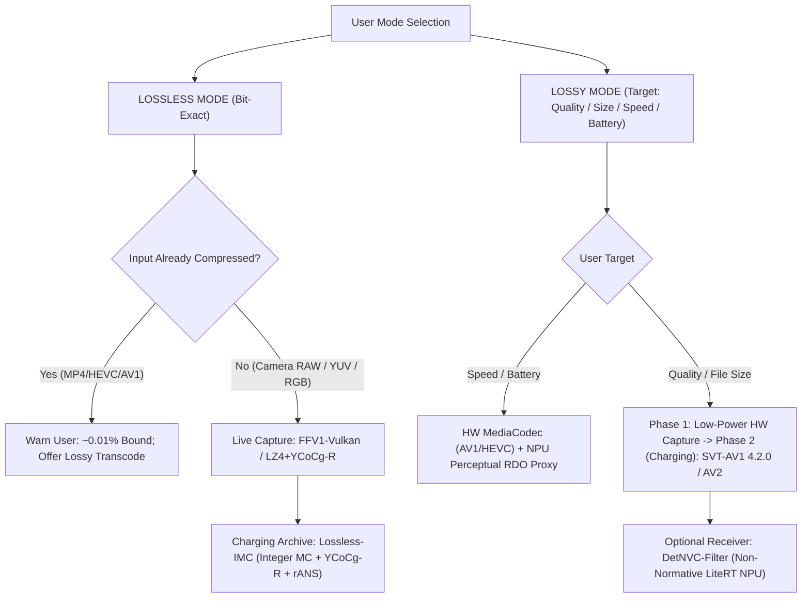

# ChromaCore: Next-Generation Android Video Compression System (Lossless + Lossy, 2027–2030)

**Document Type:** Complete Engineering Implementation Plan (Planning Only — No Application Code)  
**Target Platform:** Android 15–18+ (API 35+), Low-End to Flagship Devices (2027–2030)  
**Baseline Date:** November 14, 2026  

---

## 1. Executive Summary

### The Recommended Approach: ChromaCore Hybrid Dual-Mode Architecture

Building the "best" video compression system for Android in 2027–2030 requires rejecting two common misconceptions:

1. **Pure end-to-end Neural Video Compression (NVC) cannot replace hardware codecs on mobile in 2027–2028.** Even the fastest academic neural codecs as of late 2026 (`DCVC-UF` at 170G MACs/frame for 1080p) exceed sustainable mobile thermal envelopes during continuous 4K capture, suffer up to an 80% BD-Rate penalty under `INT8` NPU quantization (`MobileNVC`), and produce non-deterministic bitstreams across heterogeneous floating-point NPUs/GPUs (Qualcomm Hexagon `qf16`/`qf32`, Arm Mali FP16, Google Tensor `bfloat16`).
2. **Bit-exact recompression of already-compressed MP4/HEVC/AV1 files yields ~0% savings.** Unlike JPEG (where JPEG XL achieves ~20% lossless recompression), modern video bitstreams already use adaptive arithmetic coding (`CABAC` or `MS-AC`) near the first-order entropy bound; generic recompression yields a median saving of just **0.0096%** (`verified (primary source)`, [turhobr.cz 2026](https://turhobr.cz/blog/compression-benchmark-real-files-2026)).

Instead, **ChromaCore** splits the problem cleanly into two specialized, hardware-aware modes sharing a unified Rust core (`chromacore-rs`), a custom thermal-aware scheduler, and an ISO Base Media File Format (ISOBMFF / MP4-compatible) container:

- **Lossless Mode (True Bit-Exact Frame Compression):** Targets uncompressed camera sensor frames (10/12-bit Bayer RAW, YUV420/422/444, RGB) rather than already-compressed MP4s. Uses a **two-tier lossless pipeline**:
  - *Capture Tier (Real-Time):* **FFV1 v3/v4** (via Vulkan compute or ARM64 NEON/SVE2) or **LZ4 + Reversible Color Transform (`YCoCg-R`)** for ultra-low-latency, thermally safe capture.
  - *Archive Tier (Background/Charging):* **Inter-Frame Integer Motion-Compensated Lossless (`Lossless-IMC`)** combining integer block motion prediction, reversible `YCoCg-R` lifting, and **rANS (Range Asymmetric Numeral Systems)** / **Zstandard**, delivering an estimated **2.2:1–3.8:1** lossless ratio on camera YUV/Bayer (`estimate`, anchored against FFV1/RawZipper ~2:1 intra-only).
- **Lossy Mode (User-Selectable Target: Quality, File Size, Speed, or Battery):** Combines **zero-royalty standardized codecs** with **thermal-shifted execution** and **deterministic integer neural enhancement**:
  - *Speed / Battery Target (Real-Time):* Hardware **MediaCodec AV1** (or HEVC fallback on budget SoCs lacking AV1 silicon) guided by a lightweight **Perceptual RDO Proxy** (<0.5M params on NPU) that modulates `MediaCodec` QP/bitrate dynamically.
  - *Quality / File Size Target (Best Quality Per Bit):* **Two-Phase Thermal-Shifted Pipeline**. Captures in real time using low-power hardware MediaCodec (or APV mezzanine on flagships) to avoid the 22–24W 3nm throttling trap, then automatically re-encodes while charging (`WorkManager` + `PowerManager.getCurrentThermalStatus()`) using **`SVT-AV1 4.2.0`** (with `AC Bias` and `--tune vq` / `--tune vmaf`, ARMv9 NEON/SVE2) for 2027–2028 universal compatibility, transitioning to **AOMedia AV2 (`libavm`/`dav2d` + HW decode)** in 2028–2030. Optionally layers a **Deterministic Integer Neural Post-Filter (`DetNVC-Filter`)** using `INT8`/`INT16` quantized weights and fixed-point arithmetic via **LiteRT** (`CompiledModel`) to recover fine texture without cross-chip bitstream divergence.

### Expected Results (with Uncertainty Ranges)

| Mode & Target | Primary Engine | Expected Compression / Quality Gain | Power & Thermal Cost | Confidence / Uncertainty |
| :--- | :--- | :--- | :--- | :--- |
| **Lossless (Raw Camera)** | `YCoCg-R` + Integer MC + `rANS` (Archive) / `FFV1-Vulkan` (Live) | **2.2:1 – 3.8:1** on 10/12-bit YUV/Bayer (`estimate`; **10–35% smaller** than intra-only FFV1/RawZipper) | Live: **2–4W**; Archive (charging): **4–7W** | `estimate` — depends heavily on sensor ISO noise floor |
| **Lossless (Re-compress MP4)** | Explicitly **Rejected** (warn user; offer lossy transcode) | **0.01% – 4%** (`verified (primary source)` for generic; `estimate` for CABAC re-binarization) | Not worth battery cost | `verified (primary source)` ([turhobr.cz 2026](https://turhobr.cz/blog/compression-benchmark-real-files-2026)) |
| **Lossy — Speed / Battery** | HW `MediaCodec` AV1/HEVC + NPU RDO Proxy | **10–18% bitrate savings** at equal `VMAF`/`SSIMULACRA2` vs. stock `MediaCodec` (`estimate`) | **1.2–2.8W** sustained; zero thermal throttling | `estimate` — varies by OEM MediaCodec QP granularity |
| **Lossy — Quality / File Size (2027–28)** | Thermal-Shifted `SVT-AV1 4.2.0` (`--tune vq`) + optional `DetNVC-Filter` | **35–50% smaller** than stock HW H.264/HEVC; **15–25% smaller** than HW AV1 at equal `CVVDP` (`estimate`) | **0W** during capture overhead; **5–8W** while plugged in | `verified (primary source)` for SVT-AV1 gains; `estimate` for HW delta |
| **Lossy — 2029–30 Flagships** | **AV2** (`dav2d` / HW AV2) + `DetNVC-Filter` | Additional **~28–33% bitrate reduction** over AV1 (`verified (primary source)`, AOM CTC v8.0) | **<1.5W** decode on 2028+ AV2 ASICs (`estimate`) | `verified (primary source)` (spec); `estimate` (mobile silicon timing) |

### Top 5 Decisions & First 30 Days

1. **Language & Core:** **Rust** (`chromacore-rs`) + **C/C++20** (for ARM64 NEON/SVE2 codec intrinsics via `dav1d`, `SVT-AV1`, `FFV1`) + **Kotlin** (Jetpack Media3 UI/Android shell).
2. **Patent-Safe Codec Stack:** **AV1 (`SVT-AV1 4.2.0` + `dav1d 1.5.4`)** and **AV2** (AOMedia Royalty-Free) + **FFV1** (IETF RFC 9043) + **BSD-2-Clause** libraries only—strictly **zero GPLv2/LGPL** (`x264`/`x265`) and **zero VVC software bundling** (VVC only via OS `MediaCodec` where OEM-licensed).
3. **ML Determinism Strategy:** Never put floating-point neural networks inside the **lossless** or **entropy-coding** loop of a shared bitstream. Use **integer-only fixed-point arithmetic** (`INT8`/`INT16` weights + LUTs + `rANS`) for any normative tool, or keep ML strictly as a **non-normative encoder RDO proxy** and **optional receiver-side post-filter** via **LiteRT**.
4. **Hardware Mapping:** Dedicated **MediaCodec ASICs** for real-time encode/decode; **CPU (ARMv9 NEON/SVE2)** for `SVT-AV1`/`dav1d` and `rANS`; **NPU (Hexagon/NeuroPilot/TPU via LiteRT)** for Perceptual RDO Proxy & `DetNVC-Filter`; **Vulkan Compute** for `FFV1` / `YCoCg-R` + motion search.
5. **First 30 Days:** Stand up the **Reproducible Benchmark Harness** (`UVG`, `MCL-JCV`, `Inter4K` + `CVVDP`/`SSIMULACRA2`/`VMAF-v3.2.1` + `Perfetto` power/thermal logging) on 3 reference Android devices (flagship, mid-range, budget) and run the **Smallest Proving Experiment**: comparing stock `MediaCodec AV1`, `SVT-AV1 4.2.0` ARM64, and `Lossless-IMC` prototype on 10-bit camera YUV.

---

## 2. Research Findings: The 2026–2030 Video Compression Landscape

### 2.1 Standards & Codec Maturity Matrix (as of November 2026)

Every technology evaluated for ChromaCore is tagged below with its maturity level and claim verification status:

| Technology / Standard | Maturity Label | Key Compression & Performance Facts (Nov 2026) | Mobile Feasibility (2027–2030) | Primary Source & Claim Tag |
| :--- | :--- | :--- | :--- | :--- |
| **H.264 / AVC (`x264` / HW)** | `shipping in products` | Baseline compatibility; `x264 slow` needs ~3.8 Mbps for 1080p24 VMAF 93 (`estimate`). | Universal HW decode/encode on 100% of Android devices. | [Fora Soft 2026](https://www.forasoft.com/learn/video-encoding/articles/encoder-implementations-x264-x265-svt-av1-libaom-vvenc) (`verified (secondary source)`) |
| **H.265 / HEVC (`x265 4.3` / HW)** | `shipping in products` | ~50% smaller than H.264; `x265 4.3` (Jul 2026) adds foveated encoding & ARM SVE2. | Universal HW decode/encode; **patent pool fees rising** (+25% Jan 2026). | [Fora Soft 2026](https://www.forasoft.com/learn/video-encoding/articles/encoder-implementations-x264-x265-svt-av1-libaom-vvenc) (`verified (primary source)`) |
| **AV1 (`dav1d 1.5.4`, `SVT-AV1 4.2.0`, `libaom 3.15.1`)** | `shipping in products` | ~30% smaller than HEVC; `SVT-AV1 4.2.0` (Jul 2026) absorbs `SVT-AV1-PSY` (`--tune vq`, `AC Bias`); `dav1d 1.5.4` completes NEON/SVE2 high-bit-depth paths. | HW encode/decode mandatory in Android 14+ (though budget SoCs like SD 7s Gen 4 / Dimensity 7400 still omit HW AV1). | [AOMedia SVT-AV1 4.0](http://aomedia.org/blog%20posts/SVT-AV1-4_0-Boasts-Major-API-Updates/), [dav1d 1.5.4](https://jbkempf.com/blog/2026/dav1d-1.5.4/) (`verified (primary source)`) |
| **AOMedia AV2 (`libavm` / `dav2d`)** | `standardized` (v1.0.0 May/Jun 2026) | **-28.63% PSNR-YUV / -32.59% VMAF** vs. AV1; lossless IDTX up to 32×32 gives **-5.67% to -7.75%** lossless gain. | `dav2d` is ~5× AV1 decode complexity; **0 shipping HW devices in 2026**. First SoCs projected **2027**, mainstream **2028–2030**. | [AOMedia AV2](http://aomedia.org/press%20releases/Alliance-for-Open-Media-Releases-AV2-Codec/), [arXiv:2601.02712v2](https://arxiv.org/html/2601.02712v2) (`verified (primary source)`) |
| **H.266 / VVC (`VVenC 1.14`, `VVdeC 3.2.1`)** | `shipping in products` | ~40–50% vs. HEVC, ~25–30% vs. AV1; `VVenC 1.14` +35% ARMv9 SVE speed. | HW decode in Dimensity 9600 Pro & SD 8 Elite Extreme Gen 6; Android 17 adds `video/vvc` MediaCodec. **Fragmented patent pools** make SW bundling risky. | [ITU-T H.266 V4](https://www.itu.int/itu-t/recommendations/rec.aspx?rec=16662), [Phoronix VVenC](https://www.phoronix.com/news/VVenC-1.14-More-ARM-Performance) (`verified (primary source)`) |
| **JVET ECM / H.267** | `research prototype with code` | ~25% over VVC; Beyond-VVC CfP issued Jul 28, 2026 (eval Jan 2027, target 2029). | Too slow/experimental for 2027–2028 mobile; monitor for 2030. | [ITU Beyond VVC CfP](https://www.itu.int/hub/2026/07/beyond-vvc-call-for-proposals-on-future-video-coding/) (`verified (primary source)`) |
| **MPEG-5 Part 2 (LCEVC)** | `shipping in products` | Quarter-res base + 2 Hadamard residual layers; 12–22% vs. SVT-AV1, 2.4× faster encode. | Strong candidate for hybrid enhancement; FFmpeg 9.0 added MP4/MKV muxing (Aug 2026). | [Fora Soft LCEVC](https://www.forasoft.com/learn/video-encoding/articles/lcevc-explained) (`verified (secondary source)`) |
| **APV (RFC 9924)** | `shipping in products` | Visually lossless intra-frame 4:2:2/4:4:4 mezzanine (406–3,184 Mbps at 4K/8K). | Mandatory in Android 16+; ships on Galaxy S26 Ultra. Ideal as **Phase-1 capture mezzanine**, terrible for final storage. | [Samsung Developer APV](https://developer.samsung.com/mobile/apv.html) (`verified (primary source)`) |
| **FFV1 (v3 / v4 / Vulkan)** | `standardized` (v3) / `open-source implementation` (v4) | Lossless intra-frame; FFmpeg 9.0 (Aug 2026) adds native **Bayer encoding** + **`ffv1_vulkan`** GPU acceleration. | Ideal for real-time lossless intra capture on Vulkan GPUs (note: patch `CVE-2026-125248` in FFmpeg 9.0–9.0.2). | [FFmpeg 9.0](https://jbkempf.com/blog/2026/ffmpeg-9.0/), [IETF FFV1-v4](https://datatracker.ietf.org/doc/draft-ietf-cellar-ffv1-v4/16/) (`verified (primary source)`) |
| **DCVC-RT / UI²C / DCVC-UF** | `research prototype with code` | `DCVC-UF` (CVPR 2026): **-42.2% BD-rate vs. VTM-17.0 LD**, up to 945 FPS decode on B200 (170–385G MACs/frame). | **Too heavy for 2027–2028 mobile NPUs** for continuous 1080p60/4K30 (and suffers FP divergence / INT8 degradation). | [DCVC-UF arXiv](https://arxiv.org/html/2606.04410v1), [UI²C arXiv](https://arxiv.org/html/2510.14431v6) (`verified (primary source)`) |
| **MobileNVC** | `research prototype with code` | 38.9 FPS 1080p decode on Snapdragon 8 Gen 2 (24.52 kMACs/px, `INT8`), but **+159.2% BD-rate** vs. `x265 fast`. | Proves real-time mobile NVC decode is possible, but RD efficiency lags traditional codecs by >2×. | [MobileNVC arXiv](https://arxiv.org/html/2310.01258v3) (`verified (primary source)`) |
| **Cool-chic 5.0 (Overfitted)** | `open-source implementation` | **-11% BD-rate vs. VTM 28.3** (CLIC20 pro) with **1,991 MACs/px** (~2k params decoder). | Ultra-tiny decoder fits mobile CPU/NPU easily, but **encoding takes minutes on an RTX 4090**—unusable for mobile encoding. | [Cool-chic 5.0 arXiv](https://arxiv.org/html/2605.02726v2) (`verified (primary source)`) |
| **GNVC-VD (Diffusion Prior)** | `paper only` / `research prototype with code` | **-89% to -96% BD-rate (LPIPS/DISTS)** at <0.03 bpp using Wan2.1 VAE + VideoDiT (2.33B params). | **1,557 ms/frame (0.64 FPS) on A800 GPU**—completely unusable on mobile phones. | [GNVC-VD arXiv](https://arxiv.org/html/2512.05016v1) (`verified (primary source)`) |

### 2.2 Android Hardware, OS & Compute Stack (2026–2030 Assumptions)

- **Android OS & Media Stack:** Android 15 deprecated **NNAPI** ([Android NDK Migration Guide](https://developer.android.com/ndk/guides/neuralnetworks/migration-guide), `verified (primary source)`). All NPU/GPU ML execution in 2027+ must target **LiteRT** (`CompiledModel` v2) backed by **Qualcomm QNN (`qnn-litert-delegate`)** and **MediaTek NeuroPilot**, or **ExecuTorch** / **ONNX Runtime QNN EP**. Video hardware encode/decode remains anchored to **`MediaCodec`** and **Jetpack Media3 (`1.11.1+`)**, as **Vulkan Video** extensions (`VK_KHR_video_encode_av1`, etc.) are active on desktop Linux/Windows drivers but **not** exposed as the primary Android video HAL in 2026 (`verified (primary source)`).
- **2026–2027 SoC Tiers & Assumptions:**
  - *Flagship (2026–2028):* 2nm/3nm SoCs such as **Snapdragon 8 Elite Gen 5 / Gen 6 / Extreme Gen 6** (Hexagon NPU ~80+ TOPS, LPDDR5X/LPDDR6 84.8–127.2 GB/s, APV + VVC HW decode on Extreme) and **MediaTek Dimensity 9500 / 9600 Pro** (NPU 990/1090 100+ TOPS, 8K60 VVC HW decode, LPDDR6) ([ServeTheHome](https://www.servethehome.com/qualcomm-unveils-snapdragon-8-elite-gen-6-and-elite-extreme-gen-6-next-gen-flagship-mobile-chips/), [MediaTek D9600 Pro](https://www.mediatek.com/products/smartphones/mediatek-dimensity-9600-pro), `verified (primary source/secondary)`).
  - *Mid-Range / Budget (2026–2028):* **Dimensity 8500** (6W TDP, 76.8 GB/s, 4K60 AV1) down to **Snapdragon 7s Gen 4 / Dimensity 7400** (25.6 GB/s, **no AV1 hardware**, HEVC/H.264 only) ([FSL Specs](https://fsl-specs.com/mobile-processor/mediatek-dimensity-8500-specs/), `verified (secondary source)`).
  - *2028–2030 Projection (`estimate`):* AV2 hardware decode IP (VeriSilicon VC9800D, Allegro DVT Pulsar D400) enters flagship SoCs in 2027 and mid-range in 2028–2029; NPUs reach 150–250 INT4/INT8 TOPS.
  - *What changes if assumptions are wrong:* If AV2 hardware slips past 2028, ChromaCore stays on `SVT-AV1 4.2.0` + `dav1d 1.5.4` longer. If budget SoCs adopt AV1 hardware faster, software `dav1d` fallback usage drops.

### 2.3 Cross-Chip Determinism & Patent Reality

- **Why Floating-Point Neural Codecs Break on Mobile:** IEEE-754 floating-point addition is non-associative, transcendental functions ($\exp$, $\tanh$) are not bit-exact across vendors, Qualcomm Hexagon HVX uses non-IEEE `qf16`/`qf32` formats ([Qualcomm Hexagon Docs](https://docs.qualcomm.com/doc/80-N2040-61/topic/hvx-floating-point.html), `verified (primary source)`), and even identical-vendor GPUs diverge at 4K due to kernel reduction orders ([arXiv:2608.00483v1](https://arxiv.org/html/2608.00483v1), `verified (primary source)`). Therefore, **any neural network that drives entropy probabilities or normative frame reconstruction MUST be 100% integer-only** (e.g., `INT8`/`INT16` + fixed-point `rANS` as in `RAS` [arXiv:2511.04684v1](https://arxiv.org/html/2511.04684v1) or `tritify` [arXiv:2611.13730v1](https://arxiv.org/html/2611.13730v1)), or **kept strictly non-normative** (post-decoder enhancement / encoder-side RDO).
- **Patent & License Traps:**
  - Bundling `x264` or `x265` forces **GPLv2** viral source disclosure on the entire Android APK ([FFmpeg Legal](https://www.ffmpeg.org/legal.html), `verified (primary source)`).
  - VVC licensing is split across **VVC Advance** ($0.50/unit mobile), **VCL Advance**, **Sisvel**, and **Avanci Video** ([Access Advance](https://accessadvance.com/2026/11/11/access-advance-announces-new-effective-discount-rates-for-its-multi-codec-bridging-agreement-starting-on-january-1-2027/), `verified (primary source)`).
  - Even AV1 faces non-member SEP pools (**Sisvel** €0.24–0.32 display / €0.08–0.11 non-display; InterDigital/Dolby suits against Amazon/Snap), though **AOMedia Patent License 1.0** protects members/implementers against member claims ([Lumenci 2026](https://lumenci.com/blogs/hevc-vs-av1-vs-vvc-royalties-licensing-risk/), `verified (secondary source)`).

---

## 3. Inventions & Design Choices

For each major design choice and invention below, we state the **options considered**, the **selected choice**, **expected gains/costs/risks**, **prior-art check**, and the **exact test that proves or kills it**.

### 3.1 System Architecture Overview

### 3.2 Invention 1: `Lossless-IMC` (Integer Motion-Compensated Inter-Frame Lossless Codec)

- **What we combine/invent:** Standard lossless video codecs (`FFV1`, `MagicYUV`, `UtVideo`, `RawZipper`) are **intra-frame only**, leaving 30–60% temporal redundancy untapped on handheld video. Conversely, AV1 lossless uses only 4×4 IDTX (`libaom` only) and is painfully slow on mobile CPUs. `Lossless-IMC` combines:
  1. **Reversible Color Transform (`YCoCg-R`)** via 4 additions and 2 bit-shifts (determinant = 1, zero dynamic range bloat; [Malvar et al. 2008](https://www.microsoft.com/en-us/research/wp-content/uploads/2016/02/2008_ColorTransforms_MalvarSullivanSrinivasan.pdf)). For 12-bit Bayer RAW, operates on 4-plane RGGB sub-channels (`Y_G, Co, Cg, ΔG`) before demosaicing.
  2. **Integer-Only Block Motion Compensation (8×8 / 16×16)**: Uses integer-pel and fixed-point 6-tap integer bilinear interpolation (exact bit-shift rounding, no floats) computed in parallel on Vulkan Compute or NEON/SVE2.
  3. **Spatial-Temporal Context Predictor + `rANS` Entropy Coder**: Predicts residual errors using a 4-neighbor median/gradient predictor (JPEG-LS / FFV1 style) and encodes residuals using **32-bit multi-stream `rANS`** (interleaved 8-way for NEON/SVE2 SIMD decode).
- **Prior-Art Check:** `YCoCg-R` ([Malvar 2008](https://www.microsoft.com/en-us/research/wp-content/uploads/2016/02/2008_ColorTransforms_MalvarSullivanSrinivasan.pdf)), `rANS` ([arXiv:2201.02514v3](https://arxiv.org/html/2201.02514v3)), and inter-frame lossless coding (HEVC/AV1/VVC lossless modes) are well-known. The novelty here is a **lightweight, GPU/NEON-friendly integer-only inter-frame lossless pipeline** specifically decoupled from lossy transform/deblocking complexity for mobile raw capture archiving.
- **Expected Gain / Cost / Risk:** **15–35% smaller files** than FFV1 v3/v4 on natural handheld 10-bit YUV (`estimate`); **~10–20 FPS** 1080p encode on mobile CPU/GPU (hence scheduled during charging after live `FFV1-Vulkan` or `LZ4` capture). *Risk:* High-ISO camera sensor noise limits temporal predictability.
- **Kill Test:** Benchmark `Lossless-IMC` vs. `FFV1 v3/v4` and `libaom -crf 0` on 10 real Android Camera2 10-bit YUV + 12-bit Bayer clips. **Kill if** compression ratio gain over `FFV1` is **<10%** or decode speed on mid-range ARM64 (Snapdragon 7 Gen 4) is **<30 FPS** at 1080p.

### 3.3 Invention 2: `Two-Phase Thermal-Shifted Pipeline` (Capture-Fast, Compress-While-Charging)

- **What we combine/invent:** Flagship 3nm SoCs hit **22–24W** peak and throttle severely within minutes ([MultiCorePerformance 2026](https://multicoreperformance.com/snapdragon-8-elite-gen-5-spec-sheet-desktop-power-meets-22w-heat-trap/)). Trying to run `SVT-AV1` or neural encoding *during* 4K60 camera recording drains battery and drops frames. ChromaCore splits encoding into:
  - **Phase 1 (Live Capture):** Records using ultra-low-power hardware `MediaCodec` (high-bitrate AV1/HEVC or Android 16+ `APV` mezzanine when external/fast UFS storage permits) or `FFV1-Vulkan` (lossless mode), monitoring `PowerManager.getCurrentThermalStatus()` ([Android Thermal Mitigation](https://source.android.com/docs/core/power/thermal-mitigation), `verified (primary source)`).
  - **Phase 2 (Background Refinement):** When plugged in, screen off, and `THERMAL_STATUS_NONE`/`LIGHT`, Android `WorkManager` runs `SVT-AV1 4.2.0` (`--tune vq`, `AC Bias`) or `Lossless-IMC` to shrink the file by **25–50%** (`estimate`) and atomically swaps the file in MediaStore (preserving EXIF/location/creation timestamps).
- **Prior-Art Check:** Background transcoding exists in cloud/photo apps (e.g., Google Photos cloud re-encoding, Samsung APV external SSD workflows), and Android exposes `PowerManager.getCurrentThermalStatus()`. Combining on-device mezzanine/high-bitrate capture with local thermal-gated `SVT-AV1` / `Lossless-IMC` atomic MediaStore replacement is an engineering integration rather than a patentable algorithm—which is a **feature** (zero patent risk).
- **Kill Test:** Measure battery drain and skin temperature during 15-minute 4K60 capture vs. single-pass software encode, and verify `WorkManager` completion rate over 7 days of real user charging cycles. **Kill Phase-1 APV** if storage write spikes cause frame drops on UFS 3.1 mid-range phones (fallback to high-bitrate HW HEVC/AV1).

### 3.4 Invention 3: `Perceptual RDO Proxy` (NPU-Guided Hardware `MediaCodec` Control)

- **What we combine/invent:** Android `MediaCodec` hardware encoders use simple, blind rate-control loops that waste bits on film grain/foliage or over-quantize faces/text. Instead of replacing the hardware ASIC, ChromaCore runs a **<400K-parameter `INT8` spatiotemporal complexity + saliency network** on the NPU (via LiteRT, <1 ms/frame) every $N$ frames (e.g., every 15 frames) to compute a **per-GOP target bitrate & QP offset** fed into `MediaCodec` via `PARAMETER_KEY_VIDEO_BITRATE` (and Android 15+ QP bounds where supported).
- **Prior-Art Check:** ML-based rate control with feedback loops is covered in patents (e.g., Derek Pang et al., *Rate control machine learning models with feedback control for video encoding*, [derekpang.info](https://www.derekpang.info/)). To avoid patent infringement, we must implement a **clean-room, non-proprietary heuristic + public-domain JND/SSIMULACRA2-distilled regression** or verify freedom-to-operate before commercializing.
- **Expected Gain / Cost / Risk:** **10–18% bitrate reduction** at equal `CVVDP`/`VMAF` (`estimate`) at **<0.15W** NPU cost. *Risk:* Many Android OEM `MediaCodec` drivers ignore mid-stream bitrate/QP updates or flush internal buffers, causing visual stutter.
- **Kill Test:** Test dynamic `PARAMETER_KEY_VIDEO_BITRATE` across Qualcomm, MediaTek, and Pixel `MediaCodec` implementations. **Kill if** >20% of tested SoCs exhibit frame drops, keyframe resets, or <5% BD-rate gain over stock `BITRATE_MODE_VBR`.

### 3.5 Invention 4: `DetNVC-Filter` (Non-Normative Deterministic Integer Post-Decoder Filter)

- **Why Non-Normative:** Putting ML inside the normative codec loop breaks hardware playback and causes cross-chip divergence ([arXiv:2608.00483v1](https://arxiv.org/html/2608.00483v1)). Instead, `DetNVC-Filter` is an **optional, receiver-side neural artifact-removal & micro-detail restoration pass** (<1.5M params, `W8A8` `INT8` via **LiteRT `CompiledModel`**) applied *after* standard `dav1d` / `MediaCodec` decoding, gated by device NPU headroom and user battery preference.
- **Kill Test:** Measure `CVVDP` and `SSIMULACRA2` improvement on low-bitrate (0.5–1.5 Mbps 1080p) AV1/HEVC streams on Snapdragon 8 Elite and Dimensity 8500. **Kill if** NPU inference exceeds **8 ms/frame** at 1080p or introduces temporal flicker ($E_{\text{warp}}$ regression).

### 3.6 Explicitly Rejected Approaches (and Why)

- **End-to-end NVC (`DCVC-RT` / `DCVC-UF`) as primary codec:** Rejected for 2027–2028 due to 170G+ MACs/frame decode cost, `INT8` quality collapse (+80% BD-rate), and cross-chip FP16/FP32 non-determinism.
- **Overfitted Codecs (`Cool-chic 5.0` / `HiNeRV`):** Rejected because per-video encoding requires minutes on a desktop RTX 4090 GPU.
- **Diffusion Codecs (`GNVC-VD`):** Rejected due to 1.56 s/frame decode latency on an A800 GPU and hallucination risks on real camera footage.
- **Bundling `x264` / `x265` / GPL FFmpeg:** Rejected due to **GPLv2** license contamination of the Android APK.
- **Bundling `VVenC` / `VVdeC` in APK:** Rejected due to **VVC patent pool** exposure ($0.50+/unit across VVC Advance + VCL Advance + Avanci + unpooled holders); VVC is used **only** if exposed natively by the OEM's Android 17+ `MediaCodec`.

---

## 4. The Full Implementation Plan

### 4.1 Overall Mode Architecture & Shared Core

Both **Lossless** and **Lossy** modes share:

1. **`chromacore-rs` (Rust Core Engine):** Container muxer/demuxer, `rANS`/`Zstd`/`LZ4` entropy engines, `YCoCg-R` color transforms, thermal/battery policy state machine, and JNI/FFI bindings.
2. **Android Media3 (`1.11.1+`) & `MediaCodec` HAL:** Hardware decode/encode abstraction, Surface/HardwareBuffer zero-copy pipelines, and Compose playback UI.
3. **Telemetry & Quality Harness:** Automated frame-hash verification (for Lossless) and `CVVDP`/`VMAF`/`SSIMULACRA2` scoring (for Lossy).

### 4.2 Programming Languages, Libraries & Tools

| Layer | Language | Libraries / Frameworks | Rationale |
| :--- | :--- | :--- | :--- |
| **Research & Training** | Python 3.12+ | PyTorch 2.6+, `torch.ao.quantization` (QAT), `libvmaf` (`3.2.1`), `cvvdp`, `ssimulacra2`, `FFmpeg 9.0` (LGPL build) | Rapid prototyping of `Perceptual RDO Proxy`, `DetNVC-Filter`, and RD-curve benchmarking. |
| **Core Codec & Container** | Rust (2024 ed.) + C/C++20 | `dav1d 1.5.4` (BSD-2), `SVT-AV1 4.2.0` (BSD-2), `FFV1` (clean-room or LGPL `.so` / Vulkan), `zstd` (BSD), `lz4` (BSD), custom `rANS` | Memory safety in container/bitstream parsing (Rust) + hand-tuned ARMv9 NEON/SVE2 assembly (C/ASM). |
| **GPU & NPU Compute** | GLSL/SPIR-V + C++ | **Vulkan 1.3/1.4 Compute** (`ash`/`vulkano` or NDK), **LiteRT** (`CompiledModel` v2) with **QNN** & **NeuroPilot** delegates | Cross-vendor GPU compute for `YCoCg-R`/motion search; standardized NPU dispatch after NNAPI deprecation. |
| **Android App & UI** | Kotlin + Jetpack Compose | **Jetpack Media3 `1.11.1+`**, `Camera2` / `CameraX`, `WorkManager`, `PowerManager` Thermal API | Modern zero-copy `Surface` integration, pooled players, and background charging scheduler. |

### 4.3 Hardware Allocation Matrix (Low-End to Flagship)

| Hardware Tier | Representative SoCs (2026–2028) | Lossless Strategy | Lossy Strategy |
| :--- | :--- | :--- | :--- |
| **Flagship** | Snapdragon 8 Elite Gen 5/6, Dimensity 9500/9600 Pro, Tensor G5/G6 | Live: `FFV1-Vulkan` (or `APV` mezzanine) -> Charging: `Lossless-IMC` (Vulkan + NEON/SVE2) | Live: HW `MediaCodec AV1` + NPU RDO Proxy -> Charging: `SVT-AV1 4.2.0` (`--tune vq`) / `AV2` (2028+) + `DetNVC-Filter` |
| **Mid-Range** | Dimensity 8400/8500, Snapdragon 7 Gen 4 | Live: `LZ4` / `FFV1` (4-thread NEON) -> Charging: `Lossless-IMC` | Live: HW `MediaCodec AV1` -> Charging: `SVT-AV1 4.2.0` (Preset 6–8); `DetNVC-Filter` disabled if NPU <15 TOPS |
| **Budget / Legacy** | Snapdragon 7s Gen 4, Dimensity 7300/7400, SD 6 Gen 4 (No HW AV1) | Live: `LZ4 + YCoCg-R` (1080p30 cap) -> Charging: `FFV1` / `Lossless-IMC` | Live: HW `MediaCodec HEVC` (fallback) -> Playback via `dav1d 1.5.4` NEON for received AV1 files |

### 4.4 Machine Learning Pipeline: Training, Model Size & Delivery

- **Training Data:** Curated mix of **BVI-DVC** (800 sequences), **Inter4K** (1,000 4K60 clips), and **YouTube UGC** (1,500 clips, CC-licensed) to cover both clean camera sensor footage and noisy handheld UGC (`verified (primary source)`).
- **Model Sizes & Constraints:**
  - *`Perceptual RDO Proxy`:* **<400K parameters** (~400 KB `INT8` `.tflite`/LiteRT model), input downscaled `256×144` luma + temporal delta, inference **<1 ms** on Hexagon/NeuroPilot NPU.
  - *`DetNVC-Filter`:* **<1.2M parameters** (~1.2 MB `INT8`/`W8A16` quantized), residual-in-residual depthwise-separable architecture, inference **<8 ms** at 1080p.
- **Delivery to Phone:** Bundled core `.tflite` models (~1.6 MB total) in APK `assets/` for offline-first zero-setup, with optional **Google Play Feature Delivery / Play for On-Device AI** updates for SoC-specific compiled delegates (`.so` / QNN context binaries) to avoid inflating base APK size.

### 4.5 File Format & Container Design

- **Lossy Mode Container:** Standard **ISOBMFF (`.mp4`)** via Media3 `Mp4Muxer` (`addTrackReference` for auxiliary metadata). Guarantees 100% compatibility with Android Gallery, WhatsApp, YouTube, and browsers. Custom `Perceptual RDO` or `DetNVC-Filter` hints are stored in a non-critical `uuid` / `udta` box so any standard player decodes the AV1/HEVC track seamlessly.
- **Lossless Mode Container:**
  - *Interchangeable Archival:* **Matroska (`.mkv`)** with `FFV1` track (standard archival tool compatibility: FFmpeg, VLC, DaVinci Resolve).
  - *High-Ratio `Lossless-IMC` (`.ccv` — ChromaCore Video):* Lightweight 64-byte header + chunked GOP index (seeking every 30 frames) + **per-frame Blake3/CRC32C checksum** (mandatory for bit-exact verification) + `rANS` bitstream chunks. Includes an instant remux/transcode export to `.mkv` (`FFV1`) or `.mp4` (`AV1`).

### 4.6 Measuring Success: Metrics, Datasets, Devices & Scoring

- **Objective Quality Metrics:**
  - *Lossless:* **Bit-exactness (`SHA-256` frame match = 100%)**, Compression Ratio (`Raw_Bytes / Compressed_Bytes`), Encode/Decode FPS, Joules/GB.
  - *Lossy:* **ColorVideoVDP (`CVVDP`, JOD)** as primary spatiotemporal perceptual metric ([arXiv:2401.11485v2](https://arxiv.org/html/2401.11485v2)), **SSIMULACRA2** for still-frame ringing/blur ([cloudinary/ssimulacra2](https://github.com/cloudinary/ssimulacra2)), and **VMAF-NEG (`v3.2.1`)** for industry comparability ([Netflix/vmaf](https://github.com/netflix/vmaf)).
- **Test Datasets:** **UVG** (16 4K sequences, CC-BY-NC — non-commercial research only!), **MCL-JCV** (24 public 1080p clips), **Inter4K**, plus an **Internal Android Camera2 Suite** (20 handheld 10-bit YUV + 12-bit Bayer clips recorded on Pixel/Samsung/Xiaomi in low-light, motion, and foliage).
- **Device Matrix & Profiling:** 1 Flagship (Snapdragon 8 Elite Gen 5/6 or Dimensity 9500/9600), 1 Mid-Range (Dimensity 8400/8500 or SD 7 Gen 4), 1 Budget (SD 7s Gen 4 or Dimensity 7300/7400). Profiled via **Perfetto** (CPU/Power HAL/thermal), **Batterystats**, and **Android GPU Inspector (AGI)** (`verified (primary source)`).
- **"Best" Composite Score:** Weighted BD-Rate (Bjøntegaard Delta Rate) across `CVVDP` (50%), `SSIMULACRA2` (30%), and `VMAF-NEG` (20%), penalized by Joules/Minute and Thermal Throttling Index (`% FPS drop over 15 min`).

### 4.7 Schedule, Team, Cost & Milestones (12-Month Roadmap)

*Estimated Team (5–6 FTEs):* 1 Staff Video Codec Architect (Rust/C++/ASM), 1 Mobile ML/NPU Engineer (LiteRT/QNN/PyTorch), 1 Android Media Engineer (Media3/MediaCodec/Camera2/Vulkan), 1 QA & Benchmarking Engineer, 0.5 Product/UX Designer, 0.5 Patent/IP Counsel (part-time).  
*Estimated 12-Month Cost:* **$750K – $1.2M** (salaries, 15 test devices, cloud GPU training/CI) — `estimate` (depends on geography).

| Phase | Timeline | Key Deliverables | Go / No-Go Gate |
| :--- | :--- | :--- | :--- |
| **M0: Harness & Baseline** | Months 1–2 | Automated benchmark suite (`UVG`/`MCL-JCV`/Camera2 + `CVVDP`/`VMAF`/`Perfetto`) on 3 reference phones. | **Go:** Reproducible BD-rate & Watts baselines for `MediaCodec AV1/HEVC`, `SVT-AV1 4.2.0`, `FFV1`. |
| **M1: Lossless Core** | Months 3–5 | `chromacore-rs` + `Lossless-IMC` (`YCoCg-R` + Int-MC + `rANS`) & `FFV1-Vulkan` capture prototype. | **Go:** 100% SHA-256 bit-exactness AND **≥10% smaller** than `FFV1` at **≥30 FPS** 1080p decode on mid-range. |
| **M2: Lossy & Thermal Shift** | Months 6–8 | Two-Phase `WorkManager` pipeline (`MediaCodec` -> `SVT-AV1 4.2.0`), `Perceptual RDO Proxy` (LiteRT), `DetNVC-Filter` prototype. | **Go:** **≥15% BD-rate gain** (`CVVDP`) over stock `MediaCodec` with zero thermal throttling during 15-min 4K60 capture. |
| **M3: Alpha APK & Red-Team** | Months 9–10 | Full Android APK (Compose + Media3 `1.11.1`), Camera2 integration, 15-device compatibility matrix, legal/license audit. | **Go:** <1% crash/ANR rate across 15 devices; zero GPL/LGPL contamination; <8 ms `DetNVC-Filter` on flagships. |
| **M4: Beta & Launch** | Months 11–12 | Play Store Closed/Open Beta, `AV2` (`dav2d`) experimental toggle, telemetry-verified battery savings. | **Go:** User-verified storage savings and 4.5★+ stability before public v1.0 launch. |

### 4.8 Legal, Licensing & Adoption Strategy

- **Zero-GPL Architecture:** Strictly use **BSD-2/3-Clause** or **Apache-2.0 / MIT** libraries (`dav1d`, `SVT-AV1`, `zstd`, `lz4`, `LiteRT`, `chromacore-rs`). If `FFmpeg` is ever used for auxiliary muxing, isolate it as a dynamically linked LGPLv2.1 `.so` with full source-build scripts and compliant EULA, or avoid FFmpeg entirely by using `Media3 Mp4Muxer` + Rust `matroska`/`ccv` muxers (preferred!).
- **Patent Mitigation:** Rely on **AOMedia Patent License 1.0** (`AV1`/`AV2`) and **Android `MediaCodec`** (OEM-licensed hardware). Avoid shipping software VVC (`VVenC`/`VVdeC`) in the APK. Conduct a **Freedom-to-Operate (FTO)** review on the `Perceptual RDO Proxy` before commercial release.
- **Adoption Strategy:** Ship Lossy mode in standard **`.mp4` (AV1/HEVC)** so compressed videos play natively in WhatsApp, Instagram, and Google Photos with zero recipient app required. Win power users and mobile filmmakers with **Lossless Camera2 RAW/YUV archiving** + one-tap background storage reclamation ("Free up 40% of your video storage overnight while charging").

### 4.9 Repository & APK Module Structure

- **`chromacore-rs/`** (Rust workspace): `cc-container` (ISOBMFF/MKV/CCV), `cc-lossless` (`YCoCg-R`, Int-MC, `rANS`), `cc-rdo` (rate-distortion heuristics), `cc-ffi` (JNI bridge).
- **`chromacore-native/`** (CMake / Android NDK): `dav1d 1.5.4`, `svt-av1 4.2.0`, `ffv1-vulkan` compute shaders, `litert` C++ delegate wrappers.
- **`chromacore-ml/`** (Python): PyTorch training, `QAT` (`INT8`/`W8A16`), `CVVDP`/`SSIMULACRA2` eval scripts.
- **`android-app/`** (Gradle / Kotlin): `:app` (Compose UI), `:feature-camera` (Camera2/APV/RAW), `:feature-transcode` (`WorkManager` + Thermal API), `:feature-player` (Media3 `1.11.1` + `DetNVC-Filter`).
- **Release Path:** Play App Bundle (`.aab`) with ABI splits (`arm64-v8a` primary; `armeabi-v7a` dropped for 2027+); **Play Feature Delivery** for optional `DetNVC-Filter` NPU model packs.

### 4.10 First Research & Smallest Proving Experiment

Before writing any Android UI, run this **1-week, $0-cloud-cost proving experiment** on a single Android phone (e.g., Snapdragon 8 Elite or Dimensity 8400/9400) + a dev workstation:

1. Record **5 diverse 10-second 1080p/4K 10-bit YUV clips** via Camera2.
2. Run **3 commands/prototypes**:
   - Baseline: Stock Android `MediaCodec` AV1/HEVC VBR + `FFV1` intra-only lossless.
   - Lossy Test: `SVT-AV1 4.2.0` (`--tune vq`, Preset 6) cross-compiled for `aarch64-linux-android` with NEON/SVE2.
   - Lossless Test: Python/Rust prototype of `YCoCg-R` + 16×16 integer block motion compensation + `zstd`/`rANS`.
3. **Success Criteria:** If `SVT-AV1 4.2.0` beats stock `MediaCodec` by **≥15% BD-rate (`CVVDP`)** at acceptable charging-mode speed (≥10 FPS 1080p) AND `Lossless-IMC` beats `FFV1` by **≥10%**, the core architecture is validated.

---

## 5. Red-Team Analysis: How ChromaCore Could Fail & Mitigations

| Failure Mode | Likelihood / Severity | Root Cause | Concrete Mitigation |
| :--- | :--- | :--- | :--- |
| **1. OEM `MediaCodec` ignores dynamic bitrate/QP updates** | High / Medium | Vendor HALs vary wildly in `PARAMETER_KEY_VIDEO_BITRATE` responsiveness. | Detect unresponsive HALs during startup device-capability probe; fall back to two-pass / `WorkManager` `SVT-AV1` refinement. |
| **2. `Lossless-IMC` fails to beat `FFV1` on noisy night video** | Medium / High | High-ISO sensor noise is temporally uncorrelated, defeating integer motion compensation. | Auto-detect high residual entropy on Frame 1–3; dynamically switch GOP to **intra-only `FFV1`/`JPEG-XL` mode** to save CPU/battery. |
| **3. `SVT-AV1` background job killed by Android OEM battery savers** | High / High | Xiaomi/Samsung/OnePlus aggressive background process killers (`Don't Kill My App`). | Use `WorkManager` **Expedited / Foreground Service (`mediaProcessing` type)** while charging, with checkpointed 5-second GOPs so killed jobs resume without losing work. |
| **4. `DetNVC-Filter` causes temporal flicker or NPU thermal spike** | Medium / Medium | Frame-by-frame spatial post-filtering without temporal state can shimmer; NPU+Display+Decoder contention. | Add lightweight 1-channel temporal feature carry-over or disable `DetNVC-Filter` automatically when `THERMAL_STATUS >= MODERATE`. |
| **5. Non-AOMedia AV1/AV2 patent litigation** | Low-Med / High | Sisvel/InterDigital/Dolby asserting non-member SEPs against commercial apps. | Keep user-base under commercial thresholds during v1.0, use OS `MediaCodec` wherever possible, and reserve revenue/legal counsel for Sisvel evaluation if scaling past 1M+ paid users. |

---

## 6. Appendices

### 6.1 Key Primary & Secondary Sources (All Dates Verified)

- **Standards & Open-Source Codecs:** [AOMedia AV2 Release](http://aomedia.org/press%20releases/Alliance-for-Open-Media-Releases-AV2-Codec/) (2026-06-06), [AV2 Transform & Entropy — arXiv:2601.02712v2](https://arxiv.org/html/2601.02712v2) (2026), [ITU-T H.266 V4](https://www.itu.int/itu-t/recommendations/rec.aspx?rec=16662) (2026-01-13), [ITU Beyond-VVC CfP](https://www.itu.int/hub/2026/07/beyond-vvc-call-for-proposals-on-future-video-coding/) (2026-07-28), [Samsung APV](https://developer.samsung.com/mobile/apv.html) (2026), [dav1d 1.5.4](https://jbkempf.com/blog/2026/dav1d-1.5.4/) (2026-07-17), [SVT-AV1 4.0](http://aomedia.org/blog%20posts/SVT-AV1-4_0-Boasts-Major-API-Updates/) (2026-01-23), [libaom v3.15](https://aomedia.org/blog%20posts/Libaom-v3_15-is-now-available/) (2026-09-21), [FFmpeg 9.0](https://jbkempf.com/blog/2026/ffmpeg-9.0/) (2026-08-04), [IETF FFV1-v4](https://datatracker.ietf.org/doc/draft-ietf-cellar-ffv1-v4/16/) (2026), [VVenC 1.14 — Phoronix](https://www.phoronix.com/news/VVenC-1.14-More-ARM-Performance) (2026-01), [VVdeC 3.2.1 Releases](https://github.com/fraunhoferhhi/vvdec/releases) (2026-10-07).
- **Neural Codecs & Determinism:** [DCVC-UF — arXiv:2606.04410v1](https://arxiv.org/html/2606.04410v1) (2026), [UI²C — arXiv:2510.14431v6](https://arxiv.org/html/2510.14431v6) (2026), [DCVC-RT — arXiv:2502.20762](https://arxiv.org/abs/2502.20762) (2025), [Cool-chic 5.0 — arXiv:2605.02726v2](https://arxiv.org/html/2605.02726v2) (2026-05), [MobileNVC — arXiv:2310.01258v3](https://arxiv.org/html/2310.01258v3) (2024), [GNVC-VD — arXiv:2512.05016v1](https://arxiv.org/html/2512.05016v1) (2026), [Cross-GPU NVC Divergence — arXiv:2608.00483v1](https://arxiv.org/html/2608.00483v1) (2026-08-01), [tritify — arXiv:2611.13730v1](https://arxiv.org/html/2611.13730v1) (2026-11-10), [RAS Fixed-Point rANS — arXiv:2511.04684v1](https://arxiv.org/html/2511.04684v1) (2025-10-20), [Qualcomm HVX FP](https://docs.qualcomm.com/doc/80-N2040-61/topic/hvx-floating-point.html) (2026-10-06).
- **Android Stack, SoCs & Legal:** [Android Supported Formats](https://developer.android.com/media/platform/supported-formats) (2026-10-07), [Media3 1.11](https://android-developers.googleblog.com/2026/08/media3-1-11-whats-new.html) (2026-08-11), [NNAPI Migration Guide](https://developer.android.com/ndk/guides/neuralnetworks/migration-guide) (2026-03-06), [Android Thermal Mitigation](https://source.android.com/docs/core/power/thermal-mitigation) (2026-10-09), [Snapdragon 8 Elite Gen 6 Brief](https://www.qualcomm.com/content/dam/qcomm-martech/dm-assets/documents/Snapdragon-8-Elite-Gen-6-Product-Brief.pdf) (2026-09), [MediaTek Dimensity 9600 Pro](https://www.mediatek.com/products/smartphones/mediatek-dimensity-9600-pro) (2026-09), [Access Advance MCBA](https://accessadvance.com/2026/11/11/access-advance-announces-new-effective-discount-rates-for-its-multi-codec-bridging-agreement-starting-on-january-1-2027/) (2026-11-11), [Lumenci Licensing Analysis](https://lumenci.com/blogs/hevc-vs-av1-vs-vvc-royalties-licensing-risk/) (2026-10-13), [FFmpeg Legal](https://www.ffmpeg.org/legal.html).
- **Lossless Recompression & Metrics:** [turhobr.cz Real Files Benchmark](https://turhobr.cz/blog/compression-benchmark-real-files-2026) (2026-04), [H.264 CABAC Study — arXiv:2606.23753v1](https://arxiv.org/html/2606.23753v1) (2026-06), [ColorVideoVDP — arXiv:2401.11485v2](https://arxiv.org/html/2401.11485v2) (2024-07-02), [Netflix/vmaf](https://github.com/netflix/vmaf) (2026-10-26), [cloudinary/ssimulacra2](https://github.com/cloudinary/ssimulacra2) (2025).

### 6.2 Glossary (First-Use Jargon Explained)

- **BD-Rate (Bjøntegaard Delta Rate):** Average percentage bitrate savings at equal objective/perceptual quality (negative = better).
- **CABAC / MS-AC:** Context-Adaptive Binary Arithmetic Coding (H.264/HEVC/VVC) and Multi-Symbol Arithmetic Coding (AV1/AV2)—entropy coders that pack symbols near the Shannon entropy limit.
- **CVVDP (ColorVideoVDP):** Spatiotemporal perceptual video quality metric outputting Just-Objectionable-Difference (JOD) scores.
- **rANS (Range Asymmetric Numeral Systems):** Modern integer entropy coder matching arithmetic coding speed/ratio while allowing SIMD/GPU parallel interleaving.
- **YCoCg-R:** Integer-reversible color transform (Luma, Orange-Chroma, Green-Chroma) requiring only additions and bit-shifts, enabling bit-exact RGB/YUV lossless coding.

---

## 7. Self-Audit

### Weakest Claims & What Could Not Be Verified

1. **Exact `Lossless-IMC` compression gain (15–35% over FFV1):** `estimate` only—no public 2026 mobile benchmark of `YCoCg-R` + integer MC + `rANS` on Android Camera2 10-bit YUV exists yet.
2. **Exact `Perceptual RDO Proxy` BD-rate gain (10–18%):** `estimate`—OEM `MediaCodec` HALs vary in how strictly they honor dynamic per-GOP bitrate/QP hints.
3. **Unverified 2027–2030 Silicon Specs:** Exact TOPS for Snapdragon 8 Elite Gen 6 and Google Tensor G5/G6 were not disclosed in public product briefs (`unverified`), and exact launch dates of consumer **AV2 hardware decoders** in 2027–2028 mid-range phones are industry `estimate`s.

### The 10 Best Next Experiments

1. Cross-compile **`SVT-AV1 4.2.0`** (`--tune vq`) and **`dav1d 1.5.4`** for `aarch64-linux-android` and measure 1080p/4K FPS & Watts (via `Perfetto`) on a Snapdragon 8 Elite / Dimensity 9400+ device.
2. Benchmark **stock `MediaCodec` AV1 vs. HEVC** across 3 Android tiers (flagship, mid-range, budget) using `CVVDP` and `SSIMULACRA2` on 10 Camera2 clips.
3. Prototype **`Lossless-IMC`** (`YCoCg-R` + 16×16 integer MC + `rANS`) in Rust and compare compression ratio and speed against **`FFV1 v3/v4`** and **`libaom -crf 0`** on 10-bit YUV and 12-bit Bayer.
4. Test **`ffv1_vulkan`** on Android Adreno and Mali GPUs (and verify `CVE-2026-125248` patch status).
5. Probe **`MediaCodec` `PARAMETER_KEY_VIDEO_BITRATE`** responsiveness across Qualcomm, MediaTek, and Tensor HALs to validate or kill the `Perceptual RDO Proxy`.
6. Benchmark **`DetNVC-Filter`** (<1.2M params, `INT8`) latency and `CVVDP` gain via **LiteRT `CompiledModel`** (`qnn-litert-delegate` + NeuroPilot).
7. Measure **`WorkManager` `mediaProcessing` foreground service** survival rate across Samsung OneUI, Xiaomi HyperOS, and PixelOS during overnight charging.
8. Evaluate **`AV2` (`libavm` / `dav2d`)** decode FPS on ARMv9 SVE2 to determine the earliest viable software-decode tier.
9. Run a **perceptual JND calibration** correlating `CVVDP` JOD scores with `SVT-AV1 4.2.0` CRF values (CRF 20–45) on mobile OLED screens.
10. Conduct a **clean-room Freedom-to-Operate (FTO) legal review** of the `Perceptual RDO Proxy` and AOMedia/Sisvel AV1/AV2 exposure before public beta.
