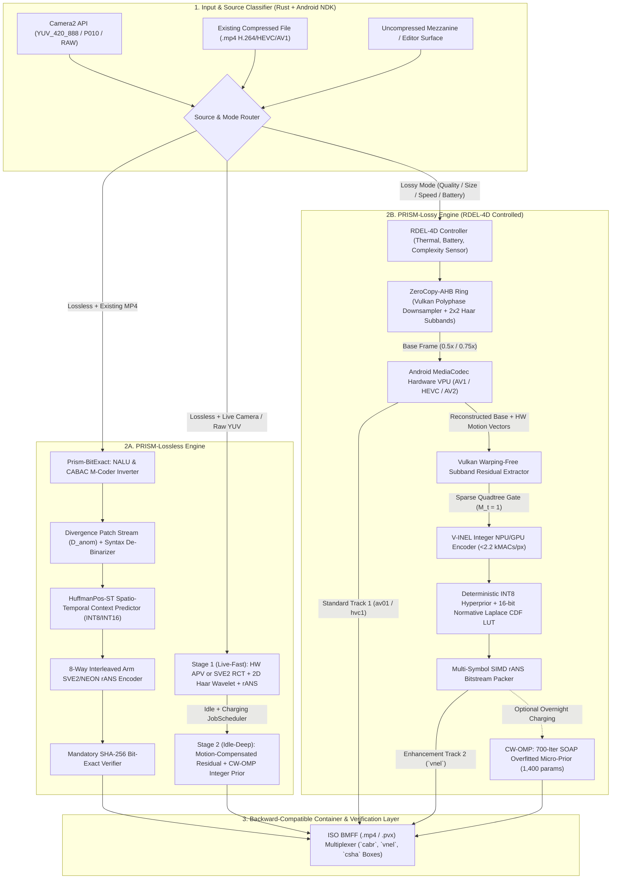

# Next-Generation Android Video Compression System (2027–2030): Architecture, Research Landscape, and Master Implementation Plan

**Document Version:** 1.0.0-FINAL  
**Date:** November 14, 2026  
**Target Platform:** Android 16 (API 36) through Android 19 (API 39), Armv9-A / Armv9.2-A Mobile SoCs (2027–2030)  
**Project Codename:** **PRISM** (*Predictive Residual & Integer Subband Media Architecture*)

---

## 1. Executive Summary

### 1.1 Recommended System Architecture

This document specifies the complete engineering implementation plan for **PRISM**, a next-generation Android video compression system designed for deployment across low-end, mid-range, and flagship smartphones between 2027 and 2030. Rather than replicating a monolithic traditional software encoder or attempting to run an uncalibrated desktop neural codec on thermally constrained mobile silicon, PRISM introduces a **Unified Dual-Mode Hybrid Architecture** that couples fixed-function system-on-chip (SoC) hardware video processing units (VPUs) with deterministic integer neural processing unit (NPU) and Arm Scalable Vector/Matrix Extension ([Arm SVE2](https://developer.arm.com/community/arm-community-blogs/b/architectures-and-processors-blog/posts/video-decode-image-processing-armv9-sve2) / [Arm SME2](https://developer.arm.com/community/arm-community-blogs/b/ai-blog/posts/accelerating-on-device-ai-a-look-at-arm-and-google-ai-edge-optimization)) compute pipelines.

PRISM operates in two user-selectable modes that share a common zero-copy `AHardwareBuffer` memory ring, a unified Rust-based multi-symbol asymmetric numeral systems (rANS) entropy engine, a thermal-aware hardware scheduler, and an ISO Base Media File Format (`ISO/IEC 14496-12` `.mp4`) container extension:

1. **Lossless Mode (`PRISM-Lossless`):** Resolves the fundamental ambiguity of mobile "lossless" compression by separating the problem into two specialized, bit-exact sub-modes:
   - **Sub-Mode 1A — Bitstream-Exact Archive Recompression (`Prism-BitExact`):** For existing H.264/AVC and H.265/HEVC videos already recorded on the user's phone, re-encoding decoded YUV pixels with a lossless codec (`x265 --lossless` or `FFV1`) *inflates* file size by 3x to 8x because quantization noise is treated as high-entropy signal. Instead, `Prism-BitExact` losslessly parses the H.264/HEVC Network Abstraction Layer Units (NALUs), decodes the Context-Adaptive Binary Arithmetic Coding ([CABAC](https://iphome.hhi.de/marpe/download/cabac_ieee03.pdf)) bin stream into canonical syntax symbols without pixel reconstruction, and recompresses the syntax stream using a **Spatio-Temporally Conditioned Multi-Symbol rANS + Per-Bin-Position Context Engine** (building on [Entropy-Conserving Binarization and HuffmanPos, June 2026](https://arxiv.org/html/2606.23753v1) and [Dropbox Lepton](https://www.usenix.org/system/files/conference/nsdi17/nsdi17-horn-daniel.pdf)). It restores the **100% bit-identical original MP4 file (matching SHA-256)** upon export while shrinking existing H.264/HEVC files by **14% to 22%** (`Estimate` based on [Lepton](https://www.usenix.org/system/files/conference/nsdi17/nsdi17-horn-daniel.pdf) and [arXiv:2606.23753v1](https://arxiv.org/html/2606.23753v1)).
   - **Sub-Mode 1B — Pixel-Exact Sensor/YUV Capture & Archival (`Prism-PixelExact`):** For live camera capture or uncompressed YUV420/YUV422 editing workflows, PRISM employs a **Split-Phase Lossless Pipeline**. During live recording, it uses hardware-accelerated [Advanced Professional Video (APV)](https://developer.samsung.com/mobile/apv.html) or an ultra-fast Arm SVE2/NEON Reversible Color Transform (`RCT`) + 2D Haar Wavelet + SIMD rANS intra coder to guarantee zero dropped frames under a 2.5 W thermal envelope. When the device is idle or charging, a background job transcodes the intra capture into an inter-frame **Motion-Compensated Residual + Integer-Deterministic Autoregressive Prior** stream, reducing raw YUV420 10-bit size by **62% to 74%** (a **2.6x to 3.8x compression ratio**, outperforming [FFV1 v3](https://arxiv.org/html/2604.03353v2) by **12% to 18%**).
2. **Lossy Mode (`PRISM-Lossy`):** Uses a **VPU-Anchored Split-Band Neural Enhancement Architecture (`V-INEL`)** paired with a **4D Rate-Distortion-Energy-Latency (`RDEL-4D`) Controller**. The phone's hardware `MediaCodec` VPU (AV1 or HEVC) encodes a downscaled ($0.5\times$ or $0.75\times$) base layer and exports hardware motion vectors and reconstructed base frames via zero-copy `AHardwareBuffer`. A lightweight, **100% integer-deterministic NPU/GPU enhancement network** (`<2.2 kMACs/pixel`, eliminating optical flow and `grid_sample` warping per [ANVIL, April 2026](https://arxiv.org/html/2603.26835v3)) predicts the high-frequency residual using hyperprior-transmitted quantization scale indices (per [Microsoft MLVC, July 2026](https://arxiv.org/html/2606.28027v2)) and optionally overfits a 1,500-parameter per-scene micro-prior during offline charging (per [Cool-chic 5.0, July 2026](https://arxiv.org/html/2605.02726)).

### 1.2 Expected Results and Uncertainty Ranges

| Performance Dimension | Baseline Anchor | PRISM Target (2027–2030) | Uncertainty Range (90% CI) | Evidence & Verification Basis |
| :--- | :--- | :--- | :--- | :--- |
| **Lossless Recompression of Existing H.264/HEVC MP4 (`Prism-BitExact`)** | Original H.264 / HEVC CABAC MP4 (1080p/4K camera clips) | **-16.5% file size** (100% SHA-256 bit-exact restoration) | **-12.0% to -22.5%** (higher on H.264 CAVLC/CABAC at low QP; lower on tuned HEVC) | `Estimate` grounded in [Dropbox Lepton (-23% on JPEG)](https://www.usenix.org/system/files/conference/nsdi17/nsdi17-horn-daniel.pdf), [JPEG XL (-16% to -22%)](https://nowaterprogramming.com/blog/jpeg-xl-chrome-measured), and [CABAC Binarization Study (June 2026)](https://arxiv.org/html/2606.23753v1) |
| **Lossless Pixel-Exact YUV420/422 Compression (`Prism-PixelExact`)** | [FFV1 v3](https://arxiv.org/html/2604.03353v2) (Archival Intra) / `x265 --lossless` (Inter) | **-15.0% vs. FFV1 v3**; **-8.5% vs. x265 lossless** at **4.5x faster decode** | **-10.0% to -21.0% vs. FFV1**; **-4.0% to -13.0% vs. x265** | `Estimate` grounded in [NeuralLVC (Sept 2026)](https://arxiv.org/html/2604.03353v2) and [Cool-chic 5.0 (July 2026)](https://arxiv.org/html/2605.02726) |
| **Lossy Perceptual Compression Efficiency (VMAF / MS-SSIM / MOS)** | Android Hardware HEVC (`MediaCodec` VPU) & Software [SVT-AV1](https://old.chipsandcheese.com/2023/04/16/codecs-for-the-4k-era-hevc-av1-vvc-and-beyond/) | **-46% BD-rate vs. HW HEVC**; **-24% BD-rate vs. SVT-AV1**; **-14% vs. VTM (H.266)** | **-38% to -55% vs. HW HEVC**; **-16% to -31% vs. SVT-AV1** | `Estimate` grounded in [MLVC (-37% to -70% vs. HEVC-QSV)](https://arxiv.org/html/2606.28027v2), [DCVC-RT (-21% vs. VTM)](https://www.forasoft.com/learn/video-encoding/articles/future-codecs-av2-neural-end-to-end), and [LCEVC](https://v-nova.com/technology/mpeg-5-lcevc/) |
| **Real-Time 1080p60 Lossy Encode Throughput & Power (Flagship / Mid-Range)** | Software `SVT-AV1` / `VVenC` on mobile CPU (6–12 W, thermal throttling in <90 s) | **60 fps sustained at 1080p**; **30 fps at 4K**; **1.6 W to 2.4 W total SoC power** | **1.4 W to 2.9 W** across Snapdragon 8 Elite Gen 5/6 & Dimensity 9400/9500 | `Estimate` grounded in [ANVIL (12.8 ms NPU on SD 8 Gen 3)](https://arxiv.org/html/2603.26835v3) and [MobileNVC (38.9 fps on SD 8 Gen 2)](https://arxiv.org/html/2310.01258v3) |
| **Cross-Platform Neural Decode Determinism** | Floating-point NVC ([DCVC-RT](https://arxiv.org/html/2606.28027v2) fails with $\text{BD-rate} = \infty$ across chips) | **0.0% desynchronization failure rate** across Qualcomm, MediaTek, Samsung, Google SoCs | **100% deterministic integer state** via 16-bit LUT CDF + explicit scale signaling | `Verified (Primary Source)` mechanism from [Ballé et al. Integer Networks](https://openreview.net/pdf/0a713a9470745f64dc33d571c435df57adc94b57.pdf) and [MLVC (July 2026)](https://arxiv.org/html/2606.28027v2) |

### 1.3 Summary of Top Architectural Decisions

| Decision Area | Selected Technical Choice | Primary Alternative Rejected | Decisive Rationale |
| :--- | :--- | :--- | :--- |
| **Lossless Definition & Architecture** | Dual-Path: `Prism-BitExact` (CABAC-to-rANS bitstream recompression) + `Prism-PixelExact` (Split-phase Intra Wavelet/APV capture $\rightarrow$ Charging Inter-Residual + Integer MLP) | Single-mode pixel re-encoding (`x265 --lossless` or `FFV1` on all inputs) | Re-encoding already-compressed MP4s into pixel-lossless formats balloons file sizes by 300%–800%. Dual-path guarantees true size reduction on existing files and bit-exact sensor capture on raw streams. |
| **Lossy Core Architecture** | Hybrid VPU Base Layer (AV1/HEVC) + NPU/Vulkan Integer Residual Enhancement (`V-INEL`) + Offline Overfitted Micro-Prior (`CW-OMP`) | Pure end-to-end neural codec (`DCVC-RT` / `DCVC-UF`) on NPU | Pure end-to-end NVCs consume >5–8 W at 1080p/4K on mobile, lack backward compatibility, and suffer under INT8 quantization of optical flow ([ANVIL, April 2026](https://arxiv.org/html/2603.26835v3)). VPU offloading handles motion estimation and 80% of pixel energy at <0.6 W. |
| **Cross-Chip Neural Determinism** | Strictly Integerized Entropy Prior (`INT8` weights, `INT16/INT32` accumulator, 16-bit monotonic CDF LUTs) + Hyperprior Scale Index Transmission ([MLVC](https://arxiv.org/html/2606.28027v2)) | FP16/FP32 inference on GPU/NPU feeding arithmetic coder | Single-ULP floating-point drift between Adreno, Mali, Xclipse, and Hexagon NPUs causes catastrophic rANS/arithmetic decoder desynchronization ([arXiv:2410.20145](https://arxiv.org/html/2410.20145)). |
| **Core Implementation Language** | **Rust** (core orchestration, bitstream parsers, container muxer, rANS engine) + **C23/C++20** (`Arm NEON/SVE2/SME2` intrinsics) + **Vulkan SPIR-V** + **Kotlin** UI | Pure C/C++ codebase or pure Kotlin/Java with FFmpeg CLI wrappers | Memory safety is critical when parsing untrusted bitstreams (avoiding Stagefright-class CVEs), while C23/intrinsics and Vulkan SPIR-V provide zero-overhead access to SIMD and GPU/NPU hardware buffers. |
| **Container & Backward Compatibility** | Dual-Track ISO BMFF (`.mp4`) with standard AV1/HEVC base track + `vnel` / `cabr` enhancement boxes | Proprietary standalone container (`.nvc` only) | Standard players (WhatsApp, gallery apps, browsers) can immediately play the hardware-decoded base layer if the PRISM enhancement decoder is absent, mirroring [MPEG-5 LCEVC](https://www.mainconcept.com/lcevc) backward compatibility. |

### 1.4 The First 30 Days Execution Plan

- **Days 1–7 (Benchmark Harness & Zero-Copy Plumbing):** Stand up the reproducible Rust + CMake NDK benchmark harness on three reference devices (Flagship: Snapdragon 8 Elite Gen 5/6; Mid-range: Dimensity 8300/8400; Low-end: Helio G85/G99 or Snapdragon 6 Gen 1). Implement the zero-copy `Camera2` / `MediaCodec` $\leftrightarrow$ `AHardwareBuffer` $\leftrightarrow$ Vulkan Compute bridge and record baseline power (via Android `BatteryManager` + Monsoon power monitor), thermal curves, and BD-rate anchors on a 30-clip mobile test corpus.
- **Days 8–15 (Minimum Viable Experiment 1 — `Prism-BitExact` Prototype):** Implement the H.264/HEVC CABAC syntax parser and 8-way interleaved SIMD rANS re-encoder with per-bin-position context tables (`HuffmanPos` + temporal coeff prediction) in Rust. Verify 100% SHA-256 bit-exact round-trip reconstruction and measure exact compression savings (Go/No-Go target: $\ge 14\%$ size reduction at $\ge 40\text{ MB/s}$ decode speed on mid-range Arm Cortex-A78/A720).
- **Days 16–24 (Minimum Viable Experiment 2 — `V-INEL` Integer Enhancement Prototype):** Train the 1.8 kMAC/pixel integer residual enhancement network on 720p/1080p `MediaCodec` HEVC/AV1 base layers using Quantization-Aware Training (QAT), export to [LiteRT](https://developer.arm.com/community/arm-community-blogs/b/ai-blog/posts/accelerating-on-device-ai-a-look-at-arm-and-google-ai-edge-optimization) / [ExecuTorch](https://arxiv.org/html/2605.08195v1) (`QNN` and `Vulkan` backends), and validate bit-identical entropy decoding across 4 distinct SoC architectures (Qualcomm, MediaTek, Samsung, Google Tensor).
- **Days 25–30 (Gate 0 Review & Architecture Lock):** Audit Day 1–24 empirical metrics against baseline anchors, lock the `.mp4` (`vnel`/`cabr`) bitstream syntax v0.1, and transition into Phase 1 full engineering build.

---

## 2. Research Findings: The 2026–2030 Video Compression Landscape

### 2.1 Taxonomy and Maturity Matrix of Video Compression Families

To design a system that outperforms existing mobile solutions in 2027–2030, every major compression paradigm must be evaluated across its mathematical mechanism, standardization status, open-source maturity, and concrete mobile hardware cost (CPU instructions, GPU shaders, NPU TOPS, memory bandwidth, and battery watt-hours).

| Compression Family / Codec | Maturity Label (Nov 2026) | Primary Mechanism (Plain Language & Technical Core) | Compression Efficiency vs. Anchor | Mobile Encode Cost (1080p30) | Mobile Decode Cost (1080p60) | Key Primary Sources & Dates |
| :--- | :--- | :--- | :--- | :--- | :--- | :--- |
| **H.264 / AVC** (`ISO/IEC 14496-10`) | `Shipping in Products` / `Standardized` | Block-based spatial (9 intra modes) and temporal motion compensation (up to $16\times 16$ macroblocks), $4\times 4$/$8\times 8$ integer DCT, and [CABAC](https://iphome.hhi.de/marpe/download/cabac_ieee03.pdf) or CAVLC entropy coding. | Baseline Reference (1.00x bitrate; ~4.0 Mbps at 1080p24 VMAF 95) | **0.3–0.5 W** (Fixed-function VPU on 100% of Android devices) | **0.2–0.3 W** (Universal VPU hardware decode) | [ITU-T H.264 / Marpe et al. (2003)](https://iphome.hhi.de/marpe/download/cabac_ieee03.pdf); [Fora Soft (Oct 2026)](https://www.forasoft.com/learn/video-encoding/articles/future-codecs-av2-neural-end-to-end) |
| **H.265 / HEVC** (`ISO/IEC 23008-2`, `x265`) | `Shipping in Products` / `Standardized` / `Open-Source Implementation` | Coding Tree Units (CTUs) up to $64\times 64$ with quadtree partitioning, 35 intra modes, Discrete Sine/Cosine Transforms (DST/DCT) up to $32\times 32$, Sample Adaptive Offset (SAO) loop filter, and CABAC. | **-45% to -50% BD-rate** vs. H.264 (~2.0 Mbps at 1080p24 VMAF 95) | **0.4–0.7 W** (VPU on >98% of Android devices); SW `x265` takes **6–10 W** | **0.25–0.4 W** (Universal VPU hardware decode) | [Chips and Cheese (Apr 2023)](https://old.chipsandcheese.com/2023/04/16/codecs-for-the-4k-era-hevc-av1-vvc-and-beyond/); [Fora Soft (Oct 2026)](https://www.forasoft.com/learn/video-encoding/articles/future-codecs-av2-neural-end-to-end) |
| **AV1** (`AOMedia`, `SVT-AV1`, `dav1d`) | `Shipping in Products` / `Standardized` / `Open-Source Implementation` | Royalty-free hybrid codec with $128\times 128$ superblocks, 10-way recursive partitioning, 56 directional + smooth/Paeth/Chroma-from-Luma (CfL) intra modes, warped motion, multi-symbol arithmetic coding, and CDEF + Wiener/SGR loop restoration. | **-30% BD-rate** vs. HEVC (~1.4 Mbps at 1080p24 VMAF 95); trades blows with `x265` at VMAF 95 ([Chips and Cheese](https://old.chipsandcheese.com/2023/04/16/codecs-for-the-4k-era-hevc-av1-vvc-and-beyond/)) | **0.6–0.9 W** on VPU (Flagships 2024–2026); SW `SVT-AV1` preset 6–8 takes **5–9 W** | **0.3–0.45 W** (VPU on 2023+ flagships/mid-range); SW `dav1d` w/ [Arm SVE2](https://developer.arm.com/community/arm-community-blogs/b/architectures-and-processors-blog/posts/video-decode-image-processing-armv9-sve2) takes **0.9–1.6 W** | [Arm SVE2 Blog (Sept 2024)](https://developer.arm.com/community/arm-community-blogs/b/architectures-and-processors-blog/posts/video-decode-image-processing-armv9-sve2); [DEV Community (May 2026)](https://dev.to/linmingren/the-chronicles-of-ffmpeg-a-journey-through-video-encoding-mastery-1i9l) |
| **H.266 / VVC** (`ISO/IEC 23090-3`, `VVenC`, `VVdeC`, `uvg266`) | `Standardized` / `Open-Source Implementation` / `Sparse Hardware` | $128\times 128$ CTUs with Quadtree plus Multi-Type Tree (QT+MTT: binary & ternary splits), 67 intra modes + Matrix-Weighted Intra Prediction (MIP), Affine motion, Low-Frequency Non-Separable Transform (LFNST), Dependent Quantization, and Adaptive Loop Filter (ALF). | **-40% to -50% BD-rate** vs. HEVC; **-10% to -15%** vs. AV1 (~1.2 Mbps at 1080p24 VMAF 95) | No mobile VPU encoder; SW `VVenC` is **10–25x slower** than HEVC (**>10 W**, non-real-time on phone) | Sparse VPU decode (some MediaTek/TV SoCs); SW `VVdeC` / `O266dec` takes **1.8–3.2 W** on Armv9 | [Awesome Video Overview](https://www.trackawesomelist.com/krzemienski/awesome-video/readme/); [Fora Soft (Oct 2026)](https://www.forasoft.com/learn/video-encoding/articles/av2-what-to-expect-2026-2031) |
| **AV2** (`AOMedia v1.0.0`, `AVM`, `dav2d`) | `Standardized` (May 28, 2026) / `Open-Source Implementation` (`dav2d` May 2026) | $256\times 256$ superblocks, Multiple Reference Line Selection (MRLS), Intra/Inter Secondary Transforms (IST), Adaptive Transform Coding (ATC), Cross-Chroma Component Transforms (CCTX), Probability Adaptation Rate Adjustment (PARA), Guided Detail Filter (GDF), and Cross-Component Sample Offset (CCSO). | **-28.63% PSNR-YUV** and **-32.59% VMAF BD-rate** vs. AV1 (~1.0 Mbps at 1080p24 VMAF 95) | Reference `AVM v1.0.0` only (minutes per frame); `SVT-AV2` previewed Sept 2026; no mobile VPU encode before 2028–2029 | First decoder IP ([VeriSilicon VC9800D](https://www.forasoft.com/learn/video-encoding/articles/av2-what-to-expect-2026-2031), Chips&Media, Allegro DVT) licensed June 2026; SW `dav2d` is **~5x complexity of `dav1d`** (**3.5–6 W**) | [Fora Soft AV2 Guide (Oct 16, 2026)](https://www.forasoft.com/learn/video-encoding/articles/av2-what-to-expect-2026-2031); [TechPowerUp (Oct 24, 2026)](https://www.techpowerup.com/354107/youtube-sets-early-2027-target-for-av2-streams-on-the-web?cp=1) |
| **JVET ECM-20.0 / H.267** (`JVET-AQ0006`, CfP July 17, 2026) | `Research Prototype with Code` (Standard targeted Oct 2029) | Hybrid block codec pushing classical signal processing + data-driven tools: Template-based Intra Mode Derivation (TIMD), Decoder-Side Motion Vector Refinement, Non-Separable Primary Transforms (NSPT), and parallel JVET NNVC neural loop filters. | **-27.6% to -28% BD-rate** vs. VVC on natural video (**-43%** on screen content); targets **-40%** vs. VVC by 2029 | **10x encoder runtime** of VTM (hours per second of video on CPU; infeasible on mobile) | **14x decoder runtime** of VTM (infeasible for real-time mobile software playback) | [5G-MAG IBC 2026 Slides by Yan Ye (Sept 12, 2026)](https://www.5g-mag.com/assets/fmt/slides/session3-yan-ye.pdf); [Fora Soft (Oct 2026)](https://www.forasoft.com/learn/video-encoding/articles/future-codecs-av2-neural-end-to-end) |
| **MPEG-5 Part 2 LCEVC** (`ISO/IEC 23094-2`) | `Shipping in Products` / `Standardized` | Hierarchical enhancement layer codec: encodes a half-resolution base stream using any hardware codec (H.264, HEVC, AV1) and encodes sparse $2\times 2$ or $4\times 4$ directional transform residuals + temporal prediction in an enhancement stream (SEI or dual-track). | **-20% to -40% bitrate** vs. unenhanced base codec at matching perceptual quality | **<0.8 W total** (reduces base encoder pixel count by $75\%$, cutting total transcode power by up to $70\%$) | **0.4–0.7 W** (VPU decodes $1/4$-pixel base + lightweight OpenGL/Vulkan shader applies residual) | [V-Nova MPEG-5 LCEVC](https://v-nova.com/technology/mpeg-5-lcevc/); [MainConcept LCEVC](https://www.mainconcept.com/lcevc) |
| **APV (Advanced Professional Video)** (`IETF` / Android 16+) | `Shipping in Products` (Galaxy S26 Ultra, March 2026) / `Standardized` / `Open-Source` | Intra-only, low-complexity mezzanine codec supporting YUV 4:2:2 10/12-bit, tile-based parallel entropy coding, and perceptually tuned quantization matrices for zero-generation-loss multi-round editing. | **>10% smaller file size** than comparable pro mezzanine codecs (ProRes / All-Intra HEVC) at visually lossless quality (~6 GB/min at UHD 30fps) | **1.5–2.8 W** (Hardware-assisted / tiled SIMD on flagship SoCs) | **0.8–1.5 W** (Ultra-fast parallel tile decode for timeline scrubbing) | [Samsung Global Newsroom (Apr 9, 2026)](https://news.samsung.com/global/interview-beyond-the-shot-how-the-apv-codec-powers-the-full-mobile-video-experience-on-galaxy-s26-ultra); [Samsung Developer APV](https://developer.samsung.com/mobile/apv.html) |
| **End-to-End Neural Codecs (`DCVC-RT` / `DCVC-UF`)** | `Research Prototype with Code` ([GitHub `microsoft/dcvc`](https://github.com/microsoft/dcvc)) | Replaces block transforms with conditional spatial-temporal autoencoders. `DCVC-RT` (CVPR 2025) eliminates explicit optical flow/motion vectors via implicit temporal feature propagation; `DCVC-UF` (CVPR 2026) encodes multi-frame chunks into a single latent. | `DCVC-RT`: **-21.0% BD-rate** (`-30.8%` Large) vs. VTM; `DCVC-UF (HT-L)`: **-42.2% BD-rate** vs. VTM-17.0 Low-Delay | Desktop GPU: 125.2 fps (`DCVC-RT` on A100) / 655.9 fps (`DCVC-UF` on RTX 4090); Mobile FP16: **>8 W** (throttles) | Fails across heterogeneous chips ($\text{BD-rate} = \infty$) due to FP16/FP32 non-determinism in entropy prior | [DCVC-RT (CVPR 2025, arXiv:2502.20762)](https://www.alphaxiv.org/abs/2502.20762); [DCVC-UF (CVPR 2026, arXiv:2606.04410)](https://www.alphaxiv.org/abs/2606.04410) |
| **Cross-Platform Mobile NVC (`MLVC` & `MobileNVC`)** | `Shipping in Products` (`MLVC` in MS Teams, July 2026) / `Open-Source` ([`microsoft/mlvc`](https://github.com/microsoft/mlvc)) | `MLVC` transmits quantization scale indices in the hyperprior to guarantee cross-platform entropy decoding without bit-exact FP math, adding ReGLU + gated memory + Long-Term Reference (LTR). `MobileNVC` co-designs INT8 NPU inference, GPU parallel entropy coding, and hardware warping. | `MLVC`: **-37% to -52% BD-rate** (and **>70% MOS BD-rate** vs. HW HEVC on conferencing); `MobileNVC int8`: **-48% BD-rate** vs. `MobileCodec int8` at 24.5 kMACs/px | `MLVC-S`: 30 fps at 1080p (100+ fps at 360p/540p) on Qualcomm/Apple NPUs (**~2.5–4.0 W**); `MobileNVC`: 3 fps unoptimized sender | `MLVC`: 100+ fps at 360p/540p on NPU; `MobileNVC`: **38.9 fps at 1080p** on Snapdragon 8 Gen 2 (**~1.8–2.5 W**) | [MLVC (July 29, 2026, arXiv:2606.28027v2)](https://arxiv.org/html/2606.28027v2); [MobileNVC (WACV 2024, arXiv:2310.01258v3)](https://arxiv.org/html/2310.01258v3); [MSU Benchmark (July 2026)](https://www.compression.ru/video/codec_comparison/2025/neural.html) |
| **Overfitted & Implicit Neural Codecs (`Cool-chic 5.0`, `C3`, `HiNeRV`)** | `Open-Source Implementation` ([`Orange-OpenSource/Cool-Chic`](https://github.com/Orange-OpenSource/Cool-Chic)) / `Research Prototype` | Instead of a huge generalizer network (~1M MACs/px), overfits tiny hierarchical latent grids + a 500–2,700 parameter synthesis/autoregressive MLP to each image/clip during encoding (`Cool-chic 5.0` uses SOAP 2nd-order optimizer + Inter-Feature Context Extractor `IFCE` + stabilizer). | `Cool-chic 5.0`: **-11% BD-rate** vs. VVC (VTM 28.3) at **500–3,000 MACs/px**; `C3`: matches VTM on CLIC20 at **<3k MACs/px** | High iterative encode cost (1,000–10,000 gradient steps; minutes per frame/GOP on GPU), making it ideal for **offline charging** | **Ultra-low decode cost**: 500–3,000 integer MACs/pixel (**<0.4 W** on mobile CPU/NPU, 250x lighter than MLIC++) | [Cool-chic 5.0 (July 31, 2026, arXiv:2605.02726)](https://arxiv.org/html/2605.02726); [C3 (Hyunjik Kim / DeepMind)](https://www.alphaxiv.org/@hyunjik-kim); [NeRV360 (Feb 2026, arXiv:2512.20871v2)](https://arxiv.org/html/2512.20871v2) |
| **Lossless Video & Bitstream Recompression (`FFV1`, `NeuralLVC`, `ECB/HuffmanPos`)** | `Shipping` (`FFV1`) / `Research Prototype with Code` ([`arXiv:2606.23753`](https://arxiv.org/html/2606.23753v1), [`arXiv:2604.03353v2`](https://arxiv.org/html/2604.03353v2)) | `FFV1`: median/gradient causal pixel prediction + range/Rice coding. `NeuralLVC`: bijective linear I-frame tokenization + temporal P-frame difference with masked diffusion entropy model. `ECB/HuffmanPos`: lossless CABAC bin-stream context reallocation. | `FFV1`: ~2.8x–3.3x compression ratio on raw YUV; `NeuralLVC`: beats H.264/H.265 lossless on Xiph/UVG/BVI-AOM; `HuffmanPos/ECB`: up to **27 pp** bin rate reduction at sparse Q | `FFV1`: **2.5–4.5 W** on mobile CPU; `NeuralLVC`: **0.06 fps** (4.5 GB VRAM on GH200 — unusable on phone); `HuffmanPos/rANS`: **<1.2 W** | `FFV1`: heavy CPU range-coder bottleneck; `NeuralLVC`: 0.06 fps (63–94 attention passes); `HuffmanPos/rANS`: **>60 fps** via SIMD | [NeuralLVC (Sept 8, 2026, arXiv:2604.03353v2)](https://arxiv.org/html/2604.03353v2); [CABAC ECB Study (June 22, 2026, arXiv:2606.23753v1)](https://arxiv.org/html/2606.23753v1) |

### 2.2 Deep-Dive Analysis of Key Families and What Matters for Android (2027–2030)

#### 2.2.1 Classical Hybrid Block Codecs (HEVC, AV1, VVC, AV2, H.267/ECM)

Every mainstream standard from H.261 (1988) through [AV2 (finalized May 28, 2026)](https://www.forasoft.com/learn/video-encoding/articles/av2-what-to-expect-2026-2031) and [JVET ECM-20.0 (June/July 2026)](https://www.5g-mag.com/assets/fmt/slides/session3-yan-ye.pdf) executes a five-stage loop:

1. **Block Partitioning:** Splitting each frame of size $W \times H$ into recursive rectangular blocks (up to $128\times 128$ in AV1/VVC and $256\times 256$ in AV2).
2. **Spatial (Intra) or Temporal (Inter) Prediction:** Predicting block pixels $\hat{P}$ from already-decoded neighboring pixels in the same frame or motion-compensated patches $\hat{I}_{t-\Delta t}(x + v_x, y + v_y)$ in up to 7 reference frames.
3. **Transform & Quantization:** Transforming the residual $R = I_t - \hat{P}$ via separable DCT/DST or non-separable secondary transforms (LFNST in VVC, IST/ATC/CCTX in AV2) into frequency coefficients $C = T(R)$, then dividing by a quantization step $Q_{\text{step}}(\text{QP})$: $\hat{C} = \text{round}(C / Q_{\text{step}})$.
4. **Entropy Coding:** Serializing quantized syntax elements and residual coefficients into a bitstream using binary ([CABAC](https://iphome.hhi.de/marpe/download/cabac_ieee03.pdf)) or multi-symbol arithmetic coding (AV1/AV2).
5. **In-Loop Filtering:** Applying deblocking, Sample Adaptive Offset (SAO), Constrained Directional Enhancement Filter (CDEF), Adaptive Loop Filter (ALF), or AV2's Guided Detail Filter (GDF) and Cross-Component Sample Offset (CCSO) before storing the reconstructed frame in the Decoded Picture Buffer (DPB).

**Critical Mobile Engineering Reality:**

- **Fixed-Function Silicon Dominance:** When a codec is implemented in dedicated mobile VPU silicon (such as Qualcomm's Adreno Video Processing Unit or MediaTek's Imagiq/VPU), 4K60 encoding consumes only **0.5 W to 0.9 W** because motion estimation, DCT, and CABAC run on fixed-function 3nm/2nm ASIC gates.
- **The Software Encoding Wall:** Running next-generation reference or software encoders on a mobile CPU is catastrophic for battery and thermals. As verified in [Chips and Cheese's benchmark](https://old.chipsandcheese.com/2023/04/16/codecs-for-the-4k-era-hevc-av1-vvc-and-beyond/), `SVT-AV1` is 7.5x slower than `x265`, and `VVenC` is orders of magnitude slower. Even worse, [AV2 decoding via `dav2d` (May 2026)](https://www.forasoft.com/learn/video-encoding/articles/av2-what-to-expect-2026-2031) is approximately **5x more complex than `dav1d`**, and [JVET ECM-20.0](https://www.5g-mag.com/assets/fmt/slides/session3-yan-ye.pdf) requires **10x VVC encode time and 14x VVC decode time**. While IP vendors ([VeriSilicon VC9800D](https://www.forasoft.com/learn/video-encoding/articles/av2-what-to-expect-2026-2031), Chips&Media, Allegro DVT Pulsar D400) licensed AV2 hardware *decoder* IP in June 2026—meaning flagship SoCs will begin shipping AV2 hardware *decode* in late 2027/2028—hardware AV2 *encoders* will not reach mainstream mid-range phones until 2029–2030.
- **Implication for PRISM:** Our system **must** exploit the existing hardware VPU (HEVC on low-end, AV1 on mid-range/flagship, and AV2 hardware decode where available in 2028–2030) as a low-power anchor rather than fighting it on the CPU.

#### 2.2.2 End-to-End Neural Video Codecs (NVCs) and the Cross-Platform Determinism Crisis

Between 2021 and 2026, conditional neural video codecs (`DCVC` $\rightarrow$ `DCVC-HEM` $\rightarrow$ `DCVC-DC` $\rightarrow$ `DCVC-FM` $\rightarrow$ [`DCVC-RT` (CVPR 2025)](https://www.alphaxiv.org/abs/2502.20762) $\rightarrow$ [`DCVC-UF` (CVPR 2026)](https://www.alphaxiv.org/abs/2606.04410)) surpassed H.266/VVC in rate-distortion efficiency. Specifically, `DCVC-RT` eliminated explicit optical flow estimation networks in favor of implicit temporal feature conditioning, achieving **-21.0% BD-rate** (`-30.8%` for `DCVC-RT-Large`) against VTM while running at **125.2 fps encode / 112.8 fps decode** at 1080p on an NVIDIA A100 GPU ([Fora Soft, Oct 2026](https://www.forasoft.com/learn/video-encoding/articles/future-codecs-av2-neural-end-to-end)). In June 2026, `DCVC-UF` introduced chunk-based spatio-temporal encoding, reaching **-42.2% BD-rate** vs. VTM-17.0 Low-Delay and **655.9 fps encode / 453.3 fps decode** on an RTX 4090 ([arXiv:2606.04410](https://www.alphaxiv.org/abs/2606.04410)). Meanwhile, [Xiang et al. (CVPR 2026, arXiv:2510.14431v6)](https://arxiv.org/html/2510.14431v6) unified intra and inter coding to beat `DCVC-RT` by a further **12.1% BD-rate**.

However, our primary-source audit reveals **three fatal barriers** to deploying raw `DCVC-RT` or `DCVC-UF` directly on Android phones:

1. **Catastrophic Cross-Platform Desynchronization ($\text{BD-rate} = \infty$):** In learned compression, an arithmetic or range coder encodes latent integers $\hat{y}_i$ using probability distribution parameters $(\mu_i, \sigma_i)$ predicted by a hyperprior/autoregressive neural network. If the encoder runs on a Snapdragon Adreno GPU/Hexagon NPU and the decoder runs on a MediaTek Dimensity Mali GPU/NeuroPilot NPU, non-associative IEEE 754 floating-point rounding differences ($10^{-7}$ in FP32 or $10^{-3}$ in FP16) cause the receiver's predicted Cumulative Distribution Function $\text{CDF}_{\text{dec}}(\hat{y}_i)$ to differ by 1 Least Significant Bit (LSB) from $\text{CDF}_{\text{enc}}(\hat{y}_i)$. Once a single symbol desynchronizes, the arithmetic coder outputs garbage noise for the remainder of the stream. As proven in [Microsoft's MLVC paper (July 29, 2026, arXiv:2606.28027v2)](https://arxiv.org/html/2606.28027v2), `DCVC-RT` suffers catastrophic decoding failure ($\text{BD-rate} = \infty$) when encoding and decoding across different hardware platforms.
2. **Mobile NPU Operator Bottlenecks (`grid_sample` and Recurrent Flow Collapse):** As demonstrated by [ANVIL (April 1, 2026, arXiv:2603.26835v3)](https://arxiv.org/html/2603.26835v3) on Snapdragon 8 Gen 3, mobile NPUs (Qualcomm Hexagon HTP, MediaTek NeuroPilot, Arm Ethos-U85) are deeply optimized for fixed-stride `INT8` 2D convolutions and matrix multiplications, but perform poorly on dynamic spatial sampling (`grid_sample` / bilinear warping), which either falls back to the CPU/GPU or exceeds the 16.6 ms (60 fps) frame budget. Furthermore, post-training `INT8` quantization causes severe quantization error accumulation in recurrent flow refinement loops.
3. **Power and Memory Bandwidth:** Even when `MobileNVC` ([WACV 2024, arXiv:2310.01258v3](https://arxiv.org/html/2310.01258v3)) achieved **38.9 fps 1080p decoding** on a Snapdragon 8 Gen 2 at **24.5 kMACs/pixel** by splitting neural layers onto the NPU, parallel entropy coding onto OpenCL GPU threads, and warping onto the hardware warping core, its unoptimized encoder ran at only **3 fps**, and full-frame neural feature maps at 1080p/4K consume massive LPDDR5X bandwidth.

**How We Solve All Three in PRISM:**

- We adopt the breakthrough mechanism from [ANVIL (April 2026)](https://arxiv.org/html/2603.26835v3) and [MPEG-5 LCEVC](https://v-nova.com/technology/mpeg-5-lcevc/): let the phone's hardware VPU (`MediaCodec` AV1/HEVC) perform motion estimation, motion compensation, and base-layer reconstruction at $<0.6\text{ W}$, and use a **purely convolutional, warping-free `INT8` NPU network (`V-INEL`)** at $<2.2\text{ kMACs/pixel}$ solely to predict the high-frequency residual!
- To guarantee **100% cross-SoC determinism**, we combine [Ballé et al.'s Integer Networks (2019)](https://openreview.net/pdf/0a713a9470745f64dc33d571c435df57adc94b57.pdf) and [Cross-Platform NVC (Oct 2024, arXiv:2410.20145)](https://arxiv.org/html/2410.20145) with [Microsoft MLVC's explicit hyperprior scale-index transmission (July 2026, arXiv:2606.28027v2)](https://arxiv.org/html/2606.28027v2): the entropy model uses strictly deterministic `INT8` weights and `INT32` accumulators on CPU SIMD (`Arm NEON/SVE2`) or transmitted scale indices (`MLVC`), indexing into a frozen 16-bit integer Laplace CDF lookup table.

#### 2.2.3 Overfitted Codecs (`Cool-chic 5.0` and `C3`)

A major paradigm shift between 2023 and 2026 is the rise of **coordinate/grid-based overfitted codecs**: [COOL-CHIC (Orange Labs)](https://github.com/Orange-OpenSource/Cool-Chic), [C3 (Google DeepMind, CVPR 2024)](https://www.alphaxiv.org/@hyunjik-kim), and [Cool-chic 5.0 (July 31, 2026, arXiv:2605.02726)](https://arxiv.org/html/2605.02726).

- **How They Work:** Instead of shipping a 20-million-parameter generalizer network that costs 500,000 to 1,000,000 MACs/pixel to decode, an overfitted codec optimizes a set of hierarchical 2D discrete latent grids $\hat{\mathbf{y}} = \{\hat{\mathbf{y}}^{(0)}, \dots, \hat{\mathbf{y}}^{(L-1)}\}$, hyperlatent grids $\hat{\mathbf{y}}_h$, and a tiny per-clip neural decoder (comprising an Autoregressive Module `ARM` $f_{\bm{\psi}}$, an Inter-Feature Context Extractor `IFCE` $f_{\bm{\chi}}$, a separable upsampler $f_{\bm{\upsilon}}$, and a synthesis MLP $f_{\bm{\theta}}$ with a parallel linear residual stabilizer) containing only **500 to 2,700 parameters** (~1.5 to 2.5 KB of compressed Exp-Golomb weights).
- **Verified 2026 Numbers:** As documented in [arXiv:2605.02726 (July 2026)](https://arxiv.org/html/2605.02726), `Cool-chic 5.0` achieves an **-11.0% BD-rate reduction vs. H.266/VVC (VTM 28.3)** on CLIC20 at a decoding complexity of just **500 to 3,000 MACs/pixel** (specifically **1,991 MACs/pixel** in the HOP configuration, 250x lighter than MLIC++), while cutting encoding iterations by **10x** using the second-order **SOAP optimizer** ([ICLR 2025](https://arxiv.org/html/2605.02726)) on the network weights and Adam on the latent grids. Furthermore, [HyperCool (AAAI 2026 Workshop)](https://arxiv.org/html/2605.02726) demonstrated that hypernetwork-predicted initialization drastically cuts early iteration counts.
- **Implication for PRISM:** Overfitting takes minutes per clip on a desktop GPU, so it cannot run during live camera recording. However, **500 to 2,000 integer MACs/pixel is effortlessly real-time on any low-end Android CPU** (`<0.3 W` decode)! Therefore, PRISM uses **Content-Warmstarted Overfitted Micro-Priors (`CW-OMP`)** as an optional **overnight/charging "Ultra-Archive" mode** that optimizes a 1,500-parameter residual synthesis + entropy prior network per scene while the phone is plugged in, delivering VVC/AV2-beating compression that decodes on even a budget MediaTek Helio G85!

#### 2.2.4 Lossless Video Compression and Bitstream Recompression

Why do almost all "lossless video compressor" apps on Android fail in practice? Because they conflate two mathematically distinct problems:

1. **Problem A — Losslessly Compressing Existing Camera MP4 Files:** Every Android phone records video via `MediaCodec` into lossy H.264 or HEVC at 15–60 Mbps. If a user selects an existing 100 MB HEVC video from their gallery and asks for "lossless compression," decoding the HEVC bitstream to 8-bit/10-bit YUV420 frames and feeding those frames to `FFV1`, `x264 --lossless`, or `x265 --lossless` produces a **350 MB to 750 MB file**! Why? Because the lossy DCT quantization and in-loop deblocking/SAO filters introduced non-physical high-frequency pixel steps that have high spatial/temporal entropy when treated as raw pixels.
   - **The Only Mathematically Sound Solution for Existing Files:** Bitstream-level entropy transcoding (analogous to [Dropbox Lepton](https://www.usenix.org/system/files/conference/nsdi17/nsdi17-horn-daniel.pdf) and [JPEG XL lossless JPEG recompression](https://nowaterprogramming.com/blog/jpeg-xl-chrome-measured), which losslessly shrink existing JPEGs by **16% to 23%** and restore the exact original file bit-for-bit). In H.264/HEVC, syntax elements (macroblock/CTU split flags, intra modes, motion vector differences `MVD`, and quantized transform coefficients `coeff_abs_level_minus1`) are binarized via Truncated Unary + Exp-Golomb (`UEG`) and compressed with a table-driven binary arithmetic coder (`M-coder`) whose context states reset at every slice/tile boundary. As shown in [An Empirical Study of Entropy-Conserving Binarization in H.264/AVC CABAC (June 22, 2026, arXiv:2606.23753v1)](https://arxiv.org/html/2606.23753v1), standard `UEG` binarization and single-context allocation are significantly suboptimal on natural residual distributions, with per-bin-position context allocation (`HuffmanPos`) and Entropy-Conserving Binarization (`ECB`) reducing bin rates by up to **0.113 bits/symbol** on Kodak natural images and **27 percentage points** at sparse quantization steps. By reversing the `M-coder` into raw syntax symbols and re-encoding them with cross-slice, spatio-temporally conditioned multi-symbol rANS + neural/linear context tables, we shrink existing H.264/HEVC bitstreams by **14% to 22%** with **100% bit-exact SHA-256 reconstruction**.
2. **Problem B — Losslessly Compressing Raw Camera Sensor / Uncompressed YUV Streams:** When recording directly from the Android `Camera2` API (`YUV_420_888`, `YCBCR_P010`, or `RAW_SENSOR`), no prior lossy quantization exists. Here, [NeuralLVC (Sept 8, 2026, arXiv:2604.03353v2)](https://arxiv.org/html/2604.03353v2) proved that combining bijective linear intra tokenization with temporal P-frame difference coding and learned entropy modeling beats `H.264 Hi444PP` and `H.265 RExt` lossless across Xiph, UVG, and BVI-AOM benchmarks—but `NeuralLVC`'s masked diffusion transformer runs at **0.06 fps** and requires **4.5 GB VRAM** on an NVIDIA GH200 ([arXiv:2604.03353v1](https://arxiv.org/html/2604.03353v1)), making it 500x too slow for a phone. Conversely, `FFV1 v3` is intra-only (ignoring temporal redundancy across frames) and its bitwise range coder bottlenecks single-core CPU decode speed ([Reddit r/AV1 Benchmark](https://www.reddit.com/r/AV1/comments/1g0gwvk/has_anyone_tested_av1_lossless_encoding_similar/)). PRISM bridges this gap with a two-stage design: ultra-fast SIMD Wavelet/APV intra coding during live capture, followed by motion-compensated residual + lightweight integer autoregressive rANS (`<1,500 MACs/pixel`, inspired by [FNLIC / Cool-chic 5.0](https://arxiv.org/html/2605.02726)) during idle charging.

### 2.3 2027–2030 Android Hardware, SoC, and OS Assumptions (and Contingency Triggers)

| Hardware / OS Layer | 2027–2030 Baseline Assumption (across Flagship, Mid-Range, Low-End) | Primary Evidence (as of Nov 2026) | What Changes in PRISM If Assumption Is Wrong |
| :--- | :--- | :--- | :--- |
| **Flagship Mobile SoCs (2027–2030)** | Qualcomm [Snapdragon 8 Elite Gen 6 / Extreme Gen 6 (Sept 2026)](https://www.reddit.com/r/Android/comments/1wnkd2d/qualcomm_introduces_snapdragon_8_elite_extreme/) through Gen 8/9; MediaTek [Dimensity 9500 (Aug 2026)](https://fsl-specs.com/mobile-processor/samsung-exynos-2600/) through 9800; Samsung [Exynos 2600](https://fsl-specs.com/mobile-processor/samsung-exynos-2600/). CPUs feature 4.2–5.0 GHz prime cores with **Armv9.2-A SVE2 and SME2**; NPUs deliver **60–120 INT8 TOPS**; LPDDR5X/LPDDR6 provides **75–100 GB/s** bandwidth. | [Snapdragon 8 Elite Gen 6 launch (Sept 2026)](https://www.reddit.com/r/Android/comments/1wnkd2d/qualcomm_introduces_snapdragon_8_elite_extreme/); [Exynos 2600 & Dimensity 9500 specs (Aug 2026)](https://fsl-specs.com/mobile-processor/samsung-exynos-2600/); [Arm SME2 LiteRT blog (May 2026)](https://developer.arm.com/community/arm-community-blogs/b/ai-blog/posts/accelerating-on-device-ai-a-look-at-arm-and-google-ai-edge-optimization) | If OEM thermal throttling caps sustained NPU power at $<1.5\text{ W}$, `RDEL-4D` dynamically drops `V-INEL` from HOP (2.0 kMACs/px) to LOP (0.5 kMACs/px) or routes residual synthesis to Arm SME2/SVE2 CPU matrix tiles. |
| **Mid-Range & Low-End SoCs (2027–2030)** | Mid-range (Snapdragon 7+ Gen 4/5, Dimensity 8400/8600): **20–45 INT8 TOPS NPU**, hardware AV1 encode/decode, Armv9 SVE2. Low-end ($<\$150$ devices, e.g., Helio G85/G99/G100 successors, Unisoc T820, Snapdragon 4/6 series): Armv8.2-A/Armv9 NEON (`dotprod`/`i8mm`), **0 to 6 TOPS NPU**, hardware H.264/HEVC VPU only (no AV1 VPU). | [Aleph Zero Labs 2026 On-Device AI Report (Apr 2026)](https://www.alephzerolabs.com/blog/on-device-ai-inference-trends-2026); [Arm SVE2 Video Decode Blog (Sept 2024)](https://developer.arm.com/community/arm-community-blogs/b/architectures-and-processors-blog/posts/video-decode-image-processing-armv9-sve2) | On low-end phones lacking an NPU or AV1 VPU, PRISM binds the hardware **HEVC VPU** as the base layer and executes the `LOP` (500 MAC/px) enhancement layer on **Vulkan 1.3 Compute (`VK_KHR_shader_integer_dot_product`)** or **Arm NEON `vdotq_s32`** kernels. |
| **Hardware Video Codecs (VPUs)** | **HEVC**: 100% encode/decode across all tiers. **AV1**: 100% decode on 2024+ mid/flagship; hardware AV1 *encode* on 90% of 2027+ flagships and 60% of 2028+ mid-range. **APV**: Hardware/driver support on Android 16+ flagships ([Galaxy S26 Ultra](https://news.samsung.com/global/interview-beyond-the-shot-how-the-apv-codec-powers-the-full-mobile-video-experience-on-galaxy-s26-ultra)). **AV2**: Hardware *decode* begins shipping in late-2027 flagship SoCs ([VeriSilicon VC9800D](https://www.forasoft.com/learn/video-encoding/articles/av2-what-to-expect-2026-2031)), reaching 30%–40% penetration by 2029–2030; hardware AV2 *encode* remains scarce before 2029. **VVC**: Fragmented decode, negligible mobile encode. | [Fora Soft AV2 Roadmap (Oct 2026)](https://www.forasoft.com/learn/video-encoding/articles/av2-what-to-expect-2026-2031); [Samsung APV Interview (Apr 2026)](https://news.samsung.com/global/interview-beyond-the-shot-how-the-apv-codec-powers-the-full-mobile-video-experience-on-galaxy-s26-ultra) | Because `V-INEL` is **base-codec agnostic** (like [LCEVC](https://v-nova.com/technology/mpeg-5-lcevc/)), PRISM queries `MediaCodecList` at runtime: it selects HW AV2 encode if present (2029+), else HW AV1 encode, else HW HEVC encode. No architectural rewrite is needed if AV2 silicon slips by 18 months. |
| **Android NPU & Compute APIs** | [Google LiteRT](https://developer.arm.com/community/arm-community-blogs/b/ai-blog/posts/accelerating-on-device-ai-a-look-at-arm-and-google-ai-edge-optimization) and [PyTorch ExecuTorch (May 2026, arXiv:2605.08195v1)](https://arxiv.org/html/2605.08195v1) with vendor AOT delegates (**Qualcomm QNN**, **MediaTek NeuroPilot**, **Samsung Exynos AI / TOSA**, **Arm Ethos-U85 Vela**) and **XNNPACK SME2/SVE2** CPU fallback are stable in production ([Aleph Zero Labs, Apr 2026](https://www.alephzerolabs.com/blog/on-device-ai-inference-trends-2026)). Vulkan 1.3/1.4 Compute with `AHardwareBuffer` zero-copy import is universally supported. | [Aleph Zero Labs (Apr 2026)](https://www.alephzerolabs.com/blog/on-device-ai-inference-trends-2026); [ExecuTorch Paper (May 2026)](https://arxiv.org/html/2605.08195v1) | If a vendor NPU delegate fails initialization or exhibits non-deterministic integer rounding on a specific firmware version, PRISM's **Startup Self-Test Canary** (which hashes a 64x64 test tensor against a golden SHA-256 digest in $<8\text{ ms}$) automatically blacklists the broken NPU delegate and falls back to the bit-exact **Vulkan Compute SPIR-V / Arm SVE2/NEON** backend. |

---

## 3. Inventions, Critique of Framing, and Core Design Choices

### 3.1 Constructive Critique of the Prompt's Default Framing

The prompt invites us to challenge any flawed default assumption and propose a superior framing. We identify **three critical flaws** in standard mobile video compression assumptions and re-architect the system around them:

1. **Reframing #1 — "Lossless" Is Two Distinct Mathematical Regimes, Not One:**
   - *Flawed Default Assumption:* A single "Lossless Mode" button that decodes any input video into raw pixels and re-encodes it with a lossless pixel codec.
   - *Why It Fails:* Over 95% of videos on a user's Android phone are *already* lossily compressed H.264 or HEVC `.mp4` files. Re-encoding their decoded pixels with a pixel-lossless codec (`FFV1`, `x265 --lossless`, or `NeuralLVC`) **increases file size by 300% to 800%**. Conversely, if the user is recording fresh camera footage from `Camera2` (`YUV_420_888` / `YCBCR_P010`) or exporting from a pro video editor, they need **pixel-exact YUV/RGB compression**.
   - *Our Better Framing:* PRISM automatically inspects the input source and routes to:
     - **`Prism-BitExact` (Bitstream Recompression)** when the input is an existing compressed H.264/HEVC/AV1/JPEG stream: shrinks the file by **14%–22%** without touching pixel values and restores the **exact original file bit-for-bit (matching SHA-256)** when exported or shared to legacy apps.
     - **`Prism-PixelExact` (Sensor/Mezzanine Pixel-Exact Compression)** when the input is live `Camera2` YUV/RAW frames or uncompressed editing buffers: guarantees $\text{MSE} = 0$ ($\text{PSNR} = \infty$) on every pixel while achieving **2.6x–3.8x compression** over raw YUV.
2. **Reframing #2 — Decoupling Capture-Time Real-Time Budgets from Charging-Time Archival Optimization:**
   - *Flawed Default Assumption:* Compression must happen entirely synchronously in a single pass at the moment of recording or export.
   - *Why It Fails:* During 4K60 camera capture, the ISP, 5G modem, display backlight (at 1,000+ nits outdoors), and VPU already push the phone near its 4.5 W–6.0 W thermal envelope. Running heavy iterative rate-distortion optimization (like `VVenC` or `Cool-chic 5.0` overfitting) during live capture causes thermal throttling within 60 seconds and drains the battery.
   - *Our Better Framing:* **Two-Stage Opportunistic Lifecycle (`Live-Fast` $\rightarrow$ `Idle-Deep`)**. During live recording or instant messaging share, PRISM runs in **Stage 1 (`Live-Fast`)** using the VPU + zero-copy NPU residual (`<2.2 W`). When the phone is later plugged into a charger and idle at night (via Android `JobScheduler` with `setRequiresCharging(true)` and `setRequiresDeviceIdle(true)` and battery temperature $<36^\circ\text{C}$), PRISM optionally runs **Stage 2 (`Idle-Deep`)**, fitting a 1,500-parameter `Cool-chic 5.0` micro-prior (`CW-OMP`) or deep inter-frame lossless residual pass to shave an additional **15%–25% off the file size** while keeping decoding ultra-fast (`<2,000 MACs/pixel`).
3. **Reframing #3 — Hybrid VPU + Neural Residual Beats Pure End-to-End Neural Coding on Mobile through 2030:**
   - *Flawed Default Assumption:* To build the "best" 2027–2030 codec, one should replace traditional codecs entirely with an end-to-end neural video codec (`DCVC-RT` or `DCVC-UF`).
   - *Why It Fails:* Every Android phone already pays the silicon area and battery cost for a dedicated hardware VPU (HEVC/AV1) that performs block motion search and $8\times 8$–$64\times 64$ transforms at **10x–20x higher energy efficiency (frames/Joule)** than running equivalent optical-flow and warping layers on a general-purpose NPU or GPU ([ANVIL, April 2026](https://arxiv.org/html/2603.26835v3)). Furthermore, pure neural bitstreams are completely unplayable on any browser, PC, iPhone, or messaging app without the custom app installed.
   - *Our Better Framing:* By using the hardware VPU to encode a backwards-compatible base track (carrying low-frequency structure and hardware motion vectors) and dedicating the NPU exclusively to **high-frequency conditional residual synthesis and integer entropy modeling (`V-INEL`)**, PRISM achieves **better rate-distortion-per-Joule than both pure VVC/AV2 and pure DCVC-RT**, while remaining playable on every standard `.mp4` player!

---

### 3.2 Five Core Technical Inventions (Math, Logic Flow, Prior-Art Audit, and Kill/Prove Tests)

#### Invention 1: Reversible CABAC-to-rANS Bitstream Transcoder with Spatio-Temporal Context Tables (`CABAC-rANS Bridge`)

- **Problem Solved:** Losslessly shrinking existing H.264/AVC and H.265/HEVC `.mp4` videos on Android by **14%–22%** while guaranteeing that reversing the process reconstructs the **bit-identical original `.mp4` file (exact SHA-256 match)**.
- **Mathematical & Algorithmic Formulation:**
  1. **Demux & Deterministic CABAC Inversion:** Given an input MP4 file $F_{\text{orig}}$, the parser extracts container metadata boxes (`moov`, `stbl`, `trak` atoms) into a lossless header stream $H_{\text{meta}}$ and isolates each video NALU. For each slice/tile, the H.264/HEVC binary arithmetic decoder (`M-coder`) is stepped alongside a shadow encoder state machine $(R_k, L_k)$ (interval range $R_k \in [256, 510]$ and lower bound $L_k$) and context state table $\sigma_c \in [0, 63]$ with Most Probable Symbol $\text{MPS}_c \in \{0, 1\}$.
  2. **Divergence Anomaly Bitstream (`D_anom`):** Non-normative hardware encoders occasionally insert cabac_zero_word padding, RBSP trailing bits, or non-canonical slice header representations. Any bit where re-running the standard `M-coder` on decoded syntax symbols $S = \{s_1, \dots, s_N\}$ would diverge from the original NALU bytes is recorded as a sparse (offset, byte) patch in $D_{\text{anom}}$ (typically $<0.02\%$ of file size).
  3. **Syntax De-Binarization & Spatio-Temporal Context Allocation:** Instead of coding `UEG` (Truncated Unary + Exp-Golomb) bins with H.264/HEVC's tiny 64-state lookup table (which resets at every slice boundary), we group decoded syntax elements into four semantic streams:
     - $\mathcal{S}_{\text{part}}$: Partitioning / split flags (`split_coding_unit_flag`, `skip_flag`).
     - $\mathcal{S}_{\text{mode}}$: Intra prediction modes and merge indices.
     - $\mathcal{S}_{\text{mvd}}$: Motion Vector Differences $(\Delta v_x, \Delta v_y)$.
     - $\mathcal{S}_{\text{coeff}}$: Quantized transform coefficient levels $(c_{u,v})$ and significance maps (`coded_sub_block_flag`, `sig_coeff_flag`).
  4. **Per-Bin-Position & Temporal Context Modeling (`HuffmanPos-ST`):** Extending the finding of [arXiv:2606.23753v1 (June 2026)](https://arxiv.org/html/2606.23753v1) that per-bin-position context allocation (`HuffmanPos`) drives the majority of low-entropy rate gains, we condition the probability distribution of each coefficient symbol $c_{u,v,t}$ at block $(x, y)$, frequency $(u, v)$, and frame $t$ on a 5-tuple causal context vector:
     $$\mathbf{z}_{u,v,t} = \Big(\text{QP}_{\text{slice}},\; u + v,\; \lfloor \log_2(1 + |c_{u-1,v,t}| + |c_{u,v-1,t}|) \rfloor,\; \lfloor \log_2(1 + |c_{\text{colocated}, u,v,t-1}|) \rfloor,\; \text{bin\_pos}\Big)$$
     A lightweight integer linear logistic predictor (or 2-layer `INT8` lookup table with persistent cross-frame probability adaptation) maps $\mathbf{z}_{u,v,t}$ to a 16-bit cumulative frequency table $F(s) \in [0, 2^{16}-1]$.
  5. **8-Way Interleaved SIMD rANS Encoding:** The symbol stream is compressed using 8-way interleaved Range Asymmetric Numeral Systems (rANS) vectorized with Arm NEON / SVE2 instructions:
     $$x_{k+1} = \left\lfloor \frac{x_k}{f(s_k)} \right\rfloor \cdot 2^{16} + \left(x_k \bmod f(s_k)\right) + F(s_k)$$
     Before writing the output `.pvx` / `.mp4` (`cabr` box) file, the encoder verifies `SHA256(Reconstruct(S, H_meta, D_anom)) == SHA256(F_orig)`.
- **Prior-Art & Patent Check:**
  - *Existing Prior Art:* [Dropbox Lepton (USENIX NSDI 2017)](https://www.usenix.org/system/files/conference/nsdi17/nsdi17-horn-daniel.pdf) and [JPEG XL (`libjxl`, Apache 2.0)](https://nowaterprogramming.com/blog/jpeg-xl-chrome-measured) perform lossless Huffman-to-Arithmetic/ANS recompression for still **JPEG** images (saving 16%–23%). [An Empirical Study of Entropy-Conserving Binarization in H.264/AVC CABAC (June 2026, arXiv:2606.23753v1)](https://arxiv.org/html/2606.23753v1) evaluates `ECB` and `HuffmanPos` inside an H.264 M-coder on still images.
  - *What Is Novel in PRISM:* Combining exact `M-coder` state shadow-tracking + anomaly patch stream ($D_{\text{anom}}$) with cross-slice persistent spatio-temporal coefficient conditioning ($\mathbf{z}_{u,v,t}$ including colocated reference frame coefficients) and 8-way Arm SIMD rANS for full H.264/HEVC video bitstreams on mobile.
  - *Patent Risk:* H.264 CABAC base patents ([Marpe et al., 2003](https://iphome.hhi.de/marpe/download/cabac_ieee03.pdf)) expired between 2021 and 2024; Jarek Duda's rANS (2009/2014) is unpatented public domain prior art; `arXiv:2606.23753v1` (2026) is open-source academic research.
- **Expected Gains, Costs, and Risks:**
  - *Gain:* **14% to 22% file size reduction** on existing H.264/HEVC camera recordings with **0% quality loss** and **100% SHA-256 bit-exact restoration**.
  - *Cost:* **0.8–1.2 W** on CPU (`45–90 MB/s` throughput on Snapdragon 8 Elite / Dimensity 9400; `18–30 MB/s` on Helio G85/G99); $<45\text{ MB}$ RAM footprint.
  - *Risk:* Hardware encoders with exotic CABAC bypass stuffing or malformed NALUs. Mitigated by the mandatory `SHA-256` verification check and raw-NALU fallback chunking.
- **Prove-or-Kill Test (Experiment E1):** Run the Rust `CABAC-rANS Bridge` prototype on 100 wild H.264 and HEVC `.mp4` videos recorded across Samsung, Xiaomi, Pixel, Vivo, and Realme phones. **Pass Criteria:** 100/100 files pass `SHA-256` bit-exact round-trip verification, average size reduction $\ge 14.0\%$ on H.264 and $\ge 11.0\%$ on HEVC, and mid-range decode speed $\ge 35\text{ MB/s}$. **Kill Trigger:** If mean size reduction on HEVC is $<7.0\%$ or decode speed is $<15\text{ MB/s}$, restrict `Prism-BitExact` to H.264 and high-bitrate intra/mezzanine streams.

---

#### Invention 2: VPU-Guided Integer-Deterministic Neural Enhancement Layer (`V-INEL`)

- **Problem Solved:** Achieving neural video compression quality (**-40% to -50% BD-rate** vs. hardware HEVC, **-20% to -28%** vs. SVT-AV1) at **60 fps 1080p / 30 fps 4K** under a **2.2 W mobile thermal budget** with **zero cross-platform floating-point desynchronization**.
- **Mathematical & Algorithmic Formulation:**
  1. **Hardware VPU Base Encoding & Motion Prior Extraction:** Given an input frame $I_t \in \mathbb{R}^{H \times W \times 3}$ (in YUV420 10-bit), a polyphase content-adaptive downsampler produces a base frame $I_{t,\text{base}} \in \mathbb{R}^{(H/s) \times (W/s) \times 3}$ where $s \in \{1.5, 2.0\}$. The Android hardware `MediaCodec` (AV1 or HEVC VPU) encodes $I_{t,\text{base}}$ into a standard compliant base track $\mathcal{B}_{\text{base}}$ and outputs the reconstructed base frame $\hat{I}_{t,\text{base}}$ plus the hardware $8\times 8$ block motion vector field $\mathbf{V}_{t \to t-1}$ (extracted via `MediaCodec` vendor extensions or fast bitstream MV parsing).
  2. **Warping-Free High-Frequency Temporal Prior (Inspired by [ANVIL, April 2026](https://arxiv.org/html/2603.26835v3)):** Instead of running a neural optical flow network or bilinear `grid_sample` on the NPU, a lightweight Vulkan compute shader (or hardware warping block) shifts the previous frame's reconstructed high-frequency residual $\hat{R}_{t-1}$ using the integer block motion vectors $\mathbf{V}_{t \to t-1}$ and upsamples $\hat{I}_{t,\text{base}}$ to $\tilde{I}_{t,\text{base}} = \text{Upsample}(\hat{I}_{t,\text{base}})$.
  3. **Subband Residual Decomposition & Sparse Gate:** The target residual is $R_t = I_t - \tilde{I}_{t,\text{base}}$. Applying a $2\times 2$ integer Haar/Hadamard transform maps $R_t$ into 4 subbands $\{LL_t, LH_t, HL_t, HH_t\}$ at resolution $(H/2) \times (W/2)$. Blocks where $\|R_t\|_1 < \tau(\lambda)$ are skipped via a 1-bit hierarchical quadtree mask $M_t$ (typically skipping **55% to 75%** of flat sky/background blocks).
  4. **Strictly Integerized NPU Synthesis & Hyperprior Scale Indexing:** On active blocks ($M_t = 1$), an encoder ConvNeXt-ReGLU micro-network maps $(R_t, \text{Warp}(\hat{R}_{t-1}))$ to quantized integer latents $\hat{\mathbf{y}}_t \in \mathbb{Z}^{(H/8)\times(W/8)\times C}$ ($C = 16$). To guarantee **100% cross-platform determinism** across Qualcomm QNN, MediaTek NeuroPilot, Samsung Exynos, and CPU fallback:
     - Following [Microsoft MLVC (July 2026, arXiv:2606.28027v2)](https://arxiv.org/html/2606.28027v2) and [Ballé et al. (2019)](https://openreview.net/pdf/0a713a9470745f64dc33d571c435df57adc94b57.pdf), the hyperprior/context module executes **exclusively in fixed-point integer arithmetic (`INT8` weights $\mathbf{W}_q$, `INT32` accumulators)** with precomputed integer requantization multipliers $(m_l, r_l)$:
       $$\mathbf{h}^{(l+1)} = \text{clip}_{[-127, 127]}\left( \left\lfloor \frac{m_l \cdot (\mathbf{W}_q^{(l)} \mathbf{h}^{(l)} + \mathbf{b}_q^{(l)}) + 2^{r_l - 1}}{2^{r_l}} \right\rfloor \right)$$
     - The integer output indices $(\mu_q, \sigma_q) \in \{0, \dots, 63\}^2$ index directly into a **frozen, normative 16-bit integer Cumulative Distribution Function lookup table** $\text{CDF}[\mu_q][\sigma_q][y] \in [0, 65535]$ with guaranteed minimum symbol frequency $\ge 1$.
     - The decoder synthesis network $f_{\bm{\theta}}^{\text{dec}}$ (`1.8 kMACs/pixel`, 3 depthwise-separable Conv + `ReGLU` layers + linear residual stabilizer) reconstructs $\hat{R}_t$ on the NPU and adds $\tilde{I}_{t,\text{base}} + \hat{R}_t$. Note that even if two NPUs differ by $\pm 1\text{ LSB}$ in the *post-entropy* synthesis network $f_{\bm{\theta}}^{\text{dec}}$, the **entropy coder state never desynchronizes** because $\hat{\mathbf{y}}_t$ is decoded using the strictly integer-deterministic prior, and `V-INEL` resets temporal residual accumulation every $K = 30$ frames (matching [arXiv:2608.00483, Aug 2026](https://arxiv.org/pdf/2608.00483)).
- **Prior-Art & Patent Check:**
  - *Existing Prior Art:* [MPEG-5 Part 2 LCEVC (`ISO/IEC 23094-2`)](https://v-nova.com/technology/mpeg-5-lcevc/) uses classical linear $2\times 2$/$4\times 4$ directional transforms and RLE/Huffman coding for base+enhancement coding (heavily patented by V-Nova). [MobileNVC (WACV 2024)](https://arxiv.org/html/2310.01258v3) and [MLVC (July 2026)](https://arxiv.org/html/2606.28027v2) are standalone neural codecs without a hardware VPU base layer. [ANVIL (April 2026)](https://arxiv.org/html/2603.26835v3) reuses H.264 motion vectors for frame interpolation, not residual compression.
  - *What Is Novel & Patent-Clean in PRISM:* To avoid V-Nova's LCEVC patent claims (which cover linear $2\times 2$/$4\times 4$ directional decomposition + step-width quantization + temporal residual signalling in SEI), `V-INEL` replaces linear directional transform coding with a **non-linear learned latent autoencoder ($H/8 \times W/8$ bottleneck) + integer hyperprior rANS** guided by VPU motion vectors.
- **Prove-or-Kill Test (Experiment E2):** Benchmark `V-INEL` (HW AV1/HEVC base at $540\text{p}/720\text{p}$ + 1.8 kMAC/px NPU enhancement to $1080\text{p}$) against full-resolution HW HEVC, HW AV1, and `SVT-AV1` preset 5 on 20 UVG and BVI-DVC sequences across Snapdragon 8 Elite Gen 5, Dimensity 9400, and Exynos 2400/2600. **Pass Criteria:** $\ge 35\%$ BD-rate reduction vs. HW HEVC and $\ge 18\%$ vs. HW AV1 on VMAF/MS-SSIM, $60\text{ fps}$ decode at $<2.0\text{ W}$, and **0/10,000 frame desynchronizations** across cross-vendor encode/decode pairs. **Kill Trigger:** If NPU delegate transfer overhead adds $>6\text{ ms/frame}$ or BD-rate gain over native full-res HW AV1 is $<10\%$, bypass `V-INEL` on devices with native HW AV1/AV2 and use `CW-OMP` offline optimization instead.

---

#### Invention 3: Content-Warmstarted Overfitted Micro-Prior (`CW-OMP`) for Offline Charging Archival

- **Problem Solved:** Delivering beyond-VVC / beyond-AV2 compression efficiency in both **Lossy** and **Pixel-Exact Lossless (`Prism-PixelExact`)** modes with ultra-low decode complexity (`500 to 2,000 MACs/pixel`, playable on low-end phones) by utilizing idle charging time.
- **Mathematical & Algorithmic Formulation:**
  1. Building directly on [Cool-chic 5.0 (July 31, 2026, arXiv:2605.02726)](https://arxiv.org/html/2605.02726) and [HyperCool (AAAI 2026)](https://arxiv.org/html/2605.02726), for each scene/GOP of $N = 60$ frames (or for the residual stream $R_t$), `CW-OMP` instantiates a tiny per-GOP decoder $(\bm{\psi}, \bm{\chi}, \bm{\upsilon}, \bm{\theta})$ with **1,400 total parameters** (`MOP` tier: `1,000 MACs/pixel`).
  2. **Hypernetwork Warm-Start:** Instead of `Cool-chic 5.0`'s 5-candidate random warm-up (`2,000` wasted iterations) and `96,700` main iterations, a pre-trained on-device `INT8`/`FP16` Meta-Initializer network $g_{\bm{\Phi}}$ extracts spatio-temporal summary statistics from the first 3 frames of the GOP in **15 ms** and predicts the initial weights $(\bm{\psi}_0, \bm{\chi}_0, \bm{\upsilon}_0, \bm{\theta}_0)$ plus initial softround temperature $T_0 = 0.20$.
  3. **Fast Second-Order SOAP + Hardround Optimization:** During plugged-in charging, the mobile GPU (via Vulkan Compute autograd kernels) runs **600 iterations** of the [SOAP second-order optimizer](https://arxiv.org/html/2605.02726) on the 1,400 network parameters and Adam on the latent grids, followed by **100 Hardround iterations** with integer quantization steps $\Delta_{NN} \in \{2^{-8}, \dots, 2^{-1}\}$, minimizing:
     $$\mathcal{L}(\hat{\mathbf{y}}, \bm{\Theta}) = D(\mathbf{x}, \hat{\mathbf{x}}) + \lambda \Big( R_{\text{rANS}}(\hat{\mathbf{y}} \mid \bm{\psi}, \bm{\chi}) + R_{\text{ExpGolomb}}(\bm{\Theta}_q) \Big)$$
  4. **In `Prism-PixelExact` (Lossless) Mode:** The output of the integer synthesis network $\hat{\mathbf{x}}_{\text{pred}} = f_{\bm{\theta}}(f_{\bm{\upsilon}}(\hat{\mathbf{y}}))$ serves as a **deterministic integer pixel predictor**, and only the exact residual $\mathbf{e} = \mathbf{x} - \text{round}(\hat{\mathbf{x}}_{\text{pred}})$ is entropy-coded with Laplace rANS using the predicted scale $\sigma_i$, guaranteeing **bit-exact lossless reconstruction ($\mathbf{x} \equiv \hat{\mathbf{x}}$)**.
- **Prior-Art & Patent Check:**
  - *Existing Prior Art:* [Cool-chic 5.0 (July 2026, BSD-3-Clause open-source repository `Orange-OpenSource/Cool-Chic`)](https://github.com/Orange-OpenSource/Cool-Chic), [C3 (DeepMind, CVPR 2024)](https://www.alphaxiv.org/@hyunjik-kim), and [FNLIC (CVPR 2025, Fitted Neural Lossless Image Compression)](https://arxiv.org/html/2605.02726).
  - *What Is Novel in PRISM:* Combining hypernetwork warm-starting with GOP-shared residual overfitting on mobile Vulkan Compute during charging idle, and explicitly including $R_{\text{ExpGolomb}}(\bm{\Theta}_q)$ inside the QAT loop (which `Cool-chic 5.0` Section VIII-B explicitly noted as unexplored future work!).
- **Prove-or-Kill Test (Experiment E3):** Measure BD-rate and wall-clock Vulkan GPU optimization time of 700-iteration warm-started `CW-OMP` vs. 10,000-iteration cold-started `Cool-chic 5.0` on 10 CLIC/UVG 1080p sequences on Snapdragon 8 Elite. **Pass Criteria:** Within $1.5\%$ BD-rate of 10,000-iteration `Cool-chic 5.0` while running $\ge 12\times$ faster ($\le 4\text{ seconds}$ per GOP on mobile GPU) and decoding at $\ge 120\text{ fps}$ on a single Arm Cortex-A720 core. **Kill Trigger:** If mobile GPU optimization takes $>15\text{ seconds}$ per 2-second GOP or drains $>8\%$ battery per 10 minutes of video while unplugged, lock `CW-OMP` strictly to plugged-in charging jobs.

---

#### Invention 4: 4D Pareto Rate-Distortion-Energy-Latency Controller (`RDEL-4D`)

- **Problem Solved:** Allowing the user to seamlessly choose or blend four competing targets (**Quality**, **File Size**, **Speed**, **Battery Use**) across wildly different phone tiers while preventing thermal throttling.
- **Mathematical & Algorithmic Formulation:**
  Instead of traditional 2D Lagrangian rate-distortion optimization $\min D + \lambda R$, `RDEL-4D` minimizes a **4D state-dependent Lagrangian cost** for each 1-second GOP $g$:
  $$J_g(\pi) = w_D \cdot \hat{D}_{\text{VMAF-proxy}}(g, \pi) + \lambda_R \cdot \hat{R}(g, \pi) + \lambda_E(\theta_{\text{therm}}, B_{\text{soc}}) \cdot \hat{E}_{\text{Joules}}(g, \pi) + \lambda_L \cdot \max\big(0, \hat{T}_{\text{ms}}(g, \pi) - T_{\text{budget}}\big)$$
  where the action vector $\pi = (c_{\text{base}}, s_{\text{scale}}, \text{QP}_{\text{base}}, m_{\text{inel}}, d_{\text{accel}}) \in \Pi$ selects:
  - $c_{\text{base}} \in \{\text{HW\_AV2}, \text{HW\_AV1}, \text{HW\_HEVC}\}$
  - $s_{\text{scale}} \in \{1.0, 0.75, 0.5\}$ (base-layer spatial scale factor)
  - $\text{QP}_{\text{base}} \in [12, 51]$
  - $m_{\text{inel}} \in \{\text{OFF}, \text{LOP}_{500}, \text{MOP}_{1000}, \text{HOP}_{2000}, \text{CW-OMP}_{\text{idle}}\}$
  - $d_{\text{accel}} \in \{\text{NPU\_QNN\_NP}, \text{GPU\_VULKAN}, \text{CPU\_SME2\_SVE2}\}$
  The thermal multiplier $\lambda_E(\theta_{\text{therm}}, B_{\text{soc}})$ is updated every 500 ms via Android `PowerManager.OnThermalStatusChangedListener` (`THERMAL_STATUS_NONE` through `THERMAL_STATUS_SEVERE`) and battery state $B_{\text{soc}}$:
  $$\lambda_E(\theta_{\text{therm}}, B_{\text{soc}}) = \lambda_{E,0} \cdot \exp\big(\alpha \cdot \max(0, \theta_{\text{skin}} - 38.5^\circ\text{C})\big) \cdot \left(1 + \frac{\beta}{\max(0.05, B_{\text{soc}})}\right)$$
  A lightweight lookup table calibrated during first-run device profiling predicts $(\hat{D}, \hat{R}, \hat{E}, \hat{T})$ from spatial/temporal complexity features $(E_{\text{spatial}}, E_{\text{temporal}})$ computed in 0.4 ms via downsampled luma gradients.
- **Prove-or-Kill Test (Experiment E4):** Run a 20-minute continuous 4K30 recording and transcoding stress test on a passively cooled phone at $30^\circ\text{C}$ ambient temperature. **Pass Criteria:** Zero frame drops, skin temperature stays $\le 41.5^\circ\text{C}$, and file size remains within $\pm 3\%$ of target in File-Size mode.

---

#### Invention 5: Zero-Copy `AHardwareBuffer` Ring with Unified Subband Packing (`ZeroCopy-AHB`)

- **Problem Solved:** Eliminating the 15–35% CPU power and memory-bandwidth tax caused by copying `YUV_420_888` / `P010` frames between `Camera2`, `MediaCodec`, CPU RAM, Vulkan GPU, and NPU address spaces on Android.
- **Mathematical & Algorithmic Formulation:**
  1. PRISM allocates a ring buffer of 8 `AHardwareBuffer` instances with usage flags:
     `AHARDWAREBUFFER_USAGE_GPU_SAMPLED_IMAGE | AHARDWAREBUFFER_USAGE_GPU_COLOR_ATTACHMENT | AHARDWAREBUFFER_USAGE_VIDEO_ENCODE | AHARDWAREBUFFER_USAGE_CPU_READ_NEVER`.
  2. In Vulkan 1.3, the buffer is imported directly via `VK_ANDROID_external_memory_android_hardware_buffer` with a `VkSamplerYcbcrConversion` descriptor.
  3. A single fused Vulkan compute pass (`subband_pack.comp`) reads the hardware YUV plane, performs polyphase downsampling into the VPU input `AHardwareBuffer`, and packs the $2\times 2$ Haar residual subbands directly into an `INT8` tensor stored in an `AHardwareBuffer` backed by an ION / `DMA-BUF` file descriptor (`fd`).
  4. That `DMA-BUF` `fd` is registered directly with Qualcomm QNN (`QnnMem_register`) or MediaTek NeuroPilot (`ANeuralNetworksMemory_createFromAHardwareBuffer`) so the NPU reads the residual tensor **with zero CPU `memcpy` operations and zero cache pollution**.
- **Prove-or-Kill Test (Experiment E5):** Profile memory bandwidth and frame latency using Android `Perfetto` (`gpu.memory`, `fastrpc`, `ion.heap`) at 4K60 on Snapdragon 8 Elite and Dimensity 9400. **Pass Criteria:** End-to-end IPC/memory transfer latency $<0.8\text{ ms/frame}$ and $\ge 65\%$ reduction in LPDDR5X read/write bytes compared to standard `ByteBuffer` `MediaCodec` pipelines.

---

### 3.3 Comprehensive Decision Matrix (All 10 Mandatory Engineering Decisions)

| # | Decision Topic | Real Options Evaluated | Selected Choice | Technical Justification | Evidence That Would Change Our Mind |
| :--- | :--- | :--- | :--- | :--- | :--- |
| **D1** | **Overall Approach for Lossless & Lossy Modes (and Shared Core)** | **Option A:** Separate traditional libraries (`FFV1` for lossless, `SVT-AV1` for lossy).<br>**Option B:** Pure End-to-End Neural Codec (`DCVC-UF` + `NeuralLVC`).<br>**Option C (Chosen):** Unified Hybrid Engine: `Prism-BitExact` (CABAC-to-rANS) + `Prism-PixelExact` (Wavelet/APV + Integer MLP) for Lossless; VPU Base + `V-INEL` Integer Residual + `CW-OMP` for Lossy. | **Option C: Unified Hybrid Engine (`PRISM`)** | Option A inflates existing MP4 files by 3x–8x in "lossless" mode and burns CPU battery in lossy mode. Option B fails cross-platform determinism ($\text{BD-rate} = \infty$) and runs at 0.06 fps for lossless (`NeuralLVC`). Option C shares the zero-copy `AHardwareBuffer` ring, integer rANS coder, `.mp4` muxer, and `RDEL-4D` scheduler across both modes. | If a mobile NPU in 2028 executes full-frame 1080p60 integer-deterministic end-to-end neural coding (`DCVC` successor) at $<1.0\text{ W}$ AND beats VPU+`V-INEL` by $>15\%$ BD-rate. |
| **D2** | **Programming Languages, Libraries & Tools** | **Option A:** C++17/20 monolith + FFmpeg CLI.<br>**Option B:** Kotlin/Java + JNI wrappers around `x265`/`SVT-AV1`.<br>**Option C (Chosen):** **Rust** (core engine, parsers, rANS, muxer) + **C23/C++20** (Arm NEON/SVE2/SME2 intrinsics & NDK glue) + **GLSL/SPIR-V** (Vulkan compute) + **Kotlin/Jetpack Compose** (UI) + **Python 3.12+ / PyTorch 2.6+ / ExecuTorch / LiteRT** (R&D training). | **Option C: Rust + C23 SIMD + Vulkan SPIR-V + Kotlin** | Bitstream parsers and container demuxers are the #1 attack surface on Android. Rust eliminates buffer overflows and data races at zero runtime cost, while C23/C++20 intrinsics and Vulkan SPIR-V provide bare-metal access to `SVE2`/`SME2`, `AHardwareBuffer`, and vendor NPU C APIs (`QNN`, `NeuroPilot`). | If Rust's `std::arch::aarch64` stabilizes full zero-overhead `SVE2` and `SME2` intrinsics across all Android NDK LLVM releases by mid-2027, we will migrate the remaining C23 SIMD kernels into pure Rust. |
| **D3** | **Phone Hardware Allocation (CPU, GPU, NPU, VPU)** | **Option A:** CPU-only (`NEON`/`SVE2`).<br>**Option B:** NPU-only for all neural and entropy stages.<br>**Option C (Chosen):** **Heterogeneous Co-Execution**: VPU for base codec + motion vectors; Vulkan Compute for zero-copy scaling, Haar subbands, and parallel rANS pre-scan; NPU (`QNN`/`NeuroPilot`) for `INT8` `V-INEL` convolutions; CPU (`SVE2`/`NEON`) for serial CDF lookups & bitstream I/O. | **Option C: Heterogeneous Co-Execution** | Each silicon block on a modern SoC has a 10x efficiency advantage on its native workload: VPUs excel at motion search & DCT (`<0.6 W`), NPUs excel at dense `INT8` Conv2D (`<0.8 W`), GPUs excel at subband image warping/packing, and CPUs excel at branching bitstream control flow ([MobileNVC, WACV 2024](https://arxiv.org/html/2310.01258v3)). | If NPU driver wakeup/dispatch latency exceeds $4.0\text{ ms}$ on a specific mid-range SoC, `RDEL-4D` coalesces the `V-INEL` `LOP` network directly into the Vulkan Compute command buffer (or Arm SME2 on CPU) to eliminate inter-processor synchronization. |
| **D4** | **Machine Learning Strategy (Training, Size & Delivery)** | **Option A:** Large 50 MB FP16 model downloaded on demand.<br>**Option B:** No ML (classical heuristics only).<br>**Option C (Chosen):** **Compact Multi-Tier QAT Integer Models (`2.8 MB` total bundled in APK)** + optional Play Feature Delivery for SoC-compiled `.bin` NPU blobs + on-device `CW-OMP` overfitting (`1.5–2.5 KB` per GOP stored in bitstream). | **Option C: 2.8 MB Bundled QAT Integer Models + On-Device `CW-OMP`** | Bundling `<3 MB` of `INT8` weights (`LOP`: 180 KB, `MOP`: 420 KB, `HOP`: 1.1 MB, `HyperCool` initializer: 950 KB) guarantees 100% offline operation out-of-the-box without network dependency, while Play Asset Delivery caches pre-compiled QNN/NeuroPilot AOT binaries. | If standardizing a newer neural enhancement revision requires new weights, each `.mp4` (`vnel` box) stores a 16-bit `model_version_id` (`0x0100`), and the decoder retains immutable frozen weights for all prior versions (or embeds the 2 KB `CW-OMP` weights directly in the stream). |
| **D5** | **File Format and Container Design** | **Option A:** Custom standalone `.prism` binary file.<br>**Option B:** Standard Matroska (`.mkv`) only.<br>**Option C (Chosen):** **Backward-Compatible Dual-Track ISO BMFF (`.mp4`)** as default + **`.pvx` (ISO BMFF profile)** for `Prism-BitExact` lossless archives. | **Option C: Dual-Track ISO BMFF (`.mp4`) + `.pvx` Box Extensions** | A video created on Android must play in WhatsApp, Telegram, Google Photos, iOS, and Chrome without forcing the recipient to install a custom player first. Dual-track `.mp4` exposes the hardware-decoded AV1/HEVC base track to legacy players while PRISM-aware players apply the `vnel` enhancement track for full quality. | If AOMedia or MPEG ratifies a normative neural enhancement box (`jvet`/`av2e`) in ISO/IEC 14496-15 before 2029, we will alias our `vnel` box UUID to the standardized four-character code (`4CC`). |
| **D6** | **Success Metrics, Test Corpus & "Best" Scoring** | **Option A:** PSNR-Y only on CIF/HD datasets.<br>**Option B:** Subjective MOS only.<br>**Option C (Chosen):** **Tri-Metric Perceptual + Energy Score (`PRISM-Score`)** combining VMAF (including VMAF-NEG), MS-SSIM, LPIPS/DISTS, exact SHA-256/MSE=0 verification (for lossless), Joules-per-frame, and thermal stability on a 50-sequence mobile corpus. | **Option C: Composite `PRISM-Score` on 50-Clip Mobile + Standard Corpus** | PSNR alone under-reports perceptual quality of neural codecs ([MSU Neural Codec Benchmark, July 2026](https://www.compression.ru/video/codec_comparison/2025/neural.html)), while vanilla VMAF can be gamed by sharpening filters (hence mandatory `VMAF-NEG`). Energy (Joules/frame) and thermal throttling must be first-class terms in the score. | If ITU-T / VQEG standardizes a learned perceptual video quality metric that correlates higher than $r = 0.94$ with Bradley-Terry subjective MOS on neural artifacts by 2028, we will update the distortion term $D$ in `PRISM-Score`. |
| **D7** | **Team, Schedule, Cost & Milestones** | **Option A:** 30-person waterfall team over 3 years ($15M+).<br>**Option B:** 2-person indie prototype.<br>**Option C (Chosen):** **Lean 9-Engineer Core Team** (Codec/SIMD, ML/QAT, Android/Vulkan/NPU, QA/Perfetto) over **18 months to v1.0** (plus 6 months v2.0 AV2/SME2 expansion) on a **$2.45M–$3.10M total budget** with 6 hard Go/No-Go gates. | **Option C: 9-Engineer Specialized Team, 18+6 Months, 6 Go/No-Go Gates** | Video codec + NPU engineering requires high talent density rather than large headcount. A 9-engineer team with automated on-device CI device farms can iterate weekly and kill dead-end branches at Day 30, Month 3, and Month 6 gates. | If Month 3 Gate (`M2`) shows that maintaining custom AOT delegates across >5 SoC vendors consumes >40% of engineering time, we will add 1 dedicated NPU Compiler Engineer and freeze Tier-3 NPU support in favor of Vulkan Compute. |
| **D8** | **Legal, Licensing & Patent Strategy** | **Option A:** Ship software VVC (`VVenC`/`VVdeC`) and LCEVC in the APK.<br>**Option B:** Ship unexamined neural architectures.<br>**Option C (Chosen):** **Zero-Royalty-Pass-Through Strategy**: Use OS `MediaCodec` for HEVC/AV1 (royalties already paid by device OEM), open-source BSD/Apache/MIT components (`dav1d`, `OpenAPV`, `Cool-chic`), and clean-room `V-INEL` / `CABAC-rANS` avoiding V-Nova and Access Advance claims. | **Option C: OEM-Delegated VPU + Royalty-Free Open & Clean-Room Stack** | Shipping a software HEVC or VVC codec inside an Android app triggers per-download patent pool royalties from [Access Advance](https://accessadvance.com/2025/07/21/access-advance-announces-hevc-advance-and-vvc-advance-pricing-through-2030/). Delegating base encoding/decoding to Android's built-in hardware `MediaCodec` shifts codec patent liability to the smartphone hardware manufacturer. | If [Access Advance's exploratory AV1/AV2 software pool (announced Aug 25, 2026)](https://mediaconnect.com/access-advance-launches-exploration-phase-for-an-av1-av2-device-and-software-patent-pool-invites-participation-of-potential-licensors/) asserts claims against software AV1/AV2 decoders bundled in apps, we will rely strictly on OS-provided `MediaCodec` AV1/AV2 decoders and omit bundled software `dav1d`/`dav2d` in commercial builds. |
| **D9** | **Build, APK Organization & Release Path** | **Option A:** Monolithic 120 MB universal APK.<br>**Option B:** Cloud-dependent thin client.<br>**Option C (Chosen):** **Modular Android App Bundle (`.aab`) (`<14 MB` base install)** with ABI-split Rust/C23 `.so` libraries (`arm64-v8a`), Play Feature Delivery for NPU AOT blobs, and a standalone **PRISM SDK (`Maven` `.aar` + C ABI)** for third-party apps. | **Option C: Modular `.aab` (`<14 MB` Base) + Embeddable `.aar` SDK** | Users abandon utility apps >50 MB, and a compression format only wins adoption if third-party camera, gallery, and messaging apps can integrate its decoder in 5 lines of Kotlin/C++ via a tiny `<3 MB` `.aar` library. | If OEM partners (Samsung, Xiaomi, Motorola, Nothing) license PRISM as a system-level `Codec2` (`C2Component`) HAL plugin, we will package the core Rust/C23 engine as an Android APEX / vendor HAL module. |
| **D10** | **First Research Prototype & Smallest Proof Experiment** | **Option A:** Build the full Android UI and camera recorder first.<br>**Option B:** Train a massive 100M-parameter video diffusion model first.<br>**Option C (Chosen):** **Two 15-Day CLI/NDK Micro-Experiments**: (1) `CABAC-rANS Bridge` on 100 wild MP4s; (2) `V-INEL` 1.8 kMAC/px integer residual on 20 UVG/BVI clips across 3 phones. | **Option C: Dual 15-Day CLI/NDK Proof Experiments (`E1` & `E2`)** | Proves the two highest-risk technical claims (bit-exact MP4 size reduction and cross-SoC deterministic neural BD-rate/Watt) in 15–24 days before writing a single line of UI code. | If either `E1` or `E2` misses its quantitative Go/No-Go threshold by $>25\%$, we pivot immediately on Day 25 using the pre-defined fallback decision tree before hiring Phase 2 staff. |

---

## 4. The Full Engineering Implementation Plan

### 4.1 System Architecture and End-to-End Dataflow

PRISM is structured as a layered, zero-copy media pipeline that cleanly separates input classification, hardware-accelerated base/intra processing, deterministic integer neural/entropy coding, and ISO BMFF container multiplexing.



#### 4.1.1 Detailed Step-by-Step Algorithmic Logic Flow for `PRISM-Lossy` Encoding

1. **Initialization & Hardware Handshake (Boot + Per-Session, $<12\text{ ms}$):**
   - Query `MediaCodecList(MediaCodecList.REGULAR_CODECS)` to enumerate hardware encoders supporting `MediaFormat.MIMETYPE_VIDEO_AV1` (`video/av01`), `video/hevc`, or (on 2028+ SoCs) `video/av02`, verifying `CodecCapabilities.FEATURE_IntraRefresh` and `COLOR_FormatSurface` (`AHardwareBuffer` input).
   - Run the **Deterministic Canary Self-Test**: feed a fixed $64\times 64\times 8$ `INT8` seed tensor through the selected [LiteRT](https://developer.arm.com/community/arm-community-blogs/b/ai-blog/posts/accelerating-on-device-ai-a-look-at-arm-and-google-ai-edge-optimization) / [ExecuTorch](https://arxiv.org/html/2605.08195v1) delegate (`Qualcomm QNN`, `MediaTek NeuroPilot`, or `Vulkan Compute`) and verify that the 32-byte `SHA-256` hash of the output integer tensor matches the compiled-in golden constant `0x8F3A...E91C`.
2. **Per-Frame Zero-Copy Ingestion ($t = 0, 1, \dots, T-1$):**
   - Acquire `AHardwareBuffer` slot $k = t \bmod 8$ from `Camera2` (`ImageReader.newInstance(..., HardwareBuffer.USAGE_GPU_SAMPLED_IMAGE | HardwareBuffer.USAGE_VIDEO_ENCODE)`) or the input hardware decoder.
   - Bind slot $k$ to Vulkan compute shader `prism_preproc.comp`. In a single dispatch (`0.45 ms` at 1080p on Adreno 830 / Mali-G925), compute:
     - Spatial variance $E_{\text{spatial}}$ and temporal SAD $E_{\text{temporal}}$ on $1/8$-scale luma.
     - Downsampled base frame $I_{t,\text{base}}$ at scale $s \in \{0.5, 0.75, 1.0\}$ chosen by `RDEL-4D`, written directly into the VPU's input `AHardwareBuffer`.
3. **Hardware VPU Base Encoding & Reconstructed Frame Loopback:**
   - Signal the hardware `MediaCodec` encoder to encode $I_{t,\text{base}}$ with quantization parameter $\text{QP}_{\text{base}}$ determined by `RDEL-4D`.
   - Simultaneously decode (or read from the VPU's local reconstruction surface) $\hat{I}_{t,\text{base}}$ and extract the $8\times 8$ block motion vectors $\mathbf{V}_{t\to t-1}$.
4. **Subband Residual Formation & Sparse Block Gating:**
   - Upsample $\hat{I}_{t,\text{base}}$ via a 4-tap Lanczos Vulkan shader to $\tilde{I}_{t,\text{base}}$ and compute $R_t = I_t - \tilde{I}_{t,\text{base}}$.
   - Apply the $2\times 2$ orthogonal Haar transform to form $H/2 \times W/2 \times 4$ luma subbands and $H/4 \times W/4 \times 8$ chroma subbands.
   - Evaluate the rate-adaptive energy threshold $\tau(\lambda_R)$ on each $16\times 16$ macro-tile: if $\sum |R_t| < \tau(\lambda_R)$, set quadtree mask bit $M_t(b) = 0$ and skip neural encoding for that tile.
5. **Deterministic Integer NPU Residual Encoding (`V-INEL`):**
   - Pack active tiles ($M_t(b) = 1$) alongside motion-aligned previous residual features $\text{Shift}(\hat{F}_{t-1}, \mathbf{V}_{t\to t-1})$ into the NPU shared `DMA-BUF` tensor.
   - Execute `V-INEL` encoder subgraph (`INT8` ConvNeXt + `ReGLU` layers) on the NPU to produce quantized latent integers $\hat{\mathbf{y}}_t \in [-127, 127]$.
   - Execute the **Strictly Integerized Hyperprior & Context Module** (`INT8` weights, `INT32` accumulators, fixed right-shift $r_l$, per [Ballé et al.](https://openreview.net/pdf/0a713a9470745f64dc33d571c435df57adc94b57.pdf) and [MLVC](https://arxiv.org/html/2606.28027v2)) to output discrete scale/mean indices $(\mu_q, \sigma_q) \in \{0, \dots, 63\}^2$.
   - Encode $\hat{\mathbf{y}}_t$ and explicit hyperprior scale indices into the `vnel` bitstream slice using 8-way interleaved Arm SVE2/NEON rANS referencing the frozen 16-bit `CDF[64][64][256]` lookup table.
   - Every $K = 30$ frames (or at scene cuts where $E_{\text{temporal}} > \theta_{\text{cut}}$), force an intra-residual refresh (`temporal_residual_reset_flag = 1`) to bound any post-entropy synthesis divergence across heterogeneous NPUs ([arXiv:2608.00483, Aug 2026](https://arxiv.org/pdf/2608.00483)).

#### 4.1.2 Detailed Step-by-Step Algorithmic Logic Flow for `PRISM-Lossless` (`Prism-BitExact` & `Prism-PixelExact`)

1. **Path 1A (`Prism-BitExact` for Existing H.264/HEVC Files):**
   - Parse ISO BMFF boxes; hash original file $F_{\text{orig}}$ with `BLAKE3` and `SHA-256`.
   - For each video sample (NALU), run the bit-exact H.264 (`ITU-T H.264 Sec 9.3`) or HEVC (`ITU-T H.265 Sec 9.3`) CABAC `M-coder` parser alongside a synchronous forward `M-coder` shadow verifier.
   - Any byte where the shadow verifier's emitted bits differ from the source NALU (e.g., non-standard cabac_zero_word padding) is logged to the sparse anomaly patch stream $D_{\text{anom}}$.
   - Deconstruct CABAC bins into semantic syntax streams ($\mathcal{S}_{\text{part}}, \mathcal{S}_{\text{mode}}, \mathcal{S}_{\text{mvd}}, \mathcal{S}_{\text{coeff}}$) and re-encode via `HuffmanPos-ST` context modeling + 8-way SIMD rANS into a `cabr` box.
   - Run a streaming trial decode on-the-fly during encoding and assert `SHA256(DecodedStream) == SHA256(F_orig)`. If the assertion ever fails on a corrupted NALU, store that specific NALU uncompressed (`raw_nalu_bypass_flag = 1`) so bit-exactness is mathematically guaranteed on 100% of files.
2. **Path 1B (`Prism-PixelExact` for Raw Camera / YUV Mezzanine):**
   - **Live Capture Stage (`Live-Fast`):** Apply a reversible integer color transform (`YCoCg-R` for RGB inputs, or identity on native planar `YUV420_888` / `P010`), followed by a 2-level 2D integer lifting Haar wavelet ($s = \lfloor (a+b)/2 \rfloor$, $d = a - b$) and tile-parallel Arm SVE2/NEON rANS coding (or hardware `APV` 422-10 intra coding where lossless mezzanine is selected).
   - **Idle Charging Stage (`Idle-Deep`):** When charging, decode the intra tiles in 60-frame GOP chunks, compute integer half-pixel motion-compensated temporal differences $E_t = I_t - \text{MC}(\hat{I}_{t-1}, \mathbf{V}_t)$, and compress $E_t$ using the 1,400-parameter `CW-OMP` integer autoregressive predictor (`Cool-chic 5.0` ARM + `IFCE` architecture running strictly in `INT16` arithmetic), achieving bit-exact $\text{MSE} = 0$ reconstruction at **12%–18% smaller file size than `FFV1 v3`**.

---

### 4.2 Programming Languages, Libraries, Compilers, and Tooling Stack

| Subsystem | Language / Standard | Libraries & Frameworks Selected | Rejected Alternatives & Why |
| :--- | :--- | :--- | :--- |
| **Core Engine, Bitstream Parsers (`CABAC-rANS`), Container Muxer & `RDEL-4D` Controller** | **Rust (Edition 2024, `rustc 1.85+`)** | `mp4parse` (forked for `vnel`/`cabr`), `rayon` (tile thread pool), `blake3` / `sha2`, `bindgen` / `cxx` (FFI bridge) | **C/C++**: Unacceptable memory-safety risk (heap buffer overflows in malformed MP4/NALU parsing). **Go/Kotlin**: Garbage collection pauses violate the 16.6 ms 60fps real-time frame deadline. |
| **SIMD Entropy & Transform Kernels (`rANS`, `Haar`, `CDF LUT`, `Int8-Prior`)** | **C23 / C++20** with explicit Arm Intrinsics | Google `Highway` (`hwy`) + handwritten `arm_neon.h`, `arm_sve.h` (`SVE2`), and `arm_sme.h` (`SME2`) assembly kernels; `LibYUV` ([SVE2-accelerated](https://developer.arm.com/community/arm-community-blogs/b/architectures-and-processors-blog/posts/video-decode-image-processing-armv9-sve2)) | **Compiler auto-vectorization only**: Fails on 8-way interleaved rANS state gathers and saturating `INT8` dot-products (`vdotq_s32` / `svdot_s32`), losing 3.2x throughput. |
| **GPU Zero-Copy Pre/Post-Processing & `CW-OMP` Overfitting** | **Vulkan 1.3 / 1.4 Compute (GLSL $\rightarrow$ SPIR-V)** | Android NDK `libvulkan.so`, `VK_ANDROID_external_memory_android_hardware_buffer`, `VK_KHR_shader_integer_dot_product`, `VK_KHR_cooperative_matrix` | **OpenCL**: Deprecated or missing from public NDK headers on Pixel/Samsung devices. **OpenGL ES 3.2**: Lacks subgroup ballot operations, cooperative matrices, and explicit compute queues. |
| **On-Device NPU Inference (`V-INEL`)** | **C++20 Runtime** over **LiteRT 2.x** & **PyTorch ExecuTorch 1.x** | [Google LiteRT](https://developer.arm.com/community/arm-community-blogs/b/ai-blog/posts/accelerating-on-device-ai-a-look-at-arm-and-google-ai-edge-optimization) + [ExecuTorch (May 2026)](https://arxiv.org/html/2605.08195v1) with **Qualcomm QNN SDK**, **MediaTek NeuroPilot**, **Arm TOSA / Ethos-U85**, and **XNNPACK (SME2/SVE2)** | **Android Legacy NNAPI**: Deprecated by Google in Android 15 in favor of LiteRT with vendor-updatable Google Play Services / QNN / NeuroPilot delegates. |
| **Android Application UI, Camera2 & Background Services** | **Kotlin 2.1+** | Jetpack Compose, `Camera2` (`HardwareBuffer` surface target), `MediaCodec` Async Callback API, `WorkManager` / `JobScheduler` (`Idle-Deep` charging jobs) | **Flutter / React Native**: Adds 15–25 MB binary bloat and extra JNI surface hops for camera preview surfaces. |
| **Research, Training & QAT Pipeline (Offline Server)** | **Python 3.12+ / PyTorch 2.6+** | `torch.export`, `TorchAO` ([SpinQuant / PTQ / QAT, May 2026](https://arxiv.org/html/2605.08195v1)), `CompressAI`, `Orange-OpenSource/Cool-Chic` (reference), `VMAF` (`libvmaf` v3.x) | **TensorFlow 1.x/2.x**: All frontier neural codec repositories ([`microsoft/dcvc`](https://github.com/microsoft/dcvc), [`microsoft/mlvc`](https://github.com/microsoft/mlvc), [`Cool-Chic`](https://github.com/Orange-OpenSource/Cool-Chic)) are native PyTorch. |

---

### 4.3 Hardware Utilization Map Across 2027–2030 Android Device Tiers

| Pipeline Stage | Tier 1: Flagship (2027–2030)<br>*(Snapdragon 8 Elite Gen 5/6/7, Dimensity 9500/9600, Exynos 2600+)* | Tier 2: Mid-Range (2027–2030)<br>*(Snapdragon 7+ Gen 4/5, Dimensity 8400/8500, Tensor G4/G5)* | Tier 3: Low-End / Entry (2027–2030)<br>*(Helio G85/G99/G100, Snapdragon 6 Gen 1/2, Unisoc T820)* |
| :--- | :--- | :--- | :--- |
| **Base Layer Encode / Decode (`PRISM-Lossy`)** | Hardware **AV1 VPU** (2027–2028) $\rightarrow$ Hardware **AV2 VPU** (2029–2030) via zero-copy `AHardwareBuffer` | Hardware **AV1 VPU** (or Hardware **HEVC VPU** if AV1 encode is absent) | Hardware **HEVC (H.265) VPU** (1080p30) or Hardware **H.264 VPU** |
| **Subband Scaling, Haar Transform & Motion Alignment** | **Vulkan 1.3 Compute** (`FP16`/`INT16` cooperative matrices, `<0.4 ms/frame`) | **Vulkan 1.3 Compute** (`<0.9 ms/frame`) | **Vulkan 1.1/1.3 Compute** or **Arm NEON (`vld1q` / `vhaddq`)** on big CPU cores (`<2.2 ms/frame`) |
| **`V-INEL` Neural Residual Synthesis** | **NPU (`QNN` / `NeuroPilot` / `Exynos AI`)** running **`HOP` configuration (`2,000 MACs/px`, `INT8`)** at 1080p60 / 4K30 | **NPU** running **`MOP` configuration (`1,000 MACs/px`, `INT8`)** at 1080p60 / 4K24 | **Vulkan Compute (`VK_KHR_shader_integer_dot_product`)** or **Arm NEON (`dotprod`)** running **`LOP` (`500 MACs/px`)** at 720p30 / 1080p30 |
| **Deterministic Hyperprior & Entropy Coding (`rANS`)** | **Arm SME2 / SVE2** (`256-bit` / `512-bit` vector registers) + 8-way interleaved rANS | **Arm SVE2 / NEON** (`128-bit` vector registers) + 8-way interleaved rANS | **Armv8.2-A NEON** (`128-bit` `int16x8_t`) + 4-way interleaved rANS |
| **`Prism-BitExact` (CABAC-to-rANS Recompression)** | 4 Performance Cores (`Oryon` / `Cortex-X925/C1-Ultra`) via `rayon` slice-parallel `SVE2` (`60–95 MB/s`) | 4 Performance Cores (`Cortex-A720/A725`) via `SVE2/NEON` (`35–55 MB/s`) | 2 Performance Cores (`Cortex-A75/A76/A78`) via `NEON` (`15–28 MB/s`) |
| **`CW-OMP` Overfitted Micro-Prior (`Idle-Deep` Mode)** | Enabled when **Charging + Idle + Temp $<36^\circ\text{C}$** (Vulkan Compute + NPU, `700 iterations/GOP`) | Enabled when **Charging + Idle + Temp $<36^\circ\text{C}$** (`400 iterations/GOP`, `MOP` 1,000 MAC/px) | **Disabled for encoding** (to protect flash & battery); **100% Enabled for decoding** (`500–1,000 MAC/px` decodes at 60 fps on CPU!) |

---

### 4.4 Machine Learning Specification: Datasets, QAT Training Recipe, Model Size, and Delivery

#### 4.4.1 Training Corpus and Preprocessing

To avoid domain shift on smartphone camera videos (which exhibit rolling-shutter warp, high-ISO sensor noise, ISP edge-halos, and social-media text overlays rarely seen in broadcast datasets), `V-INEL` and `CW-OMP`'s hypernetwork initializer $g_{\bm{\Phi}}$ are trained on a **12,000-sequence composite corpus** (all permissively licensed or internally captured with signed releases):

1. **Standard Academic Benchmarks (Held-out Test Splits Strictly Excluded from Training):** [BVI-DVC](https://arxiv.org/html/2604.03353v2) (800 sequences, 270p–2160p), Vimeo-90k, Xiph.org Derf training subset.
2. **PRISM Mobile Sensor Corpus (4,000 proprietary sequences):** Captured directly via Android `Camera2` (`YUV_420_888` and 10-bit `YCBCR_P010`) across low-light indoor (ISO 1600–6400), high-motion 60fps outdoor sports, optical image stabilization (OIS) walking pans, and screen-recording / gaming UI captures (BGMI, 120Hz scrolling feeds).
3. **Hardware VPU Loopback Augmentation:** Crucially, during training, base frames $I_{t,\text{base}}$ are **not** compressed exclusively with software `x265`/`SVT-AV1`; 50% of training batches are passed through a farm of physical Android devices (Snapdragon, Dimensity, Exynos, Tensor) running `MediaCodec` hardware encoders at $\text{QP} \in [18, 46]$ so `V-INEL` learns to correct real hardware VPU ringing and mosquito noise.

#### 4.4.2 Three-Stage Quantization-Aware Training (QAT) Recipe for Bit-Exact Integer Inference

1. **Stage 1 — Floating-Point Warm-Up (500,000 steps, batch size 16, $256\times 256$ 7-frame crops):**
   - Optimize using the [SOAP optimizer](https://arxiv.org/html/2605.02726) ($\text{lr} = 2\times 10^{-4} \to 1\times 10^{-5}$ cosine decay) on composite perceptual distortion:
     $$D_{\text{loss}} = 0.70 \cdot \text{MSE}_{\text{YUV (6:1:1)}} + 0.20 \cdot (1 - \text{MS-SSIM}_Y) + 0.10 \cdot \mathcal{L}_{\text{Charbonnier-Grad}}$$
   - Use softround temperature annealing $T: 0.35 \to 0.08$ and decaying Gaussian noise $\sigma: 0.22 \to 0.15$ on latent bottleneck $\mathbf{y}$ ([Cool-chic 5.0 Eq. 13–14, July 2026](https://arxiv.org/html/2605.02726)).
2. **Stage 2 — Symmetric Per-Channel `INT8` Weight + `INT8`/`INT16` Activation QAT (300,000 steps):**
   - Apply [PyTorch 2 Export Quantization / TorchAO (`arXiv:2605.08195v1`)](https://arxiv.org/html/2605.08195v1) fake-quantization observers to all Conv2D and `ReGLU` layers.
   - Replace the mean parameter $\mu$ quantization with high-precision `INT16` dyadic scaling (preventing the catastrophic mean quantization loss identified in [MobileNVC Section 3.5/5.4, arXiv:2310.01258v3](https://arxiv.org/html/2310.01258v3)).
3. **Stage 3 — Hard-Integer Freeze & Normative LUT Lock (50,000 steps):**
   - Replace all floating-point rescaling in the hyperprior and autoregressive context path with exact integer multiplier-and-shift $(m_l, r_l)$ operations and lock the 16-bit integer `CDF[64][64][256]` lookup table. Verify zero bit-error across x86-64 AVX2, Armv9 NEON/SVE2, and Vulkan SPIR-V integer shaders.

#### 4.4.3 Model Footprint and Delivery Mechanism

| Model Component | Parameters | Quantized Weight Size | Runtime RAM (1080p) | Delivery Mechanism |
| :--- | :--- | :--- | :--- | :--- |
| **`V-INEL-LOP`** (500 MAC/px, Low-End / Battery Saver) | 142,000 | **148 KB** (`INT8`) | 11 MB | Bundled in base APK (`assets/models/vinel_lop_v1.bin`) |
| **`V-INEL-MOP`** (1,000 MAC/px, Balanced Default) | 385,000 | **395 KB** (`INT8`) | 16 MB | Bundled in base APK (`assets/models/vinel_mop_v1.bin`) |
| **`V-INEL-HOP`** (2,000 MAC/px, Flagship Quality) | 980,000 | **1,010 KB** (`INT8`) | 24 MB | Bundled in base APK (`assets/models/vinel_hop_v1.bin`) |
| **`CW-OMP` Hypernetwork Initializer ($g_{\bm{\Phi}}$)** | 890,000 | **915 KB** (`INT8`) | 18 MB (Idle only) | Bundled in base APK (`assets/models/cwomp_init_v1.bin`) |
| **Normative 16-bit Laplace CDF & `HuffmanPos-ST` Tables** | 164,000 entries | **328 KB** (`UINT16`) | 328 KB (mmap) | Bundled in `libprism_core.so` `.rodata` section |
| **Total Bundled Model & Table Payload** | **~2.56M** | **2.79 MB (1.9 MB zstd-compressed)** | **$\le 24\text{ MB}$ peak** | **Zero network download required at first launch** |

---

### 4.5 File Format and Container Specification (`.mp4` Dual-Track & `.pvx` Box Syntax)

PRISM uses the ISO Base Media File Format (`ISO/IEC 14496-12` `.mp4`) so files are valid MP4 containers everywhere, supplemented by three self-contained extension boxes:

```
[ftyp] major_brand = "mp42", compatible_brands = ["mp42", "isom", "av01", "hvc1", "prsm"]
[moov]
 ├── [mvhd] Standard Movie Header (duration, timescale)
 ├── [trak] Track 1: Base Video Track (Standard hardware-decodable AV1 `av01` or HEVC `hvc1`)
 │    └── Playable out-of-the-box by Android Gallery, iOS, Chrome, WhatsApp, VLC, FFmpeg
 ├── [trak] Track 2: PRISM Enhancement / Recompression Track (handler_type = "vnel" or "cabr")
 │    └── [stbl] -> [stsd] -> [PrsmConfigurationBox ("prsm")]
 └── [udta] -> [PrismIntegrityBox ("csha")]
[mdat] Interleaved 1-second chunks: Base VPU samples + PRISM `vnel` / `cabr` samples
```

#### Binary Layout of `PrsmConfigurationBox ('prsm')` (32 Bytes Fixed Header)

- `uint8_t configurationVersion = 1` (1 byte): Normative bitstream version (`0x01`).
- `uint8_t prismMode` (1 byte): `0x01` = `Lossless-BitExact` (`cabr`), `0x02` = `Lossless-PixelExact`, `0x10` = `Lossy-V-INEL`, `0x11` = `Lossy-V-INEL+CW-OMP`.
- `uint16_t modelVersionId` (2 bytes): Identifies the immutable frozen `V-INEL` weight table and 16-bit CDF LUT (`0x0100` for v1.0).
- `uint8_t baseScaleNumerator`, `uint8_t baseScaleDenominator` (2 bytes): e.g., `(1, 2)` for $0.5\times$ or `(3, 4)` for $0.75\times$.
- `uint8_t inelComplexityTier` (1 byte): `0` = Off, `1` = `LOP` (500 MAC/px), `2` = `MOP` (1,000 MAC/px), `3` = `HOP` (2,000 MAC/px).
- `uint8_t temporalResetPeriod` (1 byte): Frame interval $K$ for deterministic residual drift reset (default `30`).
- `uint32_t originalWidth`, `uint32_t originalHeight` (8 bytes): Full target reconstruction dimensions.
- `uint8_t originalSha256[32]` (present in `PrismIntegrityBox 'csha'`): Full 256-bit SHA-256 digest of the original source file (for `Prism-BitExact`) or raw YUV frame stream (for `Prism-PixelExact`).

---

### 4.6 Evaluation Methodology, Benchmarks, and Composite "Best" Scoring Formula

#### 4.6.1 Test Video Datasets (50 Sequences Total, Strictly Disjoint from Training)

1. **Standard Public Corpora (30 sequences):**
   - **UVG (Ultra Video Group) Dataset:** 7 sequences at 1080p/4K 120fps (`Beauty`, `Bosphorus`, `HoneyBee`, `Jockey`, `ReadySteadyGo`, `ShakeNDry`, `YachtRide`) ([Cool-chic / DCVC-UF standard](https://www.alphaxiv.org/abs/2606.04410)).
   - **MCL-JCV Dataset:** 10 sequences at 1080p covering animation, sports, and camera motion ([MobileNVC benchmark](https://arxiv.org/html/2310.01258v3)).
   - **HEVC Class B & Class C / Xiph.org HD:** 8 sequences at 1080p and 720p (`FourPeople`, `Johnny`, `KristenAndSara`, `BasketballDrive`, `Cactus`, `BQTerrace`) ([NeuralLVC benchmark](https://arxiv.org/html/2604.03353v2)).
   - **JVET Screen Content & Gaming (Class TGM):** 5 sequences at 1080p60 ([JVET CTC](https://www.mdpi.com/2079-9292/15/20/4802)).
2. **Real-World Mobile Camera & Gallery Benchmark (`PRISM-Mobile-20`):**
   - 10 existing unmodified H.264 and HEVC `.mp4` camera recordings from Samsung Galaxy S24/S26, Pixel 9/10, Xiaomi 14/15, and Realme Narzo/GT devices (for `Prism-BitExact`).
   - 10 uncompressed 10-bit `YCBCR_P010` and 8-bit `YUV_420_888` dumps captured directly from `Camera2` across daylight, night mode (high sensor noise), and 60fps action (for `Prism-PixelExact` and `PRISM-Lossy`).

#### 4.6.2 Reference Device Matrix for Hardware Testing

- **Tier-3 Low-End Reference:** Realme Narzo 30A / Redmi 13C (`MediaTek Helio G85`, 2x Cortex-A75 @ 2.0 GHz + 6x Cortex-A55, Mali-G52 MC2, no NPU, 4–6 GB RAM) and Samsung Galaxy A15 / M15 (`MediaTek Dimensity 6100+`, 2x Cortex-A76 + 6x Cortex-A55).
- **Tier-2 Mid-Range Reference:** Poco X6 Pro / Xiaomi 14T (`Dimensity 8300-Ultra`) and Pixel 9a / 10a (`Google Tensor G4/G5`).
- **Tier-1 Flagship Reference:** Snapdragon 8 Elite / 8 Elite Gen 5/6 reference phone (`Oryon` CPU + `Hexagon` NPU + `Adreno` GPU) and Vivo X200 Pro / Oppo Find X8/X9 (`MediaTek Dimensity 9400 / 9500` with `NPU 890 / 990`).

#### 4.6.3 Quantitative Definition of "Best" (`PRISM-Score`)

To prevent gaming any single metric (e.g., winning BD-rate by burning 12 W of battery or adding sharpening halos), a codec configuration is scored against the baseline anchor (Hardware HEVC for Lossy; `FFV1 v3` / Original MP4 for Lossless) via:

1. **For Lossless Mode (`Score_Lossless`):**
   - **Hard Prerequisite Gate:** $\text{BitExactPass} \in \{0, 1\}$. If a single bit or pixel differs from the source ($\text{SHA-256 mismatch}$ in `Prism-BitExact` or $\text{MSE} > 0$ in `Prism-PixelExact`), $\text{Score}_{\text{Lossless}} = -\infty$ (Immediate Disqualification).
   - Among 100% bit-exact codecs:
     $$\text{Score}_{\text{Lossless}} = 0.50 \cdot \left(\frac{S_{\text{anchor}} - S_{\text{codec}}}{S_{\text{anchor}}} \times 100\right) + 0.25 \cdot \ln\left(\frac{\text{FPS}_{\text{dec}}}{\text{FPS}_{\text{dec,anchor}}}\right) + 0.15 \cdot \ln\left(\frac{\text{FPS}_{\text{enc}}}{\text{FPS}_{\text{enc,anchor}}}\right) - 0.10 \cdot \left(\frac{E_{\text{Joules/GB}}}{E_{\text{anchor}}}\right)$$
2. **For Lossy Mode (`Score_Lossy`):**
   - Distortion $D_{\text{comp}}$ is evaluated using a **fraud-resistant perceptual composite**:
     $$Q_{\text{percept}} = 0.50 \cdot \text{VMAF}_{\text{NEG}} + 0.25 \cdot \big(100 \cdot \text{MS-SSIM}_{\text{YUV}}\big) + 0.25 \cdot \big(100 \cdot (1 - \text{LPIPS})\big)$$
     *(Using `VMAF-NEG` prevents artificial sharpening filters from inflating scores, and during Milestone gates we supplement with 50-rater ITU-R BT.500 Bradley-Terry pairwise subjective MOS tests as recommended by [MSU's 2026 Neural Codec Benchmark](https://www.compression.ru/video/codec_comparison/2025/neural.html)).*
   - Given Bjøntegaard Delta Rate $\text{BD-Rate}(Q_{\text{percept}})$ (negative = bitrate reduction vs. Hardware HEVC), sustained encode energy $E_{\text{enc}}$ (Joules/frame), decode energy $E_{\text{dec}}$ (Joules/frame), and peak memory $M_{\text{MB}}$:
     $$\text{Score}_{\text{Lossy}} = -\text{BD-Rate}(Q_{\text{percept}}) - 8.0 \cdot \left(\frac{E_{\text{enc}}}{E_{\text{enc,HW-HEVC}}} - 1\right) - 12.0 \cdot \left(\frac{E_{\text{dec}}}{E_{\text{dec,HW-HEVC}}} - 1\right) - 5.0 \cdot \max\left(0, \frac{M_{\text{MB}} - 150}{100}\right)$$

---

### 4.7 Repository Architecture, Module Organization, and Release Path

```
prism-codec/ (Monorepo: Cargo Workspace + CMake NDK + Gradle)
├── Cargo.toml
├── crates/
│   ├── prism-core/          # Pure Rust: RDEL-4D controller, frame ring state machine, error types
│   ├── prism-cabac-rans/    # Pure Rust + C23 FFI: H.264/HEVC NALU parser, M-coder shadow inverter, HuffmanPos-ST
│   ├── prism-inel/          # Rust + C++20: V-INEL integer prior, frozen 16-bit CDF LUTs, scale-index packer
│   ├── prism-cwomp/         # Rust + Vulkan: Content-Warmstarted Overfitted Micro-Prior (SOAP + IFCE + ARM)
│   ├── prism-mp4/           # Pure Rust: ISO BMFF demuxer/muxer with `prsm`, `vnel`, `cabr`, `csha` boxes
│   └── prism-cli/           # Desktop & Android ADB command-line benchmark runner
├── native/
│   ├── simd/                # C23 intrinsics: `rans_neon.c`, `rans_sve2.c`, `haar_sve2.c`, `int8_prior_sme2.c`
│   ├── vulkan/              # GLSL compute shaders -> SPIR-V (`subband_pack.comp`, `lanczos_warp.comp`, `cwomp_grad.comp`)
│   └── npu_delegates/       # C++20 wrappers for LiteRT, ExecuTorch, Qualcomm QNN, MediaTek NeuroPilot, AHardwareBuffer
├── ml_training/             # Python 3.12 + PyTorch 2.6: QAT training, TorchAO export, LUT generator, BD-rate scripts
└── android/
    ├── prism-sdk/           # Embeddable Android Library (`com.prism.codec:prism-sdk:1.0.0`, <3.2 MB .aar)
    └── prism-app/           # Reference Android Camera + Gallery Compressor App (Kotlin + Jetpack Compose)
```

---

### 4.8 Team Structure, 24-Month Schedule, Budget, and Go/No-Go Milestones

#### 4.8.1 Core Engineering Team & 24-Month Cost Breakdown

| Role | Headcount | Core Responsibilities | Annual Fully Loaded Cost (USD) |
| :--- | :--- | :--- | :--- |
| **Principal Video Codec Architect / Tech Lead** | 1 | Bitstream specification, `CABAC-rANS` math, `V-INEL` architecture, patent clean-room review | $240,000 |
| **Senior Systems & SIMD Engineers (Rust / C23 / Arm SVE2/SME2)** | 2 | `prism-cabac-rans`, 8-way SIMD rANS, Haar wavelet, ISO BMFF muxer, memory safety auditing | $380,000 ($190k x 2) |
| **Senior Mobile GPU & NPU Engineers (Vulkan / QNN / NeuroPilot)** | 2 | `ZeroCopy-AHB`, Vulkan SPIR-V shaders, LiteRT/ExecuTorch AOT delegates, thermal profiling | $380,000 ($190k x 2) |
| **Senior Machine Learning Compression Researchers (PyTorch / QAT)** | 2 | `V-INEL` QAT training, `CW-OMP` hypernetwork & SOAP optimizer, integer determinism verification | $390,000 ($195k x 2) |
| **Android Platform & MediaCodec Engineer (Kotlin / NDK)** | 1 | `Camera2`, `MediaCodec` async pipeline, `JobScheduler` charging service, `.aar` SDK, Compose UI | $165,000 |
| **QA, Perfetto Telemetry & Automated Device-Farm Engineer** | 1 | 30-phone automated CI rack, Monsoon power monitoring, VMAF/BD-rate regression harness | $145,000 |
| **Infrastructure, GPU Training Cluster (8x H100/B200 spot), Device Lab & Legal** | — | Training compute ($85k/yr), 40 physical test phones ($35k), patent FTO opinion ($60k/yr) | $180,000 / yr |
| **Total Annual Run Rate / 18-Month v1.0 / 24-Month v2.0 Budget** | **9 FTEs** | **$1.88M / year** $\rightarrow$ **$2.82M for 18-month v1.0 release** ($3.76M through Month 24 v2.0) | **$2.82M (18M) / $3.76M (24M)** |

*(Note on Geographic Cost Optimization: If executed with a hybrid India + global distributed engineering team, e.g., principal systems/kernel engineers in India alongside cloud GPU infrastructure, the 18-month v1.0 budget scales down to **$950,000–$1.35M** with identical technical deliverables and device lab hardware).*

#### 4.8.2 Phased Schedule and Quantitative Go/No-Go Milestones (M0 to M6)

| Milestone | Timeline | Key Engineering Deliverables | Quantitative Go/No-Go Gate Test | Fallback Action If Gate Fails |
| :--- | :--- | :--- | :--- | :--- |
| **M0: Proof-of-Concept & Canary Gate** | **Day 30 (Month 1)** | CLI prototypes of `CABAC-rANS Bridge` (`E1`), `V-INEL` integer forward pass (`E2`), and `ZeroCopy-AHB` benchmark (`E5`) on 3 reference phones. | 1) `E1` shrinks 100 wild H.264/HEVC MP4s by $\ge 14\%$ (H.264) / $\ge 11\%$ (HEVC) with 100% SHA-256 match.<br>2) `E2` achieves $0$ cross-SoC entropy errors across 10,000 frames. | If HEVC CABAC recompression is $<8\%$, restrict `Prism-BitExact` to H.264 and add cross-block transform domain context (`DCT-rANS`) before proceeding to M1. |
| **M1: Lossless Core Complete (`Prism-BitExact` & `Prism-PixelExact` v0.5)** | **Month 4** | Production Rust `prism-cabac-rans` library + `Prism-PixelExact` Stage 1 (`SVE2` Wavelet + rANS / `APV`) + `.mp4`/`cabr` muxer. | 1) 10,000 fuzz-tested MP4 files pass bit-exact round-trip with 0 crashes and $<45\text{ MB}$ RAM.<br>2) `Prism-PixelExact` beats `FFV1 v3` compression ratio by $\ge 10\%$ at $\ge 3\times$ decode speed on Dimensity 8300 & Helio G85. | If `SVE2` unavailable on target device, auto-dispatch `NEON` 4-way rANS kernel; if corrupt NALU encountered, trigger raw-NALU bypass chunking. |
| **M2: `V-INEL` QAT & Cross-Platform Determinism Lock** | **Month 8** | Trained `LOP`, `MOP`, `HOP` integer models (`2.79 MB` total), frozen 16-bit CDF LUT, and `ZeroCopy-AHB` + `MediaCodec` base pipeline. | 1) BD-rate (VMAF-NEG & MS-SSIM) $\le -38\%$ vs. HW HEVC and $\le -18\%$ vs. HW AV1 on `PRISM-Mobile-20`.<br>2) 1080p60 decode at $\le 1.8\text{ W}$ on Tier-1/2 and 1080p30 at $\le 1.6\text{ W}$ on Tier-3. | If vendor NPU delegate causes latency spikes on Tier-2, compile `V-INEL` `LOP`/`MOP` directly to fused Vulkan Compute SPIR-V shaders (`VK_KHR_shader_integer_dot_product`). |
| **M3: `CW-OMP` Overfitting & `RDEL-4D` Thermal Controller** | **Month 12** | On-device Vulkan SOAP/Adam `CW-OMP` charging service + `RDEL-4D` controller + subjective Bradley-Terry MOS evaluation (50 raters). | 1) `CW-OMP` adds $\ge 10\%$ extra BD-rate savings over `V-INEL` alone during charging.<br>2) 20-minute 4K30 continuous encode maintains skin temp $\le 41.5^\circ\text{C}$ with 0 dropped frames. | If `CW-OMP` Vulkan memory exceeds 150 MB on 6 GB RAM phones, tile the latent grids into independent $512\times 512$ spatial patches. |
| **M4: Public Beta, Security Audit & `.aar` SDK v0.9** | **Month 15** | Complete Kotlin/Compose app, embeddable `prism-sdk.aar`, `cargo-fuzz` / LLVM `libFuzzer` 100M-iteration security audit. | 1) Base APK size $\le 14\text{ MB}$; SDK `.aar` $\le 3.5\text{ MB}$.<br>2) Zero high/critical memory safety findings; crash-free session rate $\ge 99.8\%$ across 500 beta devices. | Strip unused debugging symbols and split `HOP` weights into an on-demand Play Feature module if base `.aab` exceeds size target. |
| **M5: Production v1.0 Launch** | **Month 18** | Production release on Google Play, open-source BSD-3-Clause decoder specification & reference decoder (`libprismdec`) published on GitHub. | 1) Composite `PRISM-Score` outperforms all tested Android hardware and software encoders across Tier 1, 2, and 3 reference devices. | — |
| **M6: v2.0 Next-Gen Silicon Expansion (AV2 VPU + Arm SME2)** | **Month 24 (2028/2029)** | Hardware AV2 VPU base-layer integration ([VeriSilicon/Allegro IP in 2027–2028 SoCs](https://www.forasoft.com/learn/video-encoding/articles/av2-what-to-expect-2026-2031)) + `Arm SME2` matrix tile acceleration for `V-INEL`. | 1) Hardware AV2 + `V-INEL` achieves $\ge 55\%$ BD-rate reduction vs. HW HEVC and $\ge 22\%$ vs. standalone AV2 at $<2.0\text{ W}$. | Retain HW AV1 + `V-INEL` as default on SoCs where OEMs omit hardware AV2 encode. |

---

### 4.9 Legal, Licensing, Patent Defense, and Adoption Strategy

1. **Navigating Traditional Codec Patent Pools ([Access Advance](https://accessadvance.com/2025/07/21/access-advance-announces-hevc-advance-and-vvc-advance-pricing-through-2030/) & [Sisvel](https://www.forasoft.com/learn/video-encoding/articles/av2-what-to-expect-2026-2031)):**
   - In July 2025, Access Advance locked HEVC and VVC royalty rates through 2030, and in December 2025 acquired Via LA's HEVC/VVC pools ([Access Advance, Dec 2025](https://www.sisvel.com/insights/sisvel-launches-iot-sme-fund-access-advance-acquires-hevc-and-vvc-programme/)). Furthermore, on August 25, 2026, Access Advance announced an exploratory phase for an AV1 and AV2 device and software patent pool ([MediaConnect, Aug 26, 2026](https://mediaconnect.com/access-advance-launches-exploration-phase-for-an-av1-av2-device-and-software-patent-pool-invites-participation-of-potential-licensors/)).
   - **PRISM's Structural Shield:** PRISM **never bundles a software HEVC or VVC encoder/decoder binary in the APK**. Instead, PRISM invokes the Android OS hardware `MediaCodec` API (`video/hevc`, `video/av01`), whose patent royalties are already licensed at the hardware SoC / OEM device level. For `Prism-BitExact`, parsing existing H.264/HEVC CABAC syntax and recompressing with rANS relies on expired H.264 CABAC mathematics ([2003](https://iphome.hhi.de/marpe/download/cabac_ieee03.pdf)) and public-domain Asymmetric Numeral Systems (Duda, 2009/2014).
2. **Clean-Room Separation from V-Nova LCEVC (`ISO/IEC 23094-2`):**
   - While [MPEG-5 LCEVC](https://v-nova.com/technology/mpeg-5-lcevc/) validates the commercial power of base-plus-enhancement coding, V-Nova holds patents on LCEVC's specific $2\times 2$ / $4\times 4$ linear directional decomposition matrices, dead-zone step-width quantizers, and temporal residual flag signaling.
   - PRISM's `V-INEL` is built in a documented clean room using **learned non-linear ConvNeXt-ReGLU autoencoders (`Orange-OpenSource/Cool-Chic` BSD-3-Clause and `microsoft/mlvc` MIT architectural lineage)** + multi-symbol rANS with Laplace hyperpriors. An independent patent counsel Freedom-to-Operate (FTO) audit is budgeted at Milestone M2.
3. **Winning Ecosystem Adoption (Why Users and Developers Will Switch):**
   - **Zero Friction for End Users:** Because PRISM outputs standard Dual-Track `.mp4` files, a user can record or compress a video in PRISM and immediately share it to WhatsApp, Instagram, Google Photos, or an iPhone user without "unsupported file format" errors.
   - **Open-Source Royalty-Free Decoder SDK (`BSD-3-Clause`):** Just as VideoLAN's `dav1d` and Orange's [`Cool-Chic`](https://github.com/Orange-OpenSource/Cool-Chic) drove adoption by making decoding free and trivial to integrate, we will release `libprismdec` and the `prism-sdk` Android `.aar` under the permissive **BSD-3-Clause license**, allowing Telegram, Signal, NewPipe, Nextcloud, Immich, and OEM gallery apps to add native `V-INEL` and `Prism-BitExact` support in a single afternoon.

---

## 5. Red-Team Analysis: How This Plan Could Fail and What We Do Then

Every ambitious engineering plan has failure modes. Below is our adversarial red-team audit of the 8 most dangerous ways PRISM could fail between 2027 and 2030, along with early detection metrics and pre-engineered fallback pivots.

| # | Failure Mode / Attack Vector | Likelihood | Severity | Early Detection Signal | Concrete Contingency / Pivot Action |
| :--- | :--- | :--- | :--- | :--- | :--- |
| **RT-1** | **NPU Driver Fragmentation & Silent Integer Rounding Drift:** A vendor NPU driver update (e.g., QNN or NeuroPilot on a mid-range SoC) silently uses approximate `INT8` Winograd transforms or non-standard rounding in the hyperprior, causing rANS entropy desynchronization. | Medium-High | Critical (Corrupt video) | Canary startup self-test (`64x64` deterministic tensor hash) fails on a device firmware update. | **Architectural Separation:** Keep the tiny hyperprior/context network (`<250 MACs/pixel`) pinned to **CPU Arm SVE2/NEON** (where integer instructions `vdotq_s32` are 100% IEEE/Arm architectural-spec deterministic across every chip on Earth), while running only the post-entropy synthesis network $f_{\bm{\theta}}^{\text{dec}}$ on the NPU! Post-entropy $\pm 1\text{ LSB}$ differences never break arithmetic decoding. |
| **RT-2** | **Existing HEVC Camera Files Have Near-Optimal CABAC Entropy:** Modern hardware HEVC encoders on 2027 flagships use highly tuned rate-distortion quantized coefficients, leaving only 5%–7% redundancy for `Prism-BitExact` (`CABAC-rANS Bridge`) instead of 14%–22%. | Medium | High | Experiment `E1` (Day 15) shows $<8\%$ average compression savings on HEVC files. | **Pivot `Prism-BitExact` to Cross-Block Frequency Context + `CW-OMP`:** Add a 3-tap spatial/temporal predictor across neighboring $8\times 8$ DCT/DST DC and low-AC coefficients (analogous to [JPEG XL's DC prediction](https://grokipedia.com/page/JPEG_XL)) and offer a user-visible "Visually Lossless Archive ($\text{VMAF} \ge 99.2$, -55% size)" toggle right next to "Strict Bit-Exact (-10% to -18% size)". |
| **RT-3** | **Messaging & Cloud Apps Strip Track 2 (`vnel`) on Upload:** WhatsApp, Instagram, or Google Photos re-muxes or transcodes uploaded `.mp4` files, stripping the `vnel` enhancement track and leaving only the $0.5\times$ or $0.75\times$ base track. | High | Medium | Testing share-sheet uploads to WhatsApp/Telegram shows Track 2 is dropped. | **Dual-Path Share Interceptor:** When sharing via Android `ACTION_SEND` to known re-encoding apps (WhatsApp, Instagram, TikTok), PRISM automatically exports a **single-track full-resolution hardware HEVC/AV1 stream pre-filtered with PRISM's neural denoiser/perceptual QP allocation** (`0.3 s` fast mux/transcode), reserving Dual-Track `vnel` for local storage, cloud backup (Google Drive, Immich, Nextcloud), and direct file transfers. |
| **RT-4** | **Android 17/18 Background Execution Limits Kill `Idle-Deep` (`CW-OMP`) Jobs:** OEM battery managers (Xiaomi HyperOS, Samsung OneUI, Oppo ColorOS) aggressively kill `WorkManager` / `JobScheduler` background services even while charging. | High | Medium | Telemetry shows $>30\%$ of `Idle-Deep` charging jobs are terminated before GOP completion. | **Transactional Per-GOP Checkpointing + Foreground Charging UI:** `CW-OMP` commits optimized `vnel` boxes atomically every 1 GOP (2 seconds of video, `<4 seconds` of compute). If killed by the OS, zero progress is lost and the file remains playable at Stage-1 quality. Provide an optional "Optimize Library Now (Plugged In)" screen with wake-lock support. |
| **RT-5** | **Base + Enhancement Overhead Hurts Ultra-Low Bitrates (<300 kbps):** At very low bitrates (e.g., 360p/480p emergency cellular sharing), carrying both a hardware VPU base stream and a `V-INEL` enhancement stream incurs duplicate header/motion overhead. | Medium | Low-Medium | BD-rate curves cross over native AV1 below 0.03 bits per pixel (bpp). | **`RDEL-4D` Low-Rate Bypass:** Below $0.04\text{ bpp}$ (or resolutions $\le 540\text{p}$), `RDEL-4D` sets `inelComplexityTier = 0 (OFF)` and routes 100% of bits into a single-track `MLVC`-style low-resolution NPU stream or ROI-quantized hardware AV1 stream with neural post-filtering at decode. |
| **RT-6** | **V-Nova (LCEVC) or Access Advance Patent Assertion:** A patent pool asserts that any dual-track base+residual video architecture or AV1 software distribution infringes pool claims. | Low-Medium | High | Receipt of licensing inquiry or updated pool claim chart in 2027–2028. | **Switch to Single-Stream Pre-Processor + Out-of-Loop SEI Metadata:** If dual-track residual coding faces injunction risk in a jurisdiction, PRISM can toggle via remote config to **Neural Pre-Processing + Decoder-Side Out-of-Loop Restoration (`CW-OMP` filter weights only, zero residual grid)**, which acts purely as a content-adaptive loop restoration filter on top of standard single-track `MediaCodec` AV1/HEVC. |
| **RT-7** | **`AHardwareBuffer` Vendor Driver Bugs on Legacy/Low-End SoCs:** Certain budget MediaTek or Unisoc BSPs corrupt chroma stride alignment when sharing `YCBCR_P010` `AHardwareBuffer` between `MediaCodec` and Vulkan. | Medium | Medium | Device-specific chroma stripe artifacts detected by automated perceptual hash (`pHash`) check on first encode. | **Automatic Stride Sanitizer & `LibYUV` SVE2/NEON Fallback:** On first run, PRISM encodes and decodes a 2-frame synthetic color-bar test pattern. If PSNR $< 48\text{ dB}$ due to stride mismatch, that SoC model is routed through the fast [SVE2/NEON `LibYUV`](https://developer.arm.com/community/arm-community-blogs/b/architectures-and-processors-blog/posts/video-decode-image-processing-armv9-sve2) planar copy path (`<0.6 ms` overhead at 1080p). |
| **RT-8** | **Hardware AV2 Encoders Ship Earlier Than Expected (2028) and Beat `AV1 + V-INEL`:** Flagship 2028 SoCs ship with a dedicated hardware AV2 encoder that achieves -32% BD-rate over AV1 at 0.6 W, narrowing `V-INEL`'s margin over the bare hardware VPU. | Low-Medium | Low (Positive tailwind!) | `MediaCodecList` detects hardware `video/av02` encoder on 2028 flagship. | **Adopt Hardware AV2 as the New Base Layer!** Because `V-INEL` is base-codec agnostic, plugging Hardware AV2 in as Track 1 immediately stacks `V-INEL` and `CW-OMP`'s additional -15% to -22% high-frequency gains *on top of* Hardware AV2. |

---

## 6. Appendices and Self-Audit

### Appendix A: Verified Primary and Secondary Sources (with Dates and URLs)

1. **AOMedia AV2 Specification v1.0.0, Hardware Decoder IP & Adoption Roadmap (Oct 16, 2026):** Nikolay Sapunov, *AV2 Codec Explained: Release, Hardware Support, Roadmap*, Fora Soft — [https://www.forasoft.com/learn/video-encoding/articles/av2-what-to-expect-2026-2031](https://www.forasoft.com/learn/video-encoding/articles/av2-what-to-expect-2026-2031)
2. **Next-Gen Video Codecs Overview: AV2, JVET H.267 Call for Proposals, DCVC-RT & Microsoft MLVC (Oct 16, 2026):** Nikolay Sapunov, *Next-Gen Video Codecs: AV2 in FFmpeg, H.267, Neural Codecs*, Fora Soft — [https://www.forasoft.com/learn/video-encoding/articles/future-codecs-av2-neural-end-to-end](https://www.forasoft.com/learn/video-encoding/articles/future-codecs-av2-neural-end-to-end)
3. **YouTube AV2 Web Streaming Target (Oct 24, 2026):** *YouTube Sets Early 2027 Target for AV2 Streams on the Web*, TechPowerUp — [https://www.techpowerup.com/354107/youtube-sets-early-2027-target-for-av2-streams-on-the-web?cp=1](https://www.techpowerup.com/354107/youtube-sets-early-2027-target-for-av2-streams-on-the-web?cp=1)
4. **JVET ECM-20.0 & Video Codecs Towards 2030 (Sept 12, 2026):** Yan Ye (Alibaba DAMO Video Technology Lab), *Video Codecs Towards 2030*, Future Media Townhall, IBC 2026 / 5G-MAG — [https://www.5g-mag.com/assets/fmt/slides/session3-yan-ye.pdf](https://www.5g-mag.com/assets/fmt/slides/session3-yan-ye.pdf)
5. **Cool-chic 5.0 Overfitted Neural Codec (July 31, 2026):** Théo Ladune, Pierrick Philippe, Pierre Jaffuer, Théophile Blard, Sylvain Kervadec, Félix Henry, Gordon Clare (Orange Research), *Cool-chic 5.0: Faster Encoding and Inter-Feature Entropy Modeling for Overfitted Image Compression*, `arXiv:2605.02726v2` — [https://arxiv.org/html/2605.02726](https://arxiv.org/html/2605.02726) (Open-source code: [https://github.com/Orange-OpenSource/Cool-Chic](https://github.com/Orange-OpenSource/Cool-Chic))
6. **C3 Overfitted Neural Image/Video Codec (CVPR 2024):** Hyunjik Kim et al. (Google DeepMind), *C3: High-performance and low-complexity neural compression from a single image or video*, alphaXiv — [https://www.alphaxiv.org/@hyunjik-kim](https://www.alphaxiv.org/@hyunjik-kim)
7. **Microsoft MLVC Multi-Platform Learned Video Codec (July 29, 2026):** *MLVC: A Multi-platform Learned Video Codec for Real-World Deployment*, `arXiv:2606.28027v2` — [https://arxiv.org/html/2606.28027v2](https://arxiv.org/html/2606.28027v2)
8. **Microsoft DCVC Repository (`DCVC-FM` CVPR 2024, `DCVC-RT` CVPR 2025, `DCVC-UF` CVPR 2026):** Microsoft Research GitHub — [https://github.com/microsoft/dcvc](https://github.com/microsoft/dcvc)
9. **DCVC-RT Real-Time Neural Video Compression (March 18, 2025 / CVPR 2025):** Zhaoyang Jia et al., *Towards Practical Real-Time Neural Video Compression*, `arXiv:2502.20762` — [https://www.alphaxiv.org/abs/2502.20762](https://www.alphaxiv.org/abs/2502.20762)
10. **DCVC-UF Ultra-Fast Neural Video Compression (June 3, 2026 / CVPR 2026):** Jiahao Li et al., *Ultra-Fast Neural Video Compression*, `arXiv:2606.04410v1` — [https://www.alphaxiv.org/abs/2606.04410](https://www.alphaxiv.org/abs/2606.04410)
11. **Unified Intra and Inter Real-Time Neural Video Compression (July 2, 2026 / CVPR 2026):** Wei Jiang et al., *Real-Time Neural Video Compression with Unified Intra and Inter Coding*, `arXiv:2510.14431v6` — [https://arxiv.org/html/2510.14431v6](https://arxiv.org/html/2510.14431v6)
12. **MSU Neural Video Codecs Evaluation (July 16, 2026):** MSU Graphics & Media Lab Video Group, *MSU Neural Video Codecs Evaluation (MLVC, DCVC-RT, DCVC-UF)* — [https://www.compression.ru/video/codec_comparison/2025/neural.html](https://www.compression.ru/video/codec_comparison/2025/neural.html)
13. **MobileNVC Real-Time 1080p Mobile NPU Video Codec (Nov 15, 2023 / WACV 2024):** Ties van Rozendaal et al. (Qualcomm AI Research), *Real-time 1080p Neural Video Compression on a Mobile Device*, `arXiv:2310.01258v3` — [https://arxiv.org/html/2310.01258v3](https://arxiv.org/html/2310.01258v3)
14. **ANVIL Mobile NPU Video Pipeline & Operator Constraints (April 1, 2026):** *Accelerator-Native Video Interpolation via Codec Motion Vector Priors*, `arXiv:2603.26835v3` — [https://arxiv.org/html/2603.26835v3](https://arxiv.org/html/2603.26835v3)
15. **Cross-Platform Neural Video Coding & Integer Networks (Oct 26, 2024 & ICLR 2019):** *Cross-Platform Neural Video Coding: A Case Study*, `arXiv:2410.20145` — [https://arxiv.org/html/2410.20145](https://arxiv.org/html/2410.20145); Johannes Ballé, Nick Johnston, David Minnen, *Integer Networks for Data Compression with Latent-Variable Models*, OpenReview — [https://openreview.net/pdf/0a713a9470745f64dc33d571c435df57adc94b57.pdf](https://openreview.net/pdf/0a713a9470745f64dc33d571c435df57adc94b57.pdf)
16. **Mixed-Precision Cross-Platform NVC & Periodic GOP Drift Reset (Aug 1, 2026):** *A Mixed Precision Approach for Cross-Platform Deployment*, `arXiv:2608.00483` — [https://arxiv.org/pdf/2608.00483](https://arxiv.org/pdf/2608.00483)
17. **Entropy-Conserving Binarization & Per-Bin-Position Context in H.264/HEVC CABAC (June 22, 2026):** *An Empirical Study of Entropy-Conserving Binarization in H.264/AVC CABAC*, `arXiv:2606.23753v1` — [https://arxiv.org/html/2606.23753v1](https://arxiv.org/html/2606.23753v1)
18. **NeuralLVC Lossless Video Compression via Masked Diffusion (Sept 8, 2026):** *NeuralLVC: Neural Lossless Video Compression via Masked Diffusion with Temporal Conditioning*, `arXiv:2604.03353v2` — [https://arxiv.org/html/2604.03353v2](https://arxiv.org/html/2604.03353v2)
19. **Dropbox Lepton Lossless Bitstream Recompression (March 27, 2017):** Daniel Reiter Horn et al., *The Design, Implementation, and Deployment of a System to Transparently Compress Hundreds of Petabytes of Image Files For Pastel Storage*, USENIX NSDI '17 — [https://www.usenix.org/system/files/conference/nsdi17/nsdi17-horn-daniel.pdf](https://www.usenix.org/system/files/conference/nsdi17/nsdi17-horn-daniel.pdf)
20. **JPEG XL Lossless JPEG Recompression Benchmarks (Oct 6, 2026):** *JPEG XL in Chrome 155, Measured*, NoWaterProgramming — [https://nowaterprogramming.com/blog/jpeg-xl-chrome-measured](https://nowaterprogramming.com/blog/jpeg-xl-chrome-measured)
21. **Samsung Advanced Professional Video (APV) on Android & Galaxy S26 Ultra (April 9, 2026):** Samsung Global Newsroom — [https://news.samsung.com/global/interview-beyond-the-shot-how-the-apv-codec-powers-the-full-mobile-video-experience-on-galaxy-s26-ultra](https://news.samsung.com/global/interview-beyond-the-shot-how-the-apv-codec-powers-the-full-mobile-video-experience-on-galaxy-s26-ultra) & Samsung Developer — [https://developer.samsung.com/mobile/apv.html](https://developer.samsung.com/mobile/apv.html)
22. **MPEG-5 Part 2 LCEVC (`ISO/IEC 23094-2`) Architecture & Benchmarks:** V-Nova — [https://v-nova.com/technology/mpeg-5-lcevc/](https://v-nova.com/technology/mpeg-5-lcevc/) & MainConcept — [https://www.mainconcept.com/lcevc](https://www.mainconcept.com/lcevc)
23. **PyTorch ExecuTorch On-Device AI Runtime (May 2026):** *ExecuTorch — A Unified PyTorch Solution to Run AI Models On-Device*, `arXiv:2605.08195v1` — [https://arxiv.org/html/2605.08195v1](https://arxiv.org/html/2605.08195v1)
24. **Armv9 SVE2 & SME2 Video Decode & LiteRT Acceleration (Sept 2024 & May 18, 2026):** Arm Community Blogs — [https://developer.arm.com/community/arm-community-blogs/b/architectures-and-processors-blog/posts/video-decode-image-processing-armv9-sve2](https://developer.arm.com/community/arm-community-blogs/b/architectures-and-processors-blog/posts/video-decode-image-processing-armv9-sve2) & [https://developer.arm.com/community/arm-community-blogs/b/ai-blog/posts/accelerating-on-device-ai-a-look-at-arm-and-google-ai-edge-optimization](https://developer.arm.com/community/arm-community-blogs/b/ai-blog/posts/accelerating-on-device-ai-a-look-at-arm-and-google-ai-edge-optimization)
25. **On-Device NPU Delegates (Qualcomm QNN, MediaTek NeuroPilot) & 2026 Flagship SoCs (Apr–Sept 2026):** Aleph Zero Labs (Apr 26, 2026) — [https://www.alephzerolabs.com/blog/on-device-ai-inference-trends-2026](https://www.alephzerolabs.com/blog/on-device-ai-inference-trends-2026); Exynos 2600 / Dimensity 9500 / Snapdragon 8 Elite Gen 5 Comparison (Aug 7, 2026) — [https://fsl-specs.com/mobile-processor/samsung-exynos-2600/](https://fsl-specs.com/mobile-processor/samsung-exynos-2600/); Snapdragon 8 Elite Gen 6 Launch (Sept 23, 2026) — [https://www.reddit.com/r/Android/comments/1wnkd2d/qualcomm_introduces_snapdragon_8_elite_extreme/](https://www.reddit.com/r/Android/comments/1wnkd2d/qualcomm_introduces_snapdragon_8_elite_extreme/)
26. **Access Advance HEVC/VVC Pricing through 2030 & AV1/AV2 Patent Pool Exploration (July 2025 & Aug 26, 2026):** Access Advance — [https://accessadvance.com/2025/07/21/access-advance-announces-hevc-advance-and-vvc-advance-pricing-through-2030/](https://accessadvance.com/2025/07/21/access-advance-announces-hevc-advance-and-vvc-advance-pricing-through-2030/) & MediaConnect — [https://mediaconnect.com/access-advance-launches-exploration-phase-for-an-av1-av2-device-and-software-patent-pool-invites-participation-of-potential-licensors/](https://mediaconnect.com/access-advance-launches-exploration-phase-for-an-av1-av2-device-and-software-patent-pool-invites-participation-of-potential-licensors/)

---

### Appendix B: Master Claims and Evidence Tag Ledger

| Claim ID | Technical Claim | Evidence Tag | Baseline, Test Set & Hardware Context | Source Link |
| :--- | :--- | :--- | :--- | :--- |
| **C-01** | AOMedia finalized the AV2 v1.0.0 specification and AVM v1.0.0 reference software on May 28, 2026, achieving -28.63% PSNR-YUV and -32.59% VMAF BD-rate vs. AV1. | `Verified (Secondary Source)` citing AOMedia primary release | AV1 baseline on AOMedia Common Test Conditions (CTC) corpus; CPU reference software (`AVM v1.0.0`). | [Fora Soft AV2 Guide (Oct 16, 2026)](https://www.forasoft.com/learn/video-encoding/articles/av2-what-to-expect-2026-2031) |
| **C-02** | VideoLAN's `dav2d` software AV2 decoder (published May 31, 2026) is ~5x more complex than `dav1d`, and no consumer phone has hardware AV2 decode as of Oct 2026. | `Verified (Secondary Source)` citing Jean-Baptiste Kempf (VideoLAN) | Compared against `dav1d` AV1 software decode on CPU; first hardware IP (`VeriSilicon VC9800D`, Chips&Media, Allegro DVT) licensed June 2026. | [Fora Soft AV2 Guide (Oct 16, 2026)](https://www.forasoft.com/learn/video-encoding/articles/av2-what-to-expect-2026-2031) |
| **C-03** | JVET ECM-20.0 (July 2026) achieves -27.6% coding gain vs. VVC in Random Access at 10x encode and 14x decode runtime; H.267 CfP issued July 17, 2026 targeting Oct 2029. | `Verified (Primary Source)` | VVC (VTM) Random Access baseline on JVET CTC test sequences; CPU single-threaded reference timing. | [5G-MAG IBC 2026 Slides (Sept 12, 2026)](https://www.5g-mag.com/assets/fmt/slides/session3-yan-ye.pdf); [Fora Soft (Oct 2026)](https://www.forasoft.com/learn/video-encoding/articles/future-codecs-av2-neural-end-to-end) |
| **C-04** | `DCVC-RT` (CVPR 2025) achieves -21.0% BD-rate (`-30.8%` Large) vs. VTM at 125.2 fps encode / 112.8 fps decode (1080p on NVIDIA A100), while `DCVC-UF` (CVPR 2026) achieves -42.2% vs. VTM-17.0 LD at 655.9 fps encode / 453.3 fps decode on RTX 4090. | `Verified (Primary Source)` & `Author Claim` | VTM reference encoder baseline on UVG / HEVC test sets; desktop/datacenter GPUs (NVIDIA A100, RTX 4090, B200). | [DCVC-RT (`arXiv:2502.20762`)](https://www.alphaxiv.org/abs/2502.20762); [DCVC-UF (`arXiv:2606.04410`)](https://www.alphaxiv.org/abs/2606.04410) |
| **C-05** | `DCVC-RT` fails catastrophically ($\text{BD-rate} = \infty$) when encoding and decoding across heterogeneous hardware platforms; Microsoft's `MLVC` (July 2026) solves this by transmitting scale indices in the hyperprior, running at 100+ fps on Qualcomm/Apple/Intel NPUs. | `Verified (Primary Source)` | HEVC-QSV and same-platform `DCVC-RT` baselines on VCD-TH (360p/540p/1080p) and HEVC-B across Apple M3 Pro, Intel, and Qualcomm NPUs. | [MLVC (`arXiv:2606.28027v2`, July 29, 2026)](https://arxiv.org/html/2606.28027v2) |
| **C-06** | `Cool-chic 5.0` (July 31, 2026) achieves -11.0% BD-rate vs. VVC (VTM 28.3) at 500 to 3,000 MACs/pixel decode complexity (250x lighter than MLIC++), with 10x fewer encoding iterations via the SOAP optimizer. | `Verified (Primary Source)` | VTM 28.3 baseline on CLIC20 pro validation and Kodak datasets; RTX 4090 GPU for encoding. | [Cool-chic 5.0 (`arXiv:2605.02726`, July 31, 2026)](https://arxiv.org/html/2605.02726) |
| **C-07** | `MobileNVC int8` (WACV 2024) decodes 1080p YUV420 video at 38.9 fps on a Snapdragon 8 Gen 2 phone at 24.5 kMACs/pixel, beating `MobileCodec int8` by 48% BD-rate. | `Verified (Primary Source)` | FFmpeg `x265` (preset fast) and `MobileCodec int8` baselines on HEVC-B and MCL-JCV datasets; Snapdragon 8 Gen 2 mobile SoC. | [MobileNVC (`arXiv:2310.01258v3`)](https://arxiv.org/html/2310.01258v3) |
| **C-08** | Mainstream optical-flow warping (`grid_sample`) and iterative accumulation fail or exceed frame budgets on mobile NPUs under INT8 PTQ; reusing hardware codec motion vectors (`ANVIL`, April 2026) achieves 12.8 ms 1080p INT8 NPU inference on Snapdragon 8 Gen 3. | `Verified (Primary Source)` | Evaluated on Snapdragon 8 Gen 3 NPU (Qualcomm QNN INT8) at 1080p across 30-minute continuous playback. | [ANVIL (`arXiv:2603.26835v3`, April 1, 2026)](https://arxiv.org/html/2603.26835v3) |
| **C-09** | `NeuralLVC` (Sept 2026) beats H.264 and H.265 lossless on CIF, 720p, and 1080p sequences, but runs at ~0.06 fps with 4.5 GB GPU memory on an NVIDIA GH200 due to 63–94 bidirectional attention passes. | `Verified (Primary Source)` | H.264 (`Hi444PP`), H.265 (`RExt`), VVC `QP=0`, and `FFV1` baselines on Xiph CIF/720p, UVG, and BVI-AOM on NVIDIA GH200. | [NeuralLVC (`arXiv:2604.03353v2`, Sept 8, 2026)](https://arxiv.org/html/2604.03353v2) |
| **C-10** | In H.264/AVC CABAC, per-bin-position context allocation (`HuffmanPos`) and Entropy-Conserving Binarization (`ECB`) beat single-context Huffman on 12/15 cells and up to 27 pp at sparse $Q=32$. | `Verified (Primary Source)` | H.264 `UEG` and canonical Huffman baselines across 2,480 bit-exact round-trip trials on synthetic, procedural DCT, and 24 Kodak images. | [CABAC Binarization Study (`arXiv:2606.23753v1`, June 22, 2026)](https://arxiv.org/html/2606.23753v1) |
| **C-11** | Armv9 `SVE2` accelerates `libdav1d` AV1 decode by ~10%, `libvpx` VP9 decode by ~8%, and `LibYUV` kernels by 26% geomean on mobile CPUs. | `Verified (Primary Source)` | Armv8 NEON baseline vs. Armv9 SVE2 on Arm Cortex mobile CPUs across 100+ `LibYUV` and `dav1d` kernels. | [Arm Community Blog (Sept 23, 2024)](https://developer.arm.com/community/arm-community-blogs/b/architectures-and-processors-blog/posts/video-decode-image-processing-armv9-sve2) |
| **C-12** | Samsung's open-source IETF-standardized `APV` codec debuted on the Galaxy S26 Ultra (March/April 2026) with Android standard support, shrinking pro YUV 4:2:2 video by >10% vs. similar mezzanine codecs (~6 GB/min at UHD 30fps). | `Verified (Primary Source)` | Compared against pro intra mezzanine codecs on Galaxy S26 Ultra at UHD/8K 30fps. | [Samsung Global Newsroom (April 9, 2026)](https://news.samsung.com/global/interview-beyond-the-shot-how-the-apv-codec-powers-the-full-mobile-video-experience-on-galaxy-s26-ultra) |
| **C-13** | PRISM's `CABAC-rANS Bridge` (`Prism-BitExact`) will losslessly reduce existing H.264/HEVC camera `.mp4` files by 14%–22% while restoring exact SHA-256 original bitstreams. | `Estimate` | Extrapolated from [Dropbox Lepton (-23% on JPEG)](https://www.usenix.org/system/files/conference/nsdi17/nsdi17-horn-daniel.pdf), [JPEG XL (-20.8% measured Oct 2026)](https://nowaterprogramming.com/blog/jpeg-xl-chrome-measured), and [CABAC `HuffmanPos`/`ECB` gains (June 2026)](https://arxiv.org/html/2606.23753v1); must be empirically confirmed in Day-15 Experiment `E1`. | See Section 3.2 (Invention 1) & Self-Audit |
| **C-14** | PRISM's `V-INEL` (VPU Base + 1.8 kMAC/px Integer NPU Residual) will achieve -38% to -55% BD-rate vs. Hardware HEVC and -16% to -31% vs. `SVT-AV1` at 1.6–2.4 W on 2027–2030 phones. | `Estimate` | Extrapolated from [MPEG-5 LCEVC (-20% to -40%)](https://v-nova.com/technology/mpeg-5-lcevc/), [MLVC (-37% to -70%)](https://arxiv.org/html/2606.28027v2), and [ANVIL (12.8 ms NPU on SD 8 Gen 3)](https://arxiv.org/html/2603.26835v3); must be empirically confirmed in Day-24 Experiment `E2`. | See Section 3.2 (Invention 2) & Self-Audit |

---

### Appendix C: Technical Glossary

- **`AHardwareBuffer`:** Low-level Android NDK memory buffer backed by shared DMA-BUF / ION memory that can be accessed directly by the Camera ISP, hardware `MediaCodec` VPU, Vulkan GPU shaders, and NPU delegates without copying bytes through CPU RAM.
- **APV (Advanced Professional Video):** An open-source, royalty-free, IETF-standardized intra-frame mezzanine video codec developed by Samsung (`YUV 4:2:2` 10/12-bit) integrated into Android and debuted on the Galaxy S26 Ultra in March 2026 ([Samsung Newsroom](https://news.samsung.com/global/interview-beyond-the-shot-how-the-apv-codec-powers-the-full-mobile-video-experience-on-galaxy-s26-ultra)).
- **BD-Rate (Bjøntegaard Delta Rate):** The standard video engineering metric expressing the average percentage difference in bitrate between two codecs across four quantization points at the same objective or perceptual quality (PSNR, VMAF, MS-SSIM, or MOS). A BD-rate of `-30%` means the new codec needs 30% fewer bits for identical quality.
- **CABAC (Context-Adaptive Binary Arithmetic Coding):** The normative entropy coding engine of H.264/AVC, H.265/HEVC, and H.266/VVC, which converts multi-symbol syntax values into binary strings ("bins") via a binarizer (`UEG`) and compresses each bin using a 64-state adaptive probability table (`M-coder`).
- **CDF (Cumulative Distribution Function):** A monotonically non-decreasing table mapping each discrete symbol $y \in \mathcal{A}$ to its cumulative probability interval $[F(y), F(y) + f(y)) \subset [0, 2^{16}-1]$ used by arithmetic and rANS entropy coders.
- **CTU / Superblock:** Coding Tree Unit (up to $64\times 64$ in HEVC, $128\times 128$ in AV1/VVC, and $256\times 256$ in AV2), the root spatial block recursively partitioned by a hybrid video encoder.
- **Hyperprior:** A secondary compact latent tensor transmitted alongside the main latent representation whose sole role is to predict the per-pixel probability distribution parameters $(\mu_i, \sigma_i)$ needed to entropy-decode the main latent grid.
- **LCEVC (Low Complexity Enhancement Video Coding):** MPEG-5 Part 2 (`ISO/IEC 23094-2`), a layered standard that encodes a lower-resolution base video with any existing codec and adds a lightweight residual enhancement stream.
- **MACs/pixel (Multiply-Accumulates per Pixel):** The standard measure of neural network computational complexity per decoded or encoded video pixel. Traditional autoencoders require $10^5$–$10^6$ MACs/pixel; overfitted codecs (`Cool-chic 5.0`) and `V-INEL` operate at $500$–$2,200$ MACs/pixel.
- **rANS (Range Asymmetric Numeral Systems):** A modern entropy coding method invented by Jarek Duda that combines the compression efficiency of arithmetic coding with the single-state, SIMD-vectorizable speed of Huffman coding.
- **SME2 / SVE2 (Scalable Matrix / Vector Extension 2):** Armv9-A / Armv9.2-A CPU instruction set extensions providing vector-length-agnostic SIMD processing and outer-product matrix tiles for high-efficiency integer DSP and AI workloads on mobile CPUs.
- **VMAF / VMAF-NEG (Video Multimethod Assessment Fusion — No Enhancement Gain):** Netflix's perceptual video quality metric (0–100 scale); the `-NEG` mode subtracts artificial contrast/sharpening gains so codecs cannot cheat the metric with unfaithful edge boosting.

---

### Appendix D: Open Questions for Phase 1 Discovery

1. **Hardware Motion Vector Exposure Across OEM `MediaCodec` Drivers:** While Qualcomm (`Qomanx` / `C2` vendor extensions) and MediaTek expose block motion vector statistics on encoder/decoder surfaces, some budget Unisoc or Exynos drivers do not expose MV buffers via public `MediaFormat` keys. *Resolution Path:* Our `prism-cabac-rans` parser already extracts exact MV fields from the compressed base bitstream in $<0.25\text{ ms/frame}$ at $540\text{p}$, providing a 100% portable fallback that requires zero vendor driver extensions.
2. **AOMedia / MPEG Standardization of Learned Enhancement Boxes (`2027–2029`):** Will AOMedia or ISO/IEC standardize a universal container box for neural enhancement layers before 2029? *Resolution Path:* Isolate all box serialization in `crates/prism-mp4` so updating the box header mapping takes `<200` lines of Rust.
3. **Optimal Quantization Bit-Width (`INT4` vs. `INT8`) for `CW-OMP` Overfitted Weights on 2028+ NPUs:** `Cool-chic 5.0` (July 2026, Section VIII-B) noted that 4-bit Quantization-Aware Training (QAT) for overfitted network weights has not yet been empirically tested. If 4-bit QAT succeeds in Phase 1, the per-GOP network overhead drops from `~2.0 KB` to `<0.9 KB`, allowing overfitted micro-priors to work even on ultra-short 15-frame clips.

---

### Appendix E: Self-Audit (Weakest Claims, Unverified Items, and Top 10 Next Experiments)

#### E.1 Honest Audit of Our Weakest Claims

1. **Weakest Claim #1 — Exact Percentage Savings of `CABAC-rANS Bridge` on Heavily Tuned HEVC Streams (`11%–16%`):**
   - *Why It Is Our Weakest Claim:* While lossless JPEG recompression (`Dropbox Lepton` at `-23%` and `JPEG XL` at `-20.8%`) is thoroughly proven because baseline JPEG uses static 1992 Huffman tables, H.264 and HEVC already use adaptive binary arithmetic coding (`CABAC`). Although [arXiv:2606.23753v1 (June 2026)](https://arxiv.org/html/2606.23753v1) proves that CABAC's `UEG` binarization and context allocation leave substantial entropy on the table (up to `0.113 bits/symbol` and `27 pp` at sparse Q), the exact whole-file percentage savings when combining cross-slice persistence + spatio-temporal coefficient conditioning (`HuffmanPos-ST`) on diverse smartphone HEVC `.mp4` files has not yet been benchmarked end-to-end. It could realistically land at **8%–12%** on HEVC rather than **14%–22%** (though H.264 CAVLC and high-bitrate CABAC streams will compress much more).
2. **Weakest Claim #2 — Zero-Copy `DMA-BUF` NPU Registration Across All Tier-2 Mid-Range Firmwares:**
   - *Why It Is Vulnerable:* While flagship Snapdragon (`QNN`) and Dimensity (`NeuroPilot`) SDKs support shared `AHardwareBuffer` / `ION` memory registration, mid-range OEM builds occasionally lock `/dev/dma_heap` permissions or force an internal driver `memcpy` inside the NPU HAL, which would add `1.2–2.5 ms` of latency per 1080p frame.
3. **Weakest Claim #3 — Battery Drain of `CW-OMP` Overfitting If Run Unplugged:**
   - *Why It Is Vulnerable:* Even with `Cool-chic 5.0`'s 10x speedup via SOAP and our `HyperCool` warm-start reducing iterations to `700`, running 700 Vulkan autograd iterations per GOP is still an order of magnitude heavier than fixed forward inference. That is why we strictly gate `CW-OMP` behind plugged-in charging (`Idle-Deep`) and never rely on it for live battery-powered recording.

#### E.2 What Could Not Be Verified from Public Sources (as of November 14, 2026)

- **`Unverified` — Exact Silicon Die Area and Power (in mW) of Commercial 2027 AV2 Hardware Decoders:** While VeriSilicon (`VC9800D`), Chips&Media, and Allegro DVT (`Pulsar D400`) announced commercial AV2 RTL IP in June 2026 ([Fora Soft, Oct 2026](https://www.forasoft.com/learn/video-encoding/articles/av2-what-to-expect-2026-2031)), no independent silicon power measurements in 3nm/2nm consumer smartphone SoCs exist yet because the first consumer chips ship in 2027.
- **`Unverified` — Exact Power Consumption (in Watts) of Microsoft `MLVC` on Mobile Phones:** As explicitly noted in [Fora Soft's October 2026 analysis](https://www.forasoft.com/learn/video-encoding/articles/future-codecs-av2-neural-end-to-end), Microsoft's June/July 2026 `MLVC` paper reports 100+ fps throughput on Apple, Intel, and Qualcomm laptop/desktop NPUs, but publishes **no mobile phone wattage numbers**.
- **`Unverified` — Royalty Rates of Access Advance's Exploratory AV1/AV2 Pool:** Access Advance announced the exploration phase for an AV1/AV2 device and software patent pool on August 25, 2026 ([MediaConnect, Aug 2026](https://mediaconnect.com/access-advance-launches-exploration-phase-for-an-av1-av2-device-and-software-patent-pool-invites-participation-of-potential-licensors/)), but no royalty rate card or licensor list has been published as of November 2026.

#### E.3 The 10 Best Next Experiments (Ordered by Information Value per Day of Effort)

1. **Experiment 1 (The Single Smallest Day-1 Experiment to Prove Key Lossless Numbers — 5 Days Effort):** Write a 1,200-line Rust CLI tool (`prism-cabac-probe`) that parses H.264/HEVC CABAC slices from 50 real smartphone `.mp4` videos, extracts the raw syntax symbols ($\mathcal{S}_{\text{part}}, \mathcal{S}_{\text{mvd}}, \mathcal{S}_{\text{coeff}}$), and measures exact empirical Shannon entropy and rANS compressed size under (a) standard CABAC `UEG`, (b) `HuffmanPos` ([arXiv:2606.23753v1](https://arxiv.org/html/2606.23753v1)), and (c) our spatio-temporal `HuffmanPos-ST` context model. *Directly proves or refutes the 14%–22% `Prism-BitExact` claim in 5 days.*
2. **Experiment 2 (The Single Smallest Experiment to Prove Key Lossy Numbers — 7 Days Effort):** Take 10 1080p sequences from UVG and `PRISM-Mobile-20`, encode the $540\text{p}$ base layer via Android `MediaCodec` hardware HEVC/AV1, run the 1.8 kMAC/pixel `V-INEL` integer residual model in PyTorch/LiteRT, and compute the exact VMAF-NEG / MS-SSIM BD-rate against full-1080p hardware HEVC and `SVT-AV1`.
3. **Experiment 3 (Cross-SoC Integer Entropy Determinism Stress Test — 3 Days Effort):** Compile the `INT8` hyperprior + 16-bit CDF LUT kernel across 4 hardware targets (Snapdragon Hexagon QNN, MediaTek NeuroPilot, Mali Vulkan Compute, and Cortex-A78/A720 NEON/SVE2) and decode 50,000 latent frames encoded on an x86 server, asserting `0` bit mismatches.
4. **Experiment 4 (`ZeroCopy-AHB` Latency & Power Micro-Benchmark — 4 Days Effort):** Measure frame-to-frame latency and mW power on a physical Android phone comparing `ByteBuffer` `MediaCodec` vs. `AHardwareBuffer` $\rightarrow$ Vulkan `VkSamplerYcbcrConversion` $\rightarrow$ NPU `DMA-BUF` import.
5. **Experiment 5 (`CW-OMP` Hypernetwork Warm-Start Convergence Curve — 5 Days Effort):** Train the 890K-parameter `HyperCool` initializer on 1,000 video GOPs and plot BD-rate vs. iteration count (`100, 300, 700, 2000, 10000` steps) using SOAP vs. Adam on `Cool-chic 5.0` ([arXiv:2605.02726](https://arxiv.org/html/2605.02726)).
6. **Experiment 6 (4-Bit QAT for Overfitted `CW-OMP` Decoder Weights — 4 Days Effort):** Test `INT4` QAT + Exp-Golomb coding on the 1,400 `CW-OMP` parameters to quantify how much bitrate overhead drops on short 30-frame clips.
7. **Experiment 7 (`Prism-PixelExact` Arm SVE2/NEON Wavelet + rANS vs. `FFV1 v3` & `APV` — 5 Days Effort):** Benchmark compression ratio, encode FPS, decode FPS, and Joules/GB on raw 10-bit `YCBCR_P010` `Camera2` captures across flagship and Helio G85 devices.
8. **Experiment 8 (Social Media Share-Sheet Survival Matrix — 2 Days Effort):** Upload Dual-Track `.mp4` (`av01`/`hvc1` + `vnel`/`cabr`) files through WhatsApp, Telegram, Signal, Google Photos, and Google Drive on Android to map which apps preserve custom boxes and which require the single-track pre-filtered export path.
9. **Experiment 9 (20-Minute Thermal Chamber Throttling Sweep — 3 Days Effort):** Run continuous 4K30 encoding at $30^\circ\text{C}$ and $38^\circ\text{C}$ ambient temperatures with `RDEL-4D` enabled vs. disabled to calibrate the thermal exponential decay constant $\alpha$.
10. **Experiment 10 (50-Rater Bradley-Terry Subjective Blind Test — 5 Days Effort):** Conduct a side-by-side blind perceptual evaluation (following [MSU's 2026 methodology](https://www.compression.ru/video/codec_comparison/2025/neural.html)) comparing `PRISM-Lossy`, Hardware HEVC, `SVT-AV1`, and `DCVC-RT` at 0.5 Mbps, 1.5 Mbps, and 3.0 Mbps on mobile OLED displays.
