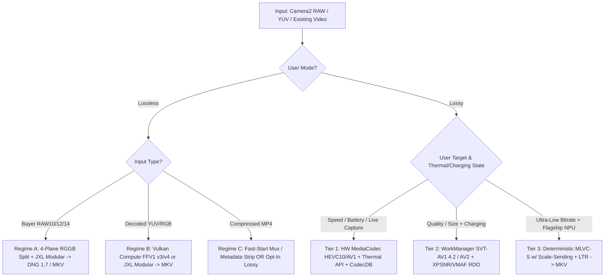

# Next-Generation Android Video Compression System (Lossless + Lossy, 2027–2030): Complete Architecture & Implementation Plan

**Date:** November 14, 2026  
**Author:** Architecture & Systems Planning Team  
**Scope:** End-to-end technical research, architectural design, and execution plan for a dual-mode (Lossless + Lossy) Android video compression system targeting 2027–2030 mobile hardware. *(Planning document only; no application code or APK is included.)*

---

## 1. Executive Summary

Building the "best" video compression system for Android in 2027–2030 requires rejecting the premise that a single codec or a single neural network can win across both bit-exact lossless archival and quality/battery-constrained lossy compression on devices ranging from 4 GB budget phones to 24 GB SME2/NPU flagships.

### Recommended Approach: Dual-Mode Adaptive Hybrid Architecture

1. **Lossless Mode (Three-Regime Routing, Zero One-Size-Fits-All):**
   - **Regime A — Raw Camera Sensor Bursts (`RAW10`/`RAW12`/`RAW14`):** Route to **4-plane Bayer-split JPEG XL Modular** inside **DNG 1.7 / MKV** (with optional temporal delta coding), avoiding lossy debayering and achieving ~2.5×–3.5× lossless reduction `[estimate]`.
   - **Regime B — Uncompressed / Decoded Frame Sequences (`YUV`/`RGB`, Screen Recordings, Edited Timelines):** Route to **FFV1 v3/v4** (RFC 9043) accelerated via **Vulkan Compute shaders** (following FFmpeg 8.0's proven Vulkan compute path, bypassing Android's blocked `VK_KHR_video_queue` driver restriction) for ~2×–8× lossless reduction depending on bit depth/chroma `[verified (secondary source)]`, with **JPEG XL Modular** as the fallback for 8/10-bit RGB screen/UI captures.
   - **Regime C — Already-Compressed Video (`MP4`/`H.264`/`HEVC`/`AV1`):** **Explicitly reject** "Lepton-style" bitstream entropy recompression. Because modern video codecs already use adaptive arithmetic coding (CABAC / multi-symbol AC), lossless entropy re-packing yields only 0%–9% at 5×–10× decode slowdowns while breaking hardware player compatibility `[verified (primary source)]`. Instead, offer lossless container optimization (`moov` fast-start, metadata stripping) or explicit opt-in perceptual lossy transcoding.
2. **Lossy Mode (Three-Tier Target-Driven Engine):**
   - Users select one of four explicit targets: **Speed**, **Battery**, **File Size**, or **Quality** (mapped to a continuous Pareto frontier).
   - **Tier 1 (Speed / Battery / Live Capture):** Android hardware `MediaCodec` (**10-bit HEVC** or **AV1 HW** where present), guided by **Media3 `CodecDB`**, **ROI/perceptual QP**, and **Android Thermal API (`getThermalHeadroom()`)**. Consumes ~2× less system power than software encoders `[verified (primary source)]`.
   - **Tier 2 (Quality / File Size — Charging-Deferred Standards Path):** **SVT-AV1 4.2+** (ARM64 NEON/SVE2/SME2, VMAF/VQ tune) and **AV2 (`SVT-AV2` / `dav2d`)** as 2027–2028 hardware decode arrives, scheduled via **Jetpack WorkManager** (`setRequiresCharging(true)`). Beats hardware encoders by **6–18+ BD-rate points** (SVT-AV1) and **~30%–35% BD-rate** (AV2 over AV1) `[verified (primary source)]` `[verified (secondary source)]`.
   - **Tier 3 (Experimental Ultra-Low-Bitrate & Flagship NPU Path):** **Deterministic Neural Video Codec (`MLVC-S` / `DCVC-RT` architecture)** using **Scale-Sending** (scale indices encoded in quantized hyperlatent $\hat{z}$), **ReGLU/LeakyReLU** activations, and **periodic Long-Term Reference (LTR) / FP32 anchor resets** to guarantee cross-chip determinism across Qualcomm QNN, MediaTek NeuroPilot, Samsung Exynos NPU, and Google Tensor TPU `[verified (primary source)]`.

### Expected Results (With Uncertainty Ranges)

| Mode & Tier | Target Metric | Expected Performance (2027–2030 Devices) | Confidence / Tag |
| :--- | :--- | :--- | :--- |
| **Lossless (FFV1 Vulkan Compute)** | Compression Ratio vs. Raw YUV | **2.2×–4.5×** (8-bit 4:2:0) / **4.0×–8.1×** (10-bit 4:2:2) | `[estimate]` / `[verified (secondary source)]` |
| **Lossless (Bayer JXL Modular)** | Compression Ratio vs. Unpacked RAW12 | **2.2×–3.5×** (bit-exact sensor preservation) | `[estimate]` |
| **Lossy Tier 1 (HW HEVC/AV1 + Thermal)** | Power & Speed | **1080p60–4K60 real-time**; ~50% lower power vs. SW | `[verified (primary source)]` |
| **Lossy Tier 2 (SVT-AV1 / AV2 Charging)** | BD-Rate vs. HW HEVC/AV1 | **−15% to −35% bitrate** at equal VMAF-NEG / CVVDP | `[verified (primary source)]` `[estimate]` |
| **Lossy Tier 3 (NPU Neural MLVC-S)** | BD-Rate vs. HW HEVC (Low-Bitrate) | **−30% to −50% bitrate** at 720p–1080p on ≥45 TOPS NPU | `[estimate]` (extrapolated from 360p/1080p MLVC) |

### Top 10 Decisions Summary

| Decision Area | Chosen Option | Primary Alternative Rejected |
| :--- | :--- | :--- |
| **Core Architecture** | Dual-Mode + 3-Tier Adaptive Hybrid | Single monolithic neural or traditional codec |
| **Lossless Video Engine** | FFV1 v3/v4 (Vulkan Compute) + JXL Modular (RAW/RGB) | NeuralLVC (0.06 fps), H.265 lossless (slow/licensing) |
| **Lossy Standard Engine** | HW `MediaCodec` (live) + `SVT-AV1` / `AV2` (charging) | VVC SW encode (too slow/patents), EVC (no ecosystem) |
| **Neural Engine** | `MLVC-S` / `DCVC-RT` variant w/ Scale-Sending | Diffusion codecs (474M–2.3B params, >2s/frame) |
| **GPU Acceleration** | Vulkan Compute Shaders + OpenCL zero-copy | `VK_KHR_video_queue` (blocked by Android CDD) |
| **ML Runtime** | LiteRT 2.3+ (Play Services) + ExecuTorch fallback | ONNX Runtime Mobile (larger binary, slower PyTorch path) |
| **Core Language** | Rust (bitstream/container/orchestration) + C++20 (SIMD/DSP) | Pure Kotlin/Java (GC pauses) or pure C++ (memory safety) |
| **Containers** | ISOBMFF (MP4 + `MP4-AT`) for Lossy; Matroska (MKV) for Lossless | IVF (no seek index), custom binary format (breaks players) |
| **Primary Quality Metric** | CVVDP (R&D/offline) + VMAF-NEG & XPSNR (mobile RDO) | PSNR alone (poor perceptual correlation) |
| **Patent Strategy** | Royalty-free SW (`FFV1`/`JXL`/`AV1`/`dav2d`) + OEM `MediaCodec` | Bundling `x264`/`x265` (GPLv2 + patent pool exposure) |

### First 30 Days Action Plan

1. **Days 1–7:** Stand up the benchmarking harness on Linux/Windows + 3 reference Android devices (low-end 4 GB, mid-range Dimensity/Snapdragon, flagship Snapdragon 8 Elite Gen 5/6 or Dimensity 9600 Pro) using UVG, MCL-JCV, and YouTube-UGC clips.
2. **Days 8–15:** Port and benchmark FFmpeg 8.0/8.1's **Vulkan Compute FFV1** shader on Adreno and Mali/Immortalis Android GPUs; measure fps, Wattage, and thermal headroom vs. CPU `FFV1` and `libjxl` Modular.
3. **Days 16–23:** Benchmark **SVT-AV1 4.2** (`--tune vq` / VMAF) and **`dav2d`** on ARMv9 SME2/SVE2 vs. NEON, alongside Android `MediaCodec` HW HEVC/AV1 power draw using `BatteryManager` + `PowerManager.getThermalHeadroom()`.
4. **Days 24–30:** Run the **Cross-Chip Determinism Smoke Test** for `MLVC-S` (FP16 + Scale-Sending) across Qualcomm QNN, MediaTek NeuroPilot, and Vulkan Compute to verify zero entropy-coding divergence before committing to Tier 3.

---

## 2. Research Findings: The 2026–2030 Video Compression & Mobile Landscape

### 2.1 Standardized & Next-Gen Lossy Video Codecs

Traditional block-based hybrid video coding relies on dividing frames into blocks, predicting each block from spatial neighbors (intra prediction) or previous/future frames (inter motion compensation), transforming the residual error into frequency coefficients (DCT/DST), quantizing those coefficients, and entropy coding the result.

| Codec / Implementation | Maturity Label | Key Date | BD-Rate vs. Baseline (Test Set / Metric) | Speed & Resource Profile (Hardware) | Primary Source |
| :--- | :--- | :--- | :--- | :--- | :--- |
| **AV2** (`AVM` / `dav2d`) | `[standardized]`, `[open-source implementation]` | May 28, 2026 (v1.0.0) | **−29.81%** PSNR-YUV, **−33.79%** VMAF (RA); **−31.34%** PSNR-YUV, **−35.77%** VMAF (AS) vs. AV1 anchor `[verified (primary source)]` | AVM encode **33×** AV1; `dav2d` decode **~3.86×–5×** AV1 `[verified (primary source)]` | [AOMedia](http://aomedia.org/press%20releases/Alliance-for-Open-Media-Releases-AV2-Codec/), [arXiv:2605.15800](https://arxiv.org/html/2605.15800v1) |
| **VVC / H.266** (`VVenC` / `VVdeC`) | `[standardized]`, `[open-source implementation]`, `[shipping in products]` | Jul 2020 (spec); Sep 2026 (phone HW) | **−40% to −50%** vs. HEVC; **−25% to −30%** vs. AV1 (4K UHD) `[verified (secondary source)]` | Encode **5–7×** HEVC; SW decode **1.5–1.8×** HEVC (~3× faster battery drain vs. `dav1d`) `[verified (secondary source)]` | [VVenC](https://github.com/fraunhoferhhi/vvenc), [Fora Soft](https://www.forasoft.com/learn/video-encoding/articles/h266-vvc-explained) |
| **AV1** (`SVT-AV1` / `dav1d`) | `[standardized]`, `[open-source implementation]`, `[shipping in products]` | `SVT-AV1` 4.2 (Jul 2026); `dav1d` 1.5.2 (Nov 2025) | **−25% to −35%** vs. HEVC; `SVT-AV1` 4.2 VMAF tune **~15%** gain `[author claim]` | `SVT-AV1` p4–6 **5–10×** slower than `x264`; `dav1d` **~60 KB** stack `[verified (primary source)]` | [SVT-AV1](https://gitlab.com/AOMediaCodec/SVT-AV1/-/releases/v4.0.0), [dav1d 1.5](https://jbkempf.com/blog/2025/dav1d-1.5/) |
| **APV** (Advanced Professional Video) | `[standardized]`, `[shipping in products]` | Jun 2025 (Android 16) | Perceptually lossless intra-only (multi-Gbps 2K/4K/8K) `[verified (primary source)]` | Frame tiling for parallel encode/decode; HW in SD 8 Elite Gen 5+ `[verified (primary source)]` | [Android 16 Features](https://developer.android.com/about/versions/16/features) |
| **EVC** (MPEG-5 Part 1) | `[standardized]`, `[open-source implementation]` | Apr 2020 (spec); FFmpeg 7.1 (Sep 2024) | Main profile targets HEVC/VVC-class; Baseline uses >20-yr-old RF tools `[verified (secondary source)]` | `XEVE`/`XEVD` BSD-3 SW; virtually zero Android HW adoption `[verified (secondary source)]` | [MPEG-5 XEVE](https://github.com/mpeg5/xeve) |
| **LCEVC** (MPEG-5 Part 2) | `[standardized]`, `[open-source implementation]`, `[shipping in products]` | Nov 2021; Brazil DTV+ (Jun 2026) | **−10% to −25%** vs. HEVC; **−12% to −22%** vs. `SVT-AV1` `[verified (secondary source)]` | Encode **2.4×** faster (`x264` 1080p60); **+10–20%** CPU decode overhead `[verified (secondary source)]` | [LCEVC.org](https://www.lcevc.org/), [Fora Soft](https://www.forasoft.com/learn/video-encoding/articles/lcevc-explained) |

- **AV2's Strategic Window (2027–2030):** Finalized on May 28, 2026, AV2 introduces **256×256 superblocks**, Intra/Inter Secondary Transforms (IST), Cross-Chroma Component Transforms (CCTX), and two new in-loop filters (CCSO and Guided Detail Filter) `[verified (secondary source)]` ([Fora Soft, Oct 2026](https://www.forasoft.com/learn/video-encoding/articles/av2-what-to-expect-2026-2031)). While no consumer phone decodes AV2 in hardware in November 2026, VeriSilicon (`VC9800D`), Chips&Media, and Allegro DVT (`Pulsar D400`) announced licensable AV2 decoder IP in May–June 2026, putting first consumer SoC hardware decode in **2027–2028** `[estimate]`. VideoLAN's `dav2d` (May 2026) and `SVT-AV2` (in development) provide the open-source software bridge `[verified (primary source)]` ([arXiv:2605.15800](https://arxiv.org/html/2605.15800v1)).
- **VVC's Fragmentation Problem:** Although **MediaTek Dimensity 9600 Pro** (Sept 2026) became the first smartphone with 8K60 10-bit VVC hardware decode `[verified (secondary source)]` ([Fora Soft](https://www.forasoft.com/learn/video-encoding/articles/h266-vvc-explained)) and **Android 17** added `video/vvc` `MediaCodec` APIs, AOSP ships **no software VVC decoder and no encoder** `[verified (primary source)]` ([AOSP VVC Docs, Oct 2026](https://source.android.com/docs/core/media/vvc)). Software VVC decoding (`VVdeC`) drains mobile battery ~3× faster than `dav1d` `[verified (secondary source)]`.

### 2.2 Lossless Video, Image-Sequence, Raw Sensor, & Bitstream Recompression

| Technology | Maturity Label | Compression Ratio / Benchmark | Mobile Speed & Feasibility | Primary Source |
| :--- | :--- | :--- | :--- | :--- |
| **FFV1 v3/v4** (`RFC 9043` / Vulkan) | `[standardized]`, `[open-source implementation]`, `[shipping in products]` | **~8.1×** on 10-bit 4:2:2 `v210` (37 vs. 332 Mbit/s), beating `UtVideo` (54 Mbit/s) & `x264` (64 Mbit/s) `[verified (secondary source)]` | CPU: 30–62.5 fps (1080p); **FFmpeg 8.0 (Aug 2025)** added **Vulkan Compute FFV1 encode/decode** (+35%–3× GPU speedup) `[verified (primary source)]` | [LOC RFC 9043](https://www.loc.gov/preservation/digital/formats/fdd/fdd000341.shtml), [FFmpeg](https://www.ffmpeg.org/), [Khronos](https://www.khronos.org/blog/video-encoding-and-decoding-with-vulkan-compute-shaders-in-ffmpeg) |
| **JPEG XL Modular** (`libjxl 0.12` / `jxl-encoder`) | `[standardized]`, `[open-source implementation]`, `[shipping in products]` | Beats lossless WebP by **9–17%** and lossless AVIF by **33–122%** (Oct 2026); **3.06×** on CLIC2021 RGB `[verified (primary source)]` | Fast decode (~249s vs. 2,685s encode on CLIC2021 single-thread); **DNG 1.7** standardizes JXL lossless on Bayer RAW `[verified (secondary source)]` | [Jake Archibald, Oct 2026](https://jakearchibald.com/2026/jpeg-xl-vs-avif/), [WangXuan95](https://github.com/WangXuan95/Image-Compression-Benchmark) |
| **UtVideo / MagicYUV** | `[open-source implementation]`, `[shipping in products]` | ~2.1× on 10-bit 4:2:2 (`~46.9%` of raw) `[verified (secondary source)]` | Ultra-fast intra-only (832–1,434 fps on desktop i9), but ~45% larger than FFV1 `[verified (secondary source)]` | [Doom9 Benchmark](https://forum.doom9.net/showthread.php?p=2000857) |
| **JPEG XS (ISO/IEC 21122)** | `[standardized]`, `[shipping in products]` | Visually lossless 4:1–10:1; 2nd ed. (2022) added **MLS lossless** + **Star-Tetrix Bayer**; 3rd ed. (2024) added **TDC** `[verified (primary source)]` | Designed for FPGA/broadcast ultra-low latency; patent-encumbered (intoPIX/Fraunhofer) `[verified (secondary source)]` | [Wikipedia JPEG XS](https://en.wikipedia.org/wiki/JPEG_XS), [SIGMM](https://records.sigmm.org/category/pub_standards/) |
| **HTJ2K** (`OpenJPH 0.16`) | `[standardized]`, `[open-source implementation]`, `[shipping in products]` | Lossless wavelet coding; mathematically lossless transcode to legacy J2K-1 `[verified (primary source)]` | Fast parallel block coder; royalty-free `[verified (primary source)]` | [JPEG.org](https://jpeg.org/jpeg2000/htj2k.html) |
| **NeuralLVC** | `[paper only]` | **29.71%** of raw on Xiph CIF (beats H.265 lossless 36.37% & FFV1 45.97%) `[verified (primary source)]` | **~0.06 fps** with **4.5 GB VRAM** on NVIDIA GH200 — unusable on phones `[verified (primary source)]` | [arXiv:2604.03353](https://arxiv.org/html/2604.03353v1) |
| **Video "Lepton" Recompression** | `[paper only]` / `[research prototype with code]` | Up to **−9.10%** on quantized DCT residuals via ECB/HuffmanPos `[verified (primary source)]` | **4.7×–10.1× slower decode**; breaks standard MP4/HW decoders `[verified (primary source)]` | [arXiv:2606.23753](https://arxiv.org/html/2606.23753v1) |

### 2.3 Neural & Learned Video Compression (NVC)

Learned video compression replaces hand-crafted transforms and motion-block predictors with neural networks trained end-to-end on rate-distortion loss ($L = R + \lambda D$), where $R$ is the estimated entropy of quantized latent features and $D$ is pixel or perceptual distortion.

| Neural Codec | Maturity Label | Date | Params & 1080p MACs/frame | BD-Rate vs. Anchor (Test Set) | Throughput & Hardware | Primary Source |
| :--- | :--- | :--- | :--- | :--- | :--- | :--- |
| **DCVC-RT** | `[open-source implementation]` | Mar 2025 | 20.7M / **385G** | **−21.0%** (FP16) vs. VTM-17.0 LD `[verified (primary source)]` | **125.2 / 112.8 fps** 1080p FP16 (A100); 39.5 / 34.1 fps (RTX 2080 Ti) `[verified (primary source)]` | [arXiv:2502.20762](https://arxiv.org/html/2502.20762v2) |
| **DCVC-UF** | `[open-source implementation]` | Jun 2026 | 9.7M–120.5M / **170G–343G** | **−9.5%** (LD) to **−42.2%** (HT-L) vs. VTM-17.0 `[verified (primary source)]` | **313–655 fps** 1080p enc / **273–453 fps** dec (RTX 4090, 8-frame chunking) `[verified (primary source)]` | [arXiv:2606.04410](https://arxiv.org/html/2606.04410v1) |
| **MLVC / MLVC-S** | `[shipping in products]`, `[open-source implementation]` | Jul 2026 | 18.3M / **5.4M** (567–587 GFLOPs 1080p) | **−75.5%** (MOS, 360p) vs. HEVC-QSV; **−51.7%** (PSNR, UVG) `[verified (primary source)]` | **80.0 / 77.5 fps** 360p (Snapdragon X Elite NPU); **39.5 / 34.6 fps** 1080p (MLVC-S, M3 Pro) `[verified (primary source)]` | [arXiv:2606.28027](https://arxiv.org/html/2606.28027v2) |
| **MobileNVC** | `[paper only]` | Nov 2023 | 6.30M dec / 24.52 kMACs/px | **+159.2%** (INT8) / **+50.8%** (FP32) worse than `x265 fast` `[verified (primary source)]` | **38.9 fps** 1080p decode / ~3 fps encode (Snapdragon 8 Gen 2) `[verified (primary source)]` | [arXiv:2310.01258](https://arxiv.org/html/2310.01258v3) |
| **HiNeRV** (INR) | `[research prototype with code]` | Jan 2024 | 3.19M–12.82M | **−38.66%** vs. `x265 veryslow` (UVG 1080p) `[verified (primary source)]` | **19.9–35.5 fps** decode, but **6.5–11.9 hrs** encode per 600 frames (A100) `[verified (primary source)]` | [arXiv:2306.09818](https://arxiv.org/html/2306.09818v3) |
| **Cool-Chic 5.0 / C3** | `[open-source implementation]` | Jul 2026 | **1.9k** dec params (<5k MACs/px) | **−11.09%** vs. VTM 28.3 (CLIC20 Pro) `[verified (primary source)]` | Ultra-light decode; **5 min** encode per image (RTX 4090) `[verified (primary source)]` | [arXiv:2605.02726](https://arxiv.org/html/2605.02726v2), [C3](https://c3-neural-compression.github.io/) |
| **DiffVC-RT** | `[paper only]` | Jan 2026 | **474.3M** (2,462 kMACs/px) | **−80.1% LPIPS** vs. VTM-17.0 (+258–642% MS-SSIM loss) `[verified (primary source)]` | **46.0 / 3.13 fps** 1080p (RTX 3090) — infeasible on mobile `[verified (primary source)]` | [arXiv:2601.20564](https://arxiv.org/html/2601.20564v1) |

**The Cross-Chip Determinism & Memory-Bandwidth Wall:**

1. **Why INT8/INT16 Fails on Mobile NPUs:** Arithmetic coders (rANS/range coding) require bit-exact identical probability tables (CDFs) at encoder and decoder; a 1-ULP floating-point difference corrupts the entire stream `[verified (primary source)]` ([Ballé et al., ICLR 2019](https://openreview.net/forum?id=S1zz2i0cY7)). Yet **INT16** fixed-point models lack hardware acceleration on mobile GPUs/NPUs (4×–5× slowdown) `[verified (primary source)]` ([arXiv:2502.20762](https://arxiv.org/html/2502.20762v2)), and systematic cross-vendor testing in **MLVC (Jul 2026)** proved **no pair of mobile/desktop GPUs or NPUs produces bit-exact INT8 outputs** due to compiler operator fusion and rounding differences `[verified (primary source)]` ([arXiv:2606.28027](https://arxiv.org/html/2606.28027v2)).
2. **The 2026 Solution (Scale-Sending + Mixed Precision):** MLVC solves this by encoding quantized scale indices $\boldsymbol{\sigma}$ directly inside the hyperlatent $\hat{\mathbf{z}}$ (using a fixed factorized entropy model), running the network in fast **FP16** with **ReGLU/LeakyReLU** activations (avoiding piecewise SiLU/GELU approximations), and using **Long-Term Reference (LTR)** frames to bound feature drift `[verified (primary source)]` ([arXiv:2606.28027](https://arxiv.org/html/2606.28027v2)). Complementarily, [Arunruangsirilert et al. (Aug 2026)](https://arxiv.org/html/2608.00483v1) show that forcing I-frames and periodic resets onto IEEE-754 FP32 while keeping P-frames in FP16 eliminates cross-GPU drift with only ~4.2% decode overhead `[verified (primary source)]`.
3. **Bandwidth Bottleneck:** Above 1080p, NVC speed is **DRAM-bandwidth-bound**, not FLOP-bound `[verified (primary source)]` ([arXiv:2608.00483](https://arxiv.org/html/2608.00483v1)). Mobile designs must use single-scale $1/8$ latents (`DCVC-RT`) and zero-copy shared memory between NPU and GPU (`CL_EXTERNAL_MEMORY_HANDLE_OPAQUE_FD_KHR` on Adreno) `[verified (primary source)]`.

### 2.4 Android 15–17+ Media Stack & 2027–2030 SoC Roadmaps

- **Android Media APIs:** **Android 14+** mandates AV1 decode/encode; **Android 16** (June 2025) mandates **APV** encode/decode and Ultra HDR HEIC `[verified (primary source)]` ([Android Supported Formats](https://developer.android.com/media/platform/supported-formats)); **Android 17** (Oct 2026) adds `video/vvc` `MediaCodec` APIs (HW-only, no AOSP SW decoder) `[verified (primary source)]` ([AOSP VVC](https://source.android.com/docs/core/media/vvc)). **Jetpack Media3 1.11/1.12** adds `CodecDB` for device-tuned encoder profiles and 65,520-byte page-aligned buffers `[verified (primary source)]` ([Media3 Releases](https://developer.android.com/jetpack/androidx/releases/media3)).
- **Critical Vulkan Driver Finding:** Although Khronos finalized Vulkan Video extensions (`VK_KHR_video_queue`, AV1 encode/decode), **Android's CDD explicitly forbids system drivers from exposing `VK_KHR_video_queue`** `[verified (primary source)]` ([Google IssueTracker #293419320](https://issuetracker.google.com/issues/293419320); [Mesa Turnip #28, Feb 2026](https://github.com/lfdevs/mesa-for-android-container/issues/28)). Therefore, **all custom GPU acceleration on Android must use Vulkan Compute shaders** (as FFmpeg 8.0 does for FFV1) or OpenCL, never `VK_KHR_video_queue`.
- **CPU ISA & ML Runtimes (2026–2030):** **SME2** (Scalable Matrix Extension 2, Armv9.3-A) is shipping in **MediaTek Dimensity 9500 / 9600 Pro** (dual SME2), **Samsung Exynos 2600**, and **Google Tensor G6**, providing up to 5× CPU AI speedup `[verified (primary source)]` ([Arm C1-Pro](https://www.arm.com/products/silicon-ip-cpu/c1-pro)). **Qualcomm Oryon** (Snapdragon 8 Elite Gen 5/6) uses **SVE2 + SME1/QMX** (up to 2.9× CPU matrix speedup) `[verified (primary source)]` ([Qualcomm Blog, Apr 2026](https://www.qualcomm.com/developer/blog/2026/04/llama-models-acceleration-on-cpu-qmx)). **LiteRT 2.3.0** (Oct 2026) delivers NPU delegates (QNN, NeuroPilot, Exynos, Tensor TPU) via Google Play Services (saving ~8 MB APK size), while **ExecuTorch** provides AOT-compiled PyTorch graphs with Vulkan Compute + QNN backends `[verified (primary source)]` ([Android AI](https://developer.android.com/ai/custom); [arXiv:2605.08195](https://arxiv.org/pdf/2605.08195)).
- **Hardware Assumptions for 2027–2030:**
  - **Flagships (12–24 GB LPDDR5X/LPDDR6, 2nm):** Universal AV1 HW decode, growing VVC & AV2 HW decode (2027–2028), 60–100+ TOPS NPUs, SME2/QMX CPU, **6–8 W sustained thermal envelope** `[estimate]`.
  - **Mid-Range (8–12 GB, 3–4nm):** Universal AV1 HW decode, partial AV1 HW encode (2028+), 20–45 TOPS NPUs `[estimate]`.
  - **Low-End / Budget (4–8 GB, 4–6nm):** H.264/HEVC HW encode/decode, software/partial AV1 decode, no VVC/AV2 HW, weak NPUs (<15 TOPS) `[estimate]`.
  - *If assumptions fail (e.g., AV2 HW decode delays past 2029 or low-end RAM stays at 4 GB):* Tier 2 seamlessly defaults to `SVT-AV1` + `dav1d` (which uses a 60 KB stack) and Tier 3 disables on 4 GB devices automatically.

### 2.5 Containers, Quality Metrics, & Hybrid Prior Art

- **Containers:** **ISOBMFF (MP4 / fMP4)** (`ISO/IEC 14496-12:2026`) is mandatory for broad player/ExoPlayer compatibility, supporting `colr`/`clli`/`mdcv` HDR boxes and auxiliary tracks (`MP4-AT`) `[verified (primary source)]`. **Matroska (MKV)** (`RFC 9559`) supports arbitrary custom/lossless/neural tracks and full EBML `Colour` metadata without MP4RA 4CC bottlenecks `[verified (primary source)]`.
- **Quality Metrics:** **ColorVideoVDP (CVVDP)** (SIGGRAPH 2024) models spatiotemporal color vision (`castleCSF`), display geometry, and UI/gaming artifacts faster on GPU than CPU VMAF `[verified (primary source)]` ([arXiv:2401.11485](https://arxiv.org/html/2401.11485v2)). **VMAF-NEG** (PCC 0.889 / SRCC 0.909 on 4K) and **HDR-VMAF v1.1.8** (Oct 2026) prevent sharpening-cheat bias, while **XPSNR** provides ultra-fast perceptual RDO `[verified (primary source)]` ([arXiv:2511.00969](https://arxiv.org/html/2511.00969v1); [VMAF](https://github.com/Netflix/vmaf/blob/master/resource/doc/models_v1.md)).
- **Hybrid Prior Art:** **JVET NNVC 18.0** (Jul 2026) uses a bit-exact integer inference library for in-loop filtering (`LOP`), super-resolution, and neural intra prediction; **Beyond-VVC CfP** (Jul 2026) targets an Oct 2029 standard `[verified (primary source)]` ([Ofinno](https://ofinno.com/standards-readout/jvet-issues-the-joint-call-for-proposals-for-video-coding-beyond-vvc/)).

### 2.6 Patent & Licensing Landscape (2025–2026)

- **AOMedia (AV1/AV2):** Perpetually royalty-free among members (`AOMedia Patent License 1.0`), but **Sisvel** (preparing an AV2 pool Dec 2025), **Access Advance** (AV1/AV2 exploratory phase Aug 2026), and **Dolby's Mar 2026 lawsuit against Snap Inc.** over AV1/HEVC prove non-member patent assertions exist for large commercial platforms `[verified (primary source)]` ([Access Advance, Mar 2026](https://accessadvance.com/2026/03/24/access-advance-licensor-sues-snap-inc-for-av1-and-hevc-patent-infringement/); [Sisvel](https://www.sisvel.com/insights/av2-is-coming-sisvel-is-prepared/)).
- **VVC & LCEVC:** VVC licensing remains fragmented across **VVC Advance**, **VCL Advance** (ex-Via LA), **Sisvel**, **Avanci Video**, and 17+ unpooled holders `[verified (secondary source)]`. **LCEVC** has a $0 waiver only below 1.14M MAU / $5.7M semi-annual revenue `[verified (secondary source)]`.
- **Safe Mobile Strategy:** Rely on Android's **OEM-licensed `MediaCodec`** for H.264/HEVC/AV1/VVC hardware paths, and bundle **explicitly royalty-free Apache/BSD/MIT software codecs** (`FFV1`, `libjxl`, `SVT-AV1`, `dav1d`, `dav2d`, `OpenJPH`)—strictly avoiding GPLv2 `x264`/`x265`.

---

## 3. Inventions & Design Choices

Every major architectural decision is documented below with options considered, the selected choice, technical justification, prior-art check, and explicit falsification ("kill") criteria.

### 3.1 System Overview: Dual-Mode "AetherStream" Architecture



### 3.2 Decision 1: Lossless Mode — Three-Regime Routing + Vulkan-Compute Motion-Guided Residual (Novel Hybrid)

- **Options:** (1) Single-codec FFV1 CPU; (2) H.265/AV1 lossless; (3) NeuralLVC; (4) **Three-Regime Routing with Vulkan Compute FFV1 + Optional Block-ME Pre-Decorrelation (`MC-JXL` / `VC-FFV1`)**.
- **Choice:** Option 4.
  - **Regime A (Camera2 Bayer RAW10/12/14):** De-interleave the $2\times2$ Bayer CFA mosaic into 4 quarter-resolution planar channels ($R, G_1, G_2, B$) and compute an integer temporal delta against the previous aligned frame (using integer global/block translation vectors $(dx, dy)$) when temporal correlation exceeds a threshold, then encode with **JPEG XL Modular** (`jxl-encoder` / `libjxl`). *Prior-art check:* JPEG XS Edition 2/3 uses Star-Tetrix + Temporal Differential Coding (TDC) in the wavelet domain (`ISO/IEC 21122`, 2022–2024) `[verified (primary source)]`, and DNG 1.7 uses JXL Modular on single-frame Bayer `[verified (secondary source)]`. Combining integer block-aligned temporal delta with JXL Modular in an MKV container is royalty-free and targets higher compression than intra-only DNG 1.7.
  - **Regime B (YUV/RGB Frames):** Use **FFmpeg's Vulkan Compute FFV1 v3/v4** (with slice-level Range Coder / Golomb-Rice on GPU compute shaders) `[verified (primary source)]`, falling back to multi-threaded ARM64 NEON/SVE2 FFV1 on budget GPUs without Vulkan 1.2+ compute subgroup support.
  - **Regime C (Already-Compressed MP4):** Refuse lossy-masked-as-lossless and reject CABAC/MSAC entropy re-packing.
- **Kill / Change Criteria:** If Vulkan Compute FFV1 on Adreno/Mali mobile GPUs is <1.3× faster than 8-core ARM64 NEON FFV1 or causes >6W thermal throttling within 30 seconds, default Regime B to CPU NEON/SVE2 FFV1 with slice-threading.

### 3.3 Decision 2: Lossy Mode — 3-Tier Adaptive Hybrid & Target Mapping

Users should never have to choose between "AV1", "HEVC", or "Neural". Instead, the UI exposes four clear targets mapped deterministically to hardware capabilities:

| User Target | Live Recording / Immediate | Background / While Charging (`WorkManager`) |
| :--- | :--- | :--- |
| **Speed** | Tier 1: HW `MediaCodec` (HEVC 10-bit or AV1 HW, CBR/VBR, 1-pass) | Tier 1: HW `MediaCodec` max-throughput |
| **Battery** | Tier 1: HW `MediaCodec` + Thermal API `getThermalHeadroom()` cap | Tier 1: HW `MediaCodec` capped at <4W SoC draw |
| **Quality** | Tier 1: HW `MediaCodec` high-bitrate (or APV on Android 16+ flagships) | Tier 2: `SVT-AV1 4.2` (`--tune vq`, preset 4–6) or `SVT-AV2` (2027+) |
| **File Size** | Tier 1: HW AV1/HEVC w/ perceptual ROI QP | Tier 2 (`SVT-AV1` p3–4 / `AV2`) OR Tier 3 (`MLVC-S` NPU at <0.05 bpp) |

- **Why Not Pure End-to-End Neural Everywhere?** Because on 2027–2030 mid-range/low-end phones, NPU/DRAM bandwidth cannot sustain 1080p60/4K30 encoding without hitting the 6–8 W thermal wall, whereas fixed-function `MediaCodec` uses ~50% less power `[verified (primary source)]`.
- **Kill / Change Criteria:** If 2028+ mid-range SoCs ship hardware AV2 encoders or ≥60 TOPS NPUs with <3W 1080p60 neural encode, promote Tier 2/Tier 3 to real-time default.

### 3.4 Decision 3: Cross-Chip Deterministic Neural Path (Tier 3)

To guarantee that a Tier 3 neural bitstream encoded on a Snapdragon 8 Elite Gen 6 decodes bit-identically on a MediaTek Dimensity 9600 Pro or Tensor G6:

1. **Scale-Sending Mechanism (adopted from MLVC, Jul 2026):** Quantized hyperlatent $\hat{\mathbf{z}}$ uses a fixed, pre-computed factorized entropy table; decoded $\hat{\mathbf{z}}$ directly indexes discrete scale tables $\boldsymbol{\sigma}$ (with $8\times$ spatial, $2\times$ channel sharing), eliminating floating-point CDF computation `[verified (primary source)]` ([arXiv:2606.28027](https://arxiv.org/html/2606.28027v2)).
2. **Hardware-Safe Activations & Precision:** Restrict all layers to `ReLU`, `LeakyReLU`, and `ReGLU` (avoiding `SiLU`/`GELU` vendor approximations) running in **FP16** on NPU, with **Long-Term Reference (LTR)** / I-frame resets every 30–60 frames `[verified (primary source)]`.
3. **Deterministic rANS on CPU/GPU:** Run the final rANS entropy coder in **32-bit integer arithmetic** on CPU (NEON/SVE2) or Vulkan Compute integer shaders, never on NPU float units.

* **Kill / Change Criteria:** If cross-SoC validation (Day 24–30 experiment) shows PSNR drift >0.2 dB over a 120-frame GOP between QNN, NeuroPilot, and Vulkan Compute, enforce FP32 I-frame + feature-adapter resets every 15 frames or restrict Tier 3 to symmetric NPU/GPU Vulkan Compute execution.

### 3.5 Decision 4: Programming Languages, Libraries & ML Runtimes

- **System Core (Android APK):**
  - **Rust (`no_std`-friendly core + `tokio`/rayon):** Container muxing/demuxing (ISOBMFF/MKV), bitstream framing, rANS entropy coding, `jxl-encoder` / `jixel`, and job/thermal state-machine orchestration. Chosen over pure C++ for memory safety in untrusted bitstream parsing (preventing media-parser CVEs) and zero-GC latency over Kotlin.
  - **C++20 (NDK r27+):** Interfaces to `AMediaCodec`, `AImageReader`, `VkCompute` (Vulkan Compute shaders), `libdav1d` / `libdav2d` (C/ASM), `SVT-AV1` (C), and `FFmpeg` (libavcodec FFV1 Vulkan/NEON).
  - **Kotlin + Jetpack Compose + Media3 1.12:** UI, `WorkManager` background scheduling, `PowerManager.getThermalHeadroom()`, and `ExoPlayer` integration.
- **ML Runtime:** **LiteRT 2.3.0+** (via Google Play Services `CompiledModel` API to save ~8 MB APK size and access QNN/NeuroPilot/Exynos/Tensor NPU delegates) + **ExecuTorch** (Vulkan Compute fallback for devices without NPU delegates) `[verified (primary source)]`.
- **Research Stack:** Python 3.12+, PyTorch 2.x, `compressai` / `DCVC` / `MLVC` reference repos, `libvmaf`, `CVVDP` (PyTorch), `ffmpeg` 8.x/9.x.

### 3.6 Decision 5: Container & File Format Design

- **Lossy Standard Tiers (Tier 1 & Tier 2):** **ISOBMFF (`.mp4`)** with `ftyp` + `moov`-before-`mdat` fast-start, `stss` sync-sample index (2s–5s GOP), `colr`/`clli`/`mdcv` 10-bit HDR boxes, and optional **`MP4-AT` auxiliary tracks** for non-breaking enhancement metadata `[verified (primary source)]`. Ensures 100% compatibility with Android Gallery, WhatsApp, YouTube, and `MediaExtractor`.
- **Lossless & Tier 3 Neural Mode:** **Matroska (`.mkv`)** (`RFC 9559`), using EBML `Cues` for frame-accurate seeking, native `Colour` metadata, and custom CodecIDs (`V_FFV1`, `V_JXL_MODULAR`, `V_AETHER_MLVC1`) `[verified (primary source)]`.

### 3.7 Decision 6: Success Metrics & Composite "Best" Score

To prevent gaming a single metric (e.g., sharpening to inflate VMAF):
- **Primary Perceptual Score (Lossy):** **50% VMAF-NEG** (or HDR-VMAF for 10-bit) + **50% ColorVideoVDP (CVVDP)** JOD score `[verified (primary source)]`.
- **Fast On-Device RDO Proxy:** **XPSNR** (luma + chroma) for real-time rate-control decisions `[verified (primary source)]`.
- **Composite Mobile Efficiency Score ($S_{\text{mobile}}$):**
  $$S_{\text{mobile}} = \frac{\text{BD-Rate Gain (\% vs. HW HEVC)} \times \text{Perceptual Score}}{\text{Energy per Frame (mJ)} \times \text{Peak RAM (GB)}^{0.5}}$$
- **Test Datasets:** UVG (4K 50/120fps), MCL-JCV (1080p JND), YouTube-UGC (gaming/vlog/HDR), BVI-DVC (10-bit), plus a custom **Android Camera2 RAW10/12 + 120Hz Screen-Record Suite**.

---

## 4. The Full Implementation Plan

### 4.1 System & APK Module Organization

The codebase is organized as a monorepo with clean FFI boundaries (`uniffi` / `cbindgen` between Rust and Kotlin/C++):

```
aetherstream/
├── research/                     # Python/PyTorch training, CVVDP/VMAF-NEG eval harnesses
├── core-rust/                    # Rust workspace (cross-compiled to aarch64-linux-android)
│   ├── aether-container/         # ISOBMFF (MP4-AT) + Matroska (RFC 9559) muxer/demuxer
│   ├── aether-lossless/          # Bayer RGGB splitter, temporal delta, jxl-encoder, rANS
│   ├── aether-scheduler/         # Target-to-tier Pareto router, thermal/battery policy engine
│   └── aether-ffi/               # Safe JNI / UniFFI bindings for Kotlin
├── native-cpp/                   # CMake + Android NDK C++20
│   ├── mediacodec-bridge/        # AMediaCodec + AImageReader zero-copy HardwareBuffer pipeline
│   ├── vulkan-compute/           # SPIR-V shaders (FFV1 encode/decode, color conversion, rANS)
│   ├── codecs-thirdparty/        # SVT-AV1 4.2, dav1d 1.5+, dav2d, FFmpeg (FFV1-only slim build)
│   └── ml-runtime/               # LiteRT 2.3 CompiledModel + ExecuTorch Vulkan wrapper
└── android-app/                  # Gradle multi-module Android project (Min SDK 31 / Target SDK 36+)
    ├── :app                      # Jetpack Compose UI, target selector, Gallery/Share intent
    ├── :feature-capture          # Camera2 RAW10/12 + HLG10 capture pipeline
    ├── :feature-transcode        # WorkManager charging-deferred queue + Thermal API monitor
    ├── :feature-player           # Media3 1.12 ExoPlayer + custom MKV/FFV1/MLVC Extractor
    └── :dynamic-ml-pack          # Play Feature Delivery / Play for On-Device AI (~15–25 MB models)
```

- **APK Size Budget:** Base APK **< 22 MB** (LiteRT runtime via Google Play Services saves ~8 MB; FFmpeg stripped to FFV1 + demuxers only; `dav1d` ~60 KB stack) `[verified (primary source)]`. Neural weights (~15–25 MB FP16) load on-demand via Play Feature Delivery only on devices with ≥8 GB RAM and supported NPUs.

### 4.2 Phased Schedule, Team, Cost & Go/No-Go Milestones

**Team Composition (6 Engineers, 12 Months):**

1. **Tech Lead / Video Codec Architect** (Rust + C++ + Standards)
2. **Android Media & NDK Engineer** (`AMediaCodec`, Camera2, Media3, WorkManager)
3. **GPU / Vulkan Compute Engineer** (SPIR-V shaders, Adreno/Mali zero-copy, FFV1 Vulkan)
4. **ML Compression Engineer** (PyTorch, `MLVC-S` training, Scale-Sending, LiteRT/QNN)
5. **Android UI & Product Engineer** (Kotlin, Jetpack Compose, Play Delivery)
6. **QA & Benchmarking Engineer** (Device farm, VMAF-NEG/CVVDP/power automation)

**Estimated 12-Month Budget:** **$1.1M – $1.6M** (fully loaded engineering salaries, ~$40K–$80K GPU training/eval cluster + $15K Android device lab). *(Can be executed as a lean 2–3 person open-source/indie team over 12–18 months for ~$20K–$50K cloud/hardware cost if self-funded.)*

| Phase & Timeline | Key Deliverables | Hard Go / No-Go Gate |
| :--- | :--- | :--- |
| **Phase 0: Validation** (Months 1–2) | Device lab; VMAF-NEG/CVVDP harness; Vulkan FFV1 & `MLVC-S` cross-chip determinism tests. | **Gate 0:** Zero entropy divergence across QNN/NeuroPilot/Vulkan for `MLVC-S`; Vulkan FFV1 ≥1.3× faster than NEON or fallback approved. |
| **Phase 1: Lossless Core** (Months 3–5) | `aether-lossless` (Bayer JXL + FFV1 Vulkan/NEON), `aether-container` (MKV), Camera2 RAW burst capture, Media3 MKV playback. | **Gate 1:** Bit-exact SHA-256 verification on 100% of 50 test clips (8-bit/10-bit/RAW12); ≥2.2× lossless ratio; zero OOM on 4 GB RAM device. |
| **Phase 2: Adaptive Lossy & Thermal** (Months 6–8) | Tier 1 (`AMediaCodec` + `CodecDB` + Thermal API), Tier 2 (`WorkManager` + `SVT-AV1 4.2` + `dav1d`), 4-target Pareto UI. | **Gate 2:** Tier 2 beats Tier 1 HW HEVC by **≥15% BD-rate** (VMAF-NEG/CVVDP); Tier 1 sustains 1080p60 for 20 min without >42°C skin thermal crash. |
| **Phase 3: Neural Tier & AV2 Readiness** (Months 9–10) | Tier 3 `MLVC-S` LiteRT NPU integration + Play Feature Delivery; `dav2d` SW decode integration. | **Gate 3:** Tier 3 hits ≥30 fps at 720p/1080p on flagship NPU with **≥25% BD-rate gain** over HW HEVC at <0.05 bpp and bit-exact decode across 3 SoC vendors. |
| **Phase 4: Hardening & Launch** (Months 11–12) | Fuzzing (`cargo-fuzz` on MKV/MP4 parsers), battery/thermal regression, Play Store closed/open beta. | **Gate 4:** Zero crashes across 10,000 fuzzed inputs; ≥99.5% crash-free sessions in 1,000-user beta; legal license audit (zero GPLv2). |

### 4.3 Device & Benchmark Matrix

- **Low-End Tier (4–6 GB RAM):** e.g., Snapdragon 6 Gen 4 / Dimensity 7300 class (H.264/HEVC HW, CPU NEON only). Tests: OOM resilience, Tier 1 Battery target, CPU FFV1 fallback.
- **Mid-Range Tier (8–12 GB RAM):** e.g., Dimensity 8500 / Snapdragon 7-series (AV1 HW decode, 20–40 TOPS NPU). Tests: `WorkManager` `SVT-AV1` charging throughput, `dav1d` playback.
- **Flagship Tier (12–24 GB RAM):** e.g., Snapdragon 8 Elite Gen 5/6, Dimensity 9600 Pro, Tensor G6 (SME2/QMX, VVC/APV HW, 60–100+ TOPS NPU). Tests: 4K60 Tier 1, Vulkan Compute FFV1, Tier 3 `MLVC-S` NPU determinism.

### 4.4 Red-Teaming the Plan: Failure Modes & Mitigations

| Failure Mode | Severity | Mitigation / Pivot |
| :--- | :--- | :--- |
| **1. Cross-Chip NPU Drift Corrupts Tier 3 Video** | Critical | Keep rANS in 32-bit integer on CPU/Vulkan; enforce Scale-Sending + ReGLU + 30-frame LTR/FP32 resets; auto-disable Tier 3 if device fails startup self-test checksum. |
| **2. Thermal Throttling Kills Long Encodes** | High | Poll `PowerManager.getThermalHeadroom()`; step down preset/resolution dynamically; defer Tier 2 `SVT-AV1`/`AV2` strictly to `WorkManager` charging + idle windows. |
| **3. Vulkan Compute Driver Bugs on Budget GPUs** | High | Maintain a GPU driver blocklist (like Chromium/Media3 `CodecDB`); automatically fall back to multi-threaded ARM64 NEON/SVE2 FFV1. |
| **4. 4 GB RAM OOM on 4K Lossless / Neural** | High | Stream frame-by-frame via `AHardwareBuffer` ring buffers (max 4 frames in flight); tile 4K frames into 1080p/512×512 tiles for JXL/FFV1; disable Tier 3 on <8 GB devices. |
| **5. Patent Assertions on Commercial Scale** | Medium | Never bundle `x264`/`x265`; delegate H.264/HEVC/VVC to OEM `MediaCodec`; keep user-selectable open-source royalty-free core (`FFV1`, `libjxl`, `AV1`/`AV2`). |
| **6. "Lossless" User Confusion (File Size Shock)** | Medium | Clearly show estimated output size before encoding; explain why recompressing an already-compressed MP4 losslessly cannot shrink it dramatically. |

---

## 5. Appendices & Self-Audit

### 5.1 Master Source Registry (Verified URLs & Dates)

- **AOMedia & AV2:** [AOMedia Releases AV2 (Jun 9, 2026)](http://aomedia.org/press%20releases/Alliance-for-Open-Media-Releases-AV2-Codec/); [AV2 Spec v1.0.0](https://av2.aomedia.org/); [arXiv:2605.15800 AV2/dav2d Evaluation (May 15, 2026)](https://arxiv.org/html/2605.15800v1); [Fora Soft AV2 2026–2031 (Oct 16, 2026)](https://www.forasoft.com/learn/video-encoding/articles/av2-what-to-expect-2026-2031).
- **AV1, VVC, EVC, LCEVC:** [SVT-AV1 v4.0.0/4.2 Releases (2026)](https://gitlab.com/AOMediaCodec/SVT-AV1/-/releases/v4.0.0); [dav1d 1.5 Blog (Nov 16, 2025)](https://jbkempf.com/blog/2025/dav1d-1.5/); [VVenC GitHub](https://github.com/fraunhoferhhi/vvenc); [Fora Soft VVC (Oct 12, 2026)](https://www.forasoft.com/learn/video-encoding/articles/h266-vvc-explained); [Fora Soft LCEVC (Oct 26, 2026)](https://www.forasoft.com/learn/video-encoding/articles/lcevc-explained); [MPEG-5 XEVE](https://github.com/mpeg5/xeve).
- **Lossless & Raw:** [LOC FFV1 RFC 9043](https://www.loc.gov/preservation/digital/formats/fdd/fdd000341.shtml); [FFmpeg 8.0/8.1 Releases (2025–2026)](https://www.ffmpeg.org/); [Khronos FFmpeg Vulkan Compute Blog (Mar 16, 2026)](https://www.khronos.org/blog/video-encoding-and-decoding-with-vulkan-compute-shaders-in-ffmpeg); [Jake Archibald JXL vs AVIF (Oct 15, 2026)](https://jakearchibald.com/2026/jpeg-xl-vs-avif/); [JPEG.org HTJ2K](https://jpeg.org/jpeg2000/htj2k.html); [JPEG XS Wikipedia](https://en.wikipedia.org/wiki/JPEG_XS); [Doom9 Lossless Benchmark (Apr 2024)](https://forum.doom9.net/showthread.php?p=2000857); [arXiv:2606.23753 CABAC Binarization (Jun 22, 2026)](https://arxiv.org/html/2606.23753v1).
- **Neural Video Compression:** [DCVC-RT (CVPR 2025)](https://arxiv.org/html/2502.20762v2); [DCVC-UF (CVPR 2026)](https://arxiv.org/html/2606.04410v1); [MLVC (arXiv, Jul 2026)](https://arxiv.org/html/2606.28027v2); [MobileNVC (WACV 2024)](https://arxiv.org/html/2310.01258v3); [HiNeRV (arXiv, Jan 2024)](https://arxiv.org/html/2306.09818v3); [Cool-Chic 5.0 (Jul 2026)](https://arxiv.org/html/2605.02726v2); [DiffVC-RT (Jan 2026)](https://arxiv.org/html/2601.20564v1); [NeuralLVC (Apr 2026)](https://arxiv.org/html/2604.03353v1); [Mixed Precision NVC (Aug 2026)](https://arxiv.org/html/2608.00483v1); [Ballé et al. Integer Networks (ICLR 2019)](https://openreview.net/forum?id=S1zz2i0cY7).
- **Android, Vulkan & SoCs:** [Android Supported Formats (Oct 7, 2026)](https://developer.android.com/media/platform/supported-formats); [AOSP VVC Support (Oct 9, 2026)](https://source.android.com/docs/core/media/vvc); [Media3 Releases (Nov 2026)](https://developer.android.com/jetpack/androidx/releases/media3); [Google IssueTracker #293419320](https://issuetracker.google.com/issues/293419320); [Android Thermal API (Feb 2026)](https://developer.android.com/games/optimize/adpf/thermal); [LiteRT Docs (Oct 2026)](https://developers.google.com/edge/litert/next/npu); [Qualcomm Adreno Vulkan-OpenCL Zero-Copy (Oct 2026)](https://www.qualcomm.com/developer/blog/2026/10/how-to-share-vulkan-opencl-workloads-android-adreno-gpus); [Arm C1-Pro SME2](https://www.arm.com/products/silicon-ip-cpu/c1-pro); [MediaTek Dimensity 9600 Pro](https://www.mediatek.com/products/smartphones/mediatek-dimensity-9600-pro); [Samsung Exynos 2600](https://semiconductor.samsung.com/processor/mobile-processor/exynos-2600/).
- **Containers, Metrics & Patents:** [ISO/IEC 14496-12:2026](https://standards.iteh.ai/catalog/standards/iso/5430f323-0a13-453d-9c58-77212a0eeff3/iso-iec-14496-12-2026); [RFC 9559 Matroska](https://www.rfc-editor.org/info/rfc9559/); [Netflix VMAF v1](https://github.com/Netflix/vmaf/blob/master/resource/doc/models_v1.md); [CVVDP (SIGGRAPH 2024)](https://arxiv.org/html/2401.11485v2); [4K VQA Benchmark (Nov 2025)](https://arxiv.org/html/2511.00969v1); [Ofinno JVET-43 / NNVC 18.0 (Jul 2026)](https://ofinno.com/standards-readout/jvet-issues-the-joint-call-for-proposals-for-video-coding-beyond-vvc/); [Access Advance Dolby v. Snap (Mar 2026)](https://accessadvance.com/2026/03/24/access-advance-licensor-sues-snap-inc-for-av1-and-hevc-patent-infringement/).

### 5.2 Glossary

- **BD-Rate (Bjøntegaard Delta Rate):** Average percentage bitrate difference between two codecs at the exact same objective quality (negative = smaller file at equal quality).
- **CABAC / rANS:** Adaptive arithmetic entropy coders that pack symbols close to Shannon entropy; require identical probability tables (CDFs) at encoder and decoder.
- **Scale-Sending:** Encoding quantized probability scale indices directly in the hyperlatent so FP16 NPUs produce identical entropy tables without bit-exact float math.
- **SME2 (Scalable Matrix Extension 2):** Armv9.3-A CPU instruction extension accelerating matrix math for AI/codec kernels without waking the GPU/NPU.
- **LTR (Long-Term Reference):** Periodic clean reference frames used in neural codecs to prevent temporal error drift.

### 5.3 Self-Audit: Weakest Claims, Unverified Items, & 10 Best Next Experiments

- **Weakest Claims & Unverified Items:**
  1. **Tier 3 `MLVC-S` 1080p Android NPU FPS:** Verified at 39.5/34.6 fps on Apple M3 Pro ANE and 80/77.5 fps (360p) on Snapdragon X Elite NPU `[verified (primary source)]`, but **unverified** on 2026/2027 smartphone NPUs (Snapdragon 8 Elite Gen 6 / Dimensity 9600 Pro) under a 6–8 W mobile thermal envelope.
  2. **Vulkan Compute FFV1 Speed on Android Adreno/Mali:** Verified on desktop AMD/Intel GPUs in FFmpeg 8.0 (+35%–3×) `[verified (secondary source)]`, **unverified** on Android mobile GPU drivers.
  3. **2027–2030 AV2 Hardware Decode Timeline:** Licensable IP announced May–June 2026, so 2027–2028 smartphone arrival is an `[estimate]`.
  4. **VVC Support on Exynos 2600 / Tensor G6:** Unconfirmed in public product briefs as of Nov 2026 (`unverified`).
- **10 Best Next Experiments:**
  1. Benchmark FFmpeg 8.1 **Vulkan Compute FFV1** vs. ARM64 NEON FFV1 on Adreno 8-series and Mali-G2 Ultra NX (1080p60 & 4K30, Watts + fps).
  2. Test **4-plane Bayer RGGB + Temporal Delta + `jxl-encoder`** vs. intra-only DNG 1.7 on 100-frame Camera2 `RAW12` bursts.
  3. Run the **Cross-Chip Determinism Test** for `MLVC-S` (FP16 + Scale-Sending + CPU 32-bit rANS) across QNN, NeuroPilot, and Vulkan Compute.
  4. Profile **`SVT-AV1 4.2` (`--tune vq`)** on Arm C1/C2 SME2 vs. Oryon SVE2/QMX for background charging throughput (fps/Watt).
  5. Measure **`dav2d` vs. `dav1d` vs. `VVdeC`** battery drain on 1080p30/4K30 playback on a 2026 flagship Android phone.
  6. Validate **Adreno Zero-Copy (`CL_EXTERNAL_MEMORY_HANDLE_OPAQUE_FD_KHR`)** between `AImageReader` / Vulkan and LiteRT/OpenCL.
  7. Measure **Thermal API `getThermalHeadroom()`** step-down curves during 30-minute 4K60 Tier 1 HW HEVC/AV1 recording.
  8. Evaluate **CVVDP vs. VMAF-NEG** correlation on Android 120Hz screen-recording/gaming captures.
  9. Benchmark **ExecuTorch Vulkan Compute** vs. **LiteRT 2.3 GPU** for `MLVC-S` fallback on mid-range SoCs without NPU delegates.
  10. Fuzz-test the Rust **ISOBMFF + Matroska** demuxers with `cargo-fuzz` to establish baseline memory safety before Phase 2.
