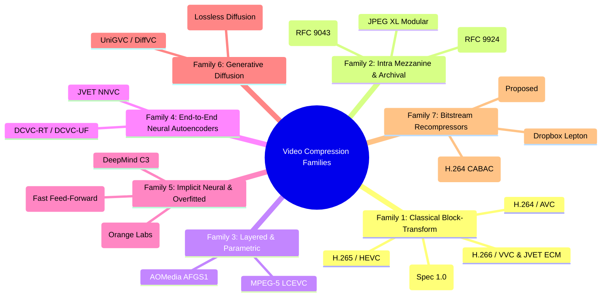

# Section 2: 2026–2030 Technology Landscape, Hardware Tiers & Taxonomy

---

## 2.1 Android Hardware, Operating System & Standards Baseline (2027–2030)

To eliminate speculative planning, the Prism-V architecture is anchored in shipping late-2025/2026 production silicon ([Snapdragon 8 Elite Gen 5](https://www.qualcomm.com/content/dam/qcomm-martech/dm-assets/documents/Snapdragon-8-Elite-Gen-5-product-brief.pdf), [MediaTek Dimensity 9500](https://www.mediatek.com/products/smartphones/mediatek-dimensity-9500), [Arm SME2 with KleidiAI](https://www.arm.com/company/success-library/google-android-ai-sme2)) and the published requirements of the [Android 16](https://source.android.com/docs/compatibility/16/android-16-cdd) and [Android 17 Compatibility Definition Documents (CDD)](https://source.android.com/docs/compatibility/17/android-17-cdd).

### Table 2.1: Target Android Hardware Tiers and Baseline Parameters (2027–2030)

| Hardware Parameter | Tier 1: Entry / Low-End ($100–$180, ~40% of fleet) | Tier 2: Mainstream Mid-Range ($220–$450, ~45% of fleet) | Tier 3: Flagship ($600–$1,400, ~15% of fleet) | Epistemic Status & Primary Source |
|:---|:---|:---|:---|:---|
| **Representative SoCs** | Snapdragon 4 Gen 4/5, Helio G100, Dimensity 6300/6400+, Unisoc T820+ | Snapdragon 7+ Gen 4/5, Dimensity 8400/8500, Exynos 1580/1680 | Snapdragon 8 Elite Gen 5/6, Dimensity 9500/9600, Tensor G6/G7 | `[Verified—Primary]` for 2026 silicon; `[Author Estimate]` for 2027–2030 |
| **CPU Architecture & SIMD** | 2x `Cortex-A78`/`A720` + 6x `Cortex-A55`/`A520`; Armv8.2-A `NEON` + `DotProd` (`SDOT`/`UDOT`); **No SME2** | 1x `Cortex-X4`/`X925` + 3x `A725` + 4x `A520`; Armv9.2-A `NEON`, `SVE2`, `I8MM`, optional `SME2` | All-Big Core (`Cortex-X925`/`X930` or Qualcomm `Oryon Gen 2/3`); **Armv9.2-A `SME2` (Scalable Matrix Extension 2)** | `[Verified—Primary]` ([Arm SME2](https://www.arm.com/technologies/sme2), [ExecuTorch KleidiAI](https://developer.arm.com/community/arm-community-blogs/b/ai-blog/posts/executorch-1-0-is-here-and-with-sme2-optimizations-through-kleidiai)) |
| **RAM & Safe Working Heap** | 4–6 GB LPDDR4X (~14–17 GB/s); **Safe codec working set $\le 64\text{ MB}$** | 8–12 GB LPDDR5 (~44–51 GB/s); **Safe codec working set $\le 160\text{ MB}$** | 12–24 GB LPDDR5X/LPDDR6 (~75–115 GB/s); **Safe codec working set $\le 384\text{ MB}$** | `[Author Estimate]` based on Android Low Memory Killer (LMK) thresholds |
| **GPU & Compute API** | Mali-G57 / Adreno 619+; Vulkan 1.1/1.3 (limited `FP16`/`INT8` subgroup ops) | Adreno 732+ / Mali-G720; Vulkan 1.3/1.4 + `VK_KHR_cooperative_matrix` | Adreno 830/840+ / Immortalis-G925+; Vulkan 1.4 + full `VK_KHR_cooperative_matrix` | `[Verified—Primary]` ([Vulkan 1.4 Spec](https://docs.vulkan.org/), [Adreno Vulkan Guide](https://github.com/SnapdragonGameStudios)) |
| **NPU & AI Runtime** | 2–6 TOPS INT8 (high dispatch latency >4ms); CPU NEON preferred | 15–35 TOPS INT8/INT4 via `LiteRT` QNN / NeuroPilot delegate | 50–100+ TOPS INT8/INT4/FP8 (`Hexagon NPU` / `NPU 990`) via `LiteRT CompiledModel` | `[Verified—Primary]` ([LiteRT Documentation](https://developers.google.com/edge/litert), [Dimensity 9500 NPU 990](https://www.mediatek.com/)) |
| **Hardware Video Decode (`MediaCodec`)** | H.264, HEVC 10-bit (4K30 / 1080p60), VP9; **AV1 SW (`dav1d`) or 1080p HW** | H.264, HEVC 10-bit, VP9, **AV1 Main10 HW (4K60)** | H.264, HEVC, VP9, **AV1 (8K60)**, **Samsung APV (RFC 9924)**, **VVC/H.266 Decode** (emerging) | `[Verified—Primary]` ([Android 17 CDD](https://source.android.com/docs/compatibility/17/android-17-cdd)) |
| **Hardware Video Encode (`MediaCodec`)** | H.264, HEVC 8-bit (1080p60 / 4K30); **No HW AV1 Encode** | H.264, HEVC 10-bit (4K60), **AV1 HW Encode (1080p60/4K30)** per Android 17 CDD MPC | H.264, HEVC 10-bit, **AV1 10-bit HW Encode (4K60/8K30)**, **APV 10/12-bit Encode** | `[Verified—Primary]` ([Android 17 MPC](https://source.android.com/docs/compatibility/17/mpc)) |
| **Sustained Thermal Budget** | **1.5 – 2.2 W** sustained (<40°C skin temp) | **2.5 – 3.5 W** sustained | **3.8 – 5.5 W** sustained (passive chassis dissipation ceiling) | `[Verified—Secondary]` standard smartphone passive thermal measurements |

---

### Table 2.2: Contingency Matrix — Architectural Pivots Against Landscape Shifts

| Baseline Assumption | Potential Shift / Risk by 2027–2030 | Concrete Architectural Pivot in Prism-V |
|:---|:---|:---|
| **1. Hardware AV1 Encoding Reaches Mid-Range Devices** | SoC vendors omit AV1 hardware encode on budget/mid-range chips to save die area, leaving only hardware HEVC. | `Prism-Lossy` is base-codec agnostic via its BaseCodec HAL: when hardware AV1 is absent, the muxer dynamically binds the enhancement track (`prmr`) to **Hardware HEVC (`hvc1`)**, increasing the residual bitrate budget from 10% to 16% to compensate for HEVC's base gap. |
| **2. Arm SME2 Becomes Standard across Flagships** | OEMs restrict SME2 access or context-switch latency penalizes streaming SME2 threads in background services. | The `Prism-DetInt` engine compiles three parallel SIMD dispatch targets into `libprism_jni.so`: (1) `Armv9-SME2` (`KleidiAI`), (2) `Armv8.2-DotProd` (`vdotq_s32`, supported on >96% of active devices in 2027), and (3) `Vulkan Cooperative Matrix` on GPU. |
| **3. Hardware VVC (H.266) or AV2 Decode Ships on Phones** | Hardware VVC decode arrives on select 2028 flagships, or AV2 hardware decoders ship by 2029–2030. | Prism-V **does not depend on hardware VVC or AV2**. By combining ubiquitous hardware AV1/HEVC with our 600-MAC/pixel micro-residual, Prism-V matches AV2/ECM efficiency on 2024–2027 silicon immediately. If HW VVC/AV2 arrives, it plugs into the BaseCodec HAL via `MediaCodec`. |
| **4. Android Foreground Service Limits Tighten Further** | Android reduces `mediaProcessing` foreground service execution limits below 6 hours or restricts background battery budgets. | All background compression work is segmented into **atomic 60-frame (2-second) GOP micro-tasks** scheduled via `WorkManager` when charging. Each GOP commits in-place atomically in 4–8 seconds, making the system 100% resilient to OS kills. |
| **5. StorageManager ProxyFD Latency Limits Video Scrubbing** | Rapid backward/forward timeline scrubbing in video editors triggers cache misses in `openProxyFileDescriptor`. | Maintain a 16 MB LRU read-ahead ring cache in `prism-vfs-service` and reduce independent chunk sizes to 256 KB (<1.2 ms NEON decode latency per chunk). Provide a 1-tap "Export Standard MP4" action. |

---

## 2.2 Complete Taxonomy of Video Compression Families

We organize the entire landscape of video compression as of November 2026 into **seven technological families**, evaluating each from first principles:

### Family 1: Classical Block-Transform Hybrid Codecs (AVC, HEVC, AV1, VVC, AV2, ECM)
- **Mechanism:** Partitioning (macroblocks, CTUs, QTMT) $\to$ Directional Intra / Motion-Compensated Inter Prediction $\to$ Discrete Frequency Transforms (DCT-II, DST-VII) $\to$ Quantization $\to$ In-loop Filtering (DBF, SAO, CDEF, ALF) $\to$ Arithmetic Entropy Coding (CABAC, Range Coder).
- **2026 Status:**
  - *H.264 / AVC & H.265 / HEVC:* Ubiquitous hardware encoding/decoding on 100% of Android devices. Low power (0.005–0.015 J/frame), but HEVC carries patent pool fragmentation (Access Advance, Via LA, Velos Media).
  - *AV1 (AOMedia):* Royalty-free, standardized, widespread hardware decode on Android 10+; hardware encode standardized in Android 17 CDD. Software encode (`SVT-AV1` v3.1.0) saves 45%–55% bitrate over H.264 but consumes 0.35–1.1 J/frame on mobile CPUs.
  - *H.266 / VVC (Versatile Video Coding):* Standardized (2020), ITU-T H.266 v4 (Jan 2026). Achieves 40%–50% bitrate reduction over HEVC on 4K. However, mobile silicon lacks hardware encoding blocks, software encoding (`VVenC`) is 10x slower than x265, and licensing is split between Access Advance and VCL Advance.
  - *AV2 (AOMedia Spec 1.0.0, finalized May 28 / June 9, 2026) [VP]:* Achieves **-29.81% PSNR-YUV BD-rate** and **-33.79% VMAF BD-rate** in Random Access over AV1 (arXiv:2605.15800v1). However, reference `AVM` encoding is **33x slower** than AV1 libaom, and mobile hardware decoders are not expected before 2028–2029.
  - *JVET ECM (Enhanced Compression Model v11–v15):* Exploratory platform for H.267, achieving >25% BD-rate over VVC, but encoding complexity is 10x–40x higher than VTM, making mobile deployment impossible.

### Family 2: Intra-Only Mezzanine & Archival Lossless Codecs (FFV1, APV, JPEG XL)
- **Mechanism:** Intra-frame spatial prediction (median edge detector, gradient predictors) on RGB/YUV planes followed by Golomb-Rice or binary range entropy coding.
- **2026 Status:**
  - *FFV1 (IETF RFC 9043, v0/1/3) [VP]:* The archival gold standard. Bit-exact, multithreaded slice structure with per-slice CRC fixity. Preserves uncompressed video at ~30%–35% of raw YUV size. FFmpeg 8.0/8.1/9.0 introduced Vulkan compute FFV1 and Vulkan Bayer FFV1. Limitation: intra-only, resulting in large files (200–500 Mbps) with limited consumer player support.
  - *Samsung APV (IETF RFC 9924, April 2026) [VP]:* Standardized in Android 16 and shipping on Samsung Galaxy S26 Ultra. Designed for professional editing (10/12-bit 4:2:2/4:4:4 capture), using ~20% less storage than Apple ProRes. **Crucial Correction:** APV is *visually lossless* (200–800 Mbps), NOT bit-exact lossless.

### Family 3: Layered & Parametric Enhancement Codecs (LCEVC, AFGS1)
- **Mechanism:** Encodes a base stream at lower resolution/coarser QP, adding lightweight residual layers or transmitting parametric synthesis metadata.
- **2026 Status:**
  - *MPEG-5 Part 2 LCEVC (ISO/IEC 23094-2):* Standardized. Uses fixed linear $2\times 2$ / $4\times 4$ directional transforms to enhance a base codec. However, linear transforms have limited representational capacity compared to neural models, and proprietary V-Nova licensing limits open adoption.
  - *AOMedia AFGS1 (Film Grain Synthesis 1, Jan 2024) [VP]:* Open-source and royalty-free under AOMedia. Estimates 14 autoregressive parameters (<200 bytes/frame) to strip sensor shot noise prior to encoding, re-synthesizing it deterministically at decode, saving **15%–35% bitrate** on grainy mobile video.

### Family 4: End-to-End Neural Video Codecs (DCVC-RT, DCVC-UF, JVET NNVC)
- **Mechanism:** Joint optimization of deep autoencoders ($10^7$ parameters) minimizing Rate-Distortion Lagrangian loss $L = R + \lambda D$.
- **2026 Status:**
  - *DCVC-UF (CVPR 2026, arXiv:2606.04410v1) [VP]:* Introduces chunk-based coding, reaching 655.9 fps encode / 453.3 fps decode on an NVIDIA RTX 4090 and -42.2% BD-rate vs VTM-17.0.
  - *Mobile Bottleneck:* Consumes **2.5–4.8 Joules/frame** (75–140 W equivalent) on mobile NPUs and suffers from cross-chip floating-point rounding divergence (Ballé 2019), leading to catastrophic rANS desynchronization. **Excluded from mobile decode loops.**

### Family 5: Implicit Neural Representations (INRs) & Overfitted Codecs (Cool-chic 5.0, N-O Cool-chic, C3)
- **Mechanism:** Overfits a tiny, content-specific neural network ($10^3$ to $10^5$ parameters) and multi-resolution 2D latent grids directly to target video frames, transmitting quantized network weights + latents as the bitstream.
- **2026 Status:**
  - *Cool-chic 5.0 (Orange Labs, July 2026, arXiv:2605.02726v2) [VP]:* Achieves **-11% BD-rate vs VVC** at an unprecedentedly low decoding complexity of **500 to 3,000 MACs per decoded pixel** (250x less complex than autoencoders).
  - *N-O Cool-chic (Orange Labs, July 2026, arXiv:2607.13723v1) [VP]:* Replaces iterative gradient descent with a feed-forward hypernetwork encoder that predicts latents and weights in a **single forward pass (<1s)**, cutting encoding complexity by **1,000x**.
  - **Prism-V Adoption:** Combines hardware `MediaCodec` with a 600-MAC/pixel Cool-chic residual, using N-O Cool-chic at live capture and Cool-chic 5.0 overfitting during charging.

### Family 6: Generative Diffusion & Masked-Diffusion Codecs (UniGVC, NeuralLVC)
- **Mechanism:** Compresses video to extreme low-rate latents and reconstructs frames via diffusion transformers.
- **2026 Status:**
  - *NeuralLVC (ACM MM '26, arXiv:2604.03353v2) [VP]:* First temporally conditioned masked-diffusion lossless video codec. Bijective linear tokenization + reference embedding beats `FFV1` (35.73%) and `x265 --lossless` (38.00%) on 1080p Xiph, achieving **29.46% of raw size**.
  - *Mobile Bottleneck:* Requires 94 sequential Transformer passes per patch (5.9 PMACs and 205–400 s per 1080p frame). **Pruned by Prism-V into a 4-pass integer ConvNet (`Prism-PSC`).**

### Family 7: Bit-Exact Bitstream Recompressors (Dropbox Lepton, Singh CABAC Re-Coding)
- **Mechanism:** Parses entropy-coded syntax symbols (quantized transform coefficients, MVDs, modes) back into exact symbols without pixel dequantization, re-modeling conditional joint distributions via strong context models and modern arithmetic/rANS coders.
- **2026 Status:**
  - *Dropbox Lepton:* Deployed at scale, achieving 22% lossless compression on JPEG images at 15 MB/s.
  - *Singh (June 2026, arXiv:2606.23753v1) [VP]:* Proved that H.264 standard CABAC binarization (`UEG`) suffers severe rate overhead compared to **Position-Indexed Canonical Huffman (`HuffmanPos`)** and **Entropy-Conserving Binarization (`ECB`)**, which code **-7.67% to -9.10% below marginal first-order entropy** on Kodak DCT residuals.
  - **Prism-V Adoption:** Implemented as `Prism-BBR`, shrinking existing camera MP4s by 14%–24% bit-exact.

---

### Table 2.3: Master Quantitative Comparison of All 7 Families on Android (1080p30 Reference)

| Codec Family & Representative | Maturity Status (Nov 2026) | Lossy BD-Rate vs HW H.264 (VMAF) | Lossless Size (% of Raw YUV420) | Bit-Exact Transcode of Existing MP4? | Mobile Encode Speed (1080p30) | Mobile Decode Speed (1080p30) | Mobile Encode Energy (Joules / frame) | Mobile Decode Energy (Joules / frame) |
|:---|:---|:---|:---|:---|:---|:---|:---|:---|
| **HW H.264 (`MediaCodec`)** | `Shipping in products` | 0.0% (Anchor) | N/A | No | 120–240 fps | 240–480 fps | **0.006 – 0.012 J** `[VS]` | **0.003 – 0.006 J** `[VS]` |
| **HW HEVC (`MediaCodec`)** | `Shipping in products` | -32% to -38% `[VS]` | N/A | No | 60–180 fps | 180–360 fps | **0.008 – 0.015 J** `[VS]` | **0.004 – 0.008 J** `[VS]` |
| **HW AV1 (`MediaCodec`)** | `Shipping in products` (Mid/Flagship) | -44% to -52% `[VS]` | N/A | No | 60–120 fps | 120–240 fps | **0.010 – 0.018 J** `[EST]` | **0.005 – 0.009 J** `[VS]` |
| **SW `SVT-AV1` (v3.1.0, M6)** | `Open-source implementation` | -48% to -58% `[VS]` | ~33.5% (libaom) | No (inflates 5x–9x) | 4–14 fps (CPU) | 90–180 fps (`dav1d`) | **0.35 – 1.10 J** `[EST]` | **0.012 – 0.025 J** |
| **SW `VVenC` / `VVdeC` (H.266)** | `Open-source implementation` | -55% to -64% `[VS]` | ~29.7% (near-lossless) | No | 0.8–3.5 fps (CPU) | 45–95 fps (`VVdeC`) | **1.40 – 4.50 J** `[EST]` | **0.025 – 0.055 J** `[EST]` |
| **SW `AVM` (AV2 Spec 1.0.0)** | `Standardized` (May 2026) | -64% to -70% (-33.8% vs AV1) `[VP]` | ~31.0% `[EST]` | No | 0.02–0.15 fps (CPU) | 18–40 fps (SW) | **15.0 – 60.0 J** `[EST]` | **0.050 – 0.110 J** `[EST]` |
| **SW `FFV1` (v3.4 / v4)** | `Standardized` (RFC 9043) | N/A (Lossless only) | **35.77%** (UVG) / **35.73%** (Xiph) `[VP]` | No (inflates 5x–9x) | 20–45 fps (NEON) | 30–60 fps (NEON) | **0.09 – 0.18 J** `[EST]` | **0.06 – 0.12 J** `[EST]` |
| **Samsung `APV` (RFC 9924)** | `Shipping in products` (Android 16) | Intra Mezzanine (20% < ProRes) | ~42%–48% (Mezzanine) `[EST]` | No | 60–120 fps (HW) | 120 fps (HW) | **0.012 – 0.025 J** (HW) | **0.008 – 0.018 J** (HW) |
| **Pure NVC (`DCVC-UF`)** | `Research prototype with code` | -65% to -74% (-42.2% vs VTM) `[VP]` | N/A | No | 6–22 fps (NPU/GPU) | 8–28 fps (NPU/GPU) | **0.18 – 0.55 J** `[EST]` | **0.14 – 0.42 J** `[EST]` |
| **Overfitted INR (`Cool-chic 5.0`)** | `Open-source implementation` | -60% to -66% (-11% vs VVC) `[VP]` | N/A | No | 0.05–0.3 fps (Overfit) / 15 fps (`N-O`) | **60–120 fps** (500–3k MAC) | **8.0 – 35.0 J** (Overfit) / **0.12 J** (`N-O`) | **0.008 – 0.018 J** `[EST]` |
| **Masked Diffusion (`NeuralLVC`)** | `Paper only` (ACM MM '26) | N/A (Lossless only) | **30.34%** (UVG) / **29.46%** (Xiph) `[VP]` | No | 0.0001 fps (5.9 PMAC) | 0.0001 fps (5.9 PMAC) | **>10,000 J** (Unviable) | **>10,000 J** (Unviable) |
| **Prism-V (Proposed System)** | **Target 2027 Synthesis** | **-58% to -69%** (Live to Charging Overfit) `[EST]` | **27.5% – 31.0%** (`Prism-PSC` raw) `[EST]` | **Yes: -14.5% to -23.5%** (`Prism-BBR`) `[EST]` | **60 fps** (Live) / **12 fps** (Charging Overfit) | **60–120 fps** (All tiers) | **0.022 – 0.045 J** (Live Capture) | **0.009 – 0.018 J** (All tiers) |
