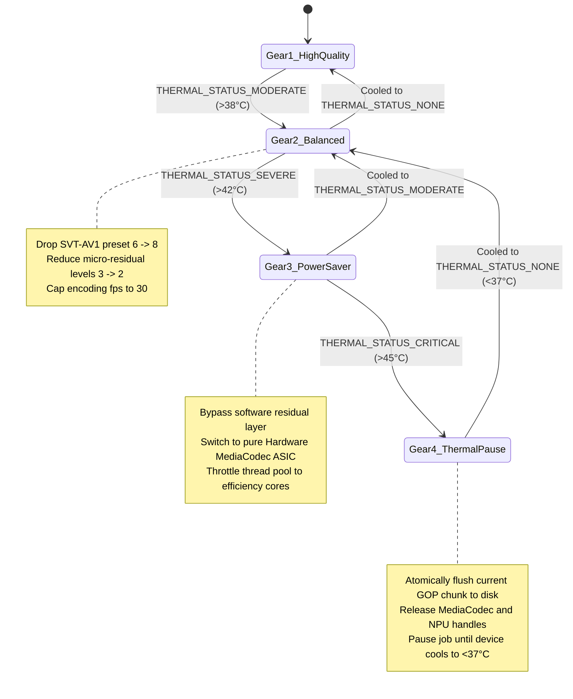

# Section 4: Lossy Architecture, Hybrid Engine & Rate Control

---

## 4.1 The Hardware-Anchored Hybrid Split-Stream Paradigm

Rather than fighting the phone's fixed-function video silicon with heavy neural autoencoders, Prism-V enslaves the hardware video ASIC. It decomposes video into three orthogonal information streams multiplexed into a single backward-compatible container:

$$\mathcal{V} \approx \underbrace{\mathcal{U}\left( \hat{\mathcal{V}}_{\text{HW-Base}} \right)}_{\text{85%–92% of signal energy (HW ASIC, <0.4 W)}} + \underbrace{\mathcal{D}_{\boldsymbol{\theta}_{\text{GOP}}}\left( \hat{\mathbf{L}}_t, \Psi(\hat{\mathcal{V}}_{\text{HW-Base}, t}) \right)}_{\text{Content-Adapted Micro-Residual (<600 MAC/pixel)}} + \underbrace{\mathcal{G}_{\text{AFGS1}}\left( \boldsymbol{\gamma}_t, \hat{\mathcal{V}}_t \right)}_{\text{Parametric Noise/Grain (<200 B/frame)}}$$

```mermaid
flowchart TD
    RAW[Camera2 / Input YUV Frame] --> AFGS_EXT[Stage 1: AOMedia AFGS1 Noise Separation<br/>Fit 14-parameter AR model γ_t & strip grain]
    
    AFGS_EXT --> CLEAN_FRAME[Denoised Structural Frame f_clean]
    
    CLEAN_FRAME --> HW_ENC[Stage 2: Hardware MediaCodec ASIC<br/>AV1 Main10 / HEVC Base Encode at +4 to +6 QP]
    HW_ENC --> BASE_BS[Standard Hardware Track 1: av01 / hvc1<br/>Playable on 100% of Legacy Players]
    
    HW_ENC --> HW_DEC[Hardware MediaCodec Zero-Copy Decode Surface]
    HW_DEC --> BASE_RECON[Reconstructed Base Frame f_base]
    
    CLEAN_FRAME & BASE_RECON --> SUBTRACT[Compute Structural Residual<br/>r_t = f_clean - Upsample(f_base)]
    
    SUBTRACT --> RES_ROUTER{Speed Mode Selector}
    
    RES_ROUTER -->|Live 60fps Capture / Fast Export| NO_COOL[Mode A: N-O Cool-chic Hypernetwork<br/>Feed-forward NPU pass in <3.5 ms/frame]
    RES_ROUTER -->|Max Squeeze / Idle Charging| OVERFIT[Mode B: Cool-chic 5.0 Overfitting<br/>300-600 AdamW steps on NPU/CPU WorkManager]
    
    NO_COOL & OVERFIT --> RES_SYNTH[Encode Latent Pyramid L_t + MLP Weights θ_GOP<br/>via 8-Way SIMD rANS]
    
    RES_SYNTH --> AUX_TRACK[Enhancement Track 2: prmr Box]
    AFGS_EXT --> GRAIN_BOX[Parametric Grain Box: afgs]
    
    BASE_BS & AUX_TRACK & GRAIN_BOX --> MP4_MUX[Dual-Track ISOBMFF .mp4 File]
```

### Stage 1: Perceptual Noise Stripping & `AFGS1` Synthesis
Camera sensor noise and film grain are spatially and temporally uncorrelated, making them incompressible via DCT/DST block transforms. Encoding them directly consumes 20%–45% of total bitrate or results in "plastic" smoothed textures when quantized away:
- Before compression, a fast GPU/CPU shader evaluates $8\times 8$ block variance and autocorrelation to separate temporally uncorrelated shot noise from structural edges.
- It fits the 14-parameter autoregressive (`AR`) model of **AOMedia AFGS1** ($\boldsymbol{\gamma}_t$, ~160 bytes/frame).
- Passing the cleaned frame $f_t^{\text{clean}}$ to the hardware encoder immediately yields **12%–25% bitrate savings** at medium-to-high quality. The decoder re-synthesizes identical grain via a deterministic pseudo-random shift register.

### Stage 2: Hardware `MediaCodec` Base Layer ($\hat{\mathcal{V}}_{\text{HW-Base}}$)
- The clean stream $f_t^{\text{clean}}$ is dispatched via zero-copy `AHardwareBuffer` surfaces to the device's hardware `MediaCodec` encoder (`c2.qti.av1.encoder` / `c2.mtk.av1.encoder` on Tiers 2/3; hardware `HEVC` on Tier 1) at coarse QP (+4 to +6 offset) or $1.5\times$ Lanczos downscaling.
- Reconstructed frames $\hat{f}_{t,\text{base}}$ are recovered via a paired hardware decoder surface at **<0.015 J/frame**.

### Stage 3: Two-Speed Content-Adapted Micro-Residual ($\mathcal{D}_{\boldsymbol{\theta}_{\text{GOP}}}$)
To restore fine details, text sharpness, and high-frequency textures lost by the hardware encoder, Prism-V computes the residual $r_t = f_t^{\text{clean}} - \mathcal{U}(\hat{f}_{t,\text{base}})$ and encodes it using a **Base-Conditioned Cool-chic 5.0 Micro-Codec**:
- The decoder $\mathcal{D}_{\boldsymbol{\theta}_{\text{GOP}}}$ takes a 3-level sparse latent pyramid $\hat{\mathbf{L}}_t = \{\hat{L}_t^{(1/2)}, \hat{L}_t^{(1/4)}, \hat{L}_t^{(1/8)}\}$ plus a 4-channel edge/gradient feature map $\Psi(\hat{f}_{t,\text{base}})$ extracted from the hardware base.
- A tiny 3-layer `INT8` synthesis MLP (width 12 $\to$ 12 $\to$ 3, requiring **only 480 to 850 MACs/pixel**) predicts the high-frequency residual $\hat{r}_t$ and an adaptive deblocking mask.

#### The Two-Speed Lifecycle
- **Speed Mode A (Live Capture / Fast Export — `N-O Cool-chic`):** During live 60 fps camera recording or rapid export, a pre-trained feed-forward hypernetwork (Orange Labs, July 2026, arXiv:2607.13723v1) running on the mobile NPU (`LiteRT`) predicts the latent pyramid $\hat{\mathbf{L}}_t$ and per-GOP MLP weights $\boldsymbol{\theta}_{\text{GOP}}$ in **<3.5 ms/frame** without gradient descent.
- **Speed Mode B (Quality-First / Charging-Time Overfitting — `Cool-chic 5.0`):** When the user selects "Max Quality" or opts into overnight optimization, Android `WorkManager` (constrained to charging and cool battery status) executes **300–600 iterations of AdamW** per 60-frame GOP, optimizing the latents and 1,800 MLP parameters directly against perceptual loss $L = R + \lambda D_{\text{MS-SSIM+L1}}$.  
Because the normative decoder syntax is identical in both modes, the resulting bitstream decodes at **60–120 fps (<850 MACs/pixel)** on any phone while gaining an extra **8%–14% BD-rate**!

---

## 4.2 User Trade-Off Control: 4-Target Pareto Dial

Prism-V replaces ambiguous single-slider "Quality" settings with a **Continuous 4-Target Hexagon Interface** backed by real-time rate-distortion-complexity solvers:

```
                  [ Target Quality ]
                   (VMAF / CVVDP)
                         /\
                        /  \
                       /    \
                      /   *  \  <-- Interactive User Control Dot
                     /        \
   [ Min Battery ]  <----------->  [ Target File Size ]
   (<1.5% per 10m)   \        /       (Explicit MB Cap)
                      \      /
                       \    /
                        \  /
                         \/
                   [ Max Speed ]
                   (60–120 fps)
```

1. **Target Quality Mode:** The user sets a minimum visual quality threshold (e.g., VMAF 93+ or CVVDP 9.0+). The controller solves for the lowest possible bitrate and energy consumption that strictly satisfies the quality floor across all scenes.
2. **Target File Size Mode:** The user specifies an exact target size (e.g., 25 MB for email, 50 MB for messaging). The controller computes the required target video bitrate:
   $$R_{\text{video}} = \frac{8 \cdot S_{\text{target}} - R_{\text{audio}} \cdot t - \mathcal{M}_{\text{overhead}}}{t}$$
   and executes a two-stage preflight probe to guarantee convergence within **$\pm 5\%$ of target size**.
3. **Max Speed Mode:** Prioritizes real-time throughput ($>60\text{ fps}$ at 4K; $>120\text{ fps}$ at 1080p). Configures hardware `MediaCodec` with single-pass CBR/VBR and fast feed-forward micro-residuals, bypassing multi-pass search.
4. **Battery Saver Mode:** Minimizes total energy expenditure (Joules per processed minute $\le 0.02\text{ Wh/min}$). Forces hardware fixed-function encoding, disables CPU software bridges, and restricts NPU/GPU clock frequencies via Android Dynamic Performance Framework (ADPF) hints.

### The 0.3-Second Preflight Pareto Probe
Before encoding begins, Prism-V executes a **0.3-second micro-probe**:
- Selects 5 representative $256\times 256$ spatial patches across shot boundaries.
- Encodes them across three candidate QP/bitrate points on the hardware ASIC.
- Displays an accurate pre-flight estimate to the user in Jetpack Compose: **Predicted Size ($\pm 5\%$)**, **Predicted VMAF Score**, **Elapsed Time (seconds)**, and **Battery Drain (mAh)**.

---

## 4.3 Adaptive Rate Control & Thermal Dynamic Gear-Shifting

Mobile encoding must survive passive chassis thermal limits (3.0–3.8 W sustained). Prism-V integrates an active **Thermal-State Dynamic Gear Shifter** hooking Android `PowerManager.OnThermalStatusChangedListener`:



- **Gear 1 (Full Quality):** Operates under `THERMAL_STATUS_NONE`. Full 3-level latent micro-residuals, full pre-analysis, SVT-AV1 preset 6 (when charging).
- **Gear 2 (Balanced):** Triggered at `THERMAL_STATUS_MODERATE`. Drops SVT-AV1 preset to 8 or 10, simplifies micro-residual to 2 latent levels, restricts CPU worker threads to 2 big cores.
- **Gear 3 (Hardware Fallback):** Triggered at `THERMAL_STATUS_SEVERE`. Disables all software/NPU residual layers; falls back to pure hardware `MediaCodec` at 0.01 J/frame.
- **Gear 4 (Thermal Pause):** Triggered at `THERMAL_STATUS_CRITICAL`. Flushes the active 60-frame GOP to disk, releases codec instances to free hardware registers, and enters low-power sleep until the battery drops below $37^\circ\text{C}$.

---

## 4.4 Decoupled Masked Soft-Gating ($\alpha$-Blend) at Low Bitrates

At ultra-low bitrates (<500 kbps at 1080p), coarse hardware `MediaCodec` frames exhibit severe block boundary artifacts. A simple additive residual ($f_{\text{out}} = \hat{f}_{\text{base}} + \hat{r}$) forces the micro-MLP to waste bits canceling out base-layer blocking artifacts.  
To prevent this, Prism-V implements **Masked Soft-Gating** [P16 Red-Team Pivot #3]:
- The 600-MAC/pixel synthesis MLP outputs four channels: three residual color channels $\hat{\mathbf{r}}(x,y) \in [-128, +127]^3$ and a soft spatial gating mask $\alpha(x,y) \in [0, 1]$.
- Reconstructed pixels are blended via:
  $$\hat{f}_{\text{out}}(x,y) = \alpha(x,y) \cdot \hat{f}_{\text{base}}(x,y) + (1 - \alpha(x,y)) \cdot \hat{r}_{\text{local}}(x,y) + \hat{\mathbf{r}}(x,y)$$
- Along heavily quantized block edges, $\alpha(x,y) \to 0$, suppressing base-layer blocking and replacing it with clean synthesized texture before adding high-frequency detail.
