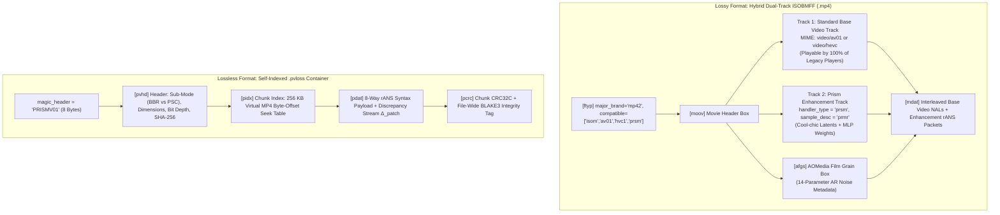
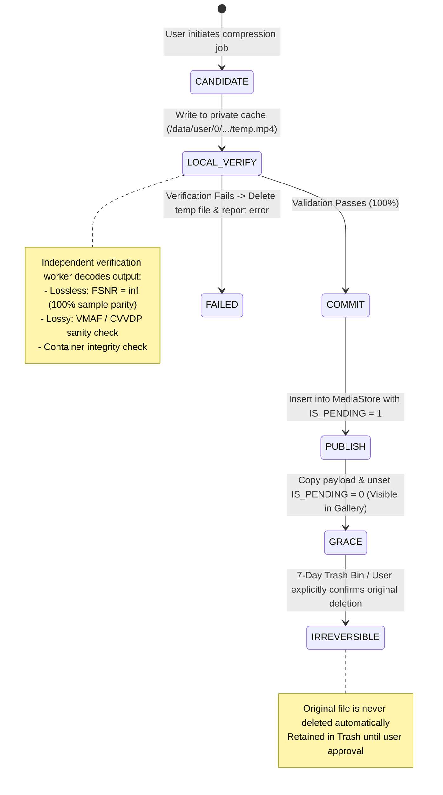

# Section 6: Container Specifications, Metadata Preservation & Social Sharing

---

## 6.1 Dual-Container Architecture & Ecosystem Strategy

Prism-V rejects proprietary standalone containers that isolate media from the broader ecosystem. It adopts a **Dual-Format Standards-First Strategy**:



### 6.1.1 Hybrid Dual-Track ISOBMFF (`.mp4`) Binary Specification
Every lossy file produced by `Prism-Lossy` is a 100% compliant ISO/IEC 14496-12 (ISOBMFF) file:
- **`ftyp` Box:** Declares major brand `mp42` with compatible brands `['isom', 'mp42', 'av01', 'hvc1', 'prsm']`.
- **Track 1 (`vide` Track):** Encoded via hardware `MediaCodec` as standard AV1 (`av01`) or HEVC (`hvc1`). Any non-Prism player (iOS QuickTime, Windows Media Player, Chrome, WhatsApp) ignores auxiliary tracks and plays Track 1 normally at 85%–92% quality.
- **Track 2 (`meta` / `prmr` Auxiliary Enhancement Track):**
  - Handler type: `prsm`.
  - Sample description box `prmr` (Prism Micro-Residual):
    ```c
    aligned(8) class PrismMicroResidualBox extends Box('prmr') {
        uint8_t  prism_version = 1;
        uint8_t  profile_idc   = 0x01; // Main10 Hybrid
        uint16_t max_macs_per_pixel = 600;
        uint8_t  latent_pyramid_levels = 3;
        uint8_t  mlp_hidden_dim = 12;
        uint16_t gop_size = 60;
    }
    ```
  - Sample stream: Carries time-aligned quantized Cool-chic latent pyramids $\hat{\mathbf{L}}_t$ and per-GOP micro-MLP parameters $\boldsymbol{\theta}_{\text{GOP}}$.
- **`afgs` Parameter Box:** Carries the AOMedia AFGS1 autoregressive film grain synthesis parameters for high-frequency noise re-synthesis.

### 6.1.2 `.pvloss` Binary Specification (Mode L-BBR & Mode L-PSC)
Every bit-exact lossless file utilizes the `.pvloss` container layout:

| Byte Offset | Field Name | Data Type | Binary Description & Value |
|:---|:---|:---|:---|
| `0x00 – 0x07` | `magic_header` | `char[8]` | ASCII `"PRISMV01"` (`0x50 0x52 0x49 0x53 0x4D 0x56 0x30 0x31`) |
| `0x08` | `lossless_mode` | `uint8_t` | `0x01` = `Prism-BBR` (Bitstream Exact), `0x02` = `Prism-PSC` (Pixel Exact) |
| `0x09` | `source_codec_id` | `uint8_t` | `0x01` = H.264, `0x02` = HEVC, `0x03` = YUV420_8, `0x04` = P010_10, `0x05` = Bayer RAW10 |
| `0x0A – 0x0B` | `flags` | `uint16_t` | Bit 0: `has_audio_zstd`, Bit 1: `has_patch_stream`, Bit 2: `seekable_256kb_blocks` |
| `0x0C – 0x13` | `orig_file_size` | `uint64_t` | Exact byte length of original file (used by `Prism-VFS` `onGetSize()`) |
| `0x14 – 0x33` | `orig_sha256` | `uint8_t[32]` | 256-bit SHA-256 cryptographic digest of the original bitstream / raw YUV |
| `0x34 – 0x3F` | `video_geometry` | `uint16_t[6]` | `width`, `height`, `fps_num`, `fps_den`, `bit_depth`, `chroma_format` |
| `0x40 – 0x47` | `index_offset` | `uint64_t` | Byte offset to the `pidx` Random-Access Seek Table |
| `0x48 – ...` | `chunk_payloads` | `byte[]` | Independent 256 KB (BBR) or 15-frame GOP (PSC) 8-way rANS packets + `uint32_t crc32c` |

---

## 6.2 Metadata Preservation Ledger

Prism-V establishes strict, immutable rules for every video stream and auxiliary metadata track, rejecting silent data loss:

| Metadata Domain | Specific Elements Tracked | Operational Preservation Rule | Fallback Action on Incompatibility |
|:---|:---|:---|:---|
| **Colorimetry & Primaries** | Colour Primaries, Transfer Characteristics, Matrix Coefficients, Video Full Range Flag | Exact preservation of NCLX / CICP values in ISOBMFF `colr` box and Matroska `Colour` elements. | Abort if lossless; if lossy, inject explicit CICP tags into output container. |
| **Static HDR Metadata** | SMPTE ST 2086 (Mastering Display Color Volume), CTA-861.3 (MaxFALL, MaxCLL) | Transferred directly into ISOBMFF `mdcv` and `clli` boxes; preserved in Matroska `MasteringMetadata`. | If destination container lacks support, warn user and retain source container. |
| **Dynamic HDR Metadata** | HDR10+ (SMPTE ST 2094-40 SEI NALs), Dolby Vision (RPU metadata / dual-track) | Preserved as pass-through NAL units in `Mode L-Remux` and `Mode L-BBR`. In `Prism-Lossy`, SEI NALs are multiplexed into Track 1. | Expose as advanced feature; warn user if dynamic tone mapping cannot be carried. |
| **Display Geometry** | Matrix transformation (Rotation: 0°, 90°, 180°, 270°), Pixel Aspect Ratio (PAR) | Transferred into ISOBMFF `tkhd` matrix and `pasp` box without re-encoding or baking rotation into pixels. | Never bake rotation into pixels in lossless mode; preserve native orientation tag. |
| **Audio Streams** | Multichannel AAC, Opus, Dolby Digital (AC-3/E-AC-3), Lossless FLAC | **Stream Copy by default:** copied packet-for-packet into output container without re-encoding. | If output container cannot carry codec, offer explicit user prompt for Opus/AAC re-encode. |
| **Timed Text & Captions** | CEA-608/708 closed captions, WebVTT, SRT, ASS/SSA subtitle tracks | Extracted and preserved as separate subtitle tracks in output container. | Never burn subtitles into video pixels unless explicitly requested by user. |
| **Timestamps & VFR** | Presentation Timestamps (PTS), Decode Timestamps (DTS), Variable Frame Rate (VFR) | Exact integer millisecond timestamp mapping; time-base normalization with 0 dropped frames. | Never force-convert VFR to CFR; preserve natural sensor shutter intervals. |

---

## 6.3 Social Export Share-Sheet Pre-Filter

When users share videos to social media platforms (WhatsApp, Instagram, TikTok, YouTube Shorts), the platform's backend transcoders strip all non-standard auxiliary tracks (`prmr`, `uuid`) and re-compress the file, losing the enhancement layer:

```
[ User taps 'Share to WhatsApp' in Prism App ]
                      |
                      v
     [ Detect Target Intent: Social Media ]
                      |
        +-------------+-------------+
        |                           |
        v                           v
(Standard Direct Share)     (Prism Social Pre-Filter)
- Uploads raw .mp4          - Composites Track 1 + Track 2 in RAM
- WhatsApp strips prmr      - Applies 5x5 Debanding Dither Shader
- Result: 85% quality       - Re-encodes single-track HW H.264/HEVC
                            - Result: 100% enhanced quality preserved!
```

- **Social Media Interceptor:** When sharing via `Intent.ACTION_SEND` targeting known social apps, Prism-V offers a 1-tap **"Optimized Social Export"**:
  1. Composites the hardware base track and the Cool-chic micro-residual in RAM via a fast GPU compute shader.
  2. Injects a calibrated high-frequency dither mask to protect dark gradients from social media banding.
  3. Re-encodes a pristine, single-track H.264 or HEVC MP4 fitted exactly to the platform's target bitrate (e.g., 2.5 Mbps 1080p).
  4. Guarantees that the recipient sees the fully enhanced video with zero stripping.

---

## 6.4 Transactional Atomic Publishing via `MediaStore` `IS_PENDING`

To guarantee that unexpected app crashes, battery death, or OS process kills never leave corrupt, unplayable files in the user's gallery, Prism-V enforces a **5-State Verified Replacement Protocol** [P11, P17]:



1. **`CANDIDATE`:** Ingests source metadata and allocates private temporary storage.
2. **`LOCAL_VERIFY`:** The entire video is compressed into an app-private cache file (`temp_export.mp4`). An independent decode worker validates frame counts, audio-video sync, container integrity, and verifies PSNR=$\infty$ (for lossless) or VMAF score sanity (for lossy).
3. **`COMMIT`:** The verified file is staged for publishing.
4. **`PUBLISH`:** The file is registered with Android's `MediaStore` using `ContentValues.put(MediaStore.MediaColumns.IS_PENDING, 1)`. The bytes are transferred atomically, and `IS_PENDING` is flipped to `0`, making the file instantly visible in Google Photos and Gallery.
5. **`GRACE`:** The original file is **never deleted automatically**. It is moved to a 7-day "Prism Vault Trash" or retained until the user explicitly approves deletion after previewing the result.
