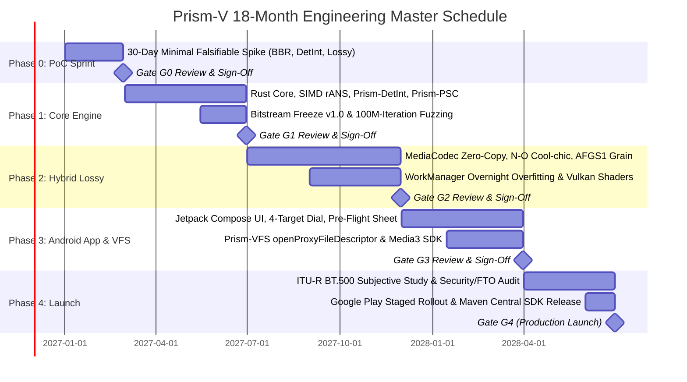

# Section 8: Engineering Roadmap, Team Structure & Budget Analysis

---

## 8.1 18-Month Phased Implementation Roadmap

Prism-V follows an 18-month disciplined engineering plan divided into five sequential phases, each terminated by a strict, quantifiable Go/No-Go Gate:



### Phase Breakdown & Deliverables
1. **Phase 0: Proof-of-Concept & Falsification Spike (Months 1–2, Days 1–60)**
   - Validate core mathematical hypotheses on 50 real Android camera MP4s and `UVG` 1080p clips using CLI test fixtures.
   - Prove cross-silicon bit-exactness of `Prism-DetInt` on 5 physical SoCs.
   - Instrument 6 physical phones with Monsoon High Voltage Power Monitors.
   - *Unlock Requirement:* 100% pass of Gate G0 criteria.
2. **Phase 1: Safe Systems Core & Bitstream Freeze (Months 3–6)**
   - Author production `prism-rans`, `prism-detint`, `prism-bbr`, and `prism-psc` crates in Rust (Edition 2024).
   - Write hand-tuned Arm assembly loops (`arm_neon_rans8.S`) and `KleidiAI` SME2 kernels.
   - Freeze normative bitstream specifications for `.pvloss` v1.0 and ISOBMFF `prsm` boxes.
   - Execute 100-million-iteration fuzzing suite (`cargo-fuzz` / `libFuzzer`).
   - *Unlock Requirement:* Gate G1 sign-off.
3. **Phase 2: Hybrid Lossy Engine & NPU Acceleration (Months 7–11)**
   - Complete `AMediaCodec` zero-copy `AHardwareBuffer` pipeline for hardware AV1 and HEVC.
   - Train and quantize the 4.8 MB `N-O Cool-chic` live hypernetwork for LiteRT NPU delegates.
   - Implement `WorkManager` background charging-time overfitting engine.
   - Implement AOMedia AFGS1 film grain extraction and GPU synthesis.
   - *Unlock Requirement:* Gate G2 sign-off.
4. **Phase 3: Android App, `Prism-VFS` Proxy & Media3 SDK (Months 12–15)**
   - Build reactive Jetpack Compose UI (4-target dial, 0.3-second pre-flight estimator sheet).
   - Implement `Prism-VFS` (`StorageManager.openProxyFileDescriptor`) virtual MP4 bridge.
   - Publish open-source `io.prismv:media3-decoder-prism` AAR library for Jetpack Media3 ExoPlayer.
   - Execute 72-hour automated continuous stress testing across all 6 HIL rack phones.
   - *Unlock Requirement:* Gate G3 sign-off.
5. **Phase 4: Subjective Testing, Security Audit & Launch (Months 16–18)**
   - Conduct double-stimulus ITU-R BT.500 subjective viewing tests across 60 human raters.
   - Retain third-party cybersecurity firm for Rust/C++ parser penetration testing.
   - Formal patent counsel Freedom-to-Operate (FTO) review sign-off.
   - Staged production rollout on Google Play Store (1%, 5%, 20%, 100%) and Maven Central SDK.

---

## 8.2 Team Structure & Staffing Model (8 FTEs)

The project is executed by a tightly coupled, highly specialized team of 8 Full-Time Equivalents (FTEs) supported by external patent and security counsel:

```
+---------------------------------------------------------------------------------------+
|                 PRISM-V CORE ENGINEERING TEAM (8 FTEs + COUNSEL)                      |
+---------------------------------------------------------------------------------------+
|                                                                                       |
|   [ Principal Video Codec Architect / Technical Lead (1 FTE) ]                        |
|   - Owns overall bitstream specifications, rate-distortion optimization, and         |
|     MediaCodec + Cool-chic hybrid integration.                                        |
|                                                                                       |
|   +------------------------------------+   +------------------------------------+     |
|   | Staff ML Compression Scientists    |   | Senior Arm SIMD & GPU Engineers    |     |
|   | (2 FTEs)                           |   | (2 FTEs)                           |     |
|   | - Own Prism-BBR Micro-MLP,         |   | - Own libprism_rans, arm_neon_rans8|     |
|   |   Prism-PSC ConvNet, N-O Cool-chic |   |   SME2 KleidiAI kernels, and       |     |
|   |   hypernetwork, and INT8 QAT.      |   |   Vulkan Cooperative Matrix shaders|     |
|   +------------------------------------+   +------------------------------------+     |
|                                                                                       |
|   +------------------------------------+   +------------------------------------+     |
|   | Senior Android Systems Engineers   |   | QA, HIL Benchmark & DevOps Lead    |     |
|   | (2 FTEs)                           |   | (1 FTE)                            |     |
|   | - Own AMediaCodec zero-copy pipeline|  | - Owns 6-phone Monsoon power rack, |     |
|   |   Prism-VFS ProxyFD, WorkManager,  |   |   continuous CI regression fuzzing,|     |
|   |   and Jetpack Compose UI.          |   |   and VMAF/CVVDP metric pipeline.  |     |
|   +------------------------------------+   +------------------------------------+     |
|                                                                                       |
|   [ External Retainers: IP / Patent Counsel & Third-Party Security Auditors ]          |
+---------------------------------------------------------------------------------------+
```

---

## 8.3 18-Month Comprehensive Budget Analysis

We present two fully loaded financial models: a **Global Hybrid Model** (US/EU/Asia senior distributed team) and an optimized **India-Centric Model** (staffed primarily in Bengaluru/Hyderabad):

### Table 8.1: 18-Month Program Cost Breakdown

| Budget Category | Global Hybrid Model (USD) | India-Centric Model (INR) | India-Centric Model (USD Equivalent) | Assumptions & Operational Scope |
|:---|:---|:---|:---|:---|
| **Engineering Compensation (8 FTEs, 1.5 Years)** | **$2,160,000 – $2,750,000** | **₹1.60 Cr – ₹2.50 Cr** | $190,000 – $295,000 | Fully loaded engineering salaries, benefits, and equity reserves across 18 months. |
| **GPU Cloud Training & CI Cluster** | **$85,000 – $135,000** | **₹18 Lakh – ₹30 Lakh** | $21,000 – $35,000 | 2x 8-GPU `NVIDIA H100/B200` cloud instances reserved for 6 months of QAT training + dataset storage. |
| **Mobile HIL Test Lab & Instrumentation** | **$35,000 – $50,000** | **₹25 Lakh – ₹40 Lakh** | $30,000 – $48,000 | 24 physical Android devices (Tiers 1–3), 4x Monsoon HV Power Meters, thermal chambers, and FLIR cameras. |
| **Patent FTO Clearances & Defensive Filings** | **$110,000 – $175,000** | **₹30 Lakh – ₹50 Lakh** | $35,000 – $60,000 | External patent counsel formal FTO review + drafting 5 defensive patent applications. |
| **Subjective Study & External Security Audit** | **$45,000 – $70,000** | **₹15 Lakh – ₹25 Lakh** | $18,000 – $30,000 | Third-party Rust/C++ penetration audit + 60-participant double-stimulus ITU-R BT.500 quality study. |
| **Operational Contingency & Device Refreshes** | **$75,000 – $120,000** | **₹20 Lakh – ₹40 Lakh** | $24,000 – $47,000 | Firmware bricking replacements, emergency silicon procurement, and cloud bursts. |
| **Total 18-Month Program Budget** | **$2,510,000 – $3,300,000** | **₹2.68 Cr – ₹4.35 Cr** | **$318,000 – $515,000** | Complete capital requirement through global production launch. |

---

## 8.4 The First 7 Days: Minimal Falsifiable Experiments

Before writing Android UI or Vulkan shaders, a single senior engineer can prove or falsify the core claims of Prism-V in **7 days** using a Linux workstation connected via `adb` to one Android phone:

### Experiment 1A: `Prism-BBR` 3-Day Proof Test
- **Input:** 10 real 1080p30 H.264 and 10 real 1080p30 HEVC camera videos from an Android phone.
- **Protocol:** Run a 400-line Python/C++ script hooking `ff_h264_decode_mb_cabac` / `ff_hevc_cabac_decode` to dump the exact stream of syntax symbols `(syntax_type, ctx_idx, symbol_val)`.
- Re-encode syntax symbols using `HuffmanPos` (Singh 2026) + a 1.1 KB `INT8` Micro-MLP and 8-way rANS.
- **Falsification Threshold:** Must achieve **$\ge 15\%$ file size reduction on H.264** and **$\ge 9\%$ on HEVC** with 100% bit-exact SHA-256 round-trip restoration. If $<8\%$ on H.264, demote `Mode L-BBR` to archival background storage.

### Experiment 1B: `Prism-Lossy` 4-Day Proof Test
- **Input:** 5 `UVG` 1080p clips encoded via `MediaCodec` at 1.5 Mbps using hardware HEVC and AV1.
- **Protocol:** Compute residual $r_t = f_t - \hat{f}_{t,\text{HW}}$. Run open-source `Cool-Chic 5.0` configured at the **500 MAC/pixel** preset to encode $r_t$ at 0.25 Mbps (total rate = 1.75 Mbps).
- Compare VMAF-NEG and CVVDP against a standalone 1.75 Mbps hardware `MediaCodec` encode.
- **Falsification Threshold:** Hybrid stream must beat standalone hardware stream by **$\ge 1.2\text{ dB PSNR}$ and $\ge 4.5\text{ VMAF-NEG points}$ ($\approx -18\%$ BD-rate)**. If $<2.0\text{ VMAF}$ gain, drop the micro-residual and pivot to NPU Region-of-Interest (ROI) QP map injection.
