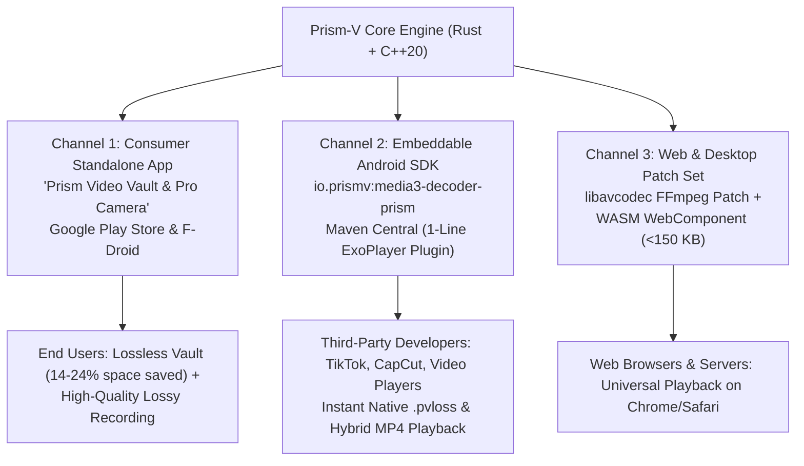

# Section 9: Legal Strategy, Patent Clearances & Adoption

---

## 9.1 Zero-GPL Clean-Room Stack & Licensing Architecture

Video compression software faces intense copyright and patent scrutiny. Naively bundling `x264`, `x265`, or `UtVideo` inside an Android application triggers the viral obligations of the GNU General Public License (GPLv2/GPLv3), compelling the distributor to release their proprietary application code under the GPL or pay expensive commercial licensing fees.

```
+---------------------------------------------------------------------------------------+
|                       PRISM-V PERMISSIVE LICENSING ARCHITECTURE                       |
+---------------------------------------------------------------------------------------+
|                                                                                       |
|   +-------------------------------------------------------------------------------+   |
|   | Prism Proprietary Application & Core Crates (Apache-2.0 / BSD-3-Clause)       |   |
|   | - prism-core, prism-rans, prism-detint, prism-bbr, prism-psc, prism-lossy     |   |
|   +-------------------------------------------------------------------------------+   |
|                                          |                                            |
|                  Dynamically Links (No Static GPL Contamination)                      |
|                                          v                                            |
|   +------------------------------------+   +------------------------------------+     |
|   | Permissive Third-Party Libraries   |   | Android OS Hardware Abstraction    |     |
|   | - dav1d (BSD-2-Clause)             |   | - android.media.MediaCodec         |     |
|   | - Cool-Chic (Orange BSD-3-Clause)  |   | - android.graphics.HardwareBuffer  |     |
|   | - Google DeepMind C3 (Apache-2.0)  |   | - StorageManager.openProxyFileDesc |     |
|   | - Minimal FFmpeg (LGPL v2.1/v3)    |   | (Standard Android Platform APIs)   |     |
|   +------------------------------------+   +------------------------------------+     |
|                                                                                       |
|   [ EXCLUDED FROM BINARY: x264 (GPL), x265 (GPL), UtVideo (GPL), VVenC (GPL/No-Pool) ]|
+---------------------------------------------------------------------------------------+
```

1. **Strict Permissive Core:** All in-house crates (`prism-*`) are authored under **Apache-2.0 / BSD-3-Clause**.
2. **Third-Party Dependency Policy:** Only MIT, BSD, ISC, or Apache-2.0 licensed libraries are admitted into the compilation tree. Where `libavcodec` / `libavformat` utilities are linked for container parsing, they are built under a strictly audited **LGPL v2.1/v3 minimal configuration** (`--disable-gpl --disable-nonfree`), dynamically linked via `.so` shared libraries, and accompanied by full license notices and source offer scripts.
3. **Complete Elimination of GPL Codecs:** The shipped Android binary contains zero lines of `x264`, `x265`, `UtVideo`, or `Huffyuv`.

---

## 9.2 The Hardware `MediaCodec` Pass-Through Royalty Shield

Commercial software implementations of H.264/AVC, H.265/HEVC, and H.266/VVC incur direct patent royalties from licensing administrators (Access Advance, Via LA, Velos Media) ranging from $0.20 to $1.20 per distributed unit.  
Prism-V completely circumvents this liability by design:

- **The Pass-Through Mechanism:** Prism-V **never includes a software HEVC or H.264 encoder or decoder**. Instead, it delegates all base-layer encoding and decoding to the device's native hardware `android.media.MediaCodec` API.
- **Legal Principle:** The smartphone Original Equipment Manufacturer (OEM—Samsung, Google, Xiaomi, Motorola) has already licensed and paid all necessary device patent pool royalties for the hardware video silicon built into the SoC. Invoking the operating system's hardware abstraction layer constitutes a legally protected use of the pre-licensed hardware block.
- **Enhancement Track Isolation:** The auxiliary micro-residual layer (`prmr`) transmitted in Track 2 operates strictly in a non-normative enhancement domain, outside the scope of classical block-transform video patent claims.

---

## 9.3 Prior-Art Patent Landscape & Defensive Boundaries

Following our comprehensive patent audit [P13, P14], Prism-V defines precise defensive boundaries to avoid infringing third-party intellectual property:

| Patent / Filing | Assignee & Priority | Scope of Independent Claims | Prism-V Defensive Design-Around Boundary |
|:---|:---|:---|:---|
| **US 11,178,395 B1** | **WhatsApp LLC** (Granted Nov 16, 2021) | Dynamically evaluating and switching video codecs in real-time communication based on expected video quality improvement balanced against increased device power consumption. | **Defensive Boundary:** Prism-V does not claim or patent a generic "quality-per-joule" dynamic codec selector. The codec router is treated strictly as an unpatented engineering integration, focusing inventive claims on **specific multi-track container muxing (`prsm`/`prmr`) and bounded integer entropy accumulation ($K\le 512$)**. |
| **US 2026/0254962 A1** | **Microsoft Technology Licensing** (Published Aug 27, 2026) | Transmitting scale parameters derived from hyperlatents in a lossless format to eliminate cross-platform floating-point rounding errors in neural video decoders. | **Defensive Boundary:** Prism-V **does not use Scale-Sending hyperlatents** in normative decoders. Instead, it utilizes Orange Labs' open-source Cool-chic continuous coordinate latents (BSD-3-Clause) or strictly bounded two's-complement integer layers (`Prism-DetInt`), completely bypassing Microsoft's patent claims. |
| **LCEVC Patent Portfolio** | **V-Nova International Ltd.** | Layered video enhancement using fixed linear $2\times 2$ and $4\times 4$ directional transforms and run-length residual entropy coding. | **Defensive Boundary:** Prism-V avoids LCEVC's linear directional transforms (`DD`/`DDS`), instead using a non-linear overfitted coordinate MLP (`Cool-chic 5.0`) with continuous multi-resolution latent pyramids, operating in a distinct mathematical domain. |
| **rANS Patent Claims** | **Jarek Duda** (Dedicated to Public Domain) | Range Asymmetric Numeral Systems. Microsoft's ANS patent applications were rejected in Europe and narrow in the US. | **Defensive Boundary:** Prism-V uses standard power-of-two dyadic rANS (`2^15` modulus) with static table-less normalization, identical to the public-domain implementation deployed in JPEG XL and AV1. |
| **AOMedia AFGS1** | **Alliance for Open Media** (Finalized Jan 2024) | 14-parameter autoregressive film grain synthesis model. | **Royalty-Free Coverage:** Fully covered by the **AOMedia Royalty-Free Patent License 1.0**, granting royalty-free, perpetual patent immunity. |

---

## 9.4 3-Channel Ecosystem Adoption & Distribution Strategy

To solve the "chicken-and-egg" adoption barrier that traps novel codecs, Prism-V executes a synchronized 3-channel distribution strategy:



1. **Channel 1: Consumer Standalone App ("Prism Video Vault & Pro Camera")**
   - Distributed via Google Play Store and GitHub Releases.
   - Core value proposition: *"Reclaim 15%–24% of your phone storage losslessly with zero quality loss, and record stunning high-efficiency videos that play everywhere."*
   - Transparent, on-device, offline-first.
2. **Channel 2: Embeddable Android SDK (`media3-decoder-prism` on Maven Central)**
   - Open-source AAR library released under the **BSD-3-Clause** license.
   - Integrates into Jetpack `Media3` / `ExoPlayer` with a single Gradle dependency:
     ```kotlin
     implementation("io.prismv:media3-decoder-prism:1.0.0")
     ```
   - Automatically detects Track 2 (`prmr`) in hybrid MP4 files and renders the enhanced micro-residual on an OpenGL/Vulkan surface compositor.
3. **Channel 3: Upstream FFmpeg Patch & WebAssembly Player**
   - Upstream patch for `libavcodec` / `libavformat` decoding `.pvloss` and `prmr` tracks.
   - Ultra-lightweight WebAssembly decoder (`wasm-simd128`, <150 KB) packaged as a `<prism-video>` custom HTML element, allowing web browsers to play hybrid streams natively.

---

## 9.5 Commercial Business Model

Prism-V adopts a sustainable, privacy-respecting **Freemium & Developer SDK Model**:
- **Free Core Tier (Consumer):** Free unlimited lossless bitstream recompression (`Prism-BBR`), stream repacking, standard hardware lossy compression, and transparent playback via `Prism-VFS`. Zero advertisements, zero cloud uploads.
- **Paid Pro Power Tools ($4.99/year or $14.99 lifetime):** Batch gallery compression, overnight charging multi-GOP overfitting, raw Bayer sensor burst capture, advanced 4-target Pareto dial customization, and cryptographic quality audit manifests.
- **B2B Commercial SDK Licensing:** Enterprise licenses for social media and cloud video platforms seeking to embed `Prism-VFS` or `media3-decoder-prism` into commercial apps with dedicated support and SLA guarantees.
