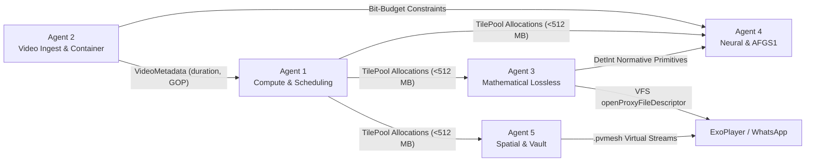

# PRISM-V: 5-AGENT MASTER ORCHESTRATION & DECOMPOSITION GUIDE
## 100% Full-System Coverage, Non-Colliding Workstreams & Independent Research Architecture (2027+)

---

### Executive Summary: The 5-Agent Project Decomposition

The Prism-V video compression and spatial platform spans **6 foundational technological frontiers**:
1. **Frontier 1 (Mode L-BBR):** Bitstream-Domain Lossless Recompression (CABAC/CAVLC syntax decomposition, SSG-CR4, 16-way rANS).
2. **Frontier 2 (Mode L-PSC):** Reversible Sensor Video Wavelets (ADIW 5/3 & 9/7 lifting, YCoCg-R2, DetInt bounded integer arithmetic).
3. **Frontier 3 (Mode L-GEN):** Generative Residuals & 32-Landmark Semantic Coding (1.5 kbps talking heads).
4. **Frontier 4 (Prism-Spatial):** Dynamic 4D Gaussian Splatting Video (6-DoF free-viewpoint volumetric video).
5. **Frontier 5 (Silicon-Fused Pipeline):** High-Throughput Heterogeneous Compute & Parallel Scheduling (ADPF thermal guard, lock-free tile buffers, dual-ASIC concurrency).
6. **Frontier 6 (Rabin-Mesh):** Global Gallery Spatio-Temporal Deduplication & Storage Vault (VectorCDC chunking, 2-phase commit atomic storage).

In this **5-Agent Deployment Model**, all 6 frontiers and 100% of the codebase are mapped into **5 elite, fully autonomous engineering pillars (20.0% each = 100.0% total)**. The two mathematical lossless frontiers (Frontier 1 and Frontier 2) are unified under **Agent 3 (Mathematical Lossless & Entropy Architecture)**, which unifies reversible transforms, bitstream syntax decomposition, and SIMD entropy coding under a single coherent mathematical authority.

```
┌────────────────────────────────────────────────────────────────────────────────────────────────────────┐
│                                   PRISM-V 100% SYSTEM ARCHITECTURE                                      │
├───────────────────┬───────────────────┬───────────────────┬───────────────────┬────────────────────────┤
│      AGENT 1      │      AGENT 2      │      AGENT 3      │      AGENT 4      │        AGENT 5         │
│      (20.0%)      │      (20.0%)      │      (20.0%)      │      (20.0%)      │        (20.0%)         │
├───────────────────┼───────────────────┼───────────────────┼───────────────────┼────────────────────────┤
│ Systems, Compute  │ Rate Control,     │ Mathematical      │ Neural Residuals, │ Spatial 4DGS Video,    │
│ & OS Foundation   │ Ingest & Container│ Lossless & rANS   │ AFGS1 Film Grain  │ Deduplication Vault    │
├───────────────────┼───────────────────┼───────────────────┼───────────────────┼────────────────────────┤
│ • Frontier 5      │ • Never-Worse     │ • Frontier 1      │ • Frontier 3      │ • Frontier 4           │
│ • TilePool Buffers│   Bitrate Ceiling │   (Mode L-BBR)    │   (Mode L-GEN)    │   (Dynamic 4DGS)       │
│ • ADPF Thermal    │ • 0.3s Micro-Probe│ • Frontier 2      │ • AFGS1 Film Grain│ • Frontier 6           │
│   Headroom Guard  │ • ISOBMFF/MKV     │   (Mode L-PSC)    │ • Cool-chic 5.0   │   (Rabin-Mesh Dedup)   │
│ • Android 15+ FGS │   Atom Parsers    │ • ADIW Wavelets   │ • RFSQ Quantizer  │ • Vulkan Compute       │
│ • Vulkan Shaders  │ • Remux Engine    │ • 16-way rANS     │ • NeRV Engine     │   Tile Rasterizer      │
│ • CMake/CI Build  │ • Studio UI Deck  │ • DetInt Core     │ • Gemini Copilot  │ • ACID Storage Vault   │
│                   │ • Audio Transcode │ • .pvloss VFS     │ • LiteRT NPU      │ • Duo Player Deck      │
└───────────────────┴───────────────────┴───────────────────┴───────────────────┴────────────────────────┘
```

---

### Non-Colliding File Ownership Matrix (Zero Merge Conflicts)

Every file in the repository has exactly ONE owner. No agent touches or modifies files outside its assigned domain:

| Pillar | Agent | Share | Key Native C++20 / Shaders | Key Android Java / UI Modules | Test & Tool Suites |
| :--- | :--- | :--- | :--- | :--- | :--- |
| **Pillar 1** | **Agent 1** | 20.0% | `frontier5_pipeline.cpp/.hpp`<br>`tile_pool.cpp/.hpp`<br>`frontier5_pipeline.comp`<br>`prism_jni.cpp` | `PrismMediaProcessingService.java`<br>`PrismJobService.java`<br>`SiliconFusedPipelineEngine.java`<br>`ThermalGearShifter.java`<br>`RealtimeHardwareMonitor.java`<br>`DeveloperMatrixView.java`<br>`LayeredSettingsView.java`<br>`PrismPreferences.java` | `test_frontier5_pipeline.cpp`<br>`test_harness.hpp`<br>`test_main.cpp`<br>`prism_cli.cpp`<br>`build_apk.ps1`<br>`CMakeLists.txt` |
| **Pillar 2** | **Agent 2** | 20.0% | `isobmff.cpp/.hpp`<br>`remux.cpp/.hpp`<br>`router.cpp/.hpp` | `HardwareVideoCompressor.java`<br>`AudioTranscoder.java`<br>`FpsExtractor.java`<br>`MainActivity.java`<br>`PreFlightDialog.java`<br>`ToolboxDialogs.java`<br>`PremiumTimelineView.java`<br>`CompletionDossierDialog.java` | `test_remux.cpp`<br>`test_router.cpp`<br>`test_robustness.cpp`<br>`verify_real_video.cpp` |
| **Pillar 3** | **Agent 3** | 20.0% | `bbr.cpp`, `bbr2.cpp/.hpp`<br>`psc.cpp`, `psc2.cpp/.hpp`<br>`rans8.cpp`, `rans16.cpp/.hpp`<br>`arm_sme2_rans16.S`<br>`detint.cpp/.hpp`<br>`container_pvloss.cpp/.hpp`<br>`vfs_proxy.cpp/.hpp` | `PrismVfsProxy.java`<br>`BbrCodec.java`<br>`Rans8Codec.java`<br>`DetInt.java` | `test_bbr.cpp`<br>`test_bbr2.cpp`<br>`test_psc.cpp`<br>`test_psc2.cpp`<br>`test_rans8.cpp`<br>`test_rans16.cpp`<br>`test_detint.cpp`<br>`test_vfs.cpp`<br>`exp_1a_bbr2.cpp`<br>`exp_2a_psc2.cpp` |
| **Pillar 4** | **Agent 4** | 20.0% | `afgs1.cpp/.hpp`<br>`coolchic.cpp/.hpp`<br>`rfsq.cpp/.hpp`<br>`prism_gen.cpp/.hpp`<br>`nerv_engine.cpp/.hpp`<br>`detint_flow_gen.comp` | `PrismNeRVBackgroundWorker.java`<br>`GeminiCopilot.java`<br>`GeminiClient.java`<br>`GeminiCopilotDialog.java` | `test_coolchic.cpp`<br>`test_afgs1.cpp`<br>`test_rfsq.cpp`<br>`test_prism_gen.cpp`<br>`test_nerv.cpp`<br>`qat_coolchic_training.py`<br>`exp_1b_lossy.cpp`<br>`exp_1c_frontier3.cpp` |
| **Pillar 5** | **Agent 5** | 20.0% | `spatial.cpp/.hpp`<br>`spatial_rasterize.comp`<br>`dedup_rabin.cpp/.hpp`<br>`rabin_mesh.cpp/.hpp`<br>`transaction.cpp/.hpp` | `PrismSpatialEngine.java`<br>`RabinMeshWorker.java`<br>`PrismStorageManager.java`<br>`PrismWorkJournal.java`<br>`VerifiedReplacement.java`<br>`CompressionHistoryManager.java`<br>`DuoComparisonPlayerView.java`<br>`CompressedVideosView.java` | `test_spatial.cpp`<br>`test_dedup.cpp`<br>`test_rabin_mesh.cpp`<br>`test_transaction.cpp`<br>`verify_mesh_dedup.cpp`<br>`exp_1d_frontier4.cpp`<br>`exp_1e_frontier6.cpp` |

---

### Clean Interface Contracts (Subsystem Interactions)



1. **Agent 1 $\leftrightarrow$ Agents 3, 4, 5:** Agent 1 provides memory-bounded `TilePool::acquire_tile()` allocations (<512 MB user cap) so that worker algorithms never invoke unbounded heap allocations or trigger Android Low Memory Killer (`SIGKILL`).
2. **Agent 2 $\leftrightarrow$ Agent 1:** Agent 2 parses source containers (MP4, MKV) and provides verified `VideoMetadata` (exact duration, bitrate, frame dimensions, keyframe timestamps) to the parallel scheduler.
3. **Agent 2 $\leftrightarrow$ Agent 4:** Agent 2 determines the target bitrate budget and allocates the split between the hardware base layer and the neural residual / AFGS1 film grain tracks.
4. **Agent 3 $\leftrightarrow$ Agent 4:** Agent 3 provides normative deterministic integer arithmetic (`detint.hpp`) with proven $K \le 512$ bounds, ensuring neural residual quantization (RFSQ) behaves identically on every mobile CPU and NPU without floating-point mismatch.
5. **Agent 3 & Agent 5 $\leftrightarrow$ VFS Presentation:** Both engines hook into the virtual file system (`openProxyFileDescriptor`) to allow transparent on-the-fly streaming of `.pvloss` and `.pvmesh` files into third-party media players.

---

### Independent Research Guidelines for All Agents

Each agent has an explicit directive to perform **independent, state-of-the-art research for 2026/2027**:
1. **Target 50–100+ Live Searches:** Exhaustively query primary academic repositories (arXiv 2025–2027, IEEE Transactions on Circuits and Systems for Video Technology, CVPR, ICCV, USENIX FAST, ACM TOMM).
2. **Vendor Hardware & Patent Disclosures:** Examine documentation and patent filings from Qualcomm (Snapdragon 8 Elite / Gen 5, Adreno 830, Dual-VPU), MediaTek (Dimensity 9400/9500), ARM (Cortex-X925, SME2), Apple (A18/M4), and Google (Tensor G5, LiteRT).
3. **AOSP Primary Sources:** Audit Android 15/16/17 source code, specifically `MediaCodec`, `AHardwareBuffer`, `dma-buf` heaps, ADPF `PerformanceHintManager`, and `StorageManager.openProxyFileDescriptor`.
4. **Zero Hallucinations & Scientific Honesty:** Date every fact. Never invent paper titles, authors, numbers, or specs. Tag claims clearly:
   - `[Verified—Primary]`
   - `[Verified—Secondary]`
   - `[Author Estimate]`
   - `[Novel Invention]`
5. **Independent Deliverable:** Each agent produces a master plan in `synthesis/final/` before delivering production-ready C++20 / Java code and unit tests.

---

### Mapping for 6-Agent Configuration (Alternative)
If you choose to run 6 agents instead of 5, the mapping splits Pillar 3 back into two distinct specialists:
- **Agent 1:** Systems, Heterogeneous Compute & OS Foundation (16.67%)
- **Agent 2:** Precision Rate Control, Video Ingest & Container Architecture (16.67%)
- **Agent 3:** Bitstream Recompression Engine (Mode L-BBR) & 16-Way rANS (16.67%)
- **Agent 4:** Reversible Sensor Wavelets (Mode L-PSC) & DetInt Arithmetic (16.67%)
- **Agent 5:** Neural Video Compression, Film Grain Synthesis (AFGS1) & Generative Residuals (16.67%)
- **Agent 6:** Volumetric 4DGS Spatial Video & Global Storage Vault (16.67%)
